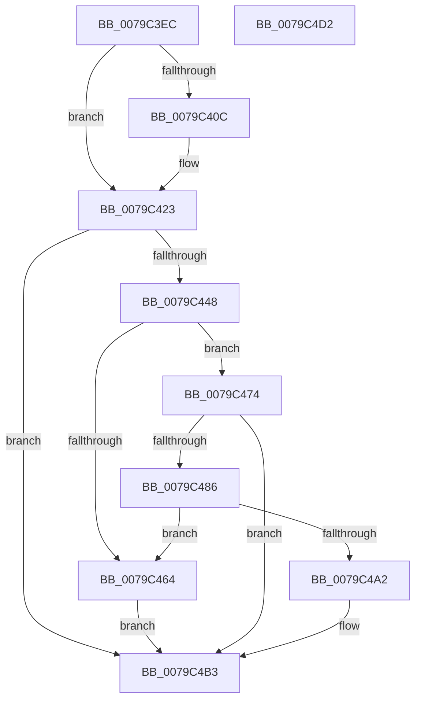

# SeInitServerSilo

- RVA: `0x0079C3EC`–`0x0079C4D3` (길이 `231` bytes)
- VA: `0x000000014079C3EC`
- 실행 섹션: `PAGE`
- PDB 이름 있음: `예`; PDB Function 태그: `아니요`
- unwind 정보 RVA: `0x00066400`
- 디코드: `64`개 명령, `231/231` bytes 표시
- 미해석 바이트: `0` (있으면 어셈블리에 `.byte`로 보존)

> 이 문서는 커널 이미지의 기계어와 PDB 기호를 분석해 생성했습니다. 4번과 5번은 함수 원형과 자료형을 바이너리 사용 방식에서 추정한 C 해석이며 원본 소스 복구 결과는 아닙니다.

## 1. Dependencies

- 직접 호출 지점: **11**; 고유 호출 대상: **9**
- 직접 호출자로 확인된 함수: **1**
- RIP 상대 이미지 참조: **2**

### Outgoing calls
- `0x0079C403` → [PsIsHostSilo](../../text/44/PsIsHostSilo_function_00443B30.md) (function, `0x00443B30`)
- `0x0079C41D` → [KeBugCheckEx](../../text/4F/KeBugCheckEx_function_004FD660.md) (function, `0x004FD660`)
- `0x0079C426` → [PsGetServerSiloGlobals](../../text/22/PsGetServerSiloGlobals_function_002250A0.md) (function, `0x002250A0`)
- `0x0079C42E` → [PsAttachSiloToCurrentThread](../../text/44/PsAttachSiloToCurrentThread_function_004428C0.md) (function, `0x004428C0`)
- `0x0079C43D` → [SepCreateLogonSessionTrack](../A2/SepCreateLogonSessionTrack_function_00A2CD3C.md) (function, `0x00A2CD3C`)
- `0x0079C459` → [SepReferenceLogonSessionSilo](../A3/SepReferenceLogonSessionSilo_function_00A3B784.md) (function, `0x00A3B784`)
- `0x0079C46D` → [SepDeleteLogonSessionTrack](../AA/SepDeleteLogonSessionTrack_function_00AA04E0.md) (function, `0x00AA04E0`)
- `0x0079C47B` → [SepCreateLogonSessionTrack](../A2/SepCreateLogonSessionTrack_function_00A2CD3C.md) (function, `0x00A2CD3C`)
- `0x0079C497` → [SepReferenceLogonSessionSilo](../A3/SepReferenceLogonSessionSilo_function_00A3B784.md) (function, `0x00A3B784`)
- `0x0079C4A2` → [SepInitializationPhase1](SepInitializationPhase1_function_0079C580.md) (function, `0x0079C580`)
- `0x0079C4B6` → [PsDetachSiloFromCurrentThread](../../text/44/PsDetachSiloFromCurrentThread_function_00449AC0.md) (function, `0x00449AC0`)

### Direct callers
- [PspInitializeServerSiloDeferred](../77/PspInitializeServerSiloDeferred_function_0077FEE0.md) at `0x00780064`

### Static image references
- `0x0079C433` → RVA `0x00B4AD18` (`SeSystemAuthenticationId`; read)
- `0x0079C474` → RVA `0x00B4AD00` (`SeAnonymousAuthenticationId`; read)

## 2. Other-region calls and transfers

- 다른 실행 섹션으로 향하는 call: **5**
  - `0x0079C403` → [PsIsHostSilo](../../text/44/PsIsHostSilo_function_00443B30.md) (`PAGE` → `.text`)
  - `0x0079C41D` → [KeBugCheckEx](../../text/4F/KeBugCheckEx_function_004FD660.md) (`PAGE` → `.text`)
  - `0x0079C426` → [PsGetServerSiloGlobals](../../text/22/PsGetServerSiloGlobals_function_002250A0.md) (`PAGE` → `.text`)
  - `0x0079C42E` → [PsAttachSiloToCurrentThread](../../text/44/PsAttachSiloToCurrentThread_function_004428C0.md) (`PAGE` → `.text`)
  - `0x0079C4B6` → [PsDetachSiloFromCurrentThread](../../text/44/PsDetachSiloFromCurrentThread_function_00449AC0.md) (`PAGE` → `.text`)
- 별도 외부 분기/꼬리 이동을 확인하지 못했습니다.

## 3. Assembly (complete function range)

```asm
0079C3EC  48 89 5C 24 08                  mov qword ptr [rsp + 8], rbx
0079C3F1  48 89 6C 24 10                  mov qword ptr [rsp + 0x10], rbp
0079C3F6  48 89 74 24 18                  mov qword ptr [rsp + 0x18], rsi
0079C3FB  57                              push rdi
0079C3FC  48 83 EC 30                     sub rsp, 0x30
0079C400  48 8B F9                        mov rdi, rcx
0079C403  E8 28 77 CA FF                  call 0x140443b30
0079C408  84 C0                           test al, al
0079C40A  74 17                           je 0x14079c423
0079C40C  48 83 64 24 20 00               and qword ptr [rsp + 0x20], 0
0079C412  33 D2                           xor edx, edx
0079C414  45 33 C9                        xor r9d, r9d
0079C417  45 33 C0                        xor r8d, r8d
0079C41A  8D 4A 33                        lea ecx, [rdx + 0x33]
0079C41D  E8 3E 12 D6 FF                  call 0x1404fd660
0079C422  CC                              int3
0079C423  48 8B CF                        mov rcx, rdi
0079C426  E8 75 8C A8 FF                  call 0x1402250a0
0079C42B  48 8B F0                        mov rsi, rax
0079C42E  E8 8D 64 CA FF                  call 0x1404428c0
0079C433  48 8D 0D DE E8 3A 00            lea rcx, [rip + 0x3ae8de]
0079C43A  48 8B E8                        mov rbp, rax
0079C43D  E8 FA 08 29 00                  call 0x140a2cd3c
0079C442  8B D8                           mov ebx, eax
0079C444  85 C0                           test eax, eax
0079C446  78 6B                           js 0x14079c4b3
0079C448  4C 8D 86 E0 02 00 00            lea r8, [rsi + 0x2e0]
0079C44F  48 8B D7                        mov rdx, rdi
0079C452  48 8D 0D BF E8 3A 00            lea rcx, [rip + 0x3ae8bf]
0079C459  E8 26 F3 29 00                  call 0x140a3b784
0079C45E  8B D8                           mov ebx, eax
0079C460  85 C0                           test eax, eax
0079C462  79 10                           jns 0x14079c474
0079C464  33 D2                           xor edx, edx
0079C466  48 8D 0D AB E8 3A 00            lea rcx, [rip + 0x3ae8ab]
0079C46D  E8 6E 40 30 00                  call 0x140aa04e0
0079C472  EB 3F                           jmp 0x14079c4b3
0079C474  48 8D 0D 85 E8 3A 00            lea rcx, [rip + 0x3ae885]
0079C47B  E8 BC 08 29 00                  call 0x140a2cd3c
0079C480  8B D8                           mov ebx, eax
0079C482  85 C0                           test eax, eax
0079C484  78 2D                           js 0x14079c4b3
0079C486  4C 8D 86 E8 02 00 00            lea r8, [rsi + 0x2e8]
0079C48D  48 8B D7                        mov rdx, rdi
0079C490  48 8D 0D 69 E8 3A 00            lea rcx, [rip + 0x3ae869]
0079C497  E8 E8 F2 29 00                  call 0x140a3b784
0079C49C  8B D8                           mov ebx, eax
0079C49E  85 C0                           test eax, eax
0079C4A0  78 C2                           js 0x14079c464
0079C4A2  E8 D9 00 00 00                  call 0x14079c580
0079C4A7  F6 D8                           neg al
0079C4A9  1B DB                           sbb ebx, ebx
0079C4AB  F7 D3                           not ebx
0079C4AD  81 E3 01 00 00 C0               and ebx, 0xc0000001
0079C4B3  48 8B CD                        mov rcx, rbp
0079C4B6  E8 05 D6 CA FF                  call 0x140449ac0
0079C4BB  48 8B 6C 24 48                  mov rbp, qword ptr [rsp + 0x48]
0079C4C0  8B C3                           mov eax, ebx
0079C4C2  48 8B 5C 24 40                  mov rbx, qword ptr [rsp + 0x40]
0079C4C7  48 8B 74 24 50                  mov rsi, qword ptr [rsp + 0x50]
0079C4CC  48 83 C4 30                     add rsp, 0x30
0079C4D0  5F                              pop rdi
0079C4D1  C3                              ret
0079C4D2  CC                              int3
```

## 4. C-style interpretation (structured pseudocode)

```c
__int64 __fastcall SeInitServerSilo(__int64 a1, int a2, int a3, int a4)
{
    __int64 result;
    __int64 v_rbx;
    __int64 v_rsp;
    unsigned __int64 v_stack_m18;
    unsigned __int64 v_stack_p10;
    unsigned __int64 v_stack_p18;
    unsigned __int64 v_stack_p8;

    v_stack_p8 = v_rbx;
    v_stack_p10 = v_rbp;
    v_stack_p18 = v_rsi;
    v_rsp = (v_rsp) - (48);
    result = PsIsHostSilo(a1, a2, a3, a4);
    if ((unsigned __int8)(result) != 0) {
        a2 = 0;
        a4 = 0;
        a3 = 0;
        a1 = a2 + 51;
        result = KeBugCheckEx(a1, a2, a3, a4);
    }
    result = PsGetServerSiloGlobals(a1, a2, a3, a4);
    result = PsAttachSiloToCurrentThread(a1, a2, a3, a4);
    result = SepCreateLogonSessionTrack(v_rip + 3860702, a2, a3, a4);
    if (sign_flag) goto loc_0079C4B3;
    result = SepReferenceLogonSessionSilo(v_rip + 3860671, a1, result + 736, a4);
    if (!sign_flag) goto loc_0079C474;
loc_0079C464:
    a2 = 0;
    result = SepDeleteLogonSessionTrack(v_rip + 3860651, a2, result + 736, a4);
    goto loc_0079C4B3;
loc_0079C474:
    result = SepCreateLogonSessionTrack(v_rip + 3860613, a2, result + 736, a4);
    if (sign_flag) goto loc_0079C4B3;
    result = SepReferenceLogonSessionSilo(v_rip + 3860585, a1, result + 744, a4);
    if (sign_flag) goto loc_0079C464;
    result = SepInitializationPhase1(v_rip + 3860585, a1, result + 744, a4);
    result = (unsigned __int8)(-(result));
    v_rbx = (unsigned int)(~((unsigned int)((unsigned int)(result))));
    v_rbx = (unsigned int)((v_rbx) & (0xC0000001ULL));
loc_0079C4B3:
    result = PsDetachSiloFromCurrentThread(result, a1, result + 744, a4);
    v_rsp = (v_rsp) + (48);
    return (unsigned int)((unsigned int)(v_rbx));
}
```

## 5. (Beta) C Style

```c
int64_t SeInitServerSilo(int64_t Arg1, int32_t Arg2, int32_t Arg3, int32_t Arg4)
{
    int64_t result;
    int64_t local_rbx;
    int64_t local_rsp;
    uint64_t v_stack_m18;
    uint64_t v_stack_p10;
    uint64_t v_stack_p18;
    uint64_t v_stack_p8;

    v_stack_p8 = local_rbx;
    v_stack_p10 = local_rbp;
    v_stack_p18 = local_rsi;
    local_rsp = (local_rsp) - (48);
    result = PsIsHostSilo(Arg1, Arg2, Arg3, Arg4);
    if ((uint8_t)(result) != 0) {
        Arg2 = 0;
        Arg4 = 0;
        Arg3 = 0;
        Arg1 = Arg2 + 51;
        result = KeBugCheckEx(Arg1, Arg2, Arg3, Arg4);
    }
    result = PsGetServerSiloGlobals(Arg1, Arg2, Arg3, Arg4);
    result = PsAttachSiloToCurrentThread(Arg1, Arg2, Arg3, Arg4);
    result = SepCreateLogonSessionTrack(v_rip + 3860702, Arg2, Arg3, Arg4);
    if (sign_flag) goto loc_0079C4B3;
    result = SepReferenceLogonSessionSilo(v_rip + 3860671, Arg1, result + 736, Arg4);
    if (!sign_flag) goto loc_0079C474;
loc_0079C464:
    Arg2 = 0;
    result = SepDeleteLogonSessionTrack(v_rip + 3860651, Arg2, result + 736, Arg4);
    goto loc_0079C4B3;
loc_0079C474:
    result = SepCreateLogonSessionTrack(v_rip + 3860613, Arg2, result + 736, Arg4);
    if (sign_flag) goto loc_0079C4B3;
    result = SepReferenceLogonSessionSilo(v_rip + 3860585, Arg1, result + 744, Arg4);
    if (sign_flag) goto loc_0079C464;
    result = SepInitializationPhase1(v_rip + 3860585, Arg1, result + 744, Arg4);
    result = (uint8_t)(-(result));
    local_rbx = (uint32_t)(~((uint32_t)((uint32_t)(result))));
    local_rbx = (uint32_t)((local_rbx) & (0xC0000001ULL));
loc_0079C4B3:
    result = PsDetachSiloFromCurrentThread(result, Arg1, result + 744, Arg4);
    local_rsp = (local_rsp) + (48);
    return (uint32_t)((uint32_t)(local_rbx));
}
```

## 6. Execution-region graph

[열기: 2D/3D 그래프와 함수 탐색 컨트롤 패널](../../../control-panel.html?section=page&rva=0x0079C3EC&view=graph)

- 2D 그래프는 위에서 아래로 흐르고, 3D 그래프는 빈 공간을 드래그해 회전합니다. Shift+드래그는 이동, 휠은 확대·축소, 함수 노드 선택은 대상 보고서 이동입니다.

### Static fallback


