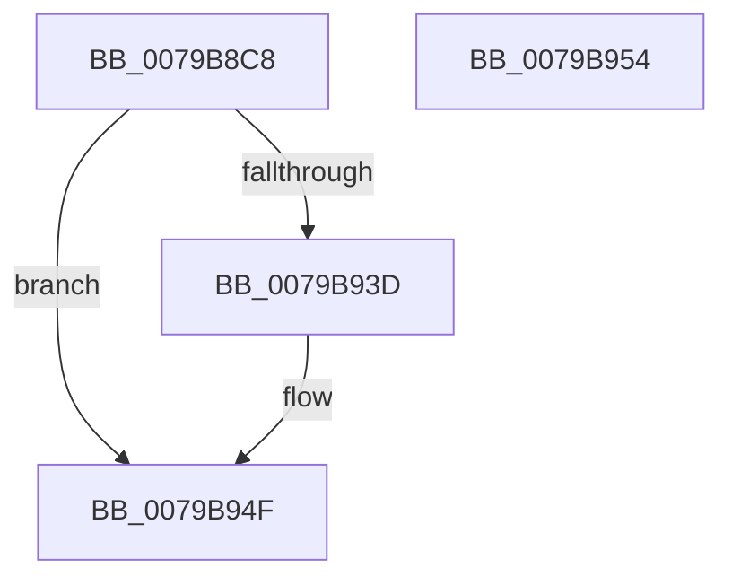

# SeRegisterElamCertResources

- RVA: `0x0079B8C8`–`0x0079B955` (길이 `141` bytes)
- VA: `0x000000014079B8C8`
- 실행 섹션: `PAGE`
- PDB 이름 있음: `예`; PDB Function 태그: `아니요`
- unwind 정보 RVA: `0x000D07C8`
- 디코드: `32`개 명령, `141/141` bytes 표시
- 미해석 바이트: `0` (있으면 어셈블리에 `.byte`로 보존)

> 이 문서는 커널 이미지의 기계어와 PDB 기호를 분석해 생성했습니다. 4번과 5번은 함수 원형과 자료형을 바이너리 사용 방식에서 추정한 C 해석이며 원본 소스 복구 결과는 아닙니다.

## 1. Dependencies

- 직접 호출 지점: **2**; 고유 호출 대상: **2**
- 직접 호출자로 확인된 함수: **2**
- RIP 상대 이미지 참조: **2**

### Outgoing calls
- `0x0079B934` → [LdrResSearchResource](../98/LdrResSearchResource_function_0098F7A0.md) (function, `0x0098F7A0`)
- `0x0079B94A` → [SepParseElamCertResources](../AA/SepParseElamCertResources_function_00AAC43C.md) (function, `0x00AAC43C`)

### Direct callers
- [ExpQueryElamCertInfo](../7C/ExpQueryElamCertInfo_function_007C4564.md) at `0x007C479F`
- [PipInitializeEarlyLaunchDrivers](../../init/C7/PipInitializeEarlyLaunchDrivers_function_00C74288.md) at `0x00C742DD`

### Static image references
- `0x0079B8DC` → RVA `0x00B05CF0` (` ?? ::NNGAKEGL::`string'`; read)
- `0x0079B8F8` → RVA `0x00B05C20` (` ?? ::NNGAKEGL::`string'`; read)

## 2. Other-region calls and transfers

- 다른 실행 섹션으로 향하는 call: **0**
- 별도 외부 분기/꼬리 이동을 확인하지 못했습니다.

## 3. Assembly (complete function range)

```asm
0079B8C8  4C 8B DC                        mov r11, rsp
0079B8CB  4D 89 4B 20                     mov qword ptr [r11 + 0x20], r9
0079B8CF  49 89 53 10                     mov qword ptr [r11 + 0x10], rdx
0079B8D3  48 83 EC 68                     sub rsp, 0x68
0079B8D7  49 83 63 10 00                  and qword ptr [r11 + 0x10], 0
0079B8DC  48 8D 05 0D A4 36 00            lea rax, [rip + 0x36a40d]
0079B8E3  49 83 63 20 00                  and qword ptr [r11 + 0x20], 0
0079B8E8  49 8D 53 D8                     lea rdx, [r11 - 0x28]
0079B8EC  49 83 63 E8 00                  and qword ptr [r11 - 0x18], 0
0079B8F1  49 89 43 D8                     mov qword ptr [r11 - 0x28], rax
0079B8F5  41 F6 D8                        neg r8b
0079B8F8  48 8D 05 21 A3 36 00            lea rax, [rip + 0x36a321]
0079B8FF  41 B8 03 00 00 00               mov r8d, 3
0079B905  45 1B C9                        sbb r9d, r9d
0079B908  49 89 43 E0                     mov qword ptr [r11 - 0x20], rax
0079B90C  49 83 63 D0 00                  and qword ptr [r11 - 0x30], 0
0079B911  49 8D 43 20                     lea rax, [r11 + 0x20]
0079B915  49 83 63 C8 00                  and qword ptr [r11 - 0x38], 0
0079B91A  41 81 E1 00 02 00 00            and r9d, 0x200
0079B921  49 89 43 C0                     mov qword ptr [r11 - 0x40], rax
0079B925  41 81 C1 10 10 00 00            add r9d, 0x1010
0079B92C  49 8D 43 10                     lea rax, [r11 + 0x10]
0079B930  49 89 43 B8                     mov qword ptr [r11 - 0x48], rax
0079B934  E8 67 3E 1F 00                  call 0x14098f7a0
0079B939  85 C0                           test eax, eax
0079B93B  78 12                           js 0x14079b94f
0079B93D  48 8B 94 24 88 00 00 00         mov rdx, qword ptr [rsp + 0x88]
0079B945  48 8B 4C 24 78                  mov rcx, qword ptr [rsp + 0x78]
0079B94A  E8 ED 0A 31 00                  call 0x140aac43c
0079B94F  48 83 C4 68                     add rsp, 0x68
0079B953  C3                              ret
0079B954  CC                              int3
```

## 4. C-style interpretation (structured pseudocode)

```c
__int64 __fastcall SeRegisterElamCertResources(__int64 a1, __int64 a2, unsigned __int8 a3, __int64 a4)
{
    __int64 result;
    __int64 v_rsp;
    unsigned __int64 v_stack_p10;
    unsigned __int64 v_stack_p20;

    *(unsigned __int64 *)(v_rsp + 32) = a4;
    *(unsigned __int64 *)(v_rsp + 16) = a2;
    v_rsp = (v_rsp) - (104);
    *(unsigned __int64 *)(v_rsp - 40) = v_rip + 3580941;
    a3 = (unsigned __int8)(-(a3));
    *(unsigned __int64 *)(v_rsp - 32) = v_rip + 3580705;
    a4 = (unsigned int)((a4) & (512));
    *(unsigned __int64 *)(v_rsp - 64) = v_rsp + 32;
    a4 = (unsigned int)((a4) + (0x1010ULL));
    *(unsigned __int64 *)(v_rsp - 72) = v_rsp + 16;
    result = LdrResSearchResource(a1, v_rsp - 40, 3, a4);
    if (!(sign_flag)) {
        a2 = v_stack_p20;
        a1 = v_stack_p10;
        result = SepParseElamCertResources(a1, a2, 3, a4);
    }
    v_rsp = (v_rsp) + (104);
    return result;
}
```

## 5. (Beta) C Style

```c
int64_t SeRegisterElamCertResources(int64_t Arg1, int64_t Arg2, uint8_t Arg3, int64_t Arg4)
{
    int64_t result;
    int64_t local_rsp;
    uint64_t v_stack_p10;
    uint64_t v_stack_p20;

    *(uint64_t *)(local_rsp + 0x20) = Arg4;
    *(uint64_t *)(local_rsp + 0x10) = Arg2;
    local_rsp = (local_rsp) - (104);
    *(uint64_t *)(local_rsp - 0x28) = v_rip + 3580941;
    Arg3 = (uint8_t)(-(Arg3));
    *(uint64_t *)(local_rsp - 0x20) = v_rip + 3580705;
    Arg4 = (uint32_t)((Arg4) & (512));
    *(uint64_t *)(local_rsp - 0x40) = local_rsp + 32;
    Arg4 = (uint32_t)((Arg4) + (0x1010ULL));
    *(uint64_t *)(local_rsp - 0x48) = local_rsp + 16;
    result = LdrResSearchResource(Arg1, local_rsp - 40, 3, Arg4);
    if (!(sign_flag)) {
        Arg2 = v_stack_p20;
        Arg1 = v_stack_p10;
        result = SepParseElamCertResources(Arg1, Arg2, 3, Arg4);
    }
    local_rsp = (local_rsp) + (104);
    return result;
}
```

## 6. Execution-region graph

[열기: 2D/3D 그래프와 함수 탐색 컨트롤 패널](../../../control-panel.html?section=page&rva=0x0079B8C8&view=graph)

- 2D 그래프는 위에서 아래로 흐르고, 3D 그래프는 빈 공간을 드래그해 회전합니다. Shift+드래그는 이동, 휠은 확대·축소, 함수 노드 선택은 대상 보고서 이동입니다.

### Static fallback


