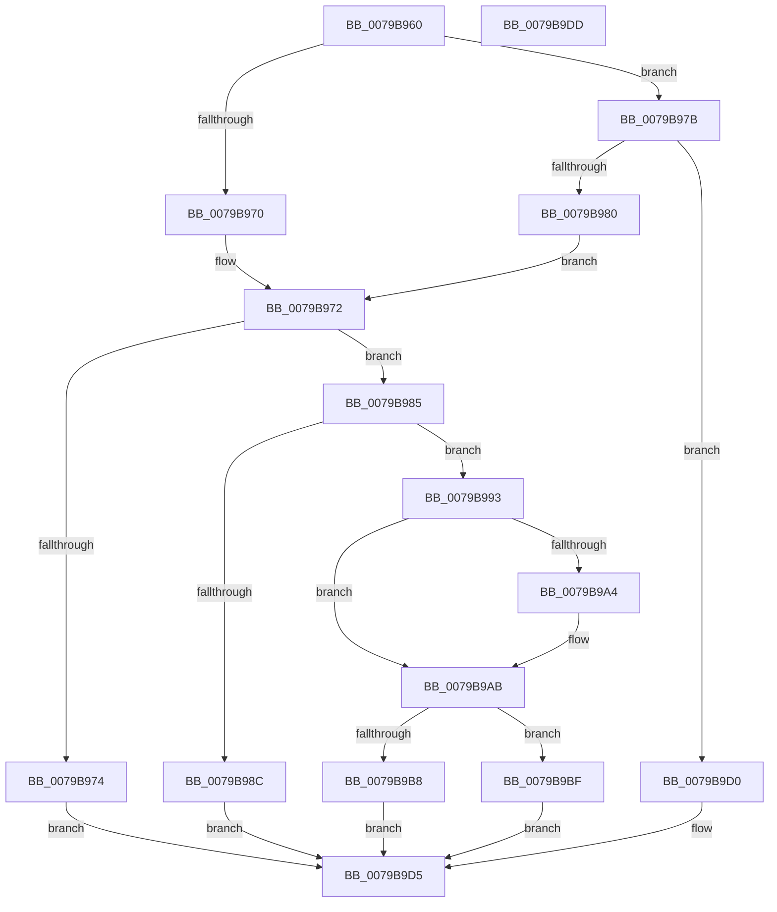

# SeRegisterImageVerificationCallback

- RVA: `0x0079B960`–`0x0079B9DE` (길이 `126` bytes)
- VA: `0x000000014079B960`
- 실행 섹션: `PAGE`
- PDB 이름 있음: `예`; PDB Function 태그: `아니요`
- unwind 정보 RVA: `0x0005CF00`
- 디코드: `40`개 명령, `126/126` bytes 표시
- 미해석 바이트: `0` (있으면 어셈블리에 `.byte`로 보존)

> 이 문서는 커널 이미지의 기계어와 PDB 기호를 분석해 생성했습니다. 4번과 5번은 함수 원형과 자료형을 바이너리 사용 방식에서 추정한 C 해석이며 원본 소스 복구 결과는 아닙니다.

## 1. Dependencies

- 직접 호출 지점: **1**; 고유 호출 대상: **1**
- 직접 호출자로 확인된 함수: **0**
- RIP 상대 이미지 참조: **3**

### Outgoing calls
- `0x0079B9AB` → [ExRegisterCallback](../../text/4B/ExRegisterCallback_function_004BDFC0.md) (function, `0x004BDFC0`)

### Direct callers
- 이 함수 시작 RVA로 연결되는 직접 call은 확인되지 않았습니다. 간접 호출은 완전히 역산할 수 없습니다.

### Static image references
- `0x0079B993` → RVA `0x00EFED88` (`.data`; read)
- `0x0079B9A4` → RVA `0x00EFED80` (`.data`; read)
- `0x0079B9BF` → RVA `0x00E67D68` (`.data`; read/write)

## 2. Other-region calls and transfers

- 다른 실행 섹션으로 향하는 call: **1**
  - `0x0079B9AB` → [ExRegisterCallback](../../text/4B/ExRegisterCallback_function_004BDFC0.md) (`PAGE` → `.text`)
- 별도 외부 분기/꼬리 이동을 확인하지 못했습니다.

## 3. Assembly (complete function range)

```asm
0079B960  40 53                           push rbx
0079B962  48 83 EC 20                     sub rsp, 0x20
0079B966  33 DB                           xor ebx, ebx
0079B968  49 8B C0                        mov rax, r8
0079B96B  83 F9 01                        cmp ecx, 1
0079B96E  75 0B                           jne 0x14079b97b
0079B970  85 D2                           test edx, edx
0079B972  74 11                           je 0x14079b985
0079B974  BB F0 00 00 C0                  mov ebx, 0xc00000f0
0079B979  EB 5A                           jmp 0x14079b9d5
0079B97B  83 F9 04                        cmp ecx, 4
0079B97E  75 50                           jne 0x14079b9d0
0079B980  83 FA 01                        cmp edx, 1
0079B983  EB ED                           jmp 0x14079b972
0079B985  48 39 5C 24 50                  cmp qword ptr [rsp + 0x50], rbx
0079B98A  74 07                           je 0x14079b993
0079B98C  BB F3 00 00 C0                  mov ebx, 0xc00000f3
0079B991  EB 42                           jmp 0x14079b9d5
0079B993  48 8B 0D EE 33 76 00            mov rcx, qword ptr [rip + 0x7633ee]
0079B99A  85 D2                           test edx, edx
0079B99C  48 8B D0                        mov rdx, rax
0079B99F  4D 8B C1                        mov r8, r9
0079B9A2  74 07                           je 0x14079b9ab
0079B9A4  48 8B 0D D5 33 76 00            mov rcx, qword ptr [rip + 0x7633d5]
0079B9AB  E8 10 26 D2 FF                  call 0x1404bdfc0
0079B9B0  48 8B C8                        mov rcx, rax
0079B9B3  48 85 C0                        test rax, rax
0079B9B6  75 07                           jne 0x14079b9bf
0079B9B8  BB 17 00 00 C0                  mov ebx, 0xc0000017
0079B9BD  EB 16                           jmp 0x14079b9d5
0079B9BF  F0 FF 05 A2 C3 6C 00            lock inc dword ptr [rip + 0x6cc3a2]
0079B9C6  48 8B 44 24 58                  mov rax, qword ptr [rsp + 0x58]
0079B9CB  48 89 08                        mov qword ptr [rax], rcx
0079B9CE  EB 05                           jmp 0x14079b9d5
0079B9D0  BB EF 00 00 C0                  mov ebx, 0xc00000ef
0079B9D5  8B C3                           mov eax, ebx
0079B9D7  48 83 C4 20                     add rsp, 0x20
0079B9DB  5B                              pop rbx
0079B9DC  C3                              ret
0079B9DD  CC                              int3
```

## 4. C-style interpretation (structured pseudocode)

```c
__int64 __fastcall SeRegisterImageVerificationCallback(int a1, int a2, __int64 a3, __int64 a4, __int64 a5, __int64 a6)
{
    __int64 result;
    __int64 v_rbx;
    __int64 v_rsp;

    v_rsp = (v_rsp) - (32);
    v_rbx = 0;
    if (a1 != 1) goto loc_0079B97B;
loc_0079B972:
    if (a2 == 0) goto loc_0079B985;
    goto loc_0079B9D5;
loc_0079B97B:
    if (a1 != 4) goto loc_0079B9D0;
    goto loc_0079B972;
loc_0079B985:
    if (a5 == ((unsigned int)(0xC00000F0ULL))) goto loc_0079B993;
    goto loc_0079B9D5;
loc_0079B993:
    if (a2 != 0) {
        a1 = *(unsigned __int64 *)(v_rip + 7746517);
    }
    result = ExRegisterCallback(a1, a3, a4, a4);
    if (result != 0) goto loc_0079B9BF;
    goto loc_0079B9D5;
loc_0079B9BF:
    *(unsigned __int64 *)(a6) = result;
    goto loc_0079B9D5;
loc_0079B9D0:
loc_0079B9D5:
    v_rsp = (v_rsp) + (32);
    return (unsigned int)((unsigned int)((unsigned int)(0xC00000EFULL)));
}
```

## 5. (Beta) C Style

```c
int64_t SeRegisterImageVerificationCallback(int32_t Arg1, int32_t Arg2, int64_t Arg3, int64_t Arg4, int64_t Arg5, void *Arg6)
{
    uint8_t *arg6 = (uint8_t *)Arg6;

    int64_t result;
    int64_t local_rbx;
    int64_t local_rsp;

    local_rsp = (local_rsp) - (32);
    local_rbx = 0;
    if (Arg1 != 1) goto loc_0079B97B;
loc_0079B972:
    if (Arg2 == 0) goto loc_0079B985;
    goto loc_0079B9D5;
loc_0079B97B:
    if (Arg1 != 4) goto loc_0079B9D0;
    goto loc_0079B972;
loc_0079B985:
    if (Arg5 == ((uint32_t)(0xC00000F0ULL))) goto loc_0079B993;
    goto loc_0079B9D5;
loc_0079B993:
    if (Arg2 != 0) {
        Arg1 = *(uint64_t *)(v_rip + 0x7633D5);
    }
    result = ExRegisterCallback(Arg1, Arg3, Arg4, Arg4);
    if (result != 0) goto loc_0079B9BF;
    goto loc_0079B9D5;
loc_0079B9BF:
    *(uint64_t *)(arg6) = result;
    goto loc_0079B9D5;
loc_0079B9D0:
loc_0079B9D5:
    local_rsp = (local_rsp) + (32);
    return (uint32_t)((uint32_t)((uint32_t)(0xC00000EFULL)));
}
```

### 관측된 메모리 오프셋

구조체 형식이 확인되지 않은 접근은 인자 기준의 오프셋으로만 기록했습니다.

| 기준 인자 | 오프셋 표현 | 폭 (bit) | 접근 |
|---|---:|---:|---|
| `Arg6` | `+ 0x0` | `64` | `W` |

## 6. Execution-region graph

[열기: 2D/3D 그래프와 함수 탐색 컨트롤 패널](../../../control-panel.html?section=page&rva=0x0079B960&view=graph)

- 2D 그래프는 위에서 아래로 흐르고, 3D 그래프는 빈 공간을 드래그해 회전합니다. Shift+드래그는 이동, 휠은 확대·축소, 함수 노드 선택은 대상 보고서 이동입니다.

### Static fallback


