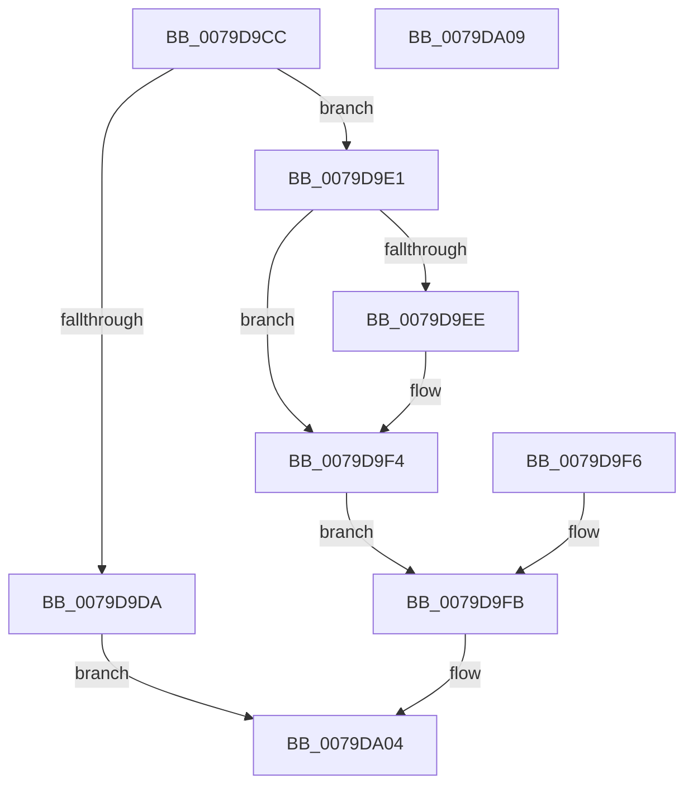

# SeSecurityModelQueryInformation

- RVA: `0x0079D9CC`–`0x0079DA0A` (길이 `62` bytes)
- VA: `0x000000014079D9CC`
- 실행 섹션: `PAGE`
- PDB 이름 있음: `예`; PDB Function 태그: `아니요`
- unwind 정보 RVA: `0x000D1004`
- 디코드: `19`개 명령, `62/62` bytes 표시
- 미해석 바이트: `0` (있으면 어셈블리에 `.byte`로 보존)

> 이 문서는 커널 이미지의 기계어와 PDB 기호를 분석해 생성했습니다. 4번과 5번은 함수 원형과 자료형을 바이너리 사용 방식에서 추정한 C 해석이며 원본 소스 복구 결과는 아닙니다.

## 1. Dependencies

- 직접 호출 지점: **1**; 고유 호출 대상: **1**
- 직접 호출자로 확인된 함수: **1**
- RIP 상대 이미지 참조: **0**

### Outgoing calls
- `0x0079D9E5` → [SepIsDeviceOwnerProtectionDowngradeAllowed](../../text/60/SepIsDeviceOwnerProtectionDowngradeAllowed_function_006093D8.md) (function, `0x006093D8`)

### Direct callers
- [ExpQuerySystemInformation](../A5/ExpQuerySystemInformation_function_00A57858.md) at `0x00A5B039`

### Static image references
- 디코드된 RIP-relative 메모리 참조가 없습니다.

## 2. Other-region calls and transfers

- 다른 실행 섹션으로 향하는 call: **1**
  - `0x0079D9E5` → [SepIsDeviceOwnerProtectionDowngradeAllowed](../../text/60/SepIsDeviceOwnerProtectionDowngradeAllowed_function_006093D8.md) (`PAGE` → `.text`)
- 별도 외부 분기/꼬리 이동을 확인하지 못했습니다.

## 3. Assembly (complete function range)

```asm
0079D9CC  4C 89 44 24 18                  mov qword ptr [rsp + 0x18], r8
0079D9D1  48 83 EC 38                     sub rsp, 0x38
0079D9D5  83 FA 04                        cmp edx, 4
0079D9D8  74 07                           je 0x14079d9e1
0079D9DA  B8 04 00 00 C0                  mov eax, 0xc0000004
0079D9DF  EB 23                           jmp 0x14079da04
0079D9E1  33 C0                           xor eax, eax
0079D9E3  89 01                           mov dword ptr [rcx], eax
0079D9E5  E8 EE B9 E6 FF                  call 0x1406093d8
0079D9EA  84 C0                           test al, al
0079D9EC  74 06                           je 0x14079d9f4
0079D9EE  C7 01 02 00 00 00               mov dword ptr [rcx], 2
0079D9F4  EB 05                           jmp 0x14079d9fb
0079D9F6  4C 8B 44 24 50                  mov r8, qword ptr [rsp + 0x50]
0079D9FB  41 C7 00 04 00 00 00            mov dword ptr [r8], 4
0079DA02  33 C0                           xor eax, eax
0079DA04  48 83 C4 38                     add rsp, 0x38
0079DA08  C3                              ret
0079DA09  CC                              int3
```

## 4. C-style interpretation (structured pseudocode)

```c
__int64 __fastcall SeSecurityModelQueryInformation(__int64 a1, int a2, __int64 a3)
{
    __int64 result;
    __int64 v_rsp;
    unsigned __int64 v_stack_p18;

    v_stack_p18 = a3;
    v_rsp = (v_rsp) - (56);
    if (a2 == 4) goto loc_0079D9E1;
    goto loc_0079DA04;
loc_0079D9E1:
    result = 0;
    *(unsigned int *)(a1) = 0;
    result = SepIsDeviceOwnerProtectionDowngradeAllowed(a1, a2, a3, a4);
    if ((unsigned __int8)(result) != 0) {
        *(unsigned int *)(a1) = 2;
    }
    goto loc_0079D9FB;
loc_0079D9FB:
    *(unsigned int *)(a3) = 4;
    result = 0;
loc_0079DA04:
    v_rsp = (v_rsp) + (56);
    return result;
}
```

## 5. (Beta) C Style

```c
int64_t SeSecurityModelQueryInformation(void *Arg1, int32_t Arg2, int64_t Arg3)
{
    uint8_t *arg1 = (uint8_t *)Arg1;

    int64_t result;
    int64_t local_rsp;
    uint64_t v_stack_p18;

    v_stack_p18 = Arg3;
    local_rsp = (local_rsp) - (56);
    if (Arg2 == 4) goto loc_0079D9E1;
    goto loc_0079DA04;
loc_0079D9E1:
    result = 0;
    *(uint32_t *)(arg1) = 0;
    result = SepIsDeviceOwnerProtectionDowngradeAllowed(Arg1, Arg2, Arg3, a4);
    if ((uint8_t)(result) != 0) {
        *(uint32_t *)(arg1) = 2;
    }
    goto loc_0079D9FB;
loc_0079D9FB:
    *(uint32_t *)(Arg3) = 4;
    result = 0;
loc_0079DA04:
    local_rsp = (local_rsp) + (56);
    return result;
}
```

### 관측된 메모리 오프셋

구조체 형식이 확인되지 않은 접근은 인자 기준의 오프셋으로만 기록했습니다.

| 기준 인자 | 오프셋 표현 | 폭 (bit) | 접근 |
|---|---:|---:|---|
| `Arg1` | `+ 0x0` | `32` | `W` |

## 6. Execution-region graph

[열기: 2D/3D 그래프와 함수 탐색 컨트롤 패널](../../../control-panel.html?section=page&rva=0x0079D9CC&view=graph)

- 2D 그래프는 위에서 아래로 흐르고, 3D 그래프는 빈 공간을 드래그해 회전합니다. Shift+드래그는 이동, 휠은 확대·축소, 함수 노드 선택은 대상 보고서 이동입니다.

### Static fallback


