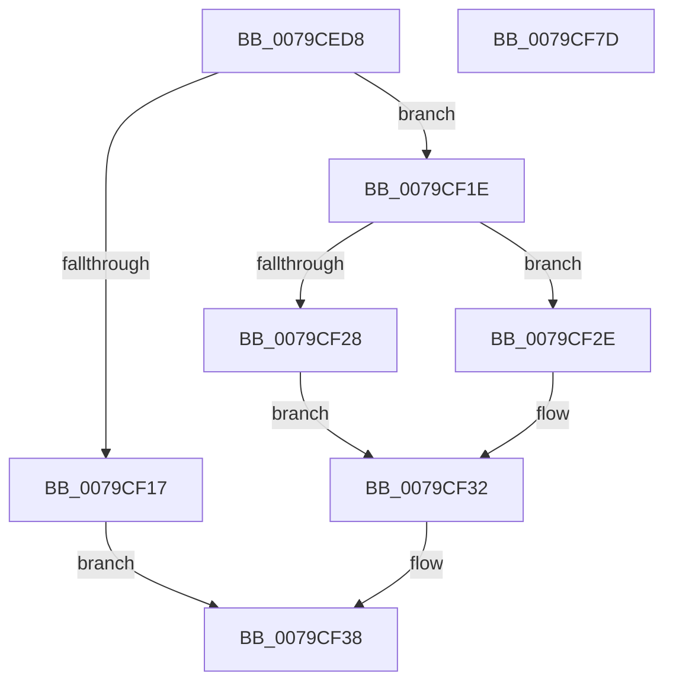

# SeSetPrivateNameSpaceToken

- RVA: `0x0079CED8`–`0x0079CF7E` (길이 `166` bytes)
- VA: `0x000000014079CED8`
- 실행 섹션: `PAGE`
- PDB 이름 있음: `예`; PDB Function 태그: `아니요`
- unwind 정보 RVA: `0x00060BC4`
- 디코드: `43`개 명령, `166/166` bytes 표시
- 미해석 바이트: `0` (있으면 어셈블리에 `.byte`로 보존)

> 이 문서는 커널 이미지의 기계어와 PDB 기호를 분석해 생성했습니다. 4번과 5번은 함수 원형과 자료형을 바이너리 사용 방식에서 추정한 C 해석이며 원본 소스 복구 결과는 아닙니다.

## 1. Dependencies

- 직접 호출 지점: **3**; 고유 호출 대상: **3**
- 직접 호출자로 확인된 함수: **1**
- RIP 상대 이미지 참조: **2**

### Outgoing calls
- `0x0079CF05` → [ExAcquireResourceExclusiveLite](../../text/21/ExAcquireResourceExclusiveLite_function_00214E20.md) (function, `0x00214E20`)
- `0x0079CF61` → [ExReleaseResourceLite](../../text/25/ExReleaseResourceLite_function_0025FA10.md) (function, `0x0025FA10`)
- `0x0079CF66` → [KeLeaveCriticalRegion](../../text/25/KeLeaveCriticalRegion_function_0025D8B0.md) (function, `0x0025D8B0`)

### Direct callers
- [NtSetInformationToken](../AF/NtSetInformationToken_function_00AF0530.md) at `0x00AF1505`

### Static image references
- `0x0079CF38` → RVA `0x00012D08` (`.rdata`; read)
- `0x0079CF42` → RVA `0x00E0EBF0` (`.data`; read/write)

## 2. Other-region calls and transfers

- 다른 실행 섹션으로 향하는 call: **3**
  - `0x0079CF05` → [ExAcquireResourceExclusiveLite](../../text/21/ExAcquireResourceExclusiveLite_function_00214E20.md) (`PAGE` → `.text`)
  - `0x0079CF61` → [ExReleaseResourceLite](../../text/25/ExReleaseResourceLite_function_0025FA10.md) (`PAGE` → `.text`)
  - `0x0079CF66` → [KeLeaveCriticalRegion](../../text/25/KeLeaveCriticalRegion_function_0025D8B0.md) (`PAGE` → `.text`)
- 별도 외부 분기/꼬리 이동을 확인하지 못했습니다.

## 3. Assembly (complete function range)

```asm
0079CED8  48 89 5C 24 08                  mov qword ptr [rsp + 8], rbx
0079CEDD  48 89 74 24 10                  mov qword ptr [rsp + 0x10], rsi
0079CEE2  57                              push rdi
0079CEE3  48 83 EC 20                     sub rsp, 0x20
0079CEE7  65 48 8B 04 25 88 01 00 00      mov rax, qword ptr gs:[0x188]
0079CEF0  8B F2                           mov esi, edx
0079CEF2  48 8B D9                        mov rbx, rcx
0079CEF5  33 FF                           xor edi, edi
0079CEF7  B2 01                           mov dl, 1
0079CEF9  66 FF 88 E4 01 00 00            dec word ptr [rax + 0x1e4]
0079CF00  90                              nop
0079CF01  48 8B 49 30                     mov rcx, qword ptr [rcx + 0x30]
0079CF05  E8 16 7F A7 FF                  call 0x140214e20
0079CF0A  F0 09 3C 24                     lock or dword ptr [rsp], edi
0079CF0E  40 38 BB CC 00 00 00            cmp byte ptr [rbx + 0xcc], dil
0079CF15  74 07                           je 0x14079cf1e
0079CF17  BF 2B 01 00 C0                  mov edi, 0xc000012b
0079CF1C  EB 1A                           jmp 0x14079cf38
0079CF1E  8B 83 C8 00 00 00               mov eax, dword ptr [rbx + 0xc8]
0079CF24  85 F6                           test esi, esi
0079CF26  74 06                           je 0x14079cf2e
0079CF28  0F BA E8 10                     bts eax, 0x10
0079CF2C  EB 04                           jmp 0x14079cf32
0079CF2E  0F BA F0 10                     btr eax, 0x10
0079CF32  89 83 C8 00 00 00               mov dword ptr [rbx + 0xc8], eax
0079CF38  48 8B 15 C9 5D 87 FF            mov rdx, qword ptr [rip - 0x78a237]
0079CF3F  48 8B CA                        mov rcx, rdx
0079CF42  F0 48 0F C1 0D A5 1C 67 00      lock xadd qword ptr [rip + 0x671ca5], rcx
0079CF4B  48 03 CA                        add rcx, rdx
0079CF4E  89 4B 38                        mov dword ptr [rbx + 0x38], ecx
0079CF51  48 C1 E9 20                     shr rcx, 0x20
0079CF55  89 4B 3C                        mov dword ptr [rbx + 0x3c], ecx
0079CF58  F0 83 0C 24 00                  lock or dword ptr [rsp], 0
0079CF5D  48 8B 4B 30                     mov rcx, qword ptr [rbx + 0x30]
0079CF61  E8 AA 2A AC FF                  call 0x14025fa10
0079CF66  E8 45 09 AC FF                  call 0x14025d8b0
0079CF6B  48 8B 5C 24 30                  mov rbx, qword ptr [rsp + 0x30]
0079CF70  8B C7                           mov eax, edi
0079CF72  48 8B 74 24 38                  mov rsi, qword ptr [rsp + 0x38]
0079CF77  48 83 C4 20                     add rsp, 0x20
0079CF7B  5F                              pop rdi
0079CF7C  C3                              ret
0079CF7D  CC                              int3
```

## 4. C-style interpretation (structured pseudocode)

```c
__int64 __fastcall SeSetPrivateNameSpaceToken(__int64 a1, int a2)
{
    __int64 result;
    __int64 v_rdi;
    __int64 v_rsp;
    unsigned int v_stack_m28;
    unsigned __int64 v_stack_p10;
    unsigned __int64 v_stack_p8;

    v_stack_p8 = v_rbx;
    v_stack_p10 = v_rsi;
    v_rsp = (v_rsp) - (32);
    v_rdi = 0;
    result = ExAcquireResourceExclusiveLite(*(unsigned __int64 *)(a1 + 48), 1, a3, a4);
    if ((*(unsigned __int8 *)(a1 + 204)) == 0) goto loc_0079CF1E;
    goto loc_0079CF38;
loc_0079CF1E:
    if ((unsigned int)((unsigned int)(a2)) == 0) goto loc_0079CF2E;
    goto loc_0079CF32;
loc_0079CF2E:
loc_0079CF32:
    *(unsigned int *)(a1 + 200) = (unsigned int)((unsigned int)(*(unsigned int *)(a1 + 200)));
loc_0079CF38:
    a1 = (*(unsigned __int64 *)(v_rip - 7905847)) + (*(unsigned __int64 *)(v_rip - 7905847));
    *(unsigned int *)(a1 + 56) = (unsigned int)(a1);
    a1 = (a1) >> (32);
    *(unsigned int *)(a1 + 60) = (unsigned int)(a1);
    result = ExReleaseResourceLite(*(unsigned __int64 *)(a1 + 48), *(unsigned __int64 *)(v_rip - 7905847), a3, a4);
    result = KeLeaveCriticalRegion(*(unsigned __int64 *)(a1 + 48), *(unsigned __int64 *)(v_rip - 7905847), a3, a4);
    v_rsp = (v_rsp) + (32);
    return (unsigned int)((unsigned int)((unsigned int)(0xC000012BULL)));
}
```

## 5. (Beta) C Style

```c
int64_t SeSetPrivateNameSpaceToken(void *Arg1, int32_t Arg2)
{
    uint8_t *arg1 = (uint8_t *)Arg1;

    int64_t result;
    int64_t local_rdi;
    int64_t local_rsp;
    uint32_t v_stack_m28;
    uint64_t v_stack_p10;
    uint64_t v_stack_p8;

    v_stack_p8 = local_rbx;
    v_stack_p10 = local_rsi;
    local_rsp = (local_rsp) - (32);
    local_rdi = 0;
    result = ExAcquireResourceExclusiveLite(*(uint64_t *)(arg1 + 0x30), 1, a3, a4);
    if ((*(uint8_t *)(arg1 + 0xCC)) == 0) goto loc_0079CF1E;
    goto loc_0079CF38;
loc_0079CF1E:
    if ((uint32_t)((uint32_t)(Arg2)) == 0) goto loc_0079CF2E;
    goto loc_0079CF32;
loc_0079CF2E:
loc_0079CF32:
    *(uint32_t *)(arg1 + 0xC8) = (uint32_t)((uint32_t)(*(uint32_t *)(arg1 + 0xC8)));
loc_0079CF38:
    Arg1 = (*(uint64_t *)(v_rip - 0x78A237)) + (*(uint64_t *)(v_rip - 0x78A237));
    *(uint32_t *)(arg1 + 0x38) = (uint32_t)(Arg1);
    Arg1 = (Arg1) >> (32);
    *(uint32_t *)(arg1 + 0x3C) = (uint32_t)(Arg1);
    result = ExReleaseResourceLite(*(uint64_t *)(arg1 + 0x30), *(uint64_t *)(v_rip - 0x78A237), a3, a4);
    result = KeLeaveCriticalRegion(*(uint64_t *)(arg1 + 0x30), *(uint64_t *)(v_rip - 0x78A237), a3, a4);
    local_rsp = (local_rsp) + (32);
    return (uint32_t)((uint32_t)((uint32_t)(0xC000012BULL)));
}
```

### 관측된 메모리 오프셋

구조체 형식이 확인되지 않은 접근은 인자 기준의 오프셋으로만 기록했습니다.

| 기준 인자 | 오프셋 표현 | 폭 (bit) | 접근 |
|---|---:|---:|---|
| `Arg1` | `+ 0x30` | `64` | `R` |
| `Arg1` | `+ 0x38` | `32` | `W` |
| `Arg1` | `+ 0x3C` | `32` | `W` |
| `Arg1` | `+ 0xC8` | `32` | `R` |
| `Arg1` | `+ 0xC8` | `32` | `W` |
| `Arg1` | `+ 0xCC` | `8` | `R` |

## 6. Execution-region graph

[열기: 2D/3D 그래프와 함수 탐색 컨트롤 패널](../../../control-panel.html?section=page&rva=0x0079CED8&view=graph)

- 2D 그래프는 위에서 아래로 흐르고, 3D 그래프는 빈 공간을 드래그해 회전합니다. Shift+드래그는 이동, 휠은 확대·축소, 함수 노드 선택은 대상 보고서 이동입니다.

### Static fallback


