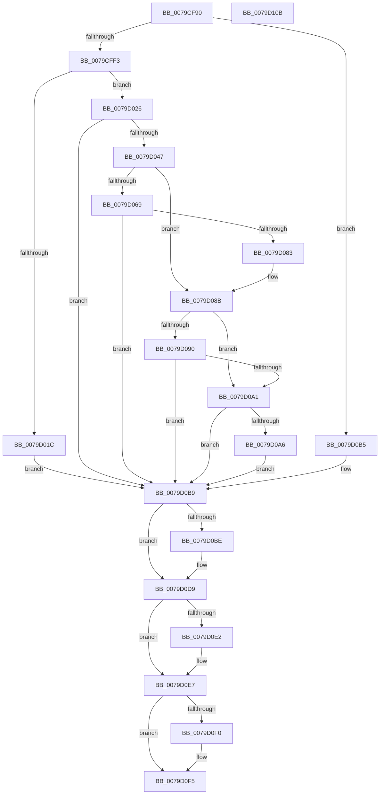

# SeSetSessionIdTokenWithLinked

- RVA: `0x0079CF90`–`0x0079D10C` (길이 `380` bytes)
- VA: `0x000000014079CF90`
- 실행 섹션: `PAGE`
- PDB 이름 있음: `예`; PDB Function 태그: `아니요`
- unwind 정보 RVA: `0x000D0D40`
- 디코드: `106`개 명령, `380/380` bytes 표시
- 미해석 바이트: `0` (있으면 어셈블리에 `.byte`로 보존)

> 이 문서는 커널 이미지의 기계어와 PDB 기호를 분석해 생성했습니다. 4번과 5번은 함수 원형과 자료형을 바이너리 사용 방식에서 추정한 C 해석이며 원본 소스 복구 결과는 아닙니다.

## 1. Dependencies

- 직접 호출 지점: **11**; 고유 호출 대상: **8**
- 직접 호출자로 확인된 함수: **0**
- RIP 상대 이미지 참조: **0**

### Outgoing calls
- `0x0079CFE4` → [SepReferenceTokenByHandle](../../text/3E/SepReferenceTokenByHandle_function_003EDAD0.md) (function, `0x003EDAD0`)
- `0x0079D00E` → [ExAcquireResourceSharedLite](../../text/21/ExAcquireResourceSharedLite_function_00211BC0.md) (function, `0x00211BC0`)
- `0x0079D03C` → [SepReferenceLogonSessionSilo](../A3/SepReferenceLogonSessionSilo_function_00A3B784.md) (function, `0x00A3B784`)
- `0x0079D078` → [SepReferenceLogonSessionSilo](../A3/SepReferenceLogonSessionSilo_function_00A3B784.md) (function, `0x00A3B784`)
- `0x0079D096` → [SeSetSessionIdToken](../AF/SeSetSessionIdToken_function_00AF1F0C.md) (function, `0x00AF1F0C`)
- `0x0079D0AC` → [SeSetSessionIdToken](../AF/SeSetSessionIdToken_function_00AF1F0C.md) (function, `0x00AF1F0C`)
- `0x0079D0C2` → [ExReleaseResourceLite](../../text/25/ExReleaseResourceLite_function_0025FA10.md) (function, `0x0025FA10`)
- `0x0079D0C7` → [KeLeaveCriticalRegion](../../text/25/KeLeaveCriticalRegion_function_0025D8B0.md) (function, `0x0025D8B0`)
- `0x0079D0D4` → [ObfDereferenceObjectWithTag](../../text/2F/ObfDereferenceObjectWithTag_function_002F78E0.md) (function, `0x002F78E0`)
- `0x0079D0E2` → [SepDeReferenceLogonSessionDirect](../../text/44/SepDeReferenceLogonSessionDirect_function_0044EDCC.md) (function, `0x0044EDCC`)
- `0x0079D0F0` → [SepDeReferenceLogonSessionDirect](../../text/44/SepDeReferenceLogonSessionDirect_function_0044EDCC.md) (function, `0x0044EDCC`)

### Direct callers
- 이 함수 시작 RVA로 연결되는 직접 call은 확인되지 않았습니다. 간접 호출은 완전히 역산할 수 없습니다.

### Static image references
- 디코드된 RIP-relative 메모리 참조가 없습니다.

## 2. Other-region calls and transfers

- 다른 실행 섹션으로 향하는 call: **7**
  - `0x0079CFE4` → [SepReferenceTokenByHandle](../../text/3E/SepReferenceTokenByHandle_function_003EDAD0.md) (`PAGE` → `.text`)
  - `0x0079D00E` → [ExAcquireResourceSharedLite](../../text/21/ExAcquireResourceSharedLite_function_00211BC0.md) (`PAGE` → `.text`)
  - `0x0079D0C2` → [ExReleaseResourceLite](../../text/25/ExReleaseResourceLite_function_0025FA10.md) (`PAGE` → `.text`)
  - `0x0079D0C7` → [KeLeaveCriticalRegion](../../text/25/KeLeaveCriticalRegion_function_0025D8B0.md) (`PAGE` → `.text`)
  - `0x0079D0D4` → [ObfDereferenceObjectWithTag](../../text/2F/ObfDereferenceObjectWithTag_function_002F78E0.md) (`PAGE` → `.text`)
  - `0x0079D0E2` → [SepDeReferenceLogonSessionDirect](../../text/44/SepDeReferenceLogonSessionDirect_function_0044EDCC.md) (`PAGE` → `.text`)
  - `0x0079D0F0` → [SepDeReferenceLogonSessionDirect](../../text/44/SepDeReferenceLogonSessionDirect_function_0044EDCC.md) (`PAGE` → `.text`)
- 별도 외부 분기/꼬리 이동을 확인하지 못했습니다.

## 3. Assembly (complete function range)

```asm
0079CF90  4C 8B DC                        mov r11, rsp
0079CF93  49 89 5B 08                     mov qword ptr [r11 + 8], rbx
0079CF97  55                              push rbp
0079CF98  56                              push rsi
0079CF99  57                              push rdi
0079CF9A  41 56                           push r14
0079CF9C  41 57                           push r15
0079CF9E  48 8B EC                        mov rbp, rsp
0079CFA1  48 83 EC 60                     sub rsp, 0x60
0079CFA5  65 48 8B 04 25 88 01 00 00      mov rax, qword ptr gs:[0x188]
0079CFAE  44 8B FA                        mov r15d, edx
0079CFB1  48 83 65 48 00                  and qword ptr [rbp + 0x48], 0
0079CFB6  33 F6                           xor esi, esi
0079CFB8  48 83 65 E0 00                  and qword ptr [rbp - 0x20], 0
0079CFBD  48 83 65 E8 00                  and qword ptr [rbp - 0x18], 0
0079CFC2  44 8A 80 32 02 00 00            mov r8b, byte ptr [rax + 0x232]
0079CFC9  48 8D 45 F0                     lea rax, [rbp - 0x10]
0079CFCD  49 89 43 A8                     mov qword ptr [r11 - 0x58], rax
0079CFD1  8D 56 08                        lea edx, [rsi + 8]
0079CFD4  48 8D 45 40                     lea rax, [rbp + 0x40]
0079CFD8  49 89 43 A0                     mov qword ptr [r11 - 0x60], rax
0079CFDC  48 8D 45 48                     lea rax, [rbp + 0x48]
0079CFE0  49 89 43 98                     mov qword ptr [r11 - 0x68], rax
0079CFE4  E8 E7 0A C5 FF                  call 0x1403edad0
0079CFE9  8B F8                           mov edi, eax
0079CFEB  85 C0                           test eax, eax
0079CFED  0F 88 C2 00 00 00               js 0x14079d0b5
0079CFF3  65 48 8B 04 25 88 01 00 00      mov rax, qword ptr gs:[0x188]
0079CFFC  B2 01                           mov dl, 1
0079CFFE  48 8B 5D 48                     mov rbx, qword ptr [rbp + 0x48]
0079D002  66 FF 88 E4 01 00 00            dec word ptr [rax + 0x1e4]
0079D009  90                              nop
0079D00A  48 8B 4B 30                     mov rcx, qword ptr [rbx + 0x30]
0079D00E  E8 AD 4B A7 FF                  call 0x140211bc0
0079D013  40 38 B3 CC 00 00 00            cmp byte ptr [rbx + 0xcc], sil
0079D01A  74 0A                           je 0x14079d026
0079D01C  BF 2B 01 00 C0                  mov edi, 0xc000012b
0079D021  E9 93 00 00 00                  jmp 0x14079d0b9
0079D026  48 8B 93 D8 00 00 00            mov rdx, qword ptr [rbx + 0xd8]
0079D02D  4C 8D 45 E0                     lea r8, [rbp - 0x20]
0079D031  48 8D 4A 08                     lea rcx, [rdx + 8]
0079D035  48 8B 92 A8 00 00 00            mov rdx, qword ptr [rdx + 0xa8]
0079D03C  E8 43 E7 29 00                  call 0x140a3b784
0079D041  8B F8                           mov edi, eax
0079D043  85 C0                           test eax, eax
0079D045  78 72                           js 0x14079d0b9
0079D047  48 8B 45 E0                     mov rax, qword ptr [rbp - 0x20]
0079D04B  48 8B 93 D8 00 00 00            mov rdx, qword ptr [rbx + 0xd8]
0079D052  4C 8B 70 38                     mov r14, qword ptr [rax + 0x38]
0079D056  48 8B 42 10                     mov rax, qword ptr [rdx + 0x10]
0079D05A  48 8B C8                        mov rcx, rax
0079D05D  48 89 45 40                     mov qword ptr [rbp + 0x40], rax
0079D061  48 C1 E9 20                     shr rcx, 0x20
0079D065  0B C8                           or ecx, eax
0079D067  74 22                           je 0x14079d08b
0079D069  48 8B 92 A8 00 00 00            mov rdx, qword ptr [rdx + 0xa8]
0079D070  4C 8D 45 E8                     lea r8, [rbp - 0x18]
0079D074  48 8D 4D 40                     lea rcx, [rbp + 0x40]
0079D078  E8 07 E7 29 00                  call 0x140a3b784
0079D07D  8B F8                           mov edi, eax
0079D07F  85 C0                           test eax, eax
0079D081  78 36                           js 0x14079d0b9
0079D083  48 8B 45 E8                     mov rax, qword ptr [rbp - 0x18]
0079D087  48 8B 70 38                     mov rsi, qword ptr [rax + 0x38]
0079D08B  4D 85 F6                        test r14, r14
0079D08E  74 11                           je 0x14079d0a1
0079D090  41 8B D7                        mov edx, r15d
0079D093  49 8B CE                        mov rcx, r14
0079D096  E8 71 4E 35 00                  call 0x140af1f0c
0079D09B  8B F8                           mov edi, eax
0079D09D  85 C0                           test eax, eax
0079D09F  78 18                           js 0x14079d0b9
0079D0A1  48 85 F6                        test rsi, rsi
0079D0A4  74 13                           je 0x14079d0b9
0079D0A6  41 8B D7                        mov edx, r15d
0079D0A9  48 8B CE                        mov rcx, rsi
0079D0AC  E8 5B 4E 35 00                  call 0x140af1f0c
0079D0B1  8B F8                           mov edi, eax
0079D0B3  EB 04                           jmp 0x14079d0b9
0079D0B5  48 8B 5D 48                     mov rbx, qword ptr [rbp + 0x48]
0079D0B9  48 85 DB                        test rbx, rbx
0079D0BC  74 1B                           je 0x14079d0d9
0079D0BE  48 8B 4B 30                     mov rcx, qword ptr [rbx + 0x30]
0079D0C2  E8 49 29 AC FF                  call 0x14025fa10
0079D0C7  E8 E4 07 AC FF                  call 0x14025d8b0
0079D0CC  BA 53 68 72 74                  mov edx, 0x74726853
0079D0D1  48 8B CB                        mov rcx, rbx
0079D0D4  E8 07 A8 B5 FF                  call 0x1402f78e0
0079D0D9  48 8B 4D E0                     mov rcx, qword ptr [rbp - 0x20]
0079D0DD  48 85 C9                        test rcx, rcx
0079D0E0  74 05                           je 0x14079d0e7
0079D0E2  E8 E5 1C CB FF                  call 0x14044edcc
0079D0E7  48 8B 4D E8                     mov rcx, qword ptr [rbp - 0x18]
0079D0EB  48 85 C9                        test rcx, rcx
0079D0EE  74 05                           je 0x14079d0f5
0079D0F0  E8 D7 1C CB FF                  call 0x14044edcc
0079D0F5  48 8B 9C 24 90 00 00 00         mov rbx, qword ptr [rsp + 0x90]
0079D0FD  8B C7                           mov eax, edi
0079D0FF  48 83 C4 60                     add rsp, 0x60
0079D103  41 5F                           pop r15
0079D105  41 5E                           pop r14
0079D107  5F                              pop rdi
0079D108  5E                              pop rsi
0079D109  5D                              pop rbp
0079D10A  C3                              ret
0079D10B  CC                              int3
```

## 4. C-style interpretation (structured pseudocode)

```c
__int64 __fastcall SeSetSessionIdTokenWithLinked(__int64 a1, int a2)
{
    __int64 result;
    __int64 v_rsi;
    __int64 v_rsp;
    unsigned __int64 v_stack_m38;
    unsigned __int64 v_stack_m40;
    unsigned __int64 v_stack_m48;
    unsigned __int64 v_stack_p18;
    unsigned __int64 v_stack_p20;
    unsigned __int64 v_stack_p8;

    *(unsigned __int64 *)(v_rsp + 8) = v_rbx;
    v_rsp = (v_rsp) - (96);
    v_rsi = 0;
    *(unsigned __int64 *)(v_rsp - 88) = v_stack_m38;
    *(unsigned __int64 *)(v_rsp - 96) = v_stack_p18;
    *(unsigned __int64 *)(v_rsp - 104) = v_stack_p20;
    result = SepReferenceTokenByHandle(a1, v_rsi + 8, *(unsigned __int8 *)(*(unsigned __int64 *)(gs_base + (0 + 392)) + 562), a4);
    if (sign_flag) goto loc_0079D0B5;
    result = ExAcquireResourceSharedLite(*(unsigned __int64 *)(v_stack_p20 + 48), 1, *(unsigned __int8 *)(*(unsigned __int64 *)(gs_base + (0 + 392)) + 562), a4);
    if ((*(unsigned __int8 *)(v_stack_p20 + 204)) == 0) goto loc_0079D026;
    goto loc_0079D0B9;
loc_0079D026:
    result = SepReferenceLogonSessionSilo(*(unsigned __int64 *)(v_stack_p20 + 216) + 8, *(unsigned __int64 *)(*(unsigned __int64 *)(v_stack_p20 + 216) + 168), v_stack_m48, a4);
    if (sign_flag) goto loc_0079D0B9;
    v_stack_p18 = *(unsigned __int64 *)(*(unsigned __int64 *)(v_stack_p20 + 216) + 16);
    a1 = (*(unsigned __int64 *)(*(unsigned __int64 *)(v_stack_p20 + 216) + 16)) >> (32);
    a1 = (unsigned int)((a1) | ((unsigned int)(*(unsigned __int64 *)(*(unsigned __int64 *)(v_stack_p20 + 216) + 16))));
    if (condition_is_equal) goto loc_0079D08B;
    result = SepReferenceLogonSessionSilo(v_stack_p18, *(unsigned __int64 *)(*(unsigned __int64 *)(v_stack_p20 + 216) + 168), v_stack_m40, a4);
    if (sign_flag) goto loc_0079D0B9;
loc_0079D08B:
    if (*(unsigned __int64 *)(v_stack_m48 + 56) == 0) goto loc_0079D0A1;
    result = SeSetSessionIdToken(*(unsigned __int64 *)(v_stack_m48 + 56), (unsigned int)((unsigned int)((unsigned int)(a2))), v_stack_m40, a4);
    if (sign_flag) goto loc_0079D0B9;
loc_0079D0A1:
    if (*(unsigned __int64 *)(v_stack_m40 + 56) == 0) goto loc_0079D0B9;
    result = SeSetSessionIdToken(*(unsigned __int64 *)(v_stack_m40 + 56), (unsigned int)((unsigned int)((unsigned int)(a2))), v_stack_m40, a4);
    goto loc_0079D0B9;
loc_0079D0B5:
loc_0079D0B9:
    if (v_stack_p20 != 0) {
        a1 = *(unsigned __int64 *)(v_stack_p20 + 48);
        result = ExReleaseResourceLite(a1, (unsigned int)((unsigned int)((unsigned int)(a2))), v_stack_m40, a4);
        result = KeLeaveCriticalRegion(a1, (unsigned int)((unsigned int)((unsigned int)(a2))), v_stack_m40, a4);
        a2 = 0x74726853ULL;
        a1 = v_stack_p20;
        result = ObfDereferenceObjectWithTag(a1, a2, v_stack_m40, a4);
    }
    if (v_stack_m48 != 0) {
        result = SepDeReferenceLogonSessionDirect(v_stack_m48, a2, v_stack_m40, a4);
    }
    if (v_stack_m40 != 0) {
        result = SepDeReferenceLogonSessionDirect(v_stack_m40, a2, v_stack_m40, a4);
    }
    v_rsp = (v_rsp) + (96);
    return (unsigned int)((unsigned int)((unsigned int)((unsigned int)(result))));
}
```

## 5. (Beta) C Style

```c
int64_t SeSetSessionIdTokenWithLinked(int64_t Arg1, int32_t Arg2)
{
    int64_t result;
    int64_t local_rsi;
    int64_t local_rsp;
    uint64_t v_stack_m38;
    uint64_t v_stack_m40;
    uint64_t v_stack_m48;
    uint64_t v_stack_p18;
    uint64_t v_stack_p20;
    uint64_t v_stack_p8;

    *(uint64_t *)(local_rsp + 0x8) = local_rbx;
    local_rsp = (local_rsp) - (96);
    local_rsi = 0;
    *(uint64_t *)(local_rsp - 0x58) = v_stack_m38;
    *(uint64_t *)(local_rsp - 0x60) = v_stack_p18;
    *(uint64_t *)(local_rsp - 0x68) = v_stack_p20;
    result = SepReferenceTokenByHandle(Arg1, local_rsi + 8, *(uint8_t *)(*(uint64_t *)(gs_base + (0 + 0x188)) + 0x232), a4);
    if (sign_flag) goto loc_0079D0B5;
    result = ExAcquireResourceSharedLite(*(uint64_t *)(v_stack_p20 + 0x30), 1, *(uint8_t *)(*(uint64_t *)(gs_base + (0 + 0x188)) + 0x232), a4);
    if ((*(uint8_t *)(v_stack_p20 + 0xCC)) == 0) goto loc_0079D026;
    goto loc_0079D0B9;
loc_0079D026:
    result = SepReferenceLogonSessionSilo(*(uint64_t *)(v_stack_p20 + 0xD8) + 8, *(uint64_t *)(*(uint64_t *)(v_stack_p20 + 0xD8) + 0xA8), v_stack_m48, a4);
    if (sign_flag) goto loc_0079D0B9;
    v_stack_p18 = *(uint64_t *)(*(uint64_t *)(v_stack_p20 + 0xD8) + 0x10);
    Arg1 = (*(uint64_t *)(*(uint64_t *)(v_stack_p20 + 0xD8) + 0x10)) >> (32);
    Arg1 = (uint32_t)((Arg1) | ((uint32_t)(*(uint64_t *)(*(uint64_t *)(v_stack_p20 + 0xD8) + 0x10))));
    if (condition_is_equal) goto loc_0079D08B;
    result = SepReferenceLogonSessionSilo(v_stack_p18, *(uint64_t *)(*(uint64_t *)(v_stack_p20 + 0xD8) + 0xA8), v_stack_m40, a4);
    if (sign_flag) goto loc_0079D0B9;
loc_0079D08B:
    if (*(uint64_t *)(v_stack_m48 + 0x38) == 0) goto loc_0079D0A1;
    result = SeSetSessionIdToken(*(uint64_t *)(v_stack_m48 + 0x38), (uint32_t)((uint32_t)((uint32_t)(Arg2))), v_stack_m40, a4);
    if (sign_flag) goto loc_0079D0B9;
loc_0079D0A1:
    if (*(uint64_t *)(v_stack_m40 + 0x38) == 0) goto loc_0079D0B9;
    result = SeSetSessionIdToken(*(uint64_t *)(v_stack_m40 + 0x38), (uint32_t)((uint32_t)((uint32_t)(Arg2))), v_stack_m40, a4);
    goto loc_0079D0B9;
loc_0079D0B5:
loc_0079D0B9:
    if (v_stack_p20 != 0) {
        Arg1 = *(uint64_t *)(v_stack_p20 + 0x30);
        result = ExReleaseResourceLite(Arg1, (uint32_t)((uint32_t)((uint32_t)(Arg2))), v_stack_m40, a4);
        result = KeLeaveCriticalRegion(Arg1, (uint32_t)((uint32_t)((uint32_t)(Arg2))), v_stack_m40, a4);
        Arg2 = 0x74726853ULL;
        Arg1 = v_stack_p20;
        result = ObfDereferenceObjectWithTag(Arg1, Arg2, v_stack_m40, a4);
    }
    if (v_stack_m48 != 0) {
        result = SepDeReferenceLogonSessionDirect(v_stack_m48, Arg2, v_stack_m40, a4);
    }
    if (v_stack_m40 != 0) {
        result = SepDeReferenceLogonSessionDirect(v_stack_m40, Arg2, v_stack_m40, a4);
    }
    local_rsp = (local_rsp) + (96);
    return (uint32_t)((uint32_t)((uint32_t)((uint32_t)(result))));
}
```

## 6. Execution-region graph

[열기: 2D/3D 그래프와 함수 탐색 컨트롤 패널](../../../control-panel.html?section=page&rva=0x0079CF90&view=graph)

- 2D 그래프는 위에서 아래로 흐르고, 3D 그래프는 빈 공간을 드래그해 회전합니다. Shift+드래그는 이동, 휠은 확대·축소, 함수 노드 선택은 대상 보고서 이동입니다.

### Static fallback


