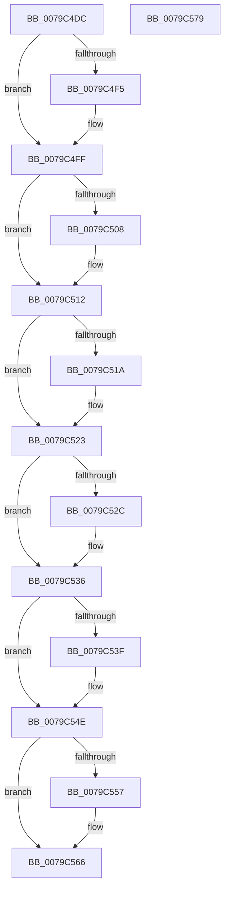

# SeShutdownServerSilo

- RVA: `0x0079C4DC`–`0x0079C57A` (길이 `158` bytes)
- VA: `0x000000014079C4DC`
- 실행 섹션: `PAGE`
- PDB 이름 있음: `예`; PDB Function 태그: `아니요`
- unwind 정보 RVA: `0x0005CAAC`
- 디코드: `44`개 명령, `158/158` bytes 표시
- 미해석 바이트: `0` (있으면 어셈블리에 `.byte`로 보존)

> 이 문서는 커널 이미지의 기계어와 PDB 기호를 분석해 생성했습니다. 4번과 5번은 함수 원형과 자료형을 바이너리 사용 방식에서 추정한 C 해석이며 원본 소스 복구 결과는 아닙니다.

## 1. Dependencies

- 직접 호출 지점: **7**; 고유 호출 대상: **4**
- 직접 호출자로 확인된 함수: **1**
- RIP 상대 이미지 참조: **0**

### Outgoing calls
- `0x0079C4F5` → [ObfDereferenceObject](../../text/2F/ObfDereferenceObject_function_002F9350.md) (function, `0x002F9350`)
- `0x0079C508` → [ObfDereferenceObject](../../text/2F/ObfDereferenceObject_function_002F9350.md) (function, `0x002F9350`)
- `0x0079C51A` → [SepDeReferenceLogonSessionDirect](../../text/44/SepDeReferenceLogonSessionDirect_function_0044EDCC.md) (function, `0x0044EDCC`)
- `0x0079C52C` → [SepDeReferenceLogonSessionDirect](../../text/44/SepDeReferenceLogonSessionDirect_function_0044EDCC.md) (function, `0x0044EDCC`)
- `0x0079C544` → [ExFreePoolWithTag](../../poolcode/B8/ExFreePoolWithTag_function_00B82870.md) (function, `0x00B82870`)
- `0x0079C55C` → [ExFreePoolWithTag](../../poolcode/B8/ExFreePoolWithTag_function_00B82870.md) (function, `0x00B82870`)
- `0x0079C569` → [SepDeleteUnreferencedLogonSessionsInSilo](../7A/SepDeleteUnreferencedLogonSessionsInSilo_function_007A15D8.md) (function, `0x007A15D8`)

### Direct callers
- [PspDeleteExternalServerSiloState](../77/PspDeleteExternalServerSiloState_function_0077FB88.md) at `0x0077FBCD`

### Static image references
- 디코드된 RIP-relative 메모리 참조가 없습니다.

## 2. Other-region calls and transfers

- 다른 실행 섹션으로 향하는 call: **6**
  - `0x0079C4F5` → [ObfDereferenceObject](../../text/2F/ObfDereferenceObject_function_002F9350.md) (`PAGE` → `.text`)
  - `0x0079C508` → [ObfDereferenceObject](../../text/2F/ObfDereferenceObject_function_002F9350.md) (`PAGE` → `.text`)
  - `0x0079C51A` → [SepDeReferenceLogonSessionDirect](../../text/44/SepDeReferenceLogonSessionDirect_function_0044EDCC.md) (`PAGE` → `.text`)
  - `0x0079C52C` → [SepDeReferenceLogonSessionDirect](../../text/44/SepDeReferenceLogonSessionDirect_function_0044EDCC.md) (`PAGE` → `.text`)
  - `0x0079C544` → [ExFreePoolWithTag](../../poolcode/B8/ExFreePoolWithTag_function_00B82870.md) (`PAGE` → `POOLCODE`)
  - `0x0079C55C` → [ExFreePoolWithTag](../../poolcode/B8/ExFreePoolWithTag_function_00B82870.md) (`PAGE` → `POOLCODE`)
- 별도 외부 분기/꼬리 이동을 확인하지 못했습니다.

## 3. Assembly (complete function range)

```asm
0079C4DC  48 89 5C 24 08                  mov qword ptr [rsp + 8], rbx
0079C4E1  57                              push rdi
0079C4E2  48 83 EC 20                     sub rsp, 0x20
0079C4E6  48 8B F9                        mov rdi, rcx
0079C4E9  48 8B DA                        mov rbx, rdx
0079C4EC  48 8B 4A 10                     mov rcx, qword ptr [rdx + 0x10]
0079C4F0  48 85 C9                        test rcx, rcx
0079C4F3  74 0A                           je 0x14079c4ff
0079C4F5  E8 56 CE B5 FF                  call 0x1402f9350
0079C4FA  48 83 63 10 00                  and qword ptr [rbx + 0x10], 0
0079C4FF  48 8B 4B 18                     mov rcx, qword ptr [rbx + 0x18]
0079C503  48 85 C9                        test rcx, rcx
0079C506  74 0A                           je 0x14079c512
0079C508  E8 43 CE B5 FF                  call 0x1402f9350
0079C50D  48 83 63 18 00                  and qword ptr [rbx + 0x18], 0
0079C512  48 8B 0B                        mov rcx, qword ptr [rbx]
0079C515  48 85 C9                        test rcx, rcx
0079C518  74 09                           je 0x14079c523
0079C51A  E8 AD 28 CB FF                  call 0x14044edcc
0079C51F  48 83 23 00                     and qword ptr [rbx], 0
0079C523  48 8B 4B 08                     mov rcx, qword ptr [rbx + 8]
0079C527  48 85 C9                        test rcx, rcx
0079C52A  74 0A                           je 0x14079c536
0079C52C  E8 9B 28 CB FF                  call 0x14044edcc
0079C531  48 83 63 08 00                  and qword ptr [rbx + 8], 0
0079C536  48 8B 4B 28                     mov rcx, qword ptr [rbx + 0x28]
0079C53A  48 85 C9                        test rcx, rcx
0079C53D  74 0F                           je 0x14079c54e
0079C53F  BA 43 49 73 63                  mov edx, 0x63734943
0079C544  E8 27 63 3E 00                  call 0x140b82870
0079C549  48 83 63 28 00                  and qword ptr [rbx + 0x28], 0
0079C54E  48 8B 4B 20                     mov rcx, qword ptr [rbx + 0x20]
0079C552  48 85 C9                        test rcx, rcx
0079C555  74 0F                           je 0x14079c566
0079C557  BA 43 49 73 63                  mov edx, 0x63734943
0079C55C  E8 0F 63 3E 00                  call 0x140b82870
0079C561  48 83 63 20 00                  and qword ptr [rbx + 0x20], 0
0079C566  48 8B CF                        mov rcx, rdi
0079C569  E8 6A 50 00 00                  call 0x1407a15d8
0079C56E  48 8B 5C 24 30                  mov rbx, qword ptr [rsp + 0x30]
0079C573  48 83 C4 20                     add rsp, 0x20
0079C577  5F                              pop rdi
0079C578  C3                              ret
0079C579  CC                              int3
```

## 4. C-style interpretation (structured pseudocode)

```c
__int64 __fastcall SeShutdownServerSilo(__int64 a1, __int64 a2)
{
    __int64 result;
    __int64 v_rsp;
    unsigned __int64 v_stack_p8;

    v_stack_p8 = v_rbx;
    v_rsp = (v_rsp) - (32);
    if (*(unsigned __int64 *)(a2 + 16) != 0) {
        result = ObfDereferenceObject(*(unsigned __int64 *)(a2 + 16), a2, a3, a4);
    }
    if (*(unsigned __int64 *)(a2 + 24) != 0) {
        result = ObfDereferenceObject(*(unsigned __int64 *)(a2 + 24), a2, a3, a4);
    }
    if (*(unsigned __int64 *)(a2) != 0) {
        result = SepDeReferenceLogonSessionDirect(*(unsigned __int64 *)(a2), a2, a3, a4);
    }
    if (*(unsigned __int64 *)(a2 + 8) != 0) {
        result = SepDeReferenceLogonSessionDirect(*(unsigned __int64 *)(a2 + 8), a2, a3, a4);
    }
    if (*(unsigned __int64 *)(a2 + 40) != 0) {
        a2 = 0x63734943ULL;
        result = ExFreePoolWithTag(*(unsigned __int64 *)(a2 + 40), a2, a3, a4);
    }
    if (*(unsigned __int64 *)(a2 + 32) != 0) {
        a2 = 0x63734943ULL;
        result = ExFreePoolWithTag(*(unsigned __int64 *)(a2 + 32), a2, a3, a4);
    }
    result = SepDeleteUnreferencedLogonSessionsInSilo(a1, a2, a3, a4);
    v_rsp = (v_rsp) + (32);
    return result;
}
```

## 5. (Beta) C Style

```c
int64_t SeShutdownServerSilo(int64_t Arg1, void *Arg2)
{
    uint8_t *arg2 = (uint8_t *)Arg2;

    int64_t result;
    int64_t local_rsp;
    uint64_t v_stack_p8;

    v_stack_p8 = local_rbx;
    local_rsp = (local_rsp) - (32);
    if (*(uint64_t *)(arg2 + 0x10) != 0) {
        result = ObfDereferenceObject(*(uint64_t *)(arg2 + 0x10), Arg2, a3, a4);
    }
    if (*(uint64_t *)(arg2 + 0x18) != 0) {
        result = ObfDereferenceObject(*(uint64_t *)(arg2 + 0x18), Arg2, a3, a4);
    }
    if (*(uint64_t *)(arg2) != 0) {
        result = SepDeReferenceLogonSessionDirect(*(uint64_t *)(arg2), Arg2, a3, a4);
    }
    if (*(uint64_t *)(arg2 + 0x8) != 0) {
        result = SepDeReferenceLogonSessionDirect(*(uint64_t *)(arg2 + 0x8), Arg2, a3, a4);
    }
    if (*(uint64_t *)(arg2 + 0x28) != 0) {
        Arg2 = 0x63734943ULL;
        result = ExFreePoolWithTag(*(uint64_t *)(arg2 + 0x28), Arg2, a3, a4);
    }
    if (*(uint64_t *)(arg2 + 0x20) != 0) {
        Arg2 = 0x63734943ULL;
        result = ExFreePoolWithTag(*(uint64_t *)(arg2 + 0x20), Arg2, a3, a4);
    }
    result = SepDeleteUnreferencedLogonSessionsInSilo(Arg1, Arg2, a3, a4);
    local_rsp = (local_rsp) + (32);
    return result;
}
```

### 관측된 메모리 오프셋

구조체 형식이 확인되지 않은 접근은 인자 기준의 오프셋으로만 기록했습니다.

| 기준 인자 | 오프셋 표현 | 폭 (bit) | 접근 |
|---|---:|---:|---|
| `Arg2` | `+ 0x0` | `64` | `R` |
| `Arg2` | `+ 0x0` | `64` | `R/W` |
| `Arg2` | `+ 0x8` | `64` | `R` |
| `Arg2` | `+ 0x8` | `64` | `R/W` |
| `Arg2` | `+ 0x10` | `64` | `R` |
| `Arg2` | `+ 0x10` | `64` | `R/W` |
| `Arg2` | `+ 0x18` | `64` | `R` |
| `Arg2` | `+ 0x18` | `64` | `R/W` |
| `Arg2` | `+ 0x20` | `64` | `R` |
| `Arg2` | `+ 0x20` | `64` | `R/W` |
| `Arg2` | `+ 0x28` | `64` | `R` |
| `Arg2` | `+ 0x28` | `64` | `R/W` |

## 6. Execution-region graph

[열기: 2D/3D 그래프와 함수 탐색 컨트롤 패널](../../../control-panel.html?section=page&rva=0x0079C4DC&view=graph)

- 2D 그래프는 위에서 아래로 흐르고, 3D 그래프는 빈 공간을 드래그해 회전합니다. Shift+드래그는 이동, 휠은 확대·축소, 함수 노드 선택은 대상 보고서 이동입니다.

### Static fallback


