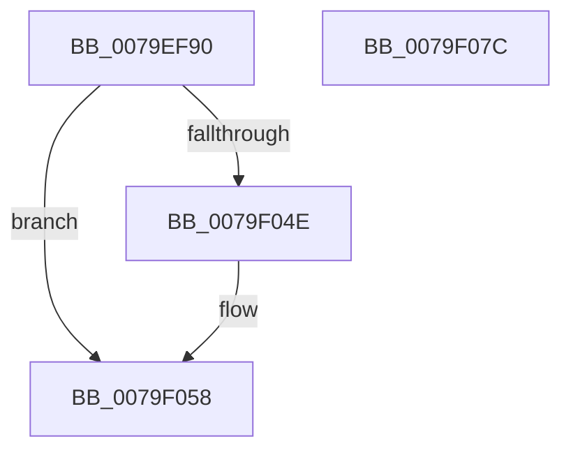

# SepAdtGenerateDiscardAudit

- RVA: `0x0079EF90`–`0x0079F07D` (길이 `237` bytes)
- VA: `0x000000014079EF90`
- 실행 섹션: `PAGE`
- PDB 이름 있음: `예`; PDB Function 태그: `아니요`
- unwind 정보 RVA: `0x000D1204`
- 디코드: `50`개 명령, `237/237` bytes 표시
- 미해석 바이트: `0` (있으면 어셈블리에 `.byte`로 보존)

> 이 문서는 커널 이미지의 기계어와 PDB 기호를 분석해 생성했습니다. 4번과 5번은 함수 원형과 자료형을 바이너리 사용 방식에서 추정한 C 해석이며 원본 소스 복구 결과는 아닙니다.

## 1. Dependencies

- 직접 호출 지점: **4**; 고유 호출 대상: **4**
- 직접 호출자로 확인된 함수: **1**
- RIP 상대 이미지 참조: **3**

### Outgoing calls
- `0x0079EFD2` → [memset](../../text/6C/memset_function_006C6C40.md) (function, `0x006C6C40`)
- `0x0079F043` → [SepAdtLogAuditRecord](../../text/22/SepAdtLogAuditRecord_function_00224B6C.md) (function, `0x00224B6C`)
- `0x0079F053` → [ExFreePoolWithTag](../../poolcode/B8/ExFreePoolWithTag_function_00B82870.md) (function, `0x00B82870`)
- `0x0079F062` → [_security_check_cookie](../../text/6A/_security_check_cookie_function_006AC640.md) (function, `0x006AC640`)

### Direct callers
- [SepAdtDetermineInsertQueue](../../text/49/SepAdtDetermineInsertQueue_function_00496730.md) at `0x004967B5`

### Static image references
- `0x0079EFAA` → RVA `0x00E0A740` (`.data`; read)
- `0x0079EFBB` → RVA `0x00E67D58` (`.data`; read)
- `0x0079F007` → RVA `0x000013A8` (`.rdata`; read)

## 2. Other-region calls and transfers

- 다른 실행 섹션으로 향하는 call: **4**
  - `0x0079EFD2` → [memset](../../text/6C/memset_function_006C6C40.md) (`PAGE` → `.text`)
  - `0x0079F043` → [SepAdtLogAuditRecord](../../text/22/SepAdtLogAuditRecord_function_00224B6C.md) (`PAGE` → `.text`)
  - `0x0079F053` → [ExFreePoolWithTag](../../poolcode/B8/ExFreePoolWithTag_function_00B82870.md) (`PAGE` → `POOLCODE`)
  - `0x0079F062` → [_security_check_cookie](../../text/6A/_security_check_cookie_function_006AC640.md) (`PAGE` → `.text`)
- 별도 외부 분기/꼬리 이동을 확인하지 못했습니다.

## 3. Assembly (complete function range)

```asm
0079EF90  48 89 5C 24 10                  mov qword ptr [rsp + 0x10], rbx
0079EF95  48 89 7C 24 18                  mov qword ptr [rsp + 0x18], rdi
0079EF9A  55                              push rbp
0079EF9B  48 8D AC 24 B0 FC FF FF         lea rbp, [rsp - 0x350]
0079EFA3  48 81 EC 50 04 00 00            sub rsp, 0x450
0079EFAA  48 8B 05 8F B7 66 00            mov rax, qword ptr [rip + 0x66b78f]
0079EFB1  48 33 C4                        xor rax, rsp
0079EFB4  48 89 85 40 03 00 00            mov qword ptr [rbp + 0x340], rax
0079EFBB  48 8B 1D 96 8D 6C 00            mov rbx, qword ptr [rip + 0x6c8d96]
0079EFC2  48 8B F9                        mov rdi, rcx
0079EFC5  48 8D 4C 24 20                  lea rcx, [rsp + 0x20]
0079EFCA  33 D2                           xor edx, edx
0079EFCC  41 B8 18 04 00 00               mov r8d, 0x418
0079EFD2  E8 69 7C F2 FF                  call 0x1406c6c40
0079EFD7  0F B6 43 01                     movzx eax, byte ptr [rbx + 1]
0079EFDB  BA 01 00 00 00                  mov edx, 1
0079EFE0  89 54 24 20                     mov dword ptr [rsp + 0x20], edx
0079EFE4  C7 44 24 30 66 00 08 00         mov dword ptr [rsp + 0x30], 0x80066
0079EFEC  C7 44 24 24 04 12 00 00         mov dword ptr [rsp + 0x24], 0x1204
0079EFF4  8D 04 85 08 00 00 00            lea eax, [rax*4 + 8]
0079EFFB  48 89 5C 24 50                  mov qword ptr [rsp + 0x50], rbx
0079F000  8D 4A 03                        lea ecx, [rdx + 3]
0079F003  89 44 24 3C                     mov dword ptr [rsp + 0x3c], eax
0079F007  48 8D 05 9A 23 86 FF            lea rax, [rip - 0x79dc66]
0079F00E  89 4C 24 38                     mov dword ptr [rsp + 0x38], ecx
0079F012  48 89 44 24 70                  mov qword ptr [rsp + 0x70], rax
0079F017  8B 47 20                        mov eax, dword ptr [rdi + 0x20]
0079F01A  89 4C 24 7C                     mov dword ptr [rsp + 0x7c], ecx
0079F01E  48 8D 4C 24 20                  lea rcx, [rsp + 0x20]
0079F023  48 89 45 80                     mov qword ptr [rbp - 0x80], rax
0079F027  89 54 24 58                     mov dword ptr [rsp + 0x58], edx
0079F02B  C7 44 24 5C 20 00 00 00         mov dword ptr [rsp + 0x5c], 0x20
0079F033  C7 44 24 78 1B 00 00 00         mov dword ptr [rsp + 0x78], 0x1b
0079F03B  C7 44 24 28 03 00 00 00         mov dword ptr [rsp + 0x28], 3
0079F043  E8 24 5B A8 FF                  call 0x140224b6c
0079F048  80 7F 24 00                     cmp byte ptr [rdi + 0x24], 0
0079F04C  74 0A                           je 0x14079f058
0079F04E  33 D2                           xor edx, edx
0079F050  48 8B CF                        mov rcx, rdi
0079F053  E8 18 38 3E 00                  call 0x140b82870
0079F058  48 8B 8D 40 03 00 00            mov rcx, qword ptr [rbp + 0x340]
0079F05F  48 33 CC                        xor rcx, rsp
0079F062  E8 D9 D5 F0 FF                  call 0x1406ac640
0079F067  4C 8D 9C 24 50 04 00 00         lea r11, [rsp + 0x450]
0079F06F  49 8B 5B 18                     mov rbx, qword ptr [r11 + 0x18]
0079F073  49 8B 7B 20                     mov rdi, qword ptr [r11 + 0x20]
0079F077  49 8B E3                        mov rsp, r11
0079F07A  5D                              pop rbp
0079F07B  C3                              ret
0079F07C  CC                              int3
```

## 4. C-style interpretation (structured pseudocode)

```c
__int64 __fastcall SepAdtGenerateDiscardAudit(__int64 a1, int a2)
{
    __int64 result;
    __int64 v_rsp;
    unsigned __int64 v_stack_m18;
    unsigned __int64 v_stack_m358;
    unsigned __int64 v_stack_m3D8;
    unsigned int v_stack_m3DC;
    unsigned int v_stack_m3E0;
    unsigned __int64 v_stack_m3E8;
    unsigned int v_stack_m3FC;
    unsigned int v_stack_m400;
    unsigned __int64 v_stack_m408;
    unsigned int v_stack_m41C;
    unsigned int v_stack_m420;
    unsigned int v_stack_m428;
    unsigned int v_stack_m430;
    unsigned int v_stack_m434;
    unsigned __int64 v_stack_m438;
    unsigned __int64 v_stack_m8;
    unsigned __int64 v_stack_p10;
    unsigned __int64 v_stack_p18;

    v_stack_p10 = v_rbx;
    v_stack_p18 = v_rdi;
    v_rsp = (v_rsp) - (0x450ULL);
    result = (*(unsigned __int64 *)(v_rip + 6731663)) ^ (v_rsp);
    v_stack_m18 = result;
    a2 = 0;
    result = memset(v_stack_m438, a2, (unsigned int)(0x418ULL), a4);
    v_stack_m438 = 1;
    v_stack_m428 = 0x80066ULL;
    v_stack_m434 = 0x1204ULL;
    v_stack_m408 = *(unsigned __int64 *)(v_rip + 7114134);
    v_stack_m41C = (unsigned int)(*(unsigned __int8 *)(*(unsigned __int64 *)(v_rip + 7114134) + 1) * 4 + 8);
    v_stack_m420 = (unsigned int)(1 + 3);
    v_stack_m3E8 = v_rip - 7986278;
    v_stack_m3DC = (unsigned int)(1 + 3);
    v_stack_m3D8 = (unsigned int)(*(unsigned int *)(a1 + 32));
    v_stack_m400 = 1;
    v_stack_m3FC = 32;
    v_stack_m3E0 = 27;
    v_stack_m430 = 3;
    result = SepAdtLogAuditRecord(v_stack_m438, 1, (unsigned int)(0x418ULL), a4);
    if ((*(unsigned __int8 *)(a1 + 36)) != 0) {
        a2 = 0;
        a1 = a1;
        result = ExFreePoolWithTag(a1, a2, (unsigned int)(0x418ULL), a4);
    }
    a1 = (v_stack_m18) ^ (v_rsp);
    result = _security_check_cookie(a1, a2, (unsigned int)(0x418ULL), a4);
    return result;
}
```

## 5. (Beta) C Style

```c
int64_t SepAdtGenerateDiscardAudit(void *Arg1, int32_t Arg2)
{
    uint8_t *arg1 = (uint8_t *)Arg1;

    int64_t result;
    int64_t local_rsp;
    uint64_t v_stack_m18;
    uint64_t v_stack_m358;
    uint64_t v_stack_m3D8;
    uint32_t v_stack_m3DC;
    uint32_t v_stack_m3E0;
    uint64_t v_stack_m3E8;
    uint32_t v_stack_m3FC;
    uint32_t v_stack_m400;
    uint64_t v_stack_m408;
    uint32_t v_stack_m41C;
    uint32_t v_stack_m420;
    uint32_t v_stack_m428;
    uint32_t v_stack_m430;
    uint32_t v_stack_m434;
    uint64_t v_stack_m438;
    uint64_t v_stack_m8;
    uint64_t v_stack_p10;
    uint64_t v_stack_p18;

    v_stack_p10 = local_rbx;
    v_stack_p18 = local_rdi;
    local_rsp = (local_rsp) - (0x450ULL);
    result = (*(uint64_t *)(v_rip + 0x66B78F)) ^ (local_rsp);
    v_stack_m18 = result;
    Arg2 = 0;
    result = memset(v_stack_m438, Arg2, (uint32_t)(0x418ULL), a4);
    v_stack_m438 = 1;
    v_stack_m428 = 0x80066ULL;
    v_stack_m434 = 0x1204ULL;
    v_stack_m408 = *(uint64_t *)(v_rip + 0x6C8D96);
    v_stack_m41C = (uint32_t)(*(uint8_t *)(*(uint64_t *)(v_rip + 0x6C8D96) + 0x1) * 4 + 8);
    v_stack_m420 = (uint32_t)(1 + 3);
    v_stack_m3E8 = v_rip - 7986278;
    v_stack_m3DC = (uint32_t)(1 + 3);
    v_stack_m3D8 = (uint32_t)(*(uint32_t *)(arg1 + 0x20));
    v_stack_m400 = 1;
    v_stack_m3FC = 32;
    v_stack_m3E0 = 27;
    v_stack_m430 = 3;
    result = SepAdtLogAuditRecord(v_stack_m438, 1, (uint32_t)(0x418ULL), a4);
    if ((*(uint8_t *)(arg1 + 0x24)) != 0) {
        Arg2 = 0;
        Arg1 = Arg1;
        result = ExFreePoolWithTag(Arg1, Arg2, (uint32_t)(0x418ULL), a4);
    }
    Arg1 = (v_stack_m18) ^ (local_rsp);
    result = _security_check_cookie(Arg1, Arg2, (uint32_t)(0x418ULL), a4);
    return result;
}
```

### 관측된 메모리 오프셋

구조체 형식이 확인되지 않은 접근은 인자 기준의 오프셋으로만 기록했습니다.

| 기준 인자 | 오프셋 표현 | 폭 (bit) | 접근 |
|---|---:|---:|---|
| `Arg1` | `+ 0x20` | `32` | `R` |
| `Arg1` | `+ 0x24` | `8` | `R` |

## 6. Execution-region graph

[열기: 2D/3D 그래프와 함수 탐색 컨트롤 패널](../../../control-panel.html?section=page&rva=0x0079EF90&view=graph)

- 2D 그래프는 위에서 아래로 흐르고, 3D 그래프는 빈 공간을 드래그해 회전합니다. Shift+드래그는 이동, 휠은 확대·축소, 함수 노드 선택은 대상 보고서 이동입니다.

### Static fallback


