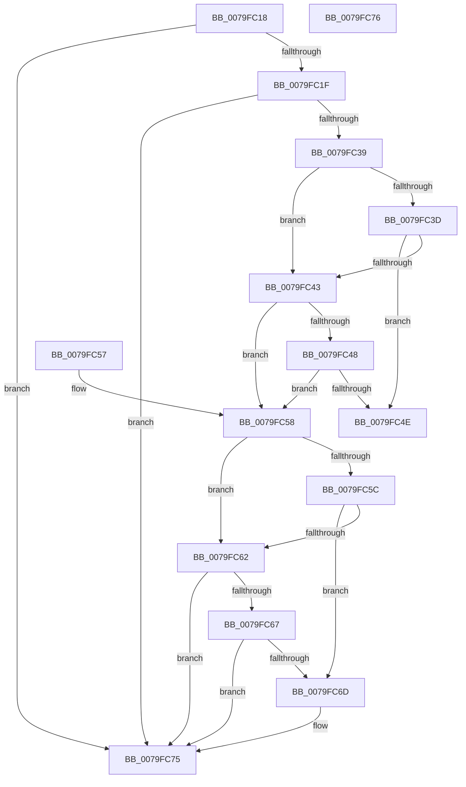

# SepAdtIncorporatePerUserPolicy

- RVA: `0x0079FC18`–`0x0079FC77` (길이 `95` bytes)
- VA: `0x000000014079FC18`
- 실행 섹션: `PAGE`
- PDB 이름 있음: `예`; PDB Function 태그: `아니요`
- unwind 정보 RVA: `0x000DB714`
- 디코드: `34`개 명령, `95/95` bytes 표시
- 미해석 바이트: `0` (있으면 어셈블리에 `.byte`로 보존)

> 이 문서는 커널 이미지의 기계어와 PDB 기호를 분석해 생성했습니다. 4번과 5번은 함수 원형과 자료형을 바이너리 사용 방식에서 추정한 C 해석이며 원본 소스 복구 결과는 아닙니다.

## 1. Dependencies

- 직접 호출 지점: **0**; 고유 호출 대상: **0**
- 직접 호출자로 확인된 함수: **6**
- RIP 상대 이미지 참조: **0**

### Outgoing calls
- 직접 디코드된 call 명령이 없습니다.

### Direct callers
- [sub_00870B27](../87/Unknown_function_00870B27.md) at `0x00870B5F`
- [PipProcessStartPhase3](../8F/PipProcessStartPhase3_function_008FBAF8.md) at `0x008FBCAB`
- [PspInsertProcess](../94/PspInsertProcess_function_009472CC.md) at `0x0094757B`
- [ObInitProcess](../94/ObInitProcess_function_0094C62C.md) at `0x0094C796`
- [SeAssignPrimaryToken](../9F/SeAssignPrimaryToken_function_009F117C.md) at `0x009F11E5`
- [sub_00B20D1A](../B2/Unknown_function_00B20D1A.md) at `0x00B20D46`

### Static image references
- 디코드된 RIP-relative 메모리 참조가 없습니다.

## 2. Other-region calls and transfers

- 다른 실행 섹션으로 향하는 call: **0**
- 별도 외부 분기/꼬리 이동을 확인하지 못했습니다.

## 3. Assembly (complete function range)

```asm
0079FC18  41 80 79 77 02                  cmp byte ptr [r9 + 0x77], 2
0079FC1D  75 56                           jne 0x14079fc75
0079FC1F  8B C1                           mov eax, ecx
0079FC21  80 E1 01                        and cl, 1
0079FC24  48 D1 E8                        shr rax, 1
0079FC27  C0 E1 02                        shl cl, 2
0079FC2A  46 0F B6 4C 08 58               movzx r9d, byte ptr [rax + r9 + 0x58]
0079FC30  41 D3 E9                        shr r9d, cl
0079FC33  41 83 E1 0F                     and r9d, 0xf
0079FC37  74 3C                           je 0x14079fc75
0079FC39  84 D2                           test dl, dl
0079FC3B  74 06                           je 0x14079fc43
0079FC3D  41 F6 C1 01                     test r9b, 1
0079FC41  75 0B                           jne 0x14079fc4e
0079FC43  45 84 C0                        test r8b, r8b
0079FC46  74 10                           je 0x14079fc58
0079FC48  41 F6 C1 04                     test r9b, 4
0079FC4C  74 0A                           je 0x14079fc58
0079FC4E  48 8B 44 24 28                  mov rax, qword ptr [rsp + 0x28]
0079FC53  C6 00 01                        mov byte ptr [rax], 1
0079FC56  C3                              ret
0079FC57  CC                              int3
0079FC58  84 D2                           test dl, dl
0079FC5A  74 06                           je 0x14079fc62
0079FC5C  41 F6 C1 02                     test r9b, 2
0079FC60  75 0B                           jne 0x14079fc6d
0079FC62  45 84 C0                        test r8b, r8b
0079FC65  74 0E                           je 0x14079fc75
0079FC67  41 F6 C1 08                     test r9b, 8
0079FC6B  74 08                           je 0x14079fc75
0079FC6D  48 8B 44 24 28                  mov rax, qword ptr [rsp + 0x28]
0079FC72  C6 00 00                        mov byte ptr [rax], 0
0079FC75  C3                              ret
0079FC76  CC                              int3
```

## 4. C-style interpretation (structured pseudocode)

```c
__int64 __fastcall SepAdtIncorporatePerUserPolicy(int a1, unsigned __int8 a2, unsigned __int8 a3, __int64 a4, __int64 a5)
{
    __int64 result;

    if ((*(unsigned __int8 *)(a4 + 119)) != 2) goto loc_0079FC75;
    a1 = (unsigned __int8)((a1) & (1));
    result = ((unsigned int)(a1)) >> (1);
    a1 = (unsigned __int8)((a1) << (2));
    a4 = (unsigned int)((*(unsigned __int8 *)(result + a4 * 1 + 88)) >> ((unsigned __int8)(a1)));
    a4 = (unsigned int)((a4) & (15));
    if (condition_is_equal) goto loc_0079FC75;
    if (a2 == 0) goto loc_0079FC43;
    if ((((unsigned __int8)(a4)) & (1)) != 0) goto loc_0079FC4E;
loc_0079FC43:
    if (a3 == 0) goto loc_0079FC58;
    if ((((unsigned __int8)(a4)) & (4)) == 0) goto loc_0079FC58;
loc_0079FC4E:
    *(unsigned __int8 *)(a5) = 1;
    return a5;
loc_0079FC58:
    if (a2 == 0) goto loc_0079FC62;
    if ((((unsigned __int8)(a4)) & (2)) != 0) goto loc_0079FC6D;
loc_0079FC62:
    if (a3 == 0) goto loc_0079FC75;
    result = a5;
    if ((((unsigned __int8)(a4)) & (8)) != 0) {
        result = a5;
        *(unsigned __int8 *)(result) = 0;
    }
    return result;
}
```

## 5. (Beta) C Style

```c
void *SepAdtIncorporatePerUserPolicy(int32_t Arg1, uint8_t Arg2, uint8_t Arg3, void *Arg4, void *Arg5)
{
    uint8_t *arg4 = (uint8_t *)Arg4;
    uint8_t *arg5 = (uint8_t *)Arg5;

    int64_t result;

    if ((*(uint8_t *)(arg4 + 0x77)) != 2) goto loc_0079FC75;
    Arg1 = (uint8_t)((Arg1) & (1));
    result = ((uint32_t)(Arg1)) >> (1);
    Arg1 = (uint8_t)((Arg1) << (2));
    Arg4 = (uint32_t)((*(uint8_t *)(result + arg4 * 1 + 0x58)) >> ((uint8_t)(Arg1)));
    Arg4 = (uint32_t)((Arg4) & (15));
    if (condition_is_equal) goto loc_0079FC75;
    if (Arg2 == 0) goto loc_0079FC43;
    if ((((uint8_t)(Arg4)) & (1)) != 0) goto loc_0079FC4E;
loc_0079FC43:
    if (Arg3 == 0) goto loc_0079FC58;
    if ((((uint8_t)(Arg4)) & (4)) == 0) goto loc_0079FC58;
loc_0079FC4E:
    *(uint8_t *)(arg5) = 1;
    return Arg5;
loc_0079FC58:
    if (Arg2 == 0) goto loc_0079FC62;
    if ((((uint8_t)(Arg4)) & (2)) != 0) goto loc_0079FC6D;
loc_0079FC62:
    if (Arg3 == 0) goto loc_0079FC75;
    result = Arg5;
    if ((((uint8_t)(Arg4)) & (8)) != 0) {
        result = Arg5;
        *(uint8_t *)(result) = 0;
    }
    return result;
}
```

### 관측된 메모리 오프셋

구조체 형식이 확인되지 않은 접근은 인자 기준의 오프셋으로만 기록했습니다.

| 기준 인자 | 오프셋 표현 | 폭 (bit) | 접근 |
|---|---:|---:|---|
| `Arg4` | `+ 0x77` | `8` | `R` |
| `Arg5` | `+ 0x0` | `8` | `W` |

## 6. Execution-region graph

[열기: 2D/3D 그래프와 함수 탐색 컨트롤 패널](../../../control-panel.html?section=page&rva=0x0079FC18&view=graph)

- 2D 그래프는 위에서 아래로 흐르고, 3D 그래프는 빈 공간을 드래그해 회전합니다. Shift+드래그는 이동, 휠은 확대·축소, 함수 노드 선택은 대상 보고서 이동입니다.

### Static fallback


