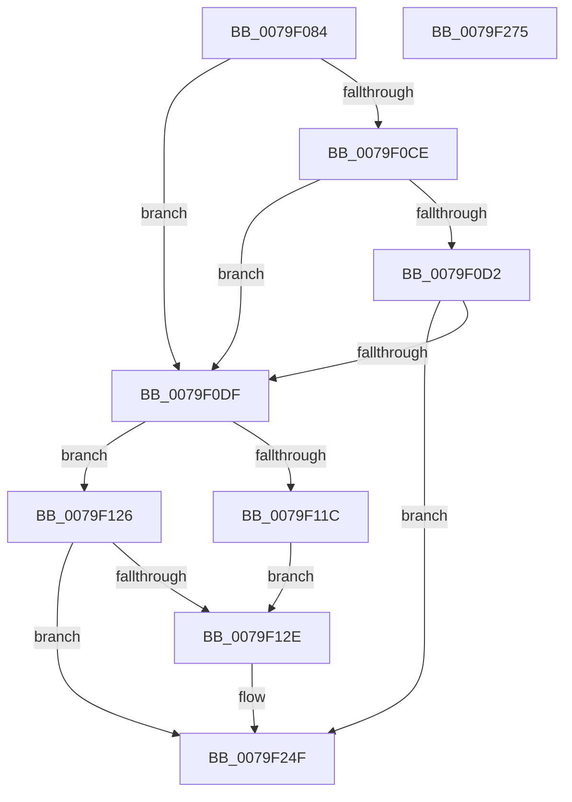

# SepAdtLogAuditFailureEvent

- RVA: `0x0079F084`–`0x0079F276` (길이 `498` bytes)
- VA: `0x000000014079F084`
- 실행 섹션: `PAGE`
- PDB 이름 있음: `예`; PDB Function 태그: `아니요`
- unwind 정보 RVA: `0x000D113C`
- 디코드: `113`개 명령, `498/498` bytes 표시
- 미해석 바이트: `0` (있으면 어셈블리에 `.byte`로 보존)

> 이 문서는 커널 이미지의 기계어와 PDB 기호를 분석해 생성했습니다. 4번과 5번은 함수 원형과 자료형을 바이너리 사용 방식에서 추정한 C 해석이며 원본 소스 복구 결과는 아닙니다.

## 1. Dependencies

- 직접 호출 지점: **3**; 고유 호출 대상: **3**
- 직접 호출자로 확인된 함수: **2**
- RIP 상대 이미지 참조: **8**

### Outgoing calls
- `0x0079F0C0` → [memset](../../text/6C/memset_function_006C6C40.md) (function, `0x006C6C40`)
- `0x0079F24A` → [SepAdtLogAuditRecord](../../text/22/SepAdtLogAuditRecord_function_00224B6C.md) (function, `0x00224B6C`)
- `0x0079F25B` → [_security_check_cookie](../../text/6A/_security_check_cookie_function_006AC640.md) (function, `0x006AC640`)

### Direct callers
- [SepAdtLogAuditRecord](../../text/22/SepAdtLogAuditRecord_function_00224B6C.md) at `0x00224DC6`
- [SepAuditFailed](../86/SepAuditFailed_function_0086EE20.md) at `0x0086EE56`

### Static image references
- `0x0079F09E` → RVA `0x00E0A740` (`.data`; read)
- `0x0079F0C5` → RVA `0x00E67F1D` (`.data`; read)
- `0x0079F0D2` → RVA `0x00E67F18` (`.data`; read)
- `0x0079F0E7` → RVA `0x00E67F1D` (`.data`; write)
- `0x0079F0EE` → RVA `0x00E67F18` (`.data`; read/write)
- `0x0079F0F4` → RVA `0x00E67D58` (`.data`; read)
- `0x0079F180` → RVA `0x000013A8` (`.rdata`; read)
- `0x0079F1F1` → RVA `0x00E67F1C` (`.data`; read)

## 2. Other-region calls and transfers

- 다른 실행 섹션으로 향하는 call: **3**
  - `0x0079F0C0` → [memset](../../text/6C/memset_function_006C6C40.md) (`PAGE` → `.text`)
  - `0x0079F24A` → [SepAdtLogAuditRecord](../../text/22/SepAdtLogAuditRecord_function_00224B6C.md) (`PAGE` → `.text`)
  - `0x0079F25B` → [_security_check_cookie](../../text/6A/_security_check_cookie_function_006AC640.md) (`PAGE` → `.text`)
- 별도 외부 분기/꼬리 이동을 확인하지 못했습니다.

## 3. Assembly (complete function range)

```asm
0079F084  48 89 5C 24 08                  mov qword ptr [rsp + 8], rbx
0079F089  48 89 7C 24 10                  mov qword ptr [rsp + 0x10], rdi
0079F08E  55                              push rbp
0079F08F  48 8D AC 24 B0 FC FF FF         lea rbp, [rsp - 0x350]
0079F097  48 81 EC 50 04 00 00            sub rsp, 0x450
0079F09E  48 8B 05 9B B6 66 00            mov rax, qword ptr [rip + 0x66b69b]
0079F0A5  48 33 C4                        xor rax, rsp
0079F0A8  48 89 85 40 03 00 00            mov qword ptr [rbp + 0x340], rax
0079F0AF  8A DA                           mov bl, dl
0079F0B1  8B F9                           mov edi, ecx
0079F0B3  33 D2                           xor edx, edx
0079F0B5  48 8D 4C 24 20                  lea rcx, [rsp + 0x20]
0079F0BA  41 B8 18 04 00 00               mov r8d, 0x418
0079F0C0  E8 7B 7B F2 FF                  call 0x1406c6c40
0079F0C5  80 3D 51 8E 6C 00 00            cmp byte ptr [rip + 0x6c8e51], 0
0079F0CC  74 11                           je 0x14079f0df
0079F0CE  84 DB                           test bl, bl
0079F0D0  75 0D                           jne 0x14079f0df
0079F0D2  83 3D 3F 8E 6C 00 32            cmp dword ptr [rip + 0x6c8e3f], 0x32
0079F0D9  0F 82 70 01 00 00               jb 0x14079f24f
0079F0DF  41 BA 01 00 00 00               mov r10d, 1
0079F0E5  33 D2                           xor edx, edx
0079F0E7  44 88 15 2F 8E 6C 00            mov byte ptr [rip + 0x6c8e2f], r10b
0079F0EE  87 15 24 8E 6C 00               xchg dword ptr [rip + 0x6c8e24], edx
0079F0F4  4C 8B 05 5D 8C 6C 00            mov r8, qword ptr [rip + 0x6c8c5d]
0079F0FB  44 89 54 24 20                  mov dword ptr [rsp + 0x20], r10d
0079F100  C7 44 24 30 66 00 08 00         mov dword ptr [rsp + 0x30], 0x80066
0079F108  C7 44 24 24 09 02 00 00         mov dword ptr [rsp + 0x24], 0x209
0079F110  C7 44 24 34 02 00 00 00         mov dword ptr [rsp + 0x34], 2
0079F118  84 DB                           test bl, bl
0079F11A  74 0A                           je 0x14079f126
0079F11C  C7 44 24 34 12 00 00 00         mov dword ptr [rsp + 0x34], 0x12
0079F124  EB 08                           jmp 0x14079f12e
0079F126  85 D2                           test edx, edx
0079F128  0F 84 21 01 00 00               je 0x14079f24f
0079F12E  8B 44 24 28                     mov eax, dword ptr [rsp + 0x28]
0079F132  41 B9 04 00 00 00               mov r9d, 4
0079F138  48 C1 E0 05                     shl rax, 5
0079F13C  44 89 4C 04 38                  mov dword ptr [rsp + rax + 0x38], r9d
0079F141  41 0F B6 40 01                  movzx eax, byte ptr [r8 + 1]
0079F146  8D 0C 85 08 00 00 00            lea ecx, [rax*4 + 8]
0079F14D  8B 44 24 28                     mov eax, dword ptr [rsp + 0x28]
0079F151  48 C1 E0 05                     shl rax, 5
0079F155  89 4C 04 3C                     mov dword ptr [rsp + rax + 0x3c], ecx
0079F159  8B 44 24 28                     mov eax, dword ptr [rsp + 0x28]
0079F15D  48 C1 E0 05                     shl rax, 5
0079F161  4C 89 44 04 50                  mov qword ptr [rsp + rax + 0x50], r8
0079F166  45 8D 41 FF                     lea r8d, [r9 - 1]
0079F16A  8B 44 24 28                     mov eax, dword ptr [rsp + 0x28]
0079F16E  41 03 C2                        add eax, r10d
0079F171  89 44 24 28                     mov dword ptr [rsp + 0x28], eax
0079F175  8B C8                           mov ecx, eax
0079F177  48 C1 E1 05                     shl rcx, 5
0079F17B  44 89 54 0C 38                  mov dword ptr [rsp + rcx + 0x38], r10d
0079F180  48 8D 0D 21 22 86 FF            lea rcx, [rip - 0x79dddf]
0079F187  8B 44 24 28                     mov eax, dword ptr [rsp + 0x28]
0079F18B  48 C1 E0 05                     shl rax, 5
0079F18F  C7 44 04 3C 20 00 00 00         mov dword ptr [rsp + rax + 0x3c], 0x20
0079F197  8B 44 24 28                     mov eax, dword ptr [rsp + 0x28]
0079F19B  48 C1 E0 05                     shl rax, 5
0079F19F  48 89 4C 04 50                  mov qword ptr [rsp + rax + 0x50], rcx
0079F1A4  8B 44 24 28                     mov eax, dword ptr [rsp + 0x28]
0079F1A8  41 03 C2                        add eax, r10d
0079F1AB  89 44 24 28                     mov dword ptr [rsp + 0x28], eax
0079F1AF  8B C8                           mov ecx, eax
0079F1B1  48 C1 E1 05                     shl rcx, 5
0079F1B5  C7 44 0C 38 0A 00 00 00         mov dword ptr [rsp + rcx + 0x38], 0xa
0079F1BD  8B 44 24 28                     mov eax, dword ptr [rsp + 0x28]
0079F1C1  48 C1 E0 05                     shl rax, 5
0079F1C5  44 89 4C 04 3C                  mov dword ptr [rsp + rax + 0x3c], r9d
0079F1CA  8B 44 24 28                     mov eax, dword ptr [rsp + 0x28]
0079F1CE  48 C1 E0 05                     shl rax, 5
0079F1D2  48 89 7C 04 40                  mov qword ptr [rsp + rax + 0x40], rdi
0079F1D7  8B 44 24 28                     mov eax, dword ptr [rsp + 0x28]
0079F1DB  41 03 C2                        add eax, r10d
0079F1DE  89 44 24 28                     mov dword ptr [rsp + 0x28], eax
0079F1E2  8B C8                           mov ecx, eax
0079F1E4  48 C1 E1 05                     shl rcx, 5
0079F1E8  44 89 44 0C 38                  mov dword ptr [rsp + rcx + 0x38], r8d
0079F1ED  8B 44 24 28                     mov eax, dword ptr [rsp + 0x28]
0079F1F1  0F B6 0D 24 8D 6C 00            movzx ecx, byte ptr [rip + 0x6c8d24]
0079F1F8  48 C1 E0 05                     shl rax, 5
0079F1FC  44 89 54 04 3C                  mov dword ptr [rsp + rax + 0x3c], r10d
0079F201  8B 44 24 28                     mov eax, dword ptr [rsp + 0x28]
0079F205  48 C1 E0 05                     shl rax, 5
0079F209  48 89 4C 04 40                  mov qword ptr [rsp + rax + 0x40], rcx
0079F20E  8B 44 24 28                     mov eax, dword ptr [rsp + 0x28]
0079F212  41 03 C2                        add eax, r10d
0079F215  89 44 24 28                     mov dword ptr [rsp + 0x28], eax
0079F219  8B C8                           mov ecx, eax
0079F21B  48 C1 E1 05                     shl rcx, 5
0079F21F  44 89 44 0C 38                  mov dword ptr [rsp + rcx + 0x38], r8d
0079F224  8B 44 24 28                     mov eax, dword ptr [rsp + 0x28]
0079F228  48 C1 E0 05                     shl rax, 5
0079F22C  8B CA                           mov ecx, edx
0079F22E  44 89 4C 04 3C                  mov dword ptr [rsp + rax + 0x3c], r9d
0079F233  8B 44 24 28                     mov eax, dword ptr [rsp + 0x28]
0079F237  48 C1 E0 05                     shl rax, 5
0079F23B  48 89 4C 04 40                  mov qword ptr [rsp + rax + 0x40], rcx
0079F240  48 8D 4C 24 20                  lea rcx, [rsp + 0x20]
0079F245  44 01 54 24 28                  add dword ptr [rsp + 0x28], r10d
0079F24A  E8 1D 59 A8 FF                  call 0x140224b6c
0079F24F  33 C0                           xor eax, eax
0079F251  48 8B 8D 40 03 00 00            mov rcx, qword ptr [rbp + 0x340]
0079F258  48 33 CC                        xor rcx, rsp
0079F25B  E8 E0 D3 F0 FF                  call 0x1406ac640
0079F260  4C 8D 9C 24 50 04 00 00         lea r11, [rsp + 0x450]
0079F268  49 8B 5B 10                     mov rbx, qword ptr [r11 + 0x10]
0079F26C  49 8B 7B 18                     mov rdi, qword ptr [r11 + 0x18]
0079F270  49 8B E3                        mov rsp, r11
0079F273  5D                              pop rbp
0079F274  C3                              ret
0079F275  CC                              int3
```

## 4. C-style interpretation (structured pseudocode)

```c
__int64 __fastcall SepAdtLogAuditFailureEvent(int a1, int a2)
{
    __int64 result;
    __int64 v_rsp;
    unsigned __int64 v_stack_m18;
    unsigned __int64 v_stack_m358;
    unsigned int v_stack_m424;
    unsigned int v_stack_m428;
    unsigned int v_stack_m430;
    unsigned int v_stack_m434;
    unsigned __int64 v_stack_m438;
    unsigned __int64 v_stack_m8;
    unsigned __int64 v_stack_p10;
    unsigned __int64 v_stack_p8;

    v_stack_p8 = v_rbx;
    v_stack_p10 = v_rdi;
    v_rsp = (v_rsp) - (0x450ULL);
    result = (*(unsigned __int64 *)(v_rip + 6731419)) ^ (v_rsp);
    v_stack_m18 = result;
    a2 = 0;
    result = memset(v_stack_m438, a2, (unsigned int)(0x418ULL), a4);
    if ((*(unsigned __int8 *)(v_rip + 7114321)) == 0) goto loc_0079F0DF;
    if ((unsigned __int8)((unsigned __int8)(a2)) != 0) goto loc_0079F0DF;
    if ((*(unsigned int *)(v_rip + 7114303)) < 50) goto loc_0079F24F;
loc_0079F0DF:
    a2 = 0;
    *(unsigned __int8 *)(v_rip + 7114287) = 1;
    v_stack_m438 = 1;
    v_stack_m428 = 0x80066ULL;
    v_stack_m434 = 521;
    v_stack_m424 = 2;
    if ((unsigned __int8)((unsigned __int8)(a2)) == 0) goto loc_0079F126;
    v_stack_m424 = 18;
    goto loc_0079F12E;
loc_0079F126:
    if (0 != 0) {
        result = v_stack_m430;
        a4 = 4;
        result = (result) << (5);
        *(unsigned int *)(v_rsp + result * 1 + 56) = (unsigned int)(a4);
        result = *(unsigned __int8 *)(*(unsigned __int64 *)(v_rip + 7113821) + 1);
        a1 = result * 4 + 8;
        result = v_stack_m430;
        result = (result) << (5);
        *(unsigned int *)(v_rsp + result * 1 + 60) = a1;
        result = v_stack_m430;
        result = (result) << (5);
        *(unsigned __int64 *)(v_rsp + result * 1 + 80) = *(unsigned __int64 *)(v_rip + 7113821);
        a3 = a4 - 1;
        result = v_stack_m430;
        result = (unsigned int)((result) + (1));
        v_stack_m430 = (unsigned int)(result);
        a1 = (unsigned int)(result);
        a1 = (a1) << (5);
        *(unsigned int *)(v_rsp + a1 * 1 + 56) = 1;
        a1 = v_rip - 7986655;
        result = v_stack_m430;
        result = (result) << (5);
        *(unsigned int *)(v_rsp + result * 1 + 60) = 32;
        result = v_stack_m430;
        result = (result) << (5);
        *(unsigned __int64 *)(v_rsp + result * 1 + 80) = a1;
        result = v_stack_m430;
        result = (unsigned int)((result) + (1));
        v_stack_m430 = (unsigned int)(result);
        a1 = (unsigned int)(result);
        a1 = (a1) << (5);
        *(unsigned int *)(v_rsp + a1 * 1 + 56) = 10;
        result = v_stack_m430;
        result = (result) << (5);
        *(unsigned int *)(v_rsp + result * 1 + 60) = (unsigned int)(a4);
        result = v_stack_m430;
        result = (result) << (5);
        *(unsigned __int64 *)(v_rsp + result * 1 + 64) = (unsigned int)(a1);
        result = v_stack_m430;
        result = (unsigned int)((result) + (1));
        v_stack_m430 = (unsigned int)(result);
        a1 = (unsigned int)(result);
        a1 = (a1) << (5);
        *(unsigned int *)(v_rsp + a1 * 1 + 56) = (unsigned int)(a3);
        result = v_stack_m430;
        a1 = *(unsigned __int8 *)(v_rip + 7114020);
        result = (result) << (5);
        *(unsigned int *)(v_rsp + result * 1 + 60) = 1;
        result = v_stack_m430;
        result = (result) << (5);
        *(unsigned __int64 *)(v_rsp + result * 1 + 64) = a1;
        result = v_stack_m430;
        result = (unsigned int)((result) + (1));
        v_stack_m430 = (unsigned int)(result);
        a1 = (unsigned int)(result);
        a1 = (a1) << (5);
        *(unsigned int *)(v_rsp + a1 * 1 + 56) = (unsigned int)(a3);
        result = v_stack_m430;
        result = (result) << (5);
        a1 = 0;
        *(unsigned int *)(v_rsp + result * 1 + 60) = (unsigned int)(a4);
        result = v_stack_m430;
        result = (result) << (5);
        *(unsigned __int64 *)(v_rsp + result * 1 + 64) = a1;
        a1 = v_stack_m438;
        result = SepAdtLogAuditRecord(a1, a2, a3, a4);
    }
    result = 0;
    a1 = (v_stack_m18) ^ (v_rsp);
    result = _security_check_cookie(a1, a2, a3, a4);
    return result;
}
```

## 5. (Beta) C Style

```c
int64_t SepAdtLogAuditFailureEvent(int32_t Arg1, int32_t Arg2)
{
    int64_t result;
    int64_t local_rsp;
    uint64_t v_stack_m18;
    uint64_t v_stack_m358;
    uint32_t v_stack_m424;
    uint32_t v_stack_m428;
    uint32_t v_stack_m430;
    uint32_t v_stack_m434;
    uint64_t v_stack_m438;
    uint64_t v_stack_m8;
    uint64_t v_stack_p10;
    uint64_t v_stack_p8;

    v_stack_p8 = local_rbx;
    v_stack_p10 = local_rdi;
    local_rsp = (local_rsp) - (0x450ULL);
    result = (*(uint64_t *)(v_rip + 0x66B69B)) ^ (local_rsp);
    v_stack_m18 = result;
    Arg2 = 0;
    result = memset(v_stack_m438, Arg2, (uint32_t)(0x418ULL), a4);
    if ((*(uint8_t *)(v_rip + 0x6C8E51)) == 0) goto loc_0079F0DF;
    if ((uint8_t)((uint8_t)(Arg2)) != 0) goto loc_0079F0DF;
    if ((*(uint32_t *)(v_rip + 0x6C8E3F)) < 50) goto loc_0079F24F;
loc_0079F0DF:
    Arg2 = 0;
    *(uint8_t *)(v_rip + 0x6C8E2F) = 1;
    v_stack_m438 = 1;
    v_stack_m428 = 0x80066ULL;
    v_stack_m434 = 521;
    v_stack_m424 = 2;
    if ((uint8_t)((uint8_t)(Arg2)) == 0) goto loc_0079F126;
    v_stack_m424 = 18;
    goto loc_0079F12E;
loc_0079F126:
    if (0 != 0) {
        result = v_stack_m430;
        a4 = 4;
        result = (result) << (5);
        *(uint32_t *)(local_rsp + result * 1 + 0x38) = (uint32_t)(a4);
        result = *(uint8_t *)(*(uint64_t *)(v_rip + 0x6C8C5D) + 0x1);
        Arg1 = result * 4 + 8;
        result = v_stack_m430;
        result = (result) << (5);
        *(uint32_t *)(local_rsp + result * 1 + 0x3C) = Arg1;
        result = v_stack_m430;
        result = (result) << (5);
        *(uint64_t *)(local_rsp + result * 1 + 0x50) = *(uint64_t *)(v_rip + 0x6C8C5D);
        a3 = a4 - 1;
        result = v_stack_m430;
        result = (uint32_t)((result) + (1));
        v_stack_m430 = (uint32_t)(result);
        Arg1 = (uint32_t)(result);
        Arg1 = (Arg1) << (5);
        *(uint32_t *)(local_rsp + Arg1 * 1 + 0x38) = 1;
        Arg1 = v_rip - 7986655;
        result = v_stack_m430;
        result = (result) << (5);
        *(uint32_t *)(local_rsp + result * 1 + 0x3C) = 32;
        result = v_stack_m430;
        result = (result) << (5);
        *(uint64_t *)(local_rsp + result * 1 + 0x50) = Arg1;
        result = v_stack_m430;
        result = (uint32_t)((result) + (1));
        v_stack_m430 = (uint32_t)(result);
        Arg1 = (uint32_t)(result);
        Arg1 = (Arg1) << (5);
        *(uint32_t *)(local_rsp + Arg1 * 1 + 0x38) = 10;
        result = v_stack_m430;
        result = (result) << (5);
        *(uint32_t *)(local_rsp + result * 1 + 0x3C) = (uint32_t)(a4);
        result = v_stack_m430;
        result = (result) << (5);
        *(uint64_t *)(local_rsp + result * 1 + 0x40) = (uint32_t)(Arg1);
        result = v_stack_m430;
        result = (uint32_t)((result) + (1));
        v_stack_m430 = (uint32_t)(result);
        Arg1 = (uint32_t)(result);
        Arg1 = (Arg1) << (5);
        *(uint32_t *)(local_rsp + Arg1 * 1 + 0x38) = (uint32_t)(a3);
        result = v_stack_m430;
        Arg1 = *(uint8_t *)(v_rip + 0x6C8D24);
        result = (result) << (5);
        *(uint32_t *)(local_rsp + result * 1 + 0x3C) = 1;
        result = v_stack_m430;
        result = (result) << (5);
        *(uint64_t *)(local_rsp + result * 1 + 0x40) = Arg1;
        result = v_stack_m430;
        result = (uint32_t)((result) + (1));
        v_stack_m430 = (uint32_t)(result);
        Arg1 = (uint32_t)(result);
        Arg1 = (Arg1) << (5);
        *(uint32_t *)(local_rsp + Arg1 * 1 + 0x38) = (uint32_t)(a3);
        result = v_stack_m430;
        result = (result) << (5);
        Arg1 = 0;
        *(uint32_t *)(local_rsp + result * 1 + 0x3C) = (uint32_t)(a4);
        result = v_stack_m430;
        result = (result) << (5);
        *(uint64_t *)(local_rsp + result * 1 + 0x40) = Arg1;
        Arg1 = v_stack_m438;
        result = SepAdtLogAuditRecord(Arg1, Arg2, a3, a4);
    }
    result = 0;
    Arg1 = (v_stack_m18) ^ (local_rsp);
    result = _security_check_cookie(Arg1, Arg2, a3, a4);
    return result;
}
```

## 6. Execution-region graph

[열기: 2D/3D 그래프와 함수 탐색 컨트롤 패널](../../../control-panel.html?section=page&rva=0x0079F084&view=graph)

- 2D 그래프는 위에서 아래로 흐르고, 3D 그래프는 빈 공간을 드래그해 회전합니다. Shift+드래그는 이동, 휠은 확대·축소, 함수 노드 선택은 대상 보고서 이동입니다.

### Static fallback


