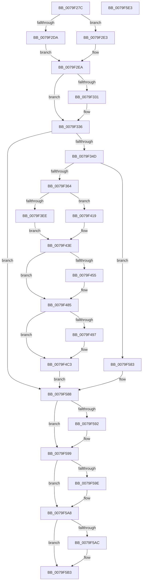

# SepAdtObjectReferenceAuditAlarm

- RVA: `0x0079F27C`–`0x0079F5E4` (길이 `872` bytes)
- VA: `0x000000014079F27C`
- 실행 섹션: `PAGE`
- PDB 이름 있음: `예`; PDB Function 태그: `아니요`
- unwind 정보 RVA: `0x000D1224`
- 디코드: `213`개 명령, `872/872` bytes 표시
- 미해석 바이트: `0` (있으면 어셈블리에 `.byte`로 보존)

> 이 문서는 커널 이미지의 기계어와 PDB 기호를 분석해 생성했습니다. 4번과 5번은 함수 원형과 자료형을 바이너리 사용 방식에서 추정한 C 해석이며 원본 소스 복구 결과는 아닙니다.

## 1. Dependencies

- 직접 호출 지점: **8**; 고유 호출 대상: **7**
- 직접 호출자로 확인된 함수: **1**
- RIP 상대 이미지 참조: **2**

### Outgoing calls
- `0x0079F2FE` → [memset](../../text/6C/memset_function_006C6C40.md) (function, `0x006C6C40`)
- `0x0079F33E` → [SepQueryNameString](../8F/SepQueryNameString_function_008F5DE8.md) (function, `0x008F5DE8`)
- `0x0079F355` → [SepQueryTypeString](../92/SepQueryTypeString_function_00920420.md) (function, `0x00920420`)
- `0x0079F57C` → [SepAdtLogAuditRecord](../../text/22/SepAdtLogAuditRecord_function_00224B6C.md) (function, `0x00224B6C`)
- `0x0079F594` → [ExFreePoolWithTag](../../poolcode/B8/ExFreePoolWithTag_function_00B82870.md) (function, `0x00B82870`)
- `0x0079F5A3` → [ExFreePoolWithTag](../../poolcode/B8/ExFreePoolWithTag_function_00B82870.md) (function, `0x00B82870`)
- `0x0079F5AE` → [SepAuditFailed](../86/SepAuditFailed_function_0086EE20.md) (function, `0x0086EE20`)
- `0x0079F5BD` → [_security_check_cookie](../../text/6A/_security_check_cookie_function_006AC640.md) (function, `0x006AC640`)

### Direct callers
- [ObpCheckObjectReference](../8C/ObpCheckObjectReference_function_008C6084.md) at `0x008C62B2`

### Static image references
- `0x0079F2A2` → RVA `0x00E0A740` (`.data`; read)
- `0x0079F393` → RVA `0x000013A8` (`.rdata`; read)

## 2. Other-region calls and transfers

- 다른 실행 섹션으로 향하는 call: **5**
  - `0x0079F2FE` → [memset](../../text/6C/memset_function_006C6C40.md) (`PAGE` → `.text`)
  - `0x0079F57C` → [SepAdtLogAuditRecord](../../text/22/SepAdtLogAuditRecord_function_00224B6C.md) (`PAGE` → `.text`)
  - `0x0079F594` → [ExFreePoolWithTag](../../poolcode/B8/ExFreePoolWithTag_function_00B82870.md) (`PAGE` → `POOLCODE`)
  - `0x0079F5A3` → [ExFreePoolWithTag](../../poolcode/B8/ExFreePoolWithTag_function_00B82870.md) (`PAGE` → `POOLCODE`)
  - `0x0079F5BD` → [_security_check_cookie](../../text/6A/_security_check_cookie_function_006AC640.md) (`PAGE` → `.text`)
- 별도 외부 분기/꼬리 이동을 확인하지 못했습니다.

## 3. Assembly (complete function range)

```asm
0079F27C  48 8B C4                        mov rax, rsp
0079F27F  48 89 58 10                     mov qword ptr [rax + 0x10], rbx
0079F283  48 89 70 18                     mov qword ptr [rax + 0x18], rsi
0079F287  48 89 78 20                     mov qword ptr [rax + 0x20], rdi
0079F28B  55                              push rbp
0079F28C  41 54                           push r12
0079F28E  41 55                           push r13
0079F290  41 56                           push r14
0079F292  41 57                           push r15
0079F294  48 8D A8 68 FC FF FF            lea rbp, [rax - 0x398]
0079F29B  48 81 EC 70 04 00 00            sub rsp, 0x470
0079F2A2  48 8B 05 97 B4 66 00            mov rax, qword ptr [rip + 0x66b497]
0079F2A9  48 33 C4                        xor rax, rsp
0079F2AC  48 89 85 60 03 00 00            mov qword ptr [rbp + 0x360], rax
0079F2B3  48 83 64 24 30 00               and qword ptr [rsp + 0x30], 0
0079F2B9  33 FF                           xor edi, edi
0079F2BB  4C 8B 32                        mov r14, qword ptr [rdx]
0079F2BE  41 8A F1                        mov sil, r9b
0079F2C1  48 8B 5A 10                     mov rbx, qword ptr [rdx + 0x10]
0079F2C5  4C 8B E2                        mov r12, rdx
0079F2C8  44 89 44 24 20                  mov dword ptr [rsp + 0x20], r8d
0079F2CD  4C 8B F9                        mov r15, rcx
0079F2D0  48 89 7C 24 28                  mov qword ptr [rsp + 0x28], rdi
0079F2D5  4D 85 F6                        test r14, r14
0079F2D8  74 09                           je 0x14079f2e3
0079F2DA  49 8B 86 98 00 00 00            mov rax, qword ptr [r14 + 0x98]
0079F2E1  EB 07                           jmp 0x14079f2ea
0079F2E3  48 8B 83 98 00 00 00            mov rax, qword ptr [rbx + 0x98]
0079F2EA  4C 8B 28                        mov r13, qword ptr [rax]
0079F2ED  48 8D 4C 24 40                  lea rcx, [rsp + 0x40]
0079F2F2  48 8B 5B 18                     mov rbx, qword ptr [rbx + 0x18]
0079F2F6  33 D2                           xor edx, edx
0079F2F8  41 B8 18 04 00 00               mov r8d, 0x418
0079F2FE  E8 3D 79 F2 FF                  call 0x1406c6c40
0079F303  21 7C 24 48                     and dword ptr [rsp + 0x48], edi
0079F307  B8 79 00 00 00                  mov eax, 0x79
0079F30C  66 89 44 24 50                  mov word ptr [rsp + 0x50], ax
0079F311  C7 44 24 40 03 00 00 00         mov dword ptr [rsp + 0x40], 3
0079F319  C7 44 24 44 53 12 00 00         mov dword ptr [rsp + 0x44], 0x1253
0079F321  8D 48 97                        lea ecx, [rax - 0x69]
0079F324  8D 41 F8                        lea eax, [rcx - 8]
0079F327  66 89 44 24 52                  mov word ptr [rsp + 0x52], ax
0079F32C  40 84 F6                        test sil, sil
0079F32F  75 05                           jne 0x14079f336
0079F331  66 89 4C 24 52                  mov word ptr [rsp + 0x52], cx
0079F336  48 8D 54 24 30                  lea rdx, [rsp + 0x30]
0079F33B  49 8B CF                        mov rcx, r15
0079F33E  E8 A5 6A 15 00                  call 0x1408f5de8
0079F343  8B F0                           mov esi, eax
0079F345  85 C0                           test eax, eax
0079F347  0F 88 3B 02 00 00               js 0x14079f588
0079F34D  48 8D 54 24 28                  lea rdx, [rsp + 0x28]
0079F352  49 8B CF                        mov rcx, r15
0079F355  E8 C6 10 18 00                  call 0x140920420
0079F35A  8B F0                           mov esi, eax
0079F35C  85 C0                           test eax, eax
0079F35E  0F 88 1F 02 00 00               js 0x14079f583
0079F364  8B 44 24 48                     mov eax, dword ptr [rsp + 0x48]
0079F368  41 BA 04 00 00 00               mov r10d, 4
0079F36E  48 C1 E0 05                     shl rax, 5
0079F372  45 8D 4A FD                     lea r9d, [r10 - 3]
0079F376  44 89 54 04 58                  mov dword ptr [rsp + rax + 0x58], r10d
0079F37B  41 0F B6 45 01                  movzx eax, byte ptr [r13 + 1]
0079F380  8D 0C 85 08 00 00 00            lea ecx, [rax*4 + 8]
0079F387  8B 44 24 48                     mov eax, dword ptr [rsp + 0x48]
0079F38B  48 C1 E0 05                     shl rax, 5
0079F38F  89 4C 04 5C                     mov dword ptr [rsp + rax + 0x5c], ecx
0079F393  48 8D 0D 0E 20 86 FF            lea rcx, [rip - 0x79dff2]
0079F39A  8B 44 24 48                     mov eax, dword ptr [rsp + 0x48]
0079F39E  48 C1 E0 05                     shl rax, 5
0079F3A2  4C 89 6C 04 70                  mov qword ptr [rsp + rax + 0x70], r13
0079F3A7  8B 44 24 48                     mov eax, dword ptr [rsp + 0x48]
0079F3AB  41 03 C1                        add eax, r9d
0079F3AE  89 44 24 48                     mov dword ptr [rsp + 0x48], eax
0079F3B2  48 C1 E0 05                     shl rax, 5
0079F3B6  44 89 4C 04 58                  mov dword ptr [rsp + rax + 0x58], r9d
0079F3BB  8B 44 24 48                     mov eax, dword ptr [rsp + 0x48]
0079F3BF  48 C1 E0 05                     shl rax, 5
0079F3C3  C7 44 04 5C 20 00 00 00         mov dword ptr [rsp + rax + 0x5c], 0x20
0079F3CB  8B 44 24 48                     mov eax, dword ptr [rsp + 0x48]
0079F3CF  48 C1 E0 05                     shl rax, 5
0079F3D3  48 89 4C 04 70                  mov qword ptr [rsp + rax + 0x70], rcx
0079F3D8  8B 44 24 48                     mov eax, dword ptr [rsp + 0x48]
0079F3DC  41 03 C1                        add eax, r9d
0079F3DF  8B C8                           mov ecx, eax
0079F3E1  48 C1 E1 05                     shl rcx, 5
0079F3E5  89 44 24 48                     mov dword ptr [rsp + 0x48], eax
0079F3E9  4D 85 F6                        test r14, r14
0079F3EC  74 2B                           je 0x14079f419
0079F3EE  49 8B 46 18                     mov rax, qword ptr [r14 + 0x18]
0079F3F2  C7 44 0C 58 05 00 00 00         mov dword ptr [rsp + rcx + 0x58], 5
0079F3FA  8B 4C 24 48                     mov ecx, dword ptr [rsp + 0x48]
0079F3FE  48 C1 E1 05                     shl rcx, 5
0079F402  C7 44 0C 5C 08 00 00 00         mov dword ptr [rsp + rcx + 0x5c], 8
0079F40A  8B 4C 24 48                     mov ecx, dword ptr [rsp + 0x48]
0079F40E  48 C1 E1 05                     shl rcx, 5
0079F412  48 89 44 0C 60                  mov qword ptr [rsp + rcx + 0x60], rax
0079F417  EB 25                           jmp 0x14079f43e
0079F419  C7 44 0C 58 05 00 00 00         mov dword ptr [rsp + rcx + 0x58], 5
0079F421  8B 44 24 48                     mov eax, dword ptr [rsp + 0x48]
0079F425  48 C1 E0 05                     shl rax, 5
0079F429  C7 44 04 5C 08 00 00 00         mov dword ptr [rsp + rax + 0x5c], 8
0079F431  8B 44 24 48                     mov eax, dword ptr [rsp + 0x48]
0079F435  48 C1 E0 05                     shl rax, 5
0079F439  48 89 5C 04 60                  mov qword ptr [rsp + rax + 0x60], rbx
0079F43E  44 8B 44 24 48                  mov r8d, dword ptr [rsp + 0x48]
0079F443  48 8B 7C 24 28                  mov rdi, qword ptr [rsp + 0x28]
0079F448  41 FF C0                        inc r8d
0079F44B  44 89 44 24 48                  mov dword ptr [rsp + 0x48], r8d
0079F450  48 85 FF                        test rdi, rdi
0079F453  74 30                           je 0x14079f485
0079F455  41 8B C0                        mov eax, r8d
0079F458  48 C1 E0 05                     shl rax, 5
0079F45C  44 89 4C 04 58                  mov dword ptr [rsp + rax + 0x58], r9d
0079F461  8B 44 24 48                     mov eax, dword ptr [rsp + 0x48]
0079F465  0F B7 0F                        movzx ecx, word ptr [rdi]
0079F468  48 C1 E0 05                     shl rax, 5
0079F46C  83 C1 10                        add ecx, 0x10
0079F46F  89 4C 04 5C                     mov dword ptr [rsp + rax + 0x5c], ecx
0079F473  8B 44 24 48                     mov eax, dword ptr [rsp + 0x48]
0079F477  48 C1 E0 05                     shl rax, 5
0079F47B  48 89 7C 04 70                  mov qword ptr [rsp + rax + 0x70], rdi
0079F480  44 8B 44 24 48                  mov r8d, dword ptr [rsp + 0x48]
0079F485  48 8B 54 24 30                  mov rdx, qword ptr [rsp + 0x30]
0079F48A  41 8D 40 01                     lea eax, [r8 + 1]
0079F48E  89 44 24 48                     mov dword ptr [rsp + 0x48], eax
0079F492  48 85 D2                        test rdx, rdx
0079F495  74 2C                           je 0x14079f4c3
0079F497  48 C1 E0 05                     shl rax, 5
0079F49B  44 89 4C 04 58                  mov dword ptr [rsp + rax + 0x58], r9d
0079F4A0  8B 44 24 48                     mov eax, dword ptr [rsp + 0x48]
0079F4A4  0F B7 0A                        movzx ecx, word ptr [rdx]
0079F4A7  48 C1 E0 05                     shl rax, 5
0079F4AB  83 C1 10                        add ecx, 0x10
0079F4AE  89 4C 04 5C                     mov dword ptr [rsp + rax + 0x5c], ecx
0079F4B2  8B 44 24 48                     mov eax, dword ptr [rsp + 0x48]
0079F4B6  48 C1 E0 05                     shl rax, 5
0079F4BA  48 89 54 04 70                  mov qword ptr [rsp + rax + 0x70], rdx
0079F4BF  8B 44 24 48                     mov eax, dword ptr [rsp + 0x48]
0079F4C3  8B 54 24 20                     mov edx, dword ptr [rsp + 0x20]
0079F4C7  41 03 C1                        add eax, r9d
0079F4CA  89 44 24 48                     mov dword ptr [rsp + 0x48], eax
0079F4CE  48 C1 E0 05                     shl rax, 5
0079F4D2  41 8B C8                        mov ecx, r8d
0079F4D5  C7 44 04 58 07 00 00 00         mov dword ptr [rsp + rax + 0x58], 7
0079F4DD  8B 44 24 48                     mov eax, dword ptr [rsp + 0x48]
0079F4E1  48 C1 E0 05                     shl rax, 5
0079F4E5  44 89 54 04 5C                  mov dword ptr [rsp + rax + 0x5c], r10d
0079F4EA  8B 44 24 48                     mov eax, dword ptr [rsp + 0x48]
0079F4EE  48 C1 E0 05                     shl rax, 5
0079F4F2  48 89 54 04 60                  mov qword ptr [rsp + rax + 0x60], rdx
0079F4F7  8B 44 24 48                     mov eax, dword ptr [rsp + 0x48]
0079F4FB  48 C1 E0 05                     shl rax, 5
0079F4FF  48 89 4C 04 68                  mov qword ptr [rsp + rax + 0x68], rcx
0079F504  8B 44 24 48                     mov eax, dword ptr [rsp + 0x48]
0079F508  41 03 C1                        add eax, r9d
0079F50B  89 44 24 48                     mov dword ptr [rsp + 0x48], eax
0079F50F  8B C8                           mov ecx, eax
0079F511  48 C1 E1 05                     shl rcx, 5
0079F515  C7 44 0C 58 0A 00 00 00         mov dword ptr [rsp + rcx + 0x58], 0xa
0079F51D  8B 44 24 48                     mov eax, dword ptr [rsp + 0x48]
0079F521  48 C1 E0 05                     shl rax, 5
0079F525  44 89 54 04 5C                  mov dword ptr [rsp + rax + 0x5c], r10d
0079F52A  8B 44 24 48                     mov eax, dword ptr [rsp + 0x48]
0079F52E  48 C1 E0 05                     shl rax, 5
0079F532  48 89 54 04 60                  mov qword ptr [rsp + rax + 0x60], rdx
0079F537  8B 44 24 48                     mov eax, dword ptr [rsp + 0x48]
0079F53B  41 03 C1                        add eax, r9d
0079F53E  89 44 24 48                     mov dword ptr [rsp + 0x48], eax
0079F542  8B C8                           mov ecx, eax
0079F544  48 C1 E1 05                     shl rcx, 5
0079F548  C7 44 0C 58 0B 00 00 00         mov dword ptr [rsp + rcx + 0x58], 0xb
0079F550  8B 44 24 48                     mov eax, dword ptr [rsp + 0x48]
0079F554  48 C1 E0 05                     shl rax, 5
0079F558  C7 44 04 5C 08 00 00 00         mov dword ptr [rsp + rax + 0x5c], 8
0079F560  8B 4C 24 48                     mov ecx, dword ptr [rsp + 0x48]
0079F564  49 8B 44 24 18                  mov rax, qword ptr [r12 + 0x18]
0079F569  48 C1 E1 05                     shl rcx, 5
0079F56D  48 89 44 0C 60                  mov qword ptr [rsp + rcx + 0x60], rax
0079F572  48 8D 4C 24 40                  lea rcx, [rsp + 0x40]
0079F577  44 01 4C 24 48                  add dword ptr [rsp + 0x48], r9d
0079F57C  E8 EB 55 A8 FF                  call 0x140224b6c
0079F581  EB 05                           jmp 0x14079f588
0079F583  48 8B 7C 24 28                  mov rdi, qword ptr [rsp + 0x28]
0079F588  48 8B 4C 24 30                  mov rcx, qword ptr [rsp + 0x30]
0079F58D  48 85 C9                        test rcx, rcx
0079F590  74 07                           je 0x14079f599
0079F592  33 D2                           xor edx, edx
0079F594  E8 D7 32 3E 00                  call 0x140b82870
0079F599  48 85 FF                        test rdi, rdi
0079F59C  74 0A                           je 0x14079f5a8
0079F59E  33 D2                           xor edx, edx
0079F5A0  48 8B CF                        mov rcx, rdi
0079F5A3  E8 C8 32 3E 00                  call 0x140b82870
0079F5A8  85 F6                           test esi, esi
0079F5AA  79 07                           jns 0x14079f5b3
0079F5AC  8B CE                           mov ecx, esi
0079F5AE  E8 6D F8 0C 00                  call 0x14086ee20
0079F5B3  48 8B 8D 60 03 00 00            mov rcx, qword ptr [rbp + 0x360]
0079F5BA  48 33 CC                        xor rcx, rsp
0079F5BD  E8 7E D0 F0 FF                  call 0x1406ac640
0079F5C2  4C 8D 9C 24 70 04 00 00         lea r11, [rsp + 0x470]
0079F5CA  49 8B 5B 38                     mov rbx, qword ptr [r11 + 0x38]
0079F5CE  49 8B 73 40                     mov rsi, qword ptr [r11 + 0x40]
0079F5D2  49 8B 7B 48                     mov rdi, qword ptr [r11 + 0x48]
0079F5D6  49 8B E3                        mov rsp, r11
0079F5D9  41 5F                           pop r15
0079F5DB  41 5E                           pop r14
0079F5DD  41 5D                           pop r13
0079F5DF  41 5C                           pop r12
0079F5E1  5D                              pop rbp
0079F5E2  C3                              ret
0079F5E3  CC                              int3
```

## 4. C-style interpretation (structured pseudocode)

```c
__int64 __fastcall SepAdtObjectReferenceAuditAlarm(__int64 a1, __int64 a2, int a3, unsigned __int8 a4)
{
    __int64 result;
    __int64 v_rdi;
    __int64 v_rsp;
    unsigned __int64 v_stack_m28;
    unsigned __int16 v_stack_m446;
    unsigned __int16 v_stack_m448;
    unsigned int v_stack_m450;
    unsigned int v_stack_m454;
    unsigned __int64 v_stack_m458;
    unsigned __int64 v_stack_m468;
    unsigned __int64 v_stack_m470;
    unsigned int v_stack_m478;

    *(unsigned __int64 *)(v_rsp + 16) = v_rbx;
    *(unsigned __int64 *)(v_rsp + 24) = v_rsi;
    *(unsigned __int64 *)(v_rsp + 32) = v_rdi;
    v_rsp = (v_rsp) - (0x470ULL);
    result = (*(unsigned __int64 *)(v_rip + 6730903)) ^ (v_rsp);
    *(unsigned __int64 *)(v_rsp - 920 + 864) = result;
    v_rdi = 0;
    v_stack_m478 = a3;
    v_stack_m470 = 0;
    if (*(unsigned __int64 *)(a2) == 0) goto loc_0079F2E3;
    goto loc_0079F2EA;
loc_0079F2E3:
loc_0079F2EA:
    a2 = 0;
    result = memset(v_stack_m458, a2, (unsigned int)(0x418ULL), a4);
    v_stack_m448 = 121;
    v_stack_m458 = 3;
    v_stack_m454 = 0x1253ULL;
    v_stack_m446 = (unsigned __int16)(121 - 105 - 8);
    if (a4 == 0) {
        v_stack_m446 = (unsigned __int16)(121 - 105);
    }
    result = SepQueryNameString(a1, v_stack_m468, (unsigned int)(0x418ULL), a4);
    if (sign_flag) goto loc_0079F588;
    result = SepQueryTypeString(a1, v_stack_m470, (unsigned int)(0x418ULL), a4);
    if (sign_flag) goto loc_0079F583;
    result = ((unsigned int)(v_stack_m450)) << (5);
    *(unsigned int *)(v_rsp + result * 1 + 88) = 4;
    result = ((unsigned int)(v_stack_m450)) << (5);
    *(unsigned int *)(v_rsp + result * 1 + 92) = (unsigned int)(*(unsigned __int8 *)(*(unsigned __int64 *)(*(unsigned __int64 *)(*(unsigned __int64 *)(a2 + 16) + 152)) + 1) * 4 + 8);
    result = ((unsigned int)(v_stack_m450)) << (5);
    *(unsigned __int64 *)(v_rsp + result * 1 + 112) = *(unsigned __int64 *)(*(unsigned __int64 *)(*(unsigned __int64 *)(a2 + 16) + 152));
    result = (unsigned int)(((unsigned int)(v_stack_m450)) + ((unsigned int)(4 - 3)));
    v_stack_m450 = (unsigned int)(result);
    result = (result) << (5);
    *(unsigned int *)(v_rsp + result * 1 + 88) = (unsigned int)(4 - 3);
    result = ((unsigned int)(v_stack_m450)) << (5);
    *(unsigned int *)(v_rsp + result * 1 + 92) = 32;
    result = ((unsigned int)(v_stack_m450)) << (5);
    *(unsigned __int64 *)(v_rsp + result * 1 + 112) = v_rip - 7987186;
    result = (unsigned int)(((unsigned int)(v_stack_m450)) + ((unsigned int)(4 - 3)));
    a1 = ((unsigned int)((unsigned int)(result))) << (5);
    v_stack_m450 = (unsigned int)(result);
    if (*(unsigned __int64 *)(a2) == 0) goto loc_0079F419;
    *(unsigned int *)(v_rsp + a1 * 1 + 88) = 5;
    a1 = ((unsigned int)(v_stack_m450)) << (5);
    *(unsigned int *)(v_rsp + a1 * 1 + 92) = 8;
    a1 = ((unsigned int)(v_stack_m450)) << (5);
    *(unsigned __int64 *)(v_rsp + a1 * 1 + 96) = *(unsigned __int64 *)(*(unsigned __int64 *)(a2) + 24);
    goto loc_0079F43E;
loc_0079F419:
    *(unsigned int *)(v_rsp + a1 * 1 + 88) = 5;
    result = ((unsigned int)(v_stack_m450)) << (5);
    *(unsigned int *)(v_rsp + result * 1 + 92) = 8;
    result = ((unsigned int)(v_stack_m450)) << (5);
    *(unsigned __int64 *)(v_rsp + result * 1 + 96) = *(unsigned __int64 *)(*(unsigned __int64 *)(a2 + 16) + 24);
loc_0079F43E:
    a3 = (unsigned int)(((unsigned int)(v_stack_m450)) + 1);
    v_stack_m450 = a3;
    if (v_stack_m470 != 0) {
        result = a3;
        result = (result) << (5);
        *(unsigned int *)(v_rsp + result * 1 + 88) = (unsigned int)(4 - 3);
        result = v_stack_m450;
        a1 = *(unsigned __int16 *)(v_stack_m470);
        result = (result) << (5);
        a1 = (unsigned int)((a1) + (16));
        *(unsigned int *)(v_rsp + result * 1 + 92) = (unsigned int)(a1);
        result = v_stack_m450;
        result = (result) << (5);
        *(unsigned __int64 *)(v_rsp + result * 1 + 112) = v_stack_m470;
        a3 = v_stack_m450;
    }
    v_stack_m450 = (unsigned int)(a3 + 1);
    result = a3 + 1;
    if (v_stack_m468 != 0) {
        result = (a3 + 1) << (5);
        *(unsigned int *)(v_rsp + result * 1 + 88) = (unsigned int)(4 - 3);
        result = v_stack_m450;
        a1 = *(unsigned __int16 *)(v_stack_m468);
        result = (result) << (5);
        a1 = (unsigned int)((a1) + (16));
        *(unsigned int *)(v_rsp + result * 1 + 92) = (unsigned int)(a1);
        result = v_stack_m450;
        result = (result) << (5);
        *(unsigned __int64 *)(v_rsp + result * 1 + 112) = v_stack_m468;
        result = v_stack_m450;
    }
    result = (unsigned int)((result) + ((unsigned int)(4 - 3)));
    v_stack_m450 = (unsigned int)(result);
    result = (result) << (5);
    *(unsigned int *)(v_rsp + result * 1 + 88) = 7;
    result = ((unsigned int)(v_stack_m450)) << (5);
    *(unsigned int *)(v_rsp + result * 1 + 92) = 4;
    result = ((unsigned int)(v_stack_m450)) << (5);
    *(unsigned __int64 *)(v_rsp + result * 1 + 96) = (unsigned int)(v_stack_m478);
    result = ((unsigned int)(v_stack_m450)) << (5);
    *(unsigned __int64 *)(v_rsp + result * 1 + 104) = (unsigned int)(a3);
    result = (unsigned int)(((unsigned int)(v_stack_m450)) + ((unsigned int)(4 - 3)));
    v_stack_m450 = (unsigned int)(result);
    a1 = ((unsigned int)((unsigned int)(result))) << (5);
    *(unsigned int *)(v_rsp + a1 * 1 + 88) = 10;
    result = ((unsigned int)(v_stack_m450)) << (5);
    *(unsigned int *)(v_rsp + result * 1 + 92) = 4;
    result = ((unsigned int)(v_stack_m450)) << (5);
    *(unsigned __int64 *)(v_rsp + result * 1 + 96) = (unsigned int)(v_stack_m478);
    result = (unsigned int)(((unsigned int)(v_stack_m450)) + ((unsigned int)(4 - 3)));
    v_stack_m450 = (unsigned int)(result);
    a1 = ((unsigned int)((unsigned int)(result))) << (5);
    *(unsigned int *)(v_rsp + a1 * 1 + 88) = 11;
    result = ((unsigned int)(v_stack_m450)) << (5);
    *(unsigned int *)(v_rsp + result * 1 + 92) = 8;
    a1 = ((unsigned int)(v_stack_m450)) << (5);
    *(unsigned __int64 *)(v_rsp + a1 * 1 + 96) = *(unsigned __int64 *)(a2 + 24);
    result = SepAdtLogAuditRecord(v_stack_m458, (unsigned int)(v_stack_m478), a3, 4 - 3);
    goto loc_0079F588;
loc_0079F583:
loc_0079F588:
    if (v_stack_m468 != 0) {
        a2 = 0;
        result = ExFreePoolWithTag(v_stack_m468, a2, a3, 4 - 3);
    }
    if (v_stack_m470 != 0) {
        a2 = 0;
        a1 = v_stack_m470;
        result = ExFreePoolWithTag(a1, a2, a3, 4 - 3);
    }
    if (sign_flag) {
        a1 = (unsigned int)((unsigned int)((unsigned int)(result)));
        result = SepAuditFailed(a1, a2, a3, 4 - 3);
    }
    a1 = (*(unsigned __int64 *)(v_rsp - 920 + 864)) ^ (v_rsp);
    result = _security_check_cookie(a1, a2, a3, 4 - 3);
    return result;
}
```

## 5. (Beta) C Style

```c
int64_t SepAdtObjectReferenceAuditAlarm(int64_t Arg1, void *Arg2, int32_t Arg3, uint8_t Arg4)
{
    uint8_t *arg2 = (uint8_t *)Arg2;

    int64_t result;
    int64_t local_rdi;
    int64_t local_rsp;
    uint64_t v_stack_m28;
    uint16_t v_stack_m446;
    uint16_t v_stack_m448;
    uint32_t v_stack_m450;
    uint32_t v_stack_m454;
    uint64_t v_stack_m458;
    uint64_t v_stack_m468;
    uint64_t v_stack_m470;
    uint32_t v_stack_m478;

    *(uint64_t *)(local_rsp + 0x10) = local_rbx;
    *(uint64_t *)(local_rsp + 0x18) = local_rsi;
    *(uint64_t *)(local_rsp + 0x20) = local_rdi;
    local_rsp = (local_rsp) - (0x470ULL);
    result = (*(uint64_t *)(v_rip + 0x66B497)) ^ (local_rsp);
    *(uint64_t *)(local_rsp - 0x398 + 0x360) = result;
    local_rdi = 0;
    v_stack_m478 = Arg3;
    v_stack_m470 = 0;
    if (*(uint64_t *)(arg2) == 0) goto loc_0079F2E3;
    goto loc_0079F2EA;
loc_0079F2E3:
loc_0079F2EA:
    Arg2 = 0;
    result = memset(v_stack_m458, Arg2, (uint32_t)(0x418ULL), Arg4);
    v_stack_m448 = 121;
    v_stack_m458 = 3;
    v_stack_m454 = 0x1253ULL;
    v_stack_m446 = (uint16_t)(121 - 105 - 8);
    if (Arg4 == 0) {
        v_stack_m446 = (uint16_t)(121 - 105);
    }
    result = SepQueryNameString(Arg1, v_stack_m468, (uint32_t)(0x418ULL), Arg4);
    if (sign_flag) goto loc_0079F588;
    result = SepQueryTypeString(Arg1, v_stack_m470, (uint32_t)(0x418ULL), Arg4);
    if (sign_flag) goto loc_0079F583;
    result = ((uint32_t)(v_stack_m450)) << (5);
    *(uint32_t *)(local_rsp + result * 1 + 0x58) = 4;
    result = ((uint32_t)(v_stack_m450)) << (5);
    *(uint32_t *)(local_rsp + result * 1 + 0x5C) = (uint32_t)(*(uint8_t *)(*(uint64_t *)(*(uint64_t *)(*(uint64_t *)(arg2 + 0x10) + 0x98)) + 0x1) * 4 + 8);
    result = ((uint32_t)(v_stack_m450)) << (5);
    *(uint64_t *)(local_rsp + result * 1 + 0x70) = *(uint64_t *)(*(uint64_t *)(*(uint64_t *)(arg2 + 0x10) + 0x98));
    result = (uint32_t)(((uint32_t)(v_stack_m450)) + ((uint32_t)(4 - 3)));
    v_stack_m450 = (uint32_t)(result);
    result = (result) << (5);
    *(uint32_t *)(local_rsp + result * 1 + 0x58) = (uint32_t)(4 - 3);
    result = ((uint32_t)(v_stack_m450)) << (5);
    *(uint32_t *)(local_rsp + result * 1 + 0x5C) = 32;
    result = ((uint32_t)(v_stack_m450)) << (5);
    *(uint64_t *)(local_rsp + result * 1 + 0x70) = v_rip - 7987186;
    result = (uint32_t)(((uint32_t)(v_stack_m450)) + ((uint32_t)(4 - 3)));
    Arg1 = ((uint32_t)((uint32_t)(result))) << (5);
    v_stack_m450 = (uint32_t)(result);
    if (*(uint64_t *)(arg2) == 0) goto loc_0079F419;
    *(uint32_t *)(local_rsp + Arg1 * 1 + 0x58) = 5;
    Arg1 = ((uint32_t)(v_stack_m450)) << (5);
    *(uint32_t *)(local_rsp + Arg1 * 1 + 0x5C) = 8;
    Arg1 = ((uint32_t)(v_stack_m450)) << (5);
    *(uint64_t *)(local_rsp + Arg1 * 1 + 0x60) = *(uint64_t *)(*(uint64_t *)(arg2) + 0x18);
    goto loc_0079F43E;
loc_0079F419:
    *(uint32_t *)(local_rsp + Arg1 * 1 + 0x58) = 5;
    result = ((uint32_t)(v_stack_m450)) << (5);
    *(uint32_t *)(local_rsp + result * 1 + 0x5C) = 8;
    result = ((uint32_t)(v_stack_m450)) << (5);
    *(uint64_t *)(local_rsp + result * 1 + 0x60) = *(uint64_t *)(*(uint64_t *)(arg2 + 0x10) + 0x18);
loc_0079F43E:
    Arg3 = (uint32_t)(((uint32_t)(v_stack_m450)) + 1);
    v_stack_m450 = Arg3;
    if (v_stack_m470 != 0) {
        result = Arg3;
        result = (result) << (5);
        *(uint32_t *)(local_rsp + result * 1 + 0x58) = (uint32_t)(4 - 3);
        result = v_stack_m450;
        Arg1 = *(uint16_t *)(v_stack_m470);
        result = (result) << (5);
        Arg1 = (uint32_t)((Arg1) + (16));
        *(uint32_t *)(local_rsp + result * 1 + 0x5C) = (uint32_t)(Arg1);
        result = v_stack_m450;
        result = (result) << (5);
        *(uint64_t *)(local_rsp + result * 1 + 0x70) = v_stack_m470;
        Arg3 = v_stack_m450;
    }
    v_stack_m450 = (uint32_t)(Arg3 + 1);
    result = Arg3 + 1;
    if (v_stack_m468 != 0) {
        result = (Arg3 + 1) << (5);
        *(uint32_t *)(local_rsp + result * 1 + 0x58) = (uint32_t)(4 - 3);
        result = v_stack_m450;
        Arg1 = *(uint16_t *)(v_stack_m468);
        result = (result) << (5);
        Arg1 = (uint32_t)((Arg1) + (16));
        *(uint32_t *)(local_rsp + result * 1 + 0x5C) = (uint32_t)(Arg1);
        result = v_stack_m450;
        result = (result) << (5);
        *(uint64_t *)(local_rsp + result * 1 + 0x70) = v_stack_m468;
        result = v_stack_m450;
    }
    result = (uint32_t)((result) + ((uint32_t)(4 - 3)));
    v_stack_m450 = (uint32_t)(result);
    result = (result) << (5);
    *(uint32_t *)(local_rsp + result * 1 + 0x58) = 7;
    result = ((uint32_t)(v_stack_m450)) << (5);
    *(uint32_t *)(local_rsp + result * 1 + 0x5C) = 4;
    result = ((uint32_t)(v_stack_m450)) << (5);
    *(uint64_t *)(local_rsp + result * 1 + 0x60) = (uint32_t)(v_stack_m478);
    result = ((uint32_t)(v_stack_m450)) << (5);
    *(uint64_t *)(local_rsp + result * 1 + 0x68) = (uint32_t)(Arg3);
    result = (uint32_t)(((uint32_t)(v_stack_m450)) + ((uint32_t)(4 - 3)));
    v_stack_m450 = (uint32_t)(result);
    Arg1 = ((uint32_t)((uint32_t)(result))) << (5);
    *(uint32_t *)(local_rsp + Arg1 * 1 + 0x58) = 10;
    result = ((uint32_t)(v_stack_m450)) << (5);
    *(uint32_t *)(local_rsp + result * 1 + 0x5C) = 4;
    result = ((uint32_t)(v_stack_m450)) << (5);
    *(uint64_t *)(local_rsp + result * 1 + 0x60) = (uint32_t)(v_stack_m478);
    result = (uint32_t)(((uint32_t)(v_stack_m450)) + ((uint32_t)(4 - 3)));
    v_stack_m450 = (uint32_t)(result);
    Arg1 = ((uint32_t)((uint32_t)(result))) << (5);
    *(uint32_t *)(local_rsp + Arg1 * 1 + 0x58) = 11;
    result = ((uint32_t)(v_stack_m450)) << (5);
    *(uint32_t *)(local_rsp + result * 1 + 0x5C) = 8;
    Arg1 = ((uint32_t)(v_stack_m450)) << (5);
    *(uint64_t *)(local_rsp + Arg1 * 1 + 0x60) = *(uint64_t *)(arg2 + 0x18);
    result = SepAdtLogAuditRecord(v_stack_m458, (uint32_t)(v_stack_m478), Arg3, 4 - 3);
    goto loc_0079F588;
loc_0079F583:
loc_0079F588:
    if (v_stack_m468 != 0) {
        Arg2 = 0;
        result = ExFreePoolWithTag(v_stack_m468, Arg2, Arg3, 4 - 3);
    }
    if (v_stack_m470 != 0) {
        Arg2 = 0;
        Arg1 = v_stack_m470;
        result = ExFreePoolWithTag(Arg1, Arg2, Arg3, 4 - 3);
    }
    if (sign_flag) {
        Arg1 = (uint32_t)((uint32_t)((uint32_t)(result)));
        result = SepAuditFailed(Arg1, Arg2, Arg3, 4 - 3);
    }
    Arg1 = (*(uint64_t *)(local_rsp - 0x398 + 0x360)) ^ (local_rsp);
    result = _security_check_cookie(Arg1, Arg2, Arg3, 4 - 3);
    return result;
}
```

### 관측된 메모리 오프셋

구조체 형식이 확인되지 않은 접근은 인자 기준의 오프셋으로만 기록했습니다.

| 기준 인자 | 오프셋 표현 | 폭 (bit) | 접근 |
|---|---:|---:|---|
| `Arg2` | `+ 0x0` | `64` | `R` |
| `Arg2` | `+ 0x10` | `64` | `R` |
| `Arg2` | `+ 0x18` | `64` | `R` |

## 6. Execution-region graph

[열기: 2D/3D 그래프와 함수 탐색 컨트롤 패널](../../../control-panel.html?section=page&rva=0x0079F27C&view=graph)

- 2D 그래프는 위에서 아래로 흐르고, 3D 그래프는 빈 공간을 드래그해 회전합니다. Shift+드래그는 이동, 휠은 확대·축소, 함수 노드 선택은 대상 보고서 이동입니다.

### Static fallback


