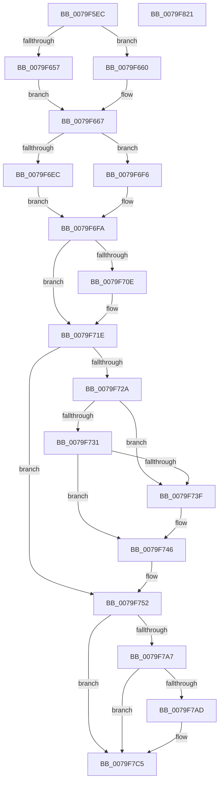

# SepAdtOpenObjectForDeleteAuditAlarm

- RVA: `0x0079F5EC`–`0x0079F822` (길이 `566` bytes)
- VA: `0x000000014079F5EC`
- 실행 섹션: `PAGE`
- PDB 이름 있음: `예`; PDB Function 태그: `아니요`
- unwind 정보 RVA: `0x000D1250`
- 디코드: `131`개 명령, `566/566` bytes 표시
- 미해석 바이트: `0` (있으면 어셈블리에 `.byte`로 보존)

> 이 문서는 커널 이미지의 기계어와 PDB 기호를 분석해 생성했습니다. 4번과 5번은 함수 원형과 자료형을 바이너리 사용 방식에서 추정한 C 해석이며 원본 소스 복구 결과는 아닙니다.

## 1. Dependencies

- 직접 호출 지점: **3**; 고유 호출 대상: **3**
- 직접 호출자로 확인된 함수: **1**
- RIP 상대 이미지 참조: **2**

### Outgoing calls
- `0x0079F67B` → [memset](../../text/6C/memset_function_006C6C40.md) (function, `0x006C6C40`)
- `0x0079F7EE` → [SepAdtLogAuditRecord](../../text/22/SepAdtLogAuditRecord_function_00224B6C.md) (function, `0x00224B6C`)
- `0x0079F800` → [_security_check_cookie](../../text/6A/_security_check_cookie_function_006AC640.md) (function, `0x006AC640`)

### Direct callers
- [sub_00B29542](../B2/Unknown_function_00B29542.md) at `0x00B296A6`

### Static image references
- `0x0079F60D` → RVA `0x00E0A740` (`.data`; read)
- `0x0079F68F` → RVA `0x000013A8` (`.rdata`; read)

## 2. Other-region calls and transfers

- 다른 실행 섹션으로 향하는 call: **3**
  - `0x0079F67B` → [memset](../../text/6C/memset_function_006C6C40.md) (`PAGE` → `.text`)
  - `0x0079F7EE` → [SepAdtLogAuditRecord](../../text/22/SepAdtLogAuditRecord_function_00224B6C.md) (`PAGE` → `.text`)
  - `0x0079F800` → [_security_check_cookie](../../text/6A/_security_check_cookie_function_006AC640.md) (`PAGE` → `.text`)
- 별도 외부 분기/꼬리 이동을 확인하지 못했습니다.

## 3. Assembly (complete function range)

```asm
0079F5EC  48 89 5C 24 10                  mov qword ptr [rsp + 0x10], rbx
0079F5F1  48 89 74 24 18                  mov qword ptr [rsp + 0x18], rsi
0079F5F6  55                              push rbp
0079F5F7  57                              push rdi
0079F5F8  41 54                           push r12
0079F5FA  41 56                           push r14
0079F5FC  41 57                           push r15
0079F5FE  48 8D AC 24 A0 FC FF FF         lea rbp, [rsp - 0x360]
0079F606  48 81 EC 60 04 00 00            sub rsp, 0x460
0079F60D  48 8B 05 2C B1 66 00            mov rax, qword ptr [rip + 0x66b12c]
0079F614  48 33 C4                        xor rax, rsp
0079F617  48 89 85 50 03 00 00            mov qword ptr [rbp + 0x350], rax
0079F61E  48 8B 85 F0 03 00 00            mov rax, qword ptr [rbp + 0x3f0]
0079F625  4C 8D A5 40 03 00 00            lea r12, [rbp + 0x340]
0079F62C  48 8B B5 B8 03 00 00            mov rsi, qword ptr [rbp + 0x3b8]
0079F633  48 85 C0                        test rax, rax
0079F636  48 8B 9D C0 03 00 00            mov rbx, qword ptr [rbp + 0x3c0]
0079F63D  0F 57 C0                        xorps xmm0, xmm0
0079F640  4C 0F 45 E0                     cmovne r12, rax
0079F644  4D 8B F1                        mov r14, r9
0079F647  44 0F B7 F9                     movzx r15d, cx
0079F64B  0F 11 85 40 03 00 00            movups xmmword ptr [rbp + 0x340], xmm0
0079F652  48 85 F6                        test rsi, rsi
0079F655  74 09                           je 0x14079f660
0079F657  48 8B BE 98 00 00 00            mov rdi, qword ptr [rsi + 0x98]
0079F65E  EB 07                           jmp 0x14079f667
0079F660  48 8B BB 98 00 00 00            mov rdi, qword ptr [rbx + 0x98]
0079F667  48 8B 3F                        mov rdi, qword ptr [rdi]
0079F66A  48 8D 4C 24 20                  lea rcx, [rsp + 0x20]
0079F66F  48 8B 5B 18                     mov rbx, qword ptr [rbx + 0x18]
0079F673  33 D2                           xor edx, edx
0079F675  41 B8 18 04 00 00               mov r8d, 0x418
0079F67B  E8 C0 75 F2 FF                  call 0x1406c6c40
0079F680  0F B6 47 01                     movzx eax, byte ptr [rdi + 1]
0079F684  41 B8 08 00 00 00               mov r8d, 8
0079F68A  48 89 7C 24 50                  mov qword ptr [rsp + 0x50], rdi
0079F68F  48 8D 15 12 1D 86 FF            lea rdx, [rip - 0x79e2ee]
0079F696  C7 44 24 20 03 00 00 00         mov dword ptr [rsp + 0x20], 3
0079F69E  66 44 89 7C 24 30               mov word ptr [rsp + 0x30], r15w
0079F6A4  C7 44 24 24 33 12 00 00         mov dword ptr [rsp + 0x24], 0x1233
0079F6AC  41 8D 78 F9                     lea edi, [r8 - 7]
0079F6B0  66 44 89 44 24 32               mov word ptr [rsp + 0x32], r8w
0079F6B6  8D 4F 1F                        lea ecx, [rdi + 0x1f]
0079F6B9  89 4C 24 5C                     mov dword ptr [rsp + 0x5c], ecx
0079F6BD  45 8D 50 FC                     lea r10d, [r8 - 4]
0079F6C1  44 89 54 24 38                  mov dword ptr [rsp + 0x38], r10d
0079F6C6  8D 04 85 08 00 00 00            lea eax, [rax*4 + 8]
0079F6CD  89 44 24 3C                     mov dword ptr [rsp + 0x3c], eax
0079F6D1  89 7C 24 58                     mov dword ptr [rsp + 0x58], edi
0079F6D5  48 89 54 24 70                  mov qword ptr [rsp + 0x70], rdx
0079F6DA  C7 44 24 78 05 00 00 00         mov dword ptr [rsp + 0x78], 5
0079F6E2  44 89 44 24 7C                  mov dword ptr [rsp + 0x7c], r8d
0079F6E7  48 85 F6                        test rsi, rsi
0079F6EA  74 0A                           je 0x14079f6f6
0079F6EC  48 8B 46 18                     mov rax, qword ptr [rsi + 0x18]
0079F6F0  48 89 45 80                     mov qword ptr [rbp - 0x80], rax
0079F6F4  EB 04                           jmp 0x14079f6fa
0079F6F6  48 89 5D 80                     mov qword ptr [rbp - 0x80], rbx
0079F6FA  48 89 55 B0                     mov qword ptr [rbp - 0x50], rdx
0079F6FE  BA 10 00 00 00                  mov edx, 0x10
0079F703  89 7D 98                        mov dword ptr [rbp - 0x68], edi
0079F706  89 4D 9C                        mov dword ptr [rbp - 0x64], ecx
0079F709  4D 85 F6                        test r14, r14
0079F70C  74 10                           je 0x14079f71e
0079F70E  41 0F B7 06                     movzx eax, word ptr [r14]
0079F712  03 C2                           add eax, edx
0079F714  89 7D B8                        mov dword ptr [rbp - 0x48], edi
0079F717  89 45 BC                        mov dword ptr [rbp - 0x44], eax
0079F71A  4C 89 75 D0                     mov qword ptr [rbp - 0x30], r14
0079F71E  48 8B 8D B0 03 00 00            mov rcx, qword ptr [rbp + 0x3b0]
0079F725  48 85 C9                        test rcx, rcx
0079F728  74 28                           je 0x14079f752
0079F72A  66 41 83 FF 75                  cmp r15w, 0x75
0079F72F  74 0E                           je 0x14079f73f
0079F731  B8 81 00 00 00                  mov eax, 0x81
0079F736  89 7D D8                        mov dword ptr [rbp - 0x28], edi
0079F739  66 44 3B F8                     cmp r15w, ax
0079F73D  75 07                           jne 0x14079f746
0079F73F  C7 45 D8 02 00 00 00            mov dword ptr [rbp - 0x28], 2
0079F746  0F B7 01                        movzx eax, word ptr [rcx]
0079F749  03 C2                           add eax, edx
0079F74B  48 89 4D F0                     mov qword ptr [rbp - 0x10], rcx
0079F74F  89 45 DC                        mov dword ptr [rbp - 0x24], eax
0079F752  8B 85 D0 03 00 00               mov eax, dword ptr [rbp + 0x3d0]
0079F758  41 B9 0B 00 00 00               mov r9d, 0xb
0079F75E  48 83 65 00 00                  and qword ptr [rbp], 0
0079F763  89 55 1C                        mov dword ptr [rbp + 0x1c], edx
0079F766  48 8B 95 D8 03 00 00            mov rdx, qword ptr [rbp + 0x3d8]
0079F76D  44 89 4D F8                     mov dword ptr [rbp - 8], r9d
0079F771  44 89 45 FC                     mov dword ptr [rbp - 4], r8d
0079F775  C7 45 18 0D 00 00 00            mov dword ptr [rbp + 0x18], 0xd
0079F77C  4C 89 65 30                     mov qword ptr [rbp + 0x30], r12
0079F780  C7 45 38 07 00 00 00            mov dword ptr [rbp + 0x38], 7
0079F787  44 89 55 3C                     mov dword ptr [rbp + 0x3c], r10d
0079F78B  48 89 45 40                     mov qword ptr [rbp + 0x40], rax
0079F78F  4C 89 55 48                     mov qword ptr [rbp + 0x48], r10
0079F793  C7 45 58 0A 00 00 00            mov dword ptr [rbp + 0x58], 0xa
0079F79A  44 89 55 5C                     mov dword ptr [rbp + 0x5c], r10d
0079F79E  48 89 45 60                     mov qword ptr [rbp + 0x60], rax
0079F7A2  48 85 D2                        test rdx, rdx
0079F7A5  74 1E                           je 0x14079f7c5
0079F7A7  8B 0A                           mov ecx, dword ptr [rdx]
0079F7A9  85 C9                           test ecx, ecx
0079F7AB  74 18                           je 0x14079f7c5
0079F7AD  8D 0C 49                        lea ecx, [rcx + rcx*2]
0079F7B0  44 89 45 78                     mov dword ptr [rbp + 0x78], r8d
0079F7B4  8D 0C 8D 08 00 00 00            lea ecx, [rcx*4 + 8]
0079F7BB  48 89 95 90 00 00 00            mov qword ptr [rbp + 0x90], rdx
0079F7C2  89 4D 7C                        mov dword ptr [rbp + 0x7c], ecx
0079F7C5  48 8B 8D E8 03 00 00            mov rcx, qword ptr [rbp + 0x3e8]
0079F7CC  48 89 8D A0 00 00 00            mov qword ptr [rbp + 0xa0], rcx
0079F7D3  48 8D 4C 24 20                  lea rcx, [rsp + 0x20]
0079F7D8  44 89 8D 98 00 00 00            mov dword ptr [rbp + 0x98], r9d
0079F7DF  44 89 85 9C 00 00 00            mov dword ptr [rbp + 0x9c], r8d
0079F7E6  C7 44 24 28 0C 00 00 00         mov dword ptr [rsp + 0x28], 0xc
0079F7EE  E8 79 53 A8 FF                  call 0x140224b6c
0079F7F3  40 8A C7                        mov al, dil
0079F7F6  48 8B 8D 50 03 00 00            mov rcx, qword ptr [rbp + 0x350]
0079F7FD  48 33 CC                        xor rcx, rsp
0079F800  E8 3B CE F0 FF                  call 0x1406ac640
0079F805  4C 8D 9C 24 60 04 00 00         lea r11, [rsp + 0x460]
0079F80D  49 8B 5B 38                     mov rbx, qword ptr [r11 + 0x38]
0079F811  49 8B 73 40                     mov rsi, qword ptr [r11 + 0x40]
0079F815  49 8B E3                        mov rsp, r11
0079F818  41 5F                           pop r15
0079F81A  41 5E                           pop r14
0079F81C  41 5C                           pop r12
0079F81E  5F                              pop rdi
0079F81F  5D                              pop rbp
0079F820  C3                              ret
0079F821  CC                              int3
```

## 4. C-style interpretation (structured pseudocode)

```c
__int64 __fastcall SepAdtOpenObjectForDeleteAuditAlarm(unsigned __int16 a1, int a2, __int64 a3, __int64 a4, __int64 a5, __int64 a6, __int64 a7, __int64 a8, unsigned int a9, __int64 a10, __int64 a11, __int64 a12, __int64 a13)
{
    __int64 result;
    __int64 v_r12;
    __int64 v_rsp;
    unsigned __int64 v_stack_m28;
    unsigned __int64 v_stack_m2E8;
    unsigned int v_stack_m2EC;
    unsigned int v_stack_m2F0;
    unsigned __int64 v_stack_m2F8;
    unsigned int v_stack_m30C;
    unsigned int v_stack_m310;
    unsigned __int64 v_stack_m328;
    unsigned int v_stack_m32C;
    unsigned int v_stack_m330;
    unsigned __int64 v_stack_m340;
    unsigned __int64 v_stack_m348;
    unsigned int v_stack_m34C;
    unsigned int v_stack_m350;
    unsigned __int64 v_stack_m358;
    unsigned int v_stack_m36C;
    unsigned int v_stack_m370;
    unsigned __int64 v_stack_m38;
    unsigned __int64 v_stack_m388;
    unsigned int v_stack_m38C;
    unsigned int v_stack_m390;
    unsigned __int64 v_stack_m398;
    unsigned int v_stack_m3AC;
    unsigned int v_stack_m3B0;
    unsigned __int64 v_stack_m3B8;
    unsigned int v_stack_m3CC;
    unsigned int v_stack_m3D0;
    unsigned __int64 v_stack_m3D8;
    unsigned int v_stack_m3EC;
    unsigned int v_stack_m3F0;
    unsigned __int64 v_stack_m408;
    unsigned int v_stack_m40C;
    unsigned int v_stack_m410;
    unsigned __int64 v_stack_m418;
    unsigned int v_stack_m42C;
    unsigned int v_stack_m430;
    unsigned __int64 v_stack_m438;
    unsigned int v_stack_m44C;
    unsigned int v_stack_m450;
    unsigned __int16 v_stack_m456;
    unsigned __int16 v_stack_m458;
    unsigned int v_stack_m460;
    unsigned int v_stack_m464;
    unsigned __int64 v_stack_m468;
    unsigned __int64 v_stack_m48;
    unsigned __int64 v_stack_p10;
    unsigned __int64 v_stack_p18;

    v_stack_p10 = v_rbx;
    v_stack_p18 = v_rsi;
    v_rsp = (v_rsp) - (0x460ULL);
    result = (*(unsigned __int64 *)(v_rip + 6730028)) ^ (v_rsp);
    v_stack_m38 = result;
    v_r12 = v_stack_m48;
    if (a13 != 0) { v_r12 = a13; }
    v_stack_m48 = v_xmm0;
    if (a6 == 0) goto loc_0079F660;
    goto loc_0079F667;
loc_0079F660:
loc_0079F667:
    a2 = 0;
    result = memset(v_stack_m468, a2, (unsigned int)(0x418ULL), a4);
    v_stack_m438 = *(unsigned __int64 *)(*(unsigned __int64 *)(a7 + 152));
    v_stack_m468 = 3;
    v_stack_m458 = a1;
    v_stack_m464 = 0x1233ULL;
    v_stack_m456 = 8;
    v_stack_m42C = (unsigned int)(8 - 7 + 31);
    v_stack_m450 = (unsigned int)(8 - 4);
    v_stack_m44C = (unsigned int)(*(unsigned __int8 *)(*(unsigned __int64 *)(*(unsigned __int64 *)(a7 + 152)) + 1) * 4 + 8);
    v_stack_m430 = (unsigned int)(8 - 7);
    v_stack_m418 = v_rip - 7987950;
    v_stack_m410 = 5;
    v_stack_m40C = 8;
    if (a6 == 0) goto loc_0079F6F6;
    v_stack_m408 = *(unsigned __int64 *)(a6 + 24);
    goto loc_0079F6FA;
loc_0079F6F6:
    v_stack_m408 = *(unsigned __int64 *)(a7 + 24);
loc_0079F6FA:
    v_stack_m3D8 = v_rip - 7987950;
    v_stack_m3F0 = (unsigned int)(8 - 7);
    v_stack_m3EC = (unsigned int)(8 - 7 + 31);
    result = *(unsigned __int64 *)(a6 + 24);
    if (a4 != 0) {
        result = *(unsigned __int16 *)(a4);
        result = (unsigned int)((result) + (16));
        v_stack_m3D0 = (unsigned int)(8 - 7);
        v_stack_m3CC = (unsigned int)(result);
        v_stack_m3B8 = a4;
    }
    if (a5 == 0) goto loc_0079F752;
    if (a1 == 117) goto loc_0079F73F;
    v_stack_m3B0 = (unsigned int)(8 - 7);
    if (a1 == 129) {
        v_stack_m3B0 = 2;
    }
    result = (unsigned int)((*(unsigned __int16 *)(a5)) + (16));
    v_stack_m398 = a5;
    v_stack_m3AC = (unsigned int)(result);
loc_0079F752:
    v_stack_m36C = 16;
    v_stack_m390 = 11;
    v_stack_m38C = 8;
    v_stack_m370 = 13;
    v_stack_m358 = v_r12;
    v_stack_m350 = 7;
    v_stack_m34C = (unsigned int)(8 - 4);
    v_stack_m348 = (unsigned int)(a9);
    v_stack_m340 = 8 - 4;
    v_stack_m330 = 10;
    v_stack_m32C = (unsigned int)(8 - 4);
    v_stack_m328 = (unsigned int)(a9);
    if (a10 == 0) goto loc_0079F7C5;
    if ((unsigned int)((unsigned int)(*(unsigned int *)(a10))) != 0) {
        a1 = (unsigned int)(*(unsigned int *)(a10)) + (unsigned int)(*(unsigned int *)(a10)) * 2;
        v_stack_m310 = 8;
        a1 = a1 * 4 + 8;
        v_stack_m2F8 = a10;
        v_stack_m30C = a1;
    }
    v_stack_m2E8 = a12;
    v_stack_m2F0 = 11;
    v_stack_m2EC = 8;
    v_stack_m460 = 12;
    result = SepAdtLogAuditRecord(v_stack_m468, a10, 8, 11);
    a1 = (v_stack_m38) ^ (v_rsp);
    result = _security_check_cookie(a1, a10, 8, 11);
    return result;
}
```

## 5. (Beta) C Style

```c
int64_t SepAdtOpenObjectForDeleteAuditAlarm(uint16_t Arg1, int32_t Arg2, int64_t Arg3, int64_t Arg4, int64_t Arg5, int64_t Arg6, void *Arg7, uint64_t Arg8, uint32_t Arg9, int64_t Arg10, uint64_t Arg11, int64_t Arg12, int64_t Arg13)
{
    uint8_t *arg7 = (uint8_t *)Arg7;

    int64_t result;
    int64_t local_r12;
    int64_t local_rsp;
    uint64_t v_stack_m28;
    uint64_t v_stack_m2E8;
    uint32_t v_stack_m2EC;
    uint32_t v_stack_m2F0;
    uint64_t v_stack_m2F8;
    uint32_t v_stack_m30C;
    uint32_t v_stack_m310;
    uint64_t v_stack_m328;
    uint32_t v_stack_m32C;
    uint32_t v_stack_m330;
    uint64_t v_stack_m340;
    uint64_t v_stack_m348;
    uint32_t v_stack_m34C;
    uint32_t v_stack_m350;
    uint64_t v_stack_m358;
    uint32_t v_stack_m36C;
    uint32_t v_stack_m370;
    uint64_t v_stack_m38;
    uint64_t v_stack_m388;
    uint32_t v_stack_m38C;
    uint32_t v_stack_m390;
    uint64_t v_stack_m398;
    uint32_t v_stack_m3AC;
    uint32_t v_stack_m3B0;
    uint64_t v_stack_m3B8;
    uint32_t v_stack_m3CC;
    uint32_t v_stack_m3D0;
    uint64_t v_stack_m3D8;
    uint32_t v_stack_m3EC;
    uint32_t v_stack_m3F0;
    uint64_t v_stack_m408;
    uint32_t v_stack_m40C;
    uint32_t v_stack_m410;
    uint64_t v_stack_m418;
    uint32_t v_stack_m42C;
    uint32_t v_stack_m430;
    uint64_t v_stack_m438;
    uint32_t v_stack_m44C;
    uint32_t v_stack_m450;
    uint16_t v_stack_m456;
    uint16_t v_stack_m458;
    uint32_t v_stack_m460;
    uint32_t v_stack_m464;
    uint64_t v_stack_m468;
    uint64_t v_stack_m48;
    uint64_t v_stack_p10;
    uint64_t v_stack_p18;

    v_stack_p10 = local_rbx;
    v_stack_p18 = local_rsi;
    local_rsp = (local_rsp) - (0x460ULL);
    result = (*(uint64_t *)(v_rip + 0x66B12C)) ^ (local_rsp);
    v_stack_m38 = result;
    local_r12 = v_stack_m48;
    if (Arg13 != 0) { local_r12 = Arg13; }
    v_stack_m48 = v_xmm0;
    if (Arg6 == 0) goto loc_0079F660;
    goto loc_0079F667;
loc_0079F660:
loc_0079F667:
    Arg2 = 0;
    result = memset(v_stack_m468, Arg2, (uint32_t)(0x418ULL), Arg4);
    v_stack_m438 = *(uint64_t *)(*(uint64_t *)(arg7 + 0x98));
    v_stack_m468 = 3;
    v_stack_m458 = Arg1;
    v_stack_m464 = 0x1233ULL;
    v_stack_m456 = 8;
    v_stack_m42C = (uint32_t)(8 - 7 + 31);
    v_stack_m450 = (uint32_t)(8 - 4);
    v_stack_m44C = (uint32_t)(*(uint8_t *)(*(uint64_t *)(*(uint64_t *)(arg7 + 0x98)) + 0x1) * 4 + 8);
    v_stack_m430 = (uint32_t)(8 - 7);
    v_stack_m418 = v_rip - 7987950;
    v_stack_m410 = 5;
    v_stack_m40C = 8;
    if (Arg6 == 0) goto loc_0079F6F6;
    v_stack_m408 = *(uint64_t *)(Arg6 + 0x18);
    goto loc_0079F6FA;
loc_0079F6F6:
    v_stack_m408 = *(uint64_t *)(arg7 + 0x18);
loc_0079F6FA:
    v_stack_m3D8 = v_rip - 7987950;
    v_stack_m3F0 = (uint32_t)(8 - 7);
    v_stack_m3EC = (uint32_t)(8 - 7 + 31);
    result = *(uint64_t *)(Arg6 + 0x18);
    if (Arg4 != 0) {
        result = *(uint16_t *)(Arg4);
        result = (uint32_t)((result) + (16));
        v_stack_m3D0 = (uint32_t)(8 - 7);
        v_stack_m3CC = (uint32_t)(result);
        v_stack_m3B8 = Arg4;
    }
    if (Arg5 == 0) goto loc_0079F752;
    if (Arg1 == 117) goto loc_0079F73F;
    v_stack_m3B0 = (uint32_t)(8 - 7);
    if (Arg1 == 129) {
        v_stack_m3B0 = 2;
    }
    result = (uint32_t)((*(uint16_t *)(Arg5)) + (16));
    v_stack_m398 = Arg5;
    v_stack_m3AC = (uint32_t)(result);
loc_0079F752:
    v_stack_m36C = 16;
    v_stack_m390 = 11;
    v_stack_m38C = 8;
    v_stack_m370 = 13;
    v_stack_m358 = local_r12;
    v_stack_m350 = 7;
    v_stack_m34C = (uint32_t)(8 - 4);
    v_stack_m348 = (uint32_t)(Arg9);
    v_stack_m340 = 8 - 4;
    v_stack_m330 = 10;
    v_stack_m32C = (uint32_t)(8 - 4);
    v_stack_m328 = (uint32_t)(Arg9);
    if (Arg10 == 0) goto loc_0079F7C5;
    if ((uint32_t)((uint32_t)(*(uint32_t *)(Arg10))) != 0) {
        Arg1 = (uint32_t)(*(uint32_t *)(Arg10)) + (uint32_t)(*(uint32_t *)(Arg10)) * 2;
        v_stack_m310 = 8;
        Arg1 = Arg1 * 4 + 8;
        v_stack_m2F8 = Arg10;
        v_stack_m30C = Arg1;
    }
    v_stack_m2E8 = Arg12;
    v_stack_m2F0 = 11;
    v_stack_m2EC = 8;
    v_stack_m460 = 12;
    result = SepAdtLogAuditRecord(v_stack_m468, Arg10, 8, 11);
    Arg1 = (v_stack_m38) ^ (local_rsp);
    result = _security_check_cookie(Arg1, Arg10, 8, 11);
    return result;
}
```

### 관측된 메모리 오프셋

구조체 형식이 확인되지 않은 접근은 인자 기준의 오프셋으로만 기록했습니다.

| 기준 인자 | 오프셋 표현 | 폭 (bit) | 접근 |
|---|---:|---:|---|
| `Arg7` | `+ 0x18` | `64` | `R` |
| `Arg7` | `+ 0x98` | `64` | `R` |

## 6. Execution-region graph

[열기: 2D/3D 그래프와 함수 탐색 컨트롤 패널](../../../control-panel.html?section=page&rva=0x0079F5EC&view=graph)

- 2D 그래프는 위에서 아래로 흐르고, 3D 그래프는 빈 공간을 드래그해 회전합니다. Shift+드래그는 이동, 휠은 확대·축소, 함수 노드 선택은 대상 보고서 이동입니다.

### Static fallback


