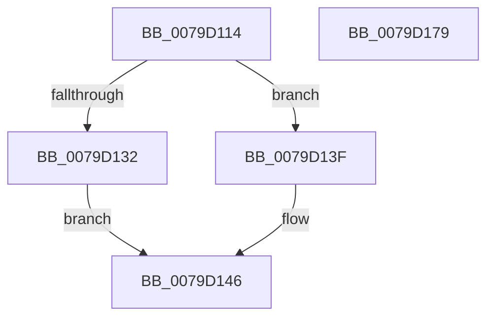

# SepAppendPrimaryGroup

- RVA: `0x0079D114`–`0x0079D17A` (길이 `102` bytes)
- VA: `0x000000014079D114`
- 실행 섹션: `PAGE`
- PDB 이름 있음: `예`; PDB Function 태그: `아니요`
- unwind 정보 RVA: `0x00060BC4`
- 디코드: `25`개 명령, `102/102` bytes 표시
- 미해석 바이트: `0` (있으면 어셈블리에 `.byte`로 보존)

> 이 문서는 커널 이미지의 기계어와 PDB 기호를 분석해 생성했습니다. 4번과 5번은 함수 원형과 자료형을 바이너리 사용 방식에서 추정한 C 해석이며 원본 소스 복구 결과는 아닙니다.

## 1. Dependencies

- 직접 호출 지점: **1**; 고유 호출 대상: **1**
- 직접 호출자로 확인된 함수: **1**
- RIP 상대 이미지 참조: **0**

### Outgoing calls
- `0x0079D157` → [memcpy](../../text/6C/memcpy_function_006C6840.md) (function, `0x006C6840`)

### Direct callers
- [NtSetInformationToken](../AF/NtSetInformationToken_function_00AF0530.md) at `0x00AF0A52`

### Static image references
- 디코드된 RIP-relative 메모리 참조가 없습니다.

## 2. Other-region calls and transfers

- 다른 실행 섹션으로 향하는 call: **1**
  - `0x0079D157` → [memcpy](../../text/6C/memcpy_function_006C6840.md) (`PAGE` → `.text`)
- 별도 외부 분기/꼬리 이동을 확인하지 못했습니다.

## 3. Assembly (complete function range)

```asm
0079D114  48 89 5C 24 08                  mov qword ptr [rsp + 8], rbx
0079D119  48 89 74 24 10                  mov qword ptr [rsp + 0x10], rsi
0079D11E  57                              push rdi
0079D11F  48 83 EC 20                     sub rsp, 0x20
0079D123  48 8B 81 B8 00 00 00            mov rax, qword ptr [rcx + 0xb8]
0079D12A  48 8B F9                        mov rdi, rcx
0079D12D  48 85 C0                        test rax, rax
0079D130  74 0D                           je 0x14079d13f
0079D132  0F B7 70 02                     movzx esi, word ptr [rax + 2]
0079D136  48 03 B1 B0 00 00 00            add rsi, qword ptr [rcx + 0xb0]
0079D13D  EB 07                           jmp 0x14079d146
0079D13F  48 8B B1 B0 00 00 00            mov rsi, qword ptr [rcx + 0xb0]
0079D146  0F B6 42 01                     movzx eax, byte ptr [rdx + 1]
0079D14A  48 8B CE                        mov rcx, rsi
0079D14D  8D 1C 85 08 00 00 00            lea ebx, [rax*4 + 8]
0079D154  44 8B C3                        mov r8d, ebx
0079D157  E8 E4 96 F2 FF                  call 0x1406c6840
0079D15C  29 9F 8C 00 00 00               sub dword ptr [rdi + 0x8c], ebx
0079D162  48 8B 5C 24 30                  mov rbx, qword ptr [rsp + 0x30]
0079D167  48 89 B7 A8 00 00 00            mov qword ptr [rdi + 0xa8], rsi
0079D16E  48 8B 74 24 38                  mov rsi, qword ptr [rsp + 0x38]
0079D173  48 83 C4 20                     add rsp, 0x20
0079D177  5F                              pop rdi
0079D178  C3                              ret
0079D179  CC                              int3
```

## 4. C-style interpretation (structured pseudocode)

```c
__int64 __fastcall SepAppendPrimaryGroup(__int64 a1, __int64 a2)
{
    __int64 result;
    __int64 v_rsi;
    __int64 v_rsp;
    unsigned __int64 v_stack_p10;
    unsigned __int64 v_stack_p8;

    v_stack_p8 = v_rbx;
    v_stack_p10 = v_rsi;
    v_rsp = (v_rsp) - (32);
    if (*(unsigned __int64 *)(a1 + 184) == 0) goto loc_0079D13F;
    v_rsi = (*(unsigned __int16 *)(*(unsigned __int64 *)(a1 + 184) + 2)) + (*(unsigned __int64 *)(a1 + 176));
    goto loc_0079D146;
loc_0079D13F:
loc_0079D146:
    result = memcpy(*(unsigned __int64 *)(a1 + 176), a2, (unsigned int)((unsigned int)(*(unsigned __int8 *)(a2 + 1) * 4 + 8)), a4);
    *(unsigned __int64 *)(a1 + 168) = *(unsigned __int64 *)(a1 + 176);
    v_rsp = (v_rsp) + (32);
    return result;
}
```

## 5. (Beta) C Style

```c
int64_t SepAppendPrimaryGroup(void *Arg1, void *Arg2)
{
    uint8_t *arg1 = (uint8_t *)Arg1;
    uint8_t *arg2 = (uint8_t *)Arg2;

    int64_t result;
    int64_t local_rsi;
    int64_t local_rsp;
    uint64_t v_stack_p10;
    uint64_t v_stack_p8;

    v_stack_p8 = local_rbx;
    v_stack_p10 = local_rsi;
    local_rsp = (local_rsp) - (32);
    if (*(uint64_t *)(arg1 + 0xB8) == 0) goto loc_0079D13F;
    local_rsi = (*(uint16_t *)(*(uint64_t *)(arg1 + 0xB8) + 0x2)) + (*(uint64_t *)(arg1 + 0xB0));
    goto loc_0079D146;
loc_0079D13F:
loc_0079D146:
    result = memcpy(*(uint64_t *)(arg1 + 0xB0), Arg2, (uint32_t)((uint32_t)(*(uint8_t *)(arg2 + 0x1) * 4 + 8)), a4);
    *(uint64_t *)(arg1 + 0xA8) = *(uint64_t *)(arg1 + 0xB0);
    local_rsp = (local_rsp) + (32);
    return result;
}
```

### 관측된 메모리 오프셋

구조체 형식이 확인되지 않은 접근은 인자 기준의 오프셋으로만 기록했습니다.

| 기준 인자 | 오프셋 표현 | 폭 (bit) | 접근 |
|---|---:|---:|---|
| `Arg1` | `+ 0x8C` | `32` | `R/W` |
| `Arg1` | `+ 0xA8` | `64` | `W` |
| `Arg1` | `+ 0xB0` | `64` | `R` |
| `Arg1` | `+ 0xB8` | `64` | `R` |
| `Arg2` | `+ 0x1` | `8` | `R` |

## 6. Execution-region graph

[열기: 2D/3D 그래프와 함수 탐색 컨트롤 패널](../../../control-panel.html?section=page&rva=0x0079D114&view=graph)

- 2D 그래프는 위에서 아래로 흐르고, 3D 그래프는 빈 공간을 드래그해 회전합니다. Shift+드래그는 이동, 휠은 확대·축소, 함수 노드 선택은 대상 보고서 이동입니다.

### Static fallback


