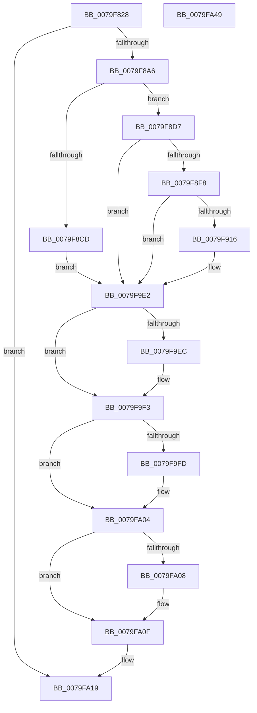

# SepAuditAssignPrimaryToken

- RVA: `0x0079F828`–`0x0079FA4A` (길이 `546` bytes)
- VA: `0x000000014079F828`
- 실행 섹션: `PAGE`
- PDB 이름 있음: `예`; PDB Function 태그: `아니요`
- unwind 정보 RVA: `0x000D11D8`
- 디코드: `131`개 명령, `546/546` bytes 표시
- 미해석 바이트: `0` (있으면 어셈블리에 `.byte`로 보존)

> 이 문서는 커널 이미지의 기계어와 PDB 기호를 분석해 생성했습니다. 4번과 5번은 함수 원형과 자료형을 바이너리 사용 방식에서 추정한 C 해석이며 원본 소스 복구 결과는 아닙니다.

## 1. Dependencies

- 직접 호출 지점: **11**; 고유 호출 대상: **9**
- 직접 호출자로 확인된 함수: **2**
- RIP 상대 이미지 참조: **2**

### Outgoing calls
- `0x0079F88B` → [memset](../../text/6C/memset_function_006C6C40.md) (function, `0x006C6C40`)
- `0x0079F890` → [PsGetCurrentThreadProcess](../../text/47/PsGetCurrentThreadProcess_function_0047C7E0.md) (function, `0x0047C7E0`)
- `0x0079F8B2` → [SeCaptureSubjectContext](../86/SeCaptureSubjectContext_function_0086B820.md) (function, `0x0086B820`)
- `0x0079F8E9` → [PsGetAllocatedFullProcessImageNameEx](../91/PsGetAllocatedFullProcessImageNameEx_function_0091D6F0.md) (function, `0x0091D6F0`)
- `0x0079F907` → [PsGetAllocatedFullProcessImageNameEx](../91/PsGetAllocatedFullProcessImageNameEx_function_0091D6F0.md) (function, `0x0091D6F0`)
- `0x0079F9DD` → [SepAdtLogAuditRecord](../../text/22/SepAdtLogAuditRecord_function_00224B6C.md) (function, `0x00224B6C`)
- `0x0079F9EE` → [ExFreePoolWithTag](../../poolcode/B8/ExFreePoolWithTag_function_00B82870.md) (function, `0x00B82870`)
- `0x0079F9FF` → [ExFreePoolWithTag](../../poolcode/B8/ExFreePoolWithTag_function_00B82870.md) (function, `0x00B82870`)
- `0x0079FA0A` → [SepAuditFailed](../86/SepAuditFailed_function_0086EE20.md) (function, `0x0086EE20`)
- `0x0079FA14` → [SeReleaseSubjectContext](../86/SeReleaseSubjectContext_function_0086B710.md) (function, `0x0086B710`)
- `0x0079FA23` → [_security_check_cookie](../../text/6A/_security_check_cookie_function_006AC640.md) (function, `0x006AC640`)

### Direct callers
- [SeExchangePrimaryToken](../7A/SeExchangePrimaryToken_function_007A07BC.md) at `0x007A09D4`
- [SeAssignPrimaryToken](../9F/SeAssignPrimaryToken_function_009F117C.md) at `0x009F1202`

### Static image references
- `0x0079F84E` → RVA `0x00E0A740` (`.data`; read)
- `0x0079F95E` → RVA `0x000013A8` (`.rdata`; read)

## 2. Other-region calls and transfers

- 다른 실행 섹션으로 향하는 call: **6**
  - `0x0079F88B` → [memset](../../text/6C/memset_function_006C6C40.md) (`PAGE` → `.text`)
  - `0x0079F890` → [PsGetCurrentThreadProcess](../../text/47/PsGetCurrentThreadProcess_function_0047C7E0.md) (`PAGE` → `.text`)
  - `0x0079F9DD` → [SepAdtLogAuditRecord](../../text/22/SepAdtLogAuditRecord_function_00224B6C.md) (`PAGE` → `.text`)
  - `0x0079F9EE` → [ExFreePoolWithTag](../../poolcode/B8/ExFreePoolWithTag_function_00B82870.md) (`PAGE` → `POOLCODE`)
  - `0x0079F9FF` → [ExFreePoolWithTag](../../poolcode/B8/ExFreePoolWithTag_function_00B82870.md) (`PAGE` → `POOLCODE`)
  - `0x0079FA23` → [_security_check_cookie](../../text/6A/_security_check_cookie_function_006AC640.md) (`PAGE` → `.text`)
- 별도 외부 분기/꼬리 이동을 확인하지 못했습니다.

## 3. Assembly (complete function range)

```asm
0079F828  48 8B C4                        mov rax, rsp
0079F82B  48 89 58 10                     mov qword ptr [rax + 0x10], rbx
0079F82F  48 89 70 18                     mov qword ptr [rax + 0x18], rsi
0079F833  48 89 78 20                     mov qword ptr [rax + 0x20], rdi
0079F837  55                              push rbp
0079F838  41 54                           push r12
0079F83A  41 55                           push r13
0079F83C  41 56                           push r14
0079F83E  41 57                           push r15
0079F840  48 8D A8 58 FC FF FF            lea rbp, [rax - 0x3a8]
0079F847  48 81 EC 80 04 00 00            sub rsp, 0x480
0079F84E  48 8B 05 EB AE 66 00            mov rax, qword ptr [rip + 0x66aeeb]
0079F855  48 33 C4                        xor rax, rsp
0079F858  48 89 85 70 03 00 00            mov qword ptr [rbp + 0x370], rax
0079F85F  48 83 64 24 28 00               and qword ptr [rsp + 0x28], 0
0079F865  0F 57 C0                        xorps xmm0, xmm0
0079F868  48 83 64 24 20 00               and qword ptr [rsp + 0x20], 0
0079F86E  4C 8B EA                        mov r13, rdx
0079F871  48 8B F1                        mov rsi, rcx
0079F874  33 D2                           xor edx, edx
0079F876  48 8D 4C 24 50                  lea rcx, [rsp + 0x50]
0079F87B  41 B8 18 04 00 00               mov r8d, 0x418
0079F881  0F 11 44 24 30                  movups xmmword ptr [rsp + 0x30], xmm0
0079F886  0F 11 44 24 40                  movups xmmword ptr [rsp + 0x40], xmm0
0079F88B  E8 B0 73 F2 FF                  call 0x1406c6c40
0079F890  E8 4B CF CD FF                  call 0x14047c7e0
0079F895  48 8B D8                        mov rbx, rax
0079F898  48 83 B8 50 03 00 00 00         cmp qword ptr [rax + 0x350], 0
0079F8A0  0F 84 73 01 00 00               je 0x14079fa19
0079F8A6  4C 8B A0 D0 01 00 00            mov r12, qword ptr [rax + 0x1d0]
0079F8AD  48 8D 4C 24 30                  lea rcx, [rsp + 0x30]
0079F8B2  E8 69 BF 0C 00                  call 0x14086b820
0079F8B7  48 8B 4C 24 30                  mov rcx, qword ptr [rsp + 0x30]
0079F8BC  48 8B 7C 24 40                  mov rdi, qword ptr [rsp + 0x40]
0079F8C1  48 85 C9                        test rcx, rcx
0079F8C4  48 0F 45 F9                     cmovne rdi, rcx
0079F8C8  48 85 FF                        test rdi, rdi
0079F8CB  75 0A                           jne 0x14079f8d7
0079F8CD  BB 7C 00 00 C0                  mov ebx, 0xc000007c
0079F8D2  E9 0B 01 00 00                  jmp 0x14079f9e2
0079F8D7  48 8B 87 98 00 00 00            mov rax, qword ptr [rdi + 0x98]
0079F8DE  48 8D 54 24 28                  lea rdx, [rsp + 0x28]
0079F8E3  48 8B CB                        mov rcx, rbx
0079F8E6  4C 8B 30                        mov r14, qword ptr [rax]
0079F8E9  E8 02 DE 17 00                  call 0x14091d6f0
0079F8EE  8B D8                           mov ebx, eax
0079F8F0  85 C0                           test eax, eax
0079F8F2  0F 88 EA 00 00 00               js 0x14079f9e2
0079F8F8  4C 8B BE D0 01 00 00            mov r15, qword ptr [rsi + 0x1d0]
0079F8FF  48 8D 54 24 20                  lea rdx, [rsp + 0x20]
0079F904  48 8B CE                        mov rcx, rsi
0079F907  E8 E4 DD 17 00                  call 0x14091d6f0
0079F90C  8B D8                           mov ebx, eax
0079F90E  85 C0                           test eax, eax
0079F910  0F 88 CC 00 00 00               js 0x14079f9e2
0079F916  41 0F B6 46 01                  movzx eax, byte ptr [r14 + 1]
0079F91B  B9 05 00 00 00                  mov ecx, 5
0079F920  89 4C 24 50                     mov dword ptr [rsp + 0x50], ecx
0079F924  89 4D A8                        mov dword ptr [rbp - 0x58], ecx
0079F927  C7 44 24 60 86 00 08 00         mov dword ptr [rsp + 0x60], 0x80086
0079F92F  8D 04 85 08 00 00 00            lea eax, [rax*4 + 8]
0079F936  C7 44 24 54 58 12 00 00         mov dword ptr [rsp + 0x54], 0x1258
0079F93E  44 8D 49 03                     lea r9d, [rcx + 3]
0079F942  89 44 24 6C                     mov dword ptr [rsp + 0x6c], eax
0079F946  44 8D 41 06                     lea r8d, [rcx + 6]
0079F94A  C7 44 24 68 04 00 00 00         mov dword ptr [rsp + 0x68], 4
0079F952  8D 51 FD                        lea edx, [rcx - 3]
0079F955  4C 89 75 80                     mov qword ptr [rbp - 0x80], r14
0079F959  48 8B 4C 24 20                  mov rcx, qword ptr [rsp + 0x20]
0079F95E  48 8D 05 43 1A 86 FF            lea rax, [rip - 0x79e5bd]
0079F965  48 89 45 A0                     mov qword ptr [rbp - 0x60], rax
0079F969  48 8B 47 18                     mov rax, qword ptr [rdi + 0x18]
0079F96D  48 89 45 B0                     mov qword ptr [rbp - 0x50], rax
0079F971  49 8B 45 18                     mov rax, qword ptr [r13 + 0x18]
0079F975  48 89 45 D0                     mov qword ptr [rbp - 0x30], rax
0079F979  0F B7 01                        movzx eax, word ptr [rcx]
0079F97C  83 C0 10                        add eax, 0x10
0079F97F  48 89 4D 20                     mov qword ptr [rbp + 0x20], rcx
0079F983  48 8B 4C 24 28                  mov rcx, qword ptr [rsp + 0x28]
0079F988  89 45 0C                        mov dword ptr [rbp + 0xc], eax
0079F98B  48 89 4D 60                     mov qword ptr [rbp + 0x60], rcx
0079F98F  C7 45 88 01 00 00 00            mov dword ptr [rbp - 0x78], 1
0079F996  0F B7 01                        movzx eax, word ptr [rcx]
0079F999  48 8D 4C 24 50                  lea rcx, [rsp + 0x50]
0079F99E  83 C0 10                        add eax, 0x10
0079F9A1  C7 45 8C 20 00 00 00            mov dword ptr [rbp - 0x74], 0x20
0079F9A8  89 45 4C                        mov dword ptr [rbp + 0x4c], eax
0079F9AB  44 89 4D AC                     mov dword ptr [rbp - 0x54], r9d
0079F9AF  C7 45 C8 23 00 00 00            mov dword ptr [rbp - 0x38], 0x23
0079F9B6  44 89 4D CC                     mov dword ptr [rbp - 0x34], r9d
0079F9BA  44 89 45 E8                     mov dword ptr [rbp - 0x18], r8d
0079F9BE  44 89 4D EC                     mov dword ptr [rbp - 0x14], r9d
0079F9C2  4C 89 7D F0                     mov qword ptr [rbp - 0x10], r15
0079F9C6  89 55 08                        mov dword ptr [rbp + 8], edx
0079F9C9  44 89 45 28                     mov dword ptr [rbp + 0x28], r8d
0079F9CD  44 89 4D 2C                     mov dword ptr [rbp + 0x2c], r9d
0079F9D1  4C 89 65 30                     mov qword ptr [rbp + 0x30], r12
0079F9D5  89 55 48                        mov dword ptr [rbp + 0x48], edx
0079F9D8  44 89 4C 24 58                  mov dword ptr [rsp + 0x58], r9d
0079F9DD  E8 8A 51 A8 FF                  call 0x140224b6c
0079F9E2  48 8B 4C 24 20                  mov rcx, qword ptr [rsp + 0x20]
0079F9E7  48 85 C9                        test rcx, rcx
0079F9EA  74 07                           je 0x14079f9f3
0079F9EC  33 D2                           xor edx, edx
0079F9EE  E8 7D 2E 3E 00                  call 0x140b82870
0079F9F3  48 8B 4C 24 28                  mov rcx, qword ptr [rsp + 0x28]
0079F9F8  48 85 C9                        test rcx, rcx
0079F9FB  74 07                           je 0x14079fa04
0079F9FD  33 D2                           xor edx, edx
0079F9FF  E8 6C 2E 3E 00                  call 0x140b82870
0079FA04  85 DB                           test ebx, ebx
0079FA06  79 07                           jns 0x14079fa0f
0079FA08  8B CB                           mov ecx, ebx
0079FA0A  E8 11 F4 0C 00                  call 0x14086ee20
0079FA0F  48 8D 4C 24 30                  lea rcx, [rsp + 0x30]
0079FA14  E8 F7 BC 0C 00                  call 0x14086b710
0079FA19  48 8B 8D 70 03 00 00            mov rcx, qword ptr [rbp + 0x370]
0079FA20  48 33 CC                        xor rcx, rsp
0079FA23  E8 18 CC F0 FF                  call 0x1406ac640
0079FA28  4C 8D 9C 24 80 04 00 00         lea r11, [rsp + 0x480]
0079FA30  49 8B 5B 38                     mov rbx, qword ptr [r11 + 0x38]
0079FA34  49 8B 73 40                     mov rsi, qword ptr [r11 + 0x40]
0079FA38  49 8B 7B 48                     mov rdi, qword ptr [r11 + 0x48]
0079FA3C  49 8B E3                        mov rsp, r11
0079FA3F  41 5F                           pop r15
0079FA41  41 5E                           pop r14
0079FA43  41 5D                           pop r13
0079FA45  41 5C                           pop r12
0079FA47  5D                              pop rbp
0079FA48  C3                              ret
0079FA49  CC                              int3
```

## 4. C-style interpretation (structured pseudocode)

```c
__int64 __fastcall SepAuditAssignPrimaryToken(__int64 a1, __int64 a2)
{
    __int64 result;
    __int64 v_rdi;
    __int64 v_rsp;
    unsigned __int64 v_stack_m28;
    unsigned int v_stack_m43C;
    unsigned int v_stack_m440;
    unsigned int v_stack_m448;
    unsigned int v_stack_m450;
    unsigned int v_stack_m454;
    unsigned __int64 v_stack_m458;
    unsigned __int64 v_stack_m468;
    unsigned __int64 v_stack_m478;
    unsigned __int64 v_stack_m480;
    unsigned __int64 v_stack_m488;

    *(unsigned __int64 *)(v_rsp + 16) = v_rbx;
    *(unsigned __int64 *)(v_rsp + 24) = v_rsi;
    *(unsigned __int64 *)(v_rsp + 32) = v_rdi;
    v_rsp = (v_rsp) - (0x480ULL);
    result = (*(unsigned __int64 *)(v_rip + 6729451)) ^ (v_rsp);
    *(unsigned __int64 *)(v_rsp - 936 + 880) = result;
    a2 = 0;
    v_stack_m478 = v_xmm0;
    v_stack_m468 = v_xmm0;
    result = memset(v_stack_m458, a2, (unsigned int)(0x418ULL), a4);
    result = PsGetCurrentThreadProcess(v_stack_m458, a2, (unsigned int)(0x418ULL), a4);
    if ((*(unsigned __int64 *)(result + 848)) == 0) goto loc_0079FA19;
    result = SeCaptureSubjectContext(v_stack_m478, a2, (unsigned int)(0x418ULL), a4);
    v_rdi = v_stack_m468;
    if (v_stack_m478 != 0) { v_rdi = v_stack_m478; }
    if (v_rdi != 0) goto loc_0079F8D7;
    goto loc_0079F9E2;
loc_0079F8D7:
    result = PsGetAllocatedFullProcessImageNameEx((unsigned int)(0xC000007CULL), v_stack_m480, (unsigned int)(0x418ULL), a4);
    if (sign_flag) goto loc_0079F9E2;
    result = PsGetAllocatedFullProcessImageNameEx(a1, v_stack_m488, (unsigned int)(0x418ULL), a4);
    if (!(sign_flag)) {
        result = *(unsigned __int8 *)(*(unsigned __int64 *)(*(unsigned __int64 *)(v_rdi + 152)) + 1);
        a1 = 5;
        v_stack_m458 = (unsigned int)(a1);
        *(unsigned int *)(v_rsp - 936 - 88) = (unsigned int)(a1);
        v_stack_m448 = 0x80086ULL;
        result = result * 4 + 8;
        v_stack_m454 = 0x1258ULL;
        a4 = a1 + 3;
        v_stack_m43C = (unsigned int)(result);
        a3 = a1 + 6;
        v_stack_m440 = 4;
        a2 = a1 - 3;
        *(unsigned __int64 *)(v_rsp - 936 - 128) = *(unsigned __int64 *)(*(unsigned __int64 *)(v_rdi + 152));
        a1 = v_stack_m488;
        result = v_rip - 7988669;
        *(unsigned __int64 *)(v_rsp - 936 - 96) = result;
        result = *(unsigned __int64 *)(v_rdi + 24);
        *(unsigned __int64 *)(v_rsp - 936 - 80) = result;
        result = *(unsigned __int64 *)(a2 + 24);
        *(unsigned __int64 *)(v_rsp - 936 - 48) = result;
        result = *(unsigned __int16 *)(a1);
        result = (unsigned int)((result) + (16));
        *(unsigned __int64 *)(v_rsp - 936 + 32) = a1;
        a1 = v_stack_m480;
        *(unsigned int *)(v_rsp - 936 + 12) = (unsigned int)(result);
        *(unsigned __int64 *)(v_rsp - 936 + 96) = a1;
        *(unsigned int *)(v_rsp - 936 - 120) = 1;
        result = *(unsigned __int16 *)(a1);
        a1 = v_stack_m458;
        result = (unsigned int)((result) + (16));
        *(unsigned int *)(v_rsp - 936 - 116) = 32;
        *(unsigned int *)(v_rsp - 936 + 76) = (unsigned int)(result);
        *(unsigned int *)(v_rsp - 936 - 84) = (unsigned int)(a4);
        *(unsigned int *)(v_rsp - 936 - 56) = 35;
        *(unsigned int *)(v_rsp - 936 - 52) = (unsigned int)(a4);
        *(unsigned int *)(v_rsp - 936 - 24) = (unsigned int)(a3);
        *(unsigned int *)(v_rsp - 936 - 20) = (unsigned int)(a4);
        *(unsigned __int64 *)(v_rsp - 936 - 16) = *(unsigned __int64 *)(a1 + 464);
        *(unsigned int *)(v_rsp - 936 + 8) = (unsigned int)(a2);
        *(unsigned int *)(v_rsp - 936 + 40) = (unsigned int)(a3);
        *(unsigned int *)(v_rsp - 936 + 44) = (unsigned int)(a4);
        *(unsigned __int64 *)(v_rsp - 936 + 48) = *(unsigned __int64 *)(result + 464);
        *(unsigned int *)(v_rsp - 936 + 72) = (unsigned int)(a2);
        v_stack_m450 = (unsigned int)(a4);
        result = SepAdtLogAuditRecord(a1, a2, a3, a4);
    }
    if (v_stack_m488 != 0) {
        a2 = 0;
        result = ExFreePoolWithTag(v_stack_m488, a2, a3, a4);
    }
    if (v_stack_m480 != 0) {
        a2 = 0;
        result = ExFreePoolWithTag(v_stack_m480, a2, a3, a4);
    }
    if (sign_flag) {
        a1 = (unsigned int)((unsigned int)((unsigned int)(result)));
        result = SepAuditFailed(a1, a2, a3, a4);
    }
    result = SeReleaseSubjectContext(v_stack_m478, a2, a3, a4);
loc_0079FA19:
    a1 = (*(unsigned __int64 *)(v_rsp - 936 + 880)) ^ (v_rsp);
    result = _security_check_cookie(a1, a2, a3, a4);
    return result;
}
```

## 5. (Beta) C Style

```c
int64_t SepAuditAssignPrimaryToken(void *Arg1, void *Arg2)
{
    uint8_t *arg1 = (uint8_t *)Arg1;
    uint8_t *arg2 = (uint8_t *)Arg2;

    int64_t result;
    int64_t local_rdi;
    int64_t local_rsp;
    uint64_t v_stack_m28;
    uint32_t v_stack_m43C;
    uint32_t v_stack_m440;
    uint32_t v_stack_m448;
    uint32_t v_stack_m450;
    uint32_t v_stack_m454;
    uint64_t v_stack_m458;
    uint64_t v_stack_m468;
    uint64_t v_stack_m478;
    uint64_t v_stack_m480;
    uint64_t v_stack_m488;

    *(uint64_t *)(local_rsp + 0x10) = local_rbx;
    *(uint64_t *)(local_rsp + 0x18) = local_rsi;
    *(uint64_t *)(local_rsp + 0x20) = local_rdi;
    local_rsp = (local_rsp) - (0x480ULL);
    result = (*(uint64_t *)(v_rip + 0x66AEEB)) ^ (local_rsp);
    *(uint64_t *)(local_rsp - 0x3A8 + 0x370) = result;
    Arg2 = 0;
    v_stack_m478 = v_xmm0;
    v_stack_m468 = v_xmm0;
    result = memset(v_stack_m458, Arg2, (uint32_t)(0x418ULL), a4);
    result = PsGetCurrentThreadProcess(v_stack_m458, Arg2, (uint32_t)(0x418ULL), a4);
    if ((*(uint64_t *)(result + 0x350)) == 0) goto loc_0079FA19;
    result = SeCaptureSubjectContext(v_stack_m478, Arg2, (uint32_t)(0x418ULL), a4);
    local_rdi = v_stack_m468;
    if (v_stack_m478 != 0) { local_rdi = v_stack_m478; }
    if (local_rdi != 0) goto loc_0079F8D7;
    goto loc_0079F9E2;
loc_0079F8D7:
    result = PsGetAllocatedFullProcessImageNameEx((uint32_t)(0xC000007CULL), v_stack_m480, (uint32_t)(0x418ULL), a4);
    if (sign_flag) goto loc_0079F9E2;
    result = PsGetAllocatedFullProcessImageNameEx(Arg1, v_stack_m488, (uint32_t)(0x418ULL), a4);
    if (!(sign_flag)) {
        result = *(uint8_t *)(*(uint64_t *)(*(uint64_t *)(local_rdi + 0x98)) + 0x1);
        Arg1 = 5;
        v_stack_m458 = (uint32_t)(Arg1);
        *(uint32_t *)(local_rsp - 0x3A8 - 0x58) = (uint32_t)(Arg1);
        v_stack_m448 = 0x80086ULL;
        result = result * 4 + 8;
        v_stack_m454 = 0x1258ULL;
        a4 = Arg1 + 3;
        v_stack_m43C = (uint32_t)(result);
        a3 = Arg1 + 6;
        v_stack_m440 = 4;
        Arg2 = Arg1 - 3;
        *(uint64_t *)(local_rsp - 0x3A8 - 0x80) = *(uint64_t *)(*(uint64_t *)(local_rdi + 0x98));
        Arg1 = v_stack_m488;
        result = v_rip - 7988669;
        *(uint64_t *)(local_rsp - 0x3A8 - 0x60) = result;
        result = *(uint64_t *)(local_rdi + 0x18);
        *(uint64_t *)(local_rsp - 0x3A8 - 0x50) = result;
        result = *(uint64_t *)(arg2 + 0x18);
        *(uint64_t *)(local_rsp - 0x3A8 - 0x30) = result;
        result = *(uint16_t *)(arg1);
        result = (uint32_t)((result) + (16));
        *(void **)(local_rsp - 0x3A8 + 0x20) = Arg1;
        Arg1 = v_stack_m480;
        *(uint32_t *)(local_rsp - 0x3A8 + 0xC) = (uint32_t)(result);
        *(void **)(local_rsp - 0x3A8 + 0x60) = Arg1;
        *(uint32_t *)(local_rsp - 0x3A8 - 0x78) = 1;
        result = *(uint16_t *)(arg1);
        Arg1 = v_stack_m458;
        result = (uint32_t)((result) + (16));
        *(uint32_t *)(local_rsp - 0x3A8 - 0x74) = 32;
        *(uint32_t *)(local_rsp - 0x3A8 + 0x4C) = (uint32_t)(result);
        *(uint32_t *)(local_rsp - 0x3A8 - 0x54) = (uint32_t)(a4);
        *(uint32_t *)(local_rsp - 0x3A8 - 0x38) = 35;
        *(uint32_t *)(local_rsp - 0x3A8 - 0x34) = (uint32_t)(a4);
        *(uint32_t *)(local_rsp - 0x3A8 - 0x18) = (uint32_t)(a3);
        *(uint32_t *)(local_rsp - 0x3A8 - 0x14) = (uint32_t)(a4);
        *(uint64_t *)(local_rsp - 0x3A8 - 0x10) = *(uint64_t *)(arg1 + 0x1D0);
        *(uint32_t *)(local_rsp - 0x3A8 + 0x8) = (uint32_t)(Arg2);
        *(uint32_t *)(local_rsp - 0x3A8 + 0x28) = (uint32_t)(a3);
        *(uint32_t *)(local_rsp - 0x3A8 + 0x2C) = (uint32_t)(a4);
        *(uint64_t *)(local_rsp - 0x3A8 + 0x30) = *(uint64_t *)(result + 0x1D0);
        *(uint32_t *)(local_rsp - 0x3A8 + 0x48) = (uint32_t)(Arg2);
        v_stack_m450 = (uint32_t)(a4);
        result = SepAdtLogAuditRecord(Arg1, Arg2, a3, a4);
    }
    if (v_stack_m488 != 0) {
        Arg2 = 0;
        result = ExFreePoolWithTag(v_stack_m488, Arg2, a3, a4);
    }
    if (v_stack_m480 != 0) {
        Arg2 = 0;
        result = ExFreePoolWithTag(v_stack_m480, Arg2, a3, a4);
    }
    if (sign_flag) {
        Arg1 = (uint32_t)((uint32_t)((uint32_t)(result)));
        result = SepAuditFailed(Arg1, Arg2, a3, a4);
    }
    result = SeReleaseSubjectContext(v_stack_m478, Arg2, a3, a4);
loc_0079FA19:
    Arg1 = (*(uint64_t *)(local_rsp - 0x3A8 + 0x370)) ^ (local_rsp);
    result = _security_check_cookie(Arg1, Arg2, a3, a4);
    return result;
}
```

### 관측된 메모리 오프셋

구조체 형식이 확인되지 않은 접근은 인자 기준의 오프셋으로만 기록했습니다.

| 기준 인자 | 오프셋 표현 | 폭 (bit) | 접근 |
|---|---:|---:|---|
| `Arg1` | `+ 0x1D0` | `64` | `R` |
| `Arg2` | `+ 0x18` | `64` | `R` |

## 6. Execution-region graph

[열기: 2D/3D 그래프와 함수 탐색 컨트롤 패널](../../../control-panel.html?section=page&rva=0x0079F828&view=graph)

- 2D 그래프는 위에서 아래로 흐르고, 3D 그래프는 빈 공간을 드래그해 회전합니다. Shift+드래그는 이동, 휠은 확대·축소, 함수 노드 선택은 대상 보고서 이동입니다.

### Static fallback


