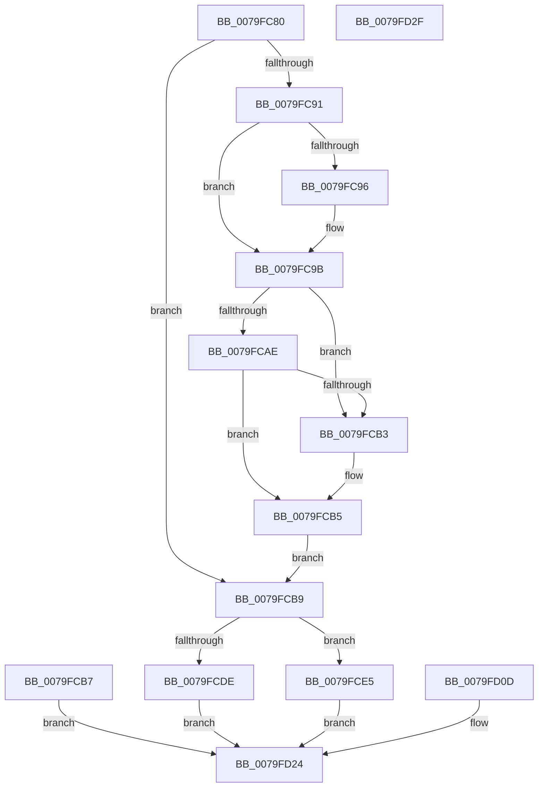

# SepCaptureAuditPolicy

- RVA: `0x0079FC80`–`0x0079FD30` (길이 `176` bytes)
- VA: `0x000000014079FC80`
- 실행 섹션: `PAGE`
- PDB 이름 있음: `예`; PDB Function 태그: `아니요`
- unwind 정보 RVA: `0x000D1350`
- 디코드: `53`개 명령, `176/176` bytes 표시
- 미해석 바이트: `0` (있으면 어셈블리에 `.byte`로 보존)

> 이 문서는 커널 이미지의 기계어와 PDB 기호를 분석해 생성했습니다. 4번과 5번은 함수 원형과 자료형을 바이너리 사용 방식에서 추정한 C 해석이며 원본 소스 복구 결과는 아닙니다.

## 1. Dependencies

- 직접 호출 지점: **3**; 고유 호출 대상: **3**
- 직접 호출자로 확인된 함수: **1**
- RIP 상대 이미지 참조: **0**

### Outgoing calls
- `0x0079FC96` → [ExRaiseDatatypeMisalignment](../89/ExRaiseDatatypeMisalignment_function_00899FD0.md) (function, `0x00899FD0`)
- `0x0079FCC9` → [ExAllocatePoolWithTag](../../poolcode/B8/ExAllocatePoolWithTag_function_00B82010.md) (function, `0x00B82010`)
- `0x0079FD19` → [ExFreePoolWithTag](../../poolcode/B8/ExFreePoolWithTag_function_00B82870.md) (function, `0x00B82870`)

### Direct callers
- [NtSetInformationToken](../AF/NtSetInformationToken_function_00AF0530.md) at `0x00AF1067`

### Static image references
- 디코드된 RIP-relative 메모리 참조가 없습니다.

## 2. Other-region calls and transfers

- 다른 실행 섹션으로 향하는 call: **2**
  - `0x0079FCC9` → [ExAllocatePoolWithTag](../../poolcode/B8/ExAllocatePoolWithTag_function_00B82010.md) (`PAGE` → `POOLCODE`)
  - `0x0079FD19` → [ExFreePoolWithTag](../../poolcode/B8/ExFreePoolWithTag_function_00B82870.md) (`PAGE` → `POOLCODE`)
- 별도 외부 분기/꼬리 이동을 확인하지 못했습니다.

## 3. Assembly (complete function range)

```asm
0079FC80  48 89 5C 24 08                  mov qword ptr [rsp + 8], rbx
0079FC85  57                              push rdi
0079FC86  48 83 EC 20                     sub rsp, 0x20
0079FC8A  48 8B D9                        mov rbx, rcx
0079FC8D  84 D2                           test dl, dl
0079FC8F  74 28                           je 0x14079fcb9
0079FC91  F6 C3 03                        test bl, 3
0079FC94  74 05                           je 0x14079fc9b
0079FC96  E8 35 A3 0F 00                  call 0x140899fd0
0079FC9B  48 8D 41 1F                     lea rax, [rcx + 0x1f]
0079FC9F  48 B9 00 00 FF FF FF 7F 00 00   movabs rcx, 0x7fffffff0000
0079FCA9  48 3B C1                        cmp rax, rcx
0079FCAC  77 05                           ja 0x14079fcb3
0079FCAE  48 3B C3                        cmp rax, rbx
0079FCB1  73 02                           jae 0x14079fcb5
0079FCB3  8A 01                           mov al, byte ptr [rcx]
0079FCB5  EB 02                           jmp 0x14079fcb9
0079FCB7  EB 6B                           jmp 0x14079fd24
0079FCB9  BA 1F 00 00 00                  mov edx, 0x1f
0079FCBE  B9 01 04 00 00                  mov ecx, 0x401
0079FCC3  41 B8 53 65 50 61               mov r8d, 0x61506553
0079FCC9  E8 42 23 3E 00                  call 0x140b82010
0079FCCE  48 8B D0                        mov rdx, rax
0079FCD1  48 8B 4C 24 60                  mov rcx, qword ptr [rsp + 0x60]
0079FCD6  48 89 01                        mov qword ptr [rcx], rax
0079FCD9  48 85 C0                        test rax, rax
0079FCDC  75 07                           jne 0x14079fce5
0079FCDE  B8 9A 00 00 C0                  mov eax, 0xc000009a
0079FCE3  EB 3F                           jmp 0x14079fd24
0079FCE5  0F 10 03                        movups xmm0, xmmword ptr [rbx]
0079FCE8  0F 11 00                        movups xmmword ptr [rax], xmm0
0079FCEB  F2 0F 10 4B 10                  movsd xmm1, qword ptr [rbx + 0x10]
0079FCF0  F2 0F 11 48 10                  movsd qword ptr [rax + 0x10], xmm1
0079FCF5  8B 43 18                        mov eax, dword ptr [rbx + 0x18]
0079FCF8  89 42 18                        mov dword ptr [rdx + 0x18], eax
0079FCFB  0F B7 43 1C                     movzx eax, word ptr [rbx + 0x1c]
0079FCFF  66 89 42 1C                     mov word ptr [rdx + 0x1c], ax
0079FD03  8A 43 1E                        mov al, byte ptr [rbx + 0x1e]
0079FD06  88 42 1E                        mov byte ptr [rdx + 0x1e], al
0079FD09  33 C0                           xor eax, eax
0079FD0B  EB 17                           jmp 0x14079fd24
0079FD0D  8B F8                           mov edi, eax
0079FD0F  33 D2                           xor edx, edx
0079FD11  48 8B 5C 24 60                  mov rbx, qword ptr [rsp + 0x60]
0079FD16  48 8B 0B                        mov rcx, qword ptr [rbx]
0079FD19  E8 52 2B 3E 00                  call 0x140b82870
0079FD1E  48 83 23 00                     and qword ptr [rbx], 0
0079FD22  8B C7                           mov eax, edi
0079FD24  48 8B 5C 24 30                  mov rbx, qword ptr [rsp + 0x30]
0079FD29  48 83 C4 20                     add rsp, 0x20
0079FD2D  5F                              pop rdi
0079FD2E  C3                              ret
0079FD2F  CC                              int3
```

## 4. C-style interpretation (structured pseudocode)

```c
__int64 __fastcall SepCaptureAuditPolicy(__int64 a1, unsigned __int8 a2, __int64 a3, __int64 a4, __int64 a5, __int64 a6, __int64 a7)
{
    __int64 result;
    __int64 v_rsp;
    unsigned __int64 v_stack_p38;
    unsigned __int64 v_stack_p8;

    v_stack_p8 = v_rbx;
    v_rsp = (v_rsp) - (32);
    if (a2 == 0) goto loc_0079FCB9;
    if ((((unsigned __int8)(a1)) & (3)) != 0) {
        result = ExRaiseDatatypeMisalignment(a1, a2, a3, a4);
    }
    if ((a1 + 31) > a1) goto loc_0079FCB3;
    result = a1 + 31;
    if ((a1 + 31) < a1) {
        result = *(unsigned __int8 *)(a1);
    }
    goto loc_0079FCB9;
loc_0079FCB9:
    result = ExAllocatePoolWithTag((unsigned int)(0x401ULL), 31, (unsigned int)(0x61506553ULL), a4);
    *(unsigned __int64 *)(a7) = result;
    if (result != 0) goto loc_0079FCE5;
    goto loc_0079FD24;
loc_0079FCE5:
    *(unsigned __int64 *)((unsigned int)(0xC000009AULL)) = v_xmm0;
    *(unsigned __int64 *)((unsigned int)(0xC000009AULL) + 16) = v_xmm1;
    *(unsigned int *)(result + 24) = (unsigned int)((unsigned int)(*(unsigned int *)(a1 + 24)));
    *(unsigned __int16 *)(result + 28) = (unsigned __int16)(*(unsigned __int16 *)(a1 + 28));
    *(unsigned __int8 *)(result + 30) = (unsigned __int8)(*(unsigned __int8 *)(a1 + 30));
    result = 0;
    goto loc_0079FD24;
loc_0079FD24:
    v_rsp = (v_rsp) + (32);
    return result;
}
```

## 5. (Beta) C Style

```c
int64_t SepCaptureAuditPolicy(int64_t Arg1, uint8_t Arg2, int64_t Arg3, int64_t Arg4, uint64_t Arg5, uint64_t Arg6, void *Arg7)
{
    uint8_t *arg7 = (uint8_t *)Arg7;

    int64_t result;
    int64_t local_rsp;
    uint64_t v_stack_p38;
    uint64_t v_stack_p8;

    v_stack_p8 = local_rbx;
    local_rsp = (local_rsp) - (32);
    if (Arg2 == 0) goto loc_0079FCB9;
    if ((((uint8_t)(Arg1)) & (3)) != 0) {
        result = ExRaiseDatatypeMisalignment(Arg1, Arg2, Arg3, Arg4);
    }
    if ((Arg1 + 31) > Arg1) goto loc_0079FCB3;
    result = Arg1 + 31;
    if ((Arg1 + 31) < Arg1) {
        result = *(uint8_t *)(Arg1);
    }
    goto loc_0079FCB9;
loc_0079FCB9:
    result = ExAllocatePoolWithTag((uint32_t)(0x401ULL), 31, (uint32_t)(0x61506553ULL), Arg4);
    *(uint64_t *)(arg7) = result;
    if (result != 0) goto loc_0079FCE5;
    goto loc_0079FD24;
loc_0079FCE5:
    *(uint64_t *)((uint32_t)(0xC000009AULL)) = v_xmm0;
    *(uint64_t *)((uint32_t)(0xC000009AULL) + 0x10) = v_xmm1;
    *(uint32_t *)(result + 0x18) = (uint32_t)((uint32_t)(*(uint32_t *)(Arg1 + 0x18)));
    *(uint16_t *)(result + 0x1C) = (uint16_t)(*(uint16_t *)(Arg1 + 0x1C));
    *(uint8_t *)(result + 0x1E) = (uint8_t)(*(uint8_t *)(Arg1 + 0x1E));
    result = 0;
    goto loc_0079FD24;
loc_0079FD24:
    local_rsp = (local_rsp) + (32);
    return result;
}
```

### 관측된 메모리 오프셋

구조체 형식이 확인되지 않은 접근은 인자 기준의 오프셋으로만 기록했습니다.

| 기준 인자 | 오프셋 표현 | 폭 (bit) | 접근 |
|---|---:|---:|---|
| `Arg7` | `+ 0x0` | `64` | `W` |

## 6. Execution-region graph

[열기: 2D/3D 그래프와 함수 탐색 컨트롤 패널](../../../control-panel.html?section=page&rva=0x0079FC80&view=graph)

- 2D 그래프는 위에서 아래로 흐르고, 3D 그래프는 빈 공간을 드래그해 회전합니다. Shift+드래그는 이동, 휠은 확대·축소, 함수 노드 선택은 대상 보고서 이동입니다.

### Static fallback


