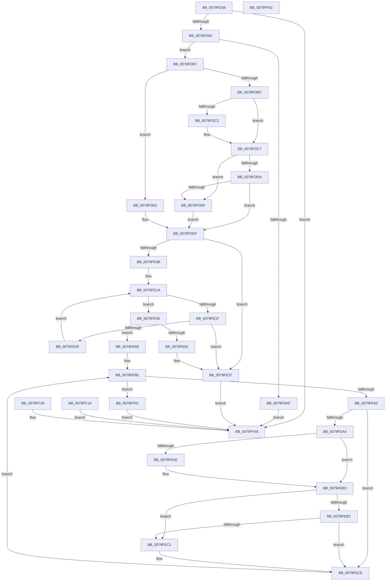

# SepCaptureFqbnArray

- RVA: `0x0079FD38`–`0x0079FF63` (길이 `555` bytes)
- VA: `0x000000014079FD38`
- 실행 섹션: `PAGE`
- PDB 이름 있음: `예`; PDB Function 태그: `아니요`
- unwind 정보 RVA: `0x000D130C`
- 디코드: `160`개 명령, `555/555` bytes 표시
- 미해석 바이트: `0` (있으면 어셈블리에 `.byte`로 보존)

> 이 문서는 커널 이미지의 기계어와 PDB 기호를 분석해 생성했습니다. 4번과 5번은 함수 원형과 자료형을 바이너리 사용 방식에서 추정한 C 해석이며 원본 소스 복구 결과는 아닙니다.

## 1. Dependencies

- 직접 호출 지점: **12**; 고유 호출 대상: **4**
- 직접 호출자로 확인된 함수: **1**
- RIP 상대 이미지 참조: **0**

### Outgoing calls
- `0x0079FD9D` → [ExAllocatePool2](../../poolcode/B8/ExAllocatePool2_function_00B820F0.md) (function, `0x00B820F0`)
- `0x0079FDC2` → [ExRaiseDatatypeMisalignment](../89/ExRaiseDatatypeMisalignment_function_00899FD0.md) (function, `0x00899FD0`)
- `0x0079FDF8` → [memcpy](../../text/6C/memcpy_function_006C6840.md) (function, `0x006C6840`)
- `0x0079FE40` → [ExAllocatePool2](../../poolcode/B8/ExAllocatePool2_function_00B820F0.md) (function, `0x00B820F0`)
- `0x0079FE5C` → [ExFreePoolWithTag](../../poolcode/B8/ExFreePoolWithTag_function_00B82870.md) (function, `0x00B82870`)
- `0x0079FE71` → [memcpy](../../text/6C/memcpy_function_006C6840.md) (function, `0x006C6840`)
- `0x0079FEAE` → [ExRaiseDatatypeMisalignment](../89/ExRaiseDatatypeMisalignment_function_00899FD0.md) (function, `0x00899FD0`)
- `0x0079FEDC` → [memcpy](../../text/6C/memcpy_function_006C6840.md) (function, `0x006C6840`)
- `0x0079FF06` → [ExFreePoolWithTag](../../poolcode/B8/ExFreePoolWithTag_function_00B82870.md) (function, `0x00B82870`)
- `0x0079FF23` → [ExFreePoolWithTag](../../poolcode/B8/ExFreePoolWithTag_function_00B82870.md) (function, `0x00B82870`)
- `0x0079FF2F` → [ExFreePoolWithTag](../../poolcode/B8/ExFreePoolWithTag_function_00B82870.md) (function, `0x00B82870`)
- `0x0079FF41` → [ExFreePoolWithTag](../../poolcode/B8/ExFreePoolWithTag_function_00B82870.md) (function, `0x00B82870`)

### Direct callers
- [SepCaptureTokenSecurityAttributesInformation](../97/SepCaptureTokenSecurityAttributesInformation_function_00971FB8.md) at `0x00972411`

### Static image references
- 디코드된 RIP-relative 메모리 참조가 없습니다.

## 2. Other-region calls and transfers

- 다른 실행 섹션으로 향하는 call: **10**
  - `0x0079FD9D` → [ExAllocatePool2](../../poolcode/B8/ExAllocatePool2_function_00B820F0.md) (`PAGE` → `POOLCODE`)
  - `0x0079FDF8` → [memcpy](../../text/6C/memcpy_function_006C6840.md) (`PAGE` → `.text`)
  - `0x0079FE40` → [ExAllocatePool2](../../poolcode/B8/ExAllocatePool2_function_00B820F0.md) (`PAGE` → `POOLCODE`)
  - `0x0079FE5C` → [ExFreePoolWithTag](../../poolcode/B8/ExFreePoolWithTag_function_00B82870.md) (`PAGE` → `POOLCODE`)
  - `0x0079FE71` → [memcpy](../../text/6C/memcpy_function_006C6840.md) (`PAGE` → `.text`)
  - `0x0079FEDC` → [memcpy](../../text/6C/memcpy_function_006C6840.md) (`PAGE` → `.text`)
  - `0x0079FF06` → [ExFreePoolWithTag](../../poolcode/B8/ExFreePoolWithTag_function_00B82870.md) (`PAGE` → `POOLCODE`)
  - `0x0079FF23` → [ExFreePoolWithTag](../../poolcode/B8/ExFreePoolWithTag_function_00B82870.md) (`PAGE` → `POOLCODE`)
  - `0x0079FF2F` → [ExFreePoolWithTag](../../poolcode/B8/ExFreePoolWithTag_function_00B82870.md) (`PAGE` → `POOLCODE`)
  - `0x0079FF41` → [ExFreePoolWithTag](../../poolcode/B8/ExFreePoolWithTag_function_00B82870.md) (`PAGE` → `POOLCODE`)
- 별도 외부 분기/꼬리 이동을 확인하지 못했습니다.

## 3. Assembly (complete function range)

```asm
0079FD38  48 8B C4                        mov rax, rsp
0079FD3B  48 89 58 08                     mov qword ptr [rax + 8], rbx
0079FD3F  48 89 70 18                     mov qword ptr [rax + 0x18], rsi
0079FD43  4C 89 48 20                     mov qword ptr [rax + 0x20], r9
0079FD47  89 50 10                        mov dword ptr [rax + 0x10], edx
0079FD4A  57                              push rdi
0079FD4B  41 54                           push r12
0079FD4D  41 55                           push r13
0079FD4F  41 56                           push r14
0079FD51  41 57                           push r15
0079FD53  48 83 EC 40                     sub rsp, 0x40
0079FD57  8B C2                           mov eax, edx
0079FD59  4C 8B F1                        mov r14, rcx
0079FD5C  4C 8D 04 40                     lea r8, [rax + rax*2]
0079FD60  4E 8D 2C C5 00 00 00 00         lea r13, [r8*8]
0079FD68  B9 FF FF FF FF                  mov ecx, 0xffffffff
0079FD6D  44 8B F9                        mov r15d, ecx
0079FD70  4C 3B E9                        cmp r13, rcx
0079FD73  45 0F 46 FD                     cmovbe r15d, r13d
0079FD77  49 3B CD                        cmp rcx, r13
0079FD7A  1B C0                           sbb eax, eax
0079FD7C  BF 95 00 00 C0                  mov edi, 0xc0000095
0079FD81  23 C7                           and eax, edi
0079FD83  4C 3B E9                        cmp r13, rcx
0079FD86  0F 87 BC 01 00 00               ja 0x14079ff48
0079FD8C  41 8B F7                        mov esi, r15d
0079FD8F  41 B8 53 65 41 74               mov r8d, 0x74416553
0079FD95  41 8B D7                        mov edx, r15d
0079FD98  B9 00 01 00 00                  mov ecx, 0x100
0079FD9D  E8 4E 23 3E 00                  call 0x140b820f0
0079FDA2  48 8B D8                        mov rbx, rax
0079FDA5  48 89 44 24 30                  mov qword ptr [rsp + 0x30], rax
0079FDAA  48 85 C0                        test rax, rax
0079FDAD  75 08                           jne 0x14079fdb7
0079FDAF  8D 47 05                        lea eax, [rdi + 5]
0079FDB2  E9 91 01 00 00                  jmp 0x14079ff48
0079FDB7  45 85 FF                        test r15d, r15d
0079FDBA  74 29                           je 0x14079fde5
0079FDBC  41 F6 C6 03                     test r14b, 3
0079FDC0  74 05                           je 0x14079fdc7
0079FDC2  E8 09 A2 0F 00                  call 0x140899fd0
0079FDC7  4B 8D 04 37                     lea rax, [r15 + r14]
0079FDCB  49 BC 00 00 FF FF FF 7F 00 00   movabs r12, 0x7fffffff0000
0079FDD5  49 3B C4                        cmp rax, r12
0079FDD8  77 05                           ja 0x14079fddf
0079FDDA  49 3B C6                        cmp rax, r14
0079FDDD  73 10                           jae 0x14079fdef
0079FDDF  41 8A 04 24                     mov al, byte ptr [r12]
0079FDE3  EB 0A                           jmp 0x14079fdef
0079FDE5  49 BC 00 00 FF FF FF 7F 00 00   movabs r12, 0x7fffffff0000
0079FDEF  4C 8B C6                        mov r8, rsi
0079FDF2  49 8B D6                        mov rdx, r14
0079FDF5  48 8B CB                        mov rcx, rbx
0079FDF8  E8 43 6A F2 FF                  call 0x1406c6840
0079FDFD  90                              nop
0079FDFE  49 8D 47 01                     lea rax, [r15 + 1]
0079FE02  48 83 E0 FE                     and rax, 0xfffffffffffffffe
0079FE06  48 3B C6                        cmp rax, rsi
0079FE09  72 4C                           jb 0x14079fe57
0079FE0B  41 8D 57 01                     lea edx, [r15 + 1]
0079FE0F  83 E2 FE                        and edx, 0xfffffffe
0079FE12  45 33 C0                        xor r8d, r8d
0079FE15  44 8B 7C 24 78                  mov r15d, dword ptr [rsp + 0x78]
0079FE1A  45 3B C7                        cmp r8d, r15d
0079FE1D  73 16                           jae 0x14079fe35
0079FE1F  4B 8D 0C 40                     lea rcx, [r8 + r8*2]
0079FE23  0F B7 4C CB 08                  movzx ecx, word ptr [rbx + rcx*8 + 8]
0079FE28  03 CA                           add ecx, edx
0079FE2A  3B CA                           cmp ecx, edx
0079FE2C  72 29                           jb 0x14079fe57
0079FE2E  8B D1                           mov edx, ecx
0079FE30  41 FF C0                        inc r8d
0079FE33  EB E5                           jmp 0x14079fe1a
0079FE35  B9 00 01 00 00                  mov ecx, 0x100
0079FE3A  41 B8 53 65 41 74               mov r8d, 0x74416553
0079FE40  E8 AB 22 3E 00                  call 0x140b820f0
0079FE45  4C 8B F0                        mov r14, rax
0079FE48  48 89 44 24 38                  mov qword ptr [rsp + 0x38], rax
0079FE4D  48 85 C0                        test rax, rax
0079FE50  75 16                           jne 0x14079fe68
0079FE52  BF 9A 00 00 C0                  mov edi, 0xc000009a
0079FE57  33 D2                           xor edx, edx
0079FE59  48 8B CB                        mov rcx, rbx
0079FE5C  E8 0F 2A 3E 00                  call 0x140b82870
0079FE61  8B C7                           mov eax, edi
0079FE63  E9 E0 00 00 00                  jmp 0x14079ff48
0079FE68  4D 8B C5                        mov r8, r13
0079FE6B  48 8B D3                        mov rdx, rbx
0079FE6E  49 8B CE                        mov rcx, r14
0079FE71  E8 CA 69 F2 FF                  call 0x1406c6840
0079FE76  49 8D 75 01                     lea rsi, [r13 + 1]
0079FE7A  49 03 F6                        add rsi, r14
0079FE7D  48 83 E6 FE                     and rsi, 0xfffffffffffffffe
0079FE81  48 89 74 24 28                  mov qword ptr [rsp + 0x28], rsi
0079FE86  33 C9                           xor ecx, ecx
0079FE88  8B F9                           mov edi, ecx
0079FE8A  89 4C 24 20                     mov dword ptr [rsp + 0x20], ecx
0079FE8E  41 3B FF                        cmp edi, r15d
0079FE91  73 6E                           jae 0x14079ff01
0079FE93  8B C7                           mov eax, edi
0079FE95  4C 8D 3C 40                     lea r15, [rax + rax*2]
0079FE99  42 0F B7 44 FB 08               movzx eax, word ptr [rbx + r15*8 + 8]
0079FE9F  66 85 C0                        test ax, ax
0079FEA2  74 2A                           je 0x14079fece
0079FEA4  4A 8B 4C FB 10                  mov rcx, qword ptr [rbx + r15*8 + 0x10]
0079FEA9  F6 C1 01                        test cl, 1
0079FEAC  74 05                           je 0x14079feb3
0079FEAE  E8 1D A1 0F 00                  call 0x140899fd0
0079FEB3  48 8D 14 01                     lea rdx, [rcx + rax]
0079FEB7  49 3B D4                        cmp rdx, r12
0079FEBA  77 05                           ja 0x14079fec1
0079FEBC  48 3B D1                        cmp rdx, rcx
0079FEBF  73 0D                           jae 0x14079fece
0079FEC1  41 8A 04 24                     mov al, byte ptr [r12]
0079FEC5  48 8B 74 24 28                  mov rsi, qword ptr [rsp + 0x28]
0079FECA  8B 7C 24 20                     mov edi, dword ptr [rsp + 0x20]
0079FECE  46 0F B7 44 FB 08               movzx r8d, word ptr [rbx + r15*8 + 8]
0079FED4  4A 8B 54 FB 10                  mov rdx, qword ptr [rbx + r15*8 + 0x10]
0079FED9  48 8B CE                        mov rcx, rsi
0079FEDC  E8 5F 69 F2 FF                  call 0x1406c6840
0079FEE1  4B 89 74 FE 10                  mov qword ptr [r14 + r15*8 + 0x10], rsi
0079FEE6  42 0F B7 44 FB 08               movzx eax, word ptr [rbx + r15*8 + 8]
0079FEEC  48 03 F0                        add rsi, rax
0079FEEF  48 89 74 24 28                  mov qword ptr [rsp + 0x28], rsi
0079FEF4  FF C7                           inc edi
0079FEF6  89 7C 24 20                     mov dword ptr [rsp + 0x20], edi
0079FEFA  44 8B 7C 24 78                  mov r15d, dword ptr [rsp + 0x78]
0079FEFF  EB 8D                           jmp 0x14079fe8e
0079FF01  33 D2                           xor edx, edx
0079FF03  48 8B CB                        mov rcx, rbx
0079FF06  E8 65 29 3E 00                  call 0x140b82870
0079FF0B  48 8B 84 24 88 00 00 00         mov rax, qword ptr [rsp + 0x88]
0079FF13  4C 89 30                        mov qword ptr [rax], r14
0079FF16  33 C0                           xor eax, eax
0079FF18  EB 2E                           jmp 0x14079ff48
0079FF1A  8B D8                           mov ebx, eax
0079FF1C  33 D2                           xor edx, edx
0079FF1E  48 8B 4C 24 30                  mov rcx, qword ptr [rsp + 0x30]
0079FF23  E8 48 29 3E 00                  call 0x140b82870
0079FF28  33 D2                           xor edx, edx
0079FF2A  48 8B 4C 24 38                  mov rcx, qword ptr [rsp + 0x38]
0079FF2F  E8 3C 29 3E 00                  call 0x140b82870
0079FF34  8B C3                           mov eax, ebx
0079FF36  EB 10                           jmp 0x14079ff48
0079FF38  8B D8                           mov ebx, eax
0079FF3A  33 D2                           xor edx, edx
0079FF3C  48 8B 4C 24 30                  mov rcx, qword ptr [rsp + 0x30]
0079FF41  E8 2A 29 3E 00                  call 0x140b82870
0079FF46  8B C3                           mov eax, ebx
0079FF48  4C 8D 5C 24 40                  lea r11, [rsp + 0x40]
0079FF4D  49 8B 5B 30                     mov rbx, qword ptr [r11 + 0x30]
0079FF51  49 8B 73 40                     mov rsi, qword ptr [r11 + 0x40]
0079FF55  49 8B E3                        mov rsp, r11
0079FF58  41 5F                           pop r15
0079FF5A  41 5E                           pop r14
0079FF5C  41 5D                           pop r13
0079FF5E  41 5C                           pop r12
0079FF60  5F                              pop rdi
0079FF61  C3                              ret
0079FF62  CC                              int3
```

## 4. C-style interpretation (structured pseudocode)

```c
__int64 __fastcall SepCaptureFqbnArray(__int64 a1, int a2, __int64 a3, __int64 a4)
{
    __int64 result;
    __int64 v_r15;
    __int64 v_rdi;
    __int64 v_rsi;
    __int64 v_rsp;
    unsigned __int64 v_stack_m28;
    unsigned __int64 v_stack_m30;
    unsigned __int64 v_stack_m38;
    unsigned __int64 v_stack_m40;
    unsigned int v_stack_m48;
    unsigned int v_stack_p10;
    unsigned __int64 v_stack_p20;

    *(unsigned __int64 *)(v_rsp + 8) = v_rbx;
    *(unsigned __int64 *)(v_rsp + 24) = v_rsi;
    *(unsigned __int64 *)(v_rsp + 32) = a4;
    *(unsigned int *)(v_rsp + 16) = a2;
    v_rsp = (v_rsp) - (64);
    v_r15 = (unsigned int)((unsigned int)((unsigned int)(0xFFFFFFFFULL)));
    if (((unsigned int)(a2) + (unsigned int)(a2) * 2 * 8) <= ((unsigned int)(0xFFFFFFFFULL))) { v_r15 = (unsigned int)((unsigned int)(a2) + (unsigned int)(a2) * 2 * 8); }
    result = (unsigned int)(((unsigned int)(a2)) & ((unsigned int)((unsigned int)(0xC0000095ULL))));
    if (((unsigned int)(a2) + (unsigned int)(a2) * 2 * 8) > ((unsigned int)(0xFFFFFFFFULL))) goto loc_0079FF48;
    result = ExAllocatePool2(256, (unsigned int)((unsigned int)(v_r15)), (unsigned int)(0x74416553ULL), a4);
    v_stack_m38 = result;
    if (result != 0) goto loc_0079FDB7;
    goto loc_0079FF48;
loc_0079FDB7:
    if ((unsigned int)(v_r15) == 0) goto loc_0079FDE5;
    result = (unsigned int)(0xC0000095ULL) + 5;
    if ((((unsigned __int8)(a1)) & (3)) != 0) {
        result = ExRaiseDatatypeMisalignment(256, (unsigned int)((unsigned int)(v_r15)), (unsigned int)(0x74416553ULL), a4);
    }
    if ((v_r15 + a1 * 1) > v_r12) goto loc_0079FDDF;
    if ((v_r15 + a1 * 1) >= a1) goto loc_0079FDEF;
loc_0079FDDF:
    goto loc_0079FDEF;
loc_0079FDE5:
loc_0079FDEF:
    result = memcpy(result, a1, (unsigned int)((unsigned int)(v_r15)), a4);
    result = (v_r15 + 1) & (-2);
    if (result < ((unsigned int)((unsigned int)(v_r15)))) goto loc_0079FE57;
    a2 = (unsigned int)((v_r15 + 1) & (0xFFFFFFFEULL));
    a3 = 0;
loc_0079FE1A:
    if (0 >= ((unsigned int)((unsigned int)(v_stack_p10)))) goto loc_0079FE35;
    a1 = (unsigned int)((*(unsigned __int16 *)(result + a3 + a3 * 2 * 8 + 8)) + (a2));
    if (((unsigned int)(a1)) < a2) goto loc_0079FE57;
    a3 = (unsigned int)((a3) + 1);
    goto loc_0079FE1A;
loc_0079FE35:
    result = ExAllocatePool2(256, (unsigned int)((unsigned int)(a1)), (unsigned int)(0x74416553ULL), a4);
    v_stack_m30 = result;
    if (result != 0) goto loc_0079FE68;
loc_0079FE57:
    a2 = 0;
    result = ExFreePoolWithTag(result, a2, (unsigned int)(0x74416553ULL), a4);
    goto loc_0079FF48;
loc_0079FE68:
    result = memcpy(result, result, (unsigned int)(a2) + (unsigned int)(a2) * 2 * 8, a4);
    v_rsi = ((unsigned int)(a2) + (unsigned int)(a2) * 2 * 8 + 1) + (result);
    v_rsi = (v_rsi) & (-2);
    v_stack_m40 = v_rsi;
    a1 = 0;
    v_stack_m48 = 0;
loc_0079FE8E:
    if (0 >= ((unsigned int)((unsigned int)(v_stack_p10)))) goto loc_0079FF01;
    if ((unsigned __int16)(*(unsigned __int16 *)(result + 0 + 0 * 2 * 8 + 8)) == 0) goto loc_0079FECE;
    result = *(unsigned __int16 *)(result + 0 + 0 * 2 * 8 + 8);
    if ((((unsigned __int8)(*(unsigned __int64 *)(result + 0 + 0 * 2 * 8 + 16))) & (1)) != 0) {
        result = ExRaiseDatatypeMisalignment(*(unsigned __int64 *)(result + 0 + 0 * 2 * 8 + 16), result, (unsigned int)(a2) + (unsigned int)(a2) * 2 * 8, a4);
    }
    if ((*(unsigned __int64 *)(result + 0 + 0 * 2 * 8 + 16) + result * 1) > v_r12) goto loc_0079FEC1;
    v_rdi = 0;
    if ((*(unsigned __int64 *)(result + 0 + 0 * 2 * 8 + 16) + result * 1) < (*(unsigned __int64 *)(result + 0 + 0 * 2 * 8 + 16))) {
        result = *(unsigned __int8 *)(v_r12);
        v_rsi = v_stack_m40;
        v_rdi = v_stack_m48;
    }
    result = memcpy(v_rsi, *(unsigned __int64 *)(result + 0 + 0 * 2 * 8 + 16), *(unsigned __int16 *)(result + 0 + 0 * 2 * 8 + 8), a4);
    *(unsigned __int64 *)(result + 0 + 0 * 2 * 8 + 16) = v_rsi;
    v_rsi = (v_rsi) + (*(unsigned __int16 *)(result + 0 + 0 * 2 * 8 + 8));
    v_stack_m40 = v_rsi;
    v_rdi = (unsigned int)((v_rdi) + 1);
    v_stack_m48 = (unsigned int)(v_rdi);
    goto loc_0079FE8E;
loc_0079FF01:
    a2 = 0;
    result = ExFreePoolWithTag(result, a2, *(unsigned __int16 *)(result + 0 + 0 * 2 * 8 + 8), a4);
    *(unsigned __int64 *)(v_stack_p20) = result;
    result = 0;
    goto loc_0079FF48;
loc_0079FF48:
    return result;
}
```

## 5. (Beta) C Style

```c
int64_t SepCaptureFqbnArray(int64_t Arg1, void *Arg2, int64_t Arg3, int64_t Arg4)
{
    uint8_t *arg2 = (uint8_t *)Arg2;

    int64_t result;
    int64_t local_r15;
    int64_t local_rdi;
    int64_t local_rsi;
    int64_t local_rsp;
    uint64_t v_stack_m28;
    uint64_t v_stack_m30;
    uint64_t v_stack_m38;
    uint64_t v_stack_m40;
    uint32_t v_stack_m48;
    uint32_t v_stack_p10;
    uint64_t v_stack_p20;

    *(uint64_t *)(local_rsp + 0x8) = local_rbx;
    *(uint64_t *)(local_rsp + 0x18) = local_rsi;
    *(uint64_t *)(local_rsp + 0x20) = Arg4;
    *(uint32_t *)(local_rsp + 0x10) = Arg2;
    local_rsp = (local_rsp) - (64);
    local_r15 = (uint32_t)((uint32_t)((uint32_t)(0xFFFFFFFFULL)));
    if (((uint32_t)(Arg2) + (uint32_t)(Arg2) * 2 * 8) <= ((uint32_t)(0xFFFFFFFFULL))) { local_r15 = (uint32_t)((uint32_t)(Arg2) + (uint32_t)(Arg2) * 2 * 8); }
    result = (uint32_t)(((uint32_t)(Arg2)) & ((uint32_t)((uint32_t)(0xC0000095ULL))));
    if (((uint32_t)(Arg2) + (uint32_t)(Arg2) * 2 * 8) > ((uint32_t)(0xFFFFFFFFULL))) goto loc_0079FF48;
    result = ExAllocatePool2(256, (uint32_t)((uint32_t)(local_r15)), (uint32_t)(0x74416553ULL), Arg4);
    v_stack_m38 = result;
    if (result != 0) goto loc_0079FDB7;
    goto loc_0079FF48;
loc_0079FDB7:
    if ((uint32_t)(local_r15) == 0) goto loc_0079FDE5;
    result = (uint32_t)(0xC0000095ULL) + 5;
    if ((((uint8_t)(Arg1)) & (3)) != 0) {
        result = ExRaiseDatatypeMisalignment(256, (uint32_t)((uint32_t)(local_r15)), (uint32_t)(0x74416553ULL), Arg4);
    }
    if ((local_r15 + Arg1 * 1) > local_r12) goto loc_0079FDDF;
    if ((local_r15 + Arg1 * 1) >= Arg1) goto loc_0079FDEF;
loc_0079FDDF:
    goto loc_0079FDEF;
loc_0079FDE5:
loc_0079FDEF:
    result = memcpy(result, Arg1, (uint32_t)((uint32_t)(local_r15)), Arg4);
    result = (local_r15 + 1) & (-2);
    if (result < ((uint32_t)((uint32_t)(local_r15)))) goto loc_0079FE57;
    Arg2 = (uint32_t)((local_r15 + 1) & (0xFFFFFFFEULL));
    Arg3 = 0;
loc_0079FE1A:
    if (0 >= ((uint32_t)((uint32_t)(v_stack_p10)))) goto loc_0079FE35;
    Arg1 = (uint32_t)((*(uint16_t *)(result + Arg3 + Arg3 * 2 * 8 + 0x8)) + (Arg2));
    if (((uint32_t)(Arg1)) < Arg2) goto loc_0079FE57;
    Arg3 = (uint32_t)((Arg3) + 1);
    goto loc_0079FE1A;
loc_0079FE35:
    result = ExAllocatePool2(256, (uint32_t)((uint32_t)(Arg1)), (uint32_t)(0x74416553ULL), Arg4);
    v_stack_m30 = result;
    if (result != 0) goto loc_0079FE68;
loc_0079FE57:
    Arg2 = 0;
    result = ExFreePoolWithTag(result, Arg2, (uint32_t)(0x74416553ULL), Arg4);
    goto loc_0079FF48;
loc_0079FE68:
    result = memcpy(result, result, (uint32_t)(Arg2) + (uint32_t)(Arg2) * 2 * 8, Arg4);
    local_rsi = ((uint32_t)(Arg2) + (uint32_t)(Arg2) * 2 * 8 + 1) + (result);
    local_rsi = (local_rsi) & (-2);
    v_stack_m40 = local_rsi;
    Arg1 = 0;
    v_stack_m48 = 0;
loc_0079FE8E:
    if (0 >= ((uint32_t)((uint32_t)(v_stack_p10)))) goto loc_0079FF01;
    if ((uint16_t)(*(uint16_t *)(result + 0x0 + 0x0 * 2 * 8 + 0x8)) == 0) goto loc_0079FECE;
    result = *(uint16_t *)(result + 0x0 + 0x0 * 2 * 8 + 0x8);
    if ((((uint8_t)(*(uint64_t *)(result + 0x0 + 0x0 * 2 * 8 + 0x10))) & (1)) != 0) {
        result = ExRaiseDatatypeMisalignment(*(uint64_t *)(result + 0x0 + 0x0 * 2 * 8 + 0x10), result, (uint32_t)(Arg2) + (uint32_t)(Arg2) * 2 * 8, Arg4);
    }
    if ((*(uint64_t *)(result + 0x0 + 0x0 * 2 * 8 + 0x10) + result * 1) > local_r12) goto loc_0079FEC1;
    local_rdi = 0;
    if ((*(uint64_t *)(result + 0x0 + 0x0 * 2 * 8 + 0x10) + result * 1) < (*(uint64_t *)(result + 0x0 + 0x0 * 2 * 8 + 0x10))) {
        result = *(uint8_t *)(local_r12);
        local_rsi = v_stack_m40;
        local_rdi = v_stack_m48;
    }
    result = memcpy(local_rsi, *(uint64_t *)(result + 0x0 + 0x0 * 2 * 8 + 0x10), *(uint16_t *)(result + 0x0 + 0x0 * 2 * 8 + 0x8), Arg4);
    *(uint64_t *)(result + 0x0 + 0x0 * 2 * 8 + 0x10) = local_rsi;
    local_rsi = (local_rsi) + (*(uint16_t *)(result + 0x0 + 0x0 * 2 * 8 + 0x8));
    v_stack_m40 = local_rsi;
    local_rdi = (uint32_t)((local_rdi) + 1);
    v_stack_m48 = (uint32_t)(local_rdi);
    goto loc_0079FE8E;
loc_0079FF01:
    Arg2 = 0;
    result = ExFreePoolWithTag(result, Arg2, *(uint16_t *)(result + 0x0 + 0x0 * 2 * 8 + 0x8), Arg4);
    *(uint64_t *)(v_stack_p20) = result;
    result = 0;
    goto loc_0079FF48;
loc_0079FF48:
    return result;
}
```

### 관측된 메모리 오프셋

구조체 형식이 확인되지 않은 접근은 인자 기준의 오프셋으로만 기록했습니다.

| 기준 인자 | 오프셋 표현 | 폭 (bit) | 접근 |
|---|---:|---:|---|
| `Arg2` | `+ 0x0 + rax*2` | `64` | `R` |

## 6. Execution-region graph

[열기: 2D/3D 그래프와 함수 탐색 컨트롤 패널](../../../control-panel.html?section=page&rva=0x0079FD38&view=graph)

- 2D 그래프는 위에서 아래로 흐르고, 3D 그래프는 빈 공간을 드래그해 회전합니다. Shift+드래그는 이동, 휠은 확대·축소, 함수 노드 선택은 대상 보고서 이동입니다.

### Static fallback


