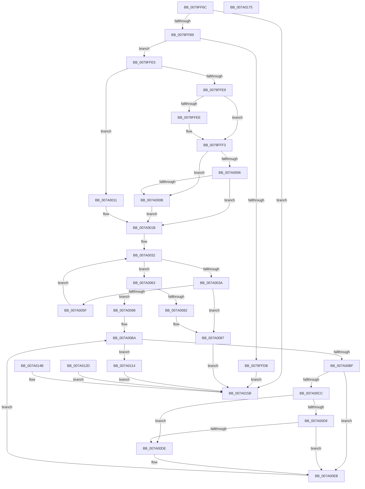

# SepCaptureOctetStringArray

- RVA: `0x0079FF6C`–`0x007A0176` (길이 `522` bytes)
- VA: `0x000000014079FF6C`
- 실행 섹션: `PAGE`
- PDB 이름 있음: `예`; PDB Function 태그: `아니요`
- unwind 정보 RVA: `0x000D12C8`
- 디코드: `156`개 명령, `522/522` bytes 표시
- 미해석 바이트: `0` (있으면 어셈블리에 `.byte`로 보존)

> 이 문서는 커널 이미지의 기계어와 PDB 기호를 분석해 생성했습니다. 4번과 5번은 함수 원형과 자료형을 바이너리 사용 방식에서 추정한 C 해석이며 원본 소스 복구 결과는 아닙니다.

## 1. Dependencies

- 직접 호출 지점: **11**; 고유 호출 대상: **4**
- 직접 호출자로 확인된 함수: **1**
- RIP 상대 이미지 참조: **0**

### Outgoing calls
- `0x0079FFC9` → [ExAllocatePool2](../../poolcode/B8/ExAllocatePool2_function_00B820F0.md) (function, `0x00B820F0`)
- `0x0079FFEE` → [ExRaiseDatatypeMisalignment](../89/ExRaiseDatatypeMisalignment_function_00899FD0.md) (function, `0x00899FD0`)
- `0x007A0024` → [memcpy](../../text/6C/memcpy_function_006C6840.md) (function, `0x006C6840`)
- `0x007A0070` → [ExAllocatePool2](../../poolcode/B8/ExAllocatePool2_function_00B820F0.md) (function, `0x00B820F0`)
- `0x007A008C` → [ExFreePoolWithTag](../../poolcode/B8/ExFreePoolWithTag_function_00B82870.md) (function, `0x00B82870`)
- `0x007A00A1` → [memcpy](../../text/6C/memcpy_function_006C6840.md) (function, `0x006C6840`)
- `0x007A00F7` → [memcpy](../../text/6C/memcpy_function_006C6840.md) (function, `0x006C6840`)
- `0x007A0119` → [ExFreePoolWithTag](../../poolcode/B8/ExFreePoolWithTag_function_00B82870.md) (function, `0x00B82870`)
- `0x007A0136` → [ExFreePoolWithTag](../../poolcode/B8/ExFreePoolWithTag_function_00B82870.md) (function, `0x00B82870`)
- `0x007A0142` → [ExFreePoolWithTag](../../poolcode/B8/ExFreePoolWithTag_function_00B82870.md) (function, `0x00B82870`)
- `0x007A0154` → [ExFreePoolWithTag](../../poolcode/B8/ExFreePoolWithTag_function_00B82870.md) (function, `0x00B82870`)

### Direct callers
- [SepCaptureTokenSecurityAttributesInformation](../97/SepCaptureTokenSecurityAttributesInformation_function_00971FB8.md) at `0x009723FA`

### Static image references
- 디코드된 RIP-relative 메모리 참조가 없습니다.

## 2. Other-region calls and transfers

- 다른 실행 섹션으로 향하는 call: **10**
  - `0x0079FFC9` → [ExAllocatePool2](../../poolcode/B8/ExAllocatePool2_function_00B820F0.md) (`PAGE` → `POOLCODE`)
  - `0x007A0024` → [memcpy](../../text/6C/memcpy_function_006C6840.md) (`PAGE` → `.text`)
  - `0x007A0070` → [ExAllocatePool2](../../poolcode/B8/ExAllocatePool2_function_00B820F0.md) (`PAGE` → `POOLCODE`)
  - `0x007A008C` → [ExFreePoolWithTag](../../poolcode/B8/ExFreePoolWithTag_function_00B82870.md) (`PAGE` → `POOLCODE`)
  - `0x007A00A1` → [memcpy](../../text/6C/memcpy_function_006C6840.md) (`PAGE` → `.text`)
  - `0x007A00F7` → [memcpy](../../text/6C/memcpy_function_006C6840.md) (`PAGE` → `.text`)
  - `0x007A0119` → [ExFreePoolWithTag](../../poolcode/B8/ExFreePoolWithTag_function_00B82870.md) (`PAGE` → `POOLCODE`)
  - `0x007A0136` → [ExFreePoolWithTag](../../poolcode/B8/ExFreePoolWithTag_function_00B82870.md) (`PAGE` → `POOLCODE`)
  - `0x007A0142` → [ExFreePoolWithTag](../../poolcode/B8/ExFreePoolWithTag_function_00B82870.md) (`PAGE` → `POOLCODE`)
  - `0x007A0154` → [ExFreePoolWithTag](../../poolcode/B8/ExFreePoolWithTag_function_00B82870.md) (`PAGE` → `POOLCODE`)
- 별도 외부 분기/꼬리 이동을 확인하지 못했습니다.

## 3. Assembly (complete function range)

```asm
0079FF6C  48 8B C4                        mov rax, rsp
0079FF6F  48 89 58 08                     mov qword ptr [rax + 8], rbx
0079FF73  48 89 70 18                     mov qword ptr [rax + 0x18], rsi
0079FF77  4C 89 48 20                     mov qword ptr [rax + 0x20], r9
0079FF7B  89 50 10                        mov dword ptr [rax + 0x10], edx
0079FF7E  57                              push rdi
0079FF7F  41 54                           push r12
0079FF81  41 55                           push r13
0079FF83  41 56                           push r14
0079FF85  41 57                           push r15
0079FF87  48 83 EC 40                     sub rsp, 0x40
0079FF8B  44 8B FA                        mov r15d, edx
0079FF8E  48 8B D9                        mov rbx, rcx
0079FF91  44 8B EA                        mov r13d, edx
0079FF94  49 C1 E5 04                     shl r13, 4
0079FF98  B9 FF FF FF FF                  mov ecx, 0xffffffff
0079FF9D  8B F1                           mov esi, ecx
0079FF9F  4C 3B E9                        cmp r13, rcx
0079FFA2  41 0F 46 F5                     cmovbe esi, r13d
0079FFA6  49 3B CD                        cmp rcx, r13
0079FFA9  1B C0                           sbb eax, eax
0079FFAB  25 95 00 00 C0                  and eax, 0xc0000095
0079FFB0  4C 3B E9                        cmp r13, rcx
0079FFB3  0F 87 A2 01 00 00               ja 0x1407a015b
0079FFB9  44 8B F6                        mov r14d, esi
0079FFBC  41 B8 53 65 41 74               mov r8d, 0x74416553
0079FFC2  8B D6                           mov edx, esi
0079FFC4  B9 00 01 00 00                  mov ecx, 0x100
0079FFC9  E8 22 21 3E 00                  call 0x140b820f0
0079FFCE  48 8B F8                        mov rdi, rax
0079FFD1  48 89 44 24 30                  mov qword ptr [rsp + 0x30], rax
0079FFD6  48 85 C0                        test rax, rax
0079FFD9  75 0A                           jne 0x14079ffe5
0079FFDB  B8 9A 00 00 C0                  mov eax, 0xc000009a
0079FFE0  E9 76 01 00 00                  jmp 0x1407a015b
0079FFE5  85 F6                           test esi, esi
0079FFE7  74 28                           je 0x1407a0011
0079FFE9  F6 C3 03                        test bl, 3
0079FFEC  74 05                           je 0x14079fff3
0079FFEE  E8 DD 9F 0F 00                  call 0x140899fd0
0079FFF3  48 8D 04 1E                     lea rax, [rsi + rbx]
0079FFF7  49 BC 00 00 FF FF FF 7F 00 00   movabs r12, 0x7fffffff0000
007A0001  49 3B C4                        cmp rax, r12
007A0004  77 05                           ja 0x1407a000b
007A0006  48 3B C3                        cmp rax, rbx
007A0009  73 10                           jae 0x1407a001b
007A000B  41 8A 04 24                     mov al, byte ptr [r12]
007A000F  EB 0A                           jmp 0x1407a001b
007A0011  49 BC 00 00 FF FF FF 7F 00 00   movabs r12, 0x7fffffff0000
007A001B  4D 8B C6                        mov r8, r14
007A001E  48 8B D3                        mov rdx, rbx
007A0021  48 8B CF                        mov rcx, rdi
007A0024  E8 17 68 F2 FF                  call 0x1406c6840
007A0029  90                              nop
007A002A  33 D2                           xor edx, edx
007A002C  41 B9 FF FF FF FF               mov r9d, 0xffffffff
007A0032  44 8B C6                        mov r8d, esi
007A0035  41 3B D7                        cmp edx, r15d
007A0038  73 29                           jae 0x1407a0063
007A003A  8B C2                           mov eax, edx
007A003C  48 03 C0                        add rax, rax
007A003F  8B 4C C7 08                     mov ecx, dword ptr [rdi + rax*8 + 8]
007A0043  03 CE                           add ecx, esi
007A0045  41 8B C1                        mov eax, r9d
007A0048  3B CE                           cmp ecx, esi
007A004A  0F 43 C1                        cmovae eax, ecx
007A004D  8B F0                           mov esi, eax
007A004F  41 3B C8                        cmp ecx, r8d
007A0052  1B DB                           sbb ebx, ebx
007A0054  81 E3 95 00 00 C0               and ebx, 0xc0000095
007A005A  41 3B C8                        cmp ecx, r8d
007A005D  72 28                           jb 0x1407a0087
007A005F  FF C2                           inc edx
007A0061  EB CF                           jmp 0x1407a0032
007A0063  8B D6                           mov edx, esi
007A0065  B9 00 01 00 00                  mov ecx, 0x100
007A006A  41 B8 53 65 41 74               mov r8d, 0x74416553
007A0070  E8 7B 20 3E 00                  call 0x140b820f0
007A0075  4C 8B F8                        mov r15, rax
007A0078  48 89 44 24 38                  mov qword ptr [rsp + 0x38], rax
007A007D  48 85 C0                        test rax, rax
007A0080  75 16                           jne 0x1407a0098
007A0082  BB 9A 00 00 C0                  mov ebx, 0xc000009a
007A0087  33 D2                           xor edx, edx
007A0089  48 8B CF                        mov rcx, rdi
007A008C  E8 DF 27 3E 00                  call 0x140b82870
007A0091  8B C3                           mov eax, ebx
007A0093  E9 C3 00 00 00                  jmp 0x1407a015b
007A0098  4D 8B C5                        mov r8, r13
007A009B  48 8B D7                        mov rdx, rdi
007A009E  49 8B CF                        mov rcx, r15
007A00A1  E8 9A 67 F2 FF                  call 0x1406c6840
007A00A6  4F 8D 34 2F                     lea r14, [r15 + r13]
007A00AA  4C 89 74 24 28                  mov qword ptr [rsp + 0x28], r14
007A00AF  33 DB                           xor ebx, ebx
007A00B1  89 5C 24 20                     mov dword ptr [rsp + 0x20], ebx
007A00B5  44 8B 6C 24 78                  mov r13d, dword ptr [rsp + 0x78]
007A00BA  41 3B DD                        cmp ebx, r13d
007A00BD  73 55                           jae 0x1407a0114
007A00BF  8B F3                           mov esi, ebx
007A00C1  48 03 F6                        add rsi, rsi
007A00C4  8B 44 F7 08                     mov eax, dword ptr [rdi + rsi*8 + 8]
007A00C8  85 C0                           test eax, eax
007A00CA  74 1F                           je 0x1407a00eb
007A00CC  48 8B 0C F7                     mov rcx, qword ptr [rdi + rsi*8]
007A00D0  48 8D 14 01                     lea rdx, [rcx + rax]
007A00D4  49 3B D4                        cmp rdx, r12
007A00D7  77 05                           ja 0x1407a00de
007A00D9  48 3B D1                        cmp rdx, rcx
007A00DC  73 0D                           jae 0x1407a00eb
007A00DE  41 8A 04 24                     mov al, byte ptr [r12]
007A00E2  4C 8B 74 24 28                  mov r14, qword ptr [rsp + 0x28]
007A00E7  8B 5C 24 20                     mov ebx, dword ptr [rsp + 0x20]
007A00EB  44 8B 44 F7 08                  mov r8d, dword ptr [rdi + rsi*8 + 8]
007A00F0  48 8B 14 F7                     mov rdx, qword ptr [rdi + rsi*8]
007A00F4  49 8B CE                        mov rcx, r14
007A00F7  E8 44 67 F2 FF                  call 0x1406c6840
007A00FC  4D 89 34 F7                     mov qword ptr [r15 + rsi*8], r14
007A0100  8B 44 F7 08                     mov eax, dword ptr [rdi + rsi*8 + 8]
007A0104  4C 03 F0                        add r14, rax
007A0107  4C 89 74 24 28                  mov qword ptr [rsp + 0x28], r14
007A010C  FF C3                           inc ebx
007A010E  89 5C 24 20                     mov dword ptr [rsp + 0x20], ebx
007A0112  EB A6                           jmp 0x1407a00ba
007A0114  33 D2                           xor edx, edx
007A0116  48 8B CF                        mov rcx, rdi
007A0119  E8 52 27 3E 00                  call 0x140b82870
007A011E  48 8B 84 24 88 00 00 00         mov rax, qword ptr [rsp + 0x88]
007A0126  4C 89 38                        mov qword ptr [rax], r15
007A0129  33 C0                           xor eax, eax
007A012B  EB 2E                           jmp 0x1407a015b
007A012D  8B D8                           mov ebx, eax
007A012F  33 D2                           xor edx, edx
007A0131  48 8B 4C 24 30                  mov rcx, qword ptr [rsp + 0x30]
007A0136  E8 35 27 3E 00                  call 0x140b82870
007A013B  33 D2                           xor edx, edx
007A013D  48 8B 4C 24 38                  mov rcx, qword ptr [rsp + 0x38]
007A0142  E8 29 27 3E 00                  call 0x140b82870
007A0147  8B C3                           mov eax, ebx
007A0149  EB 10                           jmp 0x1407a015b
007A014B  8B D8                           mov ebx, eax
007A014D  33 D2                           xor edx, edx
007A014F  48 8B 4C 24 30                  mov rcx, qword ptr [rsp + 0x30]
007A0154  E8 17 27 3E 00                  call 0x140b82870
007A0159  8B C3                           mov eax, ebx
007A015B  4C 8D 5C 24 40                  lea r11, [rsp + 0x40]
007A0160  49 8B 5B 30                     mov rbx, qword ptr [r11 + 0x30]
007A0164  49 8B 73 40                     mov rsi, qword ptr [r11 + 0x40]
007A0168  49 8B E3                        mov rsp, r11
007A016B  41 5F                           pop r15
007A016D  41 5E                           pop r14
007A016F  41 5D                           pop r13
007A0171  41 5C                           pop r12
007A0173  5F                              pop rdi
007A0174  C3                              ret
007A0175  CC                              int3
```

## 4. C-style interpretation (structured pseudocode)

```c
__int64 __fastcall SepCaptureOctetStringArray(__int64 a1, int a2, __int64 a3, __int64 a4)
{
    __int64 result;
    __int64 v_r13;
    __int64 v_r14;
    __int64 v_rbx;
    __int64 v_rsi;
    __int64 v_rsp;
    unsigned __int64 v_stack_m28;
    unsigned __int64 v_stack_m30;
    unsigned __int64 v_stack_m38;
    unsigned __int64 v_stack_m40;
    unsigned int v_stack_m48;
    unsigned int v_stack_p10;
    unsigned __int64 v_stack_p20;

    *(unsigned __int64 *)(v_rsp + 8) = v_rbx;
    *(unsigned __int64 *)(v_rsp + 24) = v_rsi;
    *(unsigned __int64 *)(v_rsp + 32) = a4;
    *(unsigned int *)(v_rsp + 16) = a2;
    v_rsp = (v_rsp) - (64);
    v_r13 = ((unsigned int)(a2)) << (4);
    v_rsi = (unsigned int)((unsigned int)((unsigned int)(0xFFFFFFFFULL)));
    if (v_r13 <= ((unsigned int)(0xFFFFFFFFULL))) { v_rsi = (unsigned int)(v_r13); }
    result = (unsigned int)((v_rsp) & (0xC0000095ULL));
    if (v_r13 > ((unsigned int)(0xFFFFFFFFULL))) goto loc_007A015B;
    result = ExAllocatePool2(256, (unsigned int)((unsigned int)(v_rsi)), (unsigned int)(0x74416553ULL), a4);
    v_stack_m38 = result;
    if (result != 0) goto loc_0079FFE5;
    goto loc_007A015B;
loc_0079FFE5:
    if ((unsigned int)(v_rsi) == 0) goto loc_007A0011;
    result = (unsigned int)(0xC000009AULL);
    if ((((unsigned __int8)(a1)) & (3)) != 0) {
        result = ExRaiseDatatypeMisalignment(256, (unsigned int)((unsigned int)(v_rsi)), (unsigned int)(0x74416553ULL), a4);
    }
    if ((v_rsi + a1 * 1) > v_r12) goto loc_007A000B;
    if ((v_rsi + a1 * 1) >= a1) goto loc_007A001B;
loc_007A000B:
    goto loc_007A001B;
loc_007A0011:
loc_007A001B:
    result = memcpy(result, a1, (unsigned int)((unsigned int)(v_rsi)), a4);
    a2 = 0;
loc_007A0032:
    if (0 >= ((unsigned int)((unsigned int)(a2)))) goto loc_007A0063;
    result = (0) + (0);
    a1 = (unsigned int)(((unsigned int)(*(unsigned int *)(result + result * 8 + 8))) + ((unsigned int)(v_rsi)));
    result = (unsigned int)((unsigned int)((unsigned int)(0xFFFFFFFFULL)));
    if (((unsigned int)(a1)) >= ((unsigned int)(v_rsi))) { result = (unsigned int)(a1); }
    v_rbx = (unsigned int)((a1) & (0xC0000095ULL));
    if (((unsigned int)(a1)) < ((unsigned int)((unsigned int)((unsigned int)(v_rsi))))) goto loc_007A0087;
    a2 = (unsigned int)((a2) + 1);
    goto loc_007A0032;
loc_007A0063:
    result = ExAllocatePool2(256, (unsigned int)((unsigned int)((unsigned int)((unsigned int)(result)))), (unsigned int)(0x74416553ULL), (unsigned int)(0xFFFFFFFFULL));
    v_stack_m30 = result;
    if (result != 0) goto loc_007A0098;
loc_007A0087:
    a2 = 0;
    result = ExFreePoolWithTag(result, a2, (unsigned int)(0x74416553ULL), (unsigned int)(0xFFFFFFFFULL));
    goto loc_007A015B;
loc_007A0098:
    result = memcpy(result, result, v_r13, (unsigned int)(0xFFFFFFFFULL));
    v_stack_m40 = result + v_r13 * 1;
    v_rbx = 0;
    v_stack_m48 = 0;
loc_007A00BA:
    if (0 >= ((unsigned int)((unsigned int)(v_stack_p10)))) goto loc_007A0114;
    v_rsi = (0) + (0);
    if ((unsigned int)((unsigned int)(*(unsigned int *)(result + v_rsi * 8 + 8))) == 0) goto loc_007A00EB;
    if ((*(unsigned __int64 *)(result + v_rsi * 8) + (unsigned int)(*(unsigned int *)(result + v_rsi * 8 + 8)) * 1) > v_r12) goto loc_007A00DE;
    result = (unsigned int)(*(unsigned int *)(result + v_rsi * 8 + 8));
    v_r14 = result + v_r13 * 1;
    if ((*(unsigned __int64 *)(result + v_rsi * 8) + (unsigned int)(*(unsigned int *)(result + v_rsi * 8 + 8)) * 1) < (*(unsigned __int64 *)(result + v_rsi * 8))) {
        result = *(unsigned __int8 *)(v_r12);
        v_r14 = v_stack_m40;
        v_rbx = v_stack_m48;
    }
    result = memcpy(v_r14, *(unsigned __int64 *)(result + v_rsi * 8), (unsigned int)(*(unsigned int *)(result + v_rsi * 8 + 8)), (unsigned int)(0xFFFFFFFFULL));
    *(unsigned __int64 *)(result + v_rsi * 8) = v_r14;
    v_r14 = (v_r14) + ((unsigned int)(*(unsigned int *)(result + v_rsi * 8 + 8)));
    v_stack_m40 = v_r14;
    v_rbx = (unsigned int)((v_rbx) + 1);
    v_stack_m48 = (unsigned int)(v_rbx);
    goto loc_007A00BA;
loc_007A0114:
    a2 = 0;
    result = ExFreePoolWithTag(result, a2, (unsigned int)(*(unsigned int *)(result + v_rsi * 8 + 8)), (unsigned int)(0xFFFFFFFFULL));
    *(unsigned __int64 *)(v_stack_p20) = result;
    result = 0;
    goto loc_007A015B;
loc_007A015B:
    return result;
}
```

## 5. (Beta) C Style

```c
int64_t SepCaptureOctetStringArray(int64_t Arg1, int32_t Arg2, int64_t Arg3, int64_t Arg4)
{
    int64_t result;
    int64_t local_r13;
    int64_t local_r14;
    int64_t local_rbx;
    int64_t local_rsi;
    int64_t local_rsp;
    uint64_t v_stack_m28;
    uint64_t v_stack_m30;
    uint64_t v_stack_m38;
    uint64_t v_stack_m40;
    uint32_t v_stack_m48;
    uint32_t v_stack_p10;
    uint64_t v_stack_p20;

    *(uint64_t *)(local_rsp + 0x8) = local_rbx;
    *(uint64_t *)(local_rsp + 0x18) = local_rsi;
    *(uint64_t *)(local_rsp + 0x20) = Arg4;
    *(uint32_t *)(local_rsp + 0x10) = Arg2;
    local_rsp = (local_rsp) - (64);
    local_r13 = ((uint32_t)(Arg2)) << (4);
    local_rsi = (uint32_t)((uint32_t)((uint32_t)(0xFFFFFFFFULL)));
    if (local_r13 <= ((uint32_t)(0xFFFFFFFFULL))) { local_rsi = (uint32_t)(local_r13); }
    result = (uint32_t)((local_rsp) & (0xC0000095ULL));
    if (local_r13 > ((uint32_t)(0xFFFFFFFFULL))) goto loc_007A015B;
    result = ExAllocatePool2(256, (uint32_t)((uint32_t)(local_rsi)), (uint32_t)(0x74416553ULL), Arg4);
    v_stack_m38 = result;
    if (result != 0) goto loc_0079FFE5;
    goto loc_007A015B;
loc_0079FFE5:
    if ((uint32_t)(local_rsi) == 0) goto loc_007A0011;
    result = (uint32_t)(0xC000009AULL);
    if ((((uint8_t)(Arg1)) & (3)) != 0) {
        result = ExRaiseDatatypeMisalignment(256, (uint32_t)((uint32_t)(local_rsi)), (uint32_t)(0x74416553ULL), Arg4);
    }
    if ((local_rsi + Arg1 * 1) > local_r12) goto loc_007A000B;
    if ((local_rsi + Arg1 * 1) >= Arg1) goto loc_007A001B;
loc_007A000B:
    goto loc_007A001B;
loc_007A0011:
loc_007A001B:
    result = memcpy(result, Arg1, (uint32_t)((uint32_t)(local_rsi)), Arg4);
    Arg2 = 0;
loc_007A0032:
    if (0 >= ((uint32_t)((uint32_t)(Arg2)))) goto loc_007A0063;
    result = (0) + (0);
    Arg1 = (uint32_t)(((uint32_t)(*(uint32_t *)(result + result * 8 + 0x8))) + ((uint32_t)(local_rsi)));
    result = (uint32_t)((uint32_t)((uint32_t)(0xFFFFFFFFULL)));
    if (((uint32_t)(Arg1)) >= ((uint32_t)(local_rsi))) { result = (uint32_t)(Arg1); }
    local_rbx = (uint32_t)((Arg1) & (0xC0000095ULL));
    if (((uint32_t)(Arg1)) < ((uint32_t)((uint32_t)((uint32_t)(local_rsi))))) goto loc_007A0087;
    Arg2 = (uint32_t)((Arg2) + 1);
    goto loc_007A0032;
loc_007A0063:
    result = ExAllocatePool2(256, (uint32_t)((uint32_t)((uint32_t)((uint32_t)(result)))), (uint32_t)(0x74416553ULL), (uint32_t)(0xFFFFFFFFULL));
    v_stack_m30 = result;
    if (result != 0) goto loc_007A0098;
loc_007A0087:
    Arg2 = 0;
    result = ExFreePoolWithTag(result, Arg2, (uint32_t)(0x74416553ULL), (uint32_t)(0xFFFFFFFFULL));
    goto loc_007A015B;
loc_007A0098:
    result = memcpy(result, result, local_r13, (uint32_t)(0xFFFFFFFFULL));
    v_stack_m40 = result + local_r13 * 1;
    local_rbx = 0;
    v_stack_m48 = 0;
loc_007A00BA:
    if (0 >= ((uint32_t)((uint32_t)(v_stack_p10)))) goto loc_007A0114;
    local_rsi = (0) + (0);
    if ((uint32_t)((uint32_t)(*(uint32_t *)(result + local_rsi * 8 + 0x8))) == 0) goto loc_007A00EB;
    if ((*(uint64_t *)(result + local_rsi * 8) + (uint32_t)(*(uint32_t *)(result + local_rsi * 8 + 0x8)) * 1) > local_r12) goto loc_007A00DE;
    result = (uint32_t)(*(uint32_t *)(result + local_rsi * 8 + 0x8));
    local_r14 = result + local_r13 * 1;
    if ((*(uint64_t *)(result + local_rsi * 8) + (uint32_t)(*(uint32_t *)(result + local_rsi * 8 + 0x8)) * 1) < (*(uint64_t *)(result + local_rsi * 8))) {
        result = *(uint8_t *)(local_r12);
        local_r14 = v_stack_m40;
        local_rbx = v_stack_m48;
    }
    result = memcpy(local_r14, *(uint64_t *)(result + local_rsi * 8), (uint32_t)(*(uint32_t *)(result + local_rsi * 8 + 0x8)), (uint32_t)(0xFFFFFFFFULL));
    *(uint64_t *)(result + local_rsi * 8) = local_r14;
    local_r14 = (local_r14) + ((uint32_t)(*(uint32_t *)(result + local_rsi * 8 + 0x8)));
    v_stack_m40 = local_r14;
    local_rbx = (uint32_t)((local_rbx) + 1);
    v_stack_m48 = (uint32_t)(local_rbx);
    goto loc_007A00BA;
loc_007A0114:
    Arg2 = 0;
    result = ExFreePoolWithTag(result, Arg2, (uint32_t)(*(uint32_t *)(result + local_rsi * 8 + 0x8)), (uint32_t)(0xFFFFFFFFULL));
    *(uint64_t *)(v_stack_p20) = result;
    result = 0;
    goto loc_007A015B;
loc_007A015B:
    return result;
}
```

## 6. Execution-region graph

[열기: 2D/3D 그래프와 함수 탐색 컨트롤 패널](../../../control-panel.html?section=page&rva=0x0079FF6C&view=graph)

- 2D 그래프는 위에서 아래로 흐르고, 3D 그래프는 빈 공간을 드래그해 회전합니다. Shift+드래그는 이동, 휠은 확대·축소, 함수 노드 선택은 대상 보고서 이동입니다.

### Static fallback


