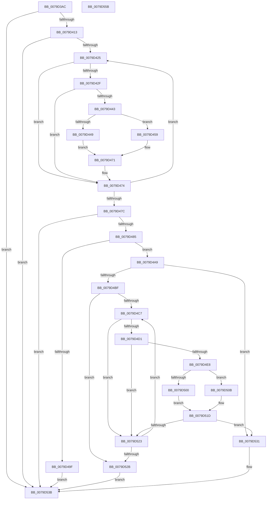

# SepConstructMandatoryAccessControlList

- RVA: `0x0079D3AC`–`0x0079D55C` (길이 `432` bytes)
- VA: `0x000000014079D3AC`
- 실행 섹션: `PAGE`
- PDB 이름 있음: `예`; PDB Function 태그: `아니요`
- unwind 정보 RVA: `0x000CFD80`
- 디코드: `129`개 명령, `432/432` bytes 표시
- 미해석 바이트: `0` (있으면 어셈블리에 `.byte`로 보존)

> 이 문서는 커널 이미지의 기계어와 PDB 기호를 분석해 생성했습니다. 4번과 5번은 함수 원형과 자료형을 바이너리 사용 방식에서 추정한 C 해석이며 원본 소스 복구 결과는 아닙니다.

## 1. Dependencies

- 직접 호출 지점: **7**; 고유 호출 대상: **6**
- 직접 호출자로 확인된 함수: **1**
- RIP 상대 이미지 참조: **2**

### Outgoing calls
- `0x0079D43A` → [SepResolveAntiTamperEntrySids](../../text/60/SepResolveAntiTamperEntrySids_function_0060864C.md) (function, `0x0060864C`)
- `0x0079D492` → [ExAllocatePool2](../../poolcode/B8/ExAllocatePool2_function_00B820F0.md) (function, `0x00B820F0`)
- `0x0079D4B4` → [RtlCreateAcl](../91/RtlCreateAcl_function_00916F00.md) (function, `0x00916F00`)
- `0x0079D4DF` → [SepResolveAntiTamperEntrySids](../../text/60/SepResolveAntiTamperEntrySids_function_0060864C.md) (function, `0x0060864C`)
- `0x0079D504` → [RtlAddMandatoryAccessAllowedAce](../78/RtlAddMandatoryAccessAllowedAce_function_0078D530.md) (function, `0x0078D530`)
- `0x0079D518` → [RtlAddMandatoryAppAccessAllowedAce](../78/RtlAddMandatoryAppAccessAllowedAce_function_0078D670.md) (function, `0x0078D670`)
- `0x0079D536` → [ExFreePoolWithTag](../../poolcode/B8/ExFreePoolWithTag_function_00B82870.md) (function, `0x00B82870`)

### Direct callers
- [SepGetMandatoryAccessControlList](SepGetMandatoryAccessControlList_function_0079D5EC.md) at `0x0079D7D9`

### Static image references
- `0x0079D3D7` → RVA `0x00F04F60` (`.data`; read)
- `0x0079D3F8` → RVA `0x00FC6E4C` (`ALMOSTRO`; read)

## 2. Other-region calls and transfers

- 다른 실행 섹션으로 향하는 call: **4**
  - `0x0079D43A` → [SepResolveAntiTamperEntrySids](../../text/60/SepResolveAntiTamperEntrySids_function_0060864C.md) (`PAGE` → `.text`)
  - `0x0079D492` → [ExAllocatePool2](../../poolcode/B8/ExAllocatePool2_function_00B820F0.md) (`PAGE` → `POOLCODE`)
  - `0x0079D4DF` → [SepResolveAntiTamperEntrySids](../../text/60/SepResolveAntiTamperEntrySids_function_0060864C.md) (`PAGE` → `.text`)
  - `0x0079D536` → [ExFreePoolWithTag](../../poolcode/B8/ExFreePoolWithTag_function_00B82870.md) (`PAGE` → `POOLCODE`)
- 별도 외부 분기/꼬리 이동을 확인하지 못했습니다.

## 3. Assembly (complete function range)

```asm
0079D3AC  48 89 5C 24 08                  mov qword ptr [rsp + 8], rbx
0079D3B1  48 89 74 24 18                  mov qword ptr [rsp + 0x18], rsi
0079D3B6  48 89 7C 24 20                  mov qword ptr [rsp + 0x20], rdi
0079D3BB  55                              push rbp
0079D3BC  41 54                           push r12
0079D3BE  41 55                           push r13
0079D3C0  41 56                           push r14
0079D3C2  41 57                           push r15
0079D3C4  48 8B EC                        mov rbp, rsp
0079D3C7  48 83 EC 40                     sub rsp, 0x40
0079D3CB  83 65 38 00                     and dword ptr [rbp + 0x38], 0
0079D3CF  48 8D 42 D0                     lea rax, [rdx - 0x30]
0079D3D3  49 83 20 00                     and qword ptr [r8], 0
0079D3D7  4C 8D 35 82 7B 76 00            lea r14, [rip + 0x767b82]
0079D3DE  48 C1 E8 08                     shr rax, 8
0079D3E2  33 FF                           xor edi, edi
0079D3E4  44 0F B6 C8                     movzx r9d, al
0079D3E8  0F 57 C0                        xorps xmm0, xmm0
0079D3EB  0F B6 42 E8                     movzx eax, byte ptr [rdx - 0x18]
0079D3EF  4D 8B E0                        mov r12, r8
0079D3F2  4C 33 C8                        xor r9, rax
0079D3F5  4C 8B E9                        mov r13, rcx
0079D3F8  0F B6 05 4D 9A 82 00            movzx eax, byte ptr [rip + 0x829a4d]
0079D3FF  4C 33 C8                        xor r9, rax
0079D402  0F 11 45 F0                     movups xmmword ptr [rbp - 0x10], xmm0
0079D406  4F 8B 34 CE                     mov r14, qword ptr [r14 + r9*8]
0079D40A  4D 85 F6                        test r14, r14
0079D40D  0F 84 28 01 00 00               je 0x14079d53b
0079D413  45 33 FF                        xor r15d, r15d
0079D416  8D 77 08                        lea esi, [rdi + 8]
0079D419  33 DB                           xor ebx, ebx
0079D41B  41 39 5E 04                     cmp dword ptr [r14 + 4], ebx
0079D41F  0F 86 16 01 00 00               jbe 0x14079d53b
0079D425  49 8B 54 DE 08                  mov rdx, qword ptr [r14 + rbx*8 + 8]
0079D42A  48 85 D2                        test rdx, rdx
0079D42D  74 45                           je 0x14079d474
0079D42F  4C 8D 4D 38                     lea r9, [rbp + 0x38]
0079D433  49 8B CD                        mov rcx, r13
0079D436  4C 8D 45 F0                     lea r8, [rbp - 0x10]
0079D43A  E8 0D B2 E6 FF                  call 0x14060864c
0079D43F  84 C0                           test al, al
0079D441  74 31                           je 0x14079d474
0079D443  83 7D 38 01                     cmp dword ptr [rbp + 0x38], 1
0079D447  75 10                           jne 0x14079d459
0079D449  48 8B 45 F0                     mov rax, qword ptr [rbp - 0x10]
0079D44D  0F B6 48 01                     movzx ecx, byte ptr [rax + 1]
0079D451  8D 34 8E                        lea esi, [rsi + rcx*4]
0079D454  83 C6 10                        add esi, 0x10
0079D457  EB 18                           jmp 0x14079d471
0079D459  48 8B 45 F8                     mov rax, qword ptr [rbp - 8]
0079D45D  0F B6 50 01                     movzx edx, byte ptr [rax + 1]
0079D461  48 8B 45 F0                     mov rax, qword ptr [rbp - 0x10]
0079D465  0F B6 48 01                     movzx ecx, byte ptr [rax + 1]
0079D469  03 D1                           add edx, ecx
0079D46B  8D 34 96                        lea esi, [rsi + rdx*4]
0079D46E  83 C6 18                        add esi, 0x18
0079D471  41 FF C7                        inc r15d
0079D474  FF C3                           inc ebx
0079D476  41 3B 5E 04                     cmp ebx, dword ptr [r14 + 4]
0079D47A  72 A9                           jb 0x14079d425
0079D47C  45 85 FF                        test r15d, r15d
0079D47F  0F 84 B6 00 00 00               je 0x14079d53b
0079D485  8B D6                           mov edx, esi
0079D487  B9 00 01 00 00                  mov ecx, 0x100
0079D48C  41 B8 53 65 41 63               mov r8d, 0x63416553
0079D492  E8 59 4C 3E 00                  call 0x140b820f0
0079D497  48 8B D8                        mov rbx, rax
0079D49A  48 85 C0                        test rax, rax
0079D49D  75 0A                           jne 0x14079d4a9
0079D49F  BF 17 00 00 C0                  mov edi, 0xc0000017
0079D4A4  E9 92 00 00 00                  jmp 0x14079d53b
0079D4A9  41 B8 02 00 00 00               mov r8d, 2
0079D4AF  8B D6                           mov edx, esi
0079D4B1  48 8B CB                        mov rcx, rbx
0079D4B4  E8 47 9A 17 00                  call 0x140916f00
0079D4B9  8B F8                           mov edi, eax
0079D4BB  85 C0                           test eax, eax
0079D4BD  78 72                           js 0x14079d531
0079D4BF  33 F6                           xor esi, esi
0079D4C1  41 39 76 04                     cmp dword ptr [r14 + 4], esi
0079D4C5  76 64                           jbe 0x14079d52b
0079D4C7  4D 8B 7C F6 08                  mov r15, qword ptr [r14 + rsi*8 + 8]
0079D4CC  4D 85 FF                        test r15, r15
0079D4CF  74 52                           je 0x14079d523
0079D4D1  4C 8D 4D 38                     lea r9, [rbp + 0x38]
0079D4D5  49 8B D7                        mov rdx, r15
0079D4D8  4C 8D 45 F0                     lea r8, [rbp - 0x10]
0079D4DC  49 8B CD                        mov rcx, r13
0079D4DF  E8 68 B1 E6 FF                  call 0x14060864c
0079D4E4  84 C0                           test al, al
0079D4E6  74 3B                           je 0x14079d523
0079D4E8  41 8B 47 04                     mov eax, dword ptr [r15 + 4]
0079D4EC  45 33 C0                        xor r8d, r8d
0079D4EF  83 7D 38 01                     cmp dword ptr [rbp + 0x38], 1
0079D4F3  48 8B CB                        mov rcx, rbx
0079D4F6  4C 8B 4D F0                     mov r9, qword ptr [rbp - 0x10]
0079D4FA  41 8D 50 02                     lea edx, [r8 + 2]
0079D4FE  75 0B                           jne 0x14079d50b
0079D500  89 44 24 20                     mov dword ptr [rsp + 0x20], eax
0079D504  E8 27 00 FF FF                  call 0x14078d530
0079D509  EB 12                           jmp 0x14079d51d
0079D50B  89 44 24 28                     mov dword ptr [rsp + 0x28], eax
0079D50F  48 8B 45 F8                     mov rax, qword ptr [rbp - 8]
0079D513  48 89 44 24 20                  mov qword ptr [rsp + 0x20], rax
0079D518  E8 53 01 FF FF                  call 0x14078d670
0079D51D  8B F8                           mov edi, eax
0079D51F  85 C0                           test eax, eax
0079D521  78 0E                           js 0x14079d531
0079D523  FF C6                           inc esi
0079D525  41 3B 76 04                     cmp esi, dword ptr [r14 + 4]
0079D529  72 9C                           jb 0x14079d4c7
0079D52B  49 89 1C 24                     mov qword ptr [r12], rbx
0079D52F  EB 0A                           jmp 0x14079d53b
0079D531  33 D2                           xor edx, edx
0079D533  48 8B CB                        mov rcx, rbx
0079D536  E8 35 53 3E 00                  call 0x140b82870
0079D53B  4C 8D 5C 24 40                  lea r11, [rsp + 0x40]
0079D540  8B C7                           mov eax, edi
0079D542  49 8B 5B 30                     mov rbx, qword ptr [r11 + 0x30]
0079D546  49 8B 73 40                     mov rsi, qword ptr [r11 + 0x40]
0079D54A  49 8B 7B 48                     mov rdi, qword ptr [r11 + 0x48]
0079D54E  49 8B E3                        mov rsp, r11
0079D551  41 5F                           pop r15
0079D553  41 5E                           pop r14
0079D555  41 5D                           pop r13
0079D557  41 5C                           pop r12
0079D559  5D                              pop rbp
0079D55A  C3                              ret
0079D55B  CC                              int3
```

## 4. C-style interpretation (structured pseudocode)

```c
__int64 __fastcall SepConstructMandatoryAccessControlList(__int64 a1, __int64 a2, __int64 a3)
{
    __int64 result;
    __int64 v_r15;
    __int64 v_rbx;
    __int64 v_rdi;
    __int64 v_rsi;
    __int64 v_rsp;
    unsigned __int64 v_stack_m28;
    unsigned __int64 v_stack_m30;
    unsigned __int64 v_stack_m38;
    unsigned int v_stack_m40;
    unsigned int v_stack_m48;
    unsigned int v_stack_p10;
    unsigned __int64 v_stack_p18;
    unsigned __int64 v_stack_p20;
    unsigned __int64 v_stack_p8;

    v_stack_p8 = v_rbx;
    v_stack_p18 = v_rsi;
    v_stack_p20 = v_rdi;
    v_rsp = (v_rsp) - (64);
    result = (a2 - 48) >> (8);
    v_rdi = 0;
    a4 = ((unsigned __int8)(result)) ^ (*(unsigned __int8 *)(a2 - 24));
    a4 = (a4) ^ (*(unsigned __int8 *)(v_rip + 8559181));
    v_stack_m38 = v_xmm0;
    if (*(unsigned __int64 *)(v_rip + 7764866 + a4 * 8) == 0) goto loc_0079D53B;
    v_r15 = 0;
    v_rbx = 0;
    if ((*(unsigned int *)(*(unsigned __int64 *)(v_rip + 7764866 + a4 * 8) + 4)) <= 0) goto loc_0079D53B;
loc_0079D425:
    if (*(unsigned __int64 *)(*(unsigned __int64 *)(v_rip + 7764866 + a4 * 8) + v_rbx * 8 + 8) == 0) goto loc_0079D474;
    result = SepResolveAntiTamperEntrySids(a1, *(unsigned __int64 *)(*(unsigned __int64 *)(v_rip + 7764866 + a4 * 8) + v_rbx * 8 + 8), v_stack_m38, v_stack_p10);
    if ((unsigned __int8)(result) == 0) goto loc_0079D474;
    if (v_stack_p10 != 1) goto loc_0079D459;
    v_rsi = (unsigned int)((v_rdi + 8 + *(unsigned __int8 *)(v_stack_m38 + 1) * 4) + (16));
    goto loc_0079D471;
loc_0079D459:
    a2 = (unsigned int)((*(unsigned __int8 *)(v_stack_m30 + 1)) + ((unsigned int)(*(unsigned __int8 *)(v_stack_m38 + 1))));
    v_rsi = (unsigned int)((v_rsi + a2 * 4) + (24));
loc_0079D471:
    v_r15 = (unsigned int)((v_r15) + 1);
loc_0079D474:
    v_rbx = (unsigned int)((v_rbx) + 1);
    if (((unsigned int)(v_rbx)) < (*(unsigned int *)(*(unsigned __int64 *)(v_rip + 7764866 + a4 * 8) + 4))) goto loc_0079D425;
    if ((unsigned int)(v_r15) == 0) goto loc_0079D53B;
    result = ExAllocatePool2(256, (unsigned int)((unsigned int)(v_rsi)), (unsigned int)(0x63416553ULL), v_stack_p10);
    if (result != 0) goto loc_0079D4A9;
    goto loc_0079D53B;
loc_0079D4A9:
    result = RtlCreateAcl(result, (unsigned int)((unsigned int)(v_rsi)), 2, v_stack_p10);
    if (sign_flag) goto loc_0079D531;
    v_rsi = 0;
    if ((*(unsigned int *)(*(unsigned __int64 *)(v_rip + 7764866 + a4 * 8) + 4)) <= 0) goto loc_0079D52B;
loc_0079D4C7:
    if (*(unsigned __int64 *)(*(unsigned __int64 *)(v_rip + 7764866 + a4 * 8) + v_rsi * 8 + 8) == 0) goto loc_0079D523;
    result = SepResolveAntiTamperEntrySids(a1, *(unsigned __int64 *)(*(unsigned __int64 *)(v_rip + 7764866 + a4 * 8) + v_rsi * 8 + 8), v_stack_m38, v_stack_p10);
    if ((unsigned __int8)(result) == 0) goto loc_0079D523;
    a3 = 0;
    if (v_stack_p10 != 1) goto loc_0079D50B;
    v_stack_m48 = (unsigned int)((unsigned int)(*(unsigned int *)(*(unsigned __int64 *)(*(unsigned __int64 *)(v_rip + 7764866 + a4 * 8) + v_rsi * 8 + 8) + 4)));
    result = RtlAddMandatoryAccessAllowedAce(result, a3 + 2, a3, v_stack_m38);
    goto loc_0079D51D;
loc_0079D50B:
    v_stack_m40 = (unsigned int)(result);
    v_stack_m48 = v_stack_m30;
    result = RtlAddMandatoryAppAccessAllowedAce(result, a3 + 2, a3, v_stack_m38);
loc_0079D51D:
    if (sign_flag) goto loc_0079D531;
loc_0079D523:
    v_rsi = (unsigned int)((v_rsi) + 1);
    if (((unsigned int)(v_rsi)) < (*(unsigned int *)(*(unsigned __int64 *)(v_rip + 7764866 + a4 * 8) + 4))) goto loc_0079D4C7;
loc_0079D52B:
    *(unsigned __int64 *)(a3) = result;
    goto loc_0079D53B;
loc_0079D531:
    a2 = 0;
    result = ExFreePoolWithTag(result, a2, a3, v_stack_m38);
loc_0079D53B:
    return (unsigned int)((unsigned int)((unsigned int)((unsigned int)(result))));
}
```

## 5. (Beta) C Style

```c
int64_t SepConstructMandatoryAccessControlList(int64_t Arg1, void *Arg2, void *Arg3)
{
    uint8_t *arg2 = (uint8_t *)Arg2;
    uint8_t *arg3 = (uint8_t *)Arg3;

    int64_t result;
    int64_t local_r15;
    int64_t local_rbx;
    int64_t local_rdi;
    int64_t local_rsi;
    int64_t local_rsp;
    uint64_t v_stack_m28;
    uint64_t v_stack_m30;
    uint64_t v_stack_m38;
    uint32_t v_stack_m40;
    uint32_t v_stack_m48;
    uint32_t v_stack_p10;
    uint64_t v_stack_p18;
    uint64_t v_stack_p20;
    uint64_t v_stack_p8;

    v_stack_p8 = local_rbx;
    v_stack_p18 = local_rsi;
    v_stack_p20 = local_rdi;
    local_rsp = (local_rsp) - (64);
    result = (Arg2 - 48) >> (8);
    local_rdi = 0;
    a4 = ((uint8_t)(result)) ^ (*(uint8_t *)(arg2 - 0x18));
    a4 = (a4) ^ (*(uint8_t *)(v_rip + 0x829A4D));
    v_stack_m38 = v_xmm0;
    if (*(uint64_t *)(v_rip + 0x767B82 + a4 * 8) == 0) goto loc_0079D53B;
    local_r15 = 0;
    local_rbx = 0;
    if ((*(uint32_t *)(*(uint64_t *)(v_rip + 0x767B82 + a4 * 8) + 0x4)) <= 0) goto loc_0079D53B;
loc_0079D425:
    if (*(uint64_t *)(*(uint64_t *)(v_rip + 0x767B82 + a4 * 8) + local_rbx * 8 + 0x8) == 0) goto loc_0079D474;
    result = SepResolveAntiTamperEntrySids(Arg1, *(uint64_t *)(*(uint64_t *)(v_rip + 0x767B82 + a4 * 8) + local_rbx * 8 + 0x8), v_stack_m38, v_stack_p10);
    if ((uint8_t)(result) == 0) goto loc_0079D474;
    if (v_stack_p10 != 1) goto loc_0079D459;
    local_rsi = (uint32_t)((local_rdi + 8 + *(uint8_t *)(v_stack_m38 + 0x1) * 4) + (16));
    goto loc_0079D471;
loc_0079D459:
    Arg2 = (uint32_t)((*(uint8_t *)(v_stack_m30 + 0x1)) + ((uint32_t)(*(uint8_t *)(v_stack_m38 + 0x1))));
    local_rsi = (uint32_t)((local_rsi + Arg2 * 4) + (24));
loc_0079D471:
    local_r15 = (uint32_t)((local_r15) + 1);
loc_0079D474:
    local_rbx = (uint32_t)((local_rbx) + 1);
    if (((uint32_t)(local_rbx)) < (*(uint32_t *)(*(uint64_t *)(v_rip + 0x767B82 + a4 * 8) + 0x4))) goto loc_0079D425;
    if ((uint32_t)(local_r15) == 0) goto loc_0079D53B;
    result = ExAllocatePool2(256, (uint32_t)((uint32_t)(local_rsi)), (uint32_t)(0x63416553ULL), v_stack_p10);
    if (result != 0) goto loc_0079D4A9;
    goto loc_0079D53B;
loc_0079D4A9:
    result = RtlCreateAcl(result, (uint32_t)((uint32_t)(local_rsi)), 2, v_stack_p10);
    if (sign_flag) goto loc_0079D531;
    local_rsi = 0;
    if ((*(uint32_t *)(*(uint64_t *)(v_rip + 0x767B82 + a4 * 8) + 0x4)) <= 0) goto loc_0079D52B;
loc_0079D4C7:
    if (*(uint64_t *)(*(uint64_t *)(v_rip + 0x767B82 + a4 * 8) + local_rsi * 8 + 0x8) == 0) goto loc_0079D523;
    result = SepResolveAntiTamperEntrySids(Arg1, *(uint64_t *)(*(uint64_t *)(v_rip + 0x767B82 + a4 * 8) + local_rsi * 8 + 0x8), v_stack_m38, v_stack_p10);
    if ((uint8_t)(result) == 0) goto loc_0079D523;
    Arg3 = 0;
    if (v_stack_p10 != 1) goto loc_0079D50B;
    v_stack_m48 = (uint32_t)((uint32_t)(*(uint32_t *)(*(uint64_t *)(*(uint64_t *)(v_rip + 0x767B82 + a4 * 8) + local_rsi * 8 + 0x8) + 0x4)));
    result = RtlAddMandatoryAccessAllowedAce(result, Arg3 + 2, Arg3, v_stack_m38);
    goto loc_0079D51D;
loc_0079D50B:
    v_stack_m40 = (uint32_t)(result);
    v_stack_m48 = v_stack_m30;
    result = RtlAddMandatoryAppAccessAllowedAce(result, Arg3 + 2, Arg3, v_stack_m38);
loc_0079D51D:
    if (sign_flag) goto loc_0079D531;
loc_0079D523:
    local_rsi = (uint32_t)((local_rsi) + 1);
    if (((uint32_t)(local_rsi)) < (*(uint32_t *)(*(uint64_t *)(v_rip + 0x767B82 + a4 * 8) + 0x4))) goto loc_0079D4C7;
loc_0079D52B:
    *(uint64_t *)(arg3) = result;
    goto loc_0079D53B;
loc_0079D531:
    Arg2 = 0;
    result = ExFreePoolWithTag(result, Arg2, Arg3, v_stack_m38);
loc_0079D53B:
    return (uint32_t)((uint32_t)((uint32_t)((uint32_t)(result))));
}
```

### 관측된 메모리 오프셋

구조체 형식이 확인되지 않은 접근은 인자 기준의 오프셋으로만 기록했습니다.

| 기준 인자 | 오프셋 표현 | 폭 (bit) | 접근 |
|---|---:|---:|---|
| `Arg2` | `- 0x30` | `64` | `R` |
| `Arg2` | `- 0x18` | `8` | `R` |
| `Arg3` | `+ 0x0` | `64` | `R/W` |
| `Arg3` | `+ 0x0` | `64` | `W` |

## 6. Execution-region graph

[열기: 2D/3D 그래프와 함수 탐색 컨트롤 패널](../../../control-panel.html?section=page&rva=0x0079D3AC&view=graph)

- 2D 그래프는 위에서 아래로 흐르고, 3D 그래프는 빈 공간을 드래그해 회전합니다. Shift+드래그는 이동, 휠은 확대·축소, 함수 노드 선택은 대상 보고서 이동입니다.

### Static fallback


