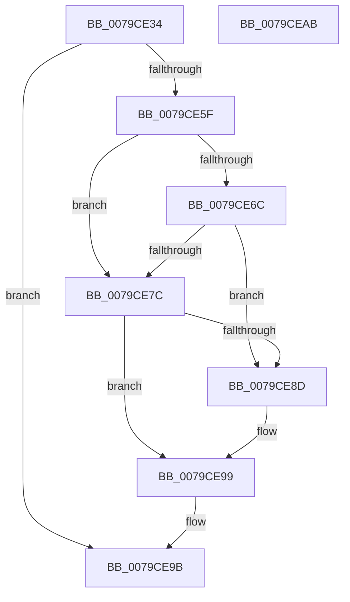

# SepCopyClientTokenAndSetSilo

- RVA: `0x0079CE34`–`0x0079CEAC` (길이 `120` bytes)
- VA: `0x000000014079CE34`
- 실행 섹션: `PAGE`
- PDB 이름 있음: `예`; PDB Function 태그: `아니요`
- unwind 정보 RVA: `0x000733E4`
- 디코드: `39`개 명령, `120/120` bytes 표시
- 미해석 바이트: `0` (있으면 어셈블리에 `.byte`로 보존)

> 이 문서는 커널 이미지의 기계어와 PDB 기호를 분석해 생성했습니다. 4번과 5번은 함수 원형과 자료형을 바이너리 사용 방식에서 추정한 C 해석이며 원본 소스 복구 결과는 아닙니다.

## 1. Dependencies

- 직접 호출 지점: **5**; 고유 호출 대상: **5**
- 직접 호출자로 확인된 함수: **2**
- RIP 상대 이미지 참조: **0**

### Outgoing calls
- `0x0079CE56` → [SeCopyClientToken](../9E/SeCopyClientToken_function_009EC5A8.md) (function, `0x009EC5A8`)
- `0x0079CE62` → [PsGetServerSiloServiceSessionId](../../text/45/PsGetServerSiloServiceSessionId_function_0045ED00.md) (function, `0x0045ED00`)
- `0x0079CE71` → [SeSetSessionIdToken](../AF/SeSetSessionIdToken_function_00AF1F0C.md) (function, `0x00AF1F0C`)
- `0x0079CE82` → [SepSetServerSiloToken](SepSetServerSiloToken_function_0079D2A8.md) (function, `0x0079D2A8`)
- `0x0079CE90` → [ObfDereferenceObject](../../text/2F/ObfDereferenceObject_function_002F9350.md) (function, `0x002F9350`)

### Direct callers
- [SepUpdateSiloInClientSecurity](../AD/SepUpdateSiloInClientSecurity_function_00AD4E10.md) at `0x00AD4E78`
- [sub_00B1943A](../B1/Unknown_function_00B1943A.md) at `0x00B1947D`

### Static image references
- 디코드된 RIP-relative 메모리 참조가 없습니다.

## 2. Other-region calls and transfers

- 다른 실행 섹션으로 향하는 call: **2**
  - `0x0079CE62` → [PsGetServerSiloServiceSessionId](../../text/45/PsGetServerSiloServiceSessionId_function_0045ED00.md) (`PAGE` → `.text`)
  - `0x0079CE90` → [ObfDereferenceObject](../../text/2F/ObfDereferenceObject_function_002F9350.md) (`PAGE` → `.text`)
- 별도 외부 분기/꼬리 이동을 확인하지 못했습니다.

## 3. Assembly (complete function range)

```asm
0079CE34  48 8B C4                        mov rax, rsp
0079CE37  48 89 58 08                     mov qword ptr [rax + 8], rbx
0079CE3B  48 89 70 10                     mov qword ptr [rax + 0x10], rsi
0079CE3F  57                              push rdi
0079CE40  48 83 EC 30                     sub rsp, 0x30
0079CE44  4C 89 48 F0                     mov qword ptr [rax - 0x10], r9
0079CE48  49 8B F9                        mov rdi, r9
0079CE4B  48 83 60 E8 00                  and qword ptr [rax - 0x18], 0
0079CE50  45 33 C9                        xor r9d, r9d
0079CE53  49 8B F0                        mov rsi, r8
0079CE56  E8 4D F7 24 00                  call 0x1409ec5a8
0079CE5B  85 C0                           test eax, eax
0079CE5D  78 3C                           js 0x14079ce9b
0079CE5F  48 8B CE                        mov rcx, rsi
0079CE62  E8 99 1E CC FF                  call 0x14045ed00
0079CE67  83 F8 FF                        cmp eax, -1
0079CE6A  74 10                           je 0x14079ce7c
0079CE6C  48 8B 0F                        mov rcx, qword ptr [rdi]
0079CE6F  8B D0                           mov edx, eax
0079CE71  E8 96 50 35 00                  call 0x140af1f0c
0079CE76  8B D8                           mov ebx, eax
0079CE78  85 C0                           test eax, eax
0079CE7A  78 11                           js 0x14079ce8d
0079CE7C  48 8B 0F                        mov rcx, qword ptr [rdi]
0079CE7F  48 8B D6                        mov rdx, rsi
0079CE82  E8 21 04 00 00                  call 0x14079d2a8
0079CE87  8B D8                           mov ebx, eax
0079CE89  85 C0                           test eax, eax
0079CE8B  79 0C                           jns 0x14079ce99
0079CE8D  48 8B 0F                        mov rcx, qword ptr [rdi]
0079CE90  E8 BB C4 B5 FF                  call 0x1402f9350
0079CE95  48 83 27 00                     and qword ptr [rdi], 0
0079CE99  8B C3                           mov eax, ebx
0079CE9B  48 8B 5C 24 40                  mov rbx, qword ptr [rsp + 0x40]
0079CEA0  48 8B 74 24 48                  mov rsi, qword ptr [rsp + 0x48]
0079CEA5  48 83 C4 30                     add rsp, 0x30
0079CEA9  5F                              pop rdi
0079CEAA  C3                              ret
0079CEAB  CC                              int3
```

## 4. C-style interpretation (structured pseudocode)

```c
__int64 __fastcall SepCopyClientTokenAndSetSilo(__int64 a1, __int64 a2, __int64 a3, __int64 a4)
{
    __int64 result;
    __int64 v_rsp;
    unsigned __int64 v_stack_p10;
    unsigned __int64 v_stack_p8;

    *(unsigned __int64 *)(v_rsp + 8) = v_rbx;
    *(unsigned __int64 *)(v_rsp + 16) = v_rsi;
    v_rsp = (v_rsp) - (48);
    *(unsigned __int64 *)(v_rsp - 16) = a4;
    a4 = 0;
    result = SeCopyClientToken(a1, a2, a3, a4);
    if (sign_flag) goto loc_0079CE9B;
    result = PsGetServerSiloServiceSessionId(a3, a2, a3, a4);
    if (((unsigned int)(result)) == -1) goto loc_0079CE7C;
    result = SeSetSessionIdToken(*(unsigned __int64 *)(a4), (unsigned int)((unsigned int)(result)), a3, a4);
    if (sign_flag) goto loc_0079CE8D;
loc_0079CE7C:
    result = SepSetServerSiloToken(*(unsigned __int64 *)(a4), a3, a3, a4);
    if (sign_flag) {
        a1 = *(unsigned __int64 *)(a4);
        result = ObfDereferenceObject(a1, a3, a3, a4);
    }
loc_0079CE9B:
    v_rsp = (v_rsp) + (48);
    return (unsigned int)((unsigned int)((unsigned int)((unsigned int)(result))));
}
```

## 5. (Beta) C Style

```c
int64_t SepCopyClientTokenAndSetSilo(int64_t Arg1, int64_t Arg2, int64_t Arg3, void *Arg4)
{
    uint8_t *arg4 = (uint8_t *)Arg4;

    int64_t result;
    int64_t local_rsp;
    uint64_t v_stack_p10;
    uint64_t v_stack_p8;

    *(uint64_t *)(local_rsp + 0x8) = local_rbx;
    *(uint64_t *)(local_rsp + 0x10) = local_rsi;
    local_rsp = (local_rsp) - (48);
    *(void **)(local_rsp - 0x10) = Arg4;
    Arg4 = 0;
    result = SeCopyClientToken(Arg1, Arg2, Arg3, Arg4);
    if (sign_flag) goto loc_0079CE9B;
    result = PsGetServerSiloServiceSessionId(Arg3, Arg2, Arg3, Arg4);
    if (((uint32_t)(result)) == -1) goto loc_0079CE7C;
    result = SeSetSessionIdToken(*(uint64_t *)(arg4), (uint32_t)((uint32_t)(result)), Arg3, Arg4);
    if (sign_flag) goto loc_0079CE8D;
loc_0079CE7C:
    result = SepSetServerSiloToken(*(uint64_t *)(arg4), Arg3, Arg3, Arg4);
    if (sign_flag) {
        Arg1 = *(uint64_t *)(arg4);
        result = ObfDereferenceObject(Arg1, Arg3, Arg3, Arg4);
    }
loc_0079CE9B:
    local_rsp = (local_rsp) + (48);
    return (uint32_t)((uint32_t)((uint32_t)((uint32_t)(result))));
}
```

### 관측된 메모리 오프셋

구조체 형식이 확인되지 않은 접근은 인자 기준의 오프셋으로만 기록했습니다.

| 기준 인자 | 오프셋 표현 | 폭 (bit) | 접근 |
|---|---:|---:|---|
| `Arg4` | `+ 0x0` | `64` | `R` |
| `Arg4` | `+ 0x0` | `64` | `R/W` |

## 6. Execution-region graph

[열기: 2D/3D 그래프와 함수 탐색 컨트롤 패널](../../../control-panel.html?section=page&rva=0x0079CE34&view=graph)

- 2D 그래프는 위에서 아래로 흐르고, 3D 그래프는 빈 공간을 드래그해 회전합니다. Shift+드래그는 이동, 휠은 확대·축소, 함수 노드 선택은 대상 보고서 이동입니다.

### Static fallback


