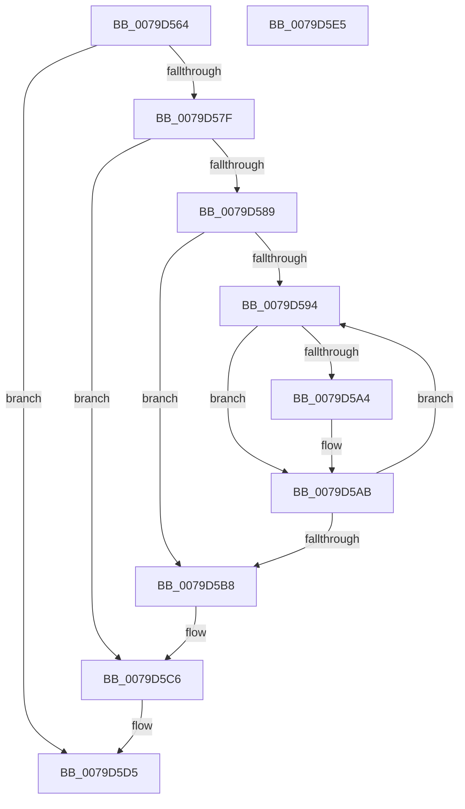

# SepFreeObjectTypeMacls

- RVA: `0x0079D564`–`0x0079D5E6` (길이 `130` bytes)
- VA: `0x000000014079D564`
- 실행 섹션: `PAGE`
- PDB 이름 있음: `예`; PDB Function 태그: `아니요`
- unwind 정보 RVA: `0x00060BC4`
- 디코드: `36`개 명령, `130/130` bytes 표시
- 미해석 바이트: `0` (있으면 어셈블리에 `.byte`로 보존)

> 이 문서는 커널 이미지의 기계어와 PDB 기호를 분석해 생성했습니다. 4번과 5번은 함수 원형과 자료형을 바이너리 사용 방식에서 추정한 C 해석이며 원본 소스 복구 결과는 아닙니다.

## 1. Dependencies

- 직접 호출 지점: **3**; 고유 호출 대상: **1**
- 직접 호출자로 확인된 함수: **1**
- RIP 상대 이미지 참조: **0**

### Outgoing calls
- `0x0079D5A6` → [ExFreePoolWithTag](../../poolcode/B8/ExFreePoolWithTag_function_00B82870.md) (function, `0x00B82870`)
- `0x0079D5C1` → [ExFreePoolWithTag](../../poolcode/B8/ExFreePoolWithTag_function_00B82870.md) (function, `0x00B82870`)
- `0x0079D5CB` → [ExFreePoolWithTag](../../poolcode/B8/ExFreePoolWithTag_function_00B82870.md) (function, `0x00B82870`)

### Direct callers
- [SepDereferenceAntiTamperEntry](../7A/SepDereferenceAntiTamperEntry_function_007A2E50.md) at `0x007A303B`

### Static image references
- 디코드된 RIP-relative 메모리 참조가 없습니다.

## 2. Other-region calls and transfers

- 다른 실행 섹션으로 향하는 call: **3**
  - `0x0079D5A6` → [ExFreePoolWithTag](../../poolcode/B8/ExFreePoolWithTag_function_00B82870.md) (`PAGE` → `POOLCODE`)
  - `0x0079D5C1` → [ExFreePoolWithTag](../../poolcode/B8/ExFreePoolWithTag_function_00B82870.md) (`PAGE` → `POOLCODE`)
  - `0x0079D5CB` → [ExFreePoolWithTag](../../poolcode/B8/ExFreePoolWithTag_function_00B82870.md) (`PAGE` → `POOLCODE`)
- 별도 외부 분기/꼬리 이동을 확인하지 못했습니다.

## 3. Assembly (complete function range)

```asm
0079D564  48 89 5C 24 08                  mov qword ptr [rsp + 8], rbx
0079D569  48 89 74 24 10                  mov qword ptr [rsp + 0x10], rsi
0079D56E  57                              push rdi
0079D56F  48 83 EC 20                     sub rsp, 0x20
0079D573  48 8B 59 38                     mov rbx, qword ptr [rcx + 0x38]
0079D577  48 8B F1                        mov rsi, rcx
0079D57A  48 85 DB                        test rbx, rbx
0079D57D  74 56                           je 0x14079d5d5
0079D57F  48 83 BB 08 01 00 00 00         cmp qword ptr [rbx + 0x108], 0
0079D587  74 3D                           je 0x14079d5c6
0079D589  33 FF                           xor edi, edi
0079D58B  40 38 BB 00 01 00 00            cmp byte ptr [rbx + 0x100], dil
0079D592  76 24                           jbe 0x14079d5b8
0079D594  48 8B 83 08 01 00 00            mov rax, qword ptr [rbx + 0x108]
0079D59B  48 8B 0C F8                     mov rcx, qword ptr [rax + rdi*8]
0079D59F  48 85 C9                        test rcx, rcx
0079D5A2  74 07                           je 0x14079d5ab
0079D5A4  33 D2                           xor edx, edx
0079D5A6  E8 C5 52 3E 00                  call 0x140b82870
0079D5AB  0F B6 83 00 01 00 00            movzx eax, byte ptr [rbx + 0x100]
0079D5B2  FF C7                           inc edi
0079D5B4  3B F8                           cmp edi, eax
0079D5B6  72 DC                           jb 0x14079d594
0079D5B8  48 8B 8B 08 01 00 00            mov rcx, qword ptr [rbx + 0x108]
0079D5BF  33 D2                           xor edx, edx
0079D5C1  E8 AA 52 3E 00                  call 0x140b82870
0079D5C6  33 D2                           xor edx, edx
0079D5C8  48 8B CB                        mov rcx, rbx
0079D5CB  E8 A0 52 3E 00                  call 0x140b82870
0079D5D0  48 83 66 38 00                  and qword ptr [rsi + 0x38], 0
0079D5D5  48 8B 5C 24 30                  mov rbx, qword ptr [rsp + 0x30]
0079D5DA  48 8B 74 24 38                  mov rsi, qword ptr [rsp + 0x38]
0079D5DF  48 83 C4 20                     add rsp, 0x20
0079D5E3  5F                              pop rdi
0079D5E4  C3                              ret
0079D5E5  CC                              int3
```

## 4. C-style interpretation (structured pseudocode)

```c
__int64 __fastcall SepFreeObjectTypeMacls(__int64 a1, int a2)
{
    __int64 result;
    __int64 v_rdi;
    __int64 v_rsp;
    unsigned __int64 v_stack_p10;
    unsigned __int64 v_stack_p8;

    v_stack_p8 = v_rbx;
    v_stack_p10 = v_rsi;
    v_rsp = (v_rsp) - (32);
    if (*(unsigned __int64 *)(a1 + 56) == 0) goto loc_0079D5D5;
    if ((*(unsigned __int64 *)(*(unsigned __int64 *)(a1 + 56) + 264)) == 0) goto loc_0079D5C6;
    v_rdi = 0;
    if ((*(unsigned __int8 *)(*(unsigned __int64 *)(a1 + 56) + 256)) <= 0) goto loc_0079D5B8;
loc_0079D594:
    result = *(unsigned __int64 *)(*(unsigned __int64 *)(a1 + 56) + 264);
    if (*(unsigned __int64 *)(*(unsigned __int64 *)(*(unsigned __int64 *)(a1 + 56) + 264) + v_rdi * 8) != 0) {
        a2 = 0;
        result = ExFreePoolWithTag(*(unsigned __int64 *)(*(unsigned __int64 *)(*(unsigned __int64 *)(a1 + 56) + 264) + v_rdi * 8), a2, a3, a4);
    }
    v_rdi = (unsigned int)((v_rdi) + 1);
    if (((unsigned int)(v_rdi)) < ((unsigned int)(*(unsigned __int8 *)(*(unsigned __int64 *)(a1 + 56) + 256)))) goto loc_0079D594;
loc_0079D5B8:
    a2 = 0;
    result = ExFreePoolWithTag(*(unsigned __int64 *)(*(unsigned __int64 *)(a1 + 56) + 264), a2, a3, a4);
loc_0079D5C6:
    a2 = 0;
    result = ExFreePoolWithTag(*(unsigned __int64 *)(a1 + 56), a2, a3, a4);
loc_0079D5D5:
    v_rsp = (v_rsp) + (32);
    return result;
}
```

## 5. (Beta) C Style

```c
int64_t SepFreeObjectTypeMacls(void *Arg1, int32_t Arg2)
{
    uint8_t *arg1 = (uint8_t *)Arg1;

    int64_t result;
    int64_t local_rdi;
    int64_t local_rsp;
    uint64_t v_stack_p10;
    uint64_t v_stack_p8;

    v_stack_p8 = local_rbx;
    v_stack_p10 = local_rsi;
    local_rsp = (local_rsp) - (32);
    if (*(uint64_t *)(arg1 + 0x38) == 0) goto loc_0079D5D5;
    if ((*(uint64_t *)(*(uint64_t *)(arg1 + 0x38) + 0x108)) == 0) goto loc_0079D5C6;
    local_rdi = 0;
    if ((*(uint8_t *)(*(uint64_t *)(arg1 + 0x38) + 0x100)) <= 0) goto loc_0079D5B8;
loc_0079D594:
    result = *(uint64_t *)(*(uint64_t *)(arg1 + 0x38) + 0x108);
    if (*(uint64_t *)(*(uint64_t *)(*(uint64_t *)(arg1 + 0x38) + 0x108) + local_rdi * 8) != 0) {
        Arg2 = 0;
        result = ExFreePoolWithTag(*(uint64_t *)(*(uint64_t *)(*(uint64_t *)(arg1 + 0x38) + 0x108) + local_rdi * 8), Arg2, a3, a4);
    }
    local_rdi = (uint32_t)((local_rdi) + 1);
    if (((uint32_t)(local_rdi)) < ((uint32_t)(*(uint8_t *)(*(uint64_t *)(arg1 + 0x38) + 0x100)))) goto loc_0079D594;
loc_0079D5B8:
    Arg2 = 0;
    result = ExFreePoolWithTag(*(uint64_t *)(*(uint64_t *)(arg1 + 0x38) + 0x108), Arg2, a3, a4);
loc_0079D5C6:
    Arg2 = 0;
    result = ExFreePoolWithTag(*(uint64_t *)(arg1 + 0x38), Arg2, a3, a4);
loc_0079D5D5:
    local_rsp = (local_rsp) + (32);
    return result;
}
```

### 관측된 메모리 오프셋

구조체 형식이 확인되지 않은 접근은 인자 기준의 오프셋으로만 기록했습니다.

| 기준 인자 | 오프셋 표현 | 폭 (bit) | 접근 |
|---|---:|---:|---|
| `Arg1` | `+ 0x38` | `64` | `R` |
| `Arg1` | `+ 0x38` | `64` | `R/W` |

## 6. Execution-region graph

[열기: 2D/3D 그래프와 함수 탐색 컨트롤 패널](../../../control-panel.html?section=page&rva=0x0079D564&view=graph)

- 2D 그래프는 위에서 아래로 흐르고, 3D 그래프는 빈 공간을 드래그해 회전합니다. Shift+드래그는 이동, 휠은 확대·축소, 함수 노드 선택은 대상 보고서 이동입니다.

### Static fallback


