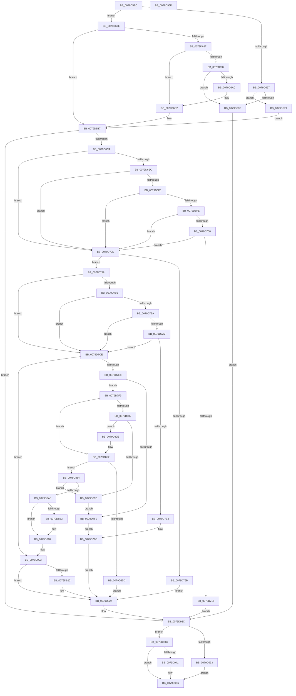

# SepGetMandatoryAccessControlList

- RVA: `0x0079D5EC`–`0x0079D96E` (길이 `898` bytes)
- VA: `0x000000014079D5EC`
- 실행 섹션: `PAGE`
- PDB 이름 있음: `예`; PDB Function 태그: `아니요`
- unwind 정보 RVA: `0x00068D9C`
- 디코드: `231`개 명령, `898/898` bytes 표시
- 미해석 바이트: `0` (있으면 어셈블리에 `.byte`로 보존)

> 이 문서는 커널 이미지의 기계어와 PDB 기호를 분석해 생성했습니다. 4번과 5번은 함수 원형과 자료형을 바이너리 사용 방식에서 추정한 C 해석이며 원본 소스 복구 결과는 아닙니다.

## 1. Dependencies

- 직접 호출 지점: **27**; 고유 호출 대상: **12**
- 직접 호출자로 확인된 함수: **2**
- RIP 상대 이미지 참조: **4**

### Outgoing calls
- `0x0079D662` → [PsReferencePrimaryTokenWithTag](../../text/20/PsReferencePrimaryTokenWithTag_function_0020FF80.md) (function, `0x0020FF80`)
- `0x0079D68A` → [IoThreadToProcess](../../text/44/IoThreadToProcess_function_00448540.md) (function, `0x00448540`)
- `0x0079D69F` → [PsReferencePrimaryTokenWithTag](../../text/20/PsReferencePrimaryTokenWithTag_function_0020FF80.md) (function, `0x0020FF80`)
- `0x0079D6DB` → [ExAcquireResourceSharedLite](../../text/21/ExAcquireResourceSharedLite_function_00211BC0.md) (function, `0x00211BC0`)
- `0x0079D71E` → [ExReleaseResourceLite](../../text/25/ExReleaseResourceLite_function_0025FA10.md) (function, `0x0025FA10`)
- `0x0079D723` → [KeLeaveCriticalRegion](../../text/25/KeLeaveCriticalRegion_function_0025D8B0.md) (function, `0x0025D8B0`)
- `0x0079D731` → [ExReleaseResourceLite](../../text/25/ExReleaseResourceLite_function_0025FA10.md) (function, `0x0025FA10`)
- `0x0079D736` → [KeLeaveCriticalRegion](../../text/25/KeLeaveCriticalRegion_function_0025D8B0.md) (function, `0x0025D8B0`)
- `0x0079D752` → [ExAcquireResourceExclusiveLite](../../text/21/ExAcquireResourceExclusiveLite_function_00214E20.md) (function, `0x00214E20`)
- `0x0079D774` → [ExReleaseResourceLite](../../text/25/ExReleaseResourceLite_function_0025FA10.md) (function, `0x0025FA10`)
- `0x0079D779` → [KeLeaveCriticalRegion](../../text/25/KeLeaveCriticalRegion_function_0025D8B0.md) (function, `0x0025D8B0`)
- `0x0079D7BF` → [ExReleaseResourceLite](../../text/25/ExReleaseResourceLite_function_0025FA10.md) (function, `0x0025FA10`)
- `0x0079D7C4` → [KeLeaveCriticalRegion](../../text/25/KeLeaveCriticalRegion_function_0025D8B0.md) (function, `0x0025D8B0`)
- `0x0079D7D9` → [SepConstructMandatoryAccessControlList](SepConstructMandatoryAccessControlList_function_0079D3AC.md) (function, `0x0079D3AC`)
- `0x0079D810` → [ExAllocatePool2](../../poolcode/B8/ExAllocatePool2_function_00B820F0.md) (function, `0x00B820F0`)
- `0x0079D827` → [ExFreePoolWithTag](../../poolcode/B8/ExFreePoolWithTag_function_00B82870.md) (function, `0x00B82870`)
- `0x0079D83A` → [memset](../../text/6C/memset_function_006C6C40.md) (function, `0x006C6C40`)
- `0x0079D862` → [ExFreePoolWithTag](../../poolcode/B8/ExFreePoolWithTag_function_00B82870.md) (function, `0x00B82870`)
- `0x0079D870` → [ExReleaseResourceLite](../../text/25/ExReleaseResourceLite_function_0025FA10.md) (function, `0x0025FA10`)
- `0x0079D875` → [KeLeaveCriticalRegion](../../text/25/KeLeaveCriticalRegion_function_0025D8B0.md) (function, `0x0025D8B0`)
- `0x0079D897` → [ExAllocatePool2](../../poolcode/B8/ExAllocatePool2_function_00B820F0.md) (function, `0x00B820F0`)
- `0x0079D8C4` → [memcpy](../../text/6C/memcpy_function_006C6840.md) (function, `0x006C6840`)
- `0x0079D8D2` → [ExFreePoolWithTag](../../poolcode/B8/ExFreePoolWithTag_function_00B82870.md) (function, `0x00B82870`)
- `0x0079D90C` → [ExReleaseResourceLite](../../text/25/ExReleaseResourceLite_function_0025FA10.md) (function, `0x0025FA10`)
- `0x0079D911` → [KeLeaveCriticalRegion](../../text/25/KeLeaveCriticalRegion_function_0025D8B0.md) (function, `0x0025D8B0`)
- `0x0079D922` → [ExFreePoolWithTag](../../poolcode/B8/ExFreePoolWithTag_function_00B82870.md) (function, `0x00B82870`)
- `0x0079D951` → [ObFastDereferenceObject](../../text/3E/ObFastDereferenceObject_function_003ED5F0.md) (function, `0x003ED5F0`)

### Direct callers
- [sub_004E9AEF](../../text/4E/Unknown_function_004E9AEF.md) at `0x004E9B22`
- [SeAdjustAntiTamperCreatorAccess](../../text/60/SeAdjustAntiTamperCreatorAccess_function_00607590.md) at `0x006075F5`

### Static image references
- `0x0079D620` → RVA `0x00FC6E4C` (`ALMOSTRO`; read)
- `0x0079D63E` → RVA `0x00FC7800` (`ALMOSTRO`; read)
- `0x0079D649` → RVA `0x00FC6A98` (`ALMOSTRO`; read)
- `0x0079D67E` → RVA `0x00FC6AC8` (`ALMOSTRO`; read)

## 2. Other-region calls and transfers

- 다른 실행 섹션으로 향하는 call: **26**
  - `0x0079D662` → [PsReferencePrimaryTokenWithTag](../../text/20/PsReferencePrimaryTokenWithTag_function_0020FF80.md) (`PAGE` → `.text`)
  - `0x0079D68A` → [IoThreadToProcess](../../text/44/IoThreadToProcess_function_00448540.md) (`PAGE` → `.text`)
  - `0x0079D69F` → [PsReferencePrimaryTokenWithTag](../../text/20/PsReferencePrimaryTokenWithTag_function_0020FF80.md) (`PAGE` → `.text`)
  - `0x0079D6DB` → [ExAcquireResourceSharedLite](../../text/21/ExAcquireResourceSharedLite_function_00211BC0.md) (`PAGE` → `.text`)
  - `0x0079D71E` → [ExReleaseResourceLite](../../text/25/ExReleaseResourceLite_function_0025FA10.md) (`PAGE` → `.text`)
  - `0x0079D723` → [KeLeaveCriticalRegion](../../text/25/KeLeaveCriticalRegion_function_0025D8B0.md) (`PAGE` → `.text`)
  - `0x0079D731` → [ExReleaseResourceLite](../../text/25/ExReleaseResourceLite_function_0025FA10.md) (`PAGE` → `.text`)
  - `0x0079D736` → [KeLeaveCriticalRegion](../../text/25/KeLeaveCriticalRegion_function_0025D8B0.md) (`PAGE` → `.text`)
  - `0x0079D752` → [ExAcquireResourceExclusiveLite](../../text/21/ExAcquireResourceExclusiveLite_function_00214E20.md) (`PAGE` → `.text`)
  - `0x0079D774` → [ExReleaseResourceLite](../../text/25/ExReleaseResourceLite_function_0025FA10.md) (`PAGE` → `.text`)
  - `0x0079D779` → [KeLeaveCriticalRegion](../../text/25/KeLeaveCriticalRegion_function_0025D8B0.md) (`PAGE` → `.text`)
  - `0x0079D7BF` → [ExReleaseResourceLite](../../text/25/ExReleaseResourceLite_function_0025FA10.md) (`PAGE` → `.text`)
  - `0x0079D7C4` → [KeLeaveCriticalRegion](../../text/25/KeLeaveCriticalRegion_function_0025D8B0.md) (`PAGE` → `.text`)
  - `0x0079D810` → [ExAllocatePool2](../../poolcode/B8/ExAllocatePool2_function_00B820F0.md) (`PAGE` → `POOLCODE`)
  - `0x0079D827` → [ExFreePoolWithTag](../../poolcode/B8/ExFreePoolWithTag_function_00B82870.md) (`PAGE` → `POOLCODE`)
  - `0x0079D83A` → [memset](../../text/6C/memset_function_006C6C40.md) (`PAGE` → `.text`)
  - `0x0079D862` → [ExFreePoolWithTag](../../poolcode/B8/ExFreePoolWithTag_function_00B82870.md) (`PAGE` → `POOLCODE`)
  - `0x0079D870` → [ExReleaseResourceLite](../../text/25/ExReleaseResourceLite_function_0025FA10.md) (`PAGE` → `.text`)
  - `0x0079D875` → [KeLeaveCriticalRegion](../../text/25/KeLeaveCriticalRegion_function_0025D8B0.md) (`PAGE` → `.text`)
  - `0x0079D897` → [ExAllocatePool2](../../poolcode/B8/ExAllocatePool2_function_00B820F0.md) (`PAGE` → `POOLCODE`)
  - `0x0079D8C4` → [memcpy](../../text/6C/memcpy_function_006C6840.md) (`PAGE` → `.text`)
  - `0x0079D8D2` → [ExFreePoolWithTag](../../poolcode/B8/ExFreePoolWithTag_function_00B82870.md) (`PAGE` → `POOLCODE`)
  - `0x0079D90C` → [ExReleaseResourceLite](../../text/25/ExReleaseResourceLite_function_0025FA10.md) (`PAGE` → `.text`)
  - `0x0079D911` → [KeLeaveCriticalRegion](../../text/25/KeLeaveCriticalRegion_function_0025D8B0.md) (`PAGE` → `.text`)
  - `0x0079D922` → [ExFreePoolWithTag](../../poolcode/B8/ExFreePoolWithTag_function_00B82870.md) (`PAGE` → `POOLCODE`)
  - `0x0079D951` → [ObFastDereferenceObject](../../text/3E/ObFastDereferenceObject_function_003ED5F0.md) (`PAGE` → `.text`)
- 별도 외부 분기/꼬리 이동을 확인하지 못했습니다.

## 3. Assembly (complete function range)

```asm
0079D5EC  48 89 5C 24 18                  mov qword ptr [rsp + 0x18], rbx
0079D5F1  4C 89 4C 24 20                  mov qword ptr [rsp + 0x20], r9
0079D5F6  55                              push rbp
0079D5F7  56                              push rsi
0079D5F8  57                              push rdi
0079D5F9  41 54                           push r12
0079D5FB  41 55                           push r13
0079D5FD  41 56                           push r14
0079D5FF  41 57                           push r15
0079D601  48 83 EC 20                     sub rsp, 0x20
0079D605  48 8B 59 10                     mov rbx, qword ptr [rcx + 0x10]
0079D609  33 C0                           xor eax, eax
0079D60B  48 89 44 24 60                  mov qword ptr [rsp + 0x60], rax
0079D610  48 8D 4A D0                     lea rcx, [rdx - 0x30]
0079D614  48 C1 E9 08                     shr rcx, 8
0079D618  8B E8                           mov ebp, eax
0079D61A  32 4A E8                        xor cl, byte ptr [rdx - 0x18]
0079D61D  44 8B E8                        mov r13d, eax
0079D620  32 0D 26 98 82 00               xor cl, byte ptr [rip + 0x829826]
0079D626  8B F8                           mov edi, eax
0079D628  0F B6 F1                        movzx esi, cl
0079D62B  4D 8B F9                        mov r15, r9
0079D62E  49 89 00                        mov qword ptr [r8], rax
0079D631  4D 8B E0                        mov r12, r8
0079D634  49 89 01                        mov qword ptr [r9], rax
0079D637  4C 8B F2                        mov r14, rdx
0079D63A  49 89 41 08                     mov qword ptr [r9 + 8], rax
0079D63E  48 8D 05 BB A1 82 00            lea rax, [rip + 0x82a1bb]
0079D645  48 8B 04 F0                     mov rax, qword ptr [rax + rsi*8]
0079D649  48 3B 05 48 94 82 00            cmp rax, qword ptr [rip + 0x829448]
0079D650  48 89 74 24 68                  mov qword ptr [rsp + 0x68], rsi
0079D655  75 27                           jne 0x14079d67e
0079D657  4C 8B EA                        mov r13, rdx
0079D65A  BA 44 66 6C 74                  mov edx, 0x746c6644
0079D65F  49 8B CD                        mov rcx, r13
0079D662  E8 19 29 A7 FF                  call 0x14020ff80
0079D667  48 8B E8                        mov rbp, rax
0079D66A  48 85 C0                        test rax, rax
0079D66D  75 0A                           jne 0x14079d679
0079D66F  BF 7C 00 00 C0                  mov edi, 0xc000007c
0079D674  E9 B3 02 00 00                  jmp 0x14079d92c
0079D679  48 8B D8                        mov rbx, rax
0079D67C  EB 39                           jmp 0x14079d6b7
0079D67E  48 3B 05 43 94 82 00            cmp rax, qword ptr [rip + 0x829443]
0079D685  75 30                           jne 0x14079d6b7
0079D687  49 8B CE                        mov rcx, r14
0079D68A  E8 B1 AE CA FF                  call 0x140448540
0079D68F  48 8B F0                        mov rsi, rax
0079D692  48 85 C0                        test rax, rax
0079D695  74 1B                           je 0x14079d6b2
0079D697  BA 44 66 6C 74                  mov edx, 0x746c6644
0079D69C  48 8B C8                        mov rcx, rax
0079D69F  E8 DC 28 A7 FF                  call 0x14020ff80
0079D6A4  48 8B E8                        mov rbp, rax
0079D6A7  48 85 C0                        test rax, rax
0079D6AA  74 C3                           je 0x14079d66f
0079D6AC  48 8B D8                        mov rbx, rax
0079D6AF  4C 8B EE                        mov r13, rsi
0079D6B2  48 8B 74 24 68                  mov rsi, qword ptr [rsp + 0x68]
0079D6B7  48 39 BB 98 04 00 00            cmp qword ptr [rbx + 0x498], rdi
0079D6BE  0F 84 68 02 00 00               je 0x14079d92c
0079D6C4  65 48 8B 04 25 88 01 00 00      mov rax, qword ptr gs:[0x188]
0079D6CD  B2 01                           mov dl, 1
0079D6CF  66 FF 88 E4 01 00 00            dec word ptr [rax + 0x1e4]
0079D6D6  90                              nop
0079D6D7  48 8B 4B 30                     mov rcx, qword ptr [rbx + 0x30]
0079D6DB  E8 E0 44 A7 FF                  call 0x140211bc0
0079D6E0  48 8B 83 B8 05 00 00            mov rax, qword ptr [rbx + 0x5b8]
0079D6E7  48 85 C0                        test rax, rax
0079D6EA  74 41                           je 0x14079d72d
0079D6EC  48 8B 40 38                     mov rax, qword ptr [rax + 0x38]
0079D6F0  48 85 C0                        test rax, rax
0079D6F3  74 38                           je 0x14079d72d
0079D6F5  0F B6 0C 06                     movzx ecx, byte ptr [rsi + rax]
0079D6F9  80 F9 FF                        cmp cl, 0xff
0079D6FC  74 2F                           je 0x14079d72d
0079D6FE  3A 88 00 01 00 00               cmp cl, byte ptr [rax + 0x100]
0079D704  73 27                           jae 0x14079d72d
0079D706  48 8B 80 08 01 00 00            mov rax, qword ptr [rax + 0x108]
0079D70D  48 8B 14 C8                     mov rdx, qword ptr [rax + rcx*8]
0079D711  48 85 D2                        test rdx, rdx
0079D714  74 17                           je 0x14079d72d
0079D716  48 8B 4B 30                     mov rcx, qword ptr [rbx + 0x30]
0079D71A  49 89 14 24                     mov qword ptr [r12], rdx
0079D71E  E8 ED 22 AC FF                  call 0x14025fa10
0079D723  E8 88 01 AC FF                  call 0x14025d8b0
0079D728  E9 FF 01 00 00                  jmp 0x14079d92c
0079D72D  48 8B 4B 30                     mov rcx, qword ptr [rbx + 0x30]
0079D731  E8 DA 22 AC FF                  call 0x14025fa10
0079D736  E8 75 01 AC FF                  call 0x14025d8b0
0079D73B  65 48 8B 04 25 88 01 00 00      mov rax, qword ptr gs:[0x188]
0079D744  B2 01                           mov dl, 1
0079D746  66 FF 88 E4 01 00 00            dec word ptr [rax + 0x1e4]
0079D74D  90                              nop
0079D74E  48 8B 4B 30                     mov rcx, qword ptr [rbx + 0x30]
0079D752  E8 C9 76 A7 FF                  call 0x140214e20
0079D757  45 33 C0                        xor r8d, r8d
0079D75A  F0 44 09 04 24                  lock or dword ptr [rsp], r8d
0079D75F  4C 8B BB B8 05 00 00            mov r15, qword ptr [rbx + 0x5b8]
0079D766  4D 85 FF                        test r15, r15
0079D769  75 1D                           jne 0x14079d788
0079D76B  F0 44 09 04 24                  lock or dword ptr [rsp], r8d
0079D770  48 8B 4B 30                     mov rcx, qword ptr [rbx + 0x30]
0079D774  E8 97 22 AC FF                  call 0x14025fa10
0079D779  E8 32 01 AC FF                  call 0x14025d8b0
0079D77E  BF 01 00 00 C0                  mov edi, 0xc0000001
0079D783  E9 9F 01 00 00                  jmp 0x14079d927
0079D788  49 8B 47 38                     mov rax, qword ptr [r15 + 0x38]
0079D78C  48 85 C0                        test rax, rax
0079D78F  74 3D                           je 0x14079d7ce
0079D791  0F B6 0C 06                     movzx ecx, byte ptr [rsi + rax]
0079D795  80 F9 FF                        cmp cl, 0xff
0079D798  74 34                           je 0x14079d7ce
0079D79A  3A 88 00 01 00 00               cmp cl, byte ptr [rax + 0x100]
0079D7A0  73 2C                           jae 0x14079d7ce
0079D7A2  48 8B 80 08 01 00 00            mov rax, qword ptr [rax + 0x108]
0079D7A9  48 8B 14 C8                     mov rdx, qword ptr [rax + rcx*8]
0079D7AD  48 85 D2                        test rdx, rdx
0079D7B0  74 1C                           je 0x14079d7ce
0079D7B2  49 89 14 24                     mov qword ptr [r12], rdx
0079D7B6  F0 44 09 04 24                  lock or dword ptr [rsp], r8d
0079D7BB  48 8B 4B 30                     mov rcx, qword ptr [rbx + 0x30]
0079D7BF  E8 4C 22 AC FF                  call 0x14025fa10
0079D7C4  E8 E7 00 AC FF                  call 0x14025d8b0
0079D7C9  E9 59 01 00 00                  jmp 0x14079d927
0079D7CE  4C 8D 44 24 60                  lea r8, [rsp + 0x60]
0079D7D3  49 8B D6                        mov rdx, r14
0079D7D6  48 8B CB                        mov rcx, rbx
0079D7D9  E8 CE FB FF FF                  call 0x14079d3ac
0079D7DE  8B F8                           mov edi, eax
0079D7E0  85 C0                           test eax, eax
0079D7E2  0F 88 1B 01 00 00               js 0x14079d903
0079D7E8  4C 8B 74 24 60                  mov r14, qword ptr [rsp + 0x60]
0079D7ED  4D 85 F6                        test r14, r14
0079D7F0  75 07                           jne 0x14079d7f9
0079D7F2  F0 83 0C 24 00                  lock or dword ptr [rsp], 0
0079D7F7  EB C2                           jmp 0x14079d7bb
0079D7F9  49 8B 77 38                     mov rsi, qword ptr [r15 + 0x38]
0079D7FD  48 85 F6                        test rsi, rsi
0079D800  75 50                           jne 0x14079d852
0079D802  BA 10 01 00 00                  mov edx, 0x110
0079D807  41 B8 53 65 4F 4D               mov r8d, 0x4d4f6553
0079D80D  8D 4A F0                        lea ecx, [rdx - 0x10]
0079D810  E8 DB 48 3E 00                  call 0x140b820f0
0079D815  48 8B F0                        mov rsi, rax
0079D818  48 85 C0                        test rax, rax
0079D81B  75 11                           jne 0x14079d82e
0079D81D  33 D2                           xor edx, edx
0079D81F  49 8B CE                        mov rcx, r14
0079D822  BF 17 00 00 C0                  mov edi, 0xc0000017
0079D827  E8 44 50 3E 00                  call 0x140b82870
0079D82C  EB C4                           jmp 0x14079d7f2
0079D82E  BA FF 00 00 00                  mov edx, 0xff
0079D833  48 8B CE                        mov rcx, rsi
0079D836  44 8D 42 01                     lea r8d, [rdx + 1]
0079D83A  E8 01 94 F2 FF                  call 0x1406c6c40
0079D83F  48 83 A6 08 01 00 00 00         and qword ptr [rsi + 0x108], 0
0079D847  C6 86 00 01 00 00 00            mov byte ptr [rsi + 0x100], 0
0079D84E  49 89 77 38                     mov qword ptr [r15 + 0x38], rsi
0079D852  0F B6 86 00 01 00 00            movzx eax, byte ptr [rsi + 0x100]
0079D859  3C FF                           cmp al, 0xff
0079D85B  72 27                           jb 0x14079d884
0079D85D  33 D2                           xor edx, edx
0079D85F  49 8B CE                        mov rcx, r14
0079D862  E8 09 50 3E 00                  call 0x140b82870
0079D867  F0 83 0C 24 00                  lock or dword ptr [rsp], 0
0079D86C  48 8B 4B 30                     mov rcx, qword ptr [rbx + 0x30]
0079D870  E8 9B 21 AC FF                  call 0x14025fa10
0079D875  E8 36 00 AC FF                  call 0x14025d8b0
0079D87A  BF 9A 00 00 C0                  mov edi, 0xc000009a
0079D87F  E9 A3 00 00 00                  jmp 0x14079d927
0079D884  48 8D 14 C5 08 00 00 00         lea rdx, [rax*8 + 8]
0079D88C  B9 00 01 00 00                  mov ecx, 0x100
0079D891  41 B8 53 65 4F 4D               mov r8d, 0x4d4f6553
0079D897  E8 54 48 3E 00                  call 0x140b820f0
0079D89C  4C 8B F8                        mov r15, rax
0079D89F  48 85 C0                        test rax, rax
0079D8A2  0F 84 75 FF FF FF               je 0x14079d81d
0079D8A8  0F B6 86 00 01 00 00            movzx eax, byte ptr [rsi + 0x100]
0079D8AF  84 C0                           test al, al
0079D8B1  74 24                           je 0x14079d8d7
0079D8B3  48 8B 96 08 01 00 00            mov rdx, qword ptr [rsi + 0x108]
0079D8BA  44 8B C0                        mov r8d, eax
0079D8BD  49 C1 E0 03                     shl r8, 3
0079D8C1  49 8B CF                        mov rcx, r15
0079D8C4  E8 77 8F F2 FF                  call 0x1406c6840
0079D8C9  48 8B 8E 08 01 00 00            mov rcx, qword ptr [rsi + 0x108]
0079D8D0  33 D2                           xor edx, edx
0079D8D2  E8 99 4F 3E 00                  call 0x140b82870
0079D8D7  0F B6 8E 00 01 00 00            movzx ecx, byte ptr [rsi + 0x100]
0079D8DE  0F B6 44 24 68                  movzx eax, byte ptr [rsp + 0x68]
0079D8E3  4C 89 BE 08 01 00 00            mov qword ptr [rsi + 0x108], r15
0079D8EA  4D 89 34 24                     mov qword ptr [r12], r14
0079D8EE  4D 89 34 CF                     mov qword ptr [r15 + rcx*8], r14
0079D8F2  88 0C 30                        mov byte ptr [rax + rsi], cl
0079D8F5  FE C1                           inc cl
0079D8F7  48 83 64 24 60 00               and qword ptr [rsp + 0x60], 0
0079D8FD  88 8E 00 01 00 00               mov byte ptr [rsi + 0x100], cl
0079D903  F0 83 0C 24 00                  lock or dword ptr [rsp], 0
0079D908  48 8B 4B 30                     mov rcx, qword ptr [rbx + 0x30]
0079D90C  E8 FF 20 AC FF                  call 0x14025fa10
0079D911  E8 9A FF AB FF                  call 0x14025d8b0
0079D916  48 8B 4C 24 60                  mov rcx, qword ptr [rsp + 0x60]
0079D91B  48 85 C9                        test rcx, rcx
0079D91E  74 07                           je 0x14079d927
0079D920  33 D2                           xor edx, edx
0079D922  E8 49 4F 3E 00                  call 0x140b82870
0079D927  4C 8B 7C 24 78                  mov r15, qword ptr [rsp + 0x78]
0079D92C  49 83 3C 24 00                  cmp qword ptr [r12], 0
0079D931  74 09                           je 0x14079d93c
0079D933  4D 89 2F                        mov qword ptr [r15], r13
0079D936  49 89 6F 08                     mov qword ptr [r15 + 8], rbp
0079D93A  EB 1A                           jmp 0x14079d956
0079D93C  48 85 ED                        test rbp, rbp
0079D93F  74 15                           je 0x14079d956
0079D941  49 8D 8D 48 02 00 00            lea rcx, [r13 + 0x248]
0079D948  41 B8 44 66 6C 74               mov r8d, 0x746c6644
0079D94E  48 8B D5                        mov rdx, rbp
0079D951  E8 9A FC C4 FF                  call 0x1403ed5f0
0079D956  48 8B 5C 24 70                  mov rbx, qword ptr [rsp + 0x70]
0079D95B  8B C7                           mov eax, edi
0079D95D  48 83 C4 20                     add rsp, 0x20
0079D961  41 5F                           pop r15
0079D963  41 5E                           pop r14
0079D965  41 5D                           pop r13
0079D967  41 5C                           pop r12
0079D969  5F                              pop rdi
0079D96A  5E                              pop rsi
0079D96B  5D                              pop rbp
0079D96C  C3                              ret
0079D96D  CC                              int3
```

## 4. C-style interpretation (structured pseudocode)

```c
__int64 __fastcall SepGetMandatoryAccessControlList(__int64 a1, __int64 a2, __int64 a3, __int64 a4)
{
    __int64 result;
    __int64 v_rsp;
    unsigned int v_stack_m58;
    unsigned __int64 v_stack_p10;
    unsigned __int64 v_stack_p18;
    unsigned __int64 v_stack_p20;
    unsigned __int64 v_stack_p8;

    v_stack_p18 = v_rbx;
    v_stack_p20 = a4;
    v_rsp = (v_rsp) - (32);
    result = 0;
    v_stack_p8 = 0;
    a1 = (a2 - 48) >> (8);
    a1 = (unsigned __int8)((a1) ^ (*(unsigned __int8 *)(a2 - 24)));
    a1 = (unsigned __int8)((a1) ^ (*(unsigned __int8 *)(v_rip + 8558630)));
    *(unsigned __int64 *)(a3) = 0;
    *(unsigned __int64 *)(a4) = 0;
    *(unsigned __int64 *)(a4 + 8) = 0;
    v_stack_p10 = (unsigned __int8)(a1);
    if ((*(unsigned __int64 *)(v_rip + 8561083 + (unsigned __int8)(a1) * 8)) != (*(unsigned __int64 *)(v_rip + 8557640))) goto loc_0079D67E;
    result = PsReferencePrimaryTokenWithTag(a2, (unsigned int)(0x746C6644ULL), a3, a4);
    if (result != 0) goto loc_0079D679;
loc_0079D66F:
    goto loc_0079D92C;
loc_0079D679:
    goto loc_0079D6B7;
loc_0079D67E:
    if (result != (*(unsigned __int64 *)(v_rip + 8557635))) goto loc_0079D6B7;
    result = IoThreadToProcess(a2, (unsigned int)(0x746C6644ULL), a3, a4);
    if (result == 0) goto loc_0079D6B2;
    result = PsReferencePrimaryTokenWithTag(result, (unsigned int)(0x746C6644ULL), a3, a4);
    if (result == 0) goto loc_0079D66F;
loc_0079D6B2:
loc_0079D6B7:
    if ((*(unsigned __int64 *)(result + 1176)) == ((unsigned int)(0xC000007CULL))) goto loc_0079D92C;
    result = ExAcquireResourceSharedLite(*(unsigned __int64 *)(result + 48), 1, a3, a4);
    if (*(unsigned __int64 *)(result + 1464) == 0) goto loc_0079D72D;
    if (*(unsigned __int64 *)(*(unsigned __int64 *)(result + 1464) + 56) == 0) goto loc_0079D72D;
    if (((unsigned __int8)(*(unsigned __int8 *)(v_stack_p10 + *(unsigned __int64 *)(*(unsigned __int64 *)(result + 1464) + 56) * 1))) == 255) goto loc_0079D72D;
    if (((unsigned __int8)(*(unsigned __int8 *)(v_stack_p10 + *(unsigned __int64 *)(*(unsigned __int64 *)(result + 1464) + 56) * 1))) >= (*(unsigned __int8 *)(*(unsigned __int64 *)(*(unsigned __int64 *)(result + 1464) + 56) + 256))) goto loc_0079D72D;
    if (*(unsigned __int64 *)(*(unsigned __int64 *)(*(unsigned __int64 *)(*(unsigned __int64 *)(result + 1464) + 56) + 264) + *(unsigned __int8 *)(v_stack_p10 + *(unsigned __int64 *)(*(unsigned __int64 *)(result + 1464) + 56) * 1) * 8) == 0) goto loc_0079D72D;
    *(unsigned __int64 *)(a3) = *(unsigned __int64 *)(*(unsigned __int64 *)(*(unsigned __int64 *)(*(unsigned __int64 *)(result + 1464) + 56) + 264) + *(unsigned __int8 *)(v_stack_p10 + *(unsigned __int64 *)(*(unsigned __int64 *)(result + 1464) + 56) * 1) * 8);
    result = ExReleaseResourceLite(*(unsigned __int64 *)(result + 48), *(unsigned __int64 *)(*(unsigned __int64 *)(*(unsigned __int64 *)(*(unsigned __int64 *)(result + 1464) + 56) + 264) + *(unsigned __int8 *)(v_stack_p10 + *(unsigned __int64 *)(*(unsigned __int64 *)(result + 1464) + 56) * 1) * 8), a3, a4);
    result = KeLeaveCriticalRegion(*(unsigned __int64 *)(result + 48), *(unsigned __int64 *)(*(unsigned __int64 *)(*(unsigned __int64 *)(*(unsigned __int64 *)(result + 1464) + 56) + 264) + *(unsigned __int8 *)(v_stack_p10 + *(unsigned __int64 *)(*(unsigned __int64 *)(result + 1464) + 56) * 1) * 8), a3, a4);
    goto loc_0079D92C;
loc_0079D72D:
    result = ExReleaseResourceLite(*(unsigned __int64 *)(result + 48), *(unsigned __int64 *)(*(unsigned __int64 *)(*(unsigned __int64 *)(*(unsigned __int64 *)(result + 1464) + 56) + 264) + *(unsigned __int8 *)(v_stack_p10 + *(unsigned __int64 *)(*(unsigned __int64 *)(result + 1464) + 56) * 1) * 8), a3, a4);
    result = KeLeaveCriticalRegion(*(unsigned __int64 *)(result + 48), *(unsigned __int64 *)(*(unsigned __int64 *)(*(unsigned __int64 *)(*(unsigned __int64 *)(result + 1464) + 56) + 264) + *(unsigned __int8 *)(v_stack_p10 + *(unsigned __int64 *)(*(unsigned __int64 *)(result + 1464) + 56) * 1) * 8), a3, a4);
    result = ExAcquireResourceExclusiveLite(*(unsigned __int64 *)(result + 48), 1, a3, a4);
    a3 = 0;
    if (*(unsigned __int64 *)(result + 1464) != 0) goto loc_0079D788;
    result = ExReleaseResourceLite(*(unsigned __int64 *)(result + 48), 1, a3, a4);
    result = KeLeaveCriticalRegion(*(unsigned __int64 *)(result + 48), 1, a3, a4);
    goto loc_0079D927;
loc_0079D788:
    if (*(unsigned __int64 *)(*(unsigned __int64 *)(result + 1464) + 56) == 0) goto loc_0079D7CE;
    if (((unsigned __int8)(*(unsigned __int8 *)(v_stack_p10 + *(unsigned __int64 *)(*(unsigned __int64 *)(result + 1464) + 56) * 1))) == 255) goto loc_0079D7CE;
    if (((unsigned __int8)(*(unsigned __int8 *)(v_stack_p10 + *(unsigned __int64 *)(*(unsigned __int64 *)(result + 1464) + 56) * 1))) >= (*(unsigned __int8 *)(*(unsigned __int64 *)(*(unsigned __int64 *)(result + 1464) + 56) + 256))) goto loc_0079D7CE;
    if (*(unsigned __int64 *)(*(unsigned __int64 *)(*(unsigned __int64 *)(*(unsigned __int64 *)(result + 1464) + 56) + 264) + *(unsigned __int8 *)(v_stack_p10 + *(unsigned __int64 *)(*(unsigned __int64 *)(result + 1464) + 56) * 1) * 8) == 0) goto loc_0079D7CE;
    *(unsigned __int64 *)(a3) = *(unsigned __int64 *)(*(unsigned __int64 *)(*(unsigned __int64 *)(*(unsigned __int64 *)(result + 1464) + 56) + 264) + *(unsigned __int8 *)(v_stack_p10 + *(unsigned __int64 *)(*(unsigned __int64 *)(result + 1464) + 56) * 1) * 8);
loc_0079D7BB:
    result = ExReleaseResourceLite(*(unsigned __int64 *)(result + 48), *(unsigned __int64 *)(*(unsigned __int64 *)(*(unsigned __int64 *)(*(unsigned __int64 *)(result + 1464) + 56) + 264) + *(unsigned __int8 *)(v_stack_p10 + *(unsigned __int64 *)(*(unsigned __int64 *)(result + 1464) + 56) * 1) * 8), a3, a4);
    result = KeLeaveCriticalRegion(*(unsigned __int64 *)(result + 48), *(unsigned __int64 *)(*(unsigned __int64 *)(*(unsigned __int64 *)(*(unsigned __int64 *)(result + 1464) + 56) + 264) + *(unsigned __int8 *)(v_stack_p10 + *(unsigned __int64 *)(*(unsigned __int64 *)(result + 1464) + 56) * 1) * 8), a3, a4);
    goto loc_0079D927;
loc_0079D7CE:
    result = SepConstructMandatoryAccessControlList(result, a2, v_stack_p8, a4);
    if (sign_flag) goto loc_0079D903;
    if (v_stack_p8 != 0) goto loc_0079D7F9;
loc_0079D7F2:
    goto loc_0079D7BB;
loc_0079D7F9:
    if (*(unsigned __int64 *)(*(unsigned __int64 *)(result + 1464) + 56) != 0) goto loc_0079D852;
    result = ExAllocatePool2(272 - 16, 272, (unsigned int)(0x4D4F6553ULL), a4);
    if (result != 0) goto loc_0079D82E;
loc_0079D81D:
    a2 = 0;
    result = ExFreePoolWithTag(v_stack_p8, a2, (unsigned int)(0x4D4F6553ULL), a4);
    goto loc_0079D7F2;
loc_0079D82E:
    result = memset(result, 255, 255 + 1, a4);
    *(unsigned __int8 *)(result + 256) = 0;
    *(unsigned __int64 *)(*(unsigned __int64 *)(result + 1464) + 56) = result;
loc_0079D852:
    if (((unsigned __int8)(*(unsigned __int8 *)(result + 256))) < 255) goto loc_0079D884;
    a2 = 0;
    result = ExFreePoolWithTag(v_stack_p8, a2, 255 + 1, a4);
    result = ExReleaseResourceLite(*(unsigned __int64 *)(result + 48), a2, 255 + 1, a4);
    result = KeLeaveCriticalRegion(*(unsigned __int64 *)(result + 48), a2, 255 + 1, a4);
    goto loc_0079D927;
loc_0079D884:
    result = ExAllocatePool2(256, result * 8 + 8, (unsigned int)(0x4D4F6553ULL), a4);
    if (result == 0) goto loc_0079D81D;
    result = *(unsigned __int8 *)(result + 256);
    if ((unsigned __int8)(*(unsigned __int8 *)(result + 256)) != 0) {
        a2 = *(unsigned __int64 *)(result + 264);
        a3 = (unsigned int)(*(unsigned __int8 *)(result + 256));
        a3 = (a3) << (3);
        a1 = result;
        result = memcpy(a1, a2, a3, a4);
        a1 = *(unsigned __int64 *)(result + 264);
        a2 = 0;
        result = ExFreePoolWithTag(a1, a2, a3, a4);
    }
    *(unsigned __int64 *)(result + 264) = result;
    *(unsigned __int64 *)(a3) = v_stack_p8;
    *(unsigned __int64 *)(result + *(unsigned __int8 *)(result + 256) * 8) = v_stack_p8;
    *(unsigned __int8 *)(v_stack_p10 + result * 1) = (unsigned __int8)(*(unsigned __int8 *)(result + 256));
    a1 = (unsigned __int8)((*(unsigned __int8 *)(result + 256)) + 1);
    *(unsigned __int8 *)(result + 256) = (unsigned __int8)(a1);
loc_0079D903:
    result = ExReleaseResourceLite(*(unsigned __int64 *)(result + 48), a2, a3, a4);
    result = KeLeaveCriticalRegion(*(unsigned __int64 *)(result + 48), a2, a3, a4);
    if (v_stack_p8 != 0) {
        a2 = 0;
        result = ExFreePoolWithTag(v_stack_p8, a2, a3, a4);
    }
loc_0079D92C:
    if ((*(unsigned __int64 *)(a3)) == 0) goto loc_0079D93C;
    *(unsigned __int64 *)(v_stack_p20) = result;
    *(unsigned __int64 *)(v_stack_p20 + 8) = result;
    goto loc_0079D956;
loc_0079D93C:
    if (result != 0) {
        a1 = result + 584;
        a3 = 0x746C6644ULL;
        a2 = result;
        result = ObFastDereferenceObject(a1, a2, a3, a4);
    }
    v_rsp = (v_rsp) + (32);
    return (unsigned int)((unsigned int)((unsigned int)(0xC000009AULL)));
}
```

## 5. (Beta) C Style

```c
int64_t SepGetMandatoryAccessControlList(void *Arg1, void *Arg2, void *Arg3, void *Arg4)
{
    uint8_t *arg1 = (uint8_t *)Arg1;
    uint8_t *arg2 = (uint8_t *)Arg2;
    uint8_t *arg3 = (uint8_t *)Arg3;
    uint8_t *arg4 = (uint8_t *)Arg4;

    int64_t result;
    int64_t local_rsp;
    uint32_t v_stack_m58;
    uint64_t v_stack_p10;
    uint64_t v_stack_p18;
    uint64_t v_stack_p20;
    uint64_t v_stack_p8;

    v_stack_p18 = local_rbx;
    v_stack_p20 = Arg4;
    local_rsp = (local_rsp) - (32);
    result = 0;
    v_stack_p8 = 0;
    Arg1 = (Arg2 - 48) >> (8);
    Arg1 = (uint8_t)((Arg1) ^ (*(uint8_t *)(arg2 - 0x18)));
    Arg1 = (uint8_t)((Arg1) ^ (*(uint8_t *)(v_rip + 0x829826)));
    *(uint64_t *)(arg3) = 0;
    *(uint64_t *)(arg4) = 0;
    *(uint64_t *)(arg4 + 0x8) = 0;
    v_stack_p10 = (uint8_t)(Arg1);
    if ((*(uint64_t *)(v_rip + 0x82A1BB + (uint8_t)(arg1) * 8)) != (*(uint64_t *)(v_rip + 0x829448))) goto loc_0079D67E;
    result = PsReferencePrimaryTokenWithTag(Arg2, (uint32_t)(0x746C6644ULL), Arg3, Arg4);
    if (result != 0) goto loc_0079D679;
loc_0079D66F:
    goto loc_0079D92C;
loc_0079D679:
    goto loc_0079D6B7;
loc_0079D67E:
    if (result != (*(uint64_t *)(v_rip + 0x829443))) goto loc_0079D6B7;
    result = IoThreadToProcess(Arg2, (uint32_t)(0x746C6644ULL), Arg3, Arg4);
    if (result == 0) goto loc_0079D6B2;
    result = PsReferencePrimaryTokenWithTag(result, (uint32_t)(0x746C6644ULL), Arg3, Arg4);
    if (result == 0) goto loc_0079D66F;
loc_0079D6B2:
loc_0079D6B7:
    if ((*(uint64_t *)(result + 0x498)) == ((uint32_t)(0xC000007CULL))) goto loc_0079D92C;
    result = ExAcquireResourceSharedLite(*(uint64_t *)(result + 0x30), 1, Arg3, Arg4);
    if (*(uint64_t *)(result + 0x5B8) == 0) goto loc_0079D72D;
    if (*(uint64_t *)(*(uint64_t *)(result + 0x5B8) + 0x38) == 0) goto loc_0079D72D;
    if (((uint8_t)(*(uint8_t *)(v_stack_p10 + *(uint64_t *)(*(uint64_t *)(result + 0x5B8) + 0x38) * 1))) == 255) goto loc_0079D72D;
    if (((uint8_t)(*(uint8_t *)(v_stack_p10 + *(uint64_t *)(*(uint64_t *)(result + 0x5B8) + 0x38) * 1))) >= (*(uint8_t *)(*(uint64_t *)(*(uint64_t *)(result + 0x5B8) + 0x38) + 0x100))) goto loc_0079D72D;
    if (*(uint64_t *)(*(uint64_t *)(*(uint64_t *)(*(uint64_t *)(result + 0x5B8) + 0x38) + 0x108) + *(uint8_t *)(v_stack_p10 + *(uint64_t *)(*(uint64_t *)(result + 0x5B8) + 0x38) * 1) * 8) == 0) goto loc_0079D72D;
    *(uint64_t *)(arg3) = *(uint64_t *)(*(uint64_t *)(*(uint64_t *)(*(uint64_t *)(result + 0x5B8) + 0x38) + 0x108) + *(uint8_t *)(v_stack_p10 + *(uint64_t *)(*(uint64_t *)(result + 0x5B8) + 0x38) * 1) * 8);
    result = ExReleaseResourceLite(*(uint64_t *)(result + 0x30), *(uint64_t *)(*(uint64_t *)(*(uint64_t *)(*(uint64_t *)(result + 0x5B8) + 0x38) + 0x108) + *(uint8_t *)(v_stack_p10 + *(uint64_t *)(*(uint64_t *)(result + 0x5B8) + 0x38) * 1) * 8), Arg3, Arg4);
    result = KeLeaveCriticalRegion(*(uint64_t *)(result + 0x30), *(uint64_t *)(*(uint64_t *)(*(uint64_t *)(*(uint64_t *)(result + 0x5B8) + 0x38) + 0x108) + *(uint8_t *)(v_stack_p10 + *(uint64_t *)(*(uint64_t *)(result + 0x5B8) + 0x38) * 1) * 8), Arg3, Arg4);
    goto loc_0079D92C;
loc_0079D72D:
    result = ExReleaseResourceLite(*(uint64_t *)(result + 0x30), *(uint64_t *)(*(uint64_t *)(*(uint64_t *)(*(uint64_t *)(result + 0x5B8) + 0x38) + 0x108) + *(uint8_t *)(v_stack_p10 + *(uint64_t *)(*(uint64_t *)(result + 0x5B8) + 0x38) * 1) * 8), Arg3, Arg4);
    result = KeLeaveCriticalRegion(*(uint64_t *)(result + 0x30), *(uint64_t *)(*(uint64_t *)(*(uint64_t *)(*(uint64_t *)(result + 0x5B8) + 0x38) + 0x108) + *(uint8_t *)(v_stack_p10 + *(uint64_t *)(*(uint64_t *)(result + 0x5B8) + 0x38) * 1) * 8), Arg3, Arg4);
    result = ExAcquireResourceExclusiveLite(*(uint64_t *)(result + 0x30), 1, Arg3, Arg4);
    Arg3 = 0;
    if (*(uint64_t *)(result + 0x5B8) != 0) goto loc_0079D788;
    result = ExReleaseResourceLite(*(uint64_t *)(result + 0x30), 1, Arg3, Arg4);
    result = KeLeaveCriticalRegion(*(uint64_t *)(result + 0x30), 1, Arg3, Arg4);
    goto loc_0079D927;
loc_0079D788:
    if (*(uint64_t *)(*(uint64_t *)(result + 0x5B8) + 0x38) == 0) goto loc_0079D7CE;
    if (((uint8_t)(*(uint8_t *)(v_stack_p10 + *(uint64_t *)(*(uint64_t *)(result + 0x5B8) + 0x38) * 1))) == 255) goto loc_0079D7CE;
    if (((uint8_t)(*(uint8_t *)(v_stack_p10 + *(uint64_t *)(*(uint64_t *)(result + 0x5B8) + 0x38) * 1))) >= (*(uint8_t *)(*(uint64_t *)(*(uint64_t *)(result + 0x5B8) + 0x38) + 0x100))) goto loc_0079D7CE;
    if (*(uint64_t *)(*(uint64_t *)(*(uint64_t *)(*(uint64_t *)(result + 0x5B8) + 0x38) + 0x108) + *(uint8_t *)(v_stack_p10 + *(uint64_t *)(*(uint64_t *)(result + 0x5B8) + 0x38) * 1) * 8) == 0) goto loc_0079D7CE;
    *(uint64_t *)(arg3) = *(uint64_t *)(*(uint64_t *)(*(uint64_t *)(*(uint64_t *)(result + 0x5B8) + 0x38) + 0x108) + *(uint8_t *)(v_stack_p10 + *(uint64_t *)(*(uint64_t *)(result + 0x5B8) + 0x38) * 1) * 8);
loc_0079D7BB:
    result = ExReleaseResourceLite(*(uint64_t *)(result + 0x30), *(uint64_t *)(*(uint64_t *)(*(uint64_t *)(*(uint64_t *)(result + 0x5B8) + 0x38) + 0x108) + *(uint8_t *)(v_stack_p10 + *(uint64_t *)(*(uint64_t *)(result + 0x5B8) + 0x38) * 1) * 8), Arg3, Arg4);
    result = KeLeaveCriticalRegion(*(uint64_t *)(result + 0x30), *(uint64_t *)(*(uint64_t *)(*(uint64_t *)(*(uint64_t *)(result + 0x5B8) + 0x38) + 0x108) + *(uint8_t *)(v_stack_p10 + *(uint64_t *)(*(uint64_t *)(result + 0x5B8) + 0x38) * 1) * 8), Arg3, Arg4);
    goto loc_0079D927;
loc_0079D7CE:
    result = SepConstructMandatoryAccessControlList(result, Arg2, v_stack_p8, Arg4);
    if (sign_flag) goto loc_0079D903;
    if (v_stack_p8 != 0) goto loc_0079D7F9;
loc_0079D7F2:
    goto loc_0079D7BB;
loc_0079D7F9:
    if (*(uint64_t *)(*(uint64_t *)(result + 0x5B8) + 0x38) != 0) goto loc_0079D852;
    result = ExAllocatePool2(272 - 16, 272, (uint32_t)(0x4D4F6553ULL), Arg4);
    if (result != 0) goto loc_0079D82E;
loc_0079D81D:
    Arg2 = 0;
    result = ExFreePoolWithTag(v_stack_p8, Arg2, (uint32_t)(0x4D4F6553ULL), Arg4);
    goto loc_0079D7F2;
loc_0079D82E:
    result = memset(result, 255, 255 + 1, Arg4);
    *(uint8_t *)(result + 0x100) = 0;
    *(uint64_t *)(*(uint64_t *)(result + 0x5B8) + 0x38) = result;
loc_0079D852:
    if (((uint8_t)(*(uint8_t *)(result + 0x100))) < 255) goto loc_0079D884;
    Arg2 = 0;
    result = ExFreePoolWithTag(v_stack_p8, Arg2, 255 + 1, Arg4);
    result = ExReleaseResourceLite(*(uint64_t *)(result + 0x30), Arg2, 255 + 1, Arg4);
    result = KeLeaveCriticalRegion(*(uint64_t *)(result + 0x30), Arg2, 255 + 1, Arg4);
    goto loc_0079D927;
loc_0079D884:
    result = ExAllocatePool2(256, result * 8 + 8, (uint32_t)(0x4D4F6553ULL), Arg4);
    if (result == 0) goto loc_0079D81D;
    result = *(uint8_t *)(result + 0x100);
    if ((uint8_t)(*(uint8_t *)(result + 0x100)) != 0) {
        Arg2 = *(uint64_t *)(result + 0x108);
        Arg3 = (uint32_t)(*(uint8_t *)(result + 0x100));
        Arg3 = (Arg3) << (3);
        Arg1 = result;
        result = memcpy(Arg1, Arg2, Arg3, Arg4);
        Arg1 = *(uint64_t *)(result + 0x108);
        Arg2 = 0;
        result = ExFreePoolWithTag(Arg1, Arg2, Arg3, Arg4);
    }
    *(uint64_t *)(result + 0x108) = result;
    *(uint64_t *)(arg3) = v_stack_p8;
    *(uint64_t *)(result + *(uint8_t *)(result + 0x100) * 8) = v_stack_p8;
    *(uint8_t *)(v_stack_p10 + result * 1) = (uint8_t)(*(uint8_t *)(result + 0x100));
    Arg1 = (uint8_t)((*(uint8_t *)(result + 0x100)) + 1);
    *(uint8_t *)(result + 0x100) = (uint8_t)(Arg1);
loc_0079D903:
    result = ExReleaseResourceLite(*(uint64_t *)(result + 0x30), Arg2, Arg3, Arg4);
    result = KeLeaveCriticalRegion(*(uint64_t *)(result + 0x30), Arg2, Arg3, Arg4);
    if (v_stack_p8 != 0) {
        Arg2 = 0;
        result = ExFreePoolWithTag(v_stack_p8, Arg2, Arg3, Arg4);
    }
loc_0079D92C:
    if ((*(uint64_t *)(arg3)) == 0) goto loc_0079D93C;
    *(uint64_t *)(v_stack_p20) = result;
    *(uint64_t *)(v_stack_p20 + 0x8) = result;
    goto loc_0079D956;
loc_0079D93C:
    if (result != 0) {
        Arg1 = result + 584;
        Arg3 = 0x746C6644ULL;
        Arg2 = result;
        result = ObFastDereferenceObject(Arg1, Arg2, Arg3, Arg4);
    }
    local_rsp = (local_rsp) + (32);
    return (uint32_t)((uint32_t)((uint32_t)(0xC000009AULL)));
}
```

### 관측된 메모리 오프셋

구조체 형식이 확인되지 않은 접근은 인자 기준의 오프셋으로만 기록했습니다.

| 기준 인자 | 오프셋 표현 | 폭 (bit) | 접근 |
|---|---:|---:|---|
| `Arg1` | `+ 0x10` | `64` | `R` |
| `Arg2` | `- 0x30` | `64` | `R` |
| `Arg2` | `- 0x18` | `8` | `R` |
| `Arg3` | `+ 0x0` | `64` | `R` |
| `Arg3` | `+ 0x0` | `64` | `W` |
| `Arg4` | `+ 0x0` | `64` | `W` |
| `Arg4` | `+ 0x8` | `64` | `W` |

## 6. Execution-region graph

[열기: 2D/3D 그래프와 함수 탐색 컨트롤 패널](../../../control-panel.html?section=page&rva=0x0079D5EC&view=graph)

- 2D 그래프는 위에서 아래로 흐르고, 3D 그래프는 빈 공간을 드래그해 회전합니다. Shift+드래그는 이동, 휠은 확대·축소, 함수 노드 선택은 대상 보고서 이동입니다.

### Static fallback


