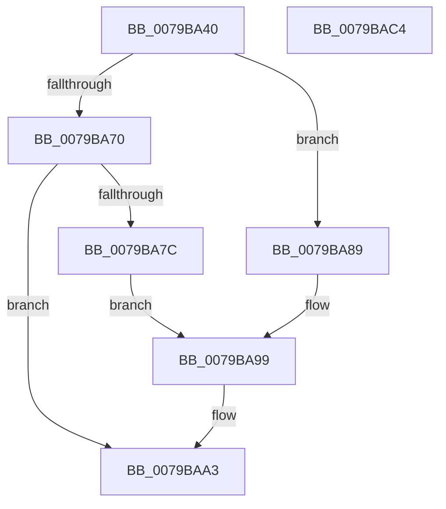

# SepImageVerificationCallbackWorker

- RVA: `0x0079BA40`–`0x0079BAC5` (길이 `133` bytes)
- VA: `0x000000014079BA40`
- 실행 섹션: `PAGE`
- PDB 이름 있음: `예`; PDB Function 태그: `아니요`
- unwind 정보 RVA: `0x0007F554`
- 디코드: `35`개 명령, `133/133` bytes 표시
- 미해석 바이트: `0` (있으면 어셈블리에 `.byte`로 보존)

> 이 문서는 커널 이미지의 기계어와 PDB 기호를 분석해 생성했습니다. 4번과 5번은 함수 원형과 자료형을 바이너리 사용 방식에서 추정한 C 해석이며 원본 소스 복구 결과는 아닙니다.

## 1. Dependencies

- 직접 호출 지점: **3**; 고유 호출 대상: **2**
- 직접 호출자로 확인된 함수: **0**
- RIP 상대 이미지 참조: **3**

### Outgoing calls
- `0x0079BA9E` → [ExNotifyWithProcessing](../../text/45/ExNotifyWithProcessing_function_004523F4.md) (function, `0x004523F4`)
- `0x0079BAAC` → [ExFreePoolWithTag](../../poolcode/B8/ExFreePoolWithTag_function_00B82870.md) (function, `0x00B82870`)
- `0x0079BAB9` → [ExFreePoolWithTag](../../poolcode/B8/ExFreePoolWithTag_function_00B82870.md) (function, `0x00B82870`)

### Direct callers
- 이 함수 시작 RVA로 연결되는 직접 call은 확인되지 않았습니다. 간접 호출은 완전히 역산할 수 없습니다.

### Static image references
- `0x0079BA4D` → RVA `0x00AA5970` (`SepImageVerificationCallbackPreProcess`; read)
- `0x0079BA80` → RVA `0x00EFED88` (`.data`; read)
- `0x0079BA92` → RVA `0x00EFED80` (`.data`; read)

## 2. Other-region calls and transfers

- 다른 실행 섹션으로 향하는 call: **3**
  - `0x0079BA9E` → [ExNotifyWithProcessing](../../text/45/ExNotifyWithProcessing_function_004523F4.md) (`PAGE` → `.text`)
  - `0x0079BAAC` → [ExFreePoolWithTag](../../poolcode/B8/ExFreePoolWithTag_function_00B82870.md) (`PAGE` → `POOLCODE`)
  - `0x0079BAB9` → [ExFreePoolWithTag](../../poolcode/B8/ExFreePoolWithTag_function_00B82870.md) (`PAGE` → `POOLCODE`)
- 별도 외부 분기/꼬리 이동을 확인하지 못했습니다.

## 3. Assembly (complete function range)

```asm
0079BA40  4C 8B DC                        mov r11, rsp
0079BA43  53                              push rbx
0079BA44  48 83 EC 40                     sub rsp, 0x40
0079BA48  49 83 63 E0 00                  and qword ptr [r11 - 0x20], 0
0079BA4D  48 8D 05 1C 9F 30 00            lea rax, [rip + 0x309f1c]
0079BA54  83 79 20 00                     cmp dword ptr [rcx + 0x20], 0
0079BA58  48 8B D9                        mov rbx, rcx
0079BA5B  49 89 43 D8                     mov qword ptr [r11 - 0x28], rax
0079BA5F  48 8B 41 28                     mov rax, qword ptr [rcx + 0x28]
0079BA63  49 89 43 E8                     mov qword ptr [r11 - 0x18], rax
0079BA67  8B 41 30                        mov eax, dword ptr [rcx + 0x30]
0079BA6A  49 89 43 F0                     mov qword ptr [r11 - 0x10], rax
0079BA6E  7C 19                           jl 0x14079ba89
0079BA70  8B 41 24                        mov eax, dword ptr [rcx + 0x24]
0079BA73  BA 01 00 00 00                  mov edx, 1
0079BA78  84 C2                           test dl, al
0079BA7A  74 27                           je 0x14079baa3
0079BA7C  4C 8D 41 38                     lea r8, [rcx + 0x38]
0079BA80  48 8B 0D 01 33 76 00            mov rcx, qword ptr [rip + 0x763301]
0079BA87  EB 10                           jmp 0x14079ba99
0079BA89  4C 8D 41 38                     lea r8, [rcx + 0x38]
0079BA8D  BA 04 00 00 00                  mov edx, 4
0079BA92  48 8B 0D E7 32 76 00            mov rcx, qword ptr [rip + 0x7632e7]
0079BA99  4C 8D 4C 24 20                  lea r9, [rsp + 0x20]
0079BA9E  E8 51 69 CB FF                  call 0x1404523f4
0079BAA3  48 8B 4B 28                     mov rcx, qword ptr [rbx + 0x28]
0079BAA7  BA 43 49 73 63                  mov edx, 0x63734943
0079BAAC  E8 BF 6D 3E 00                  call 0x140b82870
0079BAB1  BA 43 49 73 63                  mov edx, 0x63734943
0079BAB6  48 8B CB                        mov rcx, rbx
0079BAB9  E8 B2 6D 3E 00                  call 0x140b82870
0079BABE  48 83 C4 40                     add rsp, 0x40
0079BAC2  5B                              pop rbx
0079BAC3  C3                              ret
0079BAC4  CC                              int3
```

## 4. C-style interpretation (structured pseudocode)

```c
__int64 __fastcall SepImageVerificationCallbackWorker(__int64 a1)
{
    __int64 result;
    __int64 v_rsp;
    unsigned __int64 v_stack_m28;

    v_rsp = (v_rsp) - (64);
    *(unsigned __int64 *)(v_rsp - 40) = v_rip + 3186460;
    *(unsigned __int64 *)(v_rsp - 24) = *(unsigned __int64 *)(a1 + 40);
    *(unsigned __int64 *)(v_rsp - 16) = (unsigned int)(*(unsigned int *)(a1 + 48));
    if ((*(unsigned int *)(a1 + 32)) < 0) goto loc_0079BA89;
    if (((1) & ((unsigned __int8)((unsigned int)(*(unsigned int *)(a1 + 36))))) == 0) goto loc_0079BAA3;
    goto loc_0079BA99;
loc_0079BA89:
loc_0079BA99:
    result = ExNotifyWithProcessing(*(unsigned __int64 *)(v_rip + 7746279), 4, *(unsigned __int64 *)(v_rip + 7746305) + 56, v_stack_m28);
loc_0079BAA3:
    result = ExFreePoolWithTag(*(unsigned __int64 *)(a1 + 40), (unsigned int)(0x63734943ULL), *(unsigned __int64 *)(v_rip + 7746305) + 56, v_stack_m28);
    result = ExFreePoolWithTag(a1, (unsigned int)(0x63734943ULL), *(unsigned __int64 *)(v_rip + 7746305) + 56, v_stack_m28);
    v_rsp = (v_rsp) + (64);
    return result;
}
```

## 5. (Beta) C Style

```c
int64_t SepImageVerificationCallbackWorker(void *Arg1)
{
    uint8_t *arg1 = (uint8_t *)Arg1;

    int64_t result;
    int64_t local_rsp;
    uint64_t v_stack_m28;

    local_rsp = (local_rsp) - (64);
    *(uint64_t *)(local_rsp - 0x28) = v_rip + 3186460;
    *(uint64_t *)(local_rsp - 0x18) = *(uint64_t *)(arg1 + 0x28);
    *(uint64_t *)(local_rsp - 0x10) = (uint32_t)(*(uint32_t *)(arg1 + 0x30));
    if ((*(uint32_t *)(arg1 + 0x20)) < 0) goto loc_0079BA89;
    if (((1) & ((uint8_t)((uint32_t)(*(uint32_t *)(arg1 + 0x24))))) == 0) goto loc_0079BAA3;
    goto loc_0079BA99;
loc_0079BA89:
loc_0079BA99:
    result = ExNotifyWithProcessing(*(uint64_t *)(v_rip + 0x7632E7), 4, *(uint64_t *)(v_rip + 0x763301) + 56, v_stack_m28);
loc_0079BAA3:
    result = ExFreePoolWithTag(*(uint64_t *)(arg1 + 0x28), (uint32_t)(0x63734943ULL), *(uint64_t *)(v_rip + 0x763301) + 56, v_stack_m28);
    result = ExFreePoolWithTag(Arg1, (uint32_t)(0x63734943ULL), *(uint64_t *)(v_rip + 0x763301) + 56, v_stack_m28);
    local_rsp = (local_rsp) + (64);
    return result;
}
```

### 관측된 메모리 오프셋

구조체 형식이 확인되지 않은 접근은 인자 기준의 오프셋으로만 기록했습니다.

| 기준 인자 | 오프셋 표현 | 폭 (bit) | 접근 |
|---|---:|---:|---|
| `Arg1` | `+ 0x20` | `32` | `R` |
| `Arg1` | `+ 0x24` | `32` | `R` |
| `Arg1` | `+ 0x28` | `64` | `R` |
| `Arg1` | `+ 0x30` | `32` | `R` |
| `Arg1` | `+ 0x38` | `64` | `R` |

## 6. Execution-region graph

[열기: 2D/3D 그래프와 함수 탐색 컨트롤 패널](../../../control-panel.html?section=page&rva=0x0079BA40&view=graph)

- 2D 그래프는 위에서 아래로 흐르고, 3D 그래프는 빈 공간을 드래그해 회전합니다. Shift+드래그는 이동, 휠은 확대·축소, 함수 노드 선택은 대상 보고서 이동입니다.

### Static fallback


