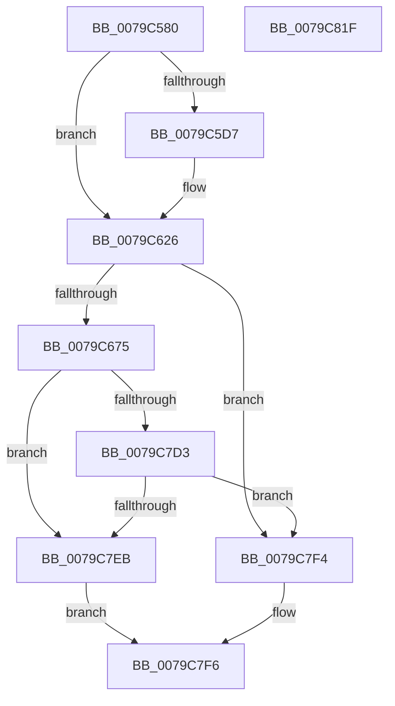

# SepInitializationPhase1

- RVA: `0x0079C580`–`0x0079C820` (길이 `672` bytes)
- VA: `0x000000014079C580`
- 실행 섹션: `PAGE`
- PDB 이름 있음: `예`; PDB Function 태그: `아니요`
- unwind 정보 RVA: `0x000D07D4`
- 디코드: `159`개 명령, `672/672` bytes 표시
- 미해석 바이트: `0` (있으면 어셈블리에 `.byte`로 보존)

> 이 문서는 커널 이미지의 기계어와 PDB 기호를 분석해 생성했습니다. 4번과 5번은 함수 원형과 자료형을 바이너리 사용 방식에서 추정한 C 해석이며 원본 소스 복구 결과는 아닙니다.

## 1. Dependencies

- 직접 호출 지점: **28**; 고유 호출 대상: **22**
- 직접 호출자로 확인된 함수: **2**
- RIP 상대 이미지 참조: **9**

### Outgoing calls
- `0x0079C5CB` → [PsIsCurrentThreadInServerSilo](../../text/43/PsIsCurrentThreadInServerSilo_function_004362E0.md) (function, `0x004362E0`)
- `0x0079C609` → [ObInsertObjectEx](../8B/ObInsertObjectEx_function_008B97A0.md) (function, `0x008B97A0`)
- `0x0079C60E` → [SeMakeAnonymousLogonToken](../../init/C4/SeMakeAnonymousLogonToken_function_00C4A8D8.md) (function, `0x00C4A8D8`)
- `0x0079C61A` → [SeMakeAnonymousLogonTokenNoEveryone](../../init/C4/SeMakeAnonymousLogonTokenNoEveryone_function_00C4AB5C.md) (function, `0x00C4AB5C`)
- `0x0079C631` → [RtlInitAnsiString](../../text/47/RtlInitAnsiString_function_00470F40.md) (function, `0x00470F40`)
- `0x0079C641` → [RtlAnsiStringToUnicodeString](../90/RtlAnsiStringToUnicodeString_function_0090BEA0.md) (function, `0x0090BEA0`)
- `0x0079C64F` → [RtlCreateSecurityDescriptor](../9F/RtlCreateSecurityDescriptor_function_009F1DF0.md) (function, `0x009F1DF0`)
- `0x0079C664` → [ExAllocatePool2](../../poolcode/B8/ExAllocatePool2_function_00B820F0.md) (function, `0x00B820F0`)
- `0x0079C685` → [RtlCreateAcl](../91/RtlCreateAcl_function_00916F00.md) (function, `0x00916F00`)
- `0x0079C6A9` → [RtlpAddKnownAce](../92/RtlpAddKnownAce_function_00929A20.md) (function, `0x00929A20`)
- `0x0079C6CD` → [RtlpAddKnownAce](../92/RtlpAddKnownAce_function_00929A20.md) (function, `0x00929A20`)
- `0x0079C6EE` → [RtlpAddKnownAce](../92/RtlpAddKnownAce_function_00929A20.md) (function, `0x00929A20`)
- `0x0079C6FF` → [RtlSetDaclSecurityDescriptor](../9E/RtlSetDaclSecurityDescriptor_function_009EC210.md) (function, `0x009EC210`)
- `0x0079C738` → [ZwCreateDirectoryObject](../../text/6A/ZwCreateDirectoryObject_function_006AE650.md) (function, `0x006AE650`)
- `0x0079C741` → [RtlFreeAnsiString](../9C/RtlFreeAnsiString_function_009C0800.md) (function, `0x009C0800`)
- `0x0079C74B` → [ExFreePoolWithTag](../../poolcode/B8/ExFreePoolWithTag_function_00B82870.md) (function, `0x00B82870`)
- `0x0079C75B` → [RtlInitAnsiString](../../text/47/RtlInitAnsiString_function_00470F40.md) (function, `0x00470F40`)
- `0x0079C76B` → [RtlAnsiStringToUnicodeString](../90/RtlAnsiStringToUnicodeString_function_0090BEA0.md) (function, `0x0090BEA0`)
- `0x0079C7AE` → [ZwCreateEvent](../../text/6A/ZwCreateEvent_function_006AD9D0.md) (function, `0x006AD9D0`)
- `0x0079C7B7` → [RtlFreeAnsiString](../9C/RtlFreeAnsiString_function_009C0800.md) (function, `0x009C0800`)
- `0x0079C7C0` → [ZwClose](../../text/6A/ZwClose_function_006AD2B0.md) (function, `0x006AD2B0`)
- `0x0079C7C9` → [ZwClose](../../text/6A/ZwClose_function_006AD2B0.md) (function, `0x006AD2B0`)
- `0x0079C7D3` → [SepInitProcessAuditSd](../../text/60/SepInitProcessAuditSd_function_00606230.md) (function, `0x00606230`)
- `0x0079C7D8` → [SepInitializeCodeIntegrity](SepInitializeCodeIntegrity_function_0079BACC.md) (function, `0x0079BACC`)
- `0x0079C7DD` → [SepInitializeAuthorizationCallbacks](../../init/C4/SepInitializeAuthorizationCallbacks_function_00C4A820.md) (function, `0x00C4A820`)
- `0x0079C7E2` → [SepInitializeSingletonAttributesStructures](../../init/C4/SepInitializeSingletonAttributesStructures_function_00C4B9A0.md) (function, `0x00C4B9A0`)
- `0x0079C7EB` → [SddlBaseInitialize](../../text/60/SddlBaseInitialize_function_0060BB1C.md) (function, `0x0060BB1C`)
- `0x0079C7FD` → [_security_check_cookie](../../text/6A/_security_check_cookie_function_006AC640.md) (function, `0x006AC640`)

### Direct callers
- [SeInitServerSilo](SeInitServerSilo_function_0079C3EC.md) at `0x0079C4A2`
- [SeInitSystem](../../init/C4/SeInitSystem_function_00C4A74C.md) at `0x00C4A778`

### Static image references
- `0x0079C59F` → RVA `0x00E0A740` (`.data`; read)
- `0x0079C613` → RVA `0x00FDA010` (`PAGEDATA`; write)
- `0x0079C61F` → RVA `0x00FD9D80` (`PAGEDATA`; write)
- `0x0079C626` → RVA `0x00B05DC0` (` ?? ::NNGAKEGL::`string'`; read)
- `0x0079C68A` → RVA `0x00E67D58` (`.data`; read)
- `0x0079C6AE` → RVA `0x00FD9A68` (`PAGEDATA`; read)
- `0x0079C6D2` → RVA `0x00E67D48` (`.data`; read)
- `0x0079C750` → RVA `0x00B05DA0` (` ?? ::NNGAKEGL::`string'`; read)
- `0x0079C78E` → RVA `0x00FD9D88` (`PAGEDATA`; read)

## 2. Other-region calls and transfers

- 다른 실행 섹션으로 향하는 call: **16**
  - `0x0079C5CB` → [PsIsCurrentThreadInServerSilo](../../text/43/PsIsCurrentThreadInServerSilo_function_004362E0.md) (`PAGE` → `.text`)
  - `0x0079C60E` → [SeMakeAnonymousLogonToken](../../init/C4/SeMakeAnonymousLogonToken_function_00C4A8D8.md) (`PAGE` → `INIT`)
  - `0x0079C61A` → [SeMakeAnonymousLogonTokenNoEveryone](../../init/C4/SeMakeAnonymousLogonTokenNoEveryone_function_00C4AB5C.md) (`PAGE` → `INIT`)
  - `0x0079C631` → [RtlInitAnsiString](../../text/47/RtlInitAnsiString_function_00470F40.md) (`PAGE` → `.text`)
  - `0x0079C664` → [ExAllocatePool2](../../poolcode/B8/ExAllocatePool2_function_00B820F0.md) (`PAGE` → `POOLCODE`)
  - `0x0079C738` → [ZwCreateDirectoryObject](../../text/6A/ZwCreateDirectoryObject_function_006AE650.md) (`PAGE` → `.text`)
  - `0x0079C74B` → [ExFreePoolWithTag](../../poolcode/B8/ExFreePoolWithTag_function_00B82870.md) (`PAGE` → `POOLCODE`)
  - `0x0079C75B` → [RtlInitAnsiString](../../text/47/RtlInitAnsiString_function_00470F40.md) (`PAGE` → `.text`)
  - `0x0079C7AE` → [ZwCreateEvent](../../text/6A/ZwCreateEvent_function_006AD9D0.md) (`PAGE` → `.text`)
  - `0x0079C7C0` → [ZwClose](../../text/6A/ZwClose_function_006AD2B0.md) (`PAGE` → `.text`)
  - `0x0079C7C9` → [ZwClose](../../text/6A/ZwClose_function_006AD2B0.md) (`PAGE` → `.text`)
  - `0x0079C7D3` → [SepInitProcessAuditSd](../../text/60/SepInitProcessAuditSd_function_00606230.md) (`PAGE` → `.text`)
  - `0x0079C7DD` → [SepInitializeAuthorizationCallbacks](../../init/C4/SepInitializeAuthorizationCallbacks_function_00C4A820.md) (`PAGE` → `INIT`)
  - `0x0079C7E2` → [SepInitializeSingletonAttributesStructures](../../init/C4/SepInitializeSingletonAttributesStructures_function_00C4B9A0.md) (`PAGE` → `INIT`)
  - `0x0079C7EB` → [SddlBaseInitialize](../../text/60/SddlBaseInitialize_function_0060BB1C.md) (`PAGE` → `.text`)
  - `0x0079C7FD` → [_security_check_cookie](../../text/6A/_security_check_cookie_function_006AC640.md) (`PAGE` → `.text`)
- 별도 외부 분기/꼬리 이동을 확인하지 못했습니다.

## 3. Assembly (complete function range)

```asm
0079C580  48 8B C4                        mov rax, rsp
0079C583  48 89 58 08                     mov qword ptr [rax + 8], rbx
0079C587  48 89 70 10                     mov qword ptr [rax + 0x10], rsi
0079C58B  48 89 78 18                     mov qword ptr [rax + 0x18], rdi
0079C58F  4C 89 60 20                     mov qword ptr [rax + 0x20], r12
0079C593  55                              push rbp
0079C594  48 8D 68 A1                     lea rbp, [rax - 0x5f]
0079C598  48 81 EC D0 00 00 00            sub rsp, 0xd0
0079C59F  48 8B 05 9A E1 66 00            mov rax, qword ptr [rip + 0x66e19a]
0079C5A6  48 33 C4                        xor rax, rsp
0079C5A9  48 89 45 4F                     mov qword ptr [rbp + 0x4f], rax
0079C5AD  45 33 E4                        xor r12d, r12d
0079C5B0  0F 57 C0                        xorps xmm0, xmm0
0079C5B3  0F 11 45 17                     movups xmmword ptr [rbp + 0x17], xmm0
0079C5B7  44 89 65 EB                     mov dword ptr [rbp - 0x15], r12d
0079C5BB  44 89 65 03                     mov dword ptr [rbp + 3], r12d
0079C5BF  4C 89 65 C7                     mov qword ptr [rbp - 0x39], r12
0079C5C3  4C 89 65 DF                     mov qword ptr [rbp - 0x21], r12
0079C5C7  0F 11 45 CF                     movups xmmword ptr [rbp - 0x31], xmm0
0079C5CB  E8 10 9D C9 FF                  call 0x1404362e0
0079C5D0  40 8A F8                        mov dil, al
0079C5D3  84 C0                           test al, al
0079C5D5  75 4F                           jne 0x14079c626
0079C5D7  65 48 8B 0C 25 88 01 00 00      mov rcx, qword ptr gs:[0x188]
0079C5E0  45 33 C9                        xor r9d, r9d
0079C5E3  4C 89 64 24 30                  mov qword ptr [rsp + 0x30], r12
0079C5E8  45 33 C0                        xor r8d, r8d
0079C5EB  4C 89 64 24 28                  mov qword ptr [rsp + 0x28], r12
0079C5F0  44 89 64 24 20                  mov dword ptr [rsp + 0x20], r12d
0079C5F5  48 8B 91 B8 00 00 00            mov rdx, qword ptr [rcx + 0xb8]
0079C5FC  48 8B 8A 48 02 00 00            mov rcx, qword ptr [rdx + 0x248]
0079C603  33 D2                           xor edx, edx
0079C605  48 83 E1 F0                     and rcx, 0xfffffffffffffff0
0079C609  E8 92 D1 11 00                  call 0x1408b97a0
0079C60E  E8 C5 E2 4A 00                  call 0x140c4a8d8
0079C613  48 89 05 F6 D9 83 00            mov qword ptr [rip + 0x83d9f6], rax
0079C61A  E8 3D E5 4A 00                  call 0x140c4ab5c
0079C61F  48 89 05 5A D7 83 00            mov qword ptr [rip + 0x83d75a], rax
0079C626  48 8D 15 93 97 36 00            lea rdx, [rip + 0x369793]
0079C62D  48 8D 4D 17                     lea rcx, [rbp + 0x17]
0079C631  E8 0A 49 CD FF                  call 0x140470f40
0079C636  41 B0 01                        mov r8b, 1
0079C639  48 8D 55 17                     lea rdx, [rbp + 0x17]
0079C63D  48 8D 4D CF                     lea rcx, [rbp - 0x31]
0079C641  E8 5A F8 16 00                  call 0x14090bea0
0079C646  BA 01 00 00 00                  mov edx, 1
0079C64B  48 8D 4D 27                     lea rcx, [rbp + 0x27]
0079C64F  E8 9C 57 25 00                  call 0x1409f1df0
0079C654  BA 00 01 00 00                  mov edx, 0x100
0079C659  B9 40 00 00 00                  mov ecx, 0x40
0079C65E  41 B8 53 65 20 20               mov r8d, 0x20206553
0079C664  E8 87 5A 3E 00                  call 0x140b820f0
0079C669  48 8B D8                        mov rbx, rax
0079C66C  48 85 C0                        test rax, rax
0079C66F  0F 84 7F 01 00 00               je 0x14079c7f4
0079C675  BE 02 00 00 00                  mov esi, 2
0079C67A  BA 00 01 00 00                  mov edx, 0x100
0079C67F  44 8B C6                        mov r8d, esi
0079C682  48 8B C8                        mov rcx, rax
0079C685  E8 76 A8 17 00                  call 0x140916f00
0079C68A  48 8B 0D C7 B6 6C 00            mov rcx, qword ptr [rip + 0x6cb6c7]
0079C691  41 B9 0F 00 0F 00               mov r9d, 0xf000f
0079C697  44 88 64 24 28                  mov byte ptr [rsp + 0x28], r12b
0079C69C  45 33 C0                        xor r8d, r8d
0079C69F  48 89 4C 24 20                  mov qword ptr [rsp + 0x20], rcx
0079C6A4  8B D6                           mov edx, esi
0079C6A6  48 8B CB                        mov rcx, rbx
0079C6A9  E8 72 D3 18 00                  call 0x140929a20
0079C6AE  48 8B 05 B3 D3 83 00            mov rax, qword ptr [rip + 0x83d3b3]
0079C6B5  41 B9 03 00 02 00               mov r9d, 0x20003
0079C6BB  44 88 64 24 28                  mov byte ptr [rsp + 0x28], r12b
0079C6C0  45 33 C0                        xor r8d, r8d
0079C6C3  8B D6                           mov edx, esi
0079C6C5  48 89 44 24 20                  mov qword ptr [rsp + 0x20], rax
0079C6CA  48 8B CB                        mov rcx, rbx
0079C6CD  E8 4E D3 18 00                  call 0x140929a20
0079C6D2  48 8B 05 6F B6 6C 00            mov rax, qword ptr [rip + 0x6cb66f]
0079C6D9  44 8B CE                        mov r9d, esi
0079C6DC  44 88 64 24 28                  mov byte ptr [rsp + 0x28], r12b
0079C6E1  45 33 C0                        xor r8d, r8d
0079C6E4  8B D6                           mov edx, esi
0079C6E6  48 89 44 24 20                  mov qword ptr [rsp + 0x20], rax
0079C6EB  48 8B CB                        mov rcx, rbx
0079C6EE  E8 2D D3 18 00                  call 0x140929a20
0079C6F3  45 33 C9                        xor r9d, r9d
0079C6F6  48 8D 4D 27                     lea rcx, [rbp + 0x27]
0079C6FA  4C 8B C3                        mov r8, rbx
0079C6FD  B2 01                           mov dl, 1
0079C6FF  E8 0C FB 24 00                  call 0x1409ec210
0079C704  48 8D 45 CF                     lea rax, [rbp - 0x31]
0079C708  4C 89 65 EF                     mov qword ptr [rbp - 0x11], r12
0079C70C  48 89 45 F7                     mov qword ptr [rbp - 9], rax
0079C710  4C 8D 45 E7                     lea r8, [rbp - 0x19]
0079C714  48 8D 45 27                     lea rax, [rbp + 0x27]
0079C718  C7 45 FF 50 00 00 00            mov dword ptr [rbp - 1], 0x50
0079C71F  BE 30 00 00 00                  mov esi, 0x30
0079C724  48 89 45 07                     mov qword ptr [rbp + 7], rax
0079C728  BA 0F 00 0F 00                  mov edx, 0xf000f
0079C72D  89 75 E7                        mov dword ptr [rbp - 0x19], esi
0079C730  48 8D 4D C7                     lea rcx, [rbp - 0x39]
0079C734  4C 89 65 0F                     mov qword ptr [rbp + 0xf], r12
0079C738  E8 13 1F F1 FF                  call 0x1406ae650
0079C73D  48 8D 4D CF                     lea rcx, [rbp - 0x31]
0079C741  E8 BA 40 22 00                  call 0x1409c0800
0079C746  33 D2                           xor edx, edx
0079C748  48 8B CB                        mov rcx, rbx
0079C74B  E8 20 61 3E 00                  call 0x140b82870
0079C750  48 8D 15 49 96 36 00            lea rdx, [rip + 0x369649]
0079C757  48 8D 4D 17                     lea rcx, [rbp + 0x17]
0079C75B  E8 E0 47 CD FF                  call 0x140470f40
0079C760  41 B0 01                        mov r8b, 1
0079C763  48 8D 55 17                     lea rdx, [rbp + 0x17]
0079C767  48 8D 4D CF                     lea rcx, [rbp - 0x31]
0079C76B  E8 30 F7 16 00                  call 0x14090bea0
0079C770  48 8B 45 C7                     mov rax, qword ptr [rbp - 0x39]
0079C774  4C 8D 45 E7                     lea r8, [rbp - 0x19]
0079C778  48 89 45 EF                     mov qword ptr [rbp - 0x11], rax
0079C77C  48 8D 4D DF                     lea rcx, [rbp - 0x21]
0079C780  48 8D 45 CF                     lea rax, [rbp - 0x31]
0079C784  89 75 E7                        mov dword ptr [rbp - 0x19], esi
0079C787  48 89 45 F7                     mov qword ptr [rbp - 9], rax
0079C78B  45 33 C9                        xor r9d, r9d
0079C78E  48 8B 05 F3 D5 83 00            mov rax, qword ptr [rip + 0x83d5f3]
0079C795  BA 00 00 00 40                  mov edx, 0x40000000
0079C79A  48 89 45 07                     mov qword ptr [rbp + 7], rax
0079C79E  C7 45 FF 50 00 00 00            mov dword ptr [rbp - 1], 0x50
0079C7A5  4C 89 65 0F                     mov qword ptr [rbp + 0xf], r12
0079C7A9  44 88 64 24 20                  mov byte ptr [rsp + 0x20], r12b
0079C7AE  E8 1D 12 F1 FF                  call 0x1406ad9d0
0079C7B3  48 8D 4D CF                     lea rcx, [rbp - 0x31]
0079C7B7  E8 44 40 22 00                  call 0x1409c0800
0079C7BC  48 8B 4D C7                     mov rcx, qword ptr [rbp - 0x39]
0079C7C0  E8 EB 0A F1 FF                  call 0x1406ad2b0
0079C7C5  48 8B 4D DF                     mov rcx, qword ptr [rbp - 0x21]
0079C7C9  E8 E2 0A F1 FF                  call 0x1406ad2b0
0079C7CE  40 84 FF                        test dil, dil
0079C7D1  75 18                           jne 0x14079c7eb
0079C7D3  E8 58 9A E6 FF                  call 0x140606230
0079C7D8  E8 EF F2 FF FF                  call 0x14079bacc
0079C7DD  E8 3E E0 4A 00                  call 0x140c4a820
0079C7E2  E8 B9 F1 4A 00                  call 0x140c4b9a0
0079C7E7  85 C0                           test eax, eax
0079C7E9  78 09                           js 0x14079c7f4
0079C7EB  E8 2C F3 E6 FF                  call 0x14060bb1c
0079C7F0  B0 01                           mov al, 1
0079C7F2  EB 02                           jmp 0x14079c7f6
0079C7F4  32 C0                           xor al, al
0079C7F6  48 8B 4D 4F                     mov rcx, qword ptr [rbp + 0x4f]
0079C7FA  48 33 CC                        xor rcx, rsp
0079C7FD  E8 3E FE F0 FF                  call 0x1406ac640
0079C802  4C 8D 9C 24 D0 00 00 00         lea r11, [rsp + 0xd0]
0079C80A  49 8B 5B 10                     mov rbx, qword ptr [r11 + 0x10]
0079C80E  49 8B 73 18                     mov rsi, qword ptr [r11 + 0x18]
0079C812  49 8B 7B 20                     mov rdi, qword ptr [r11 + 0x20]
0079C816  4D 8B 63 28                     mov r12, qword ptr [r11 + 0x28]
0079C81A  49 8B E3                        mov rsp, r11
0079C81D  5D                              pop rbp
0079C81E  C3                              ret
0079C81F  CC                              int3
```

## 4. C-style interpretation (structured pseudocode)

```c
__int64 __fastcall SepInitializationPhase1(__int64 a1, __int64 a2, int a3, int a4)
{
    __int64 result;
    __int64 v_r12;
    __int64 v_rsp;
    unsigned __int64 v_stack_m8;
    unsigned __int64 v_stack_mA8;
    unsigned __int64 v_stack_mB0;
    unsigned int v_stack_mB8;

    *(unsigned __int64 *)(v_rsp + 8) = v_rbx;
    *(unsigned __int64 *)(v_rsp + 16) = v_rsi;
    *(unsigned __int64 *)(v_rsp + 24) = v_rdi;
    *(unsigned __int64 *)(v_rsp + 32) = v_r12;
    v_rsp = (v_rsp) - (208);
    result = (*(unsigned __int64 *)(v_rip + 6742426)) ^ (v_rsp);
    *(unsigned __int64 *)(v_rsp - 95 + 79) = result;
    v_r12 = 0;
    *(unsigned __int64 *)(v_rsp - 95 + 23) = v_xmm0;
    *(unsigned int *)(v_rsp - 95 - 21) = 0;
    *(unsigned int *)(v_rsp - 95 + 3) = 0;
    *(unsigned __int64 *)(v_rsp - 95 - 57) = 0;
    *(unsigned __int64 *)(v_rsp - 95 - 33) = 0;
    *(unsigned __int64 *)(v_rsp - 95 - 49) = v_xmm0;
    result = PsIsCurrentThreadInServerSilo(a1, a2, a3, a4);
    if ((unsigned __int8)(result) == 0) {
        a1 = *(unsigned __int64 *)(gs_base + (0 + 392));
        a4 = 0;
        v_stack_mA8 = 0;
        a3 = 0;
        v_stack_mB0 = 0;
        v_stack_mB8 = 0;
        a2 = *(unsigned __int64 *)(a1 + 184);
        a1 = *(unsigned __int64 *)(a2 + 584);
        a2 = 0;
        a1 = (a1) & (-16);
        result = ObInsertObjectEx(a1, a2, a3, a4);
        result = SeMakeAnonymousLogonToken(a1, a2, a3, a4);
        *(unsigned __int64 *)(v_rip + 8641014) = result;
        result = SeMakeAnonymousLogonTokenNoEveryone(a1, a2, a3, a4);
        *(unsigned __int64 *)(v_rip + 8640346) = result;
    }
    result = RtlInitAnsiString(v_rsp - 95 + 23, v_rip + 3577747, a3, a4);
    result = RtlAnsiStringToUnicodeString(v_rsp - 95 - 49, v_rsp - 95 + 23, 1, a4);
    result = RtlCreateSecurityDescriptor(v_rsp - 95 + 39, 1, 1, a4);
    result = ExAllocatePool2(64, 256, (unsigned int)(0x20206553ULL), a4);
    if (result == 0) goto loc_0079C7F4;
    result = RtlCreateAcl(result, 256, 2, a4);
    v_stack_mB0 = 0;
    a3 = 0;
    v_stack_mB8 = *(unsigned __int64 *)(v_rip + 7124679);
    result = RtlpAddKnownAce(result, 2, a3, (unsigned int)(0xF000FULL));
    v_stack_mB0 = 0;
    a3 = 0;
    v_stack_mB8 = *(unsigned __int64 *)(v_rip + 8639411);
    result = RtlpAddKnownAce(result, 2, a3, (unsigned int)(0x20003ULL));
    v_stack_mB0 = 0;
    a3 = 0;
    v_stack_mB8 = *(unsigned __int64 *)(v_rip + 7124591);
    result = RtlpAddKnownAce(result, 2, a3, 2);
    a4 = 0;
    result = RtlSetDaclSecurityDescriptor(v_rsp - 95 + 39, 1, result, a4);
    *(unsigned __int64 *)(v_rsp - 95 - 17) = 0;
    *(unsigned __int64 *)(v_rsp - 95 - 9) = v_rsp - 95 - 49;
    *(unsigned int *)(v_rsp - 95 - 1) = 80;
    *(unsigned __int64 *)(v_rsp - 95 + 7) = v_rsp - 95 + 39;
    *(unsigned int *)(v_rsp - 95 - 25) = 48;
    *(unsigned __int64 *)(v_rsp - 95 + 15) = 0;
    result = ZwCreateDirectoryObject(v_rsp - 95 - 57, (unsigned int)(0xF000FULL), v_rsp - 95 - 25, a4);
    result = RtlFreeAnsiString(v_rsp - 95 - 49, (unsigned int)(0xF000FULL), v_rsp - 95 - 25, a4);
    a2 = 0;
    result = ExFreePoolWithTag(result, a2, v_rsp - 95 - 25, a4);
    result = RtlInitAnsiString(v_rsp - 95 + 23, v_rip + 3577417, v_rsp - 95 - 25, a4);
    result = RtlAnsiStringToUnicodeString(v_rsp - 95 - 49, v_rsp - 95 + 23, 1, a4);
    *(unsigned __int64 *)(v_rsp - 95 - 17) = *(unsigned __int64 *)(v_rsp - 95 - 57);
    *(unsigned int *)(v_rsp - 95 - 25) = 48;
    *(unsigned __int64 *)(v_rsp - 95 - 9) = v_rsp - 95 - 49;
    a4 = 0;
    *(unsigned __int64 *)(v_rsp - 95 + 7) = *(unsigned __int64 *)(v_rip + 8639987);
    *(unsigned int *)(v_rsp - 95 - 1) = 80;
    *(unsigned __int64 *)(v_rsp - 95 + 15) = 0;
    v_stack_mB8 = 0;
    result = ZwCreateEvent(v_rsp - 95 - 33, (unsigned int)(0x40000000ULL), v_rsp - 95 - 25, a4);
    result = RtlFreeAnsiString(v_rsp - 95 - 49, (unsigned int)(0x40000000ULL), v_rsp - 95 - 25, a4);
    result = ZwClose(*(unsigned __int64 *)(v_rsp - 95 - 57), (unsigned int)(0x40000000ULL), v_rsp - 95 - 25, a4);
    result = ZwClose(*(unsigned __int64 *)(v_rsp - 95 - 33), (unsigned int)(0x40000000ULL), v_rsp - 95 - 25, a4);
    if ((unsigned __int8)((unsigned __int8)(result)) != 0) goto loc_0079C7EB;
    result = SepInitProcessAuditSd(*(unsigned __int64 *)(v_rsp - 95 - 33), (unsigned int)(0x40000000ULL), v_rsp - 95 - 25, a4);
    result = SepInitializeCodeIntegrity(*(unsigned __int64 *)(v_rsp - 95 - 33), (unsigned int)(0x40000000ULL), v_rsp - 95 - 25, a4);
    result = SepInitializeAuthorizationCallbacks(*(unsigned __int64 *)(v_rsp - 95 - 33), (unsigned int)(0x40000000ULL), v_rsp - 95 - 25, a4);
    result = SepInitializeSingletonAttributesStructures(*(unsigned __int64 *)(v_rsp - 95 - 33), (unsigned int)(0x40000000ULL), v_rsp - 95 - 25, a4);
    if (sign_flag) goto loc_0079C7F4;
loc_0079C7EB:
    result = SddlBaseInitialize(*(unsigned __int64 *)(v_rsp - 95 - 33), (unsigned int)(0x40000000ULL), v_rsp - 95 - 25, a4);
    goto loc_0079C7F6;
loc_0079C7F4:
    result = 0;
loc_0079C7F6:
    a1 = (*(unsigned __int64 *)(v_rsp - 95 + 79)) ^ (v_rsp);
    result = _security_check_cookie(a1, (unsigned int)(0x40000000ULL), v_rsp - 95 - 25, a4);
    return result;
}
```

## 5. (Beta) C Style

```c
int64_t SepInitializationPhase1(int64_t Arg1, int64_t Arg2, int32_t Arg3, int32_t Arg4)
{
    int64_t result;
    int64_t local_r12;
    int64_t local_rsp;
    uint64_t v_stack_m8;
    uint64_t v_stack_mA8;
    uint64_t v_stack_mB0;
    uint32_t v_stack_mB8;

    *(uint64_t *)(local_rsp + 0x8) = local_rbx;
    *(uint64_t *)(local_rsp + 0x10) = local_rsi;
    *(uint64_t *)(local_rsp + 0x18) = local_rdi;
    *(uint64_t *)(local_rsp + 0x20) = local_r12;
    local_rsp = (local_rsp) - (208);
    result = (*(uint64_t *)(v_rip + 0x66E19A)) ^ (local_rsp);
    *(uint64_t *)(local_rsp - 0x5F + 0x4F) = result;
    local_r12 = 0;
    *(uint64_t *)(local_rsp - 0x5F + 0x17) = v_xmm0;
    *(uint32_t *)(local_rsp - 0x5F - 0x15) = 0;
    *(uint32_t *)(local_rsp - 0x5F + 0x3) = 0;
    *(uint64_t *)(local_rsp - 0x5F - 0x39) = 0;
    *(uint64_t *)(local_rsp - 0x5F - 0x21) = 0;
    *(uint64_t *)(local_rsp - 0x5F - 0x31) = v_xmm0;
    result = PsIsCurrentThreadInServerSilo(Arg1, Arg2, Arg3, Arg4);
    if ((uint8_t)(result) == 0) {
        Arg1 = *(uint64_t *)(gs_base + (0 + 0x188));
        Arg4 = 0;
        v_stack_mA8 = 0;
        Arg3 = 0;
        v_stack_mB0 = 0;
        v_stack_mB8 = 0;
        Arg2 = *(uint64_t *)(Arg1 + 0xB8);
        Arg1 = *(uint64_t *)(Arg2 + 0x248);
        Arg2 = 0;
        Arg1 = (Arg1) & (-16);
        result = ObInsertObjectEx(Arg1, Arg2, Arg3, Arg4);
        result = SeMakeAnonymousLogonToken(Arg1, Arg2, Arg3, Arg4);
        *(uint64_t *)(v_rip + 0x83D9F6) = result;
        result = SeMakeAnonymousLogonTokenNoEveryone(Arg1, Arg2, Arg3, Arg4);
        *(uint64_t *)(v_rip + 0x83D75A) = result;
    }
    result = RtlInitAnsiString(local_rsp - 95 + 23, v_rip + 3577747, Arg3, Arg4);
    result = RtlAnsiStringToUnicodeString(local_rsp - 95 - 49, local_rsp - 95 + 23, 1, Arg4);
    result = RtlCreateSecurityDescriptor(local_rsp - 95 + 39, 1, 1, Arg4);
    result = ExAllocatePool2(64, 256, (uint32_t)(0x20206553ULL), Arg4);
    if (result == 0) goto loc_0079C7F4;
    result = RtlCreateAcl(result, 256, 2, Arg4);
    v_stack_mB0 = 0;
    Arg3 = 0;
    v_stack_mB8 = *(uint64_t *)(v_rip + 0x6CB6C7);
    result = RtlpAddKnownAce(result, 2, Arg3, (uint32_t)(0xF000FULL));
    v_stack_mB0 = 0;
    Arg3 = 0;
    v_stack_mB8 = *(uint64_t *)(v_rip + 0x83D3B3);
    result = RtlpAddKnownAce(result, 2, Arg3, (uint32_t)(0x20003ULL));
    v_stack_mB0 = 0;
    Arg3 = 0;
    v_stack_mB8 = *(uint64_t *)(v_rip + 0x6CB66F);
    result = RtlpAddKnownAce(result, 2, Arg3, 2);
    Arg4 = 0;
    result = RtlSetDaclSecurityDescriptor(local_rsp - 95 + 39, 1, result, Arg4);
    *(uint64_t *)(local_rsp - 0x5F - 0x11) = 0;
    *(uint64_t *)(local_rsp - 0x5F - 0x9) = local_rsp - 95 - 49;
    *(uint32_t *)(local_rsp - 0x5F - 0x1) = 80;
    *(uint64_t *)(local_rsp - 0x5F + 0x7) = local_rsp - 95 + 39;
    *(uint32_t *)(local_rsp - 0x5F - 0x19) = 48;
    *(uint64_t *)(local_rsp - 0x5F + 0xF) = 0;
    result = ZwCreateDirectoryObject(local_rsp - 95 - 57, (uint32_t)(0xF000FULL), local_rsp - 95 - 25, Arg4);
    result = RtlFreeAnsiString(local_rsp - 95 - 49, (uint32_t)(0xF000FULL), local_rsp - 95 - 25, Arg4);
    Arg2 = 0;
    result = ExFreePoolWithTag(result, Arg2, local_rsp - 95 - 25, Arg4);
    result = RtlInitAnsiString(local_rsp - 95 + 23, v_rip + 3577417, local_rsp - 95 - 25, Arg4);
    result = RtlAnsiStringToUnicodeString(local_rsp - 95 - 49, local_rsp - 95 + 23, 1, Arg4);
    *(uint64_t *)(local_rsp - 0x5F - 0x11) = *(uint64_t *)(local_rsp - 0x5F - 0x39);
    *(uint32_t *)(local_rsp - 0x5F - 0x19) = 48;
    *(uint64_t *)(local_rsp - 0x5F - 0x9) = local_rsp - 95 - 49;
    Arg4 = 0;
    *(uint64_t *)(local_rsp - 0x5F + 0x7) = *(uint64_t *)(v_rip + 0x83D5F3);
    *(uint32_t *)(local_rsp - 0x5F - 0x1) = 80;
    *(uint64_t *)(local_rsp - 0x5F + 0xF) = 0;
    v_stack_mB8 = 0;
    result = ZwCreateEvent(local_rsp - 95 - 33, (uint32_t)(0x40000000ULL), local_rsp - 95 - 25, Arg4);
    result = RtlFreeAnsiString(local_rsp - 95 - 49, (uint32_t)(0x40000000ULL), local_rsp - 95 - 25, Arg4);
    result = ZwClose(*(uint64_t *)(local_rsp - 0x5F - 0x39), (uint32_t)(0x40000000ULL), local_rsp - 95 - 25, Arg4);
    result = ZwClose(*(uint64_t *)(local_rsp - 0x5F - 0x21), (uint32_t)(0x40000000ULL), local_rsp - 95 - 25, Arg4);
    if ((uint8_t)((uint8_t)(result)) != 0) goto loc_0079C7EB;
    result = SepInitProcessAuditSd(*(uint64_t *)(local_rsp - 0x5F - 0x21), (uint32_t)(0x40000000ULL), local_rsp - 95 - 25, Arg4);
    result = SepInitializeCodeIntegrity(*(uint64_t *)(local_rsp - 0x5F - 0x21), (uint32_t)(0x40000000ULL), local_rsp - 95 - 25, Arg4);
    result = SepInitializeAuthorizationCallbacks(*(uint64_t *)(local_rsp - 0x5F - 0x21), (uint32_t)(0x40000000ULL), local_rsp - 95 - 25, Arg4);
    result = SepInitializeSingletonAttributesStructures(*(uint64_t *)(local_rsp - 0x5F - 0x21), (uint32_t)(0x40000000ULL), local_rsp - 95 - 25, Arg4);
    if (sign_flag) goto loc_0079C7F4;
loc_0079C7EB:
    result = SddlBaseInitialize(*(uint64_t *)(local_rsp - 0x5F - 0x21), (uint32_t)(0x40000000ULL), local_rsp - 95 - 25, Arg4);
    goto loc_0079C7F6;
loc_0079C7F4:
    result = 0;
loc_0079C7F6:
    Arg1 = (*(uint64_t *)(local_rsp - 0x5F + 0x4F)) ^ (local_rsp);
    result = _security_check_cookie(Arg1, (uint32_t)(0x40000000ULL), local_rsp - 95 - 25, Arg4);
    return result;
}
```

## 6. Execution-region graph

[열기: 2D/3D 그래프와 함수 탐색 컨트롤 패널](../../../control-panel.html?section=page&rva=0x0079C580&view=graph)

- 2D 그래프는 위에서 아래로 흐르고, 3D 그래프는 빈 공간을 드래그해 회전합니다. Shift+드래그는 이동, 휠은 확대·축소, 함수 노드 선택은 대상 보고서 이동입니다.

### Static fallback


