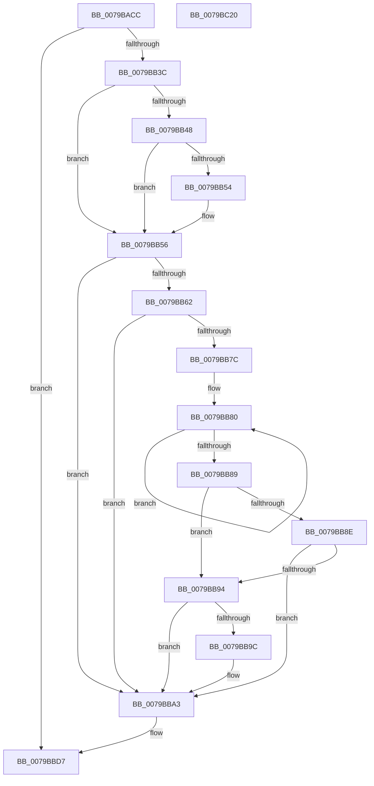

# SepInitializeCodeIntegrity

- RVA: `0x0079BACC`–`0x0079BC21` (길이 `341` bytes)
- VA: `0x000000014079BACC`
- 실행 섹션: `PAGE`
- PDB 이름 있음: `예`; PDB Function 태그: `아니요`
- unwind 정보 RVA: `0x000B6754`
- 디코드: `79`개 명령, `341/341` bytes 표시
- 미해석 바이트: `0` (있으면 어셈블리에 `.byte`로 보존)

> 이 문서는 커널 이미지의 기계어와 PDB 기호를 분석해 생성했습니다. 4번과 5번은 함수 원형과 자료형을 바이너리 사용 방식에서 추정한 C 해석이며 원본 소스 복구 결과는 아닙니다.

## 1. Dependencies

- 직접 호출 지점: **4**; 고유 호출 대상: **4**
- 직접 호출자로 확인된 함수: **1**
- RIP 상대 이미지 참조: **10**

### Outgoing calls
- `0x0079BB12` → [memset](../../text/6C/memset_function_006C6C40.md) (function, `0x006C6C40`)
- `0x0079BB6F` → [strstr](../../text/4F/strstr_function_004FF680.md) (function, `0x004FF680`)
- `0x0079BBF7` → `CI.dll!CiInitialize` (import, 간접 대상; import `CI.dll!CiInitialize`)
- `0x0079BC0B` → [_security_check_cookie](../../text/6A/_security_check_cookie_function_006AC640.md) (function, `0x006AC640`)

### Direct callers
- [SepInitializationPhase1](SepInitializationPhase1_function_0079C580.md) at `0x0079C7D8`

### Static image references
- `0x0079BADB` → RVA `0x00E0A740` (`.data`; read)
- `0x0079BAED` → RVA `0x00F04E44` (`.data`; read)
- `0x0079BB17` → RVA `0x00FC6B20` (`ALMOSTRO`; read)
- `0x0079BB1E` → RVA `0x00F04E40` (`.data`; write)
- `0x0079BB28` → RVA `0x00F04F48` (`.data`; write)
- `0x0079BB62` → RVA `0x00B05C80` (` ?? ::NNGAKEGL::`string'`; read)
- `0x0079BB9C` → RVA `0x00E67D6C` (`.data`; read/write)
- `0x0079BBD7` → RVA `0x00009410` (`.rdata`; read)
- `0x0079BBE4` → RVA `0x00F04E40` (`.data`; read)
- `0x0079BBF7` → RVA `0x00151060` (`CI.dll!CiInitialize (IAT)`; read)

## 2. Other-region calls and transfers

- 다른 실행 섹션으로 향하는 call: **3**
  - `0x0079BB12` → [memset](../../text/6C/memset_function_006C6C40.md) (`PAGE` → `.text`)
  - `0x0079BB6F` → [strstr](../../text/4F/strstr_function_004FF680.md) (`PAGE` → `.text`)
  - `0x0079BC0B` → [_security_check_cookie](../../text/6A/_security_check_cookie_function_006AC640.md) (`PAGE` → `.text`)
- 별도 외부 분기/꼬리 이동을 확인하지 못했습니다.

## 3. Assembly (complete function range)

```asm
0079BACC  48 89 5C 24 08                  mov qword ptr [rsp + 8], rbx
0079BAD1  48 89 74 24 10                  mov qword ptr [rsp + 0x10], rsi
0079BAD6  57                              push rdi
0079BAD7  48 83 EC 60                     sub rsp, 0x60
0079BADB  48 8B 05 5E EC 66 00            mov rax, qword ptr [rip + 0x66ec5e]
0079BAE2  48 33 C4                        xor rax, rsp
0079BAE5  48 89 44 24 58                  mov qword ptr [rsp + 0x58], rax
0079BAEA  0F 57 C0                        xorps xmm0, xmm0
0079BAED  48 8D 0D 50 93 76 00            lea rcx, [rip + 0x769350]
0079BAF4  33 C0                           xor eax, eax
0079BAF6  33 D2                           xor edx, edx
0079BAF8  41 B8 04 01 00 00               mov r8d, 0x104
0079BAFE  48 89 44 24 50                  mov qword ptr [rsp + 0x50], rax
0079BB03  0F 11 44 24 30                  movups xmmword ptr [rsp + 0x30], xmm0
0079BB08  BF 06 00 00 00                  mov edi, 6
0079BB0D  0F 11 44 24 40                  movups xmmword ptr [rsp + 0x40], xmm0
0079BB12  E8 29 B1 F2 FF                  call 0x1406c6c40
0079BB17  48 8B 05 02 B0 82 00            mov rax, qword ptr [rip + 0x82b002]
0079BB1E  C7 05 18 93 76 00 10 01 00 00   mov dword ptr [rip + 0x769318], 0x110
0079BB28  48 C7 05 15 94 76 00 10 00 00 0A  mov qword ptr [rip + 0x769415], 0xa000010
0079BB33  48 85 C0                        test rax, rax
0079BB36  0F 84 9B 00 00 00               je 0x14079bbd7
0079BB3C  48 8B 88 F0 00 00 00            mov rcx, qword ptr [rax + 0xf0]
0079BB43  48 85 C9                        test rcx, rcx
0079BB46  74 0E                           je 0x14079bb56
0079BB48  48 8B 91 58 0B 00 00            mov rdx, qword ptr [rcx + 0xb58]
0079BB4F  48 85 D2                        test rdx, rdx
0079BB52  74 02                           je 0x14079bb56
0079BB54  8B 3A                           mov edi, dword ptr [rdx]
0079BB56  48 8B 98 D8 00 00 00            mov rbx, qword ptr [rax + 0xd8]
0079BB5D  48 85 DB                        test rbx, rbx
0079BB60  74 41                           je 0x14079bba3
0079BB62  48 8D 35 17 A1 36 00            lea rsi, [rip + 0x36a117]
0079BB69  48 8B CB                        mov rcx, rbx
0079BB6C  48 8B D6                        mov rdx, rsi
0079BB6F  E8 0C 3B D6 FF                  call 0x1404ff680
0079BB74  48 8B C8                        mov rcx, rax
0079BB77  48 85 C0                        test rax, rax
0079BB7A  74 27                           je 0x14079bba3
0079BB7C  48 83 C8 FF                     or rax, 0xffffffffffffffff
0079BB80  48 FF C0                        inc rax
0079BB83  80 3C 06 00                     cmp byte ptr [rsi + rax], 0
0079BB87  75 F7                           jne 0x14079bb80
0079BB89  48 3B CB                        cmp rcx, rbx
0079BB8C  74 06                           je 0x14079bb94
0079BB8E  80 79 FF 20                     cmp byte ptr [rcx - 1], 0x20
0079BB92  75 0F                           jne 0x14079bba3
0079BB94  8B C0                           mov eax, eax
0079BB96  F6 04 08 DF                     test byte ptr [rax + rcx], 0xdf
0079BB9A  75 07                           jne 0x14079bba3
0079BB9C  83 0D C9 C1 6C 00 01            or dword ptr [rip + 0x6cc1c9], 1
0079BBA3  48 8B 15 76 AF 82 00            mov rdx, qword ptr [rip + 0x82af76]
0079BBAA  48 8D 42 50                     lea rax, [rdx + 0x50]
0079BBAE  48 89 44 24 30                  mov qword ptr [rsp + 0x30], rax
0079BBB3  48 8D 42 70                     lea rax, [rdx + 0x70]
0079BBB7  48 89 44 24 38                  mov qword ptr [rsp + 0x38], rax
0079BBBC  48 8D 42 40                     lea rax, [rdx + 0x40]
0079BBC0  48 89 44 24 40                  mov qword ptr [rsp + 0x40], rax
0079BBC5  48 8D 42 60                     lea rax, [rdx + 0x60]
0079BBC9  48 89 44 24 48                  mov qword ptr [rsp + 0x48], rax
0079BBCE  48 8D 42 30                     lea rax, [rdx + 0x30]
0079BBD2  48 89 44 24 50                  mov qword ptr [rsp + 0x50], rax
0079BBD7  48 8D 05 32 D8 86 FF            lea rax, [rip - 0x7927ce]
0079BBDE  41 B8 05 00 00 00               mov r8d, 5
0079BBE4  4C 8D 0D 55 92 76 00            lea r9, [rip + 0x769255]
0079BBEB  48 89 44 24 20                  mov qword ptr [rsp + 0x20], rax
0079BBF0  48 8D 54 24 30                  lea rdx, [rsp + 0x30]
0079BBF5  8B CF                           mov ecx, edi
0079BBF7  48 FF 15 62 54 9B FF            call qword ptr [rip - 0x64ab9e]
0079BBFE  0F 1F 44 00 00                  nop dword ptr [rax + rax]
0079BC03  48 8B 4C 24 58                  mov rcx, qword ptr [rsp + 0x58]
0079BC08  48 33 CC                        xor rcx, rsp
0079BC0B  E8 30 0A F1 FF                  call 0x1406ac640
0079BC10  48 8B 5C 24 70                  mov rbx, qword ptr [rsp + 0x70]
0079BC15  48 8B 74 24 78                  mov rsi, qword ptr [rsp + 0x78]
0079BC1A  48 83 C4 60                     add rsp, 0x60
0079BC1E  5F                              pop rdi
0079BC1F  C3                              ret
0079BC20  CC                              int3
```

## 4. C-style interpretation (structured pseudocode)

```c
__int64 __fastcall SepInitializeCodeIntegrity(__int64 a1, int a2)
{
    __int64 result;
    __int64 v_rdi;
    __int64 v_rsp;
    unsigned __int64 v_stack_m10;
    unsigned __int64 v_stack_m18;
    unsigned __int64 v_stack_m20;
    unsigned __int64 v_stack_m28;
    unsigned __int64 v_stack_m30;
    unsigned __int64 v_stack_m38;
    unsigned __int64 v_stack_m48;
    unsigned __int64 v_stack_p10;
    unsigned __int64 v_stack_p8;

    v_stack_p8 = v_rbx;
    v_stack_p10 = v_rsi;
    v_rsp = (v_rsp) - (96);
    result = (*(unsigned __int64 *)(v_rip + 6745182)) ^ (v_rsp);
    v_stack_m10 = result;
    result = 0;
    a2 = 0;
    v_stack_m18 = 0;
    v_stack_m38 = v_xmm0;
    v_stack_m28 = v_xmm0;
    result = memset(v_rip + 7770960, a2, 260, a4);
    *(unsigned int *)(v_rip + 7770904) = 272;
    *(unsigned __int64 *)(v_rip + 7771157) = 0xA000010ULL;
    if (*(unsigned __int64 *)(v_rip + 8564738) == 0) goto loc_0079BBD7;
    if (*(unsigned __int64 *)(*(unsigned __int64 *)(v_rip + 8564738) + 240) == 0) goto loc_0079BB56;
    v_rdi = 6;
    if (*(unsigned __int64 *)(*(unsigned __int64 *)(*(unsigned __int64 *)(v_rip + 8564738) + 240) + 2904) != 0) {
        v_rdi = *(unsigned int *)(*(unsigned __int64 *)(*(unsigned __int64 *)(*(unsigned __int64 *)(v_rip + 8564738) + 240) + 2904));
    }
    if (*(unsigned __int64 *)(*(unsigned __int64 *)(v_rip + 8564738) + 216) == 0) goto loc_0079BBA3;
    result = strstr(*(unsigned __int64 *)(*(unsigned __int64 *)(v_rip + 8564738) + 216), v_rip + 3580183, 260, a4);
    if (result == 0) goto loc_0079BBA3;
    result = (result) | (-1);
loc_0079BB80:
    result = (result) + 1;
    if ((*(unsigned __int8 *)(v_rip + 3580183 + result * 1)) != 0) goto loc_0079BB80;
    if (result == (*(unsigned __int64 *)(*(unsigned __int64 *)(v_rip + 8564738) + 216))) goto loc_0079BB94;
    if ((*(unsigned __int8 *)(result - 1)) != 32) goto loc_0079BBA3;
loc_0079BB94:
    if (((*(unsigned __int8 *)((unsigned int)((unsigned int)(result)) + result * 1)) & (223)) == 0) {
    }
    v_stack_m38 = *(unsigned __int64 *)(v_rip + 8564598) + 80;
    v_stack_m30 = *(unsigned __int64 *)(v_rip + 8564598) + 112;
    v_stack_m28 = *(unsigned __int64 *)(v_rip + 8564598) + 64;
    v_stack_m20 = *(unsigned __int64 *)(v_rip + 8564598) + 96;
    v_stack_m18 = *(unsigned __int64 *)(v_rip + 8564598) + 48;
loc_0079BBD7:
    v_stack_m48 = v_rip - 7940046;
    result = CI_dll_CiInitialize((unsigned int)((unsigned int)(v_rdi)), v_stack_m38, 5, v_rip + 7770709);
    a1 = (v_stack_m10) ^ (v_rsp);
    result = _security_check_cookie(a1, v_stack_m38, 5, v_rip + 7770709);
    v_rsp = (v_rsp) + (96);
    return result;
}
```

## 5. (Beta) C Style

```c
int64_t SepInitializeCodeIntegrity(int64_t Arg1, int32_t Arg2)
{
    int64_t result;
    int64_t local_rdi;
    int64_t local_rsp;
    uint64_t v_stack_m10;
    uint64_t v_stack_m18;
    uint64_t v_stack_m20;
    uint64_t v_stack_m28;
    uint64_t v_stack_m30;
    uint64_t v_stack_m38;
    uint64_t v_stack_m48;
    uint64_t v_stack_p10;
    uint64_t v_stack_p8;

    v_stack_p8 = local_rbx;
    v_stack_p10 = local_rsi;
    local_rsp = (local_rsp) - (96);
    result = (*(uint64_t *)(v_rip + 0x66EC5E)) ^ (local_rsp);
    v_stack_m10 = result;
    result = 0;
    Arg2 = 0;
    v_stack_m18 = 0;
    v_stack_m38 = v_xmm0;
    v_stack_m28 = v_xmm0;
    result = memset(v_rip + 7770960, Arg2, 260, a4);
    *(uint32_t *)(v_rip + 0x769318) = 272;
    *(uint64_t *)(v_rip + 0x769415) = 0xA000010ULL;
    if (*(uint64_t *)(v_rip + 0x82B002) == 0) goto loc_0079BBD7;
    if (*(uint64_t *)(*(uint64_t *)(v_rip + 0x82B002) + 0xF0) == 0) goto loc_0079BB56;
    local_rdi = 6;
    if (*(uint64_t *)(*(uint64_t *)(*(uint64_t *)(v_rip + 0x82B002) + 0xF0) + 0xB58) != 0) {
        local_rdi = *(uint32_t *)(*(uint64_t *)(*(uint64_t *)(*(uint64_t *)(v_rip + 0x82B002) + 0xF0) + 0xB58));
    }
    if (*(uint64_t *)(*(uint64_t *)(v_rip + 0x82B002) + 0xD8) == 0) goto loc_0079BBA3;
    result = strstr(*(uint64_t *)(*(uint64_t *)(v_rip + 0x82B002) + 0xD8), v_rip + 3580183, 260, a4);
    if (result == 0) goto loc_0079BBA3;
    result = (result) | (-1);
loc_0079BB80:
    result = (result) + 1;
    if ((*(uint8_t *)(v_rip + 0x36A117 + result * 1)) != 0) goto loc_0079BB80;
    if (result == (*(uint64_t *)(*(uint64_t *)(v_rip + 0x82B002) + 0xD8))) goto loc_0079BB94;
    if ((*(uint8_t *)(result - 0x1)) != 32) goto loc_0079BBA3;
loc_0079BB94:
    if (((*(uint8_t *)((uint32_t)((uint32_t)(result)) + result * 1)) & (223)) == 0) {
    }
    v_stack_m38 = *(uint64_t *)(v_rip + 0x82AF76) + 80;
    v_stack_m30 = *(uint64_t *)(v_rip + 0x82AF76) + 112;
    v_stack_m28 = *(uint64_t *)(v_rip + 0x82AF76) + 64;
    v_stack_m20 = *(uint64_t *)(v_rip + 0x82AF76) + 96;
    v_stack_m18 = *(uint64_t *)(v_rip + 0x82AF76) + 48;
loc_0079BBD7:
    v_stack_m48 = v_rip - 7940046;
    result = kernel_indirect_call((uint32_t)((uint32_t)(local_rdi)), v_stack_m38, 5, v_rip + 7770709);
    Arg1 = (v_stack_m10) ^ (local_rsp);
    result = _security_check_cookie(Arg1, v_stack_m38, 5, v_rip + 7770709);
    local_rsp = (local_rsp) + (96);
    return result;
}
```

## 6. Execution-region graph

[열기: 2D/3D 그래프와 함수 탐색 컨트롤 패널](../../../control-panel.html?section=page&rva=0x0079BACC&view=graph)

- 2D 그래프는 위에서 아래로 흐르고, 3D 그래프는 빈 공간을 드래그해 회전합니다. Shift+드래그는 이동, 휠은 확대·축소, 함수 노드 선택은 대상 보고서 이동입니다.

### Static fallback


