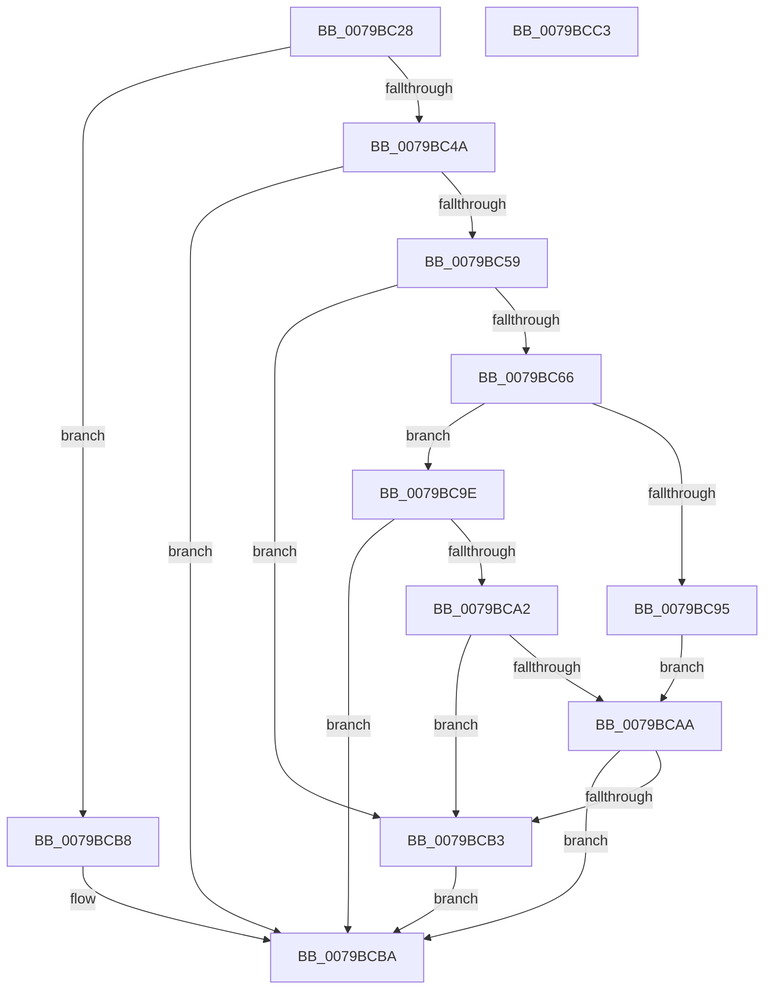

# SepIsLockedDown

- RVA: `0x0079BC28`–`0x0079BCC4` (길이 `156` bytes)
- VA: `0x000000014079BC28`
- 실행 섹션: `PAGE`
- PDB 이름 있음: `예`; PDB Function 태그: `아니요`
- unwind 정보 RVA: `0x000D0784`
- 디코드: `51`개 명령, `156/156` bytes 표시
- 미해석 바이트: `0` (있으면 어셈블리에 `.byte`로 보존)

> 이 문서는 커널 이미지의 기계어와 PDB 기호를 분석해 생성했습니다. 4번과 5번은 함수 원형과 자료형을 바이너리 사용 방식에서 추정한 C 해석이며 원본 소스 복구 결과는 아닙니다.

## 1. Dependencies

- 직접 호출 지점: **3**; 고유 호출 대상: **3**
- 직접 호출자로 확인된 함수: **1**
- RIP 상대 이미지 참조: **1**

### Outgoing calls
- `0x0079BC4E` → [KIsSideloadingEnabled](../7D/KIsSideloadingEnabled_function_007D9DD8.md) (function, `0x007D9DD8`)
- `0x0079BC87` → [ZwQueryLicenseValue](../../text/6A/ZwQueryLicenseValue_function_006AFCF0.md) (function, `0x006AFCF0`)
- `0x0079BCAA` → [ExQueryFastCacheDevLicense](../A6/ExQueryFastCacheDevLicense_function_00A68ED0.md) (function, `0x00A68ED0`)

### Direct callers
- [SeQuerySigningPolicyWorker](../A1/SeQuerySigningPolicyWorker_function_00A13788.md) at `0x00A13A28`

### Static image references
- `0x0079BC80` → RVA `0x00E088F8` (`.data`; read)

## 2. Other-region calls and transfers

- 다른 실행 섹션으로 향하는 call: **1**
  - `0x0079BC87` → [ZwQueryLicenseValue](../../text/6A/ZwQueryLicenseValue_function_006AFCF0.md) (`PAGE` → `.text`)
- 별도 외부 분기/꼬리 이동을 확인하지 못했습니다.

## 3. Assembly (complete function range)

```asm
0079BC28  48 8B C4                        mov rax, rsp
0079BC2B  53                              push rbx
0079BC2C  57                              push rdi
0079BC2D  48 83 EC 38                     sub rsp, 0x38
0079BC31  83 60 20 00                     and dword ptr [rax + 0x20], 0
0079BC35  33 DB                           xor ebx, ebx
0079BC37  83 60 18 00                     and dword ptr [rax + 0x18], 0
0079BC3B  48 8B FA                        mov rdi, rdx
0079BC3E  C6 40 08 00                     mov byte ptr [rax + 8], 0
0079BC42  C6 02 01                        mov byte ptr [rdx], 1
0079BC45  80 F9 02                        cmp cl, 2
0079BC48  72 6E                           jb 0x14079bcb8
0079BC4A  48 8D 48 08                     lea rcx, [rax + 8]
0079BC4E  E8 85 E1 03 00                  call 0x1407d9dd8
0079BC53  8B D8                           mov ebx, eax
0079BC55  85 C0                           test eax, eax
0079BC57  78 61                           js 0x14079bcba
0079BC59  0F B6 44 24 50                  movzx eax, byte ptr [rsp + 0x50]
0079BC5E  89 44 24 58                     mov dword ptr [rsp + 0x58], eax
0079BC62  85 C0                           test eax, eax
0079BC64  75 4D                           jne 0x14079bcb3
0079BC66  48 8D 44 24 60                  lea rax, [rsp + 0x60]
0079BC6B  41 B9 04 00 00 00               mov r9d, 4
0079BC71  4C 8D 44 24 58                  lea r8, [rsp + 0x58]
0079BC76  48 89 44 24 20                  mov qword ptr [rsp + 0x20], rax
0079BC7B  48 8D 54 24 68                  lea rdx, [rsp + 0x68]
0079BC80  48 8D 0D 71 CC 66 00            lea rcx, [rip + 0x66cc71]
0079BC87  E8 64 40 F1 FF                  call 0x1406afcf0
0079BC8C  8B D8                           mov ebx, eax
0079BC8E  3D 34 00 00 C0                  cmp eax, 0xc0000034
0079BC93  75 09                           jne 0x14079bc9e
0079BC95  83 64 24 58 00                  and dword ptr [rsp + 0x58], 0
0079BC9A  33 DB                           xor ebx, ebx
0079BC9C  EB 0C                           jmp 0x14079bcaa
0079BC9E  85 C0                           test eax, eax
0079BCA0  78 18                           js 0x14079bcba
0079BCA2  8B 44 24 58                     mov eax, dword ptr [rsp + 0x58]
0079BCA6  85 C0                           test eax, eax
0079BCA8  75 09                           jne 0x14079bcb3
0079BCAA  E8 21 D2 2C 00                  call 0x140a68ed0
0079BCAF  84 C0                           test al, al
0079BCB1  74 07                           je 0x14079bcba
0079BCB3  C6 07 00                        mov byte ptr [rdi], 0
0079BCB6  EB 02                           jmp 0x14079bcba
0079BCB8  88 1A                           mov byte ptr [rdx], bl
0079BCBA  8B C3                           mov eax, ebx
0079BCBC  48 83 C4 38                     add rsp, 0x38
0079BCC0  5F                              pop rdi
0079BCC1  5B                              pop rbx
0079BCC2  C3                              ret
0079BCC3  CC                              int3
```

## 4. C-style interpretation (structured pseudocode)

```c
__int64 __fastcall SepIsLockedDown(unsigned __int8 a1, __int64 a2)
{
    __int64 result;
    __int64 v_rbx;
    __int64 v_rsp;
    unsigned __int64 v_stack_m28;
    unsigned int v_stack_p10;
    unsigned __int64 v_stack_p18;
    unsigned __int64 v_stack_p20;
    unsigned __int8 v_stack_p8;

    v_rsp = (v_rsp) - (56);
    v_rbx = 0;
    *(unsigned __int8 *)(v_rsp + 8) = 0;
    *(unsigned __int8 *)(a2) = 1;
    if (a1 < 2) goto loc_0079BCB8;
    result = KIsSideloadingEnabled(v_rsp + 8, a2, a3, a4);
    if (sign_flag) goto loc_0079BCBA;
    v_stack_p10 = (unsigned int)(v_stack_p8);
    if ((unsigned int)(v_stack_p8) != 0) goto loc_0079BCB3;
    v_stack_m28 = v_stack_p18;
    result = ZwQueryLicenseValue(v_rip + 6737009, v_stack_p20, v_stack_p10, 4);
    if (((unsigned int)(result)) != 0xC0000034ULL) goto loc_0079BC9E;
    v_rbx = 0;
    goto loc_0079BCAA;
loc_0079BC9E:
    if (sign_flag) goto loc_0079BCBA;
    if ((unsigned int)((unsigned int)(v_stack_p10)) != 0) goto loc_0079BCB3;
loc_0079BCAA:
    result = ExQueryFastCacheDevLicense(v_rip + 6737009, v_stack_p20, v_stack_p10, 4);
    if ((unsigned __int8)(result) == 0) goto loc_0079BCBA;
loc_0079BCB3:
    *(unsigned __int8 *)(a2) = 0;
    goto loc_0079BCBA;
loc_0079BCB8:
    *(unsigned __int8 *)(v_stack_p20) = 0;
loc_0079BCBA:
    v_rsp = (v_rsp) + (56);
    return 0;
}
```

## 5. (Beta) C Style

```c
int64_t SepIsLockedDown(uint8_t Arg1, void *Arg2)
{
    uint8_t *arg2 = (uint8_t *)Arg2;

    int64_t result;
    int64_t local_rbx;
    int64_t local_rsp;
    uint64_t v_stack_m28;
    uint32_t v_stack_p10;
    uint64_t v_stack_p18;
    uint64_t v_stack_p20;
    uint8_t v_stack_p8;

    local_rsp = (local_rsp) - (56);
    local_rbx = 0;
    *(uint8_t *)(local_rsp + 0x8) = 0;
    *(uint8_t *)(arg2) = 1;
    if (Arg1 < 2) goto loc_0079BCB8;
    result = KIsSideloadingEnabled(local_rsp + 8, Arg2, a3, a4);
    if (sign_flag) goto loc_0079BCBA;
    v_stack_p10 = (uint32_t)(v_stack_p8);
    if ((uint32_t)(v_stack_p8) != 0) goto loc_0079BCB3;
    v_stack_m28 = v_stack_p18;
    result = ZwQueryLicenseValue(v_rip + 6737009, v_stack_p20, v_stack_p10, 4);
    if (((uint32_t)(result)) != 0xC0000034ULL) goto loc_0079BC9E;
    local_rbx = 0;
    goto loc_0079BCAA;
loc_0079BC9E:
    if (sign_flag) goto loc_0079BCBA;
    if ((uint32_t)((uint32_t)(v_stack_p10)) != 0) goto loc_0079BCB3;
loc_0079BCAA:
    result = ExQueryFastCacheDevLicense(v_rip + 6737009, v_stack_p20, v_stack_p10, 4);
    if ((uint8_t)(result) == 0) goto loc_0079BCBA;
loc_0079BCB3:
    *(uint8_t *)(arg2) = 0;
    goto loc_0079BCBA;
loc_0079BCB8:
    *(uint8_t *)(v_stack_p20) = 0;
loc_0079BCBA:
    local_rsp = (local_rsp) + (56);
    return 0;
}
```

### 관측된 메모리 오프셋

구조체 형식이 확인되지 않은 접근은 인자 기준의 오프셋으로만 기록했습니다.

| 기준 인자 | 오프셋 표현 | 폭 (bit) | 접근 |
|---|---:|---:|---|
| `Arg2` | `+ 0x0` | `8` | `W` |

## 6. Execution-region graph

[열기: 2D/3D 그래프와 함수 탐색 컨트롤 패널](../../../control-panel.html?section=page&rva=0x0079BC28&view=graph)

- 2D 그래프는 위에서 아래로 흐르고, 3D 그래프는 빈 공간을 드래그해 회전합니다. Shift+드래그는 이동, 휠은 확대·축소, 함수 노드 선택은 대상 보고서 이동입니다.

### Static fallback


