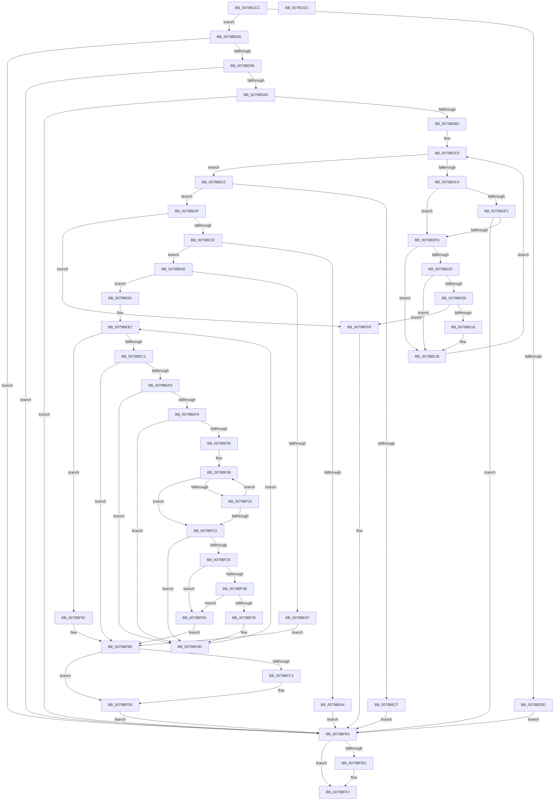

# SepLoadNgenLocations

- RVA: `0x0079BCCC`–`0x0079C022` (길이 `854` bytes)
- VA: `0x000000014079BCCC`
- 실행 섹션: `PAGE`
- PDB 이름 있음: `예`; PDB Function 태그: `아니요`
- unwind 정보 RVA: `0x000C76BC`
- 디코드: `234`개 명령, `854/854` bytes 표시
- 미해석 바이트: `0` (있으면 어셈블리에 `.byte`로 보존)

> 이 문서는 커널 이미지의 기계어와 PDB 기호를 분석해 생성했습니다. 4번과 5번은 함수 원형과 자료형을 바이너리 사용 방식에서 추정한 C 해석이며 원본 소스 복구 결과는 아닙니다.

## 1. Dependencies

- 직접 호출 지점: **11**; 고유 호출 대상: **8**
- 직접 호출자로 확인된 함수: **1**
- RIP 상대 이미지 참조: **2**

### Outgoing calls
- `0x0079BD54` → [ZwOpenKey](../../text/6A/ZwOpenKey_function_006AD310.md) (function, `0x006AD310`)
- `0x0079BD86` → [ZwQueryKey](../../text/6A/ZwQueryKey_function_006AD390.md) (function, `0x006AD390`)
- `0x0079BDE2` → [ZwEnumerateValueKey](../../text/6A/ZwEnumerateValueKey_function_006AD330.md) (function, `0x006AD330`)
- `0x0079BE57` → [ExAllocatePool2](../../poolcode/B8/ExAllocatePool2_function_00B820F0.md) (function, `0x00B820F0`)
- `0x0079BE7A` → [ExAllocatePool2](../../poolcode/B8/ExAllocatePool2_function_00B820F0.md) (function, `0x00B820F0`)
- `0x0079BEDE` → [ZwEnumerateValueKey](../../text/6A/ZwEnumerateValueKey_function_006AD330.md) (function, `0x006AD330`)
- `0x0079BF7B` → [memcpy](../../text/6C/memcpy_function_006C6840.md) (function, `0x006C6840`)
- `0x0079BFCB` → [ExFreePoolWithTag](../../poolcode/B8/ExFreePoolWithTag_function_00B82870.md) (function, `0x00B82870`)
- `0x0079BFD8` → [ExFreePoolWithTag](../../poolcode/B8/ExFreePoolWithTag_function_00B82870.md) (function, `0x00B82870`)
- `0x0079BFED` → [ZwClose](../../text/6A/ZwClose_function_006AD2B0.md) (function, `0x006AD2B0`)
- `0x0079BFFB` → [_security_check_cookie](../../text/6A/_security_check_cookie_function_006AC640.md) (function, `0x006AC640`)

### Direct callers
- [SepSetSystemPaths](SepSetSystemPaths_function_0079C040.md) at `0x0079C061`

### Static image references
- `0x0079BCEF` → RVA `0x00E0A740` (`.data`; read)
- `0x0079BD0F` → RVA `0x0000B7D0` (`.rdata`; read)

## 2. Other-region calls and transfers

- 다른 실행 섹션으로 향하는 call: **11**
  - `0x0079BD54` → [ZwOpenKey](../../text/6A/ZwOpenKey_function_006AD310.md) (`PAGE` → `.text`)
  - `0x0079BD86` → [ZwQueryKey](../../text/6A/ZwQueryKey_function_006AD390.md) (`PAGE` → `.text`)
  - `0x0079BDE2` → [ZwEnumerateValueKey](../../text/6A/ZwEnumerateValueKey_function_006AD330.md) (`PAGE` → `.text`)
  - `0x0079BE57` → [ExAllocatePool2](../../poolcode/B8/ExAllocatePool2_function_00B820F0.md) (`PAGE` → `POOLCODE`)
  - `0x0079BE7A` → [ExAllocatePool2](../../poolcode/B8/ExAllocatePool2_function_00B820F0.md) (`PAGE` → `POOLCODE`)
  - `0x0079BEDE` → [ZwEnumerateValueKey](../../text/6A/ZwEnumerateValueKey_function_006AD330.md) (`PAGE` → `.text`)
  - `0x0079BF7B` → [memcpy](../../text/6C/memcpy_function_006C6840.md) (`PAGE` → `.text`)
  - `0x0079BFCB` → [ExFreePoolWithTag](../../poolcode/B8/ExFreePoolWithTag_function_00B82870.md) (`PAGE` → `POOLCODE`)
  - `0x0079BFD8` → [ExFreePoolWithTag](../../poolcode/B8/ExFreePoolWithTag_function_00B82870.md) (`PAGE` → `POOLCODE`)
  - `0x0079BFED` → [ZwClose](../../text/6A/ZwClose_function_006AD2B0.md) (`PAGE` → `.text`)
  - `0x0079BFFB` → [_security_check_cookie](../../text/6A/_security_check_cookie_function_006AC640.md) (`PAGE` → `.text`)
- 별도 외부 분기/꼬리 이동을 확인하지 못했습니다.

## 3. Assembly (complete function range)

```asm
0079BCCC  48 8B C4                        mov rax, rsp
0079BCCF  48 89 58 10                     mov qword ptr [rax + 0x10], rbx
0079BCD3  48 89 70 18                     mov qword ptr [rax + 0x18], rsi
0079BCD7  48 89 78 20                     mov qword ptr [rax + 0x20], rdi
0079BCDB  55                              push rbp
0079BCDC  41 54                           push r12
0079BCDE  41 55                           push r13
0079BCE0  41 56                           push r14
0079BCE2  41 57                           push r15
0079BCE4  48 8D 68 A1                     lea rbp, [rax - 0x5f]
0079BCE8  48 81 EC D0 00 00 00            sub rsp, 0xd0
0079BCEF  48 8B 05 4A EA 66 00            mov rax, qword ptr [rip + 0x66ea4a]
0079BCF6  48 33 C4                        xor rax, rsp
0079BCF9  48 89 45 2F                     mov qword ptr [rbp + 0x2f], rax
0079BCFD  0F 57 C0                        xorps xmm0, xmm0
0079BD00  48 89 4D B7                     mov qword ptr [rbp - 0x49], rcx
0079BD04  45 33 ED                        xor r13d, r13d
0079BD07  48 C7 45 BF 30 00 00 00         mov qword ptr [rbp - 0x41], 0x30
0079BD0F  48 8D 05 BA FA 86 FF            lea rax, [rip - 0x790546]
0079BD16  4C 89 6D 9F                     mov qword ptr [rbp - 0x61], r13
0079BD1A  4C 8D 45 BF                     lea r8, [rbp - 0x41]
0079BD1E  48 C7 45 D7 40 02 00 00         mov qword ptr [rbp - 0x29], 0x240
0079BD26  BA 19 00 02 00                  mov edx, 0x20019
0079BD2B  44 89 6D 97                     mov dword ptr [rbp - 0x69], r13d
0079BD2F  48 8D 4D 9F                     lea rcx, [rbp - 0x61]
0079BD33  4C 89 6D C7                     mov qword ptr [rbp - 0x39], r13
0079BD37  41 8D 5D 30                     lea ebx, [r13 + 0x30]
0079BD3B  48 89 45 CF                     mov qword ptr [rbp - 0x31], rax
0079BD3F  0F 11 45 FF                     movups xmmword ptr [rbp - 1], xmm0
0079BD43  0F 11 45 0F                     movups xmmword ptr [rbp + 0xf], xmm0
0079BD47  0F 11 45 1F                     movups xmmword ptr [rbp + 0x1f], xmm0
0079BD4B  0F 11 45 EF                     movups xmmword ptr [rbp - 0x11], xmm0
0079BD4F  F3 0F 7F 45 DF                  movdqu xmmword ptr [rbp - 0x21], xmm0
0079BD54  E8 B7 15 F1 FF                  call 0x1406ad310
0079BD59  85 C0                           test eax, eax
0079BD5B  79 10                           jns 0x14079bd6d
0079BD5D  3D 34 00 00 C0                  cmp eax, 0xc0000034
0079BD62  41 8B DD                        mov ebx, r13d
0079BD65  0F 45 D8                        cmovne ebx, eax
0079BD68  E9 77 02 00 00                  jmp 0x14079bfe4
0079BD6D  48 8B 4D 9F                     mov rcx, qword ptr [rbp - 0x61]
0079BD71  48 8D 45 97                     lea rax, [rbp - 0x69]
0079BD75  44 8B CB                        mov r9d, ebx
0079BD78  48 89 44 24 20                  mov qword ptr [rsp + 0x20], rax
0079BD7D  4C 8D 45 FF                     lea r8, [rbp - 1]
0079BD81  BA 02 00 00 00                  mov edx, 2
0079BD86  E8 05 16 F1 FF                  call 0x1406ad390
0079BD8B  8B D8                           mov ebx, eax
0079BD8D  85 C0                           test eax, eax
0079BD8F  0F 88 4F 02 00 00               js 0x14079bfe4
0079BD95  8B 45 1F                        mov eax, dword ptr [rbp + 0x1f]
0079BD98  85 C0                           test eax, eax
0079BD9A  0F 84 44 02 00 00               je 0x14079bfe4
0079BDA0  8B 4D 23                        mov ecx, dword ptr [rbp + 0x23]
0079BDA3  FF C9                           dec ecx
0079BDA5  81 F9 FE FF 00 00               cmp ecx, 0xfffe
0079BDAB  0F 87 33 02 00 00               ja 0x14079bfe4
0079BDB1  41 8B F5                        mov esi, r13d
0079BDB4  41 8B FD                        mov edi, r13d
0079BDB7  45 8B FD                        mov r15d, r13d
0079BDBA  41 BE 00 00 00 80               mov r14d, 0x80000000
0079BDC0  3B F0                           cmp esi, eax
0079BDC2  73 5E                           jae 0x14079be22
0079BDC4  48 8B 4D 9F                     mov rcx, qword ptr [rbp - 0x61]
0079BDC8  48 8D 45 97                     lea rax, [rbp - 0x69]
0079BDCC  48 89 44 24 28                  mov qword ptr [rsp + 0x28], rax
0079BDD1  4C 8D 4D EF                     lea r9, [rbp - 0x11]
0079BDD5  45 33 C0                        xor r8d, r8d
0079BDD8  C7 44 24 20 10 00 00 00         mov dword ptr [rsp + 0x20], 0x10
0079BDE0  8B D6                           mov edx, esi
0079BDE2  E8 49 15 F1 FF                  call 0x1406ad330
0079BDE7  8B D8                           mov ebx, eax
0079BDE9  41 03 C6                        add eax, r14d
0079BDEC  41 85 C6                        test r14d, eax
0079BDEF  75 0C                           jne 0x14079bdfd
0079BDF1  81 FB 05 00 00 80               cmp ebx, 0x80000005
0079BDF7  0F 85 E7 01 00 00               jne 0x14079bfe4
0079BDFD  83 7D F3 04                     cmp dword ptr [rbp - 0xd], 4
0079BE01  75 18                           jne 0x14079be1b
0079BE03  8B 45 F7                        mov eax, dword ptr [rbp - 9]
0079BE06  83 F8 02                        cmp eax, 2
0079BE09  72 10                           jb 0x14079be1b
0079BE0B  83 C0 10                        add eax, 0x10
0079BE0E  03 F8                           add edi, eax
0079BE10  3B F8                           cmp edi, eax
0079BE12  0F 82 C7 01 00 00               jb 0x14079bfdf
0079BE18  41 FF C7                        inc r15d
0079BE1B  8B 45 1F                        mov eax, dword ptr [rbp + 0x1f]
0079BE1E  FF C6                           inc esi
0079BE20  EB 9E                           jmp 0x14079bdc0
0079BE22  45 85 FF                        test r15d, r15d
0079BE25  75 08                           jne 0x14079be2f
0079BE27  41 8B DD                        mov ebx, r13d
0079BE2A  E9 B5 01 00 00                  jmp 0x14079bfe4
0079BE2F  44 8D 77 08                     lea r14d, [rdi + 8]
0079BE33  44 3B F7                        cmp r14d, edi
0079BE36  0F 82 A3 01 00 00               jb 0x14079bfdf
0079BE3C  8B 45 23                        mov eax, dword ptr [rbp + 0x23]
0079BE3F  BF 00 01 00 00                  mov edi, 0x100
0079BE44  83 C0 10                        add eax, 0x10
0079BE47  41 B8 43 49 73 63               mov r8d, 0x63734943
0079BE4D  8B D0                           mov edx, eax
0079BE4F  8B CF                           mov ecx, edi
0079BE51  41 8B DD                        mov ebx, r13d
0079BE54  89 45 A7                        mov dword ptr [rbp - 0x59], eax
0079BE57  E8 94 62 3E 00                  call 0x140b820f0
0079BE5C  48 8B F0                        mov rsi, rax
0079BE5F  48 85 C0                        test rax, rax
0079BE62  75 0A                           jne 0x14079be6e
0079BE64  BB 17 00 00 C0                  mov ebx, 0xc0000017
0079BE69  E9 76 01 00 00                  jmp 0x14079bfe4
0079BE6E  41 8B D6                        mov edx, r14d
0079BE71  41 B8 43 49 73 63               mov r8d, 0x63734943
0079BE77  48 8B CF                        mov rcx, rdi
0079BE7A  E8 71 62 3E 00                  call 0x140b820f0
0079BE7F  48 8B F8                        mov rdi, rax
0079BE82  48 85 C0                        test rax, rax
0079BE85  75 0A                           jne 0x14079be91
0079BE87  BB 17 00 00 C0                  mov ebx, 0xc0000017
0079BE8C  E9 2D 01 00 00                  jmp 0x14079bfbe
0079BE91  66 81 48 04 FF FF               or word ptr [rax + 4], 0xffff
0079BE97  45 8B E5                        mov r12d, r13d
0079BE9A  41 8B CF                        mov ecx, r15d
0079BE9D  48 C1 E1 04                     shl rcx, 4
0079BEA1  48 83 C1 08                     add rcx, 8
0079BEA5  66 44 89 68 06                  mov word ptr [rax + 6], r13w
0079BEAA  48 03 CF                        add rcx, rdi
0079BEAD  44 2B F1                        sub r14d, ecx
0079BEB0  48 89 4D AF                     mov qword ptr [rbp - 0x51], rcx
0079BEB4  44 03 F7                        add r14d, edi
0079BEB7  44 3B 65 1F                     cmp r12d, dword ptr [rbp + 0x1f]
0079BEBB  0F 83 DB 00 00 00               jae 0x14079bf9c
0079BEC1  48 8B 4D 9F                     mov rcx, qword ptr [rbp - 0x61]
0079BEC5  48 8D 45 97                     lea rax, [rbp - 0x69]
0079BEC9  48 89 44 24 28                  mov qword ptr [rsp + 0x28], rax
0079BECE  4C 8B CE                        mov r9, rsi
0079BED1  8B 45 A7                        mov eax, dword ptr [rbp - 0x59]
0079BED4  45 33 C0                        xor r8d, r8d
0079BED7  41 8B D4                        mov edx, r12d
0079BEDA  89 44 24 20                     mov dword ptr [rsp + 0x20], eax
0079BEDE  E8 4D 14 F1 FF                  call 0x1406ad330
0079BEE3  45 33 C0                        xor r8d, r8d
0079BEE6  8B D8                           mov ebx, eax
0079BEE8  85 C0                           test eax, eax
0079BEEA  0F 88 CE 00 00 00               js 0x14079bfbe
0079BEF0  83 7E 04 04                     cmp dword ptr [rsi + 4], 4
0079BEF4  0F 85 93 00 00 00               jne 0x14079bf8d
0079BEFA  8B 56 08                        mov edx, dword ptr [rsi + 8]
0079BEFD  83 FA 02                        cmp edx, 2
0079BF00  0F 82 87 00 00 00               jb 0x14079bf8d
0079BF06  8B CA                           mov ecx, edx
0079BF08  8B C2                           mov eax, edx
0079BF0A  48 D1 E8                        shr rax, 1
0079BF0D  66 44 39 44 46 0A               cmp word ptr [rsi + rax*2 + 0xa], r8w
0079BF13  75 0D                           jne 0x14079bf22
0079BF15  8D 4A FE                        lea ecx, [rdx - 2]
0079BF18  89 4E 08                        mov dword ptr [rsi + 8], ecx
0079BF1B  8B D1                           mov edx, ecx
0079BF1D  83 F9 02                        cmp ecx, 2
0079BF20  73 E6                           jae 0x14079bf08
0079BF22  85 C9                           test ecx, ecx
0079BF24  74 67                           je 0x14079bf8d
0079BF26  41 3B CE                        cmp ecx, r14d
0079BF29  77 6A                           ja 0x14079bf95
0079BF2B  45 3B EF                        cmp r13d, r15d
0079BF2E  73 65                           jae 0x14079bf95
0079BF30  0F B7 47 04                     movzx eax, word ptr [rdi + 4]
0079BF34  48 8D 56 0C                     lea rdx, [rsi + 0xc]
0079BF38  4C 8B 4D AF                     mov r9, qword ptr [rbp - 0x51]
0079BF3C  3B C1                           cmp eax, ecx
0079BF3E  66 0F 43 C1                     cmovae ax, cx
0079BF42  0F B7 4F 06                     movzx ecx, word ptr [rdi + 6]
0079BF46  66 89 47 04                     mov word ptr [rdi + 4], ax
0079BF4A  8B 46 08                        mov eax, dword ptr [rsi + 8]
0079BF4D  3B C8                           cmp ecx, eax
0079BF4F  66 0F 46 C8                     cmovbe cx, ax
0079BF53  66 89 4F 06                     mov word ptr [rdi + 6], cx
0079BF57  41 8B CD                        mov ecx, r13d
0079BF5A  48 03 C9                        add rcx, rcx
0079BF5D  4C 89 4C CF 10                  mov qword ptr [rdi + rcx*8 + 0x10], r9
0079BF62  0F B7 46 08                     movzx eax, word ptr [rsi + 8]
0079BF66  66 89 44 CF 08                  mov word ptr [rdi + rcx*8 + 8], ax
0079BF6B  0F B7 46 08                     movzx eax, word ptr [rsi + 8]
0079BF6F  66 89 44 CF 0A                  mov word ptr [rdi + rcx*8 + 0xa], ax
0079BF74  49 8B C9                        mov rcx, r9
0079BF77  44 8B 46 08                     mov r8d, dword ptr [rsi + 8]
0079BF7B  E8 C0 A8 F2 FF                  call 0x1406c6840
0079BF80  8B 46 08                        mov eax, dword ptr [rsi + 8]
0079BF83  48 01 45 AF                     add qword ptr [rbp - 0x51], rax
0079BF87  44 2B F0                        sub r14d, eax
0079BF8A  41 FF C5                        inc r13d
0079BF8D  41 FF C4                        inc r12d
0079BF90  E9 22 FF FF FF                  jmp 0x14079beb7
0079BF95  BB 05 00 00 80                  mov ebx, 0x80000005
0079BF9A  EB 22                           jmp 0x14079bfbe
0079BF9C  66 83 47 04 08                  add word ptr [rdi + 4], 8
0079BFA1  66 83 47 06 08                  add word ptr [rdi + 6], 8
0079BFA6  48 8B 4D B7                     mov rcx, qword ptr [rbp - 0x49]
0079BFAA  33 C0                           xor eax, eax
0079BFAC  44 89 2F                        mov dword ptr [rdi], r13d
0079BFAF  F0 48 0F B1 79 28               lock cmpxchg qword ptr [rcx + 0x28], rdi
0079BFB5  48 F7 D8                        neg rax
0079BFB8  4D 1B C0                        sbb r8, r8
0079BFBB  49 23 F8                        and rdi, r8
0079BFBE  48 85 FF                        test rdi, rdi
0079BFC1  74 0D                           je 0x14079bfd0
0079BFC3  BA 43 49 73 63                  mov edx, 0x63734943
0079BFC8  48 8B CF                        mov rcx, rdi
0079BFCB  E8 A0 68 3E 00                  call 0x140b82870
0079BFD0  BA 43 49 73 63                  mov edx, 0x63734943
0079BFD5  48 8B CE                        mov rcx, rsi
0079BFD8  E8 93 68 3E 00                  call 0x140b82870
0079BFDD  EB 05                           jmp 0x14079bfe4
0079BFDF  BB 95 00 00 C0                  mov ebx, 0xc0000095
0079BFE4  48 8B 4D 9F                     mov rcx, qword ptr [rbp - 0x61]
0079BFE8  48 85 C9                        test rcx, rcx
0079BFEB  74 05                           je 0x14079bff2
0079BFED  E8 BE 12 F1 FF                  call 0x1406ad2b0
0079BFF2  8B C3                           mov eax, ebx
0079BFF4  48 8B 4D 2F                     mov rcx, qword ptr [rbp + 0x2f]
0079BFF8  48 33 CC                        xor rcx, rsp
0079BFFB  E8 40 06 F1 FF                  call 0x1406ac640
0079C000  4C 8D 9C 24 D0 00 00 00         lea r11, [rsp + 0xd0]
0079C008  49 8B 5B 38                     mov rbx, qword ptr [r11 + 0x38]
0079C00C  49 8B 73 40                     mov rsi, qword ptr [r11 + 0x40]
0079C010  49 8B 7B 48                     mov rdi, qword ptr [r11 + 0x48]
0079C014  49 8B E3                        mov rsp, r11
0079C017  41 5F                           pop r15
0079C019  41 5E                           pop r14
0079C01B  41 5D                           pop r13
0079C01D  41 5C                           pop r12
0079C01F  5D                              pop rbp
0079C020  C3                              ret
0079C021  CC                              int3
```

## 4. C-style interpretation (structured pseudocode)

```c
__int64 __fastcall SepLoadNgenLocations(__int64 a1)
{
    __int64 result;
    __int64 v_r12;
    __int64 v_r13;
    __int64 v_r14;
    __int64 v_r15;
    __int64 v_rbx;
    __int64 v_rdi;
    __int64 v_rsi;
    __int64 v_rsp;
    unsigned __int64 v_stack_m28;
    unsigned __int64 v_stack_mD0;
    unsigned __int64 v_stack_mD8;

    *(unsigned __int64 *)(v_rsp + 16) = v_rbx;
    *(unsigned __int64 *)(v_rsp + 24) = v_rsi;
    *(unsigned __int64 *)(v_rsp + 32) = v_rdi;
    v_rsp = (v_rsp) - (208);
    result = (*(unsigned __int64 *)(v_rip + 6744650)) ^ (v_rsp);
    *(unsigned __int64 *)(v_rsp - 95 + 47) = result;
    *(unsigned __int64 *)(v_rsp - 95 - 73) = a1;
    v_r13 = 0;
    *(unsigned __int64 *)(v_rsp - 95 - 65) = 48;
    *(unsigned __int64 *)(v_rsp - 95 - 97) = 0;
    *(unsigned __int64 *)(v_rsp - 95 - 41) = 576;
    *(unsigned int *)(v_rsp - 95 - 105) = 0;
    *(unsigned __int64 *)(v_rsp - 95 - 57) = 0;
    *(unsigned __int64 *)(v_rsp - 95 - 49) = v_rip - 7931206;
    *(unsigned __int64 *)(v_rsp - 95 - 1) = v_xmm0;
    *(unsigned __int64 *)(v_rsp - 95 + 15) = v_xmm0;
    *(unsigned __int64 *)(v_rsp - 95 + 31) = v_xmm0;
    *(unsigned __int64 *)(v_rsp - 95 - 17) = v_xmm0;
    *(unsigned __int64 *)(v_rsp - 95 - 33) = v_xmm0;
    result = ZwOpenKey(v_rsp - 95 - 97, (unsigned int)(0x20019ULL), v_rsp - 95 - 65, a4);
    if (!sign_flag) goto loc_0079BD6D;
    v_rbx = 0;
    if (((unsigned int)(result)) != 0xC0000034ULL) { v_rbx = (unsigned int)(result); }
    goto loc_0079BFE4;
loc_0079BD6D:
    v_stack_mD8 = v_rsp - 95 - 105;
    result = ZwQueryKey(*(unsigned __int64 *)(v_rsp - 95 - 97), 2, v_rsp - 95 - 1, (unsigned int)((unsigned int)(v_rbx)));
    if (sign_flag) goto loc_0079BFE4;
    if ((unsigned int)((unsigned int)(*(unsigned int *)(v_rsp - 95 + 31))) == 0) goto loc_0079BFE4;
    a1 = (unsigned int)(((unsigned int)(*(unsigned int *)(v_rsp - 95 + 35))) - 1);
    if (((unsigned int)(a1)) > 0xFFFEULL) goto loc_0079BFE4;
loc_0079BDC0:
    if (0 >= ((unsigned int)((unsigned int)(*(unsigned int *)(v_rsp - 95 + 31))))) goto loc_0079BE22;
    v_stack_mD0 = v_rsp - 95 - 105;
    a3 = 0;
    v_stack_mD8 = 16;
    result = ZwEnumerateValueKey(*(unsigned __int64 *)(v_rsp - 95 - 97), 0, a3, v_rsp - 95 - 17);
    result = (unsigned int)((result) + ((unsigned int)((unsigned int)(0x80000000ULL))));
    if ((((unsigned int)((unsigned int)(0x80000000ULL))) & ((unsigned int)(result))) != 0) goto loc_0079BDFD;
    if (((unsigned int)((unsigned int)((unsigned int)(result)))) != 0x80000005ULL) goto loc_0079BFE4;
loc_0079BDFD:
    if ((*(unsigned int *)(v_rsp - 95 - 13)) != 4) goto loc_0079BE1B;
    if (((unsigned int)((unsigned int)(*(unsigned int *)(v_rsp - 95 - 9)))) < 2) goto loc_0079BE1B;
    result = (unsigned int)(((unsigned int)(*(unsigned int *)(v_rsp - 95 - 9))) + (16));
    v_rdi = (unsigned int)((0) + ((unsigned int)(result)));
    if (((unsigned int)(v_rdi)) < ((unsigned int)(result))) goto loc_0079BFDF;
    v_r15 = (unsigned int)((0) + 1);
loc_0079BE1B:
    v_rsi = (unsigned int)((0) + 1);
    goto loc_0079BDC0;
loc_0079BE22:
    if ((unsigned int)(v_r15) != 0) goto loc_0079BE2F;
    goto loc_0079BFE4;
loc_0079BE2F:
    if (((unsigned int)(v_rdi + 8)) < ((unsigned int)(v_rdi))) goto loc_0079BFDF;
    result = (unsigned int)(((unsigned int)(*(unsigned int *)(v_rsp - 95 + 35))) + (16));
    *(unsigned int *)(v_rsp - 95 - 89) = (unsigned int)(result);
    result = ExAllocatePool2(256, (unsigned int)((unsigned int)(result)), (unsigned int)(0x63734943ULL), v_rsp - 95 - 17);
    if (result != 0) goto loc_0079BE6E;
    goto loc_0079BFE4;
loc_0079BE6E:
    result = ExAllocatePool2(256, (unsigned int)((unsigned int)(v_rdi + 8)), (unsigned int)(0x63734943ULL), v_rsp - 95 - 17);
    if (result != 0) goto loc_0079BE91;
    goto loc_0079BFBE;
loc_0079BE91:
    a1 = ((unsigned int)((unsigned int)(v_r15))) << (4);
    a1 = (a1) + (8);
    *(unsigned __int16 *)(result + 6) = 0;
    a1 = (a1) + (result);
    v_r14 = (unsigned int)((v_rdi + 8) - ((unsigned int)(a1)));
    *(unsigned __int64 *)(v_rsp - 95 - 81) = a1;
    v_r14 = (unsigned int)((v_r14) + ((unsigned int)(result)));
loc_0079BEB7:
    if (0 >= (*(unsigned int *)(v_rsp - 95 + 31))) goto loc_0079BF9C;
    v_stack_mD0 = v_rsp - 95 - 105;
    a3 = 0;
    v_stack_mD8 = (unsigned int)((unsigned int)(*(unsigned int *)(v_rsp - 95 - 89)));
    result = ZwEnumerateValueKey(*(unsigned __int64 *)(v_rsp - 95 - 97), 0, a3, result);
    a3 = 0;
    if (sign_flag) goto loc_0079BFBE;
    if ((*(unsigned int *)(result + 4)) != 4) goto loc_0079BF8D;
    if (((unsigned int)((unsigned int)(*(unsigned int *)(result + 8)))) < 2) goto loc_0079BF8D;
loc_0079BF08:
    result = ((unsigned int)((unsigned int)((unsigned int)(*(unsigned int *)(result + 8))))) >> (1);
    if ((*(unsigned __int16 *)(result + result * 2 + 10)) != 0) goto loc_0079BF22;
    *(unsigned int *)(result + 8) = (unsigned int)((unsigned int)(*(unsigned int *)(result + 8)) - 2);
    if (((unsigned int)((unsigned int)(*(unsigned int *)(result + 8)) - 2)) >= 2) goto loc_0079BF08;
loc_0079BF22:
    if ((unsigned int)((unsigned int)(*(unsigned int *)(result + 8)) - 2) == 0) goto loc_0079BF8D;
    if (((unsigned int)((unsigned int)(*(unsigned int *)(result + 8)) - 2)) > ((unsigned int)(v_r14))) goto loc_0079BF95;
    if (0 >= ((unsigned int)(v_r15))) goto loc_0079BF95;
    result = *(unsigned __int16 *)(result + 4);
    if (((unsigned int)(*(unsigned __int16 *)(result + 4))) >= ((unsigned int)((unsigned int)(*(unsigned int *)(result + 8)) - 2))) { result = (unsigned __int16)((unsigned int)(*(unsigned int *)(result + 8)) - 2); }
    *(unsigned __int16 *)(result + 4) = (unsigned __int16)(result);
    a1 = *(unsigned __int16 *)(result + 6);
    if (((unsigned int)(*(unsigned __int16 *)(result + 6))) <= ((unsigned int)((unsigned int)(*(unsigned int *)(result + 8))))) { a1 = (unsigned __int16)((unsigned int)(*(unsigned int *)(result + 8))); }
    *(unsigned __int16 *)(result + 6) = (unsigned __int16)(a1);
    a1 = (0) + (0);
    *(unsigned __int64 *)(result + a1 * 8 + 16) = *(unsigned __int64 *)(v_rsp - 95 - 81);
    *(unsigned __int16 *)(result + a1 * 8 + 8) = (unsigned __int16)(*(unsigned __int16 *)(result + 8));
    *(unsigned __int16 *)(result + a1 * 8 + 10) = (unsigned __int16)(*(unsigned __int16 *)(result + 8));
    result = memcpy(*(unsigned __int64 *)(v_rsp - 95 - 81), result + 12, (unsigned int)(*(unsigned int *)(result + 8)), *(unsigned __int64 *)(v_rsp - 95 - 81));
    v_r14 = (unsigned int)((v_r14) - ((unsigned int)((unsigned int)(*(unsigned int *)(result + 8)))));
    v_r13 = (unsigned int)((v_r13) + 1);
loc_0079BF8D:
    v_r12 = (unsigned int)((0) + 1);
    goto loc_0079BEB7;
loc_0079BF95:
    goto loc_0079BFBE;
loc_0079BF9C:
    result = 0;
    *(unsigned int *)(result) = (unsigned int)(v_r13);
    result = -(result);
    v_rdi = (result) & ((unsigned int)(*(unsigned int *)(result + 8)));
loc_0079BFBE:
    if (v_rdi != 0) {
        a2 = 0x63734943ULL;
        a1 = v_rdi;
        result = ExFreePoolWithTag(a1, a2, (unsigned int)(*(unsigned int *)(result + 8)), *(unsigned __int64 *)(v_rsp - 95 - 81));
    }
    result = ExFreePoolWithTag(result, (unsigned int)(0x63734943ULL), (unsigned int)(*(unsigned int *)(result + 8)), *(unsigned __int64 *)(v_rsp - 95 - 81));
    goto loc_0079BFE4;
loc_0079BFDF:
loc_0079BFE4:
    if (*(unsigned __int64 *)(v_rsp - 95 - 97) != 0) {
        result = ZwClose(*(unsigned __int64 *)(v_rsp - 95 - 97), (unsigned int)(0x63734943ULL), (unsigned int)(*(unsigned int *)(result + 8)), *(unsigned __int64 *)(v_rsp - 95 - 81));
    }
    a1 = (*(unsigned __int64 *)(v_rsp - 95 + 47)) ^ (v_rsp);
    result = _security_check_cookie(a1, (unsigned int)(0x63734943ULL), (unsigned int)(*(unsigned int *)(result + 8)), *(unsigned __int64 *)(v_rsp - 95 - 81));
    return result;
}
```

## 5. (Beta) C Style

```c
int64_t SepLoadNgenLocations(int64_t Arg1)
{
    int64_t result;
    int64_t local_r12;
    int64_t local_r13;
    int64_t local_r14;
    int64_t local_r15;
    int64_t local_rbx;
    int64_t local_rdi;
    int64_t local_rsi;
    int64_t local_rsp;
    uint64_t v_stack_m28;
    uint64_t v_stack_mD0;
    uint64_t v_stack_mD8;

    *(uint64_t *)(local_rsp + 0x10) = local_rbx;
    *(uint64_t *)(local_rsp + 0x18) = local_rsi;
    *(uint64_t *)(local_rsp + 0x20) = local_rdi;
    local_rsp = (local_rsp) - (208);
    result = (*(uint64_t *)(v_rip + 0x66EA4A)) ^ (local_rsp);
    *(uint64_t *)(local_rsp - 0x5F + 0x2F) = result;
    *(uint64_t *)(local_rsp - 0x5F - 0x49) = Arg1;
    local_r13 = 0;
    *(uint64_t *)(local_rsp - 0x5F - 0x41) = 48;
    *(uint64_t *)(local_rsp - 0x5F - 0x61) = 0;
    *(uint64_t *)(local_rsp - 0x5F - 0x29) = 576;
    *(uint32_t *)(local_rsp - 0x5F - 0x69) = 0;
    *(uint64_t *)(local_rsp - 0x5F - 0x39) = 0;
    *(uint64_t *)(local_rsp - 0x5F - 0x31) = v_rip - 7931206;
    *(uint64_t *)(local_rsp - 0x5F - 0x1) = v_xmm0;
    *(uint64_t *)(local_rsp - 0x5F + 0xF) = v_xmm0;
    *(uint64_t *)(local_rsp - 0x5F + 0x1F) = v_xmm0;
    *(uint64_t *)(local_rsp - 0x5F - 0x11) = v_xmm0;
    *(uint64_t *)(local_rsp - 0x5F - 0x21) = v_xmm0;
    result = ZwOpenKey(local_rsp - 95 - 97, (uint32_t)(0x20019ULL), local_rsp - 95 - 65, a4);
    if (!sign_flag) goto loc_0079BD6D;
    local_rbx = 0;
    if (((uint32_t)(result)) != 0xC0000034ULL) { local_rbx = (uint32_t)(result); }
    goto loc_0079BFE4;
loc_0079BD6D:
    v_stack_mD8 = local_rsp - 95 - 105;
    result = ZwQueryKey(*(uint64_t *)(local_rsp - 0x5F - 0x61), 2, local_rsp - 95 - 1, (uint32_t)((uint32_t)(local_rbx)));
    if (sign_flag) goto loc_0079BFE4;
    if ((uint32_t)((uint32_t)(*(uint32_t *)(local_rsp - 0x5F + 0x1F))) == 0) goto loc_0079BFE4;
    Arg1 = (uint32_t)(((uint32_t)(*(uint32_t *)(local_rsp - 0x5F + 0x23))) - 1);
    if (((uint32_t)(Arg1)) > 0xFFFEULL) goto loc_0079BFE4;
loc_0079BDC0:
    if (0 >= ((uint32_t)((uint32_t)(*(uint32_t *)(local_rsp - 0x5F + 0x1F))))) goto loc_0079BE22;
    v_stack_mD0 = local_rsp - 95 - 105;
    a3 = 0;
    v_stack_mD8 = 16;
    result = ZwEnumerateValueKey(*(uint64_t *)(local_rsp - 0x5F - 0x61), 0, a3, local_rsp - 95 - 17);
    result = (uint32_t)((result) + ((uint32_t)((uint32_t)(0x80000000ULL))));
    if ((((uint32_t)((uint32_t)(0x80000000ULL))) & ((uint32_t)(result))) != 0) goto loc_0079BDFD;
    if (((uint32_t)((uint32_t)((uint32_t)(result)))) != 0x80000005ULL) goto loc_0079BFE4;
loc_0079BDFD:
    if ((*(uint32_t *)(local_rsp - 0x5F - 0xD)) != 4) goto loc_0079BE1B;
    if (((uint32_t)((uint32_t)(*(uint32_t *)(local_rsp - 0x5F - 0x9)))) < 2) goto loc_0079BE1B;
    result = (uint32_t)(((uint32_t)(*(uint32_t *)(local_rsp - 0x5F - 0x9))) + (16));
    local_rdi = (uint32_t)((0) + ((uint32_t)(result)));
    if (((uint32_t)(local_rdi)) < ((uint32_t)(result))) goto loc_0079BFDF;
    local_r15 = (uint32_t)((0) + 1);
loc_0079BE1B:
    local_rsi = (uint32_t)((0) + 1);
    goto loc_0079BDC0;
loc_0079BE22:
    if ((uint32_t)(local_r15) != 0) goto loc_0079BE2F;
    goto loc_0079BFE4;
loc_0079BE2F:
    if (((uint32_t)(local_rdi + 8)) < ((uint32_t)(local_rdi))) goto loc_0079BFDF;
    result = (uint32_t)(((uint32_t)(*(uint32_t *)(local_rsp - 0x5F + 0x23))) + (16));
    *(uint32_t *)(local_rsp - 0x5F - 0x59) = (uint32_t)(result);
    result = ExAllocatePool2(256, (uint32_t)((uint32_t)(result)), (uint32_t)(0x63734943ULL), local_rsp - 95 - 17);
    if (result != 0) goto loc_0079BE6E;
    goto loc_0079BFE4;
loc_0079BE6E:
    result = ExAllocatePool2(256, (uint32_t)((uint32_t)(local_rdi + 8)), (uint32_t)(0x63734943ULL), local_rsp - 95 - 17);
    if (result != 0) goto loc_0079BE91;
    goto loc_0079BFBE;
loc_0079BE91:
    Arg1 = ((uint32_t)((uint32_t)(local_r15))) << (4);
    Arg1 = (Arg1) + (8);
    *(uint16_t *)(result + 0x6) = 0;
    Arg1 = (Arg1) + (result);
    local_r14 = (uint32_t)((local_rdi + 8) - ((uint32_t)(Arg1)));
    *(uint64_t *)(local_rsp - 0x5F - 0x51) = Arg1;
    local_r14 = (uint32_t)((local_r14) + ((uint32_t)(result)));
loc_0079BEB7:
    if (0 >= (*(uint32_t *)(local_rsp - 0x5F + 0x1F))) goto loc_0079BF9C;
    v_stack_mD0 = local_rsp - 95 - 105;
    a3 = 0;
    v_stack_mD8 = (uint32_t)((uint32_t)(*(uint32_t *)(local_rsp - 0x5F - 0x59)));
    result = ZwEnumerateValueKey(*(uint64_t *)(local_rsp - 0x5F - 0x61), 0, a3, result);
    a3 = 0;
    if (sign_flag) goto loc_0079BFBE;
    if ((*(uint32_t *)(result + 0x4)) != 4) goto loc_0079BF8D;
    if (((uint32_t)((uint32_t)(*(uint32_t *)(result + 0x8)))) < 2) goto loc_0079BF8D;
loc_0079BF08:
    result = ((uint32_t)((uint32_t)((uint32_t)(*(uint32_t *)(result + 0x8))))) >> (1);
    if ((*(uint16_t *)(result + result * 2 + 0xA)) != 0) goto loc_0079BF22;
    *(uint32_t *)(result + 0x8) = (uint32_t)((uint32_t)(*(uint32_t *)(result + 0x8)) - 2);
    if (((uint32_t)((uint32_t)(*(uint32_t *)(result + 0x8)) - 2)) >= 2) goto loc_0079BF08;
loc_0079BF22:
    if ((uint32_t)((uint32_t)(*(uint32_t *)(result + 0x8)) - 2) == 0) goto loc_0079BF8D;
    if (((uint32_t)((uint32_t)(*(uint32_t *)(result + 0x8)) - 2)) > ((uint32_t)(local_r14))) goto loc_0079BF95;
    if (0 >= ((uint32_t)(local_r15))) goto loc_0079BF95;
    result = *(uint16_t *)(result + 0x4);
    if (((uint32_t)(*(uint16_t *)(result + 0x4))) >= ((uint32_t)((uint32_t)(*(uint32_t *)(result + 0x8)) - 2))) { result = (uint16_t)((uint32_t)(*(uint32_t *)(result + 0x8)) - 2); }
    *(uint16_t *)(result + 0x4) = (uint16_t)(result);
    Arg1 = *(uint16_t *)(result + 0x6);
    if (((uint32_t)(*(uint16_t *)(result + 0x6))) <= ((uint32_t)((uint32_t)(*(uint32_t *)(result + 0x8))))) { Arg1 = (uint16_t)((uint32_t)(*(uint32_t *)(result + 0x8))); }
    *(uint16_t *)(result + 0x6) = (uint16_t)(Arg1);
    Arg1 = (0) + (0);
    *(uint64_t *)(result + Arg1 * 8 + 0x10) = *(uint64_t *)(local_rsp - 0x5F - 0x51);
    *(uint16_t *)(result + Arg1 * 8 + 0x8) = (uint16_t)(*(uint16_t *)(result + 0x8));
    *(uint16_t *)(result + Arg1 * 8 + 0xA) = (uint16_t)(*(uint16_t *)(result + 0x8));
    result = memcpy(*(uint64_t *)(local_rsp - 0x5F - 0x51), result + 12, (uint32_t)(*(uint32_t *)(result + 0x8)), *(uint64_t *)(local_rsp - 0x5F - 0x51));
    local_r14 = (uint32_t)((local_r14) - ((uint32_t)((uint32_t)(*(uint32_t *)(result + 0x8)))));
    local_r13 = (uint32_t)((local_r13) + 1);
loc_0079BF8D:
    local_r12 = (uint32_t)((0) + 1);
    goto loc_0079BEB7;
loc_0079BF95:
    goto loc_0079BFBE;
loc_0079BF9C:
    result = 0;
    *(uint32_t *)(result) = (uint32_t)(local_r13);
    result = -(result);
    local_rdi = (result) & ((uint32_t)(*(uint32_t *)(result + 0x8)));
loc_0079BFBE:
    if (local_rdi != 0) {
        a2 = 0x63734943ULL;
        Arg1 = local_rdi;
        result = ExFreePoolWithTag(Arg1, a2, (uint32_t)(*(uint32_t *)(result + 0x8)), *(uint64_t *)(local_rsp - 0x5F - 0x51));
    }
    result = ExFreePoolWithTag(result, (uint32_t)(0x63734943ULL), (uint32_t)(*(uint32_t *)(result + 0x8)), *(uint64_t *)(local_rsp - 0x5F - 0x51));
    goto loc_0079BFE4;
loc_0079BFDF:
loc_0079BFE4:
    if (*(uint64_t *)(local_rsp - 0x5F - 0x61) != 0) {
        result = ZwClose(*(uint64_t *)(local_rsp - 0x5F - 0x61), (uint32_t)(0x63734943ULL), (uint32_t)(*(uint32_t *)(result + 0x8)), *(uint64_t *)(local_rsp - 0x5F - 0x51));
    }
    Arg1 = (*(uint64_t *)(local_rsp - 0x5F + 0x2F)) ^ (local_rsp);
    result = _security_check_cookie(Arg1, (uint32_t)(0x63734943ULL), (uint32_t)(*(uint32_t *)(result + 0x8)), *(uint64_t *)(local_rsp - 0x5F - 0x51));
    return result;
}
```

## 6. Execution-region graph

[열기: 2D/3D 그래프와 함수 탐색 컨트롤 패널](../../../control-panel.html?section=page&rva=0x0079BCCC&view=graph)

- 2D 그래프는 위에서 아래로 흐르고, 3D 그래프는 빈 공간을 드래그해 회전합니다. Shift+드래그는 이동, 휠은 확대·축소, 함수 노드 선택은 대상 보고서 이동입니다.

### Static fallback


