# SepLogTokenSidManagement

- RVA: `0x0079DA10`–`0x0079DDCE` (길이 `958` bytes)
- VA: `0x000000014079DA10`
- 실행 섹션: `PAGE`
- PDB 이름 있음: `예`; PDB Function 태그: `아니요`
- unwind 정보 RVA: `0x000D1068`
- 디코드: `239`개 명령, `958/958` bytes 표시
- 미해석 바이트: `0` (있으면 어셈블리에 `.byte`로 보존)

> 이 문서는 커널 이미지의 기계어와 PDB 기호를 분석해 생성했습니다. 4번과 5번은 함수 원형과 자료형을 바이너리 사용 방식에서 추정한 C 해석이며 원본 소스 복구 결과는 아닙니다.

## 1. Dependencies

- 직접 호출 지점: **8**; 고유 호출 대상: **5**
- 직접 호출자로 확인된 함수: **2**
- RIP 상대 이미지 참조: **11**

### Outgoing calls
- `0x0079DA90` → [RtlConvertLuidToUlonglong](../../text/60/RtlConvertLuidToUlonglong_function_00608B10.md) (function, `0x00608B10`)
- `0x0079DA9E` → [RtlConvertLuidToUlonglong](../../text/60/RtlConvertLuidToUlonglong_function_00608B10.md) (function, `0x00608B10`)
- `0x0079DCB6` → [SepGetSidValuesDump](../../text/60/SepGetSidValuesDump_function_0060930C.md) (function, `0x0060930C`)
- `0x0079DD43` → [SepGetSidValuesDump](../../text/60/SepGetSidValuesDump_function_0060930C.md) (function, `0x0060930C`)
- `0x0079DD82` → [EtwWrite](../../text/41/EtwWrite_function_0041C720.md) (function, `0x0041C720`)
- `0x0079DD91` → [ExFreePoolWithTag](../../poolcode/B8/ExFreePoolWithTag_function_00B82870.md) (function, `0x00B82870`)
- `0x0079DDA0` → [ExFreePoolWithTag](../../poolcode/B8/ExFreePoolWithTag_function_00B82870.md) (function, `0x00B82870`)
- `0x0079DDAC` → [_security_check_cookie](../../text/6A/_security_check_cookie_function_006AC640.md) (function, `0x006AC640`)

### Direct callers
- [SepDereferenceSidValuesBlock](../7A/SepDereferenceSidValuesBlock_function_007A0F80.md) at `0x007A0FBD`
- [SepSetTokenUserAndGroups](../9F/SepSetTokenUserAndGroups_function_009FDCD0.md) at `0x009FDEAA`
- [SepSetTokenUserAndGroups](../9F/SepSetTokenUserAndGroups_function_009FDCD0.md) at `0x009FDF12`

### Static image references
- `0x0079DA2E` → RVA `0x00E0A740` (`.data`; read)
- `0x0079DA42` → RVA `0x00EFFA28` (`.data`; read)
- `0x0079DA73` → RVA `0x00E67D01` (`.data`; read)
- `0x0079DB11` → RVA `0x00E0CD08` (`.data`; read)
- `0x0079DB1F` → RVA `0x00E0CD20` (`.data`; read)
- `0x0079DB2D` → RVA `0x00E0CD98` (`.data`; read)
- `0x0079DB3B` → RVA `0x00E0CD60` (`.data`; read)
- `0x0079DB49` → RVA `0x00E0CCB8` (`.data`; read)
- `0x0079DB57` → RVA `0x00E0CCE0` (`.data`; read)
- `0x0079DB89` → RVA `0x00E67DB8` (`.data`; read)
- `0x0079DD7B` → RVA `0x00023470` (`.rdata`; read)

## 2. Other-region calls and transfers

- 다른 실행 섹션으로 향하는 call: **8**
  - `0x0079DA90` → [RtlConvertLuidToUlonglong](../../text/60/RtlConvertLuidToUlonglong_function_00608B10.md) (`PAGE` → `.text`)
  - `0x0079DA9E` → [RtlConvertLuidToUlonglong](../../text/60/RtlConvertLuidToUlonglong_function_00608B10.md) (`PAGE` → `.text`)
  - `0x0079DCB6` → [SepGetSidValuesDump](../../text/60/SepGetSidValuesDump_function_0060930C.md) (`PAGE` → `.text`)
  - `0x0079DD43` → [SepGetSidValuesDump](../../text/60/SepGetSidValuesDump_function_0060930C.md) (`PAGE` → `.text`)
  - `0x0079DD82` → [EtwWrite](../../text/41/EtwWrite_function_0041C720.md) (`PAGE` → `.text`)
  - `0x0079DD91` → [ExFreePoolWithTag](../../poolcode/B8/ExFreePoolWithTag_function_00B82870.md) (`PAGE` → `POOLCODE`)
  - `0x0079DDA0` → [ExFreePoolWithTag](../../poolcode/B8/ExFreePoolWithTag_function_00B82870.md) (`PAGE` → `POOLCODE`)
  - `0x0079DDAC` → [_security_check_cookie](../../text/6A/_security_check_cookie_function_006AC640.md) (`PAGE` → `.text`)
- 별도 외부 분기/꼬리 이동을 확인하지 못했습니다.

## 3. Assembly (complete function range)

```asm
0079DA10  48 89 5C 24 08                  mov qword ptr [rsp + 8], rbx
0079DA15  48 89 74 24 20                  mov qword ptr [rsp + 0x20], rsi
0079DA1A  55                              push rbp
0079DA1B  57                              push rdi
0079DA1C  41 55                           push r13
0079DA1E  41 56                           push r14
0079DA20  41 57                           push r15
0079DA22  48 8D 6C 24 80                  lea rbp, [rsp - 0x80]
0079DA27  48 81 EC 80 01 00 00            sub rsp, 0x180
0079DA2E  48 8B 05 0B CD 66 00            mov rax, qword ptr [rip + 0x66cd0b]
0079DA35  48 33 C4                        xor rax, rsp
0079DA38  48 89 45 70                     mov qword ptr [rbp + 0x70], rax
0079DA3C  45 33 FF                        xor r15d, r15d
0079DA3F  49 8B F0                        mov rsi, r8
0079DA42  4C 39 3D DF 1F 76 00            cmp qword ptr [rip + 0x761fdf], r15
0079DA49  48 8B FA                        mov rdi, rdx
0079DA4C  44 8B C1                        mov r8d, ecx
0079DA4F  4C 89 7C 24 60                  mov qword ptr [rsp + 0x60], r15
0079DA54  44 89 7C 24 3C                  mov dword ptr [rsp + 0x3c], r15d
0079DA59  44 89 7C 24 40                  mov dword ptr [rsp + 0x40], r15d
0079DA5E  4C 89 7C 24 68                  mov qword ptr [rsp + 0x68], r15
0079DA63  44 89 7C 24 44                  mov dword ptr [rsp + 0x44], r15d
0079DA68  44 89 7C 24 48                  mov dword ptr [rsp + 0x48], r15d
0079DA6D  0F 84 32 03 00 00               je 0x14079dda5
0079DA73  44 38 3D 87 A2 6C 00            cmp byte ptr [rip + 0x6ca287], r15b
0079DA7A  0F 84 25 03 00 00               je 0x14079dda5
0079DA80  48 8B 95 D0 00 00 00            mov rdx, qword ptr [rbp + 0xd0]
0079DA87  4D 85 C9                        test r9, r9
0079DA8A  74 4A                           je 0x14079dad6
0079DA8C  49 8D 49 10                     lea rcx, [r9 + 0x10]
0079DA90  E8 7B B0 E6 FF                  call 0x140608b10
0079DA95  49 8D 49 18                     lea rcx, [r9 + 0x18]
0079DA99  48 89 44 24 50                  mov qword ptr [rsp + 0x50], rax
0079DA9E  E8 6D B0 E6 FF                  call 0x140608b10
0079DAA3  48 89 44 24 58                  mov qword ptr [rsp + 0x58], rax
0079DAA8  41 8B 81 C0 00 00 00            mov eax, dword ptr [r9 + 0xc0]
0079DAAF  89 44 24 30                     mov dword ptr [rsp + 0x30], eax
0079DAB3  41 8B 81 C4 00 00 00            mov eax, dword ptr [r9 + 0xc4]
0079DABA  89 44 24 34                     mov dword ptr [rsp + 0x34], eax
0079DABE  41 8B 81 C8 00 00 00            mov eax, dword ptr [r9 + 0xc8]
0079DAC5  89 44 24 38                     mov dword ptr [rsp + 0x38], eax
0079DAC9  A8 20                           test al, 0x20
0079DACB  75 22                           jne 0x14079daef
0079DACD  49 8B 91 D8 00 00 00            mov rdx, qword ptr [r9 + 0xd8]
0079DAD4  EB 19                           jmp 0x14079daef
0079DAD6  4C 89 7C 24 50                  mov qword ptr [rsp + 0x50], r15
0079DADB  4C 89 7C 24 58                  mov qword ptr [rsp + 0x58], r15
0079DAE0  44 89 7C 24 30                  mov dword ptr [rsp + 0x30], r15d
0079DAE5  44 89 7C 24 34                  mov dword ptr [rsp + 0x34], r15d
0079DAEA  44 89 7C 24 38                  mov dword ptr [rsp + 0x38], r15d
0079DAEF  45 85 C0                        test r8d, r8d
0079DAF2  74 5E                           je 0x14079db52
0079DAF4  41 83 E8 01                     sub r8d, 1
0079DAF8  74 4A                           je 0x14079db44
0079DAFA  41 83 E8 01                     sub r8d, 1
0079DAFE  74 36                           je 0x14079db36
0079DB00  41 83 E8 01                     sub r8d, 1
0079DB04  74 22                           je 0x14079db28
0079DB06  41 83 F8 01                     cmp r8d, 1
0079DB0A  74 0E                           je 0x14079db1a
0079DB0C  B8 18 00 00 00                  mov eax, 0x18
0079DB11  48 8D 0D F0 F1 66 00            lea rcx, [rip + 0x66f1f0]
0079DB18  EB 44                           jmp 0x14079db5e
0079DB1A  B8 3C 00 00 00                  mov eax, 0x3c
0079DB1F  48 8D 0D FA F1 66 00            lea rcx, [rip + 0x66f1fa]
0079DB26  EB 36                           jmp 0x14079db5e
0079DB28  B8 2C 00 00 00                  mov eax, 0x2c
0079DB2D  48 8D 0D 64 F2 66 00            lea rcx, [rip + 0x66f264]
0079DB34  EB 28                           jmp 0x14079db5e
0079DB36  B8 32 00 00 00                  mov eax, 0x32
0079DB3B  48 8D 0D 1E F2 66 00            lea rcx, [rip + 0x66f21e]
0079DB42  EB 1A                           jmp 0x14079db5e
0079DB44  B8 22 00 00 00                  mov eax, 0x22
0079DB49  48 8D 0D 68 F1 66 00            lea rcx, [rip + 0x66f168]
0079DB50  EB 0C                           jmp 0x14079db5e
0079DB52  B8 28 00 00 00                  mov eax, 0x28
0079DB57  48 8D 0D 82 F1 66 00            lea rcx, [rip + 0x66f182]
0079DB5E  48 89 4C 24 70                  mov qword ptr [rsp + 0x70], rcx
0079DB63  41 B8 02 00 00 00               mov r8d, 2
0079DB69  89 44 24 78                     mov dword ptr [rsp + 0x78], eax
0079DB6D  44 89 7C 24 7C                  mov dword ptr [rsp + 0x7c], r15d
0079DB72  65 48 8B 04 25 88 01 00 00      mov rax, qword ptr gs:[0x188]
0079DB7B  48 8B 88 B8 00 00 00            mov rcx, qword ptr [rax + 0xb8]
0079DB82  48 8B 81 50 03 00 00            mov rax, qword ptr [rcx + 0x350]
0079DB89  48 8D 0D 28 A2 6C 00            lea rcx, [rip + 0x6ca228]
0079DB90  48 85 C0                        test rax, rax
0079DB93  74 11                           je 0x14079dba6
0079DB95  66 44 39 38                     cmp word ptr [rax], r15w
0079DB99  74 0B                           je 0x14079dba6
0079DB9B  4C 8B 48 08                     mov r9, qword ptr [rax + 8]
0079DB9F  44 0F B7 50 02                  movzx r10d, word ptr [rax + 2]
0079DBA4  EB 06                           jmp 0x14079dbac
0079DBA6  4C 8B C9                        mov r9, rcx
0079DBA9  45 8B D0                        mov r10d, r8d
0079DBAC  4C 89 4D 80                     mov qword ptr [rbp - 0x80], r9
0079DBB0  44 89 55 88                     mov dword ptr [rbp - 0x78], r10d
0079DBB4  44 89 7D 8C                     mov dword ptr [rbp - 0x74], r15d
0079DBB8  48 85 D2                        test rdx, rdx
0079DBBB  74 12                           je 0x14079dbcf
0079DBBD  66 44 39 7A 40                  cmp word ptr [rdx + 0x40], r15w
0079DBC2  74 0B                           je 0x14079dbcf
0079DBC4  48 8B 42 48                     mov rax, qword ptr [rdx + 0x48]
0079DBC8  44 0F B7 4A 42                  movzx r9d, word ptr [rdx + 0x42]
0079DBCD  EB 06                           jmp 0x14079dbd5
0079DBCF  48 8B C1                        mov rax, rcx
0079DBD2  45 8B C8                        mov r9d, r8d
0079DBD5  48 89 45 90                     mov qword ptr [rbp - 0x70], rax
0079DBD9  44 89 4D 98                     mov dword ptr [rbp - 0x68], r9d
0079DBDD  44 89 7D 9C                     mov dword ptr [rbp - 0x64], r15d
0079DBE1  48 85 D2                        test rdx, rdx
0079DBE4  74 10                           je 0x14079dbf6
0079DBE6  66 44 39 7A 50                  cmp word ptr [rdx + 0x50], r15w
0079DBEB  74 09                           je 0x14079dbf6
0079DBED  48 8B 4A 58                     mov rcx, qword ptr [rdx + 0x58]
0079DBF1  44 0F B7 42 52                  movzx r8d, word ptr [rdx + 0x52]
0079DBF6  48 89 4D A0                     mov qword ptr [rbp - 0x60], rcx
0079DBFA  48 8D 44 24 50                  lea rax, [rsp + 0x50]
0079DBFF  48 89 45 B0                     mov qword ptr [rbp - 0x50], rax
0079DC03  48 8D 44 24 58                  lea rax, [rsp + 0x58]
0079DC08  48 89 45 C0                     mov qword ptr [rbp - 0x40], rax
0079DC0C  48 8D 44 24 30                  lea rax, [rsp + 0x30]
0079DC11  48 89 45 D0                     mov qword ptr [rbp - 0x30], rax
0079DC15  48 8D 44 24 34                  lea rax, [rsp + 0x34]
0079DC1A  48 89 45 E0                     mov qword ptr [rbp - 0x20], rax
0079DC1E  48 8D 44 24 38                  lea rax, [rsp + 0x38]
0079DC23  48 89 45 F0                     mov qword ptr [rbp - 0x10], rax
0079DC27  44 89 45 A8                     mov dword ptr [rbp - 0x58], r8d
0079DC2B  44 89 7D AC                     mov dword ptr [rbp - 0x54], r15d
0079DC2F  48 C7 45 B8 08 00 00 00         mov qword ptr [rbp - 0x48], 8
0079DC37  48 C7 45 C8 08 00 00 00         mov qword ptr [rbp - 0x38], 8
0079DC3F  48 C7 45 D8 04 00 00 00         mov qword ptr [rbp - 0x28], 4
0079DC47  48 C7 45 E8 04 00 00 00         mov qword ptr [rbp - 0x18], 4
0079DC4F  48 C7 45 F8 04 00 00 00         mov qword ptr [rbp - 8], 4
0079DC57  48 85 FF                        test rdi, rdi
0079DC5A  74 06                           je 0x14079dc62
0079DC5C  48 8B 47 08                     mov rax, qword ptr [rdi + 8]
0079DC60  EB 03                           jmp 0x14079dc65
0079DC62  49 8B C7                        mov rax, r15
0079DC65  48 89 44 24 60                  mov qword ptr [rsp + 0x60], rax
0079DC6A  48 8D 44 24 60                  lea rax, [rsp + 0x60]
0079DC6F  48 89 45 00                     mov qword ptr [rbp], rax
0079DC73  48 C7 45 08 08 00 00 00         mov qword ptr [rbp + 8], 8
0079DC7B  48 85 FF                        test rdi, rdi
0079DC7E  74 05                           je 0x14079dc85
0079DC80  8B 47 10                        mov eax, dword ptr [rdi + 0x10]
0079DC83  EB 03                           jmp 0x14079dc88
0079DC85  41 8B C7                        mov eax, r15d
0079DC88  89 44 24 3C                     mov dword ptr [rsp + 0x3c], eax
0079DC8C  48 8D 4C 24 3C                  lea rcx, [rsp + 0x3c]
0079DC91  48 89 4D 10                     mov qword ptr [rbp + 0x10], rcx
0079DC95  BB 0B 00 00 00                  mov ebx, 0xb
0079DC9A  48 C7 45 18 04 00 00 00         mov qword ptr [rbp + 0x18], 4
0079DCA2  4D 8B F7                        mov r14, r15
0079DCA5  48 85 FF                        test rdi, rdi
0079DCA8  74 28                           je 0x14079dcd2
0079DCAA  85 C0                           test eax, eax
0079DCAC  74 24                           je 0x14079dcd2
0079DCAE  48 8D 54 24 40                  lea rdx, [rsp + 0x40]
0079DCB3  48 8B CF                        mov rcx, rdi
0079DCB6  E8 51 B6 E6 FF                  call 0x14060930c
0079DCBB  8B 4C 24 40                     mov ecx, dword ptr [rsp + 0x40]
0079DCBF  4C 8B F0                        mov r14, rax
0079DCC2  89 4D 28                        mov dword ptr [rbp + 0x28], ecx
0079DCC5  BB 0C 00 00 00                  mov ebx, 0xc
0079DCCA  48 89 45 20                     mov qword ptr [rbp + 0x20], rax
0079DCCE  44 89 7D 2C                     mov dword ptr [rbp + 0x2c], r15d
0079DCD2  48 85 F6                        test rsi, rsi
0079DCD5  74 06                           je 0x14079dcdd
0079DCD7  48 8B 46 08                     mov rax, qword ptr [rsi + 8]
0079DCDB  EB 03                           jmp 0x14079dce0
0079DCDD  49 8B C7                        mov rax, r15
0079DCE0  48 89 44 24 68                  mov qword ptr [rsp + 0x68], rax
0079DCE5  48 8D 4C 24 68                  lea rcx, [rsp + 0x68]
0079DCEA  8B C3                           mov eax, ebx
0079DCEC  FF C3                           inc ebx
0079DCEE  48 03 C0                        add rax, rax
0079DCF1  48 89 4C C4 70                  mov qword ptr [rsp + rax*8 + 0x70], rcx
0079DCF6  48 C7 44 C4 78 08 00 00 00      mov qword ptr [rsp + rax*8 + 0x78], 8
0079DCFF  48 85 F6                        test rsi, rsi
0079DD02  74 0A                           je 0x14079dd0e
0079DD04  48 3B FE                        cmp rdi, rsi
0079DD07  74 05                           je 0x14079dd0e
0079DD09  8B 4E 10                        mov ecx, dword ptr [rsi + 0x10]
0079DD0C  EB 03                           jmp 0x14079dd11
0079DD0E  41 8B CF                        mov ecx, r15d
0079DD11  8B C3                           mov eax, ebx
0079DD13  48 8D 54 24 44                  lea rdx, [rsp + 0x44]
0079DD18  48 03 C0                        add rax, rax
0079DD1B  89 4C 24 44                     mov dword ptr [rsp + 0x44], ecx
0079DD1F  FF C3                           inc ebx
0079DD21  49 8B FF                        mov rdi, r15
0079DD24  48 89 54 C4 70                  mov qword ptr [rsp + rax*8 + 0x70], rdx
0079DD29  48 C7 44 C4 78 04 00 00 00      mov qword ptr [rsp + rax*8 + 0x78], 4
0079DD32  48 85 F6                        test rsi, rsi
0079DD35  74 2D                           je 0x14079dd64
0079DD37  85 C9                           test ecx, ecx
0079DD39  74 29                           je 0x14079dd64
0079DD3B  48 8D 54 24 48                  lea rdx, [rsp + 0x48]
0079DD40  48 8B CE                        mov rcx, rsi
0079DD43  E8 C4 B5 E6 FF                  call 0x14060930c
0079DD48  8B 4C 24 48                     mov ecx, dword ptr [rsp + 0x48]
0079DD4C  48 8B F8                        mov rdi, rax
0079DD4F  8B D3                           mov edx, ebx
0079DD51  48 03 D2                        add rdx, rdx
0079DD54  FF C3                           inc ebx
0079DD56  48 89 44 D4 70                  mov qword ptr [rsp + rdx*8 + 0x70], rax
0079DD5B  89 4C D4 78                     mov dword ptr [rsp + rdx*8 + 0x78], ecx
0079DD5F  44 89 7C D4 7C                  mov dword ptr [rsp + rdx*8 + 0x7c], r15d
0079DD64  48 8B 0D BD 1C 76 00            mov rcx, qword ptr [rip + 0x761cbd]
0079DD6B  48 8D 44 24 70                  lea rax, [rsp + 0x70]
0079DD70  44 8B CB                        mov r9d, ebx
0079DD73  48 89 44 24 20                  mov qword ptr [rsp + 0x20], rax
0079DD78  45 33 C0                        xor r8d, r8d
0079DD7B  48 8D 15 EE 56 88 FF            lea rdx, [rip - 0x77a912]
0079DD82  E8 99 E9 C7 FF                  call 0x14041c720
0079DD87  4D 85 F6                        test r14, r14
0079DD8A  74 0A                           je 0x14079dd96
0079DD8C  33 D2                           xor edx, edx
0079DD8E  49 8B CE                        mov rcx, r14
0079DD91  E8 DA 4A 3E 00                  call 0x140b82870
0079DD96  48 85 FF                        test rdi, rdi
0079DD99  74 0A                           je 0x14079dda5
0079DD9B  33 D2                           xor edx, edx
0079DD9D  48 8B CF                        mov rcx, rdi
0079DDA0  E8 CB 4A 3E 00                  call 0x140b82870
0079DDA5  48 8B 4D 70                     mov rcx, qword ptr [rbp + 0x70]
0079DDA9  48 33 CC                        xor rcx, rsp
0079DDAC  E8 8F E8 F0 FF                  call 0x1406ac640
0079DDB1  4C 8D 9C 24 80 01 00 00         lea r11, [rsp + 0x180]
0079DDB9  49 8B 5B 30                     mov rbx, qword ptr [r11 + 0x30]
0079DDBD  49 8B 73 48                     mov rsi, qword ptr [r11 + 0x48]
0079DDC1  49 8B E3                        mov rsp, r11
0079DDC4  41 5F                           pop r15
0079DDC6  41 5E                           pop r14
0079DDC8  41 5D                           pop r13
0079DDCA  5F                              pop rdi
0079DDCB  5D                              pop rbp
0079DDCC  C3                              ret
0079DDCD  CC                              int3
```

## 4. C-style interpretation (structured pseudocode)

```c
__int64 __fastcall SepLogTokenSidManagement(int a1, __int64 a2, __int64 a3, __int64 a4, __int64 a5)
{
    __int64 result;
    __int64 v_r14;
    __int64 v_r15;
    __int64 v_rbx;
    __int64 v_rdi;
    __int64 v_rsp;
    unsigned int v_stack_m100;
    unsigned __int64 v_stack_m108;
    unsigned int v_stack_m10C;
    unsigned int v_stack_m110;
    unsigned __int64 v_stack_m118;
    unsigned int v_stack_m11C;
    unsigned int v_stack_m120;
    unsigned __int64 v_stack_m128;
    unsigned int v_stack_m12C;
    unsigned int v_stack_m130;
    unsigned __int64 v_stack_m138;
    unsigned __int64 v_stack_m140;
    unsigned __int64 v_stack_m148;
    unsigned __int64 v_stack_m150;
    unsigned __int64 v_stack_m158;
    unsigned int v_stack_m160;
    unsigned int v_stack_m164;
    unsigned int v_stack_m168;
    unsigned int v_stack_m16C;
    unsigned int v_stack_m170;
    unsigned int v_stack_m174;
    unsigned int v_stack_m178;
    unsigned __int64 v_stack_m188;
    unsigned __int64 v_stack_m28;
    unsigned __int64 v_stack_m38;
    unsigned int v_stack_m7C;
    unsigned int v_stack_m80;
    unsigned __int64 v_stack_m88;
    unsigned __int64 v_stack_m90;
    unsigned __int64 v_stack_m98;
    unsigned __int64 v_stack_mA0;
    unsigned __int64 v_stack_mA8;
    unsigned __int64 v_stack_mB0;
    unsigned __int64 v_stack_mB8;
    unsigned __int64 v_stack_mC0;
    unsigned __int64 v_stack_mC8;
    unsigned __int64 v_stack_mD0;
    unsigned __int64 v_stack_mD8;
    unsigned __int64 v_stack_mE0;
    unsigned __int64 v_stack_mE8;
    unsigned __int64 v_stack_mF0;
    unsigned __int64 v_stack_mF8;
    unsigned int v_stack_mFC;
    unsigned __int64 v_stack_p20;
    unsigned __int64 v_stack_p8;

    v_stack_p8 = v_rbx;
    v_stack_p20 = v_rsi;
    v_rsp = (v_rsp) - (384);
    result = (*(unsigned __int64 *)(v_rip + 6737163)) ^ (v_rsp);
    v_stack_m38 = result;
    v_r15 = 0;
    v_stack_m148 = 0;
    v_stack_m16C = 0;
    v_stack_m168 = 0;
    v_stack_m140 = 0;
    v_stack_m164 = 0;
    v_stack_m160 = 0;
    if ((*(unsigned __int64 *)(v_rip + 7741407)) == 0) goto loc_0079DDA5;
    if ((*(unsigned __int8 *)(v_rip + 7119495)) == 0) goto loc_0079DDA5;
    if (a4 == 0) goto loc_0079DAD6;
    result = RtlConvertLuidToUlonglong(a4 + 16, a5, (unsigned int)(a1), a4);
    v_stack_m158 = result;
    result = RtlConvertLuidToUlonglong(a4 + 24, a5, (unsigned int)(a1), a4);
    v_stack_m150 = result;
    v_stack_m178 = (unsigned int)((unsigned int)(*(unsigned int *)(a4 + 192)));
    v_stack_m174 = (unsigned int)((unsigned int)(*(unsigned int *)(a4 + 196)));
    v_stack_m170 = (unsigned int)((unsigned int)(*(unsigned int *)(a4 + 200)));
    if ((((unsigned __int8)((unsigned int)(*(unsigned int *)(a4 + 200)))) & (32)) != 0) goto loc_0079DAEF;
    goto loc_0079DAEF;
loc_0079DAD6:
    v_stack_m158 = 0;
    v_stack_m150 = 0;
    v_stack_m178 = 0;
    v_stack_m174 = 0;
    v_stack_m170 = 0;
loc_0079DAEF:
    if ((unsigned int)((unsigned int)(a1)) == 0) goto loc_0079DB52;
    a3 = (unsigned int)(((unsigned int)(a1)) - (1));
    if (condition_is_equal) goto loc_0079DB44;
    a3 = (unsigned int)((a3) - (1));
    if (condition_is_equal) goto loc_0079DB36;
    a3 = (unsigned int)((a3) - (1));
    if (condition_is_equal) goto loc_0079DB28;
    if (((unsigned int)(a3)) == 1) goto loc_0079DB1A;
    goto loc_0079DB5E;
loc_0079DB1A:
    goto loc_0079DB5E;
loc_0079DB28:
    goto loc_0079DB5E;
loc_0079DB36:
    goto loc_0079DB5E;
loc_0079DB44:
    goto loc_0079DB5E;
loc_0079DB52:
loc_0079DB5E:
    v_stack_m138 = v_rip + 6746498;
    v_stack_m130 = 40;
    v_stack_m12C = 0;
    if (*(unsigned __int64 *)(*(unsigned __int64 *)(*(unsigned __int64 *)(gs_base + (0 + 392)) + 184) + 848) == 0) goto loc_0079DBA6;
    if ((*(unsigned __int16 *)(*(unsigned __int64 *)(*(unsigned __int64 *)(*(unsigned __int64 *)(gs_base + (0 + 392)) + 184) + 848))) == 0) goto loc_0079DBA6;
    goto loc_0079DBAC;
loc_0079DBA6:
loc_0079DBAC:
    v_stack_m128 = v_rip + 7119400;
    v_stack_m120 = 2;
    v_stack_m11C = 0;
    if (*(unsigned __int64 *)(a4 + 216) == 0) goto loc_0079DBCF;
    if ((*(unsigned __int16 *)(*(unsigned __int64 *)(a4 + 216) + 64)) == 0) goto loc_0079DBCF;
    goto loc_0079DBD5;
loc_0079DBCF:
loc_0079DBD5:
    v_stack_m118 = v_rip + 7119400;
    v_stack_m110 = 2;
    v_stack_m10C = 0;
    if (*(unsigned __int64 *)(a4 + 216) == 0) goto loc_0079DBF6;
    if ((*(unsigned __int16 *)(*(unsigned __int64 *)(a4 + 216) + 80)) != 0) {
        a1 = *(unsigned __int64 *)(*(unsigned __int64 *)(a4 + 216) + 88);
        a3 = *(unsigned __int16 *)(*(unsigned __int64 *)(a4 + 216) + 82);
    }
    v_stack_m108 = a1;
    v_stack_mF8 = v_stack_m158;
    v_stack_mE8 = v_stack_m150;
    v_stack_mD8 = v_stack_m178;
    v_stack_mC8 = v_stack_m174;
    v_stack_mB8 = v_stack_m170;
    v_stack_m100 = (unsigned int)(a3);
    v_stack_mFC = 0;
    v_stack_mF0 = 8;
    v_stack_mE0 = 8;
    v_stack_mD0 = 4;
    v_stack_mC0 = 4;
    v_stack_mB0 = 4;
    if (a2 == 0) goto loc_0079DC62;
    goto loc_0079DC65;
loc_0079DC62:
loc_0079DC65:
    v_stack_m148 = 0;
    v_stack_mA8 = v_stack_m148;
    v_stack_mA0 = 8;
    if (a2 == 0) goto loc_0079DC85;
    goto loc_0079DC88;
loc_0079DC85:
loc_0079DC88:
    v_stack_m16C = 0;
    v_stack_m98 = v_stack_m16C;
    v_stack_m90 = 4;
    if (a2 == 0) goto loc_0079DCD2;
    result = 0;
    v_rbx = 11;
    v_r14 = 0;
    if (0 != 0) {
        a2 = v_stack_m168;
        a1 = a2;
        result = SepGetSidValuesDump(a1, a2, a3, 2);
        a1 = v_stack_m168;
        v_r14 = result;
        v_stack_m80 = a1;
        v_rbx = 12;
        v_stack_m88 = result;
        v_stack_m7C = 0;
    }
    if (a3 == 0) goto loc_0079DCDD;
    goto loc_0079DCE0;
loc_0079DCDD:
loc_0079DCE0:
    v_stack_m140 = 0;
    v_rbx = (unsigned int)((v_rbx) + 1);
    result = ((unsigned int)((unsigned int)(v_rbx))) + ((unsigned int)((unsigned int)(v_rbx)));
    *(unsigned __int64 *)(v_rsp + result * 8 + 112) = v_stack_m140;
    *(unsigned __int64 *)(v_rsp + result * 8 + 120) = 8;
    if (a3 == 0) goto loc_0079DD0E;
    if (a2 == a3) goto loc_0079DD0E;
    goto loc_0079DD11;
loc_0079DD0E:
loc_0079DD11:
    result = ((unsigned int)((unsigned int)(v_rbx))) + ((unsigned int)((unsigned int)(v_rbx)));
    v_stack_m164 = 0;
    v_rbx = (unsigned int)((v_rbx) + 1);
    *(unsigned __int64 *)(v_rsp + result * 8 + 112) = v_stack_m164;
    *(unsigned __int64 *)(v_rsp + result * 8 + 120) = 4;
    if (a3 == 0) goto loc_0079DD64;
    v_rdi = 0;
    if (0 != 0) {
        a2 = v_stack_m160;
        a1 = a3;
        result = SepGetSidValuesDump(a1, a2, a3, 2);
        a1 = v_stack_m160;
        v_rdi = result;
        a2 = (unsigned int)(v_rbx);
        a2 = (a2) + (a2);
        v_rbx = (unsigned int)((v_rbx) + 1);
        *(unsigned __int64 *)(v_rsp + a2 * 8 + 112) = result;
        *(unsigned int *)(v_rsp + a2 * 8 + 120) = a1;
        *(unsigned int *)(v_rsp + a2 * 8 + 124) = 0;
    }
    v_stack_m188 = v_stack_m138;
    a3 = 0;
    result = EtwWrite(*(unsigned __int64 *)(v_rip + 7740605), v_rip - 7842066, a3, (unsigned int)((unsigned int)(v_rbx)));
    if (v_r14 != 0) {
        a2 = 0;
        a1 = v_r14;
        result = ExFreePoolWithTag(a1, a2, a3, (unsigned int)((unsigned int)(v_rbx)));
    }
    if (v_rdi != 0) {
        a2 = 0;
        a1 = v_rdi;
        result = ExFreePoolWithTag(a1, a2, a3, (unsigned int)((unsigned int)(v_rbx)));
    }
    a1 = (v_stack_m38) ^ (v_rsp);
    result = _security_check_cookie(a1, a2, a3, (unsigned int)((unsigned int)(v_rbx)));
    return result;
}
```

## 5. (Beta) C Style

```c
int64_t SepLogTokenSidManagement(int32_t Arg1, int64_t Arg2, int64_t Arg3, int64_t Arg4, int64_t Arg5)
{
    int64_t result;
    int64_t local_r14;
    int64_t local_r15;
    int64_t local_rbx;
    int64_t local_rdi;
    int64_t local_rsp;
    uint32_t v_stack_m100;
    uint64_t v_stack_m108;
    uint32_t v_stack_m10C;
    uint32_t v_stack_m110;
    uint64_t v_stack_m118;
    uint32_t v_stack_m11C;
    uint32_t v_stack_m120;
    uint64_t v_stack_m128;
    uint32_t v_stack_m12C;
    uint32_t v_stack_m130;
    uint64_t v_stack_m138;
    uint64_t v_stack_m140;
    uint64_t v_stack_m148;
    uint64_t v_stack_m150;
    uint64_t v_stack_m158;
    uint32_t v_stack_m160;
    uint32_t v_stack_m164;
    uint32_t v_stack_m168;
    uint32_t v_stack_m16C;
    uint32_t v_stack_m170;
    uint32_t v_stack_m174;
    uint32_t v_stack_m178;
    uint64_t v_stack_m188;
    uint64_t v_stack_m28;
    uint64_t v_stack_m38;
    uint32_t v_stack_m7C;
    uint32_t v_stack_m80;
    uint64_t v_stack_m88;
    uint64_t v_stack_m90;
    uint64_t v_stack_m98;
    uint64_t v_stack_mA0;
    uint64_t v_stack_mA8;
    uint64_t v_stack_mB0;
    uint64_t v_stack_mB8;
    uint64_t v_stack_mC0;
    uint64_t v_stack_mC8;
    uint64_t v_stack_mD0;
    uint64_t v_stack_mD8;
    uint64_t v_stack_mE0;
    uint64_t v_stack_mE8;
    uint64_t v_stack_mF0;
    uint64_t v_stack_mF8;
    uint32_t v_stack_mFC;
    uint64_t v_stack_p20;
    uint64_t v_stack_p8;

    v_stack_p8 = local_rbx;
    v_stack_p20 = local_rsi;
    local_rsp = (local_rsp) - (384);
    result = (*(uint64_t *)(v_rip + 0x66CD0B)) ^ (local_rsp);
    v_stack_m38 = result;
    local_r15 = 0;
    v_stack_m148 = 0;
    v_stack_m16C = 0;
    v_stack_m168 = 0;
    v_stack_m140 = 0;
    v_stack_m164 = 0;
    v_stack_m160 = 0;
    if ((*(uint64_t *)(v_rip + 0x761FDF)) == 0) goto loc_0079DDA5;
    if ((*(uint8_t *)(v_rip + 0x6CA287)) == 0) goto loc_0079DDA5;
    if (Arg4 == 0) goto loc_0079DAD6;
    result = RtlConvertLuidToUlonglong(Arg4 + 16, Arg5, (uint32_t)(Arg1), Arg4);
    v_stack_m158 = result;
    result = RtlConvertLuidToUlonglong(Arg4 + 24, Arg5, (uint32_t)(Arg1), Arg4);
    v_stack_m150 = result;
    v_stack_m178 = (uint32_t)((uint32_t)(*(uint32_t *)(Arg4 + 0xC0)));
    v_stack_m174 = (uint32_t)((uint32_t)(*(uint32_t *)(Arg4 + 0xC4)));
    v_stack_m170 = (uint32_t)((uint32_t)(*(uint32_t *)(Arg4 + 0xC8)));
    if ((((uint8_t)((uint32_t)(*(uint32_t *)(Arg4 + 0xC8)))) & (32)) != 0) goto loc_0079DAEF;
    goto loc_0079DAEF;
loc_0079DAD6:
    v_stack_m158 = 0;
    v_stack_m150 = 0;
    v_stack_m178 = 0;
    v_stack_m174 = 0;
    v_stack_m170 = 0;
loc_0079DAEF:
    if ((uint32_t)((uint32_t)(Arg1)) == 0) goto loc_0079DB52;
    Arg3 = (uint32_t)(((uint32_t)(Arg1)) - (1));
    if (condition_is_equal) goto loc_0079DB44;
    Arg3 = (uint32_t)((Arg3) - (1));
    if (condition_is_equal) goto loc_0079DB36;
    Arg3 = (uint32_t)((Arg3) - (1));
    if (condition_is_equal) goto loc_0079DB28;
    if (((uint32_t)(Arg3)) == 1) goto loc_0079DB1A;
    goto loc_0079DB5E;
loc_0079DB1A:
    goto loc_0079DB5E;
loc_0079DB28:
    goto loc_0079DB5E;
loc_0079DB36:
    goto loc_0079DB5E;
loc_0079DB44:
    goto loc_0079DB5E;
loc_0079DB52:
loc_0079DB5E:
    v_stack_m138 = v_rip + 6746498;
    v_stack_m130 = 40;
    v_stack_m12C = 0;
    if (*(uint64_t *)(*(uint64_t *)(*(uint64_t *)(gs_base + (0 + 0x188)) + 0xB8) + 0x350) == 0) goto loc_0079DBA6;
    if ((*(uint16_t *)(*(uint64_t *)(*(uint64_t *)(*(uint64_t *)(gs_base + (0 + 0x188)) + 0xB8) + 0x350))) == 0) goto loc_0079DBA6;
    goto loc_0079DBAC;
loc_0079DBA6:
loc_0079DBAC:
    v_stack_m128 = v_rip + 7119400;
    v_stack_m120 = 2;
    v_stack_m11C = 0;
    if (*(uint64_t *)(Arg4 + 0xD8) == 0) goto loc_0079DBCF;
    if ((*(uint16_t *)(*(uint64_t *)(Arg4 + 0xD8) + 0x40)) == 0) goto loc_0079DBCF;
    goto loc_0079DBD5;
loc_0079DBCF:
loc_0079DBD5:
    v_stack_m118 = v_rip + 7119400;
    v_stack_m110 = 2;
    v_stack_m10C = 0;
    if (*(uint64_t *)(Arg4 + 0xD8) == 0) goto loc_0079DBF6;
    if ((*(uint16_t *)(*(uint64_t *)(Arg4 + 0xD8) + 0x50)) != 0) {
        Arg1 = *(uint64_t *)(*(uint64_t *)(Arg4 + 0xD8) + 0x58);
        Arg3 = *(uint16_t *)(*(uint64_t *)(Arg4 + 0xD8) + 0x52);
    }
    v_stack_m108 = Arg1;
    v_stack_mF8 = v_stack_m158;
    v_stack_mE8 = v_stack_m150;
    v_stack_mD8 = v_stack_m178;
    v_stack_mC8 = v_stack_m174;
    v_stack_mB8 = v_stack_m170;
    v_stack_m100 = (uint32_t)(Arg3);
    v_stack_mFC = 0;
    v_stack_mF0 = 8;
    v_stack_mE0 = 8;
    v_stack_mD0 = 4;
    v_stack_mC0 = 4;
    v_stack_mB0 = 4;
    if (Arg2 == 0) goto loc_0079DC62;
    goto loc_0079DC65;
loc_0079DC62:
loc_0079DC65:
    v_stack_m148 = 0;
    v_stack_mA8 = v_stack_m148;
    v_stack_mA0 = 8;
    if (Arg2 == 0) goto loc_0079DC85;
    goto loc_0079DC88;
loc_0079DC85:
loc_0079DC88:
    v_stack_m16C = 0;
    v_stack_m98 = v_stack_m16C;
    v_stack_m90 = 4;
    if (Arg2 == 0) goto loc_0079DCD2;
    result = 0;
    local_rbx = 11;
    local_r14 = 0;
    if (0 != 0) {
        Arg2 = v_stack_m168;
        Arg1 = Arg2;
        result = SepGetSidValuesDump(Arg1, Arg2, Arg3, 2);
        Arg1 = v_stack_m168;
        local_r14 = result;
        v_stack_m80 = Arg1;
        local_rbx = 12;
        v_stack_m88 = result;
        v_stack_m7C = 0;
    }
    if (Arg3 == 0) goto loc_0079DCDD;
    goto loc_0079DCE0;
loc_0079DCDD:
loc_0079DCE0:
    v_stack_m140 = 0;
    local_rbx = (uint32_t)((local_rbx) + 1);
    result = ((uint32_t)((uint32_t)(local_rbx))) + ((uint32_t)((uint32_t)(local_rbx)));
    *(uint64_t *)(local_rsp + result * 8 + 0x70) = v_stack_m140;
    *(uint64_t *)(local_rsp + result * 8 + 0x78) = 8;
    if (Arg3 == 0) goto loc_0079DD0E;
    if (Arg2 == Arg3) goto loc_0079DD0E;
    goto loc_0079DD11;
loc_0079DD0E:
loc_0079DD11:
    result = ((uint32_t)((uint32_t)(local_rbx))) + ((uint32_t)((uint32_t)(local_rbx)));
    v_stack_m164 = 0;
    local_rbx = (uint32_t)((local_rbx) + 1);
    *(uint64_t *)(local_rsp + result * 8 + 0x70) = v_stack_m164;
    *(uint64_t *)(local_rsp + result * 8 + 0x78) = 4;
    if (Arg3 == 0) goto loc_0079DD64;
    local_rdi = 0;
    if (0 != 0) {
        Arg2 = v_stack_m160;
        Arg1 = Arg3;
        result = SepGetSidValuesDump(Arg1, Arg2, Arg3, 2);
        Arg1 = v_stack_m160;
        local_rdi = result;
        Arg2 = (uint32_t)(local_rbx);
        Arg2 = (Arg2) + (Arg2);
        local_rbx = (uint32_t)((local_rbx) + 1);
        *(uint64_t *)(local_rsp + Arg2 * 8 + 0x70) = result;
        *(uint32_t *)(local_rsp + Arg2 * 8 + 0x78) = Arg1;
        *(uint32_t *)(local_rsp + Arg2 * 8 + 0x7C) = 0;
    }
    v_stack_m188 = v_stack_m138;
    Arg3 = 0;
    result = EtwWrite(*(uint64_t *)(v_rip + 0x761CBD), v_rip - 7842066, Arg3, (uint32_t)((uint32_t)(local_rbx)));
    if (local_r14 != 0) {
        Arg2 = 0;
        Arg1 = local_r14;
        result = ExFreePoolWithTag(Arg1, Arg2, Arg3, (uint32_t)((uint32_t)(local_rbx)));
    }
    if (local_rdi != 0) {
        Arg2 = 0;
        Arg1 = local_rdi;
        result = ExFreePoolWithTag(Arg1, Arg2, Arg3, (uint32_t)((uint32_t)(local_rbx)));
    }
    Arg1 = (v_stack_m38) ^ (local_rsp);
    result = _security_check_cookie(Arg1, Arg2, Arg3, (uint32_t)((uint32_t)(local_rbx)));
    return result;
}
```

## 6. Execution-region graph

[열기: 2D/3D 그래프와 함수 탐색 컨트롤 패널](../../../control-panel.html?section=page&rva=0x0079DA10&view=graph)

- 2D 그래프는 위에서 아래로 흐르고, 3D 그래프는 빈 공간을 드래그해 회전합니다. Shift+드래그는 이동, 휠은 확대·축소, 함수 노드 선택은 대상 보고서 이동입니다.

### Static fallback

```mermaid
flowchart TD
  bb_0079DA10[BB_0079DA10]
  bb_0079DA73[BB_0079DA73]
  bb_0079DA80[BB_0079DA80]
  bb_0079DA8C[BB_0079DA8C]
  bb_0079DACD[BB_0079DACD]
  bb_0079DAD6[BB_0079DAD6]
  bb_0079DAEF[BB_0079DAEF]
  bb_0079DAF4[BB_0079DAF4]
  bb_0079DAFA[BB_0079DAFA]
  bb_0079DB00[BB_0079DB00]
  bb_0079DB06[BB_0079DB06]
  bb_0079DB0C[BB_0079DB0C]
  bb_0079DB1A[BB_0079DB1A]
  bb_0079DB28[BB_0079DB28]
  bb_0079DB36[BB_0079DB36]
  bb_0079DB44[BB_0079DB44]
  bb_0079DB52[BB_0079DB52]
  bb_0079DB5E[BB_0079DB5E]
  bb_0079DB95[BB_0079DB95]
  bb_0079DB9B[BB_0079DB9B]
  bb_0079DBA6[BB_0079DBA6]
  bb_0079DBAC[BB_0079DBAC]
  bb_0079DBBD[BB_0079DBBD]
  bb_0079DBC4[BB_0079DBC4]
  bb_0079DBCF[BB_0079DBCF]
  bb_0079DBD5[BB_0079DBD5]
  bb_0079DBE6[BB_0079DBE6]
  bb_0079DBED[BB_0079DBED]
  bb_0079DBF6[BB_0079DBF6]
  bb_0079DC5C[BB_0079DC5C]
  bb_0079DC62[BB_0079DC62]
  bb_0079DC65[BB_0079DC65]
  bb_0079DC80[BB_0079DC80]
  bb_0079DC85[BB_0079DC85]
  bb_0079DC88[BB_0079DC88]
  bb_0079DCAA[BB_0079DCAA]
  bb_0079DCAE[BB_0079DCAE]
  bb_0079DCD2[BB_0079DCD2]
  bb_0079DCD7[BB_0079DCD7]
  bb_0079DCDD[BB_0079DCDD]
  bb_0079DCE0[BB_0079DCE0]
  bb_0079DD04[BB_0079DD04]
  bb_0079DD09[BB_0079DD09]
  bb_0079DD0E[BB_0079DD0E]
  bb_0079DD11[BB_0079DD11]
  bb_0079DD37[BB_0079DD37]
  bb_0079DD3B[BB_0079DD3B]
  bb_0079DD64[BB_0079DD64]
  bb_0079DD8C[BB_0079DD8C]
  bb_0079DD96[BB_0079DD96]
  bb_0079DD9B[BB_0079DD9B]
  bb_0079DDA5[BB_0079DDA5]
  bb_0079DDCD[BB_0079DDCD]
  bb_0079DA10 -->|branch| bb_0079DDA5
  bb_0079DA10 -->|fallthrough| bb_0079DA73
  bb_0079DA73 -->|branch| bb_0079DDA5
  bb_0079DA73 -->|fallthrough| bb_0079DA80
  bb_0079DA80 -->|branch| bb_0079DAD6
  bb_0079DA80 -->|fallthrough| bb_0079DA8C
  bb_0079DA8C -->|branch| bb_0079DAEF
  bb_0079DA8C -->|fallthrough| bb_0079DACD
  bb_0079DACD -->|branch| bb_0079DAEF
  bb_0079DAD6 -->|flow| bb_0079DAEF
  bb_0079DAEF -->|branch| bb_0079DB52
  bb_0079DAEF -->|fallthrough| bb_0079DAF4
  bb_0079DAF4 -->|branch| bb_0079DB44
  bb_0079DAF4 -->|fallthrough| bb_0079DAFA
  bb_0079DAFA -->|branch| bb_0079DB36
  bb_0079DAFA -->|fallthrough| bb_0079DB00
  bb_0079DB00 -->|branch| bb_0079DB28
  bb_0079DB00 -->|fallthrough| bb_0079DB06
  bb_0079DB06 -->|branch| bb_0079DB1A
  bb_0079DB06 -->|fallthrough| bb_0079DB0C
  bb_0079DB0C -->|branch| bb_0079DB5E
  bb_0079DB1A -->|branch| bb_0079DB5E
  bb_0079DB28 -->|branch| bb_0079DB5E
  bb_0079DB36 -->|branch| bb_0079DB5E
  bb_0079DB44 -->|branch| bb_0079DB5E
  bb_0079DB52 -->|flow| bb_0079DB5E
  bb_0079DB5E -->|branch| bb_0079DBA6
  bb_0079DB5E -->|fallthrough| bb_0079DB95
  bb_0079DB95 -->|branch| bb_0079DBA6
  bb_0079DB95 -->|fallthrough| bb_0079DB9B
  bb_0079DB9B -->|branch| bb_0079DBAC
  bb_0079DBA6 -->|flow| bb_0079DBAC
  bb_0079DBAC -->|branch| bb_0079DBCF
  bb_0079DBAC -->|fallthrough| bb_0079DBBD
  bb_0079DBBD -->|branch| bb_0079DBCF
  bb_0079DBBD -->|fallthrough| bb_0079DBC4
  bb_0079DBC4 -->|branch| bb_0079DBD5
  bb_0079DBCF -->|flow| bb_0079DBD5
  bb_0079DBD5 -->|branch| bb_0079DBF6
  bb_0079DBD5 -->|fallthrough| bb_0079DBE6
  bb_0079DBE6 -->|branch| bb_0079DBF6
  bb_0079DBE6 -->|fallthrough| bb_0079DBED
  bb_0079DBED -->|flow| bb_0079DBF6
  bb_0079DBF6 -->|branch| bb_0079DC62
  bb_0079DBF6 -->|fallthrough| bb_0079DC5C
  bb_0079DC5C -->|branch| bb_0079DC65
  bb_0079DC62 -->|flow| bb_0079DC65
  bb_0079DC65 -->|branch| bb_0079DC85
  bb_0079DC65 -->|fallthrough| bb_0079DC80
  bb_0079DC80 -->|branch| bb_0079DC88
  bb_0079DC85 -->|flow| bb_0079DC88
  bb_0079DC88 -->|branch| bb_0079DCD2
  bb_0079DC88 -->|fallthrough| bb_0079DCAA
  bb_0079DCAA -->|branch| bb_0079DCD2
  bb_0079DCAA -->|fallthrough| bb_0079DCAE
  bb_0079DCAE -->|flow| bb_0079DCD2
  bb_0079DCD2 -->|branch| bb_0079DCDD
  bb_0079DCD2 -->|fallthrough| bb_0079DCD7
  bb_0079DCD7 -->|branch| bb_0079DCE0
  bb_0079DCDD -->|flow| bb_0079DCE0
  bb_0079DCE0 -->|branch| bb_0079DD0E
  bb_0079DCE0 -->|fallthrough| bb_0079DD04
  bb_0079DD04 -->|branch| bb_0079DD0E
  bb_0079DD04 -->|fallthrough| bb_0079DD09
  bb_0079DD09 -->|branch| bb_0079DD11
  bb_0079DD0E -->|flow| bb_0079DD11
  bb_0079DD11 -->|branch| bb_0079DD64
  bb_0079DD11 -->|fallthrough| bb_0079DD37
  bb_0079DD37 -->|branch| bb_0079DD64
  bb_0079DD37 -->|fallthrough| bb_0079DD3B
  bb_0079DD3B -->|flow| bb_0079DD64
  bb_0079DD64 -->|branch| bb_0079DD96
  bb_0079DD64 -->|fallthrough| bb_0079DD8C
  bb_0079DD8C -->|flow| bb_0079DD96
  bb_0079DD96 -->|branch| bb_0079DDA5
  bb_0079DD96 -->|fallthrough| bb_0079DD9B
  bb_0079DD9B -->|flow| bb_0079DDA5
```


