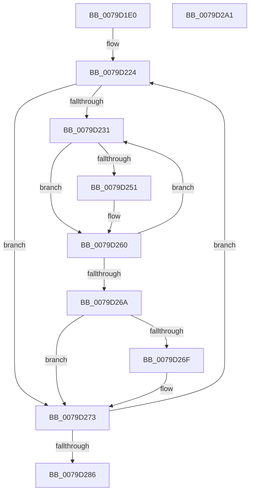

# SepModifyTokenPolicyCounter

- RVA: `0x0079D1E0`–`0x0079D2A2` (길이 `194` bytes)
- VA: `0x000000014079D1E0`
- 실행 섹션: `PAGE`
- PDB 이름 있음: `예`; PDB Function 태그: `아니요`
- unwind 정보 RVA: `0x000D0D58`
- 디코드: `58`개 명령, `194/194` bytes 표시
- 미해석 바이트: `0` (있으면 어셈블리에 `.byte`로 보존)

> 이 문서는 커널 이미지의 기계어와 PDB 기호를 분석해 생성했습니다. 4번과 5번은 함수 원형과 자료형을 바이너리 사용 방식에서 추정한 C 해석이며 원본 소스 복구 결과는 아닙니다.

## 1. Dependencies

- 직접 호출 지점: **0**; 고유 호출 대상: **0**
- 직접 호출자로 확인된 함수: **4**
- RIP 상대 이미지 참조: **3**

### Outgoing calls
- 직접 디코드된 call 명령이 없습니다.

### Direct callers
- [SepDuplicateToken](../8B/SepDuplicateToken_function_008B87EC.md) at `0x008B8BF6`
- [SepFilterToken](../9C/SepFilterToken_function_009C6B80.md) at `0x009C7016`
- [NtSetInformationToken](../AF/NtSetInformationToken_function_00AF0530.md) at `0x00AF110A`
- [SepTokenDeleteMethod](../AF/SepTokenDeleteMethod_function_00AF23D0.md) at `0x00AF2530`

### Static image references
- `0x0079D1FC` → RVA `0x00FD8160` (`PAGEDATA`; read)
- `0x0079D205` → RVA `0x00F04BA0` (`.data`; read)
- `0x0079D251` → RVA `0x00F04BE0` (`.data`; read)

## 2. Other-region calls and transfers

- 다른 실행 섹션으로 향하는 call: **0**
- 별도 외부 분기/꼬리 이동을 확인하지 못했습니다.

## 3. Assembly (complete function range)

```asm
0079D1E0  48 8B C4                        mov rax, rsp
0079D1E3  48 89 58 08                     mov qword ptr [rax + 8], rbx
0079D1E7  48 89 68 10                     mov qword ptr [rax + 0x10], rbp
0079D1EB  48 89 70 18                     mov qword ptr [rax + 0x18], rsi
0079D1EF  48 89 78 20                     mov qword ptr [rax + 0x20], rdi
0079D1F3  41 54                           push r12
0079D1F5  41 56                           push r14
0079D1F7  41 57                           push r15
0079D1F9  45 33 FF                        xor r15d, r15d
0079D1FC  4C 8D 0D 5D AF 83 00            lea r9, [rip + 0x83af5d]
0079D203  F6 DA                           neg dl
0079D205  4C 8D 15 94 79 76 00            lea r10, [rip + 0x767994]
0079D20C  4C 8B F1                        mov r14, rcx
0079D20F  41 8B DF                        mov ebx, r15d
0079D212  45 1B C0                        sbb r8d, r8d
0079D215  41 83 E0 02                     and r8d, 2
0079D219  41 8D 7F 09                     lea edi, [r15 + 9]
0079D21D  41 FF C8                        dec r8d
0079D220  45 8D 67 01                     lea r12d, [r15 + 1]
0079D224  41 8A F7                        mov sil, r15b
0079D227  45 0F B7 DF                     movzx r11d, r15w
0079D22B  66 45 3B 39                     cmp r15w, word ptr [r9]
0079D22F  73 42                           jae 0x14079d273
0079D231  41 0F B7 C3                     movzx eax, r11w
0079D235  41 8D 0C 1B                     lea ecx, [r11 + rbx]
0079D239  03 C3                           add eax, ebx
0079D23B  41 22 CC                        and cl, r12b
0079D23E  C0 E1 02                        shl cl, 2
0079D241  8B E8                           mov ebp, eax
0079D243  48 D1 E8                        shr rax, 1
0079D246  42 8A 14 30                     mov dl, byte ptr [rax + r14]
0079D24A  D2 EA                           shr dl, cl
0079D24C  F6 C2 0F                        test dl, 0xf
0079D24F  74 0F                           je 0x14079d260
0079D251  48 8D 05 88 79 76 00            lea rax, [rip + 0x767988]
0079D258  F0 44 01 04 A8                  lock add dword ptr [rax + rbp*4], r8d
0079D25D  41 8A F4                        mov sil, r12b
0079D260  66 45 03 DC                     add r11w, r12w
0079D264  66 45 3B 19                     cmp r11w, word ptr [r9]
0079D268  72 C7                           jb 0x14079d231
0079D26A  40 84 F6                        test sil, sil
0079D26D  74 04                           je 0x14079d273
0079D26F  F0 45 01 02                     lock add dword ptr [r10], r8d
0079D273  41 0F B7 01                     movzx eax, word ptr [r9]
0079D277  49 83 C2 04                     add r10, 4
0079D27B  03 D8                           add ebx, eax
0079D27D  49 83 C1 02                     add r9, 2
0079D281  49 2B FC                        sub rdi, r12
0079D284  75 9E                           jne 0x14079d224
0079D286  48 8B 5C 24 20                  mov rbx, qword ptr [rsp + 0x20]
0079D28B  48 8B 6C 24 28                  mov rbp, qword ptr [rsp + 0x28]
0079D290  48 8B 74 24 30                  mov rsi, qword ptr [rsp + 0x30]
0079D295  48 8B 7C 24 38                  mov rdi, qword ptr [rsp + 0x38]
0079D29A  41 5F                           pop r15
0079D29C  41 5E                           pop r14
0079D29E  41 5C                           pop r12
0079D2A0  C3                              ret
0079D2A1  CC                              int3
```

## 4. C-style interpretation (structured pseudocode)

```c
__int64 __fastcall SepModifyTokenPolicyCounter(__int64 a1, unsigned __int8 a2, int a3)
{
    __int64 result;
    __int64 v_r10;
    __int64 v_r11;
    __int64 v_r15;
    __int64 v_rbx;
    __int64 v_rdi;
    __int64 v_rsi;
    unsigned __int64 v_stack_p10;
    unsigned __int64 v_stack_p18;
    unsigned __int64 v_stack_p20;
    unsigned __int64 v_stack_p8;

    *(unsigned __int64 *)(v_rsp + 8) = v_rbx;
    *(unsigned __int64 *)(v_rsp + 16) = v_rbp;
    *(unsigned __int64 *)(v_rsp + 24) = v_rsi;
    *(unsigned __int64 *)(v_rsp + 32) = v_rdi;
    v_r15 = 0;
    a2 = (unsigned __int8)(-(a2));
    a3 = (unsigned int)((a3) & (2));
    a3 = (unsigned int)((a3) - 1);
loc_0079D224:
    if (0 >= (*(unsigned __int16 *)(v_rip + 8630109))) goto loc_0079D273;
loc_0079D231:
    result = (unsigned int)((0) + (0));
    a1 = (unsigned __int8)((0 + 0 * 1) & ((unsigned __int8)(v_r15 + 1)));
    a1 = (unsigned __int8)((a1) << (2));
    result = (result) >> (1);
    a2 = (unsigned __int8)((*(unsigned __int8 *)(result + a1 * 1)) >> ((unsigned __int8)(a1)));
    v_rsi = 0;
    if (((a2) & (15)) != 0) {
        result = v_rip + 7764360;
        v_rsi = (unsigned __int8)(v_r15 + 1);
    }
    v_r11 = (unsigned __int16)((0) + ((unsigned __int16)(v_r15 + 1)));
    if (((unsigned __int16)(v_r11)) < (*(unsigned __int16 *)(v_rip + 8630109))) goto loc_0079D231;
    if ((unsigned __int8)(v_rsi) != 0) {
    }
    v_r10 = (v_rip + 7764372) + (4);
    v_rbx = (unsigned int)((0) + ((unsigned int)(*(unsigned __int16 *)(v_rip + 8630109))));
    a4 = (v_rip + 8630109) + (2);
    v_rdi = (v_r15 + 9) - (v_r15 + 1);
    if (condition_is_not_equal) goto loc_0079D224;
    return *(unsigned __int16 *)(v_rip + 8630109);
}
```

## 5. (Beta) C Style

```c
int64_t SepModifyTokenPolicyCounter(int64_t Arg1, uint8_t Arg2, int32_t Arg3)
{
    int64_t result;
    int64_t local_r10;
    int64_t local_r11;
    int64_t local_r15;
    int64_t local_rbx;
    int64_t local_rdi;
    int64_t local_rsi;
    uint64_t v_stack_p10;
    uint64_t v_stack_p18;
    uint64_t v_stack_p20;
    uint64_t v_stack_p8;

    *(uint64_t *)(local_rsp + 0x8) = local_rbx;
    *(uint64_t *)(local_rsp + 0x10) = local_rbp;
    *(uint64_t *)(local_rsp + 0x18) = local_rsi;
    *(uint64_t *)(local_rsp + 0x20) = local_rdi;
    local_r15 = 0;
    Arg2 = (uint8_t)(-(Arg2));
    Arg3 = (uint32_t)((Arg3) & (2));
    Arg3 = (uint32_t)((Arg3) - 1);
loc_0079D224:
    if (0 >= (*(uint16_t *)(v_rip + 0x83AF5D))) goto loc_0079D273;
loc_0079D231:
    result = (uint32_t)((0) + (0));
    Arg1 = (uint8_t)((0 + 0 * 1) & ((uint8_t)(local_r15 + 1)));
    Arg1 = (uint8_t)((Arg1) << (2));
    result = (result) >> (1);
    Arg2 = (uint8_t)((*(uint8_t *)(result + Arg1 * 1)) >> ((uint8_t)(Arg1)));
    local_rsi = 0;
    if (((Arg2) & (15)) != 0) {
        result = v_rip + 7764360;
        local_rsi = (uint8_t)(local_r15 + 1);
    }
    local_r11 = (uint16_t)((0) + ((uint16_t)(local_r15 + 1)));
    if (((uint16_t)(local_r11)) < (*(uint16_t *)(v_rip + 0x83AF5D))) goto loc_0079D231;
    if ((uint8_t)(local_rsi) != 0) {
    }
    local_r10 = (v_rip + 7764372) + (4);
    local_rbx = (uint32_t)((0) + ((uint32_t)(*(uint16_t *)(v_rip + 0x83AF5D))));
    a4 = (v_rip + 8630109) + (2);
    local_rdi = (local_r15 + 9) - (local_r15 + 1);
    if (condition_is_not_equal) goto loc_0079D224;
    return *(uint16_t *)(v_rip + 0x83AF5D);
}
```

## 6. Execution-region graph

[열기: 2D/3D 그래프와 함수 탐색 컨트롤 패널](../../../control-panel.html?section=page&rva=0x0079D1E0&view=graph)

- 2D 그래프는 위에서 아래로 흐르고, 3D 그래프는 빈 공간을 드래그해 회전합니다. Shift+드래그는 이동, 휠은 확대·축소, 함수 노드 선택은 대상 보고서 이동입니다.

### Static fallback


