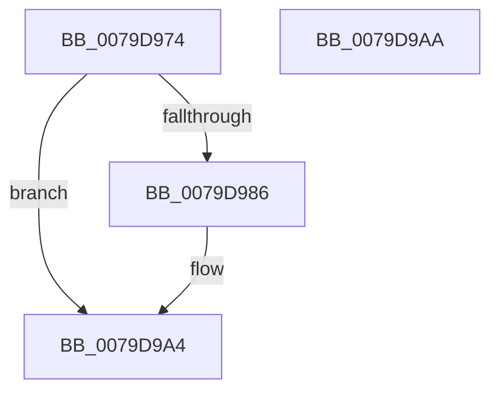

# SepReleaseMandatoryAccessControlList

- RVA: `0x0079D974`–`0x0079D9AB` (길이 `55` bytes)
- VA: `0x000000014079D974`
- 실행 섹션: `PAGE`
- PDB 이름 있음: `예`; PDB Function 태그: `아니요`
- unwind 정보 RVA: `0x0005CF00`
- 디코드: `16`개 명령, `55/55` bytes 표시
- 미해석 바이트: `0` (있으면 어셈블리에 `.byte`로 보존)

> 이 문서는 커널 이미지의 기계어와 PDB 기호를 분석해 생성했습니다. 4번과 5번은 함수 원형과 자료형을 바이너리 사용 방식에서 추정한 C 해석이며 원본 소스 복구 결과는 아닙니다.

## 1. Dependencies

- 직접 호출 지점: **1**; 고유 호출 대상: **1**
- 직접 호출자로 확인된 함수: **2**
- RIP 상대 이미지 참조: **0**

### Outgoing calls
- `0x0079D996` → [ObFastDereferenceObject](../../text/3E/ObFastDereferenceObject_function_003ED5F0.md) (function, `0x003ED5F0`)

### Direct callers
- [sub_004E9AEF](../../text/4E/Unknown_function_004E9AEF.md) at `0x004E9BA1`
- [SeAdjustAntiTamperCreatorAccess](../../text/60/SeAdjustAntiTamperCreatorAccess_function_00607590.md) at `0x00607621`
- [SeAdjustAntiTamperCreatorAccess](../../text/60/SeAdjustAntiTamperCreatorAccess_function_00607590.md) at `0x00607671`

### Static image references
- 디코드된 RIP-relative 메모리 참조가 없습니다.

## 2. Other-region calls and transfers

- 다른 실행 섹션으로 향하는 call: **1**
  - `0x0079D996` → [ObFastDereferenceObject](../../text/3E/ObFastDereferenceObject_function_003ED5F0.md) (`PAGE` → `.text`)
- 별도 외부 분기/꼬리 이동을 확인하지 못했습니다.

## 3. Assembly (complete function range)

```asm
0079D974  40 53                           push rbx
0079D976  48 83 EC 20                     sub rsp, 0x20
0079D97A  48 8B 51 08                     mov rdx, qword ptr [rcx + 8]
0079D97E  48 8B D9                        mov rbx, rcx
0079D981  48 85 D2                        test rdx, rdx
0079D984  74 1E                           je 0x14079d9a4
0079D986  48 8B 09                        mov rcx, qword ptr [rcx]
0079D989  41 B8 44 66 6C 74               mov r8d, 0x746c6644
0079D98F  48 81 C1 48 02 00 00            add rcx, 0x248
0079D996  E8 55 FC C4 FF                  call 0x1403ed5f0
0079D99B  48 83 23 00                     and qword ptr [rbx], 0
0079D99F  48 83 63 08 00                  and qword ptr [rbx + 8], 0
0079D9A4  48 83 C4 20                     add rsp, 0x20
0079D9A8  5B                              pop rbx
0079D9A9  C3                              ret
0079D9AA  CC                              int3
```

## 4. C-style interpretation (structured pseudocode)

```c
__int64 __fastcall SepReleaseMandatoryAccessControlList(__int64 a1)
{
    __int64 result;
    __int64 v_rsp;

    v_rsp = (v_rsp) - (32);
    if (*(unsigned __int64 *)(a1 + 8) != 0) {
        a1 = *(unsigned __int64 *)(a1);
        a3 = 0x746C6644ULL;
        a1 = (a1) + (584);
        result = ObFastDereferenceObject(a1, *(unsigned __int64 *)(a1 + 8), a3, a4);
    }
    v_rsp = (v_rsp) + (32);
    return result;
}
```

## 5. (Beta) C Style

```c
int64_t SepReleaseMandatoryAccessControlList(void *Arg1)
{
    uint8_t *arg1 = (uint8_t *)Arg1;

    int64_t result;
    int64_t local_rsp;

    local_rsp = (local_rsp) - (32);
    if (*(uint64_t *)(arg1 + 0x8) != 0) {
        Arg1 = *(uint64_t *)(arg1);
        a3 = 0x746C6644ULL;
        Arg1 = (Arg1) + (584);
        result = ObFastDereferenceObject(Arg1, *(uint64_t *)(arg1 + 0x8), a3, a4);
    }
    local_rsp = (local_rsp) + (32);
    return result;
}
```

### 관측된 메모리 오프셋

구조체 형식이 확인되지 않은 접근은 인자 기준의 오프셋으로만 기록했습니다.

| 기준 인자 | 오프셋 표현 | 폭 (bit) | 접근 |
|---|---:|---:|---|
| `Arg1` | `+ 0x0` | `64` | `R` |
| `Arg1` | `+ 0x0` | `64` | `R/W` |
| `Arg1` | `+ 0x8` | `64` | `R` |
| `Arg1` | `+ 0x8` | `64` | `R/W` |

## 6. Execution-region graph

[열기: 2D/3D 그래프와 함수 탐색 컨트롤 패널](../../../control-panel.html?section=page&rva=0x0079D974&view=graph)

- 2D 그래프는 위에서 아래로 흐르고, 3D 그래프는 빈 공간을 드래그해 회전합니다. Shift+드래그는 이동, 휠은 확대·축소, 함수 노드 선택은 대상 보고서 이동입니다.

### Static fallback


