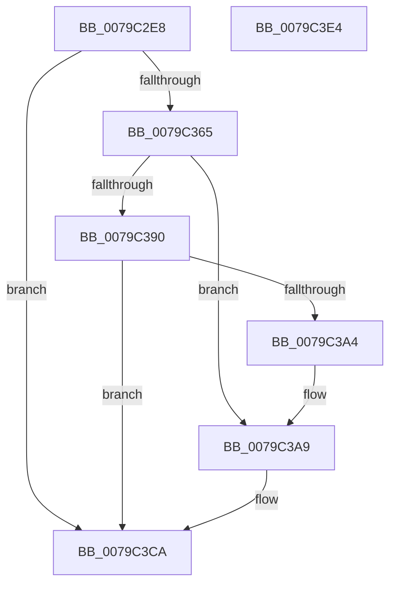

# SepRmVerifyLsaProtectionLevel

- RVA: `0x0079C2E8`–`0x0079C3E5` (길이 `253` bytes)
- VA: `0x000000014079C2E8`
- 실행 섹션: `PAGE`
- PDB 이름 있음: `예`; PDB Function 태그: `아니요`
- unwind 정보 RVA: `0x0005F764`
- 디코드: `59`개 명령, `253/253` bytes 표시
- 미해석 바이트: `0` (있으면 어셈블리에 `.byte`로 보존)

> 이 문서는 커널 이미지의 기계어와 PDB 기호를 분석해 생성했습니다. 4번과 5번은 함수 원형과 자료형을 바이너리 사용 방식에서 추정한 C 해석이며 원본 소스 복구 결과는 아닙니다.

## 1. Dependencies

- 직접 호출 지점: **6**; 고유 호출 대상: **6**
- 직접 호출자로 확인된 함수: **1**
- RIP 상대 이미지 참조: **3**

### Outgoing calls
- `0x0079C33F` → [RtlInitUnicodeString](../../text/42/RtlInitUnicodeString_function_0042A780.md) (function, `0x0042A780`)
- `0x0079C35A` → [ZwQuerySystemEnvironmentValueEx](../../text/6A/ZwQuerySystemEnvironmentValueEx_function_006AFE90.md) (function, `0x006AFE90`)
- `0x0079C387` → [ObReferenceObjectByHandle](../86/ObReferenceObjectByHandle_function_00868DB0.md) (function, `0x00868DB0`)
- `0x0079C39A` → [ObfDereferenceObject](../../text/2F/ObfDereferenceObject_function_002F9350.md) (function, `0x002F9350`)
- `0x0079C3C4` → [KeBugCheckEx](../../text/4F/KeBugCheckEx_function_004FD660.md) (function, `0x004FD660`)
- `0x0079C3D1` → [_security_check_cookie](../../text/6A/_security_check_cookie_function_006AC640.md) (function, `0x006AC640`)

### Direct callers
- [SepRmLsaConnectRequest](../A6/SepRmLsaConnectRequest_function_00A6AB54.md) at `0x00A6ACBE`

### Static image references
- `0x0079C2F5` → RVA `0x00E0A740` (`.data`; read)
- `0x0079C307` → RVA `0x00B05D70` (` ?? ::NNGAKEGL::`string'`; read)
- `0x0079C3AF` → RVA `0x00B05D20` (` ?? ::NNGAKEGL::`string'`; read)

## 2. Other-region calls and transfers

- 다른 실행 섹션으로 향하는 call: **5**
  - `0x0079C33F` → [RtlInitUnicodeString](../../text/42/RtlInitUnicodeString_function_0042A780.md) (`PAGE` → `.text`)
  - `0x0079C35A` → [ZwQuerySystemEnvironmentValueEx](../../text/6A/ZwQuerySystemEnvironmentValueEx_function_006AFE90.md) (`PAGE` → `.text`)
  - `0x0079C39A` → [ObfDereferenceObject](../../text/2F/ObfDereferenceObject_function_002F9350.md) (`PAGE` → `.text`)
  - `0x0079C3C4` → [KeBugCheckEx](../../text/4F/KeBugCheckEx_function_004FD660.md) (`PAGE` → `.text`)
  - `0x0079C3D1` → [_security_check_cookie](../../text/6A/_security_check_cookie_function_006AC640.md) (`PAGE` → `.text`)
- 별도 외부 분기/꼬리 이동을 확인하지 못했습니다.

## 3. Assembly (complete function range)

```asm
0079C2E8  48 89 5C 24 10                  mov qword ptr [rsp + 0x10], rbx
0079C2ED  55                              push rbp
0079C2EE  48 8B EC                        mov rbp, rsp
0079C2F1  48 83 EC 70                     sub rsp, 0x70
0079C2F5  48 8B 05 44 E4 66 00            mov rax, qword ptr [rip + 0x66e444]
0079C2FC  48 33 C4                        xor rax, rsp
0079C2FF  48 89 45 F0                     mov qword ptr [rbp - 0x10], rax
0079C303  83 65 C0 00                     and dword ptr [rbp - 0x40], 0
0079C307  48 8D 15 62 9A 36 00            lea rdx, [rip + 0x369a62]
0079C30E  48 8B D9                        mov rbx, rcx
0079C311  C7 45 C4 04 00 00 00            mov dword ptr [rbp - 0x3c], 4
0079C318  0F 57 C0                        xorps xmm0, xmm0
0079C31B  C7 45 E0 BD 9A FA 77            mov dword ptr [rbp - 0x20], 0x77fa9abd
0079C322  48 8D 4D D0                     lea rcx, [rbp - 0x30]
0079C326  C7 45 E4 59 03 32 4D            mov dword ptr [rbp - 0x1c], 0x4d320359
0079C32D  0F 11 45 D0                     movups xmmword ptr [rbp - 0x30], xmm0
0079C331  C7 45 E8 BD 60 28 F4            mov dword ptr [rbp - 0x18], 0xf42860bd
0079C338  C7 45 EC E7 8F 78 4B            mov dword ptr [rbp - 0x14], 0x4b788fe7
0079C33F  E8 3C E4 C8 FF                  call 0x14042a780
0079C344  48 83 64 24 20 00               and qword ptr [rsp + 0x20], 0
0079C34A  4C 8D 4D C4                     lea r9, [rbp - 0x3c]
0079C34E  4C 8D 45 C0                     lea r8, [rbp - 0x40]
0079C352  48 8D 55 E0                     lea rdx, [rbp - 0x20]
0079C356  48 8D 4D D0                     lea rcx, [rbp - 0x30]
0079C35A  E8 31 3B F1 FF                  call 0x1406afe90
0079C35F  83 7D C0 04                     cmp dword ptr [rbp - 0x40], 4
0079C363  75 65                           jne 0x14079c3ca
0079C365  48 8B 0B                        mov rcx, qword ptr [rbx]
0079C368  48 8D 45 C8                     lea rax, [rbp - 0x38]
0079C36C  48 83 64 24 28 00               and qword ptr [rsp + 0x28], 0
0079C372  45 33 C9                        xor r9d, r9d
0079C375  48 83 65 C8 00                  and qword ptr [rbp - 0x38], 0
0079C37A  45 33 C0                        xor r8d, r8d
0079C37D  BA 00 00 00 02                  mov edx, 0x2000000
0079C382  48 89 44 24 20                  mov qword ptr [rsp + 0x20], rax
0079C387  E8 24 CA 0C 00                  call 0x140868db0
0079C38C  85 C0                           test eax, eax
0079C38E  78 19                           js 0x14079c3a9
0079C390  48 8B 4D C8                     mov rcx, qword ptr [rbp - 0x38]
0079C394  8A 99 FA 05 00 00               mov bl, byte ptr [rcx + 0x5fa]
0079C39A  E8 B1 CF B5 FF                  call 0x1402f9350
0079C39F  80 FB 41                        cmp bl, 0x41
0079C3A2  74 26                           je 0x14079c3ca
0079C3A4  B8 22 00 00 C0                  mov eax, 0xc0000022
0079C3A9  48 83 64 24 20 00               and qword ptr [rsp + 0x20], 0
0079C3AF  4C 8D 05 6A 99 36 00            lea r8, [rip + 0x36996a]
0079C3B6  48 63 D0                        movsxd rdx, eax
0079C3B9  41 B9 92 02 00 00               mov r9d, 0x292
0079C3BF  B9 29 00 00 00                  mov ecx, 0x29
0079C3C4  E8 97 12 D6 FF                  call 0x1404fd660
0079C3C9  CC                              int3
0079C3CA  48 8B 4D F0                     mov rcx, qword ptr [rbp - 0x10]
0079C3CE  48 33 CC                        xor rcx, rsp
0079C3D1  E8 6A 02 F1 FF                  call 0x1406ac640
0079C3D6  48 8B 9C 24 88 00 00 00         mov rbx, qword ptr [rsp + 0x88]
0079C3DE  48 83 C4 70                     add rsp, 0x70
0079C3E2  5D                              pop rbp
0079C3E3  C3                              ret
0079C3E4  CC                              int3
```

## 4. C-style interpretation (structured pseudocode)

```c
__int64 __fastcall SepRmVerifyLsaProtectionLevel(__int64 a1)
{
    __int64 result;
    __int64 v_rsp;
    unsigned __int64 v_stack_m18;
    unsigned int v_stack_m1C;
    unsigned int v_stack_m20;
    unsigned int v_stack_m24;
    unsigned int v_stack_m28;
    unsigned __int64 v_stack_m38;
    unsigned __int64 v_stack_m40;
    unsigned int v_stack_m44;
    unsigned int v_stack_m48;
    unsigned __int64 v_stack_m50;
    unsigned __int64 v_stack_m58;
    unsigned __int64 v_stack_p10;

    v_stack_p10 = v_rbx;
    v_rsp = (v_rsp) - (112);
    result = (*(unsigned __int64 *)(v_rip + 6743108)) ^ (v_rsp);
    v_stack_m18 = result;
    v_stack_m44 = 4;
    v_stack_m28 = 0x77FA9ABDULL;
    v_stack_m24 = 0x4D320359ULL;
    v_stack_m38 = v_xmm0;
    v_stack_m20 = 0xF42860BDULL;
    v_stack_m1C = 0x4B788FE7ULL;
    result = RtlInitUnicodeString(v_stack_m38, v_rip + 3578466, a3, a4);
    result = ZwQuerySystemEnvironmentValueEx(v_stack_m38, v_stack_m28, v_stack_m48, v_stack_m44);
    if (v_stack_m48 != 4) goto loc_0079C3CA;
    a4 = 0;
    a3 = 0;
    v_stack_m58 = v_stack_m40;
    result = ObReferenceObjectByHandle(*(unsigned __int64 *)(a1), (unsigned int)(0x2000000ULL), a3, a4);
    if (sign_flag) goto loc_0079C3A9;
    result = ObfDereferenceObject(v_stack_m40, (unsigned int)(0x2000000ULL), a3, a4);
    if (((unsigned __int8)(*(unsigned __int8 *)(v_stack_m40 + 1530))) == 65) goto loc_0079C3CA;
loc_0079C3A9:
    result = KeBugCheckEx(41, (int)((unsigned int)((unsigned int)(0xC0000022ULL))), v_rip + 3578218, 658);
loc_0079C3CA:
    a1 = (v_stack_m18) ^ (v_rsp);
    result = _security_check_cookie(a1, (int)((unsigned int)((unsigned int)(0xC0000022ULL))), v_rip + 3578218, 658);
    v_rsp = (v_rsp) + (112);
    return result;
}
```

## 5. (Beta) C Style

```c
int64_t SepRmVerifyLsaProtectionLevel(void *Arg1)
{
    uint8_t *arg1 = (uint8_t *)Arg1;

    int64_t result;
    int64_t local_rsp;
    uint64_t v_stack_m18;
    uint32_t v_stack_m1C;
    uint32_t v_stack_m20;
    uint32_t v_stack_m24;
    uint32_t v_stack_m28;
    uint64_t v_stack_m38;
    uint64_t v_stack_m40;
    uint32_t v_stack_m44;
    uint32_t v_stack_m48;
    uint64_t v_stack_m50;
    uint64_t v_stack_m58;
    uint64_t v_stack_p10;

    v_stack_p10 = local_rbx;
    local_rsp = (local_rsp) - (112);
    result = (*(uint64_t *)(v_rip + 0x66E444)) ^ (local_rsp);
    v_stack_m18 = result;
    v_stack_m44 = 4;
    v_stack_m28 = 0x77FA9ABDULL;
    v_stack_m24 = 0x4D320359ULL;
    v_stack_m38 = v_xmm0;
    v_stack_m20 = 0xF42860BDULL;
    v_stack_m1C = 0x4B788FE7ULL;
    result = RtlInitUnicodeString(v_stack_m38, v_rip + 3578466, a3, a4);
    result = ZwQuerySystemEnvironmentValueEx(v_stack_m38, v_stack_m28, v_stack_m48, v_stack_m44);
    if (v_stack_m48 != 4) goto loc_0079C3CA;
    a4 = 0;
    a3 = 0;
    v_stack_m58 = v_stack_m40;
    result = ObReferenceObjectByHandle(*(uint64_t *)(arg1), (uint32_t)(0x2000000ULL), a3, a4);
    if (sign_flag) goto loc_0079C3A9;
    result = ObfDereferenceObject(v_stack_m40, (uint32_t)(0x2000000ULL), a3, a4);
    if (((uint8_t)(*(uint8_t *)(v_stack_m40 + 0x5FA))) == 65) goto loc_0079C3CA;
loc_0079C3A9:
    result = KeBugCheckEx(41, (int32_t)((uint32_t)((uint32_t)(0xC0000022ULL))), v_rip + 3578218, 658);
loc_0079C3CA:
    Arg1 = (v_stack_m18) ^ (local_rsp);
    result = _security_check_cookie(Arg1, (int32_t)((uint32_t)((uint32_t)(0xC0000022ULL))), v_rip + 3578218, 658);
    local_rsp = (local_rsp) + (112);
    return result;
}
```

### 관측된 메모리 오프셋

구조체 형식이 확인되지 않은 접근은 인자 기준의 오프셋으로만 기록했습니다.

| 기준 인자 | 오프셋 표현 | 폭 (bit) | 접근 |
|---|---:|---:|---|
| `Arg1` | `+ 0x0` | `64` | `R` |

## 6. Execution-region graph

[열기: 2D/3D 그래프와 함수 탐색 컨트롤 패널](../../../control-panel.html?section=page&rva=0x0079C2E8&view=graph)

- 2D 그래프는 위에서 아래로 흐르고, 3D 그래프는 빈 공간을 드래그해 회전합니다. Shift+드래그는 이동, 휠은 확대·축소, 함수 노드 선택은 대상 보고서 이동입니다.

### Static fallback


