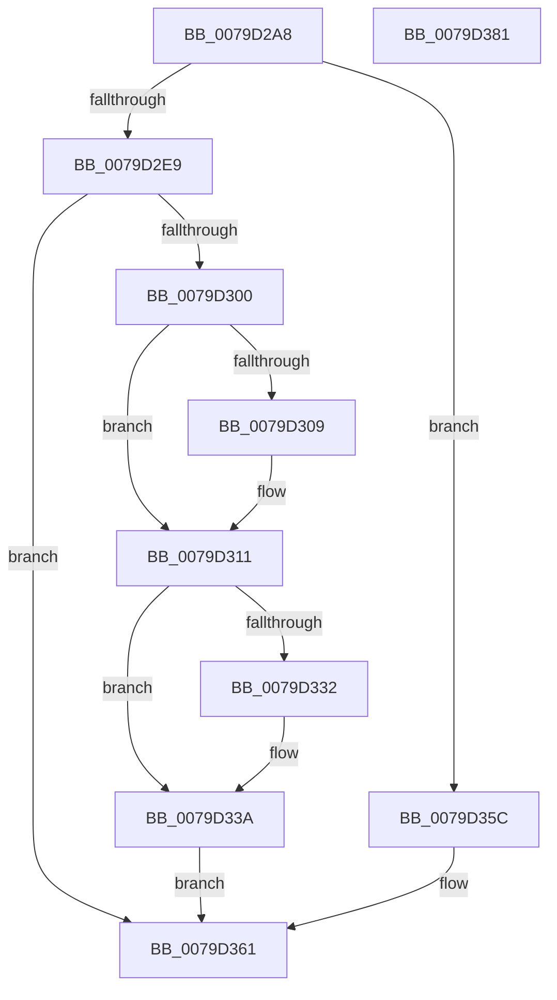

# SepSetServerSiloToken

- RVA: `0x0079D2A8`–`0x0079D382` (길이 `218` bytes)
- VA: `0x000000014079D2A8`
- 실행 섹션: `PAGE`
- PDB 이름 있음: `예`; PDB Function 태그: `아니요`
- unwind 정보 RVA: `0x00068D5C`
- 디코드: `54`개 명령, `218/218` bytes 표시
- 미해석 바이트: `0` (있으면 어셈블리에 `.byte`로 보존)

> 이 문서는 커널 이미지의 기계어와 PDB 기호를 분석해 생성했습니다. 4번과 5번은 함수 원형과 자료형을 바이너리 사용 방식에서 추정한 C 해석이며 원본 소스 복구 결과는 아닙니다.

## 1. Dependencies

- 직접 호출 지점: **7**; 고유 호출 대상: **7**
- 직접 호출자로 확인된 함수: **2**
- RIP 상대 이미지 참조: **3**

### Outgoing calls
- `0x0079D2D5` → [ExAcquireResourceExclusiveLite](../../text/21/ExAcquireResourceExclusiveLite_function_00214E20.md) (function, `0x00214E20`)
- `0x0079D2F5` → [SepReferenceLogonSessionSilo](../A3/SepReferenceLogonSessionSilo_function_00A3B784.md) (function, `0x00A3B784`)
- `0x0079D30C` → [SepRemoveTokenLogonSession](../7A/SepRemoveTokenLogonSession_function_007A19C8.md) (function, `0x007A19C8`)
- `0x0079D318` → [SepDeReferenceLogonSessionDirect](../../text/44/SepDeReferenceLogonSessionDirect_function_0044EDCC.md) (function, `0x0044EDCC`)
- `0x0079D335` → [SepAddTokenLogonSession](../7A/SepAddTokenLogonSession_function_007A14E0.md) (function, `0x007A14E0`)
- `0x0079D36A` → [ExReleaseResourceLite](../../text/25/ExReleaseResourceLite_function_0025FA10.md) (function, `0x0025FA10`)
- `0x0079D36F` → [KeLeaveCriticalRegion](../../text/25/KeLeaveCriticalRegion_function_0025D8B0.md) (function, `0x0025D8B0`)

### Direct callers
- [SepCopyClientTokenAndSetSilo](SepCopyClientTokenAndSetSilo_function_0079CE34.md) at `0x0079CE82`
- [SepCopyAnonymousTokenAndSetSilo](../A3/SepCopyAnonymousTokenAndSetSilo_function_00A3A510.md) at `0x00A3A66D`

### Static image references
- `0x0079D300` → RVA `0x00FD8010` (`PAGEDATA`; read)
- `0x0079D33A` → RVA `0x00012D08` (`.rdata`; read)
- `0x0079D344` → RVA `0x00E0EBF0` (`.data`; read/write)

## 2. Other-region calls and transfers

- 다른 실행 섹션으로 향하는 call: **4**
  - `0x0079D2D5` → [ExAcquireResourceExclusiveLite](../../text/21/ExAcquireResourceExclusiveLite_function_00214E20.md) (`PAGE` → `.text`)
  - `0x0079D318` → [SepDeReferenceLogonSessionDirect](../../text/44/SepDeReferenceLogonSessionDirect_function_0044EDCC.md) (`PAGE` → `.text`)
  - `0x0079D36A` → [ExReleaseResourceLite](../../text/25/ExReleaseResourceLite_function_0025FA10.md) (`PAGE` → `.text`)
  - `0x0079D36F` → [KeLeaveCriticalRegion](../../text/25/KeLeaveCriticalRegion_function_0025D8B0.md) (`PAGE` → `.text`)
- 별도 외부 분기/꼬리 이동을 확인하지 못했습니다.

## 3. Assembly (complete function range)

```asm
0079D2A8  48 89 5C 24 10                  mov qword ptr [rsp + 0x10], rbx
0079D2AD  57                              push rdi
0079D2AE  48 83 EC 20                     sub rsp, 0x20
0079D2B2  65 48 8B 04 25 88 01 00 00      mov rax, qword ptr gs:[0x188]
0079D2BB  48 8B FA                        mov rdi, rdx
0079D2BE  48 83 64 24 30 00               and qword ptr [rsp + 0x30], 0
0079D2C4  48 8B D9                        mov rbx, rcx
0079D2C7  B2 01                           mov dl, 1
0079D2C9  66 FF 88 E4 01 00 00            dec word ptr [rax + 0x1e4]
0079D2D0  90                              nop
0079D2D1  48 8B 49 30                     mov rcx, qword ptr [rcx + 0x30]
0079D2D5  E8 46 7B A7 FF                  call 0x140214e20
0079D2DA  F0 83 0C 24 00                  lock or dword ptr [rsp], 0
0079D2DF  8B 83 C8 00 00 00               mov eax, dword ptr [rbx + 0xc8]
0079D2E5  A8 20                           test al, 0x20
0079D2E7  75 73                           jne 0x14079d35c
0079D2E9  48 8D 4B 18                     lea rcx, [rbx + 0x18]
0079D2ED  48 8B D7                        mov rdx, rdi
0079D2F0  4C 8D 44 24 30                  lea r8, [rsp + 0x30]
0079D2F5  E8 8A E4 29 00                  call 0x140a3b784
0079D2FA  8B F8                           mov edi, eax
0079D2FC  85 C0                           test eax, eax
0079D2FE  78 61                           js 0x14079d361
0079D300  83 3D 09 AD 83 00 00            cmp dword ptr [rip + 0x83ad09], 0
0079D307  74 08                           je 0x14079d311
0079D309  48 8B CB                        mov rcx, rbx
0079D30C  E8 B7 46 00 00                  call 0x1407a19c8
0079D311  48 8B 8B D8 00 00 00            mov rcx, qword ptr [rbx + 0xd8]
0079D318  E8 AF 1A CB FF                  call 0x14044edcc
0079D31D  48 8B 44 24 30                  mov rax, qword ptr [rsp + 0x30]
0079D322  48 89 83 D8 00 00 00            mov qword ptr [rbx + 0xd8], rax
0079D329  83 3D E0 AC 83 00 00            cmp dword ptr [rip + 0x83ace0], 0
0079D330  74 08                           je 0x14079d33a
0079D332  48 8B CB                        mov rcx, rbx
0079D335  E8 A6 41 00 00                  call 0x1407a14e0
0079D33A  48 8B 0D C7 59 87 FF            mov rcx, qword ptr [rip - 0x78a639]
0079D341  48 8B C1                        mov rax, rcx
0079D344  F0 48 0F C1 05 A3 18 67 00      lock xadd qword ptr [rip + 0x6718a3], rax
0079D34D  48 03 C1                        add rax, rcx
0079D350  89 43 38                        mov dword ptr [rbx + 0x38], eax
0079D353  48 C1 E8 20                     shr rax, 0x20
0079D357  89 43 3C                        mov dword ptr [rbx + 0x3c], eax
0079D35A  EB 05                           jmp 0x14079d361
0079D35C  BF 08 00 00 C0                  mov edi, 0xc0000008
0079D361  F0 83 0C 24 00                  lock or dword ptr [rsp], 0
0079D366  48 8B 4B 30                     mov rcx, qword ptr [rbx + 0x30]
0079D36A  E8 A1 26 AC FF                  call 0x14025fa10
0079D36F  E8 3C 05 AC FF                  call 0x14025d8b0
0079D374  48 8B 5C 24 38                  mov rbx, qword ptr [rsp + 0x38]
0079D379  8B C7                           mov eax, edi
0079D37B  48 83 C4 20                     add rsp, 0x20
0079D37F  5F                              pop rdi
0079D380  C3                              ret
0079D381  CC                              int3
```

## 4. C-style interpretation (structured pseudocode)

```c
__int64 __fastcall SepSetServerSiloToken(__int64 a1, __int64 a2)
{
    __int64 result;
    __int64 v_rsp;
    unsigned int v_stack_m28;
    unsigned __int64 v_stack_p10;
    unsigned __int64 v_stack_p8;

    v_stack_p10 = v_rbx;
    v_rsp = (v_rsp) - (32);
    result = ExAcquireResourceExclusiveLite(*(unsigned __int64 *)(a1 + 48), 1, a3, a4);
    if ((((unsigned __int8)((unsigned int)(*(unsigned int *)(a1 + 200)))) & (32)) != 0) goto loc_0079D35C;
    result = SepReferenceLogonSessionSilo(a1 + 24, a2, v_stack_p8, a4);
    if (sign_flag) goto loc_0079D361;
    if ((*(unsigned int *)(v_rip + 8629513)) != 0) {
        a1 = a1;
        result = SepRemoveTokenLogonSession(a1, a2, v_stack_p8, a4);
    }
    result = SepDeReferenceLogonSessionDirect(*(unsigned __int64 *)(a1 + 216), a2, v_stack_p8, a4);
    *(unsigned __int64 *)(a1 + 216) = v_stack_p8;
    result = v_stack_p8;
    if ((*(unsigned int *)(v_rip + 8629472)) != 0) {
        a1 = a1;
        result = SepAddTokenLogonSession(a1, a2, v_stack_p8, a4);
    }
    result = (*(unsigned __int64 *)(v_rip - 7906873)) + (*(unsigned __int64 *)(v_rip - 7906873));
    *(unsigned int *)(a1 + 56) = (unsigned int)(result);
    result = (result) >> (32);
    *(unsigned int *)(a1 + 60) = (unsigned int)(result);
    goto loc_0079D361;
loc_0079D35C:
loc_0079D361:
    result = ExReleaseResourceLite(*(unsigned __int64 *)(a1 + 48), a2, v_stack_p8, a4);
    result = KeLeaveCriticalRegion(*(unsigned __int64 *)(a1 + 48), a2, v_stack_p8, a4);
    v_rsp = (v_rsp) + (32);
    return (unsigned int)((unsigned int)((unsigned int)(0xC0000008ULL)));
}
```

## 5. (Beta) C Style

```c
int64_t SepSetServerSiloToken(void *Arg1, int64_t Arg2)
{
    uint8_t *arg1 = (uint8_t *)Arg1;

    int64_t result;
    int64_t local_rsp;
    uint32_t v_stack_m28;
    uint64_t v_stack_p10;
    uint64_t v_stack_p8;

    v_stack_p10 = local_rbx;
    local_rsp = (local_rsp) - (32);
    result = ExAcquireResourceExclusiveLite(*(uint64_t *)(arg1 + 0x30), 1, a3, a4);
    if ((((uint8_t)((uint32_t)(*(uint32_t *)(arg1 + 0xC8)))) & (32)) != 0) goto loc_0079D35C;
    result = SepReferenceLogonSessionSilo(Arg1 + 24, Arg2, v_stack_p8, a4);
    if (sign_flag) goto loc_0079D361;
    if ((*(uint32_t *)(v_rip + 0x83AD09)) != 0) {
        Arg1 = Arg1;
        result = SepRemoveTokenLogonSession(Arg1, Arg2, v_stack_p8, a4);
    }
    result = SepDeReferenceLogonSessionDirect(*(uint64_t *)(arg1 + 0xD8), Arg2, v_stack_p8, a4);
    *(uint64_t *)(arg1 + 0xD8) = v_stack_p8;
    result = v_stack_p8;
    if ((*(uint32_t *)(v_rip + 0x83ACE0)) != 0) {
        Arg1 = Arg1;
        result = SepAddTokenLogonSession(Arg1, Arg2, v_stack_p8, a4);
    }
    result = (*(uint64_t *)(v_rip - 0x78A639)) + (*(uint64_t *)(v_rip - 0x78A639));
    *(uint32_t *)(arg1 + 0x38) = (uint32_t)(result);
    result = (result) >> (32);
    *(uint32_t *)(arg1 + 0x3C) = (uint32_t)(result);
    goto loc_0079D361;
loc_0079D35C:
loc_0079D361:
    result = ExReleaseResourceLite(*(uint64_t *)(arg1 + 0x30), Arg2, v_stack_p8, a4);
    result = KeLeaveCriticalRegion(*(uint64_t *)(arg1 + 0x30), Arg2, v_stack_p8, a4);
    local_rsp = (local_rsp) + (32);
    return (uint32_t)((uint32_t)((uint32_t)(0xC0000008ULL)));
}
```

### 관측된 메모리 오프셋

구조체 형식이 확인되지 않은 접근은 인자 기준의 오프셋으로만 기록했습니다.

| 기준 인자 | 오프셋 표현 | 폭 (bit) | 접근 |
|---|---:|---:|---|
| `Arg1` | `+ 0x18` | `64` | `R` |
| `Arg1` | `+ 0x30` | `64` | `R` |
| `Arg1` | `+ 0x38` | `32` | `W` |
| `Arg1` | `+ 0x3C` | `32` | `W` |
| `Arg1` | `+ 0xC8` | `32` | `R` |
| `Arg1` | `+ 0xD8` | `64` | `R` |
| `Arg1` | `+ 0xD8` | `64` | `W` |

## 6. Execution-region graph

[열기: 2D/3D 그래프와 함수 탐색 컨트롤 패널](../../../control-panel.html?section=page&rva=0x0079D2A8&view=graph)

- 2D 그래프는 위에서 아래로 흐르고, 3D 그래프는 빈 공간을 드래그해 회전합니다. Shift+드래그는 이동, 휠은 확대·축소, 함수 노드 선택은 대상 보고서 이동입니다.

### Static fallback


