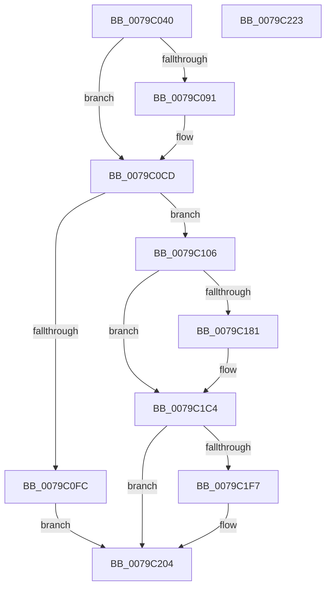

# SepSetSystemPaths

- RVA: `0x0079C040`–`0x0079C224` (길이 `484` bytes)
- VA: `0x000000014079C040`
- 실행 섹션: `PAGE`
- PDB 이름 있음: `예`; PDB Function 태그: `아니요`
- unwind 정보 RVA: `0x000B0E24`
- 디코드: `117`개 명령, `484/484` bytes 표시
- 미해석 바이트: `0` (있으면 어셈블리에 `.byte`로 보존)

> 이 문서는 커널 이미지의 기계어와 PDB 기호를 분석해 생성했습니다. 4번과 5번은 함수 원형과 자료형을 바이너리 사용 방식에서 추정한 C 해석이며 원본 소스 복구 결과는 아닙니다.

## 1. Dependencies

- 직접 호출 지점: **14**; 고유 호출 대상: **8**
- 직접 호출자로 확인된 함수: **1**
- RIP 상대 이미지 참조: **5**

### Outgoing calls
- `0x0079C061` → [SepLoadNgenLocations](SepLoadNgenLocations_function_0079BCCC.md) (function, `0x0079BCCC`)
- `0x0079C066` → [PsGetCurrentServerSiloGlobals](../../text/2F/PsGetCurrentServerSiloGlobals_function_002FE1F0.md) (function, `0x002FE1F0`)
- `0x0079C0B5` → [wil_details_FeatureReporting_ReportUsageToService](../../text/53/wil_details_FeatureReporting_ReportUsageToService_function_0053E6E4.md) (function, `0x0053E6E4`)
- `0x0079C0C8` → [wil_details_FeatureStateCache_TryEnableDeviceUsageFastPath](../../text/53/wil_details_FeatureStateCache_TryEnableDeviceUsageFastPath_function_0053E774.md) (function, `0x0053E774`)
- `0x0079C0EF` → [ExAllocatePool2](../../poolcode/B8/ExAllocatePool2_function_00B820F0.md) (function, `0x00B820F0`)
- `0x0079C11E` → [RtlStringCbPrintfW](../../text/40/RtlStringCbPrintfW_function_0040FB40.md) (function, `0x0040FB40`)
- `0x0079C129` → [RtlInitUnicodeString](../../text/42/RtlInitUnicodeString_function_0042A780.md) (function, `0x0042A780`)
- `0x0079C14E` → [RtlStringCbPrintfW](../../text/40/RtlStringCbPrintfW_function_0040FB40.md) (function, `0x0040FB40`)
- `0x0079C15A` → [RtlInitUnicodeString](../../text/42/RtlInitUnicodeString_function_0042A780.md) (function, `0x0042A780`)
- `0x0079C1AB` → [wil_details_FeatureReporting_ReportUsageToService](../../text/53/wil_details_FeatureReporting_ReportUsageToService_function_0053E6E4.md) (function, `0x0053E6E4`)
- `0x0079C1BF` → [wil_details_FeatureStateCache_TryEnableDeviceUsageFastPath](../../text/53/wil_details_FeatureStateCache_TryEnableDeviceUsageFastPath_function_0053E774.md) (function, `0x0053E774`)
- `0x0079C1DB` → [RtlStringCbPrintfW](../../text/40/RtlStringCbPrintfW_function_0040FB40.md) (function, `0x0040FB40`)
- `0x0079C1E7` → [RtlInitUnicodeString](../../text/42/RtlInitUnicodeString_function_0042A780.md) (function, `0x0042A780`)
- `0x0079C1FF` → [ExFreePoolWithTag](../../poolcode/B8/ExFreePoolWithTag_function_00B82870.md) (function, `0x00B82870`)

### Direct callers
- [SepIsMinTCB](../A1/SepIsMinTCB_function_00A13120.md) at `0x00A133C2`

### Static image references
- `0x0079C07A` → RVA `0x00FC4B40` (`.data`; read)
- `0x0079C0AE` → RVA `0x000DF0A8` (`.rdata`; read)
- `0x0079C114` → RVA `0x00037928` (`.rdata`; read)
- `0x0079C135` → RVA `0x00037900` (`.rdata`; read)
- `0x0079C1CB` → RVA `0x000379C8` (`.rdata`; read)

## 2. Other-region calls and transfers

- 다른 실행 섹션으로 향하는 call: **13**
  - `0x0079C066` → [PsGetCurrentServerSiloGlobals](../../text/2F/PsGetCurrentServerSiloGlobals_function_002FE1F0.md) (`PAGE` → `.text`)
  - `0x0079C0B5` → [wil_details_FeatureReporting_ReportUsageToService](../../text/53/wil_details_FeatureReporting_ReportUsageToService_function_0053E6E4.md) (`PAGE` → `.text`)
  - `0x0079C0C8` → [wil_details_FeatureStateCache_TryEnableDeviceUsageFastPath](../../text/53/wil_details_FeatureStateCache_TryEnableDeviceUsageFastPath_function_0053E774.md) (`PAGE` → `.text`)
  - `0x0079C0EF` → [ExAllocatePool2](../../poolcode/B8/ExAllocatePool2_function_00B820F0.md) (`PAGE` → `POOLCODE`)
  - `0x0079C11E` → [RtlStringCbPrintfW](../../text/40/RtlStringCbPrintfW_function_0040FB40.md) (`PAGE` → `.text`)
  - `0x0079C129` → [RtlInitUnicodeString](../../text/42/RtlInitUnicodeString_function_0042A780.md) (`PAGE` → `.text`)
  - `0x0079C14E` → [RtlStringCbPrintfW](../../text/40/RtlStringCbPrintfW_function_0040FB40.md) (`PAGE` → `.text`)
  - `0x0079C15A` → [RtlInitUnicodeString](../../text/42/RtlInitUnicodeString_function_0042A780.md) (`PAGE` → `.text`)
  - `0x0079C1AB` → [wil_details_FeatureReporting_ReportUsageToService](../../text/53/wil_details_FeatureReporting_ReportUsageToService_function_0053E6E4.md) (`PAGE` → `.text`)
  - `0x0079C1BF` → [wil_details_FeatureStateCache_TryEnableDeviceUsageFastPath](../../text/53/wil_details_FeatureStateCache_TryEnableDeviceUsageFastPath_function_0053E774.md) (`PAGE` → `.text`)
  - `0x0079C1DB` → [RtlStringCbPrintfW](../../text/40/RtlStringCbPrintfW_function_0040FB40.md) (`PAGE` → `.text`)
  - `0x0079C1E7` → [RtlInitUnicodeString](../../text/42/RtlInitUnicodeString_function_0042A780.md) (`PAGE` → `.text`)
  - `0x0079C1FF` → [ExFreePoolWithTag](../../poolcode/B8/ExFreePoolWithTag_function_00B82870.md) (`PAGE` → `POOLCODE`)
- 별도 외부 분기/꼬리 이동을 확인하지 못했습니다.

## 3. Assembly (complete function range)

```asm
0079C040  48 89 5C 24 08                  mov qword ptr [rsp + 8], rbx
0079C045  48 89 6C 24 18                  mov qword ptr [rsp + 0x18], rbp
0079C04A  48 89 74 24 20                  mov qword ptr [rsp + 0x20], rsi
0079C04F  57                              push rdi
0079C050  41 54                           push r12
0079C052  41 55                           push r13
0079C054  41 56                           push r14
0079C056  41 57                           push r15
0079C058  48 83 EC 20                     sub rsp, 0x20
0079C05C  4C 8B E1                        mov r12, rcx
0079C05F  33 FF                           xor edi, edi
0079C061  E8 66 FC FF FF                  call 0x14079bccc
0079C066  E8 85 21 B6 FF                  call 0x1402fe1f0
0079C06B  48 8B F0                        mov rsi, rax
0079C06E  44 0F B7 B8 D0 04 00 00         movzx r15d, word ptr [rax + 0x4d0]
0079C076  49 83 C7 1E                     add r15, 0x1e
0079C07A  8B 0D C0 8A 82 00               mov ecx, dword ptr [rip + 0x828ac0]
0079C080  8D 6F 03                        lea ebp, [rdi + 3]
0079C083  48 89 7C 24 58                  mov qword ptr [rsp + 0x58], rdi
0079C088  89 4C 24 58                     mov dword ptr [rsp + 0x58], ecx
0079C08C  F6 C1 10                        test cl, 0x10
0079C08F  75 3C                           jne 0x14079c0cd
0079C091  48 8B 44 24 58                  mov rax, qword ptr [rsp + 0x58]
0079C096  44 8D 4F 01                     lea r9d, [rdi + 1]
0079C09A  83 C9 01                        or ecx, 1
0079C09D  48 89 44 24 58                  mov qword ptr [rsp + 0x58], rax
0079C0A2  89 4C 24 58                     mov dword ptr [rsp + 0x58], ecx
0079C0A6  44 8B C5                        mov r8d, ebp
0079C0A9  48 8B 54 24 58                  mov rdx, qword ptr [rsp + 0x58]
0079C0AE  48 8D 0D F3 2F 94 FF            lea rcx, [rip - 0x6bd00d]
0079C0B5  E8 2A 26 DA FF                  call 0x14053e6e4
0079C0BA  48 8B 4C 24 58                  mov rcx, qword ptr [rsp + 0x58]
0079C0BF  4C 8D 05 E2 2F 94 FF            lea r8, [rip - 0x6bd01e]
0079C0C6  8B D5                           mov edx, ebp
0079C0C8  E8 A7 26 DA FF                  call 0x14053e774
0079C0CD  44 0F B7 B6 D0 04 00 00         movzx r14d, word ptr [rsi + 0x4d0]
0079C0D5  4A 8D 14 7D 40 00 00 00         lea rdx, [r15*2 + 0x40]
0079C0DD  49 83 C6 22                     add r14, 0x22
0079C0E1  B9 00 01 00 00                  mov ecx, 0x100
0079C0E6  49 03 D6                        add rdx, r14
0079C0E9  41 B8 43 49 73 63               mov r8d, 0x63734943
0079C0EF  E8 FC 5F 3E 00                  call 0x140b820f0
0079C0F4  48 8B D8                        mov rbx, rax
0079C0F7  48 85 C0                        test rax, rax
0079C0FA  75 0A                           jne 0x14079c106
0079C0FC  BF 17 00 00 C0                  mov edi, 0xc0000017
0079C101  E9 FE 00 00 00                  jmp 0x14079c204
0079C106  4C 8B 8E D8 04 00 00            mov r9, qword ptr [rsi + 0x4d8]
0079C10D  48 8D 68 40                     lea rbp, [rax + 0x40]
0079C111  48 8B CD                        mov rcx, rbp
0079C114  4C 8D 05 0D B8 89 FF            lea r8, [rip - 0x7647f3]
0079C11B  49 8B D7                        mov rdx, r15
0079C11E  E8 1D 3A C7 FF                  call 0x14040fb40
0079C123  48 8B D5                        mov rdx, rbp
0079C126  48 8B CB                        mov rcx, rbx
0079C129  E8 52 E6 C8 FF                  call 0x14042a780
0079C12E  4C 8B 8E D8 04 00 00            mov r9, qword ptr [rsi + 0x4d8]
0079C135  4C 8D 05 C4 B7 89 FF            lea r8, [rip - 0x76483c]
0079C13C  4D 8B EF                        mov r13, r15
0079C13F  49 8B D7                        mov rdx, r15
0079C142  49 D1 ED                        shr r13, 1
0079C145  4D 03 ED                        add r13, r13
0079C148  49 03 ED                        add rbp, r13
0079C14B  48 8B CD                        mov rcx, rbp
0079C14E  E8 ED 39 C7 FF                  call 0x14040fb40
0079C153  48 8D 4B 10                     lea rcx, [rbx + 0x10]
0079C157  48 8B D5                        mov rdx, rbp
0079C15A  E8 21 E6 C8 FF                  call 0x14042a780
0079C15F  0F 10 03                        movups xmm0, xmmword ptr [rbx]
0079C162  F3 0F 7F 43 20                  movdqu xmmword ptr [rbx + 0x20], xmm0
0079C167  66 C7 43 20 0C 00               mov word ptr [rbx + 0x20], 0xc
0079C16D  8B 0D CD 89 82 00               mov ecx, dword ptr [rip + 0x8289cd]
0079C173  48 89 7C 24 58                  mov qword ptr [rsp + 0x58], rdi
0079C178  89 4C 24 58                     mov dword ptr [rsp + 0x58], ecx
0079C17C  F6 C1 10                        test cl, 0x10
0079C17F  75 43                           jne 0x14079c1c4
0079C181  48 8B 44 24 58                  mov rax, qword ptr [rsp + 0x58]
0079C186  83 C9 01                        or ecx, 1
0079C189  48 89 44 24 58                  mov qword ptr [rsp + 0x58], rax
0079C18E  41 B9 01 00 00 00               mov r9d, 1
0079C194  89 4C 24 58                     mov dword ptr [rsp + 0x58], ecx
0079C198  48 8D 0D 09 2F 94 FF            lea rcx, [rip - 0x6bd0f7]
0079C19F  48 8B 54 24 58                  mov rdx, qword ptr [rsp + 0x58]
0079C1A4  45 8D 79 02                     lea r15d, [r9 + 2]
0079C1A8  45 8B C7                        mov r8d, r15d
0079C1AB  E8 34 25 DA FF                  call 0x14053e6e4
0079C1B0  48 8B 4C 24 58                  mov rcx, qword ptr [rsp + 0x58]
0079C1B5  4C 8D 05 EC 2E 94 FF            lea r8, [rip - 0x6bd114]
0079C1BC  41 8B D7                        mov edx, r15d
0079C1BF  E8 B0 25 DA FF                  call 0x14053e774
0079C1C4  4C 8B 8E D8 04 00 00            mov r9, qword ptr [rsi + 0x4d8]
0079C1CB  4C 8D 05 F6 B7 89 FF            lea r8, [rip - 0x76480a]
0079C1D2  49 03 ED                        add rbp, r13
0079C1D5  49 8B D6                        mov rdx, r14
0079C1D8  48 8B CD                        mov rcx, rbp
0079C1DB  E8 60 39 C7 FF                  call 0x14040fb40
0079C1E0  48 8D 4B 30                     lea rcx, [rbx + 0x30]
0079C1E4  48 8B D5                        mov rdx, rbp
0079C1E7  E8 94 E5 C8 FF                  call 0x14042a780
0079C1EC  33 C0                           xor eax, eax
0079C1EE  F0 49 0F B1 5C 24 20            lock cmpxchg qword ptr [r12 + 0x20], rbx
0079C1F5  74 0D                           je 0x14079c204
0079C1F7  BA 43 49 73 63                  mov edx, 0x63734943
0079C1FC  48 8B CB                        mov rcx, rbx
0079C1FF  E8 6C 66 3E 00                  call 0x140b82870
0079C204  48 8B 5C 24 50                  mov rbx, qword ptr [rsp + 0x50]
0079C209  8B C7                           mov eax, edi
0079C20B  48 8B 6C 24 60                  mov rbp, qword ptr [rsp + 0x60]
0079C210  48 8B 74 24 68                  mov rsi, qword ptr [rsp + 0x68]
0079C215  48 83 C4 20                     add rsp, 0x20
0079C219  41 5F                           pop r15
0079C21B  41 5E                           pop r14
0079C21D  41 5D                           pop r13
0079C21F  41 5C                           pop r12
0079C221  5F                              pop rdi
0079C222  C3                              ret
0079C223  CC                              int3
```

## 4. C-style interpretation (structured pseudocode)

```c
__int64 __fastcall SepSetSystemPaths(__int64 a1)
{
    __int64 result;
    __int64 v_r13;
    __int64 v_r14;
    __int64 v_r15;
    __int64 v_rbp;
    __int64 v_rdi;
    __int64 v_rsp;
    unsigned __int64 v_stack_p10;
    unsigned __int64 v_stack_p18;
    unsigned __int64 v_stack_p20;
    unsigned __int64 v_stack_p8;

    v_stack_p8 = v_rbx;
    v_stack_p18 = v_rbp;
    v_stack_p20 = v_rsi;
    v_rsp = (v_rsp) - (32);
    v_rdi = 0;
    result = SepLoadNgenLocations(a1, a2, a3, a4);
    result = PsGetCurrentServerSiloGlobals(a1, a2, a3, a4);
    v_r15 = (*(unsigned __int16 *)(result + 1232)) + (30);
    v_stack_p10 = 0;
    v_stack_p10 = (unsigned int)((unsigned int)(*(unsigned int *)(v_rip + 8555200)));
    if ((((unsigned __int8)((unsigned int)(*(unsigned int *)(v_rip + 8555200)))) & (16)) == 0) {
        result = v_stack_p10;
        a4 = v_rdi + 1;
        a1 = (unsigned int)(((unsigned int)(*(unsigned int *)(v_rip + 8555200))) | (1));
        v_stack_p10 = result;
        v_stack_p10 = (unsigned int)(a1);
        a3 = (unsigned int)(v_rdi + 3);
        a2 = v_stack_p10;
        a1 = v_rip - 7065613;
        result = wil_details_FeatureReporting_ReportUsageToService(a1, a2, a3, a4);
        a1 = v_stack_p10;
        a3 = v_rip - 7065630;
        a2 = (unsigned int)(v_rdi + 3);
        result = wil_details_FeatureStateCache_TryEnableDeviceUsageFastPath(a1, a2, a3, a4);
    }
    v_r14 = (*(unsigned __int16 *)(result + 1232)) + (34);
    a2 = (v_r15 * 2 + 64) + (v_r14);
    result = ExAllocatePool2(256, a2, (unsigned int)(0x63734943ULL), a4);
    if (result != 0) goto loc_0079C106;
    goto loc_0079C204;
loc_0079C106:
    result = RtlStringCbPrintfW(result + 64, v_r15, v_rip - 7751667, *(unsigned __int64 *)(result + 1240));
    result = RtlInitUnicodeString(result, result + 64, v_rip - 7751667, *(unsigned __int64 *)(result + 1240));
    v_r13 = (v_r15) >> (1);
    v_r13 = (v_r13) + (v_r13);
    v_rbp = (result + 64) + (v_r13);
    result = RtlStringCbPrintfW(v_rbp, v_r15, v_rip - 7751740, *(unsigned __int64 *)(result + 1240));
    result = RtlInitUnicodeString(result + 16, v_rbp, v_rip - 7751740, *(unsigned __int64 *)(result + 1240));
    *(unsigned __int64 *)(result + 32) = v_xmm0;
    *(unsigned __int16 *)(result + 32) = 12;
    v_stack_p10 = (unsigned int)(0xC0000017ULL);
    v_stack_p10 = (unsigned int)((unsigned int)(*(unsigned int *)(v_rip + 8554957)));
    if ((((unsigned __int8)((unsigned int)(*(unsigned int *)(v_rip + 8554957)))) & (16)) == 0) {
        result = v_stack_p10;
        a1 = (unsigned int)(((unsigned int)(*(unsigned int *)(v_rip + 8554957))) | (1));
        v_stack_p10 = result;
        a4 = 1;
        v_stack_p10 = (unsigned int)(a1);
        a1 = v_rip - 7065847;
        a2 = v_stack_p10;
        v_r15 = a4 + 2;
        a3 = (unsigned int)(v_r15);
        result = wil_details_FeatureReporting_ReportUsageToService(a1, a2, a3, a4);
        a1 = v_stack_p10;
        a3 = v_rip - 7065876;
        a2 = (unsigned int)(v_r15);
        result = wil_details_FeatureStateCache_TryEnableDeviceUsageFastPath(a1, a2, a3, a4);
    }
    v_rbp = (v_rbp) + (v_r13);
    result = RtlStringCbPrintfW(v_rbp, v_r14, v_rip - 7751690, *(unsigned __int64 *)(result + 1240));
    result = RtlInitUnicodeString(result + 48, v_rbp, v_rip - 7751690, *(unsigned __int64 *)(result + 1240));
    result = 0;
    if (!(condition_is_equal)) {
        a2 = 0x63734943ULL;
        a1 = 0;
        result = ExFreePoolWithTag(a1, a2, v_rip - 7751690, *(unsigned __int64 *)(result + 1240));
    }
    v_rsp = (v_rsp) + (32);
    return (unsigned int)((unsigned int)((unsigned int)(0xC0000017ULL)));
}
```

## 5. (Beta) C Style

```c
int64_t SepSetSystemPaths(void *Arg1)
{
    uint8_t *arg1 = (uint8_t *)Arg1;

    int64_t result;
    int64_t local_r13;
    int64_t local_r14;
    int64_t local_r15;
    int64_t local_rbp;
    int64_t local_rdi;
    int64_t local_rsp;
    uint64_t v_stack_p10;
    uint64_t v_stack_p18;
    uint64_t v_stack_p20;
    uint64_t v_stack_p8;

    v_stack_p8 = local_rbx;
    v_stack_p18 = local_rbp;
    v_stack_p20 = local_rsi;
    local_rsp = (local_rsp) - (32);
    local_rdi = 0;
    result = SepLoadNgenLocations(Arg1, a2, a3, a4);
    result = PsGetCurrentServerSiloGlobals(Arg1, a2, a3, a4);
    local_r15 = (*(uint16_t *)(result + 0x4D0)) + (30);
    v_stack_p10 = 0;
    v_stack_p10 = (uint32_t)((uint32_t)(*(uint32_t *)(v_rip + 0x828AC0)));
    if ((((uint8_t)((uint32_t)(*(uint32_t *)(v_rip + 0x828AC0)))) & (16)) == 0) {
        result = v_stack_p10;
        a4 = local_rdi + 1;
        Arg1 = (uint32_t)(((uint32_t)(*(uint32_t *)(v_rip + 0x828AC0))) | (1));
        v_stack_p10 = result;
        v_stack_p10 = (uint32_t)(Arg1);
        a3 = (uint32_t)(local_rdi + 3);
        a2 = v_stack_p10;
        Arg1 = v_rip - 7065613;
        result = wil_details_FeatureReporting_ReportUsageToService(Arg1, a2, a3, a4);
        Arg1 = v_stack_p10;
        a3 = v_rip - 7065630;
        a2 = (uint32_t)(local_rdi + 3);
        result = wil_details_FeatureStateCache_TryEnableDeviceUsageFastPath(Arg1, a2, a3, a4);
    }
    local_r14 = (*(uint16_t *)(result + 0x4D0)) + (34);
    a2 = (local_r15 * 2 + 64) + (local_r14);
    result = ExAllocatePool2(256, a2, (uint32_t)(0x63734943ULL), a4);
    if (result != 0) goto loc_0079C106;
    goto loc_0079C204;
loc_0079C106:
    result = RtlStringCbPrintfW(result + 64, local_r15, v_rip - 7751667, *(uint64_t *)(result + 0x4D8));
    result = RtlInitUnicodeString(result, result + 64, v_rip - 7751667, *(uint64_t *)(result + 0x4D8));
    local_r13 = (local_r15) >> (1);
    local_r13 = (local_r13) + (local_r13);
    local_rbp = (result + 64) + (local_r13);
    result = RtlStringCbPrintfW(local_rbp, local_r15, v_rip - 7751740, *(uint64_t *)(result + 0x4D8));
    result = RtlInitUnicodeString(result + 16, local_rbp, v_rip - 7751740, *(uint64_t *)(result + 0x4D8));
    *(uint64_t *)(result + 0x20) = v_xmm0;
    *(uint16_t *)(result + 0x20) = 12;
    v_stack_p10 = (uint32_t)(0xC0000017ULL);
    v_stack_p10 = (uint32_t)((uint32_t)(*(uint32_t *)(v_rip + 0x8289CD)));
    if ((((uint8_t)((uint32_t)(*(uint32_t *)(v_rip + 0x8289CD)))) & (16)) == 0) {
        result = v_stack_p10;
        Arg1 = (uint32_t)(((uint32_t)(*(uint32_t *)(v_rip + 0x8289CD))) | (1));
        v_stack_p10 = result;
        a4 = 1;
        v_stack_p10 = (uint32_t)(Arg1);
        Arg1 = v_rip - 7065847;
        a2 = v_stack_p10;
        local_r15 = a4 + 2;
        a3 = (uint32_t)(local_r15);
        result = wil_details_FeatureReporting_ReportUsageToService(Arg1, a2, a3, a4);
        Arg1 = v_stack_p10;
        a3 = v_rip - 7065876;
        a2 = (uint32_t)(local_r15);
        result = wil_details_FeatureStateCache_TryEnableDeviceUsageFastPath(Arg1, a2, a3, a4);
    }
    local_rbp = (local_rbp) + (local_r13);
    result = RtlStringCbPrintfW(local_rbp, local_r14, v_rip - 7751690, *(uint64_t *)(result + 0x4D8));
    result = RtlInitUnicodeString(result + 48, local_rbp, v_rip - 7751690, *(uint64_t *)(result + 0x4D8));
    result = 0;
    if (!(condition_is_equal)) {
        a2 = 0x63734943ULL;
        Arg1 = 0;
        result = ExFreePoolWithTag(Arg1, a2, v_rip - 7751690, *(uint64_t *)(result + 0x4D8));
    }
    local_rsp = (local_rsp) + (32);
    return (uint32_t)((uint32_t)((uint32_t)(0xC0000017ULL)));
}
```

### 관측된 메모리 오프셋

구조체 형식이 확인되지 않은 접근은 인자 기준의 오프셋으로만 기록했습니다.

| 기준 인자 | 오프셋 표현 | 폭 (bit) | 접근 |
|---|---:|---:|---|
| `Arg1` | `+ 0x20` | `64` | `R` |

## 6. Execution-region graph

[열기: 2D/3D 그래프와 함수 탐색 컨트롤 패널](../../../control-panel.html?section=page&rva=0x0079C040&view=graph)

- 2D 그래프는 위에서 아래로 흐르고, 3D 그래프는 빈 공간을 드래그해 회전합니다. Shift+드래그는 이동, 휠은 확대·축소, 함수 노드 선택은 대상 보고서 이동입니다.

### Static fallback


