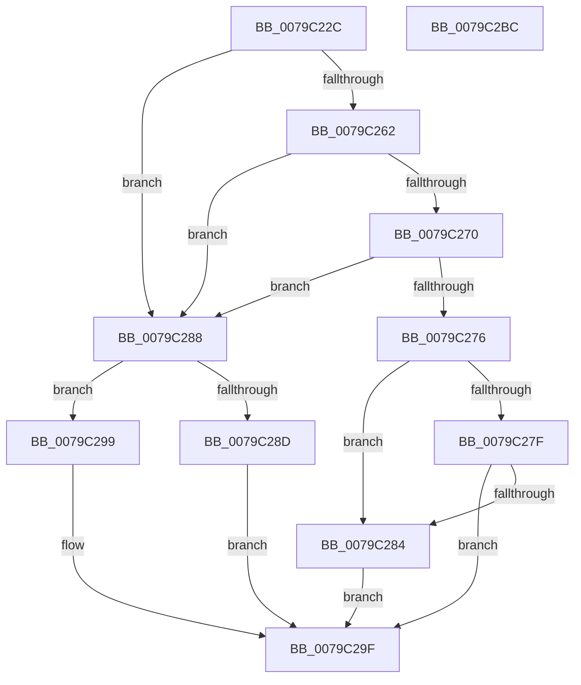

# SepSetTrustedLaunchSigningLevel

- RVA: `0x0079C22C`–`0x0079C2BD` (길이 `145` bytes)
- VA: `0x000000014079C22C`
- 실행 섹션: `PAGE`
- PDB 이름 있음: `예`; PDB Function 태그: `아니요`
- unwind 정보 RVA: `0x0005D7BC`
- 디코드: `46`개 명령, `145/145` bytes 표시
- 미해석 바이트: `0` (있으면 어셈블리에 `.byte`로 보존)

> 이 문서는 커널 이미지의 기계어와 PDB 기호를 분석해 생성했습니다. 4번과 5번은 함수 원형과 자료형을 바이너리 사용 방식에서 추정한 C 해석이며 원본 소스 복구 결과는 아닙니다.

## 1. Dependencies

- 직접 호출 지점: **1**; 고유 호출 대상: **1**
- 직접 호출자로 확인된 함수: **1**
- RIP 상대 이미지 참조: **1**

### Outgoing calls
- `0x0079C267` → [guard_dispatch_icall](../../text/6B/guard_dispatch_icall_function_006BAAD0.md) (function, `0x006BAAD0`)

### Direct callers
- [SeQuerySigningPolicyWorker](../A1/SeQuerySigningPolicyWorker_function_00A13788.md) at `0x00A1393D`
- [SeQuerySigningPolicyWorker](../A1/SeQuerySigningPolicyWorker_function_00A13788.md) at `0x00A13ADD`

### Static image references
- `0x0079C250` → RVA `0x00F04F30` (`.data`; read)

## 2. Other-region calls and transfers

- 다른 실행 섹션으로 향하는 call: **1**
  - `0x0079C267` → [guard_dispatch_icall](../../text/6B/guard_dispatch_icall_function_006BAAD0.md) (`PAGE` → `.text`)
- 별도 외부 분기/꼬리 이동을 확인하지 못했습니다.

## 3. Assembly (complete function range)

```asm
0079C22C  48 8B C4                        mov rax, rsp
0079C22F  48 89 58 08                     mov qword ptr [rax + 8], rbx
0079C233  48 89 68 10                     mov qword ptr [rax + 0x10], rbp
0079C237  48 89 70 18                     mov qword ptr [rax + 0x18], rsi
0079C23B  48 89 78 20                     mov qword ptr [rax + 0x20], rdi
0079C23F  41 56                           push r14
0079C241  48 83 EC 30                     sub rsp, 0x30
0079C245  33 DB                           xor ebx, ebx
0079C247  49 8B F9                        mov rdi, r9
0079C24A  88 58 E8                        mov byte ptr [rax - 0x18], bl
0079C24D  4D 8B F0                        mov r14, r8
0079C250  48 8B 05 D9 8C 76 00            mov rax, qword ptr [rip + 0x768cd9]
0079C257  40 8A EA                        mov bpl, dl
0079C25A  40 8A F1                        mov sil, cl
0079C25D  48 85 C0                        test rax, rax
0079C260  74 26                           je 0x14079c288
0079C262  48 8D 4C 24 20                  lea rcx, [rsp + 0x20]
0079C267  E8 64 E8 F1 FF                  call 0x1406baad0
0079C26C  85 C0                           test eax, eax
0079C26E  78 18                           js 0x14079c288
0079C270  38 5C 24 20                     cmp byte ptr [rsp + 0x20], bl
0079C274  74 12                           je 0x14079c288
0079C276  41 C6 06 03                     mov byte ptr [r14], 3
0079C27A  40 84 ED                        test bpl, bpl
0079C27D  75 05                           jne 0x14079c284
0079C27F  40 84 F6                        test sil, sil
0079C282  74 1B                           je 0x14079c29f
0079C284  B3 03                           mov bl, 3
0079C286  EB 17                           jmp 0x14079c29f
0079C288  40 84 F6                        test sil, sil
0079C28B  75 0C                           jne 0x14079c299
0079C28D  40 84 ED                        test bpl, bpl
0079C290  41 C6 06 01                     mov byte ptr [r14], 1
0079C294  0F 95 C3                        setne bl
0079C297  EB 06                           jmp 0x14079c29f
0079C299  41 88 36                        mov byte ptr [r14], sil
0079C29C  40 8A DE                        mov bl, sil
0079C29F  88 1F                           mov byte ptr [rdi], bl
0079C2A1  48 8B 5C 24 40                  mov rbx, qword ptr [rsp + 0x40]
0079C2A6  48 8B 6C 24 48                  mov rbp, qword ptr [rsp + 0x48]
0079C2AB  48 8B 74 24 50                  mov rsi, qword ptr [rsp + 0x50]
0079C2B0  48 8B 7C 24 58                  mov rdi, qword ptr [rsp + 0x58]
0079C2B5  48 83 C4 30                     add rsp, 0x30
0079C2B9  41 5E                           pop r14
0079C2BB  C3                              ret
0079C2BC  CC                              int3
```

## 4. C-style interpretation (structured pseudocode)

```c
__int64 __fastcall SepSetTrustedLaunchSigningLevel(unsigned __int8 a1, unsigned __int8 a2, __int64 a3, __int64 a4)
{
    __int64 result;
    __int64 v_rbx;
    __int64 v_rsp;
    unsigned __int64 v_stack_m18;
    unsigned __int64 v_stack_p10;
    unsigned __int64 v_stack_p18;
    unsigned __int64 v_stack_p20;
    unsigned __int64 v_stack_p8;

    *(unsigned __int64 *)(v_rsp + 8) = v_rbx;
    *(unsigned __int64 *)(v_rsp + 16) = v_rbp;
    *(unsigned __int64 *)(v_rsp + 24) = v_rsi;
    *(unsigned __int64 *)(v_rsp + 32) = v_rdi;
    v_rsp = (v_rsp) - (48);
    v_rbx = 0;
    *(unsigned __int8 *)(v_rsp - 24) = 0;
    if (*(unsigned __int64 *)(v_rip + 7769305) == 0) goto loc_0079C288;
    result = guard_dispatch_icall(v_stack_m18, a2, a3, a4);
    if (sign_flag) goto loc_0079C288;
    if (v_stack_m18 == 0) goto loc_0079C288;
    *(unsigned __int8 *)(a3) = 3;
    if (a2 != 0) goto loc_0079C284;
    if (a1 == 0) goto loc_0079C29F;
loc_0079C284:
    goto loc_0079C29F;
loc_0079C288:
    if (a1 != 0) goto loc_0079C299;
    *(unsigned __int8 *)(a3) = 1;
    v_rbx = (a2 != 0) ? 1 : 0;
    goto loc_0079C29F;
loc_0079C299:
    *(unsigned __int8 *)(a3) = a1;
loc_0079C29F:
    *(unsigned __int8 *)(a4) = a1;
    v_rsp = (v_rsp) + (48);
    return result;
}
```

## 5. (Beta) C Style

```c
int64_t SepSetTrustedLaunchSigningLevel(uint8_t Arg1, uint8_t Arg2, void *Arg3, void *Arg4)
{
    uint8_t *arg3 = (uint8_t *)Arg3;
    uint8_t *arg4 = (uint8_t *)Arg4;

    int64_t result;
    int64_t local_rbx;
    int64_t local_rsp;
    uint64_t v_stack_m18;
    uint64_t v_stack_p10;
    uint64_t v_stack_p18;
    uint64_t v_stack_p20;
    uint64_t v_stack_p8;

    *(uint64_t *)(local_rsp + 0x8) = local_rbx;
    *(uint64_t *)(local_rsp + 0x10) = local_rbp;
    *(uint64_t *)(local_rsp + 0x18) = local_rsi;
    *(uint64_t *)(local_rsp + 0x20) = local_rdi;
    local_rsp = (local_rsp) - (48);
    local_rbx = 0;
    *(uint8_t *)(local_rsp - 0x18) = 0;
    if (*(uint64_t *)(v_rip + 0x768CD9) == 0) goto loc_0079C288;
    result = guard_dispatch_icall(v_stack_m18, Arg2, Arg3, Arg4);
    if (sign_flag) goto loc_0079C288;
    if (v_stack_m18 == 0) goto loc_0079C288;
    *(uint8_t *)(arg3) = 3;
    if (Arg2 != 0) goto loc_0079C284;
    if (Arg1 == 0) goto loc_0079C29F;
loc_0079C284:
    goto loc_0079C29F;
loc_0079C288:
    if (Arg1 != 0) goto loc_0079C299;
    *(uint8_t *)(arg3) = 1;
    local_rbx = (Arg2 != 0) ? 1 : 0;
    goto loc_0079C29F;
loc_0079C299:
    *(uint8_t *)(arg3) = Arg1;
loc_0079C29F:
    *(uint8_t *)(arg4) = Arg1;
    local_rsp = (local_rsp) + (48);
    return result;
}
```

### 관측된 메모리 오프셋

구조체 형식이 확인되지 않은 접근은 인자 기준의 오프셋으로만 기록했습니다.

| 기준 인자 | 오프셋 표현 | 폭 (bit) | 접근 |
|---|---:|---:|---|
| `Arg3` | `+ 0x0` | `8` | `W` |
| `Arg4` | `+ 0x0` | `8` | `W` |

## 6. Execution-region graph

[열기: 2D/3D 그래프와 함수 탐색 컨트롤 패널](../../../control-panel.html?section=page&rva=0x0079C22C&view=graph)

- 2D 그래프는 위에서 아래로 흐르고, 3D 그래프는 빈 공간을 드래그해 회전합니다. Shift+드래그는 이동, 휠은 확대·축소, 함수 노드 선택은 대상 보고서 이동입니다.

### Static fallback


