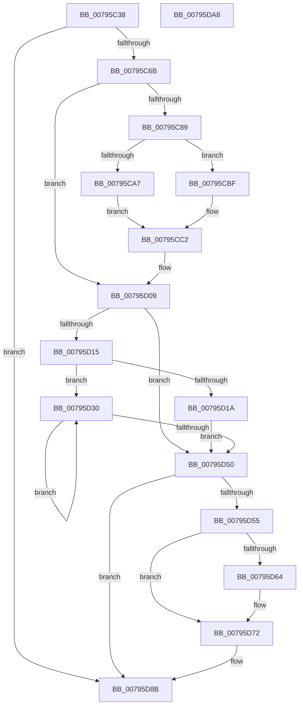

# Xp10BitCopy

- RVA: `0x00795C38`–`0x00795DA9` (길이 `369` bytes)
- VA: `0x0000000140795C38`
- 실행 섹션: `PAGE`
- PDB 이름 있음: `예`; PDB Function 태그: `아니요`
- unwind 정보 RVA: `0x00075C18`
- 디코드: `126`개 명령, `369/369` bytes 표시
- 미해석 바이트: `0` (있으면 어셈블리에 `.byte`로 보존)

> 이 문서는 커널 이미지의 기계어와 PDB 기호를 분석해 생성했습니다. 4번과 5번은 함수 원형과 자료형을 바이너리 사용 방식에서 추정한 C 해석이며 원본 소스 복구 결과는 아닙니다.

## 1. Dependencies

- 직접 호출 지점: **1**; 고유 호출 대상: **1**
- 직접 호출자로 확인된 함수: **1**
- RIP 상대 이미지 참조: **1**

### Outgoing calls
- `0x00795D23` → [memcpy](../../text/6C/memcpy_function_006C6840.md) (function, `0x006C6840`)

### Direct callers
- [Xp10ScatteredCopyBits](Xp10ScatteredCopyBits_function_00799F68.md) at `0x00799FF3`
- [Xp10ScatteredCopyBits](Xp10ScatteredCopyBits_function_00799F68.md) at `0x0079A0AD`

### Static image references
- `0x00795C71` → RVA `0x00034820` (`.rdata`; read)

## 2. Other-region calls and transfers

- 다른 실행 섹션으로 향하는 call: **1**
  - `0x00795D23` → [memcpy](../../text/6C/memcpy_function_006C6840.md) (`PAGE` → `.text`)
- 별도 외부 분기/꼬리 이동을 확인하지 못했습니다.

## 3. Assembly (complete function range)

```asm
00795C38  48 89 5C 24 08                  mov qword ptr [rsp + 8], rbx
00795C3D  48 89 6C 24 10                  mov qword ptr [rsp + 0x10], rbp
00795C42  48 89 74 24 18                  mov qword ptr [rsp + 0x18], rsi
00795C47  57                              push rdi
00795C48  41 54                           push r12
00795C4A  41 55                           push r13
00795C4C  41 56                           push r14
00795C4E  41 57                           push r15
00795C50  48 83 EC 20                     sub rsp, 0x20
00795C54  48 8B 6C 24 70                  mov rbp, qword ptr [rsp + 0x70]
00795C59  49 8B D8                        mov rbx, r8
00795C5C  44 8B FA                        mov r15d, edx
00795C5F  48 8B F9                        mov rdi, rcx
00795C62  48 85 ED                        test rbp, rbp
00795C65  0F 84 20 01 00 00               je 0x140795d8b
00795C6B  41 BB 08 00 00 00               mov r11d, 8
00795C71  4C 8D 2D A8 EB 89 FF            lea r13, [rip - 0x761458]
00795C78  45 8B F3                        mov r14d, r11d
00795C7B  45 8B E1                        mov r12d, r9d
00795C7E  45 2B F1                        sub r14d, r9d
00795C81  85 D2                           test edx, edx
00795C83  0F 84 80 00 00 00               je 0x140795d09
00795C89  45 0F B6 10                     movzx r10d, byte ptr [r8]
00795C8D  41 8B C3                        mov eax, r11d
00795C90  2B C2                           sub eax, edx
00795C92  8B D5                           mov edx, ebp
00795C94  8B C8                           mov ecx, eax
00795C96  48 3B CD                        cmp rcx, rbp
00795C99  41 8A C9                        mov cl, r9b
00795C9C  0F 46 D0                        cmovbe edx, eax
00795C9F  41 D3 EA                        shr r10d, cl
00795CA2  41 3B D6                        cmp edx, r14d
00795CA5  76 18                           jbe 0x140795cbf
00795CA7  48 FF C3                        inc rbx
00795CAA  41 8B CE                        mov ecx, r14d
00795CAD  44 8B CA                        mov r9d, edx
00795CB0  8A 03                           mov al, byte ptr [rbx]
00795CB2  D2 E0                           shl al, cl
00795CB4  0F B6 C0                        movzx eax, al
00795CB7  44 0B D0                        or r10d, eax
00795CBA  45 2B CE                        sub r9d, r14d
00795CBD  EB 03                           jmp 0x140795cc2
00795CBF  44 03 CA                        add r9d, edx
00795CC2  44 8B C2                        mov r8d, edx
00795CC5  45 8D 61 F8                     lea r12d, [r9 - 8]
00795CC9  41 8A 54 95 00                  mov dl, byte ptr [r13 + rdx*4]
00795CCE  41 8B CF                        mov ecx, r15d
00795CD1  8A C2                           mov al, dl
00795CD3  49 2B E8                        sub rbp, r8
00795CD6  D2 E0                           shl al, cl
00795CD8  41 22 D2                        and dl, r10b
00795CDB  F6 D0                           not al
00795CDD  D2 E2                           shl dl, cl
00795CDF  22 07                           and al, byte ptr [rdi]
00795CE1  45 33 FF                        xor r15d, r15d
00795CE4  0A C2                           or al, dl
00795CE6  45 8B F3                        mov r14d, r11d
00795CE9  88 07                           mov byte ptr [rdi], al
00795CEB  48 FF C7                        inc rdi
00795CEE  45 3B CB                        cmp r9d, r11d
00795CF1  48 8D 43 01                     lea rax, [rbx + 1]
00795CF5  45 0F 42 E1                     cmovb r12d, r9d
00795CF9  45 2B F4                        sub r14d, r12d
00795CFC  45 3B CB                        cmp r9d, r11d
00795CFF  45 8B CC                        mov r9d, r12d
00795D02  48 0F 42 C3                     cmovb rax, rbx
00795D06  48 8B D8                        mov rbx, rax
00795D09  48 8B F5                        mov rsi, rbp
00795D0C  48 C1 EE 03                     shr rsi, 3
00795D10  48 85 F6                        test rsi, rsi
00795D13  74 3B                           je 0x140795d50
00795D15  45 3B F9                        cmp r15d, r9d
00795D18  75 16                           jne 0x140795d30
00795D1A  4C 8B C6                        mov r8, rsi
00795D1D  48 8B D3                        mov rdx, rbx
00795D20  48 8B CF                        mov rcx, rdi
00795D23  E8 18 0B F3 FF                  call 0x1406c6840
00795D28  48 03 FE                        add rdi, rsi
00795D2B  48 03 DE                        add rbx, rsi
00795D2E  EB 20                           jmp 0x140795d50
00795D30  8A 13                           mov dl, byte ptr [rbx]
00795D32  41 8A CC                        mov cl, r12b
00795D35  D2 EA                           shr dl, cl
00795D37  48 FF C3                        inc rbx
00795D3A  88 17                           mov byte ptr [rdi], dl
00795D3C  41 8B CE                        mov ecx, r14d
00795D3F  8A 03                           mov al, byte ptr [rbx]
00795D41  D2 E0                           shl al, cl
00795D43  0A C2                           or al, dl
00795D45  88 07                           mov byte ptr [rdi], al
00795D47  48 FF C7                        inc rdi
00795D4A  48 83 EE 01                     sub rsi, 1
00795D4E  75 E0                           jne 0x140795d30
00795D50  83 E5 07                        and ebp, 7
00795D53  76 36                           jbe 0x140795d8b
00795D55  44 0F B6 03                     movzx r8d, byte ptr [rbx]
00795D59  41 8A CC                        mov cl, r12b
00795D5C  41 D3 E8                        shr r8d, cl
00795D5F  41 3B EE                        cmp ebp, r14d
00795D62  76 0E                           jbe 0x140795d72
00795D64  8A 43 01                        mov al, byte ptr [rbx + 1]
00795D67  41 8B CE                        mov ecx, r14d
00795D6A  D2 E0                           shl al, cl
00795D6C  0F B6 C0                        movzx eax, al
00795D6F  44 0B C0                        or r8d, eax
00795D72  41 8A 54 AD 00                  mov dl, byte ptr [r13 + rbp*4]
00795D77  41 8B CF                        mov ecx, r15d
00795D7A  8A C2                           mov al, dl
00795D7C  41 22 D0                        and dl, r8b
00795D7F  D2 E0                           shl al, cl
00795D81  F6 D0                           not al
00795D83  D2 E2                           shl dl, cl
00795D85  22 07                           and al, byte ptr [rdi]
00795D87  0A C2                           or al, dl
00795D89  88 07                           mov byte ptr [rdi], al
00795D8B  48 8B 5C 24 50                  mov rbx, qword ptr [rsp + 0x50]
00795D90  48 8B 6C 24 58                  mov rbp, qword ptr [rsp + 0x58]
00795D95  48 8B 74 24 60                  mov rsi, qword ptr [rsp + 0x60]
00795D9A  48 83 C4 20                     add rsp, 0x20
00795D9E  41 5F                           pop r15
00795DA0  41 5E                           pop r14
00795DA2  41 5D                           pop r13
00795DA4  41 5C                           pop r12
00795DA6  5F                              pop rdi
00795DA7  C3                              ret
00795DA8  CC                              int3
```

## 4. C-style interpretation (structured pseudocode)

```c
__int64 __fastcall Xp10BitCopy(__int64 a1, int a2, __int64 a3, int a4, __int64 a5)
{
    __int64 result;
    __int64 v_r10;
    __int64 v_r12;
    __int64 v_r14;
    __int64 v_r15;
    __int64 v_rbp;
    __int64 v_rbx;
    __int64 v_rdi;
    __int64 v_rsi;
    __int64 v_rsp;
    unsigned __int64 v_stack_p10;
    unsigned __int64 v_stack_p18;
    unsigned __int64 v_stack_p8;

    v_stack_p8 = v_rbx;
    v_stack_p10 = v_rbp;
    v_stack_p18 = v_rsi;
    v_rsp = (v_rsp) - (32);
    if (a5 == 0) goto loc_00795D8B;
    v_r14 = (unsigned int)((8) - (a4));
    if (a2 == 0) goto loc_00795D09;
    result = (unsigned int)((8) - (a2));
    a2 = (unsigned int)((unsigned int)(a5));
    if (((unsigned int)((unsigned int)(result))) <= a5) { a2 = (unsigned int)(result); }
    v_r10 = (unsigned int)((*(unsigned __int8 *)(a3)) >> ((unsigned __int8)((unsigned __int8)(a4))));
    if (a2 <= ((unsigned int)(v_r14))) goto loc_00795CBF;
    v_rbx = (a3) + 1;
    result = (unsigned __int8)((*(unsigned __int8 *)(v_rbx)) << ((unsigned __int8)((unsigned int)((unsigned int)(v_r14)))));
    v_r10 = (unsigned int)((v_r10) | ((unsigned int)((unsigned __int8)(result))));
    a4 = (unsigned int)(((unsigned int)(a2)) - ((unsigned int)(v_r14)));
    goto loc_00795CC2;
loc_00795CBF:
    a4 = (unsigned int)((a4) + (a2));
loc_00795CC2:
    v_rbp = (a5) - ((unsigned int)(a2));
    result = (unsigned __int8)(((unsigned __int8)(*(unsigned __int8 *)(v_rip - 7738456 + a2 * 4))) << ((unsigned __int8)((unsigned int)((unsigned int)((unsigned int)(a2))))));
    a2 = (unsigned __int8)((*(unsigned __int8 *)(v_rip - 7738456 + a2 * 4)) & ((unsigned __int8)(v_r10)));
    result = (unsigned __int8)(~(result));
    a2 = (unsigned __int8)((a2) << ((unsigned __int8)((unsigned int)((unsigned int)((unsigned int)(a2))))));
    result = (unsigned __int8)((result) & (*(unsigned __int8 *)(a1)));
    v_r15 = 0;
    result = (unsigned __int8)((result) | ((unsigned __int8)(a2)));
    *(unsigned __int8 *)(a1) = (unsigned __int8)(result);
    v_rdi = (a1) + 1;
    v_r12 = a4 - 8;
    if (a4 < 8) { v_r12 = a4; }
    v_r14 = (unsigned int)((8) - ((unsigned int)(v_r12)));
    result = v_rbx + 1;
    if (a4 < 8) { result = v_rbx; }
loc_00795D09:
    v_rsi = (v_rbp) >> (3);
    if (v_rsi == 0) goto loc_00795D50;
    if (0 != ((unsigned int)((unsigned int)((unsigned int)(v_r12))))) goto loc_00795D30;
    result = memcpy(v_rdi, result, v_rsi, (unsigned int)((unsigned int)(v_r12)));
    v_rdi = (v_rdi) + (v_rsi);
    v_rbx = (result) + (v_rsi);
    goto loc_00795D50;
loc_00795D30:
    a2 = (unsigned __int8)((*(unsigned __int8 *)(v_rbx)) >> ((unsigned __int8)((unsigned __int8)(v_r12))));
    v_rbx = (v_rbx) + 1;
    *(unsigned __int8 *)(v_rdi) = (unsigned __int8)(a2);
    result = (unsigned __int8)((*(unsigned __int8 *)(v_rbx)) << ((unsigned __int8)((unsigned int)((unsigned int)(v_r14)))));
    result = (unsigned __int8)((result) | ((unsigned __int8)(a2)));
    *(unsigned __int8 *)(v_rdi) = (unsigned __int8)(result);
    v_rdi = (v_rdi) + 1;
    v_rsi = (v_rsi) - (1);
    if (condition_is_not_equal) goto loc_00795D30;
loc_00795D50:
    v_rbp = (unsigned int)((v_rbp) & (7));
    if (condition_is_below_or_equal) goto loc_00795D8B;
    a3 = (unsigned int)((*(unsigned __int8 *)(v_rbx)) >> ((unsigned __int8)((unsigned __int8)(v_r12))));
    if (((unsigned int)(v_rbp)) >= = ((unsigned int)(v_r14))) {
        result = *(unsigned __int8 *)(v_rbx + 1);
        a1 = (unsigned int)(v_r14);
        result = (unsigned __int8)((result) << ((unsigned __int8)(a1)));
        result = (unsigned __int8)(result);
        a3 = (unsigned int)((a3) | ((unsigned int)(result)));
    }
    a2 = (unsigned __int8)((*(unsigned __int8 *)(v_rip - 7738456 + v_rbp * 4)) & ((unsigned __int8)(a3)));
    result = (unsigned __int8)(((unsigned __int8)(*(unsigned __int8 *)(v_rip - 7738456 + v_rbp * 4))) << (0));
    result = (unsigned __int8)(~(result));
    a2 = (unsigned __int8)((a2) << (0));
    result = (unsigned __int8)((result) & (*(unsigned __int8 *)(v_rdi)));
    result = (unsigned __int8)((result) | ((unsigned __int8)(a2)));
    *(unsigned __int8 *)(v_rdi) = (unsigned __int8)(result);
loc_00795D8B:
    v_rsp = (v_rsp) + (32);
    return result;
}
```

## 5. (Beta) C Style

```c
int64_t Xp10BitCopy(void *Arg1, int32_t Arg2, void *Arg3, int32_t Arg4, int64_t Arg5)
{
    uint8_t *arg1 = (uint8_t *)Arg1;
    uint8_t *arg3 = (uint8_t *)Arg3;

    int64_t result;
    int64_t local_r10;
    int64_t local_r12;
    int64_t local_r14;
    int64_t local_r15;
    int64_t local_rbp;
    int64_t local_rbx;
    int64_t local_rdi;
    int64_t local_rsi;
    int64_t local_rsp;
    uint64_t v_stack_p10;
    uint64_t v_stack_p18;
    uint64_t v_stack_p8;

    v_stack_p8 = local_rbx;
    v_stack_p10 = local_rbp;
    v_stack_p18 = local_rsi;
    local_rsp = (local_rsp) - (32);
    if (Arg5 == 0) goto loc_00795D8B;
    local_r14 = (uint32_t)((8) - (Arg4));
    if (Arg2 == 0) goto loc_00795D09;
    result = (uint32_t)((8) - (Arg2));
    Arg2 = (uint32_t)((uint32_t)(Arg5));
    if (((uint32_t)((uint32_t)(result))) <= Arg5) { Arg2 = (uint32_t)(result); }
    local_r10 = (uint32_t)((*(uint8_t *)(arg3)) >> ((uint8_t)((uint8_t)(Arg4))));
    if (Arg2 <= ((uint32_t)(local_r14))) goto loc_00795CBF;
    local_rbx = (Arg3) + 1;
    result = (uint8_t)((*(uint8_t *)(local_rbx)) << ((uint8_t)((uint32_t)((uint32_t)(local_r14)))));
    local_r10 = (uint32_t)((local_r10) | ((uint32_t)((uint8_t)(result))));
    Arg4 = (uint32_t)(((uint32_t)(Arg2)) - ((uint32_t)(local_r14)));
    goto loc_00795CC2;
loc_00795CBF:
    Arg4 = (uint32_t)((Arg4) + (Arg2));
loc_00795CC2:
    local_rbp = (Arg5) - ((uint32_t)(Arg2));
    result = (uint8_t)(((uint8_t)(*(uint8_t *)(v_rip - 0x761458 + Arg2 * 4))) << ((uint8_t)((uint32_t)((uint32_t)((uint32_t)(Arg2))))));
    Arg2 = (uint8_t)((*(uint8_t *)(v_rip - 0x761458 + Arg2 * 4)) & ((uint8_t)(local_r10)));
    result = (uint8_t)(~(result));
    Arg2 = (uint8_t)((Arg2) << ((uint8_t)((uint32_t)((uint32_t)((uint32_t)(Arg2))))));
    result = (uint8_t)((result) & (*(uint8_t *)(arg1)));
    local_r15 = 0;
    result = (uint8_t)((result) | ((uint8_t)(Arg2)));
    *(uint8_t *)(arg1) = (uint8_t)(result);
    local_rdi = (Arg1) + 1;
    local_r12 = Arg4 - 8;
    if (Arg4 < 8) { local_r12 = Arg4; }
    local_r14 = (uint32_t)((8) - ((uint32_t)(local_r12)));
    result = local_rbx + 1;
    if (Arg4 < 8) { result = local_rbx; }
loc_00795D09:
    local_rsi = (local_rbp) >> (3);
    if (local_rsi == 0) goto loc_00795D50;
    if (0 != ((uint32_t)((uint32_t)((uint32_t)(local_r12))))) goto loc_00795D30;
    result = memcpy(local_rdi, result, local_rsi, (uint32_t)((uint32_t)(local_r12)));
    local_rdi = (local_rdi) + (local_rsi);
    local_rbx = (result) + (local_rsi);
    goto loc_00795D50;
loc_00795D30:
    Arg2 = (uint8_t)((*(uint8_t *)(local_rbx)) >> ((uint8_t)((uint8_t)(local_r12))));
    local_rbx = (local_rbx) + 1;
    *(uint8_t *)(local_rdi) = (uint8_t)(Arg2);
    result = (uint8_t)((*(uint8_t *)(local_rbx)) << ((uint8_t)((uint32_t)((uint32_t)(local_r14)))));
    result = (uint8_t)((result) | ((uint8_t)(Arg2)));
    *(uint8_t *)(local_rdi) = (uint8_t)(result);
    local_rdi = (local_rdi) + 1;
    local_rsi = (local_rsi) - (1);
    if (condition_is_not_equal) goto loc_00795D30;
loc_00795D50:
    local_rbp = (uint32_t)((local_rbp) & (7));
    if (condition_is_below_or_equal) goto loc_00795D8B;
    Arg3 = (uint32_t)((*(uint8_t *)(local_rbx)) >> ((uint8_t)((uint8_t)(local_r12))));
    if (((uint32_t)(local_rbp)) >= = ((uint32_t)(local_r14))) {
        result = *(uint8_t *)(local_rbx + 0x1);
        Arg1 = (uint32_t)(local_r14);
        result = (uint8_t)((result) << ((uint8_t)(Arg1)));
        result = (uint8_t)(result);
        Arg3 = (uint32_t)((Arg3) | ((uint32_t)(result)));
    }
    Arg2 = (uint8_t)((*(uint8_t *)(v_rip - 0x761458 + local_rbp * 4)) & ((uint8_t)(Arg3)));
    result = (uint8_t)(((uint8_t)(*(uint8_t *)(v_rip - 0x761458 + local_rbp * 4))) << (0));
    result = (uint8_t)(~(result));
    Arg2 = (uint8_t)((Arg2) << (0));
    result = (uint8_t)((result) & (*(uint8_t *)(local_rdi)));
    result = (uint8_t)((result) | ((uint8_t)(Arg2)));
    *(uint8_t *)(local_rdi) = (uint8_t)(result);
loc_00795D8B:
    local_rsp = (local_rsp) + (32);
    return result;
}
```

### 관측된 메모리 오프셋

구조체 형식이 확인되지 않은 접근은 인자 기준의 오프셋으로만 기록했습니다.

| 기준 인자 | 오프셋 표현 | 폭 (bit) | 접근 |
|---|---:|---:|---|
| `Arg1` | `+ 0x0` | `8` | `R` |
| `Arg1` | `+ 0x0` | `8` | `W` |
| `Arg3` | `+ 0x0` | `8` | `R` |

## 6. Execution-region graph

[열기: 2D/3D 그래프와 함수 탐색 컨트롤 패널](../../../control-panel.html?section=page&rva=0x00795C38&view=graph)

- 2D 그래프는 위에서 아래로 흐르고, 3D 그래프는 빈 공간을 드래그해 회전합니다. Shift+드래그는 이동, 휠은 확대·축소, 함수 노드 선택은 대상 보고서 이동입니다.

### Static fallback


