# Xp10BuildAndWriteHuffmanEncodings

- RVA: `0x00795DB0`–`0x00796176` (길이 `966` bytes)
- VA: `0x0000000140795DB0`
- 실행 섹션: `PAGE`
- PDB 이름 있음: `예`; PDB Function 태그: `아니요`
- unwind 정보 RVA: `0x000C5198`
- 디코드: `274`개 명령, `966/966` bytes 표시
- 미해석 바이트: `0` (있으면 어셈블리에 `.byte`로 보존)

> 이 문서는 커널 이미지의 기계어와 PDB 기호를 분석해 생성했습니다. 4번과 5번은 함수 원형과 자료형을 바이너리 사용 방식에서 추정한 C 해석이며 원본 소스 복구 결과는 아닙니다.

## 1. Dependencies

- 직접 호출 지점: **3**; 고유 호출 대상: **3**
- 직접 호출자로 확인된 함수: **1**
- RIP 상대 이미지 참조: **1**

### Outgoing calls
- `0x00795E5A` → [Xp10BuildHuffmanEncodings](Xp10BuildHuffmanEncodings_function_00796EA4.md) (function, `0x00796EA4`)
- `0x00795F2F` → [Xp10BuildAndWriteHuffmanTables](Xp10BuildAndWriteHuffmanTables_function_0079617C.md) (function, `0x0079617C`)
- `0x007960E9` → [memset](../../text/6C/memset_function_006C6C40.md) (function, `0x006C6C40`)

### Direct callers
- [Xp10ExecuteHuffmanEncode](Xp10ExecuteHuffmanEncode_function_00798100.md) at `0x00798197`
- [Xp10ExecuteHuffmanEncode](Xp10ExecuteHuffmanEncode_function_00798100.md) at `0x007981DE`

### Static image references
- `0x00795E67` → RVA `0x00000000` (`image boundary/outside`; read)

## 2. Other-region calls and transfers

- 다른 실행 섹션으로 향하는 call: **1**
  - `0x007960E9` → [memset](../../text/6C/memset_function_006C6C40.md) (`PAGE` → `.text`)
- 별도 외부 분기/꼬리 이동을 확인하지 못했습니다.

## 3. Assembly (complete function range)

```asm
00795DB0  48 8B C4                        mov rax, rsp
00795DB3  48 89 58 08                     mov qword ptr [rax + 8], rbx
00795DB7  44 89 48 20                     mov dword ptr [rax + 0x20], r9d
00795DBB  55                              push rbp
00795DBC  56                              push rsi
00795DBD  57                              push rdi
00795DBE  41 54                           push r12
00795DC0  41 55                           push r13
00795DC2  41 56                           push r14
00795DC4  41 57                           push r15
00795DC6  48 83 EC 50                     sub rsp, 0x50
00795DCA  83 60 20 00                     and dword ptr [rax + 0x20], 0
00795DCE  4C 8B E9                        mov r13, rcx
00795DD1  45 0F BD C8                     bsr r9d, r8d
00795DD5  BB 01 00 00 00                  mov ebx, 1
00795DDA  4C 8B D2                        mov r10, rdx
00795DDD  33 D2                           xor edx, edx
00795DDF  44 89 48 18                     mov dword ptr [rax + 0x18], r9d
00795DE3  41 8B F0                        mov esi, r8d
00795DE6  45 8D 59 01                     lea r11d, [r9 + 1]
00795DEA  41 8B CB                        mov ecx, r11d
00795DED  44 89 5C 24 30                  mov dword ptr [rsp + 0x30], r11d
00795DF2  D3 E3                           shl ebx, cl
00795DF4  33 C9                           xor ecx, ecx
00795DF6  41 2B D8                        sub ebx, r8d
00795DF9  74 14                           je 0x140795e0f
00795DFB  49 8B C2                        mov rax, r10
00795DFE  44 8B C3                        mov r8d, ebx
00795E01  8B CB                           mov ecx, ebx
00795E03  03 10                           add edx, dword ptr [rax]
00795E05  48 8D 40 04                     lea rax, [rax + 4]
00795E09  49 83 E8 01                     sub r8, 1
00795E0D  75 F4                           jne 0x140795e03
00795E0F  41 8B E9                        mov ebp, r9d
00795E12  45 33 C0                        xor r8d, r8d
00795E15  0F AF EA                        imul ebp, edx
00795E18  3B CE                           cmp ecx, esi
00795E1A  73 19                           jae 0x140795e35
00795E1C  8B C1                           mov eax, ecx
00795E1E  49 8D 14 82                     lea rdx, [r10 + rax*4]
00795E22  8B C6                           mov eax, esi
00795E24  2B C1                           sub eax, ecx
00795E26  8B C8                           mov ecx, eax
00795E28  44 03 02                        add r8d, dword ptr [rdx]
00795E2B  48 8D 52 04                     lea rdx, [rdx + 4]
00795E2F  48 83 E9 01                     sub rcx, 1
00795E33  75 F3                           jne 0x140795e28
00795E35  48 8B 8C 24 B0 00 00 00         mov rcx, qword ptr [rsp + 0xb0]
00795E3D  41 8B C3                        mov eax, r11d
00795E40  41 0F AF C0                     imul eax, r8d
00795E44  41 B9 1B 00 00 00               mov r9d, 0x1b
00795E4A  48 89 4C 24 20                  mov qword ptr [rsp + 0x20], rcx
00795E4F  44 8B C6                        mov r8d, esi
00795E52  49 8B D2                        mov rdx, r10
00795E55  49 8B CD                        mov rcx, r13
00795E58  03 E8                           add ebp, eax
00795E5A  E8 45 10 00 00                  call 0x140796ea4
00795E5F  4C 8B A4 24 B8 00 00 00         mov r12, qword ptr [rsp + 0xb8]
00795E67  4C 8D 1D 92 A1 86 FF            lea r11, [rip - 0x795e6e]
00795E6E  44 8B F0                        mov r14d, eax
00795E71  BF 02 00 00 00                  mov edi, 2
00795E76  44 8B CF                        mov r9d, edi
00795E79  45 8B 7C 24 08                  mov r15d, dword ptr [r12 + 8]
00795E7E  4D 8B 04 24                     mov r8, qword ptr [r12]
00795E82  44 8D 57 06                     lea r10d, [rdi + 6]
00795E86  41 8B C7                        mov eax, r15d
00795E89  41 8B CF                        mov ecx, r15d
00795E8C  48 C1 E8 03                     shr rax, 3
00795E90  83 E1 07                        and ecx, 7
00795E93  4C 03 C0                        add r8, rax
00795E96  48 89 44 24 40                  mov qword ptr [rsp + 0x40], rax
00795E9B  41 8B 44 24 0C                  mov eax, dword ptr [r12 + 0xc]
00795EA0  41 8D 57 02                     lea edx, [r15 + 2]
00795EA4  44 2B D1                        sub r10d, ecx
00795EA7  89 54 24 38                     mov dword ptr [rsp + 0x38], edx
00795EAB  44 89 54 24 3C                  mov dword ptr [rsp + 0x3c], r10d
00795EB0  3B D0                           cmp edx, eax
00795EB2  76 08                           jbe 0x140795ebc
00795EB4  44 8B C8                        mov r9d, eax
00795EB7  45 2B CF                        sub r9d, r15d
00795EBA  74 62                           je 0x140795f1e
00795EBC  45 3B D1                        cmp r10d, r9d
00795EBF  41 8B C2                        mov eax, r10d
00795EC2  41 0F 43 C1                     cmovae eax, r9d
00795EC6  8B D0                           mov edx, eax
00795EC8  41 8A 84 83 20 48 03 00         mov al, byte ptr [r11 + rax*4 + 0x34820]
00795ED0  40 22 C7                        and al, dil
00795ED3  D2 E0                           shl al, cl
00795ED5  41 8B CA                        mov ecx, r10d
00795ED8  41 08 00                        or byte ptr [r8], al
00795EDB  41 8B C1                        mov eax, r9d
00795EDE  2B C2                           sub eax, edx
00795EE0  49 FF C0                        inc r8
00795EE3  8B D7                           mov edx, edi
00795EE5  D3 EA                           shr edx, cl
00795EE7  83 F8 08                        cmp eax, 8
00795EEA  72 18                           jb 0x140795f04
00795EEC  8B C8                           mov ecx, eax
00795EEE  48 C1 E9 03                     shr rcx, 3
00795EF2  41 88 10                        mov byte ptr [r8], dl
00795EF5  83 C0 F8                        add eax, -8
00795EF8  C1 EA 08                        shr edx, 8
00795EFB  49 FF C0                        inc r8
00795EFE  48 83 E9 01                     sub rcx, 1
00795F02  75 EE                           jne 0x140795ef2
00795F04  85 C0                           test eax, eax
00795F06  74 0D                           je 0x140795f15
00795F08  41 8A 84 83 20 48 03 00         mov al, byte ptr [r11 + rax*4 + 0x34820]
00795F10  22 C2                           and al, dl
00795F12  41 08 00                        or byte ptr [r8], al
00795F15  43 8D 04 0F                     lea eax, [r15 + r9]
00795F19  41 89 44 24 08                  mov dword ptr [r12 + 8], eax
00795F1E  48 8B 94 24 B0 00 00 00         mov rdx, qword ptr [rsp + 0xb0]
00795F26  4D 8B CC                        mov r9, r12
00795F29  44 8B C6                        mov r8d, esi
00795F2C  49 8B CD                        mov rcx, r13
00795F2F  E8 48 02 00 00                  call 0x14079617c
00795F34  85 C0                           test eax, eax
00795F36  0F 88 21 02 00 00               js 0x14079615d
00795F3C  41 8B 44 24 08                  mov eax, dword ptr [r12 + 8]
00795F41  44 8D 6D 02                     lea r13d, [rbp + 2]
00795F45  41 2B C7                        sub eax, r15d
00795F48  44 89 AC 24 A8 00 00 00         mov dword ptr [rsp + 0xa8], r13d
00795F50  44 03 F0                        add r14d, eax
00795F53  89 44 24 34                     mov dword ptr [rsp + 0x34], eax
00795F57  45 3B EE                        cmp r13d, r14d
00795F5A  0F 87 ED 01 00 00               ja 0x14079614d
00795F60  45 33 C0                        xor r8d, r8d
00795F63  85 DB                           test ebx, ebx
00795F65  0F 84 9B 00 00 00               je 0x140796006
00795F6B  8B AC 24 A0 00 00 00            mov ebp, dword ptr [rsp + 0xa0]
00795F72  4C 8D 2D 87 A0 86 FF            lea r13, [rip - 0x795f79]
00795F79  4C 8B B4 24 B0 00 00 00         mov r14, qword ptr [rsp + 0xb0]
00795F81  44 8B D5                        mov r10d, ebp
00795F84  41 83 E2 1F                     and r10d, 0x1f
00795F88  33 D2                           xor edx, edx
00795F8A  44 8B CD                        mov r9d, ebp
00795F8D  45 8B D8                        mov r11d, r8d
00795F90  83 FD 08                        cmp ebp, 8
00795F93  76 2B                           jbe 0x140795fc0
00795F95  44 8D 65 F7                     lea r12d, [rbp - 9]
00795F99  41 C1 EC 03                     shr r12d, 3
00795F9D  41 FF C4                        inc r12d
00795FA0  41 0F B6 CB                     movzx ecx, r11b
00795FA4  41 83 C1 F8                     add r9d, -8
00795FA8  C1 E2 08                        shl edx, 8
00795FAB  41 C1 EB 08                     shr r11d, 8
00795FAF  42 0F B6 84 29 50 48 03 00      movzx eax, byte ptr [rcx + r13 + 0x34850]
00795FB8  0B D0                           or edx, eax
00795FBA  49 83 EC 01                     sub r12, 1
00795FBE  75 E0                           jne 0x140795fa0
00795FC0  45 85 C9                        test r9d, r9d
00795FC3  74 1C                           je 0x140795fe1
00795FC5  41 0F B6 CB                     movzx ecx, r11b
00795FC9  C1 E2 08                        shl edx, 8
00795FCC  42 0F B6 84 29 50 48 03 00      movzx eax, byte ptr [rcx + r13 + 0x34850]
00795FD5  B9 08 00 00 00                  mov ecx, 8
00795FDA  41 2B C9                        sub ecx, r9d
00795FDD  0B D0                           or edx, eax
00795FDF  D3 EA                           shr edx, cl
00795FE1  C1 E2 05                        shl edx, 5
00795FE4  41 FF C0                        inc r8d
00795FE7  41 0B D2                        or edx, r10d
00795FEA  41 89 16                        mov dword ptr [r14], edx
00795FED  49 83 C6 04                     add r14, 4
00795FF1  44 3B C3                        cmp r8d, ebx
00795FF4  72 92                           jb 0x140795f88
00795FF6  4C 8B A4 24 B8 00 00 00         mov r12, qword ptr [rsp + 0xb8]
00795FFE  44 8B AC 24 A8 00 00 00         mov r13d, dword ptr [rsp + 0xa8]
00796006  44 3B C6                        cmp r8d, esi
00796009  0F 83 9E 00 00 00               jae 0x1407960ad
0079600F  48 8B 8C 24 B0 00 00 00         mov rcx, qword ptr [rsp + 0xb0]
00796017  4C 8D 2D E2 9F 86 FF            lea r13, [rip - 0x79601e]
0079601E  44 8B 64 24 30                  mov r12d, dword ptr [rsp + 0x30]
00796023  41 8B EC                        mov ebp, r12d
00796026  83 E5 1F                        and ebp, 0x1f
00796029  4E 8D 1C 81                     lea r11, [rcx + r8*4]
0079602D  33 D2                           xor edx, edx
0079602F  45 8D 14 18                     lea r10d, [r8 + rbx]
00796033  45 8B CC                        mov r9d, r12d
00796036  41 83 FC 08                     cmp r12d, 8
0079603A  76 2C                           jbe 0x140796068
0079603C  45 8D 74 24 F7                  lea r14d, [r12 - 9]
00796041  41 C1 EE 03                     shr r14d, 3
00796045  41 FF C6                        inc r14d
00796048  41 0F B6 CA                     movzx ecx, r10b
0079604C  41 83 C1 F8                     add r9d, -8
00796050  C1 E2 08                        shl edx, 8
00796053  41 C1 EA 08                     shr r10d, 8
00796057  42 0F B6 84 29 50 48 03 00      movzx eax, byte ptr [rcx + r13 + 0x34850]
00796060  0B D0                           or edx, eax
00796062  49 83 EE 01                     sub r14, 1
00796066  75 E0                           jne 0x140796048
00796068  45 85 C9                        test r9d, r9d
0079606B  74 1C                           je 0x140796089
0079606D  41 0F B6 CA                     movzx ecx, r10b
00796071  C1 E2 08                        shl edx, 8
00796074  42 0F B6 84 29 50 48 03 00      movzx eax, byte ptr [rcx + r13 + 0x34850]
0079607D  B9 08 00 00 00                  mov ecx, 8
00796082  41 2B C9                        sub ecx, r9d
00796085  0B D0                           or edx, eax
00796087  D3 EA                           shr edx, cl
00796089  C1 E2 05                        shl edx, 5
0079608C  41 FF C0                        inc r8d
0079608F  0B D5                           or edx, ebp
00796091  41 89 13                        mov dword ptr [r11], edx
00796094  49 83 C3 04                     add r11, 4
00796098  44 3B C6                        cmp r8d, esi
0079609B  72 90                           jb 0x14079602d
0079609D  4C 8B A4 24 B8 00 00 00         mov r12, qword ptr [rsp + 0xb8]
007960A5  44 8B AC 24 A8 00 00 00         mov r13d, dword ptr [rsp + 0xa8]
007960AD  49 8B 14 24                     mov rdx, qword ptr [r12]
007960B1  41 8D 4F 07                     lea ecx, [r15 + 7]
007960B5  44 8B 44 24 34                  mov r8d, dword ptr [rsp + 0x34]
007960BA  48 8D 35 3F 9F 86 FF            lea rsi, [rip - 0x7960c1]
007960C1  48 8B 5C 24 40                  mov rbx, qword ptr [rsp + 0x40]
007960C6  49 8B C7                        mov rax, r15
007960C9  48 03 DA                        add rbx, rdx
007960CC  48 C1 E9 03                     shr rcx, 3
007960D0  83 E0 07                        and eax, 7
007960D3  41 83 C0 07                     add r8d, 7
007960D7  48 03 CA                        add rcx, rdx
007960DA  49 C1 E8 03                     shr r8, 3
007960DE  33 D2                           xor edx, edx
007960E0  8A 84 86 20 48 03 00            mov al, byte ptr [rsi + rax*4 + 0x34820]
007960E7  20 03                           and byte ptr [rbx], al
007960E9  E8 52 0B F3 FF                  call 0x1406c6c40
007960EE  41 8B 44 24 0C                  mov eax, dword ptr [r12 + 0xc]
007960F3  45 89 7C 24 08                  mov dword ptr [r12 + 8], r15d
007960F8  39 44 24 38                     cmp dword ptr [rsp + 0x38], eax
007960FC  76 07                           jbe 0x140796105
007960FE  8B F8                           mov edi, eax
00796100  41 2B FF                        sub edi, r15d
00796103  74 4B                           je 0x140796150
00796105  8B 4C 24 3C                     mov ecx, dword ptr [rsp + 0x3c]
00796109  8B C7                           mov eax, edi
0079610B  3B CF                           cmp ecx, edi
0079610D  0F 43 CF                        cmovae ecx, edi
00796110  33 D2                           xor edx, edx
00796112  2B C1                           sub eax, ecx
00796114  48 FF C3                        inc rbx
00796117  83 F8 08                        cmp eax, 8
0079611A  72 17                           jb 0x140796133
0079611C  8B C8                           mov ecx, eax
0079611E  48 C1 E9 03                     shr rcx, 3
00796122  88 13                           mov byte ptr [rbx], dl
00796124  83 C0 F8                        add eax, -8
00796127  C1 EA 08                        shr edx, 8
0079612A  48 FF C3                        inc rbx
0079612D  48 83 E9 01                     sub rcx, 1
00796131  75 EF                           jne 0x140796122
00796133  85 C0                           test eax, eax
00796135  74 0B                           je 0x140796142
00796137  8A 84 86 20 48 03 00            mov al, byte ptr [rsi + rax*4 + 0x34820]
0079613E  22 C2                           and al, dl
00796140  08 03                           or byte ptr [rbx], al
00796142  42 8D 04 3F                     lea eax, [rdi + r15]
00796146  41 89 44 24 08                  mov dword ptr [r12 + 8], eax
0079614B  EB 03                           jmp 0x140796150
0079614D  45 8B EE                        mov r13d, r14d
00796150  48 8B 84 24 C0 00 00 00         mov rax, qword ptr [rsp + 0xc0]
00796158  44 89 28                        mov dword ptr [rax], r13d
0079615B  33 C0                           xor eax, eax
0079615D  48 8B 9C 24 90 00 00 00         mov rbx, qword ptr [rsp + 0x90]
00796165  48 83 C4 50                     add rsp, 0x50
00796169  41 5F                           pop r15
0079616B  41 5E                           pop r14
0079616D  41 5D                           pop r13
0079616F  41 5C                           pop r12
00796171  5F                              pop rdi
00796172  5E                              pop rsi
00796173  5D                              pop rbp
00796174  C3                              ret
00796175  CC                              int3
```

## 4. C-style interpretation (structured pseudocode)

```c
__int64 __fastcall Xp10BuildAndWriteHuffmanEncodings(__int64 a1, __int64 a2, int a3, int a4, __int64 a5, __int64 a6, __int64 a7)
{
    __int64 result;
    __int64 v_r10;
    __int64 v_r11;
    __int64 v_r12;
    __int64 v_r14;
    __int64 v_rbp;
    __int64 v_rbx;
    __int64 v_rdi;
    __int64 v_rsp;
    unsigned __int64 v_stack_m48;
    unsigned int v_stack_m4C;
    unsigned int v_stack_m50;
    unsigned int v_stack_m54;
    unsigned int v_stack_m58;
    unsigned __int64 v_stack_m68;
    unsigned int v_stack_p18;
    unsigned int v_stack_p20;
    unsigned __int64 v_stack_p8;

    *(unsigned __int64 *)(v_rsp + 8) = v_rbx;
    *(unsigned int *)(v_rsp + 32) = a4;
    v_rsp = (v_rsp) - (80);
    a2 = 0;
    *(unsigned int *)(v_rsp + 24) = a4;
    v_stack_m58 = (unsigned int)(a4 + 1);
    v_rbx = (unsigned int)((1) << ((unsigned __int8)((unsigned int)((unsigned int)(a4 + 1)))));
    a1 = 0;
    v_rbx = (unsigned int)((v_rbx) - (a3));
    if (condition_is_equal) goto loc_00795E0F;
loc_00795E03:
    a2 = (unsigned int)((a2) + (*(unsigned int *)(0)));
    a3 = ((unsigned int)((unsigned int)(v_rbx))) - (1);
    if (condition_is_not_equal) goto loc_00795E03;
loc_00795E0F:
    a3 = 0;
    v_rbp = (unsigned int)(((unsigned int)(a4)) * ((unsigned int)(a2)));
    if (((unsigned int)((unsigned int)((unsigned int)(v_rbx)))) >= ((unsigned int)((unsigned int)(a3)))) goto loc_00795E35;
    result = (unsigned int)(((unsigned int)((unsigned int)((unsigned int)(a3)))) - ((unsigned int)((unsigned int)((unsigned int)(v_rbx)))));
loc_00795E28:
    a3 = (unsigned int)((a3) + (*(unsigned int *)(a2 + (unsigned int)((unsigned int)((unsigned int)((unsigned int)(v_rbx)))) * 4)));
    a1 = ((unsigned int)((unsigned int)(result))) - (1);
    if (condition_is_not_equal) goto loc_00795E28;
loc_00795E35:
    result = (unsigned int)(((unsigned int)((unsigned int)(a4 + 1))) * (a3));
    v_stack_m68 = a5;
    v_rbp = (unsigned int)((v_rbp) + ((unsigned int)(result)));
    result = Xp10BuildHuffmanEncodings(a1, a2, (unsigned int)((unsigned int)((unsigned int)(a3))), 27);
    result = ((unsigned int)((unsigned int)((unsigned int)(*(unsigned int *)(a6 + 8))))) >> (3);
    a1 = (unsigned int)(((unsigned int)((unsigned int)((unsigned int)(*(unsigned int *)(a6 + 8))))) & (7));
    a3 = (*(unsigned __int64 *)(a6)) + (result);
    v_stack_m48 = result;
    v_r10 = (unsigned int)((2 + 6) - ((unsigned int)(a1)));
    v_stack_m50 = (unsigned int)((unsigned int)(*(unsigned int *)(a6 + 8)) + 2);
    v_stack_m4C = (unsigned int)(v_r10);
    if (((unsigned int)((unsigned int)(*(unsigned int *)(a6 + 8)) + 2)) <= ((unsigned int)((unsigned int)(*(unsigned int *)(a6 + 12))))) goto loc_00795EBC;
    a4 = (unsigned int)(((unsigned int)((unsigned int)((unsigned int)(*(unsigned int *)(a6 + 12))))) - ((unsigned int)((unsigned int)(*(unsigned int *)(a6 + 8)))));
    if (condition_is_equal) goto loc_00795F1E;
loc_00795EBC:
    result = (unsigned int)((unsigned int)(v_r10));
    if (((unsigned int)(v_r10)) >= a4) { result = a4; }
    result = (unsigned __int8)((*(unsigned __int8 *)(v_rip - 7954030 + result * 4 + 215072)) & (2));
    result = (unsigned __int8)((result) << ((unsigned __int8)(a1)));
    result = (unsigned int)(((unsigned int)(a4)) - ((unsigned int)((unsigned int)((unsigned int)(result)))));
    a3 = (a3) + 1;
    a2 = (unsigned int)((2) >> ((unsigned __int8)((unsigned int)((unsigned int)(v_r10)))));
    if (((unsigned int)(result)) < 8) goto loc_00795F04;
    a1 = ((unsigned int)((unsigned int)(result))) >> (3);
loc_00795EF2:
    *(unsigned __int8 *)(a3) = (unsigned __int8)(a2);
    result = (unsigned int)((result) + (-8));
    a2 = (unsigned int)((a2) >> (8));
    a3 = (a3) + 1;
    a1 = (a1) - (1);
    if (condition_is_not_equal) goto loc_00795EF2;
loc_00795F04:
    if ((unsigned int)(result) != 0) {
        result = *(unsigned __int8 *)(v_rip - 7954030 + result * 4 + 215072);
        result = (unsigned __int8)((result) & ((unsigned __int8)(a2)));
    }
    *(unsigned int *)(a6 + 8) = (unsigned int)((unsigned int)(*(unsigned int *)(a6 + 8)) + a4 * 1);
loc_00795F1E:
    result = Xp10BuildAndWriteHuffmanTables(a1, a5, (unsigned int)((unsigned int)((unsigned int)(a3))), a6);
    if (sign_flag) goto loc_0079615D;
    result = (unsigned int)(((unsigned int)(*(unsigned int *)(a6 + 8))) - ((unsigned int)((unsigned int)(*(unsigned int *)(a6 + 8)))));
    v_stack_p20 = (unsigned int)(v_rbp + 2);
    v_r14 = (unsigned int)(((unsigned int)((unsigned int)(result))) + ((unsigned int)(result)));
    v_stack_m54 = (unsigned int)(result);
    if (((unsigned int)(v_rbp + 2)) > ((unsigned int)(v_r14))) goto loc_0079614D;
    a3 = 0;
    if ((unsigned int)(v_rbx) == 0) goto loc_00796006;
    v_r10 = (unsigned int)(((unsigned int)((unsigned int)((unsigned int)(v_stack_p18)))) & (31));
loc_00795F88:
    a2 = 0;
    if (((unsigned int)((unsigned int)(v_stack_p18))) <= 8) goto loc_00795FC0;
    v_r12 = (unsigned int)(((unsigned int)(v_stack_p18) - 9) >> (3));
    v_r12 = (unsigned int)((v_r12) + 1);
loc_00795FA0:
    a4 = (unsigned int)(((unsigned int)((unsigned int)((unsigned int)(v_stack_p18)))) + (-8));
    a2 = (unsigned int)((a2) << (8));
    v_r11 = (unsigned int)((0) >> (8));
    a2 = (unsigned int)((a2) | ((unsigned int)(*(unsigned __int8 *)(0 + v_rip - 7954297 * 1 + 215120))));
    v_r12 = (v_r12) - (1);
    if (condition_is_not_equal) goto loc_00795FA0;
loc_00795FC0:
    result = *(unsigned __int8 *)(0 + v_rip - 7954297 * 1 + 215120);
    if (a4 != 0) {
        a1 = (unsigned __int8)(v_r11);
        a2 = (unsigned int)((a2) << (8));
        result = *(unsigned __int8 *)(a1 + v_rip - 7954297 * 1 + 215120);
        a1 = 8;
        a1 = (unsigned int)((a1) - (a4));
        a2 = (unsigned int)((a2) | ((unsigned int)(result)));
        a2 = (unsigned int)((a2) >> ((unsigned __int8)(a1)));
    }
    a2 = (unsigned int)((a2) << (5));
    a3 = (unsigned int)((a3) + 1);
    a2 = (unsigned int)((a2) | ((unsigned int)(v_r10)));
    *(unsigned int *)(a5) = (unsigned int)(a2);
    v_r14 = (a5) + (4);
    if (a3 < ((unsigned int)(v_rbx))) goto loc_00795F88;
loc_00796006:
    if (a3 >= ((unsigned int)((unsigned int)(a3)))) goto loc_007960AD;
    v_rbp = (unsigned int)(((unsigned int)((unsigned int)((unsigned int)(v_stack_m58)))) & (31));
loc_0079602D:
    a2 = 0;
    if (((unsigned int)((unsigned int)(v_stack_m58))) <= 8) goto loc_00796068;
    v_r14 = (unsigned int)(((unsigned int)(v_stack_m58) - 9) >> (3));
    v_r14 = (unsigned int)((v_r14) + 1);
loc_00796048:
    a4 = (unsigned int)(((unsigned int)((unsigned int)((unsigned int)(v_stack_m58)))) + (-8));
    a2 = (unsigned int)((a2) << (8));
    v_r10 = (unsigned int)((a3 + v_rbx * 1) >> (8));
    a2 = (unsigned int)((a2) | ((unsigned int)(*(unsigned __int8 *)((unsigned __int8)(a3 + v_rbx * 1) + v_rip - 7954462 * 1 + 215120))));
    v_r14 = (v_r14) - (1);
    if (condition_is_not_equal) goto loc_00796048;
loc_00796068:
    result = *(unsigned __int8 *)((unsigned __int8)(a3 + v_rbx * 1) + v_rip - 7954462 * 1 + 215120);
    if (a4 != 0) {
        a1 = (unsigned __int8)(v_r10);
        a2 = (unsigned int)((a2) << (8));
        result = *(unsigned __int8 *)(a1 + v_rip - 7954462 * 1 + 215120);
        a1 = 8;
        a1 = (unsigned int)((a1) - (a4));
        a2 = (unsigned int)((a2) | ((unsigned int)(result)));
        a2 = (unsigned int)((a2) >> ((unsigned __int8)(a1)));
    }
    a2 = (unsigned int)((a2) << (5));
    a3 = (unsigned int)((a3) + 1);
    a2 = (unsigned int)((a2) | ((unsigned int)(v_rbp)));
    *(unsigned int *)(a5 + a3 * 4) = (unsigned int)(a2);
    v_r11 = (a5 + a3 * 4) + (4);
    if (a3 < ((unsigned int)((unsigned int)(a3)))) goto loc_0079602D;
loc_007960AD:
    v_rbx = (v_stack_m48) + (*(unsigned __int64 *)(a6));
    a1 = ((unsigned int)(*(unsigned int *)(a6 + 8)) + 7) >> (3);
    result = (unsigned int)(((unsigned int)(*(unsigned int *)(a6 + 8))) & (7));
    a3 = (unsigned int)(((unsigned int)(v_stack_m54)) + (7));
    a1 = (a1) + (*(unsigned __int64 *)(a6));
    a3 = (a3) >> (3);
    a2 = 0;
    result = memset(a1, a2, a3, a4);
    *(unsigned int *)(a6 + 8) = (unsigned int)((unsigned int)(*(unsigned int *)(a6 + 8)));
    if (v_stack_m50 <= ((unsigned int)((unsigned int)(*(unsigned int *)(a6 + 12))))) goto loc_00796105;
    v_rdi = (unsigned int)(((unsigned int)((unsigned int)((unsigned int)(*(unsigned int *)(a6 + 12))))) - ((unsigned int)((unsigned int)(*(unsigned int *)(a6 + 8)))));
    if (condition_is_equal) goto loc_00796150;
loc_00796105:
    a1 = (unsigned int)(v_stack_m4C);
    if (((unsigned int)((unsigned int)(v_stack_m4C))) >= ((unsigned int)(v_rdi))) { a1 = (unsigned int)(v_rdi); }
    a2 = 0;
    result = (unsigned int)(((unsigned int)((unsigned int)(v_rdi))) - ((unsigned int)(a1)));
    v_rbx = (v_rbx) + 1;
    if (((unsigned int)(result)) < 8) goto loc_00796133;
    a1 = ((unsigned int)((unsigned int)(result))) >> (3);
loc_00796122:
    *(unsigned __int8 *)(v_rbx) = 0;
    result = (unsigned int)((result) + (-8));
    a2 = (unsigned int)((a2) >> (8));
    v_rbx = (v_rbx) + 1;
    a1 = (a1) - (1);
    if (condition_is_not_equal) goto loc_00796122;
loc_00796133:
    if ((unsigned int)(result) != 0) {
        result = *(unsigned __int8 *)(v_rip - 7954625 + result * 4 + 215072);
        result = (unsigned __int8)((result) & ((unsigned __int8)(a2)));
    }
    *(unsigned int *)(a6 + 8) = (unsigned int)(v_rdi + (unsigned int)(*(unsigned int *)(a6 + 8)) * 1);
    goto loc_00796150;
loc_0079614D:
loc_00796150:
    *(unsigned int *)(a7) = (unsigned int)((unsigned int)((unsigned int)(v_r14)));
    result = 0;
loc_0079615D:
    v_rsp = (v_rsp) + (80);
    return result;
}
```

## 5. (Beta) C Style

```c
int64_t Xp10BuildAndWriteHuffmanEncodings(int64_t Arg1, void *Arg2, int32_t Arg3, int32_t Arg4, void *Arg5, void *Arg6, void *Arg7)
{
    uint8_t *arg2 = (uint8_t *)Arg2;
    uint8_t *arg5 = (uint8_t *)Arg5;
    uint8_t *arg6 = (uint8_t *)Arg6;
    uint8_t *arg7 = (uint8_t *)Arg7;

    int64_t result;
    int64_t local_r10;
    int64_t local_r11;
    int64_t local_r12;
    int64_t local_r14;
    int64_t local_rbp;
    int64_t local_rbx;
    int64_t local_rdi;
    int64_t local_rsp;
    uint64_t v_stack_m48;
    uint32_t v_stack_m4C;
    uint32_t v_stack_m50;
    uint32_t v_stack_m54;
    uint32_t v_stack_m58;
    uint64_t v_stack_m68;
    uint32_t v_stack_p18;
    uint32_t v_stack_p20;
    uint64_t v_stack_p8;

    *(uint64_t *)(local_rsp + 0x8) = local_rbx;
    *(uint32_t *)(local_rsp + 0x20) = Arg4;
    local_rsp = (local_rsp) - (80);
    Arg2 = 0;
    *(uint32_t *)(local_rsp + 0x18) = Arg4;
    v_stack_m58 = (uint32_t)(Arg4 + 1);
    local_rbx = (uint32_t)((1) << ((uint8_t)((uint32_t)((uint32_t)(Arg4 + 1)))));
    Arg1 = 0;
    local_rbx = (uint32_t)((local_rbx) - (Arg3));
    if (condition_is_equal) goto loc_00795E0F;
loc_00795E03:
    Arg2 = (uint32_t)((Arg2) + (*(uint32_t *)(0)));
    Arg3 = ((uint32_t)((uint32_t)(local_rbx))) - (1);
    if (condition_is_not_equal) goto loc_00795E03;
loc_00795E0F:
    Arg3 = 0;
    local_rbp = (uint32_t)(((uint32_t)(Arg4)) * ((uint32_t)(Arg2)));
    if (((uint32_t)((uint32_t)((uint32_t)(local_rbx)))) >= ((uint32_t)((uint32_t)(Arg3)))) goto loc_00795E35;
    result = (uint32_t)(((uint32_t)((uint32_t)((uint32_t)(Arg3)))) - ((uint32_t)((uint32_t)((uint32_t)(local_rbx)))));
loc_00795E28:
    Arg3 = (uint32_t)((Arg3) + (*(uint32_t *)(arg2 + (uint32_t)((uint32_t)((uint32_t)((uint32_t)(local_rbx)))) * 4)));
    Arg1 = ((uint32_t)((uint32_t)(result))) - (1);
    if (condition_is_not_equal) goto loc_00795E28;
loc_00795E35:
    result = (uint32_t)(((uint32_t)((uint32_t)(Arg4 + 1))) * (Arg3));
    v_stack_m68 = Arg5;
    local_rbp = (uint32_t)((local_rbp) + ((uint32_t)(result)));
    result = Xp10BuildHuffmanEncodings(Arg1, Arg2, (uint32_t)((uint32_t)((uint32_t)(Arg3))), 27);
    result = ((uint32_t)((uint32_t)((uint32_t)(*(uint32_t *)(arg6 + 0x8))))) >> (3);
    Arg1 = (uint32_t)(((uint32_t)((uint32_t)((uint32_t)(*(uint32_t *)(arg6 + 0x8))))) & (7));
    Arg3 = (*(uint64_t *)(arg6)) + (result);
    v_stack_m48 = result;
    local_r10 = (uint32_t)((2 + 6) - ((uint32_t)(Arg1)));
    v_stack_m50 = (uint32_t)((uint32_t)(*(uint32_t *)(arg6 + 0x8)) + 2);
    v_stack_m4C = (uint32_t)(local_r10);
    if (((uint32_t)((uint32_t)(*(uint32_t *)(arg6 + 0x8)) + 2)) <= ((uint32_t)((uint32_t)(*(uint32_t *)(arg6 + 0xC))))) goto loc_00795EBC;
    Arg4 = (uint32_t)(((uint32_t)((uint32_t)((uint32_t)(*(uint32_t *)(arg6 + 0xC))))) - ((uint32_t)((uint32_t)(*(uint32_t *)(arg6 + 0x8)))));
    if (condition_is_equal) goto loc_00795F1E;
loc_00795EBC:
    result = (uint32_t)((uint32_t)(local_r10));
    if (((uint32_t)(local_r10)) >= Arg4) { result = Arg4; }
    result = (uint8_t)((*(uint8_t *)(v_rip - 0x795E6E + result * 4 + 0x34820)) & (2));
    result = (uint8_t)((result) << ((uint8_t)(Arg1)));
    result = (uint32_t)(((uint32_t)(Arg4)) - ((uint32_t)((uint32_t)((uint32_t)(result)))));
    Arg3 = (Arg3) + 1;
    Arg2 = (uint32_t)((2) >> ((uint8_t)((uint32_t)((uint32_t)(local_r10)))));
    if (((uint32_t)(result)) < 8) goto loc_00795F04;
    Arg1 = ((uint32_t)((uint32_t)(result))) >> (3);
loc_00795EF2:
    *(uint8_t *)(Arg3) = (uint8_t)(Arg2);
    result = (uint32_t)((result) + (-8));
    Arg2 = (uint32_t)((Arg2) >> (8));
    Arg3 = (Arg3) + 1;
    Arg1 = (Arg1) - (1);
    if (condition_is_not_equal) goto loc_00795EF2;
loc_00795F04:
    if ((uint32_t)(result) != 0) {
        result = *(uint8_t *)(v_rip - 0x795E6E + result * 4 + 0x34820);
        result = (uint8_t)((result) & ((uint8_t)(Arg2)));
    }
    *(uint32_t *)(arg6 + 0x8) = (uint32_t)((uint32_t)(*(uint32_t *)(arg6 + 0x8)) + Arg4 * 1);
loc_00795F1E:
    result = Xp10BuildAndWriteHuffmanTables(Arg1, Arg5, (uint32_t)((uint32_t)((uint32_t)(Arg3))), Arg6);
    if (sign_flag) goto loc_0079615D;
    result = (uint32_t)(((uint32_t)(*(uint32_t *)(arg6 + 0x8))) - ((uint32_t)((uint32_t)(*(uint32_t *)(arg6 + 0x8)))));
    v_stack_p20 = (uint32_t)(local_rbp + 2);
    local_r14 = (uint32_t)(((uint32_t)((uint32_t)(result))) + ((uint32_t)(result)));
    v_stack_m54 = (uint32_t)(result);
    if (((uint32_t)(local_rbp + 2)) > ((uint32_t)(local_r14))) goto loc_0079614D;
    Arg3 = 0;
    if ((uint32_t)(local_rbx) == 0) goto loc_00796006;
    local_r10 = (uint32_t)(((uint32_t)((uint32_t)((uint32_t)(v_stack_p18)))) & (31));
loc_00795F88:
    Arg2 = 0;
    if (((uint32_t)((uint32_t)(v_stack_p18))) <= 8) goto loc_00795FC0;
    local_r12 = (uint32_t)(((uint32_t)(v_stack_p18) - 9) >> (3));
    local_r12 = (uint32_t)((local_r12) + 1);
loc_00795FA0:
    Arg4 = (uint32_t)(((uint32_t)((uint32_t)((uint32_t)(v_stack_p18)))) + (-8));
    Arg2 = (uint32_t)((Arg2) << (8));
    local_r11 = (uint32_t)((0) >> (8));
    Arg2 = (uint32_t)((Arg2) | ((uint32_t)(*(uint8_t *)(0 + v_rip - 0x795F79 * 1 + 0x34850))));
    local_r12 = (local_r12) - (1);
    if (condition_is_not_equal) goto loc_00795FA0;
loc_00795FC0:
    result = *(uint8_t *)(0 + v_rip - 0x795F79 * 1 + 0x34850);
    if (Arg4 != 0) {
        Arg1 = (uint8_t)(local_r11);
        Arg2 = (uint32_t)((Arg2) << (8));
        result = *(uint8_t *)(Arg1 + v_rip - 0x795F79 * 1 + 0x34850);
        Arg1 = 8;
        Arg1 = (uint32_t)((Arg1) - (Arg4));
        Arg2 = (uint32_t)((Arg2) | ((uint32_t)(result)));
        Arg2 = (uint32_t)((Arg2) >> ((uint8_t)(Arg1)));
    }
    Arg2 = (uint32_t)((Arg2) << (5));
    Arg3 = (uint32_t)((Arg3) + 1);
    Arg2 = (uint32_t)((Arg2) | ((uint32_t)(local_r10)));
    *(uint32_t *)(arg5) = (uint32_t)(Arg2);
    local_r14 = (Arg5) + (4);
    if (Arg3 < ((uint32_t)(local_rbx))) goto loc_00795F88;
loc_00796006:
    if (Arg3 >= ((uint32_t)((uint32_t)(Arg3)))) goto loc_007960AD;
    local_rbp = (uint32_t)(((uint32_t)((uint32_t)((uint32_t)(v_stack_m58)))) & (31));
loc_0079602D:
    Arg2 = 0;
    if (((uint32_t)((uint32_t)(v_stack_m58))) <= 8) goto loc_00796068;
    local_r14 = (uint32_t)(((uint32_t)(v_stack_m58) - 9) >> (3));
    local_r14 = (uint32_t)((local_r14) + 1);
loc_00796048:
    Arg4 = (uint32_t)(((uint32_t)((uint32_t)((uint32_t)(v_stack_m58)))) + (-8));
    Arg2 = (uint32_t)((Arg2) << (8));
    local_r10 = (uint32_t)((Arg3 + local_rbx * 1) >> (8));
    Arg2 = (uint32_t)((Arg2) | ((uint32_t)(*(uint8_t *)((uint8_t)(Arg3 + local_rbx * 1) + v_rip - 0x79601E * 1 + 0x34850))));
    local_r14 = (local_r14) - (1);
    if (condition_is_not_equal) goto loc_00796048;
loc_00796068:
    result = *(uint8_t *)((uint8_t)(Arg3 + local_rbx * 1) + v_rip - 0x79601E * 1 + 0x34850);
    if (Arg4 != 0) {
        Arg1 = (uint8_t)(local_r10);
        Arg2 = (uint32_t)((Arg2) << (8));
        result = *(uint8_t *)(Arg1 + v_rip - 0x79601E * 1 + 0x34850);
        Arg1 = 8;
        Arg1 = (uint32_t)((Arg1) - (Arg4));
        Arg2 = (uint32_t)((Arg2) | ((uint32_t)(result)));
        Arg2 = (uint32_t)((Arg2) >> ((uint8_t)(Arg1)));
    }
    Arg2 = (uint32_t)((Arg2) << (5));
    Arg3 = (uint32_t)((Arg3) + 1);
    Arg2 = (uint32_t)((Arg2) | ((uint32_t)(local_rbp)));
    *(uint32_t *)(arg5 + Arg3 * 4) = (uint32_t)(Arg2);
    local_r11 = (Arg5 + Arg3 * 4) + (4);
    if (Arg3 < ((uint32_t)((uint32_t)(Arg3)))) goto loc_0079602D;
loc_007960AD:
    local_rbx = (v_stack_m48) + (*(uint64_t *)(arg6));
    Arg1 = ((uint32_t)(*(uint32_t *)(arg6 + 0x8)) + 7) >> (3);
    result = (uint32_t)(((uint32_t)(*(uint32_t *)(arg6 + 0x8))) & (7));
    Arg3 = (uint32_t)(((uint32_t)(v_stack_m54)) + (7));
    Arg1 = (Arg1) + (*(uint64_t *)(arg6));
    Arg3 = (Arg3) >> (3);
    Arg2 = 0;
    result = memset(Arg1, Arg2, Arg3, Arg4);
    *(uint32_t *)(arg6 + 0x8) = (uint32_t)((uint32_t)(*(uint32_t *)(arg6 + 0x8)));
    if (v_stack_m50 <= ((uint32_t)((uint32_t)(*(uint32_t *)(arg6 + 0xC))))) goto loc_00796105;
    local_rdi = (uint32_t)(((uint32_t)((uint32_t)((uint32_t)(*(uint32_t *)(arg6 + 0xC))))) - ((uint32_t)((uint32_t)(*(uint32_t *)(arg6 + 0x8)))));
    if (condition_is_equal) goto loc_00796150;
loc_00796105:
    Arg1 = (uint32_t)(v_stack_m4C);
    if (((uint32_t)((uint32_t)(v_stack_m4C))) >= ((uint32_t)(local_rdi))) { Arg1 = (uint32_t)(local_rdi); }
    Arg2 = 0;
    result = (uint32_t)(((uint32_t)((uint32_t)(local_rdi))) - ((uint32_t)(Arg1)));
    local_rbx = (local_rbx) + 1;
    if (((uint32_t)(result)) < 8) goto loc_00796133;
    Arg1 = ((uint32_t)((uint32_t)(result))) >> (3);
loc_00796122:
    *(uint8_t *)(local_rbx) = 0;
    result = (uint32_t)((result) + (-8));
    Arg2 = (uint32_t)((Arg2) >> (8));
    local_rbx = (local_rbx) + 1;
    Arg1 = (Arg1) - (1);
    if (condition_is_not_equal) goto loc_00796122;
loc_00796133:
    if ((uint32_t)(result) != 0) {
        result = *(uint8_t *)(v_rip - 0x7960C1 + result * 4 + 0x34820);
        result = (uint8_t)((result) & ((uint8_t)(Arg2)));
    }
    *(uint32_t *)(arg6 + 0x8) = (uint32_t)(local_rdi + (uint32_t)(*(uint32_t *)(arg6 + 0x8)) * 1);
    goto loc_00796150;
loc_0079614D:
loc_00796150:
    *(uint32_t *)(arg7) = (uint32_t)((uint32_t)((uint32_t)(local_r14)));
    result = 0;
loc_0079615D:
    local_rsp = (local_rsp) + (80);
    return result;
}
```

### 관측된 메모리 오프셋

구조체 형식이 확인되지 않은 접근은 인자 기준의 오프셋으로만 기록했습니다.

| 기준 인자 | 오프셋 표현 | 폭 (bit) | 접근 |
|---|---:|---:|---|
| `Arg2` | `+ 0x0` | `32` | `R` |
| `Arg2` | `+ 0x0 + rax*4` | `64` | `R` |
| `Arg2` | `+ 0x4` | `64` | `R` |
| `Arg5` | `+ 0x0` | `32` | `W` |
| `Arg5` | `+ 0x0 + r8*4` | `64` | `R` |
| `Arg6` | `+ 0x0` | `64` | `R` |
| `Arg6` | `+ 0x8` | `32` | `R` |
| `Arg6` | `+ 0x8` | `32` | `W` |
| `Arg6` | `+ 0xC` | `32` | `R` |
| `Arg7` | `+ 0x0` | `32` | `W` |

## 6. Execution-region graph

[열기: 2D/3D 그래프와 함수 탐색 컨트롤 패널](../../../control-panel.html?section=page&rva=0x00795DB0&view=graph)

- 2D 그래프는 위에서 아래로 흐르고, 3D 그래프는 빈 공간을 드래그해 회전합니다. Shift+드래그는 이동, 휠은 확대·축소, 함수 노드 선택은 대상 보고서 이동입니다.

### Static fallback

```mermaid
flowchart TD
  bb_00795DB0[BB_00795DB0]
  bb_00795DFB[BB_00795DFB]
  bb_00795E03[BB_00795E03]
  bb_00795E0F[BB_00795E0F]
  bb_00795E1C[BB_00795E1C]
  bb_00795E28[BB_00795E28]
  bb_00795E35[BB_00795E35]
  bb_00795EB4[BB_00795EB4]
  bb_00795EBC[BB_00795EBC]
  bb_00795EEC[BB_00795EEC]
  bb_00795EF2[BB_00795EF2]
  bb_00795F04[BB_00795F04]
  bb_00795F08[BB_00795F08]
  bb_00795F15[BB_00795F15]
  bb_00795F1E[BB_00795F1E]
  bb_00795F3C[BB_00795F3C]
  bb_00795F60[BB_00795F60]
  bb_00795F6B[BB_00795F6B]
  bb_00795F88[BB_00795F88]
  bb_00795F95[BB_00795F95]
  bb_00795FA0[BB_00795FA0]
  bb_00795FC0[BB_00795FC0]
  bb_00795FC5[BB_00795FC5]
  bb_00795FE1[BB_00795FE1]
  bb_00795FF6[BB_00795FF6]
  bb_00796006[BB_00796006]
  bb_0079600F[BB_0079600F]
  bb_0079602D[BB_0079602D]
  bb_0079603C[BB_0079603C]
  bb_00796048[BB_00796048]
  bb_00796068[BB_00796068]
  bb_0079606D[BB_0079606D]
  bb_00796089[BB_00796089]
  bb_0079609D[BB_0079609D]
  bb_007960AD[BB_007960AD]
  bb_007960FE[BB_007960FE]
  bb_00796105[BB_00796105]
  bb_0079611C[BB_0079611C]
  bb_00796122[BB_00796122]
  bb_00796133[BB_00796133]
  bb_00796137[BB_00796137]
  bb_00796142[BB_00796142]
  bb_0079614D[BB_0079614D]
  bb_00796150[BB_00796150]
  bb_0079615D[BB_0079615D]
  bb_00796175[BB_00796175]
  bb_00795DB0 -->|branch| bb_00795E0F
  bb_00795DB0 -->|fallthrough| bb_00795DFB
  bb_00795DFB -->|flow| bb_00795E03
  bb_00795E03 -->|branch| bb_00795E03
  bb_00795E03 -->|fallthrough| bb_00795E0F
  bb_00795E0F -->|branch| bb_00795E35
  bb_00795E0F -->|fallthrough| bb_00795E1C
  bb_00795E1C -->|flow| bb_00795E28
  bb_00795E28 -->|branch| bb_00795E28
  bb_00795E28 -->|fallthrough| bb_00795E35
  bb_00795E35 -->|branch| bb_00795EBC
  bb_00795E35 -->|fallthrough| bb_00795EB4
  bb_00795EB4 -->|branch| bb_00795F1E
  bb_00795EB4 -->|fallthrough| bb_00795EBC
  bb_00795EBC -->|branch| bb_00795F04
  bb_00795EBC -->|fallthrough| bb_00795EEC
  bb_00795EEC -->|flow| bb_00795EF2
  bb_00795EF2 -->|branch| bb_00795EF2
  bb_00795EF2 -->|fallthrough| bb_00795F04
  bb_00795F04 -->|branch| bb_00795F15
  bb_00795F04 -->|fallthrough| bb_00795F08
  bb_00795F08 -->|flow| bb_00795F15
  bb_00795F15 -->|flow| bb_00795F1E
  bb_00795F1E -->|branch| bb_0079615D
  bb_00795F1E -->|fallthrough| bb_00795F3C
  bb_00795F3C -->|branch| bb_0079614D
  bb_00795F3C -->|fallthrough| bb_00795F60
  bb_00795F60 -->|branch| bb_00796006
  bb_00795F60 -->|fallthrough| bb_00795F6B
  bb_00795F6B -->|flow| bb_00795F88
  bb_00795F88 -->|branch| bb_00795FC0
  bb_00795F88 -->|fallthrough| bb_00795F95
  bb_00795F95 -->|flow| bb_00795FA0
  bb_00795FA0 -->|branch| bb_00795FA0
  bb_00795FA0 -->|fallthrough| bb_00795FC0
  bb_00795FC0 -->|branch| bb_00795FE1
  bb_00795FC0 -->|fallthrough| bb_00795FC5
  bb_00795FC5 -->|flow| bb_00795FE1
  bb_00795FE1 -->|branch| bb_00795F88
  bb_00795FE1 -->|fallthrough| bb_00795FF6
  bb_00795FF6 -->|flow| bb_00796006
  bb_00796006 -->|branch| bb_007960AD
  bb_00796006 -->|fallthrough| bb_0079600F
  bb_0079600F -->|flow| bb_0079602D
  bb_0079602D -->|branch| bb_00796068
  bb_0079602D -->|fallthrough| bb_0079603C
  bb_0079603C -->|flow| bb_00796048
  bb_00796048 -->|branch| bb_00796048
  bb_00796048 -->|fallthrough| bb_00796068
  bb_00796068 -->|branch| bb_00796089
  bb_00796068 -->|fallthrough| bb_0079606D
  bb_0079606D -->|flow| bb_00796089
  bb_00796089 -->|branch| bb_0079602D
  bb_00796089 -->|fallthrough| bb_0079609D
  bb_0079609D -->|flow| bb_007960AD
  bb_007960AD -->|branch| bb_00796105
  bb_007960AD -->|fallthrough| bb_007960FE
  bb_007960FE -->|branch| bb_00796150
  bb_007960FE -->|fallthrough| bb_00796105
  bb_00796105 -->|branch| bb_00796133
  bb_00796105 -->|fallthrough| bb_0079611C
  bb_0079611C -->|flow| bb_00796122
  bb_00796122 -->|branch| bb_00796122
  bb_00796122 -->|fallthrough| bb_00796133
  bb_00796133 -->|branch| bb_00796142
  bb_00796133 -->|fallthrough| bb_00796137
  bb_00796137 -->|flow| bb_00796142
  bb_00796142 -->|branch| bb_00796150
  bb_0079614D -->|flow| bb_00796150
  bb_00796150 -->|flow| bb_0079615D
```


