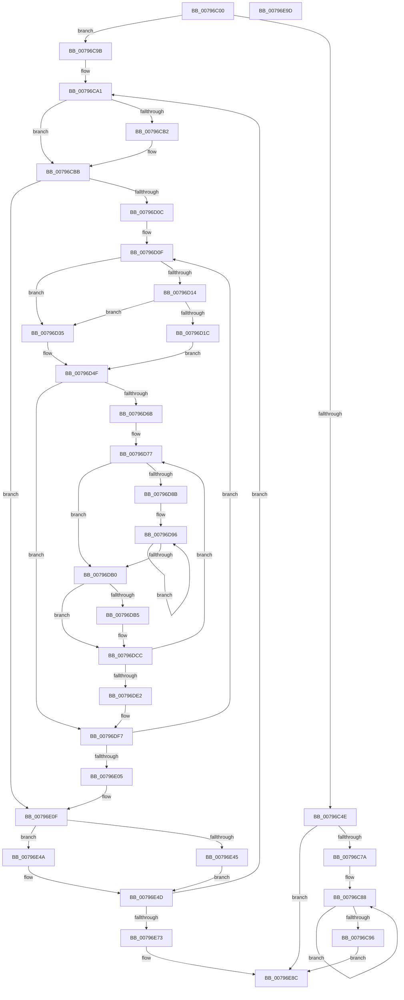

# Xp10BuildHuffmanDecodeTable

- RVA: `0x00796C00`–`0x00796E9E` (길이 `670` bytes)
- VA: `0x0000000140796C00`
- 실행 섹션: `PAGE`
- PDB 이름 있음: `예`; PDB Function 태그: `아니요`
- unwind 정보 RVA: `0x000D02D4`
- 디코드: `183`개 명령, `670/670` bytes 표시
- 미해석 바이트: `0` (있으면 어셈블리에 `.byte`로 보존)

> 이 문서는 커널 이미지의 기계어와 PDB 기호를 분석해 생성했습니다. 4번과 5번은 함수 원형과 자료형을 바이너리 사용 방식에서 추정한 C 해석이며 원본 소스 복구 결과는 아닙니다.

## 1. Dependencies

- 직접 호출 지점: **0**; 고유 호출 대상: **0**
- 직접 호출자로 확인된 함수: **1**
- RIP 상대 이미지 참조: **1**

### Outgoing calls
- 직접 디코드된 call 명령이 없습니다.

### Direct callers
- [Xp10ReadAndDecodeHuffmanTables](Xp10ReadAndDecodeHuffmanTables_function_007993D4.md) at `0x00799650`
- [Xp10ReadAndDecodeHuffmanTables](Xp10ReadAndDecodeHuffmanTables_function_007993D4.md) at `0x00799B32`

### Static image references
- `0x00796D70` → RVA `0x00034850` (`.rdata`; read)

## 2. Other-region calls and transfers

- 다른 실행 섹션으로 향하는 call: **0**
- 별도 외부 분기/꼬리 이동을 확인하지 못했습니다.

## 3. Assembly (complete function range)

```asm
00796C00  4C 89 44 24 18                  mov qword ptr [rsp + 0x18], r8
00796C05  89 54 24 10                     mov dword ptr [rsp + 0x10], edx
00796C09  48 89 4C 24 08                  mov qword ptr [rsp + 8], rcx
00796C0E  53                              push rbx
00796C0F  55                              push rbp
00796C10  56                              push rsi
00796C11  57                              push rdi
00796C12  41 54                           push r12
00796C14  41 55                           push r13
00796C16  41 56                           push r14
00796C18  41 57                           push r15
00796C1A  48 83 EC 18                     sub rsp, 0x18
00796C1E  45 33 F6                        xor r14d, r14d
00796C21  4D 8B E8                        mov r13, r8
00796C24  48 8B F9                        mov rdi, rcx
00796C27  4C 89 74 24 08                  mov qword ptr [rsp + 8], r14
00796C2C  41 8B DE                        mov ebx, r14d
00796C2F  44 89 74 24 68                  mov dword ptr [rsp + 0x68], r14d
00796C34  45 8B FE                        mov r15d, r14d
00796C37  44 89 B4 24 98 00 00 00         mov dword ptr [rsp + 0x98], r14d
00796C3F  45 8D 56 01                     lea r10d, [r14 + 1]
00796C43  45 8B DE                        mov r11d, r14d
00796C46  41 8B EE                        mov ebp, r14d
00796C49  45 3B CA                        cmp r9d, r10d
00796C4C  75 4D                           jne 0x140796c9b
00796C4E  41 0F B7 10                     movzx edx, word ptr [r8]
00796C52  48 8B 84 24 A0 00 00 00         mov rax, qword ptr [rsp + 0xa0]
00796C5A  44 0F B6 04 0A                  movzx r8d, byte ptr [rdx + rcx]
00796C5F  8B 8C 24 80 00 00 00            mov ecx, dword ptr [rsp + 0x80]
00796C66  C1 E2 04                        shl edx, 4
00796C69  44 03 C2                        add r8d, edx
00796C6C  66 41 D3 E2                     shl r10w, cl
00796C70  66 45 85 D2                     test r10w, r10w
00796C74  0F 84 12 02 00 00               je 0x140796e8c
00796C7A  41 0F B7 CA                     movzx ecx, r10w
00796C7E  41 BC FF FF 00 00               mov r12d, 0xffff
00796C84  48 8D 14 48                     lea rdx, [rax + rcx*2]
00796C88  48 8D 52 FE                     lea rdx, [rdx - 2]
00796C8C  66 44 89 02                     mov word ptr [rdx], r8w
00796C90  66 45 03 D4                     add r10w, r12w
00796C94  75 F2                           jne 0x140796c88
00796C96  E9 F1 01 00 00                  jmp 0x140796e8c
00796C9B  41 BC FF FF 00 00               mov r12d, 0xffff
00796CA1  8B C5                           mov eax, ebp
00796CA3  41 0F B7 4C 45 00               movzx ecx, word ptr [r13 + rax*2]
00796CA9  0F B6 14 39                     movzx edx, byte ptr [rcx + rdi]
00796CAD  48 85 DB                        test rbx, rbx
00796CB0  74 09                           je 0x140796cbb
00796CB2  0F B7 43 0A                     movzx eax, word ptr [rbx + 0xa]
00796CB6  3B C2                           cmp eax, edx
00796CB8  0F 47 D0                        cmova edx, eax
00796CBB  3B 94 24 80 00 00 00            cmp edx, dword ptr [rsp + 0x80]
00796CC2  44 8B F2                        mov r14d, edx
00796CC5  8B C2                           mov eax, edx
00796CC7  45 8B C2                        mov r8d, r10d
00796CCA  44 0F 46 B4 24 80 00 00 00      cmovbe r14d, dword ptr [rsp + 0x80]
00796CD3  2B 84 24 88 00 00 00            sub eax, dword ptr [rsp + 0x88]
00796CDA  45 8B CE                        mov r9d, r14d
00796CDD  39 94 24 80 00 00 00            cmp dword ptr [rsp + 0x80], edx
00796CE4  44 89 34 24                     mov dword ptr [rsp], r14d
00796CE8  1B F6                           sbb esi, esi
00796CEA  23 F0                           and esi, eax
00796CEC  44 2B CE                        sub r9d, esi
00796CEF  89 B4 24 A8 00 00 00            mov dword ptr [rsp + 0xa8], esi
00796CF6  41 8B C9                        mov ecx, r9d
00796CF9  44 89 4C 24 78                  mov dword ptr [rsp + 0x78], r9d
00796CFE  66 41 D3 E0                     shl r8w, cl
00796D02  66 45 85 C0                     test r8w, r8w
00796D06  0F 84 03 01 00 00               je 0x140796e0f
00796D0C  45 33 FF                        xor r15d, r15d
00796D0F  48 85 DB                        test rbx, rbx
00796D12  74 21                           je 0x140796d35
00796D14  0F B7 43 0A                     movzx eax, word ptr [rbx + 0xa]
00796D18  3B C6                           cmp eax, esi
00796D1A  76 19                           jbe 0x140796d35
00796D1C  0F B7 53 08                     movzx edx, word ptr [rbx + 8]
00796D20  8B 8C 24 88 00 00 00            mov ecx, dword ptr [rsp + 0x88]
00796D27  48 8B 1B                        mov rbx, qword ptr [rbx]
00796D2A  D3 E2                           shl edx, cl
00796D2C  2B D6                           sub edx, esi
00796D2E  41 2B D3                        sub edx, r11d
00796D31  03 D0                           add edx, eax
00796D33  EB 1A                           jmp 0x140796d4f
00796D35  8B C5                           mov eax, ebp
00796D37  41 0F B7 54 45 00               movzx edx, word ptr [r13 + rax*2]
00796D3D  0F B6 04 3A                     movzx eax, byte ptr [rdx + rdi]
00796D41  C1 E2 04                        shl edx, 4
00796D44  2B D6                           sub edx, esi
00796D46  03 D0                           add edx, eax
00796D48  41 03 EA                        add ebp, r10d
00796D4B  89 6C 24 68                     mov dword ptr [rsp + 0x68], ebp
00796D4F  41 8B CE                        mov ecx, r14d
00796D52  41 0F B7 E8                     movzx ebp, r8w
00796D56  2B C8                           sub ecx, eax
00796D58  41 8B C2                        mov eax, r10d
00796D5B  66 D3 E0                        shl ax, cl
00796D5E  66 2B E8                        sub bp, ax
00796D61  66 44 3B C5                     cmp r8w, bp
00796D65  0F 86 8C 00 00 00               jbe 0x140796df7
00796D6B  44 8B 6C 24 78                  mov r13d, dword ptr [rsp + 0x78]
00796D70  48 8D 35 D9 DA 89 FF            lea rsi, [rip - 0x762527]
00796D77  66 45 03 C4                     add r8w, r12w
00796D7B  45 8B CD                        mov r9d, r13d
00796D7E  45 0F B7 F0                     movzx r14d, r8w
00796D82  41 8B FF                        mov edi, r15d
00796D85  41 83 FD 08                     cmp r13d, 8
00796D89  76 25                           jbe 0x140796db0
00796D8B  45 8D 7D F7                     lea r15d, [r13 - 9]
00796D8F  41 C1 EF 03                     shr r15d, 3
00796D93  45 03 FA                        add r15d, r10d
00796D96  41 0F B6 CE                     movzx ecx, r14b
00796D9A  41 83 C1 F8                     add r9d, -8
00796D9E  C1 E7 08                        shl edi, 8
00796DA1  41 C1 EE 08                     shr r14d, 8
00796DA5  0F B6 04 31                     movzx eax, byte ptr [rcx + rsi]
00796DA9  0B F8                           or edi, eax
00796DAB  4D 2B FA                        sub r15, r10
00796DAE  75 E6                           jne 0x140796d96
00796DB0  45 85 C9                        test r9d, r9d
00796DB3  74 17                           je 0x140796dcc
00796DB5  41 0F B6 CE                     movzx ecx, r14b
00796DB9  C1 E7 08                        shl edi, 8
00796DBC  0F B6 04 31                     movzx eax, byte ptr [rcx + rsi]
00796DC0  B9 08 00 00 00                  mov ecx, 8
00796DC5  41 2B C9                        sub ecx, r9d
00796DC8  0B F8                           or edi, eax
00796DCA  D3 EF                           shr edi, cl
00796DCC  48 8B 84 24 A0 00 00 00         mov rax, qword ptr [rsp + 0xa0]
00796DD4  42 8D 0C 1F                     lea ecx, [rdi + r11]
00796DD8  66 89 14 48                     mov word ptr [rax + rcx*2], dx
00796DDC  66 44 3B C5                     cmp r8w, bp
00796DE0  77 95                           ja 0x140796d77
00796DE2  8B B4 24 A8 00 00 00            mov esi, dword ptr [rsp + 0xa8]
00796DE9  4C 8B 6C 24 70                  mov r13, qword ptr [rsp + 0x70]
00796DEE  48 8B 7C 24 60                  mov rdi, qword ptr [rsp + 0x60]
00796DF3  44 8B 34 24                     mov r14d, dword ptr [rsp]
00796DF7  8B 6C 24 68                     mov ebp, dword ptr [rsp + 0x68]
00796DFB  66 45 85 C0                     test r8w, r8w
00796DFF  0F 85 0A FF FF FF               jne 0x140796d0f
00796E05  44 8B 4C 24 78                  mov r9d, dword ptr [rsp + 0x78]
00796E0A  4C 8B 7C 24 08                  mov r15, qword ptr [rsp + 8]
00796E0F  44 8B 84 24 98 00 00 00         mov r8d, dword ptr [rsp + 0x98]
00796E17  45 33 F6                        xor r14d, r14d
00796E1A  8B 8C 24 88 00 00 00            mov ecx, dword ptr [rsp + 0x88]
00796E21  41 8B D0                        mov edx, r8d
00796E24  48 C1 E2 04                     shl rdx, 4
00796E28  41 8B C3                        mov eax, r11d
00796E2B  48 03 94 24 90 00 00 00         add rdx, qword ptr [rsp + 0x90]
00796E33  D3 E8                           shr eax, cl
00796E35  66 89 42 08                     mov word ptr [rdx + 8], ax
00796E39  66 89 72 0A                     mov word ptr [rdx + 0xa], si
00796E3D  4C 89 32                        mov qword ptr [rdx], r14
00796E40  48 85 DB                        test rbx, rbx
00796E43  75 05                           jne 0x140796e4a
00796E45  48 8B DA                        mov rbx, rdx
00796E48  EB 03                           jmp 0x140796e4d
00796E4A  49 89 17                        mov qword ptr [r15], rdx
00796E4D  45 03 C2                        add r8d, r10d
00796E50  48 89 54 24 08                  mov qword ptr [rsp + 8], rdx
00796E55  41 8B C9                        mov ecx, r9d
00796E58  44 89 84 24 98 00 00 00         mov dword ptr [rsp + 0x98], r8d
00796E60  41 8B C2                        mov eax, r10d
00796E63  4C 8B FA                        mov r15, rdx
00796E66  D3 E0                           shl eax, cl
00796E68  44 03 D8                        add r11d, eax
00796E6B  85 F6                           test esi, esi
00796E6D  0F 85 2E FE FF FF               jne 0x140796ca1
00796E73  8B 8C 24 80 00 00 00            mov ecx, dword ptr [rsp + 0x80]
00796E7A  41 D3 E2                        shl r10d, cl
00796E7D  48 8B 8C 24 A0 00 00 00         mov rcx, qword ptr [rsp + 0xa0]
00796E85  45 2B DA                        sub r11d, r10d
00796E88  4A 8D 04 59                     lea rax, [rcx + r11*2]
00796E8C  48 83 C4 18                     add rsp, 0x18
00796E90  41 5F                           pop r15
00796E92  41 5E                           pop r14
00796E94  41 5D                           pop r13
00796E96  41 5C                           pop r12
00796E98  5F                              pop rdi
00796E99  5E                              pop rsi
00796E9A  5D                              pop rbp
00796E9B  5B                              pop rbx
00796E9C  C3                              ret
00796E9D  CC                              int3
```

## 4. C-style interpretation (structured pseudocode)

```c
__int64 __fastcall Xp10BuildHuffmanDecodeTable(__int64 a1, int a2, __int64 a3, int a4, unsigned int a5, unsigned int a6, __int64 a7, unsigned int a8, __int64 a9, unsigned int a10)
{
    __int64 result;
    __int64 v_r10;
    __int64 v_r11;
    __int64 v_r14;
    __int64 v_r15;
    __int64 v_rbp;
    __int64 v_rdi;
    __int64 v_rsi;
    __int64 v_rsp;
    unsigned __int64 v_stack_m50;
    unsigned int v_stack_m58;
    unsigned int v_stack_p10;
    unsigned __int64 v_stack_p18;
    unsigned int v_stack_p20;
    unsigned int v_stack_p40;
    unsigned int v_stack_p50;
    unsigned __int64 v_stack_p8;

    v_stack_p18 = a3;
    v_stack_p10 = a2;
    v_stack_p8 = a1;
    v_rsp = (v_rsp) - (24);
    v_r14 = 0;
    v_stack_m50 = 0;
    v_stack_p10 = 0;
    v_stack_p40 = 0;
    if (a4 != ((unsigned int)(v_r14 + 1))) goto loc_00796C9B;
    a2 = (unsigned int)((*(unsigned __int16 *)(a3)) << (4));
    a3 = (unsigned int)((*(unsigned __int8 *)(*(unsigned __int16 *)(a3) + a1 * 1)) + (a2));
    v_r10 = (unsigned __int16)((v_r14 + 1) << ((unsigned __int8)((unsigned int)(a5))));
    if ((unsigned __int16)(v_r10) == 0) goto loc_00796E8C;
loc_00796C88:
    *(unsigned __int16 *)(a9 + (unsigned __int16)(v_r10) * 2 - 2) = (unsigned __int16)(a3);
    v_r10 = (unsigned __int16)((v_r10) + ((unsigned __int16)((unsigned int)(0xFFFFULL))));
    if (condition_is_not_equal) goto loc_00796C88;
    goto loc_00796E8C;
loc_00796C9B:
loc_00796CA1:
    result = 0;
    if (0 != 0) {
        result = *(unsigned __int16 *)(0 + 10);
        a2 = *(unsigned __int8 *)(*(unsigned __int16 *)(a3 + 0 * 2) + a1 * 1);
        if (((unsigned int)(result)) > ((unsigned int)(*(unsigned __int8 *)(*(unsigned __int16 *)(a3 + 0 * 2) + a1 * 1)))) { a2 = (unsigned int)(result); }
    }
    v_r14 = (unsigned int)(a2);
    if (a2 <= a5) { v_r14 = a5; }
    result = (unsigned int)(((unsigned int)(a2)) - (a6));
    v_stack_m58 = (unsigned int)(v_r14);
    v_rsi = (unsigned int)((v_rsi) & ((unsigned int)(result)));
    a4 = (unsigned int)(((unsigned int)((unsigned int)(v_r14))) - ((unsigned int)(v_rsi)));
    v_stack_p50 = (unsigned int)(v_rsi);
    v_stack_p20 = a4;
    a3 = (unsigned __int16)(((unsigned int)((unsigned int)(v_r10))) << ((unsigned __int8)((unsigned int)(a4))));
    if ((unsigned __int16)(a3) == 0) goto loc_00796E0F;
    v_r15 = 0;
loc_00796D0F:
    if (0 == 0) goto loc_00796D35;
    if (((unsigned int)(*(unsigned __int16 *)(0 + 10))) <= ((unsigned int)(v_rsi))) goto loc_00796D35;
    a2 = (unsigned int)((*(unsigned __int16 *)(0 + 8)) << ((unsigned __int8)((unsigned int)(a6))));
    a2 = (unsigned int)((a2) - ((unsigned int)(v_rsi)));
    a2 = (unsigned int)((a2) - (0));
    a2 = (unsigned int)((a2) + ((unsigned int)(*(unsigned __int16 *)(0 + 10))));
    goto loc_00796D4F;
loc_00796D35:
    a2 = (unsigned int)((*(unsigned __int16 *)(a3 + 0 * 2)) << (4));
    a2 = (unsigned int)((a2) - ((unsigned int)(v_rsi)));
    a2 = (unsigned int)((a2) + ((unsigned int)(*(unsigned __int8 *)(*(unsigned __int16 *)(a3 + 0 * 2) + a1 * 1))));
    v_rbp = (unsigned int)((0) + ((unsigned int)(v_r10)));
    v_stack_p10 = (unsigned int)(v_rbp);
loc_00796D4F:
    a1 = (unsigned int)(((unsigned int)((unsigned int)(v_r14))) - ((unsigned int)(*(unsigned __int8 *)(*(unsigned __int16 *)(a3 + 0 * 2) + a1 * 1))));
    result = (unsigned __int16)(((unsigned int)((unsigned int)(v_r10))) << ((unsigned __int8)(a1)));
    v_rbp = (unsigned __int16)(((unsigned __int16)(a3)) - ((unsigned __int16)(result)));
    if (((unsigned __int16)(a3)) <= ((unsigned __int16)(v_rbp))) goto loc_00796DF7;
loc_00796D77:
    a3 = (unsigned __int16)((a3) + ((unsigned __int16)((unsigned int)(0xFFFFULL))));
    if (((unsigned int)((unsigned int)(v_stack_p20))) <= 8) goto loc_00796DB0;
    v_r15 = (unsigned int)(((unsigned int)(v_stack_p20) - 9) >> (3));
    v_r15 = (unsigned int)((v_r15) + ((unsigned int)(v_r10)));
loc_00796D96:
    a4 = (unsigned int)(((unsigned int)((unsigned int)((unsigned int)(v_stack_p20)))) + (-8));
    v_rdi = (unsigned int)((0) << (8));
    v_r14 = (unsigned int)(((unsigned __int16)(a3)) >> (8));
    v_rdi = (unsigned int)((v_rdi) | ((unsigned int)(*(unsigned __int8 *)((unsigned __int8)((unsigned __int16)(a3)) + v_rip - 7742759 * 1))));
    v_r15 = (v_r15) - (v_r10);
    if (condition_is_not_equal) goto loc_00796D96;
loc_00796DB0:
    result = *(unsigned __int8 *)((unsigned __int8)((unsigned __int16)(a3)) + v_rip - 7742759 * 1);
    if (a4 != 0) {
        a1 = (unsigned __int8)(v_r14);
        v_rdi = (unsigned int)((v_rdi) << (8));
        result = *(unsigned __int8 *)(a1 + v_rip - 7742759 * 1);
        a1 = 8;
        a1 = (unsigned int)((a1) - (a4));
        v_rdi = (unsigned int)((v_rdi) | ((unsigned int)(result)));
        v_rdi = (unsigned int)((v_rdi) >> ((unsigned __int8)(a1)));
    }
    *(unsigned __int16 *)(a9 + v_rdi + 0 * 1 * 2) = (unsigned __int16)(a2);
    if (((unsigned __int16)(a3)) > ((unsigned __int16)(v_rbp))) goto loc_00796D77;
loc_00796DF7:
    if ((unsigned __int16)(a3) != 0) goto loc_00796D0F;
loc_00796E0F:
    v_r14 = 0;
    a2 = ((unsigned int)((unsigned int)((unsigned int)(a8)))) << (4);
    a2 = (a2) + (a7);
    result = (unsigned int)((0) >> ((unsigned __int8)((unsigned int)(a6))));
    *(unsigned __int16 *)(a2 + 8) = (unsigned __int16)(result);
    *(unsigned __int16 *)(a2 + 10) = (unsigned __int16)((unsigned int)(a10));
    *(unsigned __int64 *)(a2) = 0;
    if (*(unsigned __int64 *)(0) != 0) goto loc_00796E4A;
    goto loc_00796E4D;
loc_00796E4A:
    *(unsigned __int64 *)(v_stack_m50) = a2;
loc_00796E4D:
    a3 = (unsigned int)(((unsigned int)(a8)) + ((unsigned int)(v_r10)));
    v_stack_m50 = a2;
    v_stack_p40 = (unsigned int)(a3);
    result = (unsigned int)(((unsigned int)((unsigned int)(v_r10))) << ((unsigned __int8)((unsigned int)((unsigned int)((unsigned int)(v_stack_p20))))));
    v_r11 = (unsigned int)((0) + ((unsigned int)(result)));
    if ((unsigned int)((unsigned int)(a10)) != 0) goto loc_00796CA1;
    v_r10 = (unsigned int)((v_r10) << ((unsigned __int8)((unsigned int)(a5))));
    v_r11 = (unsigned int)((v_r11) - ((unsigned int)(v_r10)));
loc_00796E8C:
    v_rsp = (v_rsp) + (24);
    return a9 + v_r11 * 2;
}
```

## 5. (Beta) C Style

```c
int64_t Xp10BuildHuffmanDecodeTable(int64_t Arg1, int32_t Arg2, void *Arg3, int32_t Arg4, uint32_t Arg5, uint32_t Arg6, int64_t Arg7, uint32_t Arg8, void *Arg9, uint32_t Arg10)
{
    uint8_t *arg3 = (uint8_t *)Arg3;
    uint8_t *arg9 = (uint8_t *)Arg9;

    int64_t result;
    int64_t local_r10;
    int64_t local_r11;
    int64_t local_r14;
    int64_t local_r15;
    int64_t local_rbp;
    int64_t local_rdi;
    int64_t local_rsi;
    int64_t local_rsp;
    uint64_t v_stack_m50;
    uint32_t v_stack_m58;
    uint32_t v_stack_p10;
    uint64_t v_stack_p18;
    uint32_t v_stack_p20;
    uint32_t v_stack_p40;
    uint32_t v_stack_p50;
    uint64_t v_stack_p8;

    v_stack_p18 = Arg3;
    v_stack_p10 = Arg2;
    v_stack_p8 = Arg1;
    local_rsp = (local_rsp) - (24);
    local_r14 = 0;
    v_stack_m50 = 0;
    v_stack_p10 = 0;
    v_stack_p40 = 0;
    if (Arg4 != ((uint32_t)(local_r14 + 1))) goto loc_00796C9B;
    Arg2 = (uint32_t)((*(uint16_t *)(arg3)) << (4));
    Arg3 = (uint32_t)((*(uint8_t *)(*(uint16_t *)(arg3) + Arg1 * 1)) + (Arg2));
    local_r10 = (uint16_t)((local_r14 + 1) << ((uint8_t)((uint32_t)(Arg5))));
    if ((uint16_t)(local_r10) == 0) goto loc_00796E8C;
loc_00796C88:
    *(uint16_t *)(arg9 + (uint16_t)(local_r10) * 2 - 0x2) = (uint16_t)(Arg3);
    local_r10 = (uint16_t)((local_r10) + ((uint16_t)((uint32_t)(0xFFFFULL))));
    if (condition_is_not_equal) goto loc_00796C88;
    goto loc_00796E8C;
loc_00796C9B:
loc_00796CA1:
    result = 0;
    if (0 != 0) {
        result = *(uint16_t *)(0 + 0xA);
        Arg2 = *(uint8_t *)(*(uint16_t *)(arg3 + 0x0 * 2) + Arg1 * 1);
        if (((uint32_t)(result)) > ((uint32_t)(*(uint8_t *)(*(uint16_t *)(arg3 + 0x0 * 2) + Arg1 * 1)))) { Arg2 = (uint32_t)(result); }
    }
    local_r14 = (uint32_t)(Arg2);
    if (Arg2 <= Arg5) { local_r14 = Arg5; }
    result = (uint32_t)(((uint32_t)(Arg2)) - (Arg6));
    v_stack_m58 = (uint32_t)(local_r14);
    local_rsi = (uint32_t)((local_rsi) & ((uint32_t)(result)));
    Arg4 = (uint32_t)(((uint32_t)((uint32_t)(local_r14))) - ((uint32_t)(local_rsi)));
    v_stack_p50 = (uint32_t)(local_rsi);
    v_stack_p20 = Arg4;
    Arg3 = (uint16_t)(((uint32_t)((uint32_t)(local_r10))) << ((uint8_t)((uint32_t)(Arg4))));
    if ((uint16_t)(Arg3) == 0) goto loc_00796E0F;
    local_r15 = 0;
loc_00796D0F:
    if (0 == 0) goto loc_00796D35;
    if (((uint32_t)(*(uint16_t *)(0 + 0xA))) <= ((uint32_t)(local_rsi))) goto loc_00796D35;
    Arg2 = (uint32_t)((*(uint16_t *)(0 + 0x8)) << ((uint8_t)((uint32_t)(Arg6))));
    Arg2 = (uint32_t)((Arg2) - ((uint32_t)(local_rsi)));
    Arg2 = (uint32_t)((Arg2) - (0));
    Arg2 = (uint32_t)((Arg2) + ((uint32_t)(*(uint16_t *)(0 + 0xA))));
    goto loc_00796D4F;
loc_00796D35:
    Arg2 = (uint32_t)((*(uint16_t *)(arg3 + 0x0 * 2)) << (4));
    Arg2 = (uint32_t)((Arg2) - ((uint32_t)(local_rsi)));
    Arg2 = (uint32_t)((Arg2) + ((uint32_t)(*(uint8_t *)(*(uint16_t *)(arg3 + 0x0 * 2) + Arg1 * 1))));
    local_rbp = (uint32_t)((0) + ((uint32_t)(local_r10)));
    v_stack_p10 = (uint32_t)(local_rbp);
loc_00796D4F:
    Arg1 = (uint32_t)(((uint32_t)((uint32_t)(local_r14))) - ((uint32_t)(*(uint8_t *)(*(uint16_t *)(arg3 + 0x0 * 2) + Arg1 * 1))));
    result = (uint16_t)(((uint32_t)((uint32_t)(local_r10))) << ((uint8_t)(Arg1)));
    local_rbp = (uint16_t)(((uint16_t)(Arg3)) - ((uint16_t)(result)));
    if (((uint16_t)(Arg3)) <= ((uint16_t)(local_rbp))) goto loc_00796DF7;
loc_00796D77:
    Arg3 = (uint16_t)((Arg3) + ((uint16_t)((uint32_t)(0xFFFFULL))));
    if (((uint32_t)((uint32_t)(v_stack_p20))) <= 8) goto loc_00796DB0;
    local_r15 = (uint32_t)(((uint32_t)(v_stack_p20) - 9) >> (3));
    local_r15 = (uint32_t)((local_r15) + ((uint32_t)(local_r10)));
loc_00796D96:
    Arg4 = (uint32_t)(((uint32_t)((uint32_t)((uint32_t)(v_stack_p20)))) + (-8));
    local_rdi = (uint32_t)((0) << (8));
    local_r14 = (uint32_t)(((uint16_t)(Arg3)) >> (8));
    local_rdi = (uint32_t)((local_rdi) | ((uint32_t)(*(uint8_t *)((uint8_t)((uint16_t)(arg3)) + v_rip - 0x762527 * 1))));
    local_r15 = (local_r15) - (local_r10);
    if (condition_is_not_equal) goto loc_00796D96;
loc_00796DB0:
    result = *(uint8_t *)((uint8_t)((uint16_t)(arg3)) + v_rip - 0x762527 * 1);
    if (Arg4 != 0) {
        Arg1 = (uint8_t)(local_r14);
        local_rdi = (uint32_t)((local_rdi) << (8));
        result = *(uint8_t *)(Arg1 + v_rip - 0x762527 * 1);
        Arg1 = 8;
        Arg1 = (uint32_t)((Arg1) - (Arg4));
        local_rdi = (uint32_t)((local_rdi) | ((uint32_t)(result)));
        local_rdi = (uint32_t)((local_rdi) >> ((uint8_t)(Arg1)));
    }
    *(uint16_t *)(arg9 + local_rdi + 0x0 * 1 * 2) = (uint16_t)(Arg2);
    if (((uint16_t)(Arg3)) > ((uint16_t)(local_rbp))) goto loc_00796D77;
loc_00796DF7:
    if ((uint16_t)(Arg3) != 0) goto loc_00796D0F;
loc_00796E0F:
    local_r14 = 0;
    Arg2 = ((uint32_t)((uint32_t)((uint32_t)(Arg8)))) << (4);
    Arg2 = (Arg2) + (Arg7);
    result = (uint32_t)((0) >> ((uint8_t)((uint32_t)(Arg6))));
    *(uint16_t *)(Arg2 + 0x8) = (uint16_t)(result);
    *(uint16_t *)(Arg2 + 0xA) = (uint16_t)((uint32_t)(Arg10));
    *(uint64_t *)(Arg2) = 0;
    if (*(uint64_t *)(0) != 0) goto loc_00796E4A;
    goto loc_00796E4D;
loc_00796E4A:
    *(uint64_t *)(v_stack_m50) = Arg2;
loc_00796E4D:
    Arg3 = (uint32_t)(((uint32_t)(Arg8)) + ((uint32_t)(local_r10)));
    v_stack_m50 = Arg2;
    v_stack_p40 = (uint32_t)(Arg3);
    result = (uint32_t)(((uint32_t)((uint32_t)(local_r10))) << ((uint8_t)((uint32_t)((uint32_t)((uint32_t)(v_stack_p20))))));
    local_r11 = (uint32_t)((0) + ((uint32_t)(result)));
    if ((uint32_t)((uint32_t)(Arg10)) != 0) goto loc_00796CA1;
    local_r10 = (uint32_t)((local_r10) << ((uint8_t)((uint32_t)(Arg5))));
    local_r11 = (uint32_t)((local_r11) - ((uint32_t)(local_r10)));
loc_00796E8C:
    local_rsp = (local_rsp) + (24);
    return Arg9 + local_r11 * 2;
}
```

### 관측된 메모리 오프셋

구조체 형식이 확인되지 않은 접근은 인자 기준의 오프셋으로만 기록했습니다.

| 기준 인자 | 오프셋 표현 | 폭 (bit) | 접근 |
|---|---:|---:|---|
| `Arg3` | `+ 0x0` | `16` | `R` |
| `Arg9` | `- 0x2` | `64` | `R` |
| `Arg9` | `+ 0x0` | `16` | `W` |
| `Arg9` | `+ 0x0 + r11*2` | `64` | `R` |
| `Arg9` | `+ 0x0 + rcx*2` | `16` | `W` |
| `Arg9` | `+ 0x0 + rcx*2` | `64` | `R` |

## 6. Execution-region graph

[열기: 2D/3D 그래프와 함수 탐색 컨트롤 패널](../../../control-panel.html?section=page&rva=0x00796C00&view=graph)

- 2D 그래프는 위에서 아래로 흐르고, 3D 그래프는 빈 공간을 드래그해 회전합니다. Shift+드래그는 이동, 휠은 확대·축소, 함수 노드 선택은 대상 보고서 이동입니다.

### Static fallback


