# Xp10BuildHuffmanEncodings

- RVA: `0x00796EA4`–`0x007972ED` (길이 `1,097` bytes)
- VA: `0x0000000140796EA4`
- 실행 섹션: `PAGE`
- PDB 이름 있음: `예`; PDB Function 태그: `아니요`
- unwind 정보 RVA: `0x00075C18`
- 디코드: `297`개 명령, `1,097/1,097` bytes 표시
- 미해석 바이트: `0` (있으면 어셈블리에 `.byte`로 보존)

> 이 문서는 커널 이미지의 기계어와 PDB 기호를 분석해 생성했습니다. 4번과 5번은 함수 원형과 자료형을 바이너리 사용 방식에서 추정한 C 해석이며 원본 소스 복구 결과는 아닙니다.

## 1. Dependencies

- 직접 호출 지점: **1**; 고유 호출 대상: **1**
- 직접 호출자로 확인된 함수: **2**
- RIP 상대 이미지 참조: **1**

### Outgoing calls
- `0x00796ED4` → [memset](../../text/6C/memset_function_006C6C40.md) (function, `0x006C6C40`)

### Direct callers
- [Xp10BuildAndWriteHuffmanEncodings](Xp10BuildAndWriteHuffmanEncodings_function_00795DB0.md) at `0x00795E5A`
- [Xp10BuildAndWriteHuffmanTables](Xp10BuildAndWriteHuffmanTables_function_0079617C.md) at `0x007962E1`

### Static image references
- `0x0079720C` → RVA `0x00034850` (`.rdata`; read)

## 2. Other-region calls and transfers

- 다른 실행 섹션으로 향하는 call: **1**
  - `0x00796ED4` → [memset](../../text/6C/memset_function_006C6C40.md) (`PAGE` → `.text`)
- 별도 외부 분기/꼬리 이동을 확인하지 못했습니다.

## 3. Assembly (complete function range)

```asm
00796EA4  48 89 5C 24 08                  mov qword ptr [rsp + 8], rbx
00796EA9  48 89 6C 24 10                  mov qword ptr [rsp + 0x10], rbp
00796EAE  48 89 74 24 18                  mov qword ptr [rsp + 0x18], rsi
00796EB3  57                              push rdi
00796EB4  41 54                           push r12
00796EB6  41 55                           push r13
00796EB8  41 56                           push r14
00796EBA  41 57                           push r15
00796EBC  48 83 EC 20                     sub rsp, 0x20
00796EC0  45 8B E0                        mov r12d, r8d
00796EC3  4C 8B F2                        mov r14, rdx
00796EC6  33 D2                           xor edx, edx
00796EC8  41 B8 E0 97 00 00               mov r8d, 0x97e0
00796ECE  45 8B F9                        mov r15d, r9d
00796ED1  48 8B D9                        mov rbx, rcx
00796ED4  E8 67 FD F2 FF                  call 0x1406c6c40
00796ED9  33 F6                           xor esi, esi
00796EDB  4C 8B D3                        mov r10, rbx
00796EDE  44 0F B7 DE                     movzx r11d, si
00796EE2  44 8D 6E 01                     lea r13d, [rsi + 1]
00796EE6  45 85 E4                        test r12d, r12d
00796EE9  74 5E                           je 0x140796f49
00796EEB  41 0F B7 C3                     movzx eax, r11w
00796EEF  41 8B 14 86                     mov edx, dword ptr [r14 + rax*4]
00796EF3  85 D2                           test edx, edx
00796EF5  74 45                           je 0x140796f3c
00796EF7  41 89 12                        mov dword ptr [r10], edx
00796EFA  0F B6 C2                        movzx eax, dl
00796EFD  41 03 C5                        add eax, r13d
00796F00  66 44 01 AC 43 18 84 00 00      add word ptr [rbx + rax*2 + 0x8418], r13w
00796F09  8B C2                           mov eax, edx
00796F0B  C1 E8 08                        shr eax, 8
00796F0E  0F B6 C8                        movzx ecx, al
00796F11  C1 EA 10                        shr edx, 0x10
00796F14  41 03 CD                        add ecx, r13d
00796F17  0F B6 C2                        movzx eax, dl
00796F1A  41 03 C5                        add eax, r13d
00796F1D  66 44 01 AC 4B 1A 86 00 00      add word ptr [rbx + rcx*2 + 0x861a], r13w
00796F26  66 44 01 AC 43 1C 88 00 00      add word ptr [rbx + rax*2 + 0x881c], r13w
00796F2F  49 89 72 08                     mov qword ptr [r10 + 8], rsi
00796F33  66 45 89 5A 10                  mov word ptr [r10 + 0x10], r11w
00796F38  49 83 C2 18                     add r10, 0x18
00796F3C  66 45 03 DD                     add r11w, r13w
00796F40  41 0F B7 C3                     movzx eax, r11w
00796F44  41 3B C4                        cmp eax, r12d
00796F47  72 A2                           jb 0x140796eeb
00796F49  48 8D 6B 18                     lea rbp, [rbx + 0x18]
00796F4D  4C 3B D5                        cmp r10, rbp
00796F50  77 1D                           ja 0x140796f6f
00796F52  75 14                           jne 0x140796f68
00796F54  48 8B 44 24 70                  mov rax, qword ptr [rsp + 0x70]
00796F59  0F B7 4B 10                     movzx ecx, word ptr [rbx + 0x10]
00796F5D  44 89 2C 88                     mov dword ptr [rax + rcx*4], r13d
00796F61  8B 03                           mov eax, dword ptr [rbx]
00796F63  E9 67 03 00 00                  jmp 0x1407972cf
00796F68  33 C0                           xor eax, eax
00796F6A  E9 60 03 00 00                  jmp 0x1407972cf
00796F6F  48 8D 8B 1C 86 00 00            lea rcx, [rbx + 0x861c]
00796F76  41 B8 FF 00 00 00               mov r8d, 0xff
00796F7C  48 8D 93 1A 86 00 00            lea rdx, [rbx + 0x861a]
00796F83  0F B7 82 FE FD FF FF            movzx eax, word ptr [rdx - 0x202]
00796F8A  66 01 81 FE FD FF FF            add word ptr [rcx - 0x202], ax
00796F91  0F B7 02                        movzx eax, word ptr [rdx]
00796F94  48 8D 52 02                     lea rdx, [rdx + 2]
00796F98  66 01 01                        add word ptr [rcx], ax
00796F9B  48 8D 49 02                     lea rcx, [rcx + 2]
00796F9F  0F B7 82 00 02 00 00            movzx eax, word ptr [rdx + 0x200]
00796FA6  66 01 81 00 02 00 00            add word ptr [rcx + 0x200], ax
00796FAD  4D 2B C5                        sub r8, r13
00796FB0  75 D1                           jne 0x140796f83
00796FB2  49 8B CA                        mov rcx, r10
00796FB5  48 B8 AB AA AA AA AA AA AA 2A   movabs rax, 0x2aaaaaaaaaaaaaab
00796FBF  48 2B CB                        sub rcx, rbx
00796FC2  48 F7 E9                        imul rcx
00796FC5  4C 8B CA                        mov r9, rdx
00796FC8  49 C1 F9 02                     sar r9, 2
00796FCC  49 8B C1                        mov rax, r9
00796FCF  48 C1 E8 3F                     shr rax, 0x3f
00796FD3  4C 03 C8                        add r9, rax
00796FD6  45 85 C9                        test r9d, r9d
00796FD9  0F 84 BF 00 00 00               je 0x14079709e
00796FDF  4C 8B DB                        mov r11, rbx
00796FE2  41 8B F9                        mov edi, r9d
00796FE5  41 8B F1                        mov esi, r9d
00796FE8  41 8B 03                        mov eax, dword ptr [r11]
00796FEB  45 0F B7 43 10                  movzx r8d, word ptr [r11 + 0x10]
00796FF0  4D 8D 5B 18                     lea r11, [r11 + 0x18]
00796FF4  0F B6 D0                        movzx edx, al
00796FF7  0F B7 8C 53 18 84 00 00         movzx ecx, word ptr [rbx + rdx*2 + 0x8418]
00796FFF  42 8D 04 29                     lea eax, [rcx + r13]
00797003  66 89 84 53 18 84 00 00         mov word ptr [rbx + rdx*2 + 0x8418], ax
0079700B  66 44 89 84 4B 1E 8A 00 00      mov word ptr [rbx + rcx*2 + 0x8a1e], r8w
00797014  49 2B F5                        sub rsi, r13
00797017  75 CF                           jne 0x140796fe8
00797019  4C 8D 9B 1E 8A 00 00            lea r11, [rbx + 0x8a1e]
00797020  45 0F B7 03                     movzx r8d, word ptr [r11]
00797024  4D 8D 5B 02                     lea r11, [r11 + 2]
00797028  43 8B 0C 86                     mov ecx, dword ptr [r14 + r8*4]
0079702C  48 C1 E9 08                     shr rcx, 8
00797030  0F B6 D1                        movzx edx, cl
00797033  0F B7 8C 53 1A 86 00 00         movzx ecx, word ptr [rbx + rdx*2 + 0x861a]
0079703B  42 8D 04 29                     lea eax, [rcx + r13]
0079703F  66 89 84 53 1A 86 00 00         mov word ptr [rbx + rdx*2 + 0x861a], ax
00797047  66 44 89 84 4B 9E 8F 00 00      mov word ptr [rbx + rcx*2 + 0x8f9e], r8w
00797050  49 2B FD                        sub rdi, r13
00797053  75 CB                           jne 0x140797020
00797055  4C 8D 9B 9E 8F 00 00            lea r11, [rbx + 0x8f9e]
0079705C  41 8B F9                        mov edi, r9d
0079705F  45 0F B7 0B                     movzx r9d, word ptr [r11]
00797063  4D 8D 5B 02                     lea r11, [r11 + 2]
00797067  47 8B 04 8E                     mov r8d, dword ptr [r14 + r9*4]
0079706B  41 8B C0                        mov eax, r8d
0079706E  48 C1 E8 10                     shr rax, 0x10
00797072  0F B6 D0                        movzx edx, al
00797075  0F B7 8C 53 1C 88 00 00         movzx ecx, word ptr [rbx + rdx*2 + 0x881c]
0079707D  42 8D 04 29                     lea eax, [rcx + r13]
00797081  66 89 84 53 1C 88 00 00         mov word ptr [rbx + rdx*2 + 0x881c], ax
00797089  48 8D 0C 49                     lea rcx, [rcx + rcx*2]
0079708D  66 44 89 4C CB 10               mov word ptr [rbx + rcx*8 + 0x10], r9w
00797093  44 89 04 CB                     mov dword ptr [rbx + rcx*8], r8d
00797097  49 2B FD                        sub rdi, r13
0079709A  75 C3                           jne 0x14079705f
0079709C  33 F6                           xor esi, esi
0079709E  49 89 5A 08                     mov qword ptr [r10 + 8], rbx
007970A2  48 8D 4B 30                     lea rcx, [rbx + 0x30]
007970A6  49 89 6A 10                     mov qword ptr [r10 + 0x10], rbp
007970AA  49 8B D2                        mov rdx, r10
007970AD  8B 03                           mov eax, dword ptr [rbx]
007970AF  4D 8B C2                        mov r8, r10
007970B2  03 43 18                        add eax, dword ptr [rbx + 0x18]
007970B5  41 89 02                        mov dword ptr [r10], eax
007970B8  4C 8B CA                        mov r9, rdx
007970BB  49 3B CA                        cmp rcx, r10
007970BE  75 05                           jne 0x1407970c5
007970C0  4C 3B C2                        cmp r8, rdx
007970C3  74 62                           je 0x140797127
007970C5  48 83 C2 18                     add rdx, 0x18
007970C9  49 3B CA                        cmp rcx, r10
007970CC  74 1C                           je 0x1407970ea
007970CE  4C 3B C2                        cmp r8, rdx
007970D1  73 07                           jae 0x1407970da
007970D3  8B 01                           mov eax, dword ptr [rcx]
007970D5  41 39 00                        cmp dword ptr [r8], eax
007970D8  72 10                           jb 0x1407970ea
007970DA  4C 8D 4A 10                     lea r9, [rdx + 0x10]
007970DE  49 89 49 F8                     mov qword ptr [r9 - 8], rcx
007970E2  8B 01                           mov eax, dword ptr [rcx]
007970E4  48 83 C1 18                     add rcx, 0x18
007970E8  EB 0F                           jmp 0x1407970f9
007970EA  49 83 C1 28                     add r9, 0x28
007970EE  4D 89 41 F8                     mov qword ptr [r9 - 8], r8
007970F2  41 8B 00                        mov eax, dword ptr [r8]
007970F5  49 83 C0 18                     add r8, 0x18
007970F9  89 02                           mov dword ptr [rdx], eax
007970FB  49 3B CA                        cmp rcx, r10
007970FE  74 19                           je 0x140797119
00797100  4C 3B C2                        cmp r8, rdx
00797103  73 07                           jae 0x14079710c
00797105  8B 01                           mov eax, dword ptr [rcx]
00797107  41 39 00                        cmp dword ptr [r8], eax
0079710A  72 0D                           jb 0x140797119
0079710C  49 89 09                        mov qword ptr [r9], rcx
0079710F  8B 01                           mov eax, dword ptr [rcx]
00797111  01 02                           add dword ptr [rdx], eax
00797113  48 83 C1 18                     add rcx, 0x18
00797117  EB 9F                           jmp 0x1407970b8
00797119  4D 89 01                        mov qword ptr [r9], r8
0079711C  41 8B 00                        mov eax, dword ptr [r8]
0079711F  01 02                           add dword ptr [rdx], eax
00797121  49 83 C0 18                     add r8, 0x18
00797125  EB 91                           jmp 0x1407970b8
00797127  44 8B CE                        mov r9d, esi
0079712A  44 8B C6                        mov r8d, esi
0079712D  48 39 72 08                     cmp qword ptr [rdx + 8], rsi
00797131  75 36                           jne 0x140797169
00797133  0F B7 42 10                     movzx eax, word ptr [rdx + 0x10]
00797137  44 89 4A 08                     mov dword ptr [rdx + 8], r9d
0079713B  44 88 8C 18 20 95 00 00         mov byte ptr [rax + rbx + 0x9520], r9b
00797143  45 85 C0                        test r8d, r8d
00797146  74 4D                           je 0x140797195
00797148  41 FF C8                        dec r8d
0079714B  41 8B C0                        mov eax, r8d
0079714E  48 03 C0                        add rax, rax
00797151  48 8B 94 C3 18 84 00 00         mov rdx, qword ptr [rbx + rax*8 + 0x8418]
00797159  49 8D 80 42 08 00 00            lea rax, [r8 + 0x842]
00797160  48 03 C0                        add rax, rax
00797163  44 8B 0C C3                     mov r9d, dword ptr [rbx + rax*8]
00797167  EB C4                           jmp 0x14079712d
00797169  41 8B C8                        mov ecx, r8d
0079716C  45 03 CD                        add r9d, r13d
0079716F  48 8D 81 42 08 00 00            lea rax, [rcx + 0x842]
00797176  48 03 C9                        add rcx, rcx
00797179  48 03 C0                        add rax, rax
0079717C  45 03 C5                        add r8d, r13d
0079717F  44 89 0C C3                     mov dword ptr [rbx + rax*8], r9d
00797183  48 8B 42 08                     mov rax, qword ptr [rdx + 8]
00797187  48 89 84 CB 18 84 00 00         mov qword ptr [rbx + rcx*8 + 0x8418], rax
0079718F  48 8B 52 10                     mov rdx, qword ptr [rdx + 0x10]
00797193  EB 98                           jmp 0x14079712d
00797195  8B 73 08                        mov esi, dword ptr [rbx + 8]
00797198  41 3B F7                        cmp esi, r15d
0079719B  76 2C                           jbe 0x1407971c9
0079719D  48 8B CB                        mov rcx, rbx
007971A0  BE 00 00 00 00                  mov esi, 0
007971A5  49 3B DA                        cmp rbx, r10
007971A8  0F 83 F0 FE FF FF               jae 0x14079709e
007971AE  8B 01                           mov eax, dword ptr [rcx]
007971B0  41 03 C5                        add eax, r13d
007971B3  48 89 71 08                     mov qword ptr [rcx + 8], rsi
007971B7  D1 E8                           shr eax, 1
007971B9  89 01                           mov dword ptr [rcx], eax
007971BB  48 83 C1 18                     add rcx, 0x18
007971BF  49 3B CA                        cmp rcx, r10
007971C2  72 EA                           jb 0x1407971ae
007971C4  E9 D5 FE FF FF                  jmp 0x14079709e
007971C9  41 8B 52 F0                     mov edx, dword ptr [r10 - 0x10]
007971CD  33 FF                           xor edi, edi
007971CF  44 8B DF                        mov r11d, edi
007971D2  44 0F B7 C7                     movzx r8d, di
007971D6  45 85 E4                        test r12d, r12d
007971D9  74 21                           je 0x1407971fc
007971DB  41 0F B7 C0                     movzx eax, r8w
007971DF  66 45 03 C5                     add r8w, r13w
007971E3  0F B6 8C 18 20 95 00 00         movzx ecx, byte ptr [rax + rbx + 0x9520]
007971EB  41 0F AF 0C 86                  imul ecx, dword ptr [r14 + rax*4]
007971F0  41 0F B7 C0                     movzx eax, r8w
007971F4  44 03 D9                        add r11d, ecx
007971F7  41 3B C4                        cmp eax, r12d
007971FA  72 DF                           jb 0x1407971db
007971FC  44 8B D7                        mov r10d, edi
007971FF  3B D6                           cmp edx, esi
00797201  0F 87 C5 00 00 00               ja 0x1407972cc
00797207  4C 8B 7C 24 70                  mov r15, qword ptr [rsp + 0x70]
0079720C  4C 8D 35 3D D6 89 FF            lea r14, [rip - 0x7629c3]
00797213  44 0F B7 CF                     movzx r9d, di
00797217  45 85 E4                        test r12d, r12d
0079721A  0F 84 9E 00 00 00               je 0x1407972be
00797220  41 0F B7 C1                     movzx eax, r9w
00797224  0F B6 8C 18 20 95 00 00         movzx ecx, byte ptr [rax + rbx + 0x9520]
0079722C  3B CA                           cmp ecx, edx
0079722E  75 7B                           jne 0x1407972ab
00797230  45 33 C0                        xor r8d, r8d
00797233  8B FA                           mov edi, edx
00797235  41 8B EA                        mov ebp, r10d
00797238  83 FA 08                        cmp edx, 8
0079723B  76 39                           jbe 0x140797276
0079723D  44 8D 72 F7                     lea r14d, [rdx - 9]
00797241  41 C1 EE 03                     shr r14d, 3
00797245  4C 8D 3D 04 D6 89 FF            lea r15, [rip - 0x7629fc]
0079724C  45 03 F5                        add r14d, r13d
0079724F  40 0F B6 CD                     movzx ecx, bpl
00797253  83 C7 F8                        add edi, -8
00797256  41 C1 E0 08                     shl r8d, 8
0079725A  C1 ED 08                        shr ebp, 8
0079725D  42 0F B6 04 39                  movzx eax, byte ptr [rcx + r15]
00797262  44 0B C0                        or r8d, eax
00797265  4D 2B F5                        sub r14, r13
00797268  75 E5                           jne 0x14079724f
0079726A  4C 8B 7C 24 70                  mov r15, qword ptr [rsp + 0x70]
0079726F  4C 8D 35 DA D5 89 FF            lea r14, [rip - 0x762a26]
00797276  85 FF                           test edi, edi
00797278  74 1A                           je 0x140797294
0079727A  40 0F B6 CD                     movzx ecx, bpl
0079727E  41 C1 E0 08                     shl r8d, 8
00797282  42 0F B6 04 31                  movzx eax, byte ptr [rcx + r14]
00797287  B9 08 00 00 00                  mov ecx, 8
0079728C  2B CF                           sub ecx, edi
0079728E  44 0B C0                        or r8d, eax
00797291  41 D3 E8                        shr r8d, cl
00797294  8B C2                           mov eax, edx
00797296  41 C1 E0 05                     shl r8d, 5
0079729A  83 E0 1F                        and eax, 0x1f
0079729D  44 0B C0                        or r8d, eax
007972A0  41 0F B7 C1                     movzx eax, r9w
007972A4  45 03 D5                        add r10d, r13d
007972A7  45 89 04 87                     mov dword ptr [r15 + rax*4], r8d
007972AB  66 45 03 CD                     add r9w, r13w
007972AF  41 0F B7 C9                     movzx ecx, r9w
007972B3  41 3B CC                        cmp ecx, r12d
007972B6  0F 82 64 FF FF FF               jb 0x140797220
007972BC  33 FF                           xor edi, edi
007972BE  45 03 D2                        add r10d, r10d
007972C1  41 03 D5                        add edx, r13d
007972C4  3B D6                           cmp edx, esi
007972C6  0F 86 47 FF FF FF               jbe 0x140797213
007972CC  41 8B C3                        mov eax, r11d
007972CF  48 8B 5C 24 50                  mov rbx, qword ptr [rsp + 0x50]
007972D4  48 8B 6C 24 58                  mov rbp, qword ptr [rsp + 0x58]
007972D9  48 8B 74 24 60                  mov rsi, qword ptr [rsp + 0x60]
007972DE  48 83 C4 20                     add rsp, 0x20
007972E2  41 5F                           pop r15
007972E4  41 5E                           pop r14
007972E6  41 5D                           pop r13
007972E8  41 5C                           pop r12
007972EA  5F                              pop rdi
007972EB  C3                              ret
007972EC  CC                              int3
```

## 4. C-style interpretation (structured pseudocode)

```c
__int64 __fastcall Xp10BuildHuffmanEncodings(__int64 a1, __int64 a2, int a3, int a4, __int64 a5)
{
    __int64 result;
    __int64 v_r10;
    __int64 v_r11;
    __int64 v_r14;
    __int64 v_rbp;
    __int64 v_rdi;
    __int64 v_rsi;
    __int64 v_rsp;
    unsigned __int64 v_stack_p10;
    unsigned __int64 v_stack_p18;
    unsigned __int64 v_stack_p8;

    v_stack_p8 = v_rbx;
    v_stack_p10 = v_rbp;
    v_stack_p18 = v_rsi;
    v_rsp = (v_rsp) - (32);
    a2 = 0;
    result = memset(a1, a2, (unsigned int)(0x97E0ULL), a4);
    v_rsi = 0;
    if ((unsigned int)((unsigned int)(a3)) == 0) goto loc_00796F49;
loc_00796EEB:
    result = 0;
    v_r10 = a1;
    if ((unsigned int)((unsigned int)(*(unsigned int *)(a2 + 0 * 4))) != 0) {
        *(unsigned int *)(a1) = (unsigned int)((unsigned int)(*(unsigned int *)(a2 + 0 * 4)));
        result = (unsigned __int8)((unsigned int)(*(unsigned int *)(a2 + 0 * 4)));
        result = (unsigned int)((result) + ((unsigned int)(v_rsi + 1)));
        result = (unsigned int)((unsigned int)(*(unsigned int *)(a2 + 0 * 4)));
        result = (unsigned int)((result) >> (8));
        a1 = (unsigned __int8)(result);
        a2 = (unsigned int)(((unsigned int)(*(unsigned int *)(a2 + 0 * 4))) >> (16));
        a1 = (unsigned int)((a1) + ((unsigned int)(v_rsi + 1)));
        result = (unsigned __int8)(a2);
        result = (unsigned int)((result) + ((unsigned int)(v_rsi + 1)));
        *(unsigned __int64 *)(a1 + 8) = 0;
        *(unsigned __int16 *)(a1 + 16) = 0;
        v_r10 = (a1) + (24);
    }
    v_r11 = (unsigned __int16)((0) + ((unsigned __int16)(v_rsi + 1)));
    if (((unsigned int)((unsigned __int16)(v_r11))) < ((unsigned int)((unsigned int)(a3)))) goto loc_00796EEB;
loc_00796F49:
    if (v_r10 > (a1 + 24)) goto loc_00796F6F;
    if (v_r10 != (a1 + 24)) goto loc_00796F68;
    *(unsigned int *)(a5 + *(unsigned __int16 *)(a1 + 16) * 4) = (unsigned int)(v_rsi + 1);
    goto loc_007972CF;
loc_00796F68:
    result = 0;
    goto loc_007972CF;
loc_00796F6F:
loc_00796F83:
    a3 = (255) - (v_rsi + 1);
    if (condition_is_not_equal) goto loc_00796F83;
    a1 = (v_r10) - (a1);
    a4 = (a1 + 34330 + 2) >> (2);
    result = (a4) >> (63);
    a4 = (a4) + (result);
    if (a4 == 0) goto loc_0079709E;
loc_00796FE8:
    *(unsigned __int16 *)(a1 + (unsigned __int8)((unsigned int)(*(unsigned int *)(a1))) * 2 + 33816) = (unsigned __int16)(*(unsigned __int16 *)(a1 + (unsigned __int8)((unsigned int)(*(unsigned int *)(a1))) * 2 + 33816) + v_rsi + 1 * 1);
    *(unsigned __int16 *)(a1 + *(unsigned __int16 *)(a1 + (unsigned __int8)((unsigned int)(*(unsigned int *)(a1))) * 2 + 33816) * 2 + 35358) = (unsigned __int16)(*(unsigned __int16 *)(a1 + 16));
    v_rsi = ((unsigned int)(a4)) - (v_rsi + 1);
    if (condition_is_not_equal) goto loc_00796FE8;
loc_00797020:
    a1 = ((unsigned int)(*(unsigned int *)(a2 + *(unsigned __int16 *)(a1 + 35358) * 4))) >> (8);
    *(unsigned __int16 *)(a1 + (unsigned __int8)(a1) * 2 + 34330) = (unsigned __int16)(*(unsigned __int16 *)(a1 + (unsigned __int8)(a1) * 2 + 34330) + v_rsi + 1 * 1);
    *(unsigned __int16 *)(a1 + *(unsigned __int16 *)(a1 + (unsigned __int8)(a1) * 2 + 34330) * 2 + 36766) = (unsigned __int16)(*(unsigned __int16 *)(a1 + 35358));
    v_rdi = ((unsigned int)(a4)) - (v_rsi + 1);
    if (condition_is_not_equal) goto loc_00797020;
loc_0079705F:
    result = ((unsigned int)((unsigned int)((unsigned int)(*(unsigned int *)(a2 + *(unsigned __int16 *)(a1 + 36766) * 4))))) >> (16);
    *(unsigned __int16 *)(a1 + (unsigned __int8)(result) * 2 + 34844) = (unsigned __int16)(*(unsigned __int16 *)(a1 + (unsigned __int8)(result) * 2 + 34844) + v_rsi + 1 * 1);
    *(unsigned __int16 *)(a1 + *(unsigned __int16 *)(a1 + (unsigned __int8)(result) * 2 + 34844) + *(unsigned __int16 *)(a1 + (unsigned __int8)(result) * 2 + 34844) * 2 * 8 + 16) = (unsigned __int16)(*(unsigned __int16 *)(a1 + 36766));
    *(unsigned int *)(a1 + *(unsigned __int16 *)(a1 + (unsigned __int8)(result) * 2 + 34844) + *(unsigned __int16 *)(a1 + (unsigned __int8)(result) * 2 + 34844) * 2 * 8) = (unsigned int)((unsigned int)(*(unsigned int *)(a2 + *(unsigned __int16 *)(a1 + 36766) * 4)));
    v_rdi = ((unsigned int)(a4)) - (v_rsi + 1);
    if (condition_is_not_equal) goto loc_0079705F;
    v_rsi = 0;
loc_0079709E:
    *(unsigned __int64 *)(v_r10 + 8) = a1;
    *(unsigned __int64 *)(v_r10 + 16) = a1 + 24;
    result = (unsigned int)(((unsigned int)(*(unsigned int *)(a1))) + (*(unsigned int *)(a1 + 24)));
    *(unsigned int *)(v_r10) = (unsigned int)(result);
loc_007970B8:
    if ((a1 + 48) != v_r10) goto loc_007970C5;
    if (v_r10 == v_r10) goto loc_00797127;
loc_007970C5:
    a2 = (v_r10) + (24);
    if ((a1 + 48) == v_r10) goto loc_007970EA;
    if (v_r10 >= a2) goto loc_007970DA;
    if ((*(unsigned int *)(v_r10)) < ((unsigned int)((unsigned int)(*(unsigned int *)(a1 + 48))))) goto loc_007970EA;
loc_007970DA:
    *(unsigned __int64 *)(a2 + 16 - 8) = a1 + 48;
    a1 = (a1 + 48) + (24);
    goto loc_007970F9;
loc_007970EA:
    a4 = (a2 + 16) + (40);
    *(unsigned __int64 *)(a4 - 8) = v_r10;
    a3 = (v_r10) + (24);
loc_007970F9:
    *(unsigned int *)(a2) = (unsigned int)((unsigned int)(*(unsigned int *)(v_r10)));
    if (a1 == v_r10) goto loc_00797119;
    if (a3 >= a2) goto loc_0079710C;
    if ((*(unsigned int *)(a3)) < ((unsigned int)((unsigned int)(*(unsigned int *)(a1))))) goto loc_00797119;
loc_0079710C:
    *(unsigned __int64 *)(a4) = a1;
    a1 = (a1) + (24);
    goto loc_007970B8;
loc_00797119:
    *(unsigned __int64 *)(a4) = a3;
    a3 = (a3) + (24);
    goto loc_007970B8;
loc_00797127:
loc_0079712D:
    if ((*(unsigned __int64 *)(a2 + 8)) != 0) goto loc_00797169;
    *(unsigned int *)(a2 + 8) = 0;
    *(unsigned __int8 *)(*(unsigned __int16 *)(a2 + 16) + a1 * 1 + 38176) = 0;
    if (0 == 0) goto loc_00797195;
    a3 = (unsigned int)((0) - 1);
    result = ((unsigned int)(a3)) + ((unsigned int)(a3));
    result = (a3 + 2114) + (a3 + 2114);
    goto loc_0079712D;
loc_00797169:
    a4 = (unsigned int)(((unsigned int)(*(unsigned int *)(a1 + result * 8))) + ((unsigned int)(v_rsi + 1)));
    a1 = ((unsigned int)(a3)) + ((unsigned int)(a3));
    result = ((unsigned int)(a3) + 2114) + ((unsigned int)(a3) + 2114);
    a3 = (unsigned int)((a3) + ((unsigned int)(v_rsi + 1)));
    *(unsigned int *)(a1 + result * 8) = a4;
    *(unsigned __int64 *)(a1 + a1 * 8 + 33816) = *(unsigned __int64 *)(*(unsigned __int64 *)(a1 + result * 8 + 33816) + 8);
    goto loc_0079712D;
loc_00797195:
    if (((unsigned int)((unsigned int)(*(unsigned int *)(a1 + 8)))) <= ((unsigned int)((unsigned int)(a4)))) goto loc_007971C9;
    if (a1 >= v_r10) goto loc_0079709E;
loc_007971AE:
    result = (unsigned int)(((unsigned int)(*(unsigned int *)(a1))) + ((unsigned int)(v_rsi + 1)));
    *(unsigned __int64 *)(a1 + 8) = 0;
    result = (unsigned int)((result) >> (1));
    *(unsigned int *)(a1) = (unsigned int)(result);
    a1 = (a1) + (24);
    if (a1 < v_r10) goto loc_007971AE;
    goto loc_0079709E;
loc_007971C9:
    v_rdi = 0;
    if ((unsigned int)((unsigned int)(a3)) == 0) goto loc_007971FC;
loc_007971DB:
    a3 = (unsigned __int16)((0) + ((unsigned __int16)(v_rsi + 1)));
    a1 = (unsigned int)((*(unsigned __int8 *)(0 + a1 * 1 + 38176)) * (*(unsigned int *)(a2 + 0 * 4)));
    v_r11 = (unsigned int)((0) + ((unsigned int)(a1)));
    if (((unsigned int)((unsigned __int16)(a3))) < ((unsigned int)((unsigned int)(a3)))) goto loc_007971DB;
loc_007971FC:
    if (((unsigned int)((unsigned int)(*(unsigned int *)(v_r10 - 16)))) > 0) goto loc_007972CC;
loc_00797213:
    if ((unsigned int)((unsigned int)(a3)) == 0) goto loc_007972BE;
loc_00797220:
    if (((unsigned int)(*(unsigned __int8 *)(0 + a1 * 1 + 38176))) != ((unsigned int)((unsigned int)(*(unsigned int *)(v_r10 - 16))))) goto loc_007972AB;
    a3 = 0;
    if (((unsigned int)((unsigned int)(*(unsigned int *)(v_r10 - 16)))) <= 8) goto loc_00797276;
    v_r14 = (unsigned int)(((unsigned int)(*(unsigned int *)(v_r10 - 16)) - 9) >> (3));
    v_r14 = (unsigned int)((v_r14) + ((unsigned int)(v_rsi + 1)));
loc_0079724F:
    v_rdi = (unsigned int)(((unsigned int)((unsigned int)((unsigned int)(*(unsigned int *)(v_r10 - 16))))) + (-8));
    a3 = (unsigned int)((a3) << (8));
    v_rbp = (unsigned int)((0) >> (8));
    a3 = (unsigned int)((a3) | ((unsigned int)(*(unsigned __int8 *)(0 + v_rip - 7743996 * 1))));
    v_r14 = (v_r14) - (v_rsi + 1);
    if (condition_is_not_equal) goto loc_0079724F;
loc_00797276:
    result = *(unsigned __int8 *)(0 + v_rip - 7743996 * 1);
    if ((unsigned int)(v_rdi) != 0) {
        a1 = (unsigned __int8)(v_rbp);
        a3 = (unsigned int)((a3) << (8));
        result = *(unsigned __int8 *)(a1 + v_rip - 7744038 * 1);
        a1 = 8;
        a1 = (unsigned int)((a1) - ((unsigned int)(v_rdi)));
        a3 = (unsigned int)((a3) | ((unsigned int)(result)));
        a3 = (unsigned int)((a3) >> ((unsigned __int8)(a1)));
    }
    a3 = (unsigned int)((a3) << (5));
    result = (unsigned int)(((unsigned int)((unsigned int)((unsigned int)(*(unsigned int *)(v_r10 - 16))))) & (31));
    a3 = (unsigned int)((a3) | ((unsigned int)(result)));
    v_r10 = (unsigned int)((0) + ((unsigned int)(v_rsi + 1)));
    *(unsigned int *)(a5 + 0 * 4) = a3;
loc_007972AB:
    a4 = (unsigned __int16)((0) + ((unsigned __int16)(v_rsi + 1)));
    if (((unsigned int)((unsigned __int16)(a4))) < ((unsigned int)((unsigned int)(a3)))) goto loc_00797220;
    v_rdi = 0;
loc_007972BE:
    v_r10 = (unsigned int)((v_r10) + ((unsigned int)(v_r10)));
    a2 = (unsigned int)(((unsigned int)(*(unsigned int *)(v_r10 - 16))) + ((unsigned int)(v_rsi + 1)));
    if (((unsigned int)(a2)) <= 0) goto loc_00797213;
loc_007972CC:
loc_007972CF:
    v_rsp = (v_rsp) + (32);
    return (unsigned int)((unsigned int)(v_r11));
}
```

## 5. (Beta) C Style

```c
int64_t Xp10BuildHuffmanEncodings(void *Arg1, void *Arg2, int32_t Arg3, int32_t Arg4, void *Arg5)
{
    uint8_t *arg1 = (uint8_t *)Arg1;
    uint8_t *arg2 = (uint8_t *)Arg2;
    uint8_t *arg5 = (uint8_t *)Arg5;

    int64_t result;
    int64_t local_r10;
    int64_t local_r11;
    int64_t local_r14;
    int64_t local_rbp;
    int64_t local_rdi;
    int64_t local_rsi;
    int64_t local_rsp;
    uint64_t v_stack_p10;
    uint64_t v_stack_p18;
    uint64_t v_stack_p8;

    v_stack_p8 = local_rbx;
    v_stack_p10 = local_rbp;
    v_stack_p18 = local_rsi;
    local_rsp = (local_rsp) - (32);
    Arg2 = 0;
    result = memset(Arg1, Arg2, (uint32_t)(0x97E0ULL), Arg4);
    local_rsi = 0;
    if ((uint32_t)((uint32_t)(Arg3)) == 0) goto loc_00796F49;
loc_00796EEB:
    result = 0;
    local_r10 = Arg1;
    if ((uint32_t)((uint32_t)(*(uint32_t *)(arg2 + 0x0 * 4))) != 0) {
        *(uint32_t *)(arg1) = (uint32_t)((uint32_t)(*(uint32_t *)(arg2 + 0x0 * 4)));
        result = (uint8_t)((uint32_t)(*(uint32_t *)(arg2 + 0x0 * 4)));
        result = (uint32_t)((result) + ((uint32_t)(local_rsi + 1)));
        result = (uint32_t)((uint32_t)(*(uint32_t *)(arg2 + 0x0 * 4)));
        result = (uint32_t)((result) >> (8));
        Arg1 = (uint8_t)(result);
        Arg2 = (uint32_t)(((uint32_t)(*(uint32_t *)(arg2 + 0x0 * 4))) >> (16));
        Arg1 = (uint32_t)((Arg1) + ((uint32_t)(local_rsi + 1)));
        result = (uint8_t)(Arg2);
        result = (uint32_t)((result) + ((uint32_t)(local_rsi + 1)));
        *(uint64_t *)(arg1 + 0x8) = 0;
        *(uint16_t *)(arg1 + 0x10) = 0;
        local_r10 = (Arg1) + (24);
    }
    local_r11 = (uint16_t)((0) + ((uint16_t)(local_rsi + 1)));
    if (((uint32_t)((uint16_t)(local_r11))) < ((uint32_t)((uint32_t)(Arg3)))) goto loc_00796EEB;
loc_00796F49:
    if (local_r10 > (Arg1 + 24)) goto loc_00796F6F;
    if (local_r10 != (Arg1 + 24)) goto loc_00796F68;
    *(uint32_t *)(arg5 + *(uint16_t *)(arg1 + 0x10) * 4) = (uint32_t)(local_rsi + 1);
    goto loc_007972CF;
loc_00796F68:
    result = 0;
    goto loc_007972CF;
loc_00796F6F:
loc_00796F83:
    Arg3 = (255) - (local_rsi + 1);
    if (condition_is_not_equal) goto loc_00796F83;
    Arg1 = (local_r10) - (Arg1);
    Arg4 = (Arg1 + 34330 + 2) >> (2);
    result = (Arg4) >> (63);
    Arg4 = (Arg4) + (result);
    if (Arg4 == 0) goto loc_0079709E;
loc_00796FE8:
    *(uint16_t *)(arg1 + (uint8_t)((uint32_t)(*(uint32_t *)(arg1))) * 2 + 0x8418) = (uint16_t)(*(uint16_t *)(arg1 + (uint8_t)((uint32_t)(*(uint32_t *)(arg1))) * 2 + 0x8418) + local_rsi + 1 * 1);
    *(uint16_t *)(arg1 + *(uint16_t *)(arg1 + (uint8_t)((uint32_t)(*(uint32_t *)(arg1))) * 2 + 0x8418) * 2 + 0x8A1E) = (uint16_t)(*(uint16_t *)(arg1 + 0x10));
    local_rsi = ((uint32_t)(Arg4)) - (local_rsi + 1);
    if (condition_is_not_equal) goto loc_00796FE8;
loc_00797020:
    Arg1 = ((uint32_t)(*(uint32_t *)(arg2 + *(uint16_t *)(arg1 + 0x8A1E) * 4))) >> (8);
    *(uint16_t *)(arg1 + (uint8_t)(arg1) * 2 + 0x861A) = (uint16_t)(*(uint16_t *)(arg1 + (uint8_t)(arg1) * 2 + 0x861A) + local_rsi + 1 * 1);
    *(uint16_t *)(arg1 + *(uint16_t *)(arg1 + (uint8_t)(arg1) * 2 + 0x861A) * 2 + 0x8F9E) = (uint16_t)(*(uint16_t *)(arg1 + 0x8A1E));
    local_rdi = ((uint32_t)(Arg4)) - (local_rsi + 1);
    if (condition_is_not_equal) goto loc_00797020;
loc_0079705F:
    result = ((uint32_t)((uint32_t)((uint32_t)(*(uint32_t *)(arg2 + *(uint16_t *)(arg1 + 0x8F9E) * 4))))) >> (16);
    *(uint16_t *)(arg1 + (uint8_t)(result) * 2 + 0x881C) = (uint16_t)(*(uint16_t *)(arg1 + (uint8_t)(result) * 2 + 0x881C) + local_rsi + 1 * 1);
    *(uint16_t *)(arg1 + *(uint16_t *)(arg1 + (uint8_t)(result) * 2 + 0x881C) + *(uint16_t *)(arg1 + (uint8_t)(result) * 2 + 0x881C) * 2 * 8 + 0x10) = (uint16_t)(*(uint16_t *)(arg1 + 0x8F9E));
    *(uint32_t *)(arg1 + *(uint16_t *)(arg1 + (uint8_t)(result) * 2 + 0x881C) + *(uint16_t *)(arg1 + (uint8_t)(result) * 2 + 0x881C) * 2 * 8) = (uint32_t)((uint32_t)(*(uint32_t *)(arg2 + *(uint16_t *)(arg1 + 0x8F9E) * 4)));
    local_rdi = ((uint32_t)(Arg4)) - (local_rsi + 1);
    if (condition_is_not_equal) goto loc_0079705F;
    local_rsi = 0;
loc_0079709E:
    *(void **)(local_r10 + 0x8) = Arg1;
    *(void **)(local_r10 + 0x10) = Arg1 + 24;
    result = (uint32_t)(((uint32_t)(*(uint32_t *)(arg1))) + (*(uint32_t *)(arg1 + 0x18)));
    *(uint32_t *)(local_r10) = (uint32_t)(result);
loc_007970B8:
    if ((Arg1 + 48) != local_r10) goto loc_007970C5;
    if (local_r10 == local_r10) goto loc_00797127;
loc_007970C5:
    Arg2 = (local_r10) + (24);
    if ((Arg1 + 48) == local_r10) goto loc_007970EA;
    if (local_r10 >= Arg2) goto loc_007970DA;
    if ((*(uint32_t *)(local_r10)) < ((uint32_t)((uint32_t)(*(uint32_t *)(arg1 + 0x30))))) goto loc_007970EA;
loc_007970DA:
    *(void **)(arg2 + 0x10 - 0x8) = Arg1 + 48;
    Arg1 = (Arg1 + 48) + (24);
    goto loc_007970F9;
loc_007970EA:
    Arg4 = (Arg2 + 16) + (40);
    *(uint64_t *)(Arg4 - 0x8) = local_r10;
    Arg3 = (local_r10) + (24);
loc_007970F9:
    *(uint32_t *)(arg2) = (uint32_t)((uint32_t)(*(uint32_t *)(local_r10)));
    if (Arg1 == local_r10) goto loc_00797119;
    if (Arg3 >= Arg2) goto loc_0079710C;
    if ((*(uint32_t *)(Arg3)) < ((uint32_t)((uint32_t)(*(uint32_t *)(arg1))))) goto loc_00797119;
loc_0079710C:
    *(void **)(Arg4) = Arg1;
    Arg1 = (Arg1) + (24);
    goto loc_007970B8;
loc_00797119:
    *(uint64_t *)(Arg4) = Arg3;
    Arg3 = (Arg3) + (24);
    goto loc_007970B8;
loc_00797127:
loc_0079712D:
    if ((*(uint64_t *)(arg2 + 0x8)) != 0) goto loc_00797169;
    *(uint32_t *)(arg2 + 0x8) = 0;
    *(uint8_t *)(*(uint16_t *)(arg2 + 0x10) + arg1 * 1 + 0x9520) = 0;
    if (0 == 0) goto loc_00797195;
    Arg3 = (uint32_t)((0) - 1);
    result = ((uint32_t)(Arg3)) + ((uint32_t)(Arg3));
    result = (Arg3 + 2114) + (Arg3 + 2114);
    goto loc_0079712D;
loc_00797169:
    Arg4 = (uint32_t)(((uint32_t)(*(uint32_t *)(arg1 + result * 8))) + ((uint32_t)(local_rsi + 1)));
    Arg1 = ((uint32_t)(Arg3)) + ((uint32_t)(Arg3));
    result = ((uint32_t)(Arg3) + 2114) + ((uint32_t)(Arg3) + 2114);
    Arg3 = (uint32_t)((Arg3) + ((uint32_t)(local_rsi + 1)));
    *(uint32_t *)(arg1 + result * 8) = Arg4;
    *(uint64_t *)(arg1 + arg1 * 8 + 0x8418) = *(uint64_t *)(*(uint64_t *)(arg1 + result * 8 + 0x8418) + 0x8);
    goto loc_0079712D;
loc_00797195:
    if (((uint32_t)((uint32_t)(*(uint32_t *)(arg1 + 0x8)))) <= ((uint32_t)((uint32_t)(Arg4)))) goto loc_007971C9;
    if (Arg1 >= local_r10) goto loc_0079709E;
loc_007971AE:
    result = (uint32_t)(((uint32_t)(*(uint32_t *)(arg1))) + ((uint32_t)(local_rsi + 1)));
    *(uint64_t *)(arg1 + 0x8) = 0;
    result = (uint32_t)((result) >> (1));
    *(uint32_t *)(arg1) = (uint32_t)(result);
    Arg1 = (Arg1) + (24);
    if (Arg1 < local_r10) goto loc_007971AE;
    goto loc_0079709E;
loc_007971C9:
    local_rdi = 0;
    if ((uint32_t)((uint32_t)(Arg3)) == 0) goto loc_007971FC;
loc_007971DB:
    Arg3 = (uint16_t)((0) + ((uint16_t)(local_rsi + 1)));
    Arg1 = (uint32_t)((*(uint8_t *)(0 + arg1 * 1 + 0x9520)) * (*(uint32_t *)(arg2 + 0x0 * 4)));
    local_r11 = (uint32_t)((0) + ((uint32_t)(Arg1)));
    if (((uint32_t)((uint16_t)(Arg3))) < ((uint32_t)((uint32_t)(Arg3)))) goto loc_007971DB;
loc_007971FC:
    if (((uint32_t)((uint32_t)(*(uint32_t *)(local_r10 - 0x10)))) > 0) goto loc_007972CC;
loc_00797213:
    if ((uint32_t)((uint32_t)(Arg3)) == 0) goto loc_007972BE;
loc_00797220:
    if (((uint32_t)(*(uint8_t *)(0 + arg1 * 1 + 0x9520))) != ((uint32_t)((uint32_t)(*(uint32_t *)(local_r10 - 0x10))))) goto loc_007972AB;
    Arg3 = 0;
    if (((uint32_t)((uint32_t)(*(uint32_t *)(local_r10 - 0x10)))) <= 8) goto loc_00797276;
    local_r14 = (uint32_t)(((uint32_t)(*(uint32_t *)(local_r10 - 0x10)) - 9) >> (3));
    local_r14 = (uint32_t)((local_r14) + ((uint32_t)(local_rsi + 1)));
loc_0079724F:
    local_rdi = (uint32_t)(((uint32_t)((uint32_t)((uint32_t)(*(uint32_t *)(local_r10 - 0x10))))) + (-8));
    Arg3 = (uint32_t)((Arg3) << (8));
    local_rbp = (uint32_t)((0) >> (8));
    Arg3 = (uint32_t)((Arg3) | ((uint32_t)(*(uint8_t *)(0 + v_rip - 0x7629FC * 1))));
    local_r14 = (local_r14) - (local_rsi + 1);
    if (condition_is_not_equal) goto loc_0079724F;
loc_00797276:
    result = *(uint8_t *)(0 + v_rip - 0x7629FC * 1);
    if ((uint32_t)(local_rdi) != 0) {
        Arg1 = (uint8_t)(local_rbp);
        Arg3 = (uint32_t)((Arg3) << (8));
        result = *(uint8_t *)(arg1 + v_rip - 0x762A26 * 1);
        Arg1 = 8;
        Arg1 = (uint32_t)((Arg1) - ((uint32_t)(local_rdi)));
        Arg3 = (uint32_t)((Arg3) | ((uint32_t)(result)));
        Arg3 = (uint32_t)((Arg3) >> ((uint8_t)(Arg1)));
    }
    Arg3 = (uint32_t)((Arg3) << (5));
    result = (uint32_t)(((uint32_t)((uint32_t)((uint32_t)(*(uint32_t *)(local_r10 - 0x10))))) & (31));
    Arg3 = (uint32_t)((Arg3) | ((uint32_t)(result)));
    local_r10 = (uint32_t)((0) + ((uint32_t)(local_rsi + 1)));
    *(uint32_t *)(arg5 + 0x0 * 4) = Arg3;
loc_007972AB:
    Arg4 = (uint16_t)((0) + ((uint16_t)(local_rsi + 1)));
    if (((uint32_t)((uint16_t)(Arg4))) < ((uint32_t)((uint32_t)(Arg3)))) goto loc_00797220;
    local_rdi = 0;
loc_007972BE:
    local_r10 = (uint32_t)((local_r10) + ((uint32_t)(local_r10)));
    Arg2 = (uint32_t)(((uint32_t)(*(uint32_t *)(local_r10 - 0x10))) + ((uint32_t)(local_rsi + 1)));
    if (((uint32_t)(Arg2)) <= 0) goto loc_00797213;
loc_007972CC:
loc_007972CF:
    local_rsp = (local_rsp) + (32);
    return (uint32_t)((uint32_t)(local_r11));
}
```

### 관측된 메모리 오프셋

구조체 형식이 확인되지 않은 접근은 인자 기준의 오프셋으로만 기록했습니다.

| 기준 인자 | 오프셋 표현 | 폭 (bit) | 접근 |
|---|---:|---:|---|
| `Arg1` | `- 0x202` | `16` | `R` |
| `Arg1` | `- 0x202` | `16` | `R/W` |
| `Arg1` | `+ 0x0` | `16` | `R` |
| `Arg1` | `+ 0x0` | `16` | `R/W` |
| `Arg1` | `+ 0x0` | `32` | `R` |
| `Arg1` | `+ 0x0` | `32` | `W` |
| `Arg1` | `+ 0x0 + rcx*8` | `32` | `W` |
| `Arg1` | `+ 0x2` | `64` | `R` |
| `Arg1` | `+ 0x8` | `64` | `W` |
| `Arg1` | `+ 0x10` | `16` | `R` |
| `Arg1` | `+ 0x10` | `16` | `W` |
| `Arg1` | `+ 0x10 + rcx*8` | `16` | `W` |
| `Arg1` | `+ 0x18` | `64` | `R` |
| `Arg1` | `+ 0x200` | `16` | `R` |
| `Arg1` | `+ 0x200` | `16` | `R/W` |
| `Arg1` | `+ 0x8418 + rax*2` | `16` | `R/W` |
| `Arg1` | `+ 0x8418 + rdx*2` | `16` | `R` |
| `Arg1` | `+ 0x8418 + rdx*2` | `16` | `W` |
| `Arg1` | `+ 0x861A` | `64` | `R` |
| `Arg1` | `+ 0x861A + rcx*2` | `16` | `R/W` |
| `Arg1` | `+ 0x861A + rdx*2` | `16` | `R` |
| `Arg1` | `+ 0x861A + rdx*2` | `16` | `W` |
| `Arg1` | `+ 0x861C` | `64` | `R` |
| `Arg1` | `+ 0x881C + rax*2` | `16` | `R/W` |
| `Arg1` | `+ 0x881C + rdx*2` | `16` | `R` |
| `Arg1` | `+ 0x881C + rdx*2` | `16` | `W` |
| `Arg1` | `+ 0x8A1E` | `64` | `R` |
| `Arg1` | `+ 0x8A1E + rcx*2` | `16` | `W` |
| `Arg1` | `+ 0x8F9E` | `64` | `R` |
| `Arg1` | `+ 0x8F9E + rcx*2` | `16` | `W` |
| `Arg2` | `+ 0x0 + r8*4` | `32` | `R` |
| `Arg2` | `+ 0x0 + r9*4` | `32` | `R` |

추가 오프셋 3개는 표에서 생략했습니다.

## 6. Execution-region graph

[열기: 2D/3D 그래프와 함수 탐색 컨트롤 패널](../../../control-panel.html?section=page&rva=0x00796EA4&view=graph)

- 2D 그래프는 위에서 아래로 흐르고, 3D 그래프는 빈 공간을 드래그해 회전합니다. Shift+드래그는 이동, 휠은 확대·축소, 함수 노드 선택은 대상 보고서 이동입니다.

### Static fallback

```mermaid
flowchart TD
  bb_00796EA4[BB_00796EA4]
  bb_00796EEB[BB_00796EEB]
  bb_00796EF7[BB_00796EF7]
  bb_00796F3C[BB_00796F3C]
  bb_00796F49[BB_00796F49]
  bb_00796F52[BB_00796F52]
  bb_00796F54[BB_00796F54]
  bb_00796F68[BB_00796F68]
  bb_00796F6F[BB_00796F6F]
  bb_00796F83[BB_00796F83]
  bb_00796FB2[BB_00796FB2]
  bb_00796FDF[BB_00796FDF]
  bb_00796FE8[BB_00796FE8]
  bb_00797019[BB_00797019]
  bb_00797020[BB_00797020]
  bb_00797055[BB_00797055]
  bb_0079705F[BB_0079705F]
  bb_0079709C[BB_0079709C]
  bb_0079709E[BB_0079709E]
  bb_007970B8[BB_007970B8]
  bb_007970C0[BB_007970C0]
  bb_007970C5[BB_007970C5]
  bb_007970CE[BB_007970CE]
  bb_007970D3[BB_007970D3]
  bb_007970DA[BB_007970DA]
  bb_007970EA[BB_007970EA]
  bb_007970F9[BB_007970F9]
  bb_00797100[BB_00797100]
  bb_00797105[BB_00797105]
  bb_0079710C[BB_0079710C]
  bb_00797119[BB_00797119]
  bb_00797127[BB_00797127]
  bb_0079712D[BB_0079712D]
  bb_00797133[BB_00797133]
  bb_00797148[BB_00797148]
  bb_00797169[BB_00797169]
  bb_00797195[BB_00797195]
  bb_0079719D[BB_0079719D]
  bb_007971AE[BB_007971AE]
  bb_007971C4[BB_007971C4]
  bb_007971C9[BB_007971C9]
  bb_007971DB[BB_007971DB]
  bb_007971FC[BB_007971FC]
  bb_00797207[BB_00797207]
  bb_00797213[BB_00797213]
  bb_00797220[BB_00797220]
  bb_00797230[BB_00797230]
  bb_0079723D[BB_0079723D]
  bb_0079724F[BB_0079724F]
  bb_0079726A[BB_0079726A]
  bb_00797276[BB_00797276]
  bb_0079727A[BB_0079727A]
  bb_00797294[BB_00797294]
  bb_007972AB[BB_007972AB]
  bb_007972BC[BB_007972BC]
  bb_007972BE[BB_007972BE]
  bb_007972CC[BB_007972CC]
  bb_007972CF[BB_007972CF]
  bb_007972EC[BB_007972EC]
  bb_00796EA4 -->|branch| bb_00796F49
  bb_00796EA4 -->|fallthrough| bb_00796EEB
  bb_00796EEB -->|branch| bb_00796F3C
  bb_00796EEB -->|fallthrough| bb_00796EF7
  bb_00796EF7 -->|flow| bb_00796F3C
  bb_00796F3C -->|branch| bb_00796EEB
  bb_00796F3C -->|fallthrough| bb_00796F49
  bb_00796F49 -->|branch| bb_00796F6F
  bb_00796F49 -->|fallthrough| bb_00796F52
  bb_00796F52 -->|branch| bb_00796F68
  bb_00796F52 -->|fallthrough| bb_00796F54
  bb_00796F54 -->|branch| bb_007972CF
  bb_00796F68 -->|branch| bb_007972CF
  bb_00796F6F -->|flow| bb_00796F83
  bb_00796F83 -->|branch| bb_00796F83
  bb_00796F83 -->|fallthrough| bb_00796FB2
  bb_00796FB2 -->|branch| bb_0079709E
  bb_00796FB2 -->|fallthrough| bb_00796FDF
  bb_00796FDF -->|flow| bb_00796FE8
  bb_00796FE8 -->|branch| bb_00796FE8
  bb_00796FE8 -->|fallthrough| bb_00797019
  bb_00797019 -->|flow| bb_00797020
  bb_00797020 -->|branch| bb_00797020
  bb_00797020 -->|fallthrough| bb_00797055
  bb_00797055 -->|flow| bb_0079705F
  bb_0079705F -->|branch| bb_0079705F
  bb_0079705F -->|fallthrough| bb_0079709C
  bb_0079709C -->|flow| bb_0079709E
  bb_0079709E -->|flow| bb_007970B8
  bb_007970B8 -->|branch| bb_007970C5
  bb_007970B8 -->|fallthrough| bb_007970C0
  bb_007970C0 -->|branch| bb_00797127
  bb_007970C0 -->|fallthrough| bb_007970C5
  bb_007970C5 -->|branch| bb_007970EA
  bb_007970C5 -->|fallthrough| bb_007970CE
  bb_007970CE -->|branch| bb_007970DA
  bb_007970CE -->|fallthrough| bb_007970D3
  bb_007970D3 -->|branch| bb_007970EA
  bb_007970D3 -->|fallthrough| bb_007970DA
  bb_007970DA -->|branch| bb_007970F9
  bb_007970EA -->|flow| bb_007970F9
  bb_007970F9 -->|branch| bb_00797119
  bb_007970F9 -->|fallthrough| bb_00797100
  bb_00797100 -->|branch| bb_0079710C
  bb_00797100 -->|fallthrough| bb_00797105
  bb_00797105 -->|branch| bb_00797119
  bb_00797105 -->|fallthrough| bb_0079710C
  bb_0079710C -->|branch| bb_007970B8
  bb_00797119 -->|branch| bb_007970B8
  bb_00797127 -->|flow| bb_0079712D
  bb_0079712D -->|branch| bb_00797169
  bb_0079712D -->|fallthrough| bb_00797133
  bb_00797133 -->|branch| bb_00797195
  bb_00797133 -->|fallthrough| bb_00797148
  bb_00797148 -->|branch| bb_0079712D
  bb_00797169 -->|branch| bb_0079712D
  bb_00797195 -->|branch| bb_007971C9
  bb_00797195 -->|fallthrough| bb_0079719D
  bb_0079719D -->|branch| bb_0079709E
  bb_0079719D -->|fallthrough| bb_007971AE
  bb_007971AE -->|branch| bb_007971AE
  bb_007971AE -->|fallthrough| bb_007971C4
  bb_007971C4 -->|branch| bb_0079709E
  bb_007971C9 -->|branch| bb_007971FC
  bb_007971C9 -->|fallthrough| bb_007971DB
  bb_007971DB -->|branch| bb_007971DB
  bb_007971DB -->|fallthrough| bb_007971FC
  bb_007971FC -->|branch| bb_007972CC
  bb_007971FC -->|fallthrough| bb_00797207
  bb_00797207 -->|flow| bb_00797213
  bb_00797213 -->|branch| bb_007972BE
  bb_00797213 -->|fallthrough| bb_00797220
  bb_00797220 -->|branch| bb_007972AB
  bb_00797220 -->|fallthrough| bb_00797230
  bb_00797230 -->|branch| bb_00797276
  bb_00797230 -->|fallthrough| bb_0079723D
  bb_0079723D -->|flow| bb_0079724F
  bb_0079724F -->|branch| bb_0079724F
  bb_0079724F -->|fallthrough| bb_0079726A
  bb_0079726A -->|flow| bb_00797276
  bb_00797276 -->|branch| bb_00797294
  bb_00797276 -->|fallthrough| bb_0079727A
  bb_0079727A -->|flow| bb_00797294
  bb_00797294 -->|flow| bb_007972AB
  bb_007972AB -->|branch| bb_00797220
  bb_007972AB -->|fallthrough| bb_007972BC
  bb_007972BC -->|flow| bb_007972BE
  bb_007972BE -->|branch| bb_00797213
  bb_007972BE -->|fallthrough| bb_007972CC
  bb_007972CC -->|flow| bb_007972CF
```


