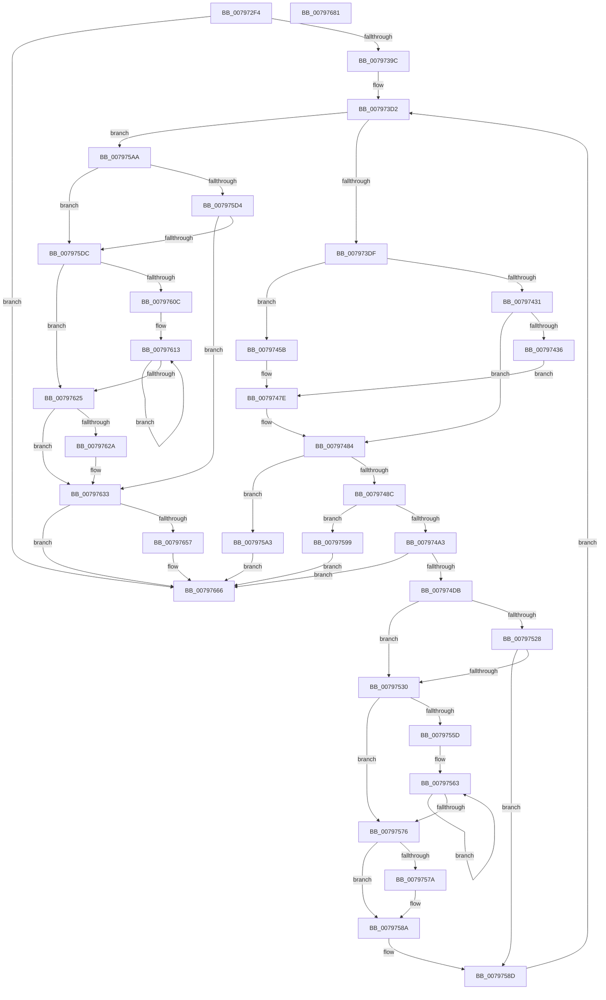

# Xp10CompressBuffer

- RVA: `0x007972F4`–`0x00797682` (길이 `910` bytes)
- VA: `0x00000001407972F4`
- 실행 섹션: `PAGE`
- PDB 이름 있음: `예`; PDB Function 태그: `아니요`
- unwind 정보 RVA: `0x000D0348`
- 디코드: `270`개 명령, `910/910` bytes 표시
- 미해석 바이트: `0` (있으면 어셈블리에 `.byte`로 보존)

> 이 문서는 커널 이미지의 기계어와 PDB 기호를 분석해 생성했습니다. 4번과 5번은 함수 원형과 자료형을 바이너리 사용 방식에서 추정한 C 해석이며 원본 소스 복구 결과는 아닙니다.

## 1. Dependencies

- 직접 호출 지점: **9**; 고유 호출 대상: **6**
- 직접 호출자로 확인된 함수: **1**
- RIP 상대 이미지 참조: **1**

### Outgoing calls
- `0x00797349` → [memset](../../text/6C/memset_function_006C6C40.md) (function, `0x006C6C40`)
- `0x00797381` → [memset](../../text/6C/memset_function_006C6C40.md) (function, `0x006C6C40`)
- `0x0079738D` → [Xp10ValidateParametersAndFillFrameHeader](Xp10ValidateParametersAndFillFrameHeader_function_0079A464.md) (function, `0x0079A464`)
- `0x007973EB` → [memset](../../text/6C/memset_function_006C6C40.md) (function, `0x006C6C40`)
- `0x007973FF` → [memset](../../text/6C/memset_function_006C6C40.md) (function, `0x006C6C40`)
- `0x00797454` → [Xp10ExecuteLz77PassMinMatchLen4](Xp10ExecuteLz77PassMinMatchLen4_function_00798CF4.md) (function, `0x00798CF4`)
- `0x00797479` → [Xp10ExecuteLz77PassMinMatchLen3](Xp10ExecuteLz77PassMinMatchLen3_function_0079859C.md) (function, `0x0079859C`)
- `0x007974CC` → [Xp10ExecuteHuffmanEncode](Xp10ExecuteHuffmanEncode_function_00798100.md) (function, `0x00798100`)
- `0x0079764B` → [Xp10ComputeAndWriteCrc](Xp10ComputeAndWriteCrc_function_007978A4.md) (function, `0x007978A4`)

### Direct callers
- [RtlCompressBufferXp10](RtlCompressBufferXp10_function_00795900.md) at `0x0079595C`

### Static image references
- `0x00797533` → RVA `0x00034820` (`.rdata`; read)

## 2. Other-region calls and transfers

- 다른 실행 섹션으로 향하는 call: **4**
  - `0x00797349` → [memset](../../text/6C/memset_function_006C6C40.md) (`PAGE` → `.text`)
  - `0x00797381` → [memset](../../text/6C/memset_function_006C6C40.md) (`PAGE` → `.text`)
  - `0x007973EB` → [memset](../../text/6C/memset_function_006C6C40.md) (`PAGE` → `.text`)
  - `0x007973FF` → [memset](../../text/6C/memset_function_006C6C40.md) (`PAGE` → `.text`)
- 별도 외부 분기/꼬리 이동을 확인하지 못했습니다.

## 3. Assembly (complete function range)

```asm
007972F4  48 8B C4                        mov rax, rsp
007972F7  48 89 58 10                     mov qword ptr [rax + 0x10], rbx
007972FB  44 89 40 18                     mov dword ptr [rax + 0x18], r8d
007972FF  48 89 48 08                     mov qword ptr [rax + 8], rcx
00797303  55                              push rbp
00797304  56                              push rsi
00797305  57                              push rdi
00797306  41 54                           push r12
00797308  41 55                           push r13
0079730A  41 56                           push r14
0079730C  41 57                           push r15
0079730E  48 8D 68 B9                     lea rbp, [rax - 0x47]
00797312  48 81 EC 90 00 00 00            sub rsp, 0x90
00797319  4C 8B 75 7F                     mov r14, qword ptr [rbp + 0x7f]
0079731D  33 C0                           xor eax, eax
0079731F  8B 75 6F                        mov esi, dword ptr [rbp + 0x6f]
00797322  4C 8B EA                        mov r13, rdx
00797325  83 65 BF 00                     and dword ptr [rbp - 0x41], 0
00797329  48 8B D9                        mov rbx, rcx
0079732C  0F 57 C0                        xorps xmm0, xmm0
0079732F  89 45 CF                        mov dword ptr [rbp - 0x31], eax
00797332  49 8D 4E 18                     lea rcx, [r14 + 0x18]
00797336  66 89 45 D3                     mov word ptr [rbp - 0x2d], ax
0079733A  33 D2                           xor edx, edx
0079733C  41 B8 08 25 01 00               mov r8d, 0x12508
00797342  49 8B F9                        mov rdi, r9
00797345  0F 11 45 EF                     movups xmmword ptr [rbp - 0x11], xmm0
00797349  E8 F2 F8 F2 FF                  call 0x1406c6c40
0079734E  83 65 6F 00                     and dword ptr [rbp + 0x6f], 0
00797352  4D 8D A6 20 25 01 00            lea r12, [r14 + 0x12520]
00797359  49 89 1E                        mov qword ptr [r14], rbx
0079735C  0F 57 C0                        xorps xmm0, xmm0
0079735F  41 0F 11 46 08                  movups xmmword ptr [r14 + 8], xmm0
00797364  0F B7 0B                        movzx ecx, word ptr [rbx]
00797367  B8 01 00 00 00                  mov eax, 1
0079736C  83 E1 1F                        and ecx, 0x1f
0079736F  44 8B C6                        mov r8d, esi
00797372  D3 E0                           shl eax, cl
00797374  33 D2                           xor edx, edx
00797376  89 45 C3                        mov dword ptr [rbp - 0x3d], eax
00797379  48 8B CF                        mov rcx, rdi
0079737C  03 C0                           add eax, eax
0079737E  89 45 7F                        mov dword ptr [rbp + 0x7f], eax
00797381  E8 BA F8 F2 FF                  call 0x1406c6c40
00797386  48 8D 55 CF                     lea rdx, [rbp - 0x31]
0079738A  48 8B CB                        mov rcx, rbx
0079738D  E8 D2 30 00 00                  call 0x14079a464
00797392  8B D8                           mov ebx, eax
00797394  85 C0                           test eax, eax
00797396  0F 88 CA 02 00 00               js 0x140797666
0079739C  8B 45 CF                        mov eax, dword ptr [rbp - 0x31]
0079739F  89 07                           mov dword ptr [rdi], eax
007973A1  0F B7 45 D3                     movzx eax, word ptr [rbp - 0x2d]
007973A5  66 89 47 04                     mov word ptr [rdi + 4], ax
007973A9  48 89 7D DF                     mov qword ptr [rbp - 0x21], rdi
007973AD  BF FF FF FF 1F                  mov edi, 0x1fffffff
007973B2  3B F7                           cmp esi, edi
007973B4  C7 45 E7 30 00 00 00            mov dword ptr [rbp - 0x19], 0x30
007973BB  0F 46 FE                        cmovbe edi, esi
007973BE  33 C0                           xor eax, eax
007973C0  C1 E7 03                        shl edi, 3
007973C3  45 33 D2                        xor r10d, r10d
007973C6  33 F6                           xor esi, esi
007973C8  89 7D EB                        mov dword ptr [rbp - 0x15], edi
007973CB  45 33 FF                        xor r15d, r15d
007973CE  48 89 45 CF                     mov qword ptr [rbp - 0x31], rax
007973D2  44 8B 5D 5F                     mov r11d, dword ptr [rbp + 0x5f]
007973D6  45 3B FB                        cmp r15d, r11d
007973D9  0F 83 CB 01 00 00               jae 0x1407975aa
007973DF  49 8D 4E 1C                     lea rcx, [r14 + 0x1c]
007973E3  33 D2                           xor edx, edx
007973E5  41 B8 00 0B 00 00               mov r8d, 0xb00
007973EB  E8 50 F8 F2 FF                  call 0x1406c6c40
007973F0  49 8D 8E 1C 0B 00 00            lea rcx, [r14 + 0xb1c]
007973F7  33 D2                           xor edx, edx
007973F9  41 B8 00 04 00 00               mov r8d, 0x400
007973FF  E8 3C F8 F2 FF                  call 0x1406c6c40
00797404  8B 45 5F                        mov eax, dword ptr [rbp + 0x5f]
00797407  41 2B C7                        sub eax, r15d
0079740A  3B 45 C3                        cmp eax, dword ptr [rbp - 0x3d]
0079740D  0F 43 45 C3                     cmovae eax, dword ptr [rbp - 0x3d]
00797411  44 8B D0                        mov r10d, eax
00797414  4C 89 55 CF                     mov qword ptr [rbp - 0x31], r10
00797418  4D 8D 04 07                     lea r8, [r15 + rax]
0079741C  48 8B 45 4F                     mov rax, qword ptr [rbp + 0x4f]
00797420  4D 03 C5                        add r8, r13
00797423  0F B7 08                        movzx ecx, word ptr [rax]
00797426  C1 E9 05                        shr ecx, 5
00797429  83 E1 07                        and ecx, 7
0079742C  83 E9 03                        sub ecx, 3
0079742F  74 2A                           je 0x14079745b
00797431  83 F9 01                        cmp ecx, 1
00797434  75 4E                           jne 0x140797484
00797436  8B 45 7F                        mov eax, dword ptr [rbp + 0x7f]
00797439  48 8D 4D 6F                     lea rcx, [rbp + 0x6f]
0079743D  48 89 4C 24 28                  mov qword ptr [rsp + 0x28], rcx
00797442  4B 8D 14 2F                     lea rdx, [r15 + r13]
00797446  49 03 C4                        add rax, r12
00797449  49 8B CE                        mov rcx, r14
0079744C  4D 8B CC                        mov r9, r12
0079744F  48 89 44 24 20                  mov qword ptr [rsp + 0x20], rax
00797454  E8 9B 18 00 00                  call 0x140798cf4
00797459  EB 23                           jmp 0x14079747e
0079745B  8B 45 7F                        mov eax, dword ptr [rbp + 0x7f]
0079745E  48 8D 4D 6F                     lea rcx, [rbp + 0x6f]
00797462  48 89 4C 24 28                  mov qword ptr [rsp + 0x28], rcx
00797467  4B 8D 14 2F                     lea rdx, [r15 + r13]
0079746B  49 03 C4                        add rax, r12
0079746E  49 8B CE                        mov rcx, r14
00797471  4D 8B CC                        mov r9, r12
00797474  48 89 44 24 20                  mov qword ptr [rsp + 0x20], rax
00797479  E8 1E 11 00 00                  call 0x14079859c
0079747E  4C 8B 55 CF                     mov r10, qword ptr [rbp - 0x31]
00797482  8B D8                           mov ebx, eax
00797484  85 DB                           test ebx, ebx
00797486  0F 88 17 01 00 00               js 0x1407975a3
0079748C  8B 45 E7                        mov eax, dword ptr [rbp - 0x19]
0079748F  0F 28 45 DF                     movaps xmm0, xmmword ptr [rbp - 0x21]
00797493  83 C0 20                        add eax, 0x20
00797496  66 0F 7F 45 FF                  movdqa xmmword ptr [rbp - 1], xmm0
0079749B  3B C7                           cmp eax, edi
0079749D  0F 87 F6 00 00 00               ja 0x140797599
007974A3  89 45 E7                        mov dword ptr [rbp - 0x19], eax
007974A6  4B 8D 14 2F                     lea rdx, [r15 + r13]
007974AA  48 8D 45 BF                     lea rax, [rbp - 0x41]
007974AE  4D 8B CC                        mov r9, r12
007974B1  48 89 44 24 30                  mov qword ptr [rsp + 0x30], rax
007974B6  45 8B C2                        mov r8d, r10d
007974B9  48 8D 45 DF                     lea rax, [rbp - 0x21]
007974BD  49 8B CE                        mov rcx, r14
007974C0  48 89 44 24 28                  mov qword ptr [rsp + 0x28], rax
007974C5  8B 45 6F                        mov eax, dword ptr [rbp + 0x6f]
007974C8  89 44 24 20                     mov dword ptr [rsp + 0x20], eax
007974CC  E8 2F 0C 00 00                  call 0x140798100
007974D1  8B D8                           mov ebx, eax
007974D3  85 C0                           test eax, eax
007974D5  0F 88 8B 01 00 00               js 0x140797666
007974DB  44 8B 55 07                     mov r10d, dword ptr [rbp + 7]
007974DF  41 BB 20 00 00 00               mov r11d, 0x20
007974E5  48 8B 55 FF                     mov rdx, qword ptr [rbp - 1]
007974E9  45 8B C2                        mov r8d, r10d
007974EC  44 8B 4D E7                     mov r9d, dword ptr [rbp - 0x19]
007974F0  41 8B CA                        mov ecx, r10d
007974F3  8B 45 BF                        mov eax, dword ptr [rbp - 0x41]
007974F6  45 2B CA                        sub r9d, r10d
007974F9  8B 75 0B                        mov esi, dword ptr [rbp + 0xb]
007974FC  41 8D 7B E8                     lea edi, [r11 - 0x18]
00797500  83 E0 01                        and eax, 1
00797503  49 C1 E8 03                     shr r8, 3
00797507  C1 E0 1D                        shl eax, 0x1d
0079750A  41 81 E1 FF FF FF 0F            and r9d, 0xfffffff
00797511  83 E1 07                        and ecx, 7
00797514  48 89 55 CF                     mov qword ptr [rbp - 0x31], rdx
00797518  44 0B C8                        or r9d, eax
0079751B  2B F9                           sub edi, ecx
0079751D  41 8D 42 20                     lea eax, [r10 + 0x20]
00797521  4C 03 C2                        add r8, rdx
00797524  3B C6                           cmp eax, esi
00797526  76 08                           jbe 0x140797530
00797528  44 8B DE                        mov r11d, esi
0079752B  45 2B DA                        sub r11d, r10d
0079752E  74 5D                           je 0x14079758d
00797530  41 3B FB                        cmp edi, r11d
00797533  48 8D 05 E6 D2 89 FF            lea rax, [rip - 0x762d1a]
0079753A  8B D7                           mov edx, edi
0079753C  41 0F 43 D3                     cmovae edx, r11d
00797540  8A 04 90                        mov al, byte ptr [rax + rdx*4]
00797543  41 22 C1                        and al, r9b
00797546  D2 E0                           shl al, cl
00797548  8B CF                           mov ecx, edi
0079754A  41 08 00                        or byte ptr [r8], al
0079754D  41 8B C3                        mov eax, r11d
00797550  2B C2                           sub eax, edx
00797552  41 D3 E9                        shr r9d, cl
00797555  49 FF C0                        inc r8
00797558  83 F8 08                        cmp eax, 8
0079755B  72 19                           jb 0x140797576
0079755D  8B C8                           mov ecx, eax
0079755F  48 C1 E9 03                     shr rcx, 3
00797563  45 88 08                        mov byte ptr [r8], r9b
00797566  83 C0 F8                        add eax, -8
00797569  41 C1 E9 08                     shr r9d, 8
0079756D  49 FF C0                        inc r8
00797570  48 83 E9 01                     sub rcx, 1
00797574  75 ED                           jne 0x140797563
00797576  85 C0                           test eax, eax
00797578  74 10                           je 0x14079758a
0079757A  48 8D 0D 9F D2 89 FF            lea rcx, [rip - 0x762d61]
00797581  8A 0C 81                        mov cl, byte ptr [rcx + rax*4]
00797584  41 22 C9                        and cl, r9b
00797587  41 08 08                        or byte ptr [r8], cl
0079758A  45 03 D3                        add r10d, r11d
0079758D  44 03 7D C3                     add r15d, dword ptr [rbp - 0x3d]
00797591  8B 7D EB                        mov edi, dword ptr [rbp - 0x15]
00797594  E9 39 FE FF FF                  jmp 0x1407973d2
00797599  B8 23 00 00 C0                  mov eax, 0xc0000023
0079759E  E9 C3 00 00 00                  jmp 0x140797666
007975A3  8B C3                           mov eax, ebx
007975A5  E9 BC 00 00 00                  jmp 0x140797666
007975AA  41 8D 52 FF                     lea edx, [r10 - 1]
007975AE  BB 01 00 00 00                  mov ebx, 1
007975B3  44 8B CA                        mov r9d, edx
007975B6  8D 42 01                        lea eax, [rdx + 1]
007975B9  49 C1 E9 03                     shr r9, 3
007975BD  8B CA                           mov ecx, edx
007975BF  4C 03 4D CF                     add r9, qword ptr [rbp - 0x31]
007975C3  83 E1 07                        and ecx, 7
007975C6  44 8D 53 07                     lea r10d, [rbx + 7]
007975CA  44 8B C3                        mov r8d, ebx
007975CD  44 2B D1                        sub r10d, ecx
007975D0  3B C6                           cmp eax, esi
007975D2  76 08                           jbe 0x1407975dc
007975D4  44 8B C6                        mov r8d, esi
007975D7  44 2B C2                        sub r8d, edx
007975DA  74 57                           je 0x140797633
007975DC  45 3B D0                        cmp r10d, r8d
007975DF  48 8D 3D 3A D2 89 FF            lea rdi, [rip - 0x762dc6]
007975E6  41 8B C2                        mov eax, r10d
007975E9  41 0F 43 C0                     cmovae eax, r8d
007975ED  8B D0                           mov edx, eax
007975EF  44 2B C2                        sub r8d, edx
007975F2  8B D3                           mov edx, ebx
007975F4  8A 04 87                        mov al, byte ptr [rdi + rax*4]
007975F7  22 C3                           and al, bl
007975F9  D2 E0                           shl al, cl
007975FB  41 8B CA                        mov ecx, r10d
007975FE  41 08 01                        or byte ptr [r9], al
00797601  4C 03 CB                        add r9, rbx
00797604  D3 EA                           shr edx, cl
00797606  41 83 F8 08                     cmp r8d, 8
0079760A  72 19                           jb 0x140797625
0079760C  41 8B C0                        mov eax, r8d
0079760F  48 C1 E8 03                     shr rax, 3
00797613  41 88 11                        mov byte ptr [r9], dl
00797616  41 83 C0 F8                     add r8d, -8
0079761A  C1 EA 08                        shr edx, 8
0079761D  4C 03 CB                        add r9, rbx
00797620  48 2B C3                        sub rax, rbx
00797623  75 EE                           jne 0x140797613
00797625  45 85 C0                        test r8d, r8d
00797628  74 09                           je 0x140797633
0079762A  42 8A 0C 87                     mov cl, byte ptr [rdi + r8*4]
0079762E  22 CA                           and cl, dl
00797630  41 08 09                        or byte ptr [r9], cl
00797633  48 8B 4D 4F                     mov rcx, qword ptr [rbp + 0x4f]
00797637  4C 8D 45 DF                     lea r8, [rbp - 0x21]
0079763B  83 65 F7 00                     and dword ptr [rbp - 9], 0
0079763F  48 8D 55 EF                     lea rdx, [rbp - 0x11]
00797643  4C 89 6D EF                     mov qword ptr [rbp - 0x11], r13
00797647  44 89 5D FB                     mov dword ptr [rbp - 5], r11d
0079764B  E8 54 02 00 00                  call 0x1407978a4
00797650  44 8B C0                        mov r8d, eax
00797653  85 C0                           test eax, eax
00797655  78 0F                           js 0x140797666
00797657  48 8B 45 77                     mov rax, qword ptr [rbp + 0x77]
0079765B  8B 4D E7                        mov ecx, dword ptr [rbp - 0x19]
0079765E  C1 E9 03                        shr ecx, 3
00797661  89 08                           mov dword ptr [rax], ecx
00797663  41 8B C0                        mov eax, r8d
00797666  48 8B 9C 24 D8 00 00 00         mov rbx, qword ptr [rsp + 0xd8]
0079766E  48 81 C4 90 00 00 00            add rsp, 0x90
00797675  41 5F                           pop r15
00797677  41 5E                           pop r14
00797679  41 5D                           pop r13
0079767B  41 5C                           pop r12
0079767D  5F                              pop rdi
0079767E  5E                              pop rsi
0079767F  5D                              pop rbp
00797680  C3                              ret
00797681  CC                              int3
```

## 4. C-style interpretation (structured pseudocode)

```c
__int64 __fastcall Xp10CompressBuffer(__int64 a1, __int64 a2, int a3, __int64 a4)
{
    __int64 result;
    __int64 v_r10;
    __int64 v_r11;
    __int64 v_r15;
    __int64 v_rdi;
    __int64 v_rsi;
    __int64 v_rsp;
    unsigned __int64 v_stack_m98;
    unsigned __int64 v_stack_mA0;
    unsigned __int64 v_stack_mA8;
    unsigned __int64 v_stack_p10;

    *(unsigned __int64 *)(v_rsp + 16) = v_rbx;
    *(unsigned int *)(v_rsp + 24) = a3;
    *(unsigned __int64 *)(v_rsp + 8) = a1;
    v_rsp = (v_rsp) - (144);
    result = 0;
    *(unsigned int *)(v_rsp - 71 - 49) = 0;
    *(unsigned __int16 *)(v_rsp - 71 - 45) = 0;
    a2 = 0;
    *(unsigned __int64 *)(v_rsp - 71 - 17) = v_xmm0;
    result = memset(*(unsigned __int64 *)(v_rsp - 71 + 127) + 24, a2, (unsigned int)(0x12508ULL), a4);
    *(unsigned __int64 *)(*(unsigned __int64 *)(v_rsp - 71 + 127)) = a1;
    *(unsigned __int64 *)(*(unsigned __int64 *)(v_rsp - 71 + 127) + 8) = v_xmm0;
    a1 = (unsigned int)((*(unsigned __int16 *)(a1)) & (31));
    result = (unsigned int)((1) << ((unsigned __int8)(a1)));
    a2 = 0;
    *(unsigned int *)(v_rsp - 71 - 61) = (unsigned int)(result);
    result = (unsigned int)((result) + ((unsigned int)(result)));
    *(unsigned int *)(v_rsp - 71 + 127) = (unsigned int)(result);
    result = memset(a4, a2, (unsigned int)((unsigned int)((unsigned int)(*(unsigned int *)(v_rsp - 71 + 111)))), a4);
    result = Xp10ValidateParametersAndFillFrameHeader(a1, v_rsp - 71 - 49, (unsigned int)((unsigned int)((unsigned int)(*(unsigned int *)(v_rsp - 71 + 111)))), a4);
    if (sign_flag) goto loc_00797666;
    *(unsigned int *)(a4) = (unsigned int)((unsigned int)(*(unsigned int *)(v_rsp - 71 - 49)));
    *(unsigned __int16 *)(a4 + 4) = (unsigned __int16)(*(unsigned __int16 *)(v_rsp - 71 - 45));
    *(unsigned __int64 *)(v_rsp - 71 - 33) = a4;
    *(unsigned int *)(v_rsp - 71 - 25) = 48;
    v_rdi = (unsigned int)(0x1FFFFFFFULL);
    if (((unsigned int)((unsigned int)(*(unsigned int *)(v_rsp - 71 + 111)))) <= ((unsigned int)((unsigned int)(0x1FFFFFFFULL)))) { v_rdi = (unsigned int)((unsigned int)(*(unsigned int *)(v_rsp - 71 + 111))); }
    result = 0;
    v_rdi = (unsigned int)((v_rdi) << (3));
    v_r10 = 0;
    v_rsi = 0;
    *(unsigned int *)(v_rsp - 71 - 21) = (unsigned int)(v_rdi);
    v_r15 = 0;
    *(unsigned __int64 *)(v_rsp - 71 - 49) = 0;
loc_007973D2:
    if (0 >= ((unsigned int)((unsigned int)(*(unsigned int *)(v_rsp - 71 + 95))))) goto loc_007975AA;
    a2 = 0;
    result = memset(*(unsigned __int64 *)(v_rsp - 71 + 127) + 28, a2, (unsigned int)(0xB00ULL), a4);
    a2 = 0;
    result = memset(*(unsigned __int64 *)(v_rsp - 71 + 127) + 2844, a2, (unsigned int)(0x400ULL), a4);
    result = (unsigned int)(((unsigned int)(*(unsigned int *)(v_rsp - 71 + 95))) - (0));
    if (((unsigned int)(result)) >= (*(unsigned int *)(v_rsp - 71 - 61))) { result = *(unsigned int *)(v_rsp - 71 - 61); }
    *(unsigned __int64 *)(v_rsp - 71 - 49) = (unsigned int)((unsigned int)(result));
    a3 = (v_r15 + result * 1) + (0);
    a1 = (unsigned int)((*(unsigned __int16 *)(*(unsigned __int64 *)(v_rsp - 71 + 79))) >> (5));
    a1 = (unsigned int)((a1) & (7));
    a1 = (unsigned int)((a1) - (3));
    if (condition_is_equal) goto loc_0079745B;
    if (((unsigned int)(a1)) != 1) goto loc_00797484;
    v_stack_mA0 = v_rsp - 71 + 111;
    result = ((unsigned int)(*(unsigned int *)(v_rsp - 71 + 127))) + (*(unsigned __int64 *)(v_rsp - 71 + 127) + 75040);
    v_stack_mA8 = result;
    result = Xp10ExecuteLz77PassMinMatchLen4(*(unsigned __int64 *)(v_rsp - 71 + 127), v_r15 + a2 * 1, a3, *(unsigned __int64 *)(v_rsp - 71 + 127) + 75040);
    goto loc_0079747E;
loc_0079745B:
    v_stack_mA0 = v_rsp - 71 + 111;
    result = ((unsigned int)(*(unsigned int *)(v_rsp - 71 + 127))) + (*(unsigned __int64 *)(v_rsp - 71 + 127) + 75040);
    v_stack_mA8 = result;
    result = Xp10ExecuteLz77PassMinMatchLen3(*(unsigned __int64 *)(v_rsp - 71 + 127), v_r15 + a2 * 1, a3, *(unsigned __int64 *)(v_rsp - 71 + 127) + 75040);
loc_0079747E:
loc_00797484:
    if (sign_flag) goto loc_007975A3;
    result = (unsigned int)(((unsigned int)(*(unsigned int *)(v_rsp - 71 - 25))) + (32));
    *(unsigned __int64 *)(v_rsp - 71 - 1) = v_xmm0;
    if (((unsigned int)(result)) > ((unsigned int)(v_rdi))) goto loc_00797599;
    *(unsigned int *)(v_rsp - 71 - 25) = (unsigned int)(result);
    v_stack_m98 = v_rsp - 71 - 65;
    v_stack_mA0 = v_rsp - 71 - 33;
    v_stack_mA8 = (unsigned int)((unsigned int)(*(unsigned int *)(v_rsp - 71 + 111)));
    result = Xp10ExecuteHuffmanEncode(*(unsigned __int64 *)(v_rsp - 71 + 127), v_r15 + a2 * 1, (unsigned int)((unsigned int)(*(unsigned __int64 *)(v_rsp - 71 - 49))), *(unsigned __int64 *)(v_rsp - 71 + 127) + 75040);
    if (sign_flag) goto loc_00797666;
    a4 = (unsigned int)(((unsigned int)(*(unsigned int *)(v_rsp - 71 - 25))) - ((unsigned int)((unsigned int)(*(unsigned int *)(v_rsp - 71 + 7)))));
    result = (unsigned int)(((unsigned int)(*(unsigned int *)(v_rsp - 71 - 65))) & (1));
    a3 = ((unsigned int)((unsigned int)((unsigned int)(*(unsigned int *)(v_rsp - 71 + 7))))) >> (3);
    result = (unsigned int)((result) << (29));
    a4 = (unsigned int)((a4) & (0xFFFFFFFULL));
    a1 = (unsigned int)(((unsigned int)((unsigned int)((unsigned int)(*(unsigned int *)(v_rsp - 71 + 7))))) & (7));
    *(unsigned __int64 *)(v_rsp - 71 - 49) = *(unsigned __int64 *)(v_rsp - 71 - 1);
    a4 = (unsigned int)((a4) | ((unsigned int)(result)));
    v_rdi = (unsigned int)((32 - 24) - ((unsigned int)(a1)));
    a3 = (a3) + (*(unsigned __int64 *)(v_rsp - 71 - 1));
    if (((unsigned int)((unsigned int)(*(unsigned int *)(v_rsp - 71 + 7)) + 32)) <= ((unsigned int)((unsigned int)(*(unsigned int *)(v_rsp - 71 + 11))))) goto loc_00797530;
    v_r11 = (unsigned int)(((unsigned int)((unsigned int)((unsigned int)(*(unsigned int *)(v_rsp - 71 + 11))))) - ((unsigned int)((unsigned int)(*(unsigned int *)(v_rsp - 71 + 7)))));
    if (condition_is_equal) goto loc_0079758D;
loc_00797530:
    a2 = (unsigned int)((unsigned int)(v_rdi));
    if (((unsigned int)(v_rdi)) >= ((unsigned int)(v_r11))) { a2 = (unsigned int)(v_r11); }
    result = (unsigned __int8)((*(unsigned __int8 *)(v_rip - 7744794 + a2 * 4)) & ((unsigned __int8)(a4)));
    result = (unsigned __int8)((result) << ((unsigned __int8)(a1)));
    result = (unsigned int)(((unsigned int)((unsigned int)(v_r11))) - ((unsigned int)(a2)));
    a4 = (unsigned int)((a4) >> ((unsigned __int8)((unsigned int)((unsigned int)(v_rdi)))));
    a3 = (a3) + 1;
    if (((unsigned int)(result)) < 8) goto loc_00797576;
    a1 = ((unsigned int)((unsigned int)(result))) >> (3);
loc_00797563:
    *(unsigned __int8 *)(a3) = (unsigned __int8)(a4);
    result = (unsigned int)((result) + (-8));
    a4 = (unsigned int)((a4) >> (8));
    a3 = (a3) + 1;
    a1 = (a1) - (1);
    if (condition_is_not_equal) goto loc_00797563;
loc_00797576:
    if ((unsigned int)(result) != 0) {
        a1 = v_rip - 7744865;
        a1 = *(unsigned __int8 *)(a1 + result * 4);
        a1 = (unsigned __int8)((a1) & ((unsigned __int8)(a4)));
    }
    v_r10 = (unsigned int)(((unsigned int)(*(unsigned int *)(v_rsp - 71 + 7))) + ((unsigned int)(v_r11)));
loc_0079758D:
    v_r15 = (unsigned int)((v_r15) + (*(unsigned int *)(v_rsp - 71 - 61)));
    goto loc_007973D2;
loc_00797599:
    goto loc_00797666;
loc_007975A3:
    goto loc_00797666;
loc_007975AA:
    a4 = ((unsigned int)((unsigned int)(v_r10 - 1))) >> (3);
    a4 = (a4) + (*(unsigned __int64 *)(v_rsp - 71 - 49));
    a1 = (unsigned int)(((unsigned int)((unsigned int)(v_r10 - 1))) & (7));
    v_r10 = (unsigned int)((1 + 7) - ((unsigned int)(a1)));
    if (((unsigned int)(v_r10 - 1 + 1)) <= ((unsigned int)((unsigned int)(*(unsigned int *)(v_rsp - 71 + 11))))) goto loc_007975DC;
    a3 = (unsigned int)(((unsigned int)((unsigned int)((unsigned int)(*(unsigned int *)(v_rsp - 71 + 11))))) - ((unsigned int)(v_r10 - 1)));
    if (condition_is_equal) goto loc_00797633;
loc_007975DC:
    result = (unsigned int)((unsigned int)(v_r10));
    if (((unsigned int)(v_r10)) >= a3) { result = a3; }
    a3 = (unsigned int)((a3) - ((unsigned int)((unsigned int)((unsigned int)(result)))));
    result = (unsigned __int8)((*(unsigned __int8 *)(v_rip - 7744966 + result * 4)) & (1));
    result = (unsigned __int8)((result) << ((unsigned __int8)(a1)));
    a4 = (a4) + (1);
    a2 = (unsigned int)((1) >> ((unsigned __int8)((unsigned int)((unsigned int)(v_r10)))));
    if (a3 < 8) goto loc_00797625;
    result = ((unsigned int)(a3)) >> (3);
loc_00797613:
    *(unsigned __int8 *)(a4) = (unsigned __int8)(a2);
    a3 = (unsigned int)((a3) + (-8));
    a2 = (unsigned int)((a2) >> (8));
    a4 = (a4) + (1);
    result = (result) - (1);
    if (condition_is_not_equal) goto loc_00797613;
loc_00797625:
    if (a3 != 0) {
        a1 = *(unsigned __int8 *)(v_rip - 7744966 + a3 * 4);
        a1 = (unsigned __int8)((a1) & ((unsigned __int8)(a2)));
    }
    *(unsigned __int64 *)(v_rsp - 71 - 17) = a2;
    *(unsigned int *)(v_rsp - 71 - 5) = (unsigned int)(v_r11);
    result = Xp10ComputeAndWriteCrc(*(unsigned __int64 *)(v_rsp - 71 + 79), v_rsp - 71 - 17, v_rsp - 71 - 33, a4);
    if (!(sign_flag)) {
        result = *(unsigned __int64 *)(v_rsp - 71 + 119);
        a1 = *(unsigned int *)(v_rsp - 71 - 25);
        a1 = (unsigned int)((a1) >> (3));
        *(unsigned int *)(result) = (unsigned int)(a1);
        result = (unsigned int)((unsigned int)((unsigned int)(result)));
    }
    v_rsp = (v_rsp) + (144);
    return result;
}
```

## 5. (Beta) C Style

```c
int64_t Xp10CompressBuffer(void *Arg1, int64_t Arg2, int32_t Arg3, void *Arg4)
{
    uint8_t *arg1 = (uint8_t *)Arg1;
    uint8_t *arg4 = (uint8_t *)Arg4;

    int64_t result;
    int64_t local_r10;
    int64_t local_r11;
    int64_t local_r15;
    int64_t local_rdi;
    int64_t local_rsi;
    int64_t local_rsp;
    uint64_t v_stack_m98;
    uint64_t v_stack_mA0;
    uint64_t v_stack_mA8;
    uint64_t v_stack_p10;

    *(uint64_t *)(local_rsp + 0x10) = local_rbx;
    *(uint32_t *)(local_rsp + 0x18) = Arg3;
    *(void **)(local_rsp + 0x8) = Arg1;
    local_rsp = (local_rsp) - (144);
    result = 0;
    *(uint32_t *)(local_rsp - 0x47 - 0x31) = 0;
    *(uint16_t *)(local_rsp - 0x47 - 0x2D) = 0;
    Arg2 = 0;
    *(uint64_t *)(local_rsp - 0x47 - 0x11) = v_xmm0;
    result = memset(*(uint64_t *)(local_rsp - 0x47 + 0x7F) + 24, Arg2, (uint32_t)(0x12508ULL), Arg4);
    *(void **)(*(uint64_t *)(local_rsp - 0x47 + 0x7F)) = Arg1;
    *(uint64_t *)(*(uint64_t *)(local_rsp - 0x47 + 0x7F) + 0x8) = v_xmm0;
    Arg1 = (uint32_t)((*(uint16_t *)(arg1)) & (31));
    result = (uint32_t)((1) << ((uint8_t)(Arg1)));
    Arg2 = 0;
    *(uint32_t *)(local_rsp - 0x47 - 0x3D) = (uint32_t)(result);
    result = (uint32_t)((result) + ((uint32_t)(result)));
    *(uint32_t *)(local_rsp - 0x47 + 0x7F) = (uint32_t)(result);
    result = memset(Arg4, Arg2, (uint32_t)((uint32_t)((uint32_t)(*(uint32_t *)(local_rsp - 0x47 + 0x6F)))), Arg4);
    result = Xp10ValidateParametersAndFillFrameHeader(Arg1, local_rsp - 71 - 49, (uint32_t)((uint32_t)((uint32_t)(*(uint32_t *)(local_rsp - 0x47 + 0x6F)))), Arg4);
    if (sign_flag) goto loc_00797666;
    *(uint32_t *)(arg4) = (uint32_t)((uint32_t)(*(uint32_t *)(local_rsp - 0x47 - 0x31)));
    *(uint16_t *)(arg4 + 0x4) = (uint16_t)(*(uint16_t *)(local_rsp - 0x47 - 0x2D));
    *(void **)(local_rsp - 0x47 - 0x21) = Arg4;
    *(uint32_t *)(local_rsp - 0x47 - 0x19) = 48;
    local_rdi = (uint32_t)(0x1FFFFFFFULL);
    if (((uint32_t)((uint32_t)(*(uint32_t *)(local_rsp - 0x47 + 0x6F)))) <= ((uint32_t)((uint32_t)(0x1FFFFFFFULL)))) { local_rdi = (uint32_t)((uint32_t)(*(uint32_t *)(local_rsp - 0x47 + 0x6F))); }
    result = 0;
    local_rdi = (uint32_t)((local_rdi) << (3));
    local_r10 = 0;
    local_rsi = 0;
    *(uint32_t *)(local_rsp - 0x47 - 0x15) = (uint32_t)(local_rdi);
    local_r15 = 0;
    *(uint64_t *)(local_rsp - 0x47 - 0x31) = 0;
loc_007973D2:
    if (0 >= ((uint32_t)((uint32_t)(*(uint32_t *)(local_rsp - 0x47 + 0x5F))))) goto loc_007975AA;
    Arg2 = 0;
    result = memset(*(uint64_t *)(local_rsp - 0x47 + 0x7F) + 28, Arg2, (uint32_t)(0xB00ULL), Arg4);
    Arg2 = 0;
    result = memset(*(uint64_t *)(local_rsp - 0x47 + 0x7F) + 2844, Arg2, (uint32_t)(0x400ULL), Arg4);
    result = (uint32_t)(((uint32_t)(*(uint32_t *)(local_rsp - 0x47 + 0x5F))) - (0));
    if (((uint32_t)(result)) >= (*(uint32_t *)(local_rsp - 0x47 - 0x3D))) { result = *(uint32_t *)(local_rsp - 0x47 - 0x3D); }
    *(uint64_t *)(local_rsp - 0x47 - 0x31) = (uint32_t)((uint32_t)(result));
    Arg3 = (local_r15 + result * 1) + (0);
    Arg1 = (uint32_t)((*(uint16_t *)(*(uint64_t *)(local_rsp - 0x47 + 0x4F))) >> (5));
    Arg1 = (uint32_t)((Arg1) & (7));
    Arg1 = (uint32_t)((Arg1) - (3));
    if (condition_is_equal) goto loc_0079745B;
    if (((uint32_t)(Arg1)) != 1) goto loc_00797484;
    v_stack_mA0 = local_rsp - 71 + 111;
    result = ((uint32_t)(*(uint32_t *)(local_rsp - 0x47 + 0x7F))) + (*(uint64_t *)(local_rsp - 0x47 + 0x7F) + 75040);
    v_stack_mA8 = result;
    result = Xp10ExecuteLz77PassMinMatchLen4(*(uint64_t *)(local_rsp - 0x47 + 0x7F), local_r15 + Arg2 * 1, Arg3, *(uint64_t *)(local_rsp - 0x47 + 0x7F) + 75040);
    goto loc_0079747E;
loc_0079745B:
    v_stack_mA0 = local_rsp - 71 + 111;
    result = ((uint32_t)(*(uint32_t *)(local_rsp - 0x47 + 0x7F))) + (*(uint64_t *)(local_rsp - 0x47 + 0x7F) + 75040);
    v_stack_mA8 = result;
    result = Xp10ExecuteLz77PassMinMatchLen3(*(uint64_t *)(local_rsp - 0x47 + 0x7F), local_r15 + Arg2 * 1, Arg3, *(uint64_t *)(local_rsp - 0x47 + 0x7F) + 75040);
loc_0079747E:
loc_00797484:
    if (sign_flag) goto loc_007975A3;
    result = (uint32_t)(((uint32_t)(*(uint32_t *)(local_rsp - 0x47 - 0x19))) + (32));
    *(uint64_t *)(local_rsp - 0x47 - 0x1) = v_xmm0;
    if (((uint32_t)(result)) > ((uint32_t)(local_rdi))) goto loc_00797599;
    *(uint32_t *)(local_rsp - 0x47 - 0x19) = (uint32_t)(result);
    v_stack_m98 = local_rsp - 71 - 65;
    v_stack_mA0 = local_rsp - 71 - 33;
    v_stack_mA8 = (uint32_t)((uint32_t)(*(uint32_t *)(local_rsp - 0x47 + 0x6F)));
    result = Xp10ExecuteHuffmanEncode(*(uint64_t *)(local_rsp - 0x47 + 0x7F), local_r15 + Arg2 * 1, (uint32_t)((uint32_t)(*(uint64_t *)(local_rsp - 0x47 - 0x31))), *(uint64_t *)(local_rsp - 0x47 + 0x7F) + 75040);
    if (sign_flag) goto loc_00797666;
    Arg4 = (uint32_t)(((uint32_t)(*(uint32_t *)(local_rsp - 0x47 - 0x19))) - ((uint32_t)((uint32_t)(*(uint32_t *)(local_rsp - 0x47 + 0x7)))));
    result = (uint32_t)(((uint32_t)(*(uint32_t *)(local_rsp - 0x47 - 0x41))) & (1));
    Arg3 = ((uint32_t)((uint32_t)((uint32_t)(*(uint32_t *)(local_rsp - 0x47 + 0x7))))) >> (3);
    result = (uint32_t)((result) << (29));
    Arg4 = (uint32_t)((Arg4) & (0xFFFFFFFULL));
    Arg1 = (uint32_t)(((uint32_t)((uint32_t)((uint32_t)(*(uint32_t *)(local_rsp - 0x47 + 0x7))))) & (7));
    *(uint64_t *)(local_rsp - 0x47 - 0x31) = *(uint64_t *)(local_rsp - 0x47 - 0x1);
    Arg4 = (uint32_t)((Arg4) | ((uint32_t)(result)));
    local_rdi = (uint32_t)((32 - 24) - ((uint32_t)(Arg1)));
    Arg3 = (Arg3) + (*(uint64_t *)(local_rsp - 0x47 - 0x1));
    if (((uint32_t)((uint32_t)(*(uint32_t *)(local_rsp - 0x47 + 0x7)) + 32)) <= ((uint32_t)((uint32_t)(*(uint32_t *)(local_rsp - 0x47 + 0xB))))) goto loc_00797530;
    local_r11 = (uint32_t)(((uint32_t)((uint32_t)((uint32_t)(*(uint32_t *)(local_rsp - 0x47 + 0xB))))) - ((uint32_t)((uint32_t)(*(uint32_t *)(local_rsp - 0x47 + 0x7)))));
    if (condition_is_equal) goto loc_0079758D;
loc_00797530:
    Arg2 = (uint32_t)((uint32_t)(local_rdi));
    if (((uint32_t)(local_rdi)) >= ((uint32_t)(local_r11))) { Arg2 = (uint32_t)(local_r11); }
    result = (uint8_t)((*(uint8_t *)(v_rip - 0x762D1A + Arg2 * 4)) & ((uint8_t)(Arg4)));
    result = (uint8_t)((result) << ((uint8_t)(Arg1)));
    result = (uint32_t)(((uint32_t)((uint32_t)(local_r11))) - ((uint32_t)(Arg2)));
    Arg4 = (uint32_t)((Arg4) >> ((uint8_t)((uint32_t)((uint32_t)(local_rdi)))));
    Arg3 = (Arg3) + 1;
    if (((uint32_t)(result)) < 8) goto loc_00797576;
    Arg1 = ((uint32_t)((uint32_t)(result))) >> (3);
loc_00797563:
    *(uint8_t *)(Arg3) = (uint8_t)(Arg4);
    result = (uint32_t)((result) + (-8));
    Arg4 = (uint32_t)((Arg4) >> (8));
    Arg3 = (Arg3) + 1;
    Arg1 = (Arg1) - (1);
    if (condition_is_not_equal) goto loc_00797563;
loc_00797576:
    if ((uint32_t)(result) != 0) {
        Arg1 = v_rip - 7744865;
        Arg1 = *(uint8_t *)(arg1 + result * 4);
        Arg1 = (uint8_t)((Arg1) & ((uint8_t)(Arg4)));
    }
    local_r10 = (uint32_t)(((uint32_t)(*(uint32_t *)(local_rsp - 0x47 + 0x7))) + ((uint32_t)(local_r11)));
loc_0079758D:
    local_r15 = (uint32_t)((local_r15) + (*(uint32_t *)(local_rsp - 0x47 - 0x3D)));
    goto loc_007973D2;
loc_00797599:
    goto loc_00797666;
loc_007975A3:
    goto loc_00797666;
loc_007975AA:
    Arg4 = ((uint32_t)((uint32_t)(local_r10 - 1))) >> (3);
    Arg4 = (Arg4) + (*(uint64_t *)(local_rsp - 0x47 - 0x31));
    Arg1 = (uint32_t)(((uint32_t)((uint32_t)(local_r10 - 1))) & (7));
    local_r10 = (uint32_t)((1 + 7) - ((uint32_t)(Arg1)));
    if (((uint32_t)(local_r10 - 1 + 1)) <= ((uint32_t)((uint32_t)(*(uint32_t *)(local_rsp - 0x47 + 0xB))))) goto loc_007975DC;
    Arg3 = (uint32_t)(((uint32_t)((uint32_t)((uint32_t)(*(uint32_t *)(local_rsp - 0x47 + 0xB))))) - ((uint32_t)(local_r10 - 1)));
    if (condition_is_equal) goto loc_00797633;
loc_007975DC:
    result = (uint32_t)((uint32_t)(local_r10));
    if (((uint32_t)(local_r10)) >= Arg3) { result = Arg3; }
    Arg3 = (uint32_t)((Arg3) - ((uint32_t)((uint32_t)((uint32_t)(result)))));
    result = (uint8_t)((*(uint8_t *)(v_rip - 0x762DC6 + result * 4)) & (1));
    result = (uint8_t)((result) << ((uint8_t)(Arg1)));
    Arg4 = (Arg4) + (1);
    Arg2 = (uint32_t)((1) >> ((uint8_t)((uint32_t)((uint32_t)(local_r10)))));
    if (Arg3 < 8) goto loc_00797625;
    result = ((uint32_t)(Arg3)) >> (3);
loc_00797613:
    *(uint8_t *)(arg4) = (uint8_t)(Arg2);
    Arg3 = (uint32_t)((Arg3) + (-8));
    Arg2 = (uint32_t)((Arg2) >> (8));
    Arg4 = (Arg4) + (1);
    result = (result) - (1);
    if (condition_is_not_equal) goto loc_00797613;
loc_00797625:
    if (Arg3 != 0) {
        Arg1 = *(uint8_t *)(v_rip - 0x762DC6 + Arg3 * 4);
        Arg1 = (uint8_t)((Arg1) & ((uint8_t)(Arg2)));
    }
    *(uint64_t *)(local_rsp - 0x47 - 0x11) = Arg2;
    *(uint32_t *)(local_rsp - 0x47 - 0x5) = (uint32_t)(local_r11);
    result = Xp10ComputeAndWriteCrc(*(uint64_t *)(local_rsp - 0x47 + 0x4F), local_rsp - 71 - 17, local_rsp - 71 - 33, Arg4);
    if (!(sign_flag)) {
        result = *(uint64_t *)(local_rsp - 0x47 + 0x77);
        Arg1 = *(uint32_t *)(local_rsp - 0x47 - 0x19);
        Arg1 = (uint32_t)((Arg1) >> (3));
        *(uint32_t *)(result) = (uint32_t)(Arg1);
        result = (uint32_t)((uint32_t)((uint32_t)(result)));
    }
    local_rsp = (local_rsp) + (144);
    return result;
}
```

### 관측된 메모리 오프셋

구조체 형식이 확인되지 않은 접근은 인자 기준의 오프셋으로만 기록했습니다.

| 기준 인자 | 오프셋 표현 | 폭 (bit) | 접근 |
|---|---:|---:|---|
| `Arg1` | `+ 0x0` | `16` | `R` |
| `Arg4` | `+ 0x0` | `32` | `W` |
| `Arg4` | `+ 0x4` | `16` | `W` |

## 6. Execution-region graph

[열기: 2D/3D 그래프와 함수 탐색 컨트롤 패널](../../../control-panel.html?section=page&rva=0x007972F4&view=graph)

- 2D 그래프는 위에서 아래로 흐르고, 3D 그래프는 빈 공간을 드래그해 회전합니다. Shift+드래그는 이동, 휠은 확대·축소, 함수 노드 선택은 대상 보고서 이동입니다.

### Static fallback


