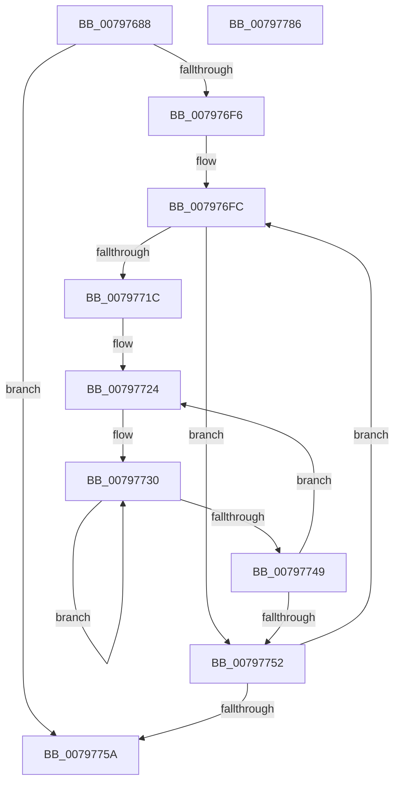

# Xp10Compute2Crc32

- RVA: `0x00797688`–`0x00797787` (길이 `255` bytes)
- VA: `0x0000000140797688`
- 실행 섹션: `PAGE`
- PDB 이름 있음: `예`; PDB Function 태그: `아니요`
- unwind 정보 RVA: `0x000D0368`
- 디코드: `71`개 명령, `255/255` bytes 표시
- 미해석 바이트: `0` (있으면 어셈블리에 `.byte`로 보존)

> 이 문서는 커널 이미지의 기계어와 PDB 기호를 분석해 생성했습니다. 4번과 5번은 함수 원형과 자료형을 바이너리 사용 방식에서 추정한 C 해석이며 원본 소스 복구 결과는 아닙니다.

## 1. Dependencies

- 직접 호출 지점: **2**; 고유 호출 대상: **2**
- 직접 호출자로 확인된 함수: **1**
- RIP 상대 이미지 참조: **1**

### Outgoing calls
- `0x00797711` → [Xp10ScatteredReadBytes](Xp10ScatteredReadBytes_function_0079A220.md) (function, `0x0079A220`)
- `0x00797769` → [_security_check_cookie](../../text/6A/_security_check_cookie_function_006AC640.md) (function, `0x006AC640`)

### Direct callers
- [Xp10ReadAndValidateCrc](Xp10ReadAndValidateCrc_function_00799B68.md) at `0x00799BE8`

### Static image references
- `0x0079769D` → RVA `0x00E0A740` (`.data`; read)

## 2. Other-region calls and transfers

- 다른 실행 섹션으로 향하는 call: **1**
  - `0x00797769` → [_security_check_cookie](../../text/6A/_security_check_cookie_function_006AC640.md) (`PAGE` → `.text`)
- 별도 외부 분기/꼬리 이동을 확인하지 못했습니다.

## 3. Assembly (complete function range)

```asm
00797688  48 89 5C 24 10                  mov qword ptr [rsp + 0x10], rbx
0079768D  48 89 6C 24 18                  mov qword ptr [rsp + 0x18], rbp
00797692  56                              push rsi
00797693  57                              push rdi
00797694  41 56                           push r14
00797696  48 81 EC 30 01 00 00            sub rsp, 0x130
0079769D  48 8B 05 9C 30 67 00            mov rax, qword ptr [rip + 0x67309c]
007976A4  48 33 C4                        xor rax, rsp
007976A7  48 89 84 24 20 01 00 00         mov qword ptr [rsp + 0x120], rax
007976AF  48 8B 41 18                     mov rax, qword ptr [rcx + 0x18]
007976B3  48 8B F9                        mov rdi, rcx
007976B6  4C 8B 41 20                     mov r8, qword ptr [rcx + 0x20]
007976BA  48 03 C0                        add rax, rax
007976BD  48 8B 29                        mov rbp, qword ptr [rcx]
007976C0  BB FF FF FF FF                  mov ebx, 0xffffffff
007976C5  BE 00 00 00 00                  mov esi, 0
007976CA  49 2B 2C C0                     sub rbp, qword ptr [r8 + rax*8]
007976CE  48 03 69 10                     add rbp, qword ptr [rcx + 0x10]
007976D2  48 C7 41 18 00 00 00 00         mov qword ptr [rcx + 0x18], 0
007976DA  49 8B 08                        mov rcx, qword ptr [r8]
007976DD  48 89 0F                        mov qword ptr [rdi], rcx
007976E0  49 8B 40 08                     mov rax, qword ptr [r8 + 8]
007976E4  48 C7 47 10 00 00 00 00         mov qword ptr [rdi + 0x10], 0
007976EC  48 8D 0C 01                     lea rcx, [rcx + rax]
007976F0  48 89 4F 08                     mov qword ptr [rdi + 8], rcx
007976F4  74 64                           je 0x14079775a
007976F6  41 BE 00 01 00 00               mov r14d, 0x100
007976FC  4C 8B C5                        mov r8, rbp
007976FF  48 8D 54 24 20                  lea rdx, [rsp + 0x20]
00797704  4C 2B C6                        sub r8, rsi
00797707  48 8B CF                        mov rcx, rdi
0079770A  4D 3B C6                        cmp r8, r14
0079770D  4D 0F 47 C6                     cmova r8, r14
00797711  E8 0A 2B 00 00                  call 0x14079a220
00797716  8B D0                           mov edx, eax
00797718  85 C0                           test eax, eax
0079771A  74 36                           je 0x140797752
0079771C  4C 8D 44 24 20                  lea r8, [rsp + 0x20]
00797721  44 8B CA                        mov r9d, edx
00797724  41 0F B6 00                     movzx eax, byte ptr [r8]
00797728  41 BA 08 00 00 00               mov r10d, 8
0079772E  33 D8                           xor ebx, eax
00797730  8B CB                           mov ecx, ebx
00797732  8B C3                           mov eax, ebx
00797734  D1 E9                           shr ecx, 1
00797736  8B D9                           mov ebx, ecx
00797738  81 F3 78 3B F6 82               xor ebx, 0x82f63b78
0079773E  A8 01                           test al, 1
00797740  0F 44 D9                        cmove ebx, ecx
00797743  49 83 EA 01                     sub r10, 1
00797747  75 E7                           jne 0x140797730
00797749  49 FF C0                        inc r8
0079774C  49 83 E9 01                     sub r9, 1
00797750  75 D2                           jne 0x140797724
00797752  48 03 F2                        add rsi, rdx
00797755  48 3B F5                        cmp rsi, rbp
00797758  72 A2                           jb 0x1407976fc
0079775A  F7 D3                           not ebx
0079775C  8B C3                           mov eax, ebx
0079775E  48 8B 8C 24 20 01 00 00         mov rcx, qword ptr [rsp + 0x120]
00797766  48 33 CC                        xor rcx, rsp
00797769  E8 D2 4E F1 FF                  call 0x1406ac640
0079776E  4C 8D 9C 24 30 01 00 00         lea r11, [rsp + 0x130]
00797776  49 8B 5B 28                     mov rbx, qword ptr [r11 + 0x28]
0079777A  49 8B 6B 30                     mov rbp, qword ptr [r11 + 0x30]
0079777E  49 8B E3                        mov rsp, r11
00797781  41 5E                           pop r14
00797783  5F                              pop rdi
00797784  5E                              pop rsi
00797785  C3                              ret
00797786  CC                              int3
```

## 4. C-style interpretation (structured pseudocode)

```c
__int64 __fastcall Xp10Compute2Crc32(__int64 a1)
{
    __int64 result;
    __int64 v_r10;
    __int64 v_rbp;
    __int64 v_rbx;
    __int64 v_rsi;
    __int64 v_rsp;
    unsigned __int64 v_stack_m128;
    unsigned __int64 v_stack_m18;
    unsigned __int64 v_stack_m28;
    unsigned __int64 v_stack_p10;
    unsigned __int64 v_stack_p18;

    v_stack_p10 = v_rbx;
    v_stack_p18 = v_rbp;
    v_rsp = (v_rsp) - (304);
    result = (*(unsigned __int64 *)(v_rip + 6762652)) ^ (v_rsp);
    v_stack_m28 = result;
    result = (*(unsigned __int64 *)(a1 + 24)) + (*(unsigned __int64 *)(a1 + 24));
    v_rbp = (*(unsigned __int64 *)(a1)) - (*(unsigned __int64 *)(*(unsigned __int64 *)(a1 + 32) + result * 8));
    v_rbp = (v_rbp) + (*(unsigned __int64 *)(a1 + 16));
    *(unsigned __int64 *)(a1 + 24) = 0;
    *(unsigned __int64 *)(a1) = *(unsigned __int64 *)(*(unsigned __int64 *)(a1 + 32));
    *(unsigned __int64 *)(a1 + 16) = 0;
    *(unsigned __int64 *)(a1 + 8) = *(unsigned __int64 *)(*(unsigned __int64 *)(a1 + 32)) + *(unsigned __int64 *)(*(unsigned __int64 *)(a1 + 32) + 8) * 1;
    if (condition_is_equal) goto loc_0079775A;
loc_007976FC:
    a3 = (v_rbp) - (0);
    if (a3 > 256) { a3 = 256; }
    result = Xp10ScatteredReadBytes(a1, v_stack_m128, a3, a4);
    if ((unsigned int)(result) == 0) goto loc_00797752;
loc_00797724:
    v_rbx = (unsigned int)(((unsigned int)(0xFFFFFFFFULL)) ^ ((unsigned int)(*(unsigned __int8 *)(v_stack_m128))));
loc_00797730:
    a1 = (unsigned int)(((unsigned int)((unsigned int)(v_rbx))) >> (1));
    v_rbx = (unsigned int)(((unsigned int)((unsigned int)(a1))) ^ (0x82F63B78ULL));
    if ((((unsigned __int8)((unsigned int)((unsigned int)(v_rbx)))) & (1)) == 0) { v_rbx = (unsigned int)(a1); }
    v_r10 = (8) - (1);
    if (condition_is_not_equal) goto loc_00797730;
    a3 = (v_stack_m128) + 1;
    a4 = ((unsigned int)((unsigned int)((unsigned int)((unsigned int)(result))))) - (1);
    if (condition_is_not_equal) goto loc_00797724;
loc_00797752:
    v_rsi = (0) + ((unsigned int)((unsigned int)(result)));
    if (v_rsi < v_rbp) goto loc_007976FC;
loc_0079775A:
    v_rbx = (unsigned int)(~(v_rbx));
    a1 = (v_stack_m28) ^ (v_rsp);
    result = _security_check_cookie(a1, (unsigned int)((unsigned int)(result)), a3, a4);
    return result;
}
```

## 5. (Beta) C Style

```c
int64_t Xp10Compute2Crc32(void *Arg1)
{
    uint8_t *arg1 = (uint8_t *)Arg1;

    int64_t result;
    int64_t local_r10;
    int64_t local_rbp;
    int64_t local_rbx;
    int64_t local_rsi;
    int64_t local_rsp;
    uint64_t v_stack_m128;
    uint64_t v_stack_m18;
    uint64_t v_stack_m28;
    uint64_t v_stack_p10;
    uint64_t v_stack_p18;

    v_stack_p10 = local_rbx;
    v_stack_p18 = local_rbp;
    local_rsp = (local_rsp) - (304);
    result = (*(uint64_t *)(v_rip + 0x67309C)) ^ (local_rsp);
    v_stack_m28 = result;
    result = (*(uint64_t *)(arg1 + 0x18)) + (*(uint64_t *)(arg1 + 0x18));
    local_rbp = (*(uint64_t *)(arg1)) - (*(uint64_t *)(*(uint64_t *)(arg1 + 0x20) + result * 8));
    local_rbp = (local_rbp) + (*(uint64_t *)(arg1 + 0x10));
    *(uint64_t *)(arg1 + 0x18) = 0;
    *(uint64_t *)(arg1) = *(uint64_t *)(*(uint64_t *)(arg1 + 0x20));
    *(uint64_t *)(arg1 + 0x10) = 0;
    *(uint64_t *)(arg1 + 0x8) = *(uint64_t *)(*(uint64_t *)(arg1 + 0x20)) + *(uint64_t *)(*(uint64_t *)(arg1 + 0x20) + 0x8) * 1;
    if (condition_is_equal) goto loc_0079775A;
loc_007976FC:
    a3 = (local_rbp) - (0);
    if (a3 > 256) { a3 = 256; }
    result = Xp10ScatteredReadBytes(Arg1, v_stack_m128, a3, a4);
    if ((uint32_t)(result) == 0) goto loc_00797752;
loc_00797724:
    local_rbx = (uint32_t)(((uint32_t)(0xFFFFFFFFULL)) ^ ((uint32_t)(*(uint8_t *)(v_stack_m128))));
loc_00797730:
    Arg1 = (uint32_t)(((uint32_t)((uint32_t)(local_rbx))) >> (1));
    local_rbx = (uint32_t)(((uint32_t)((uint32_t)(Arg1))) ^ (0x82F63B78ULL));
    if ((((uint8_t)((uint32_t)((uint32_t)(local_rbx)))) & (1)) == 0) { local_rbx = (uint32_t)(Arg1); }
    local_r10 = (8) - (1);
    if (condition_is_not_equal) goto loc_00797730;
    a3 = (v_stack_m128) + 1;
    a4 = ((uint32_t)((uint32_t)((uint32_t)((uint32_t)(result))))) - (1);
    if (condition_is_not_equal) goto loc_00797724;
loc_00797752:
    local_rsi = (0) + ((uint32_t)((uint32_t)(result)));
    if (local_rsi < local_rbp) goto loc_007976FC;
loc_0079775A:
    local_rbx = (uint32_t)(~(local_rbx));
    Arg1 = (v_stack_m28) ^ (local_rsp);
    result = _security_check_cookie(Arg1, (uint32_t)((uint32_t)(result)), a3, a4);
    return result;
}
```

### 관측된 메모리 오프셋

구조체 형식이 확인되지 않은 접근은 인자 기준의 오프셋으로만 기록했습니다.

| 기준 인자 | 오프셋 표현 | 폭 (bit) | 접근 |
|---|---:|---:|---|
| `Arg1` | `+ 0x0` | `64` | `R` |
| `Arg1` | `+ 0x0` | `64` | `W` |
| `Arg1` | `+ 0x8` | `64` | `W` |
| `Arg1` | `+ 0x10` | `64` | `R` |
| `Arg1` | `+ 0x10` | `64` | `W` |
| `Arg1` | `+ 0x18` | `64` | `R` |
| `Arg1` | `+ 0x18` | `64` | `W` |
| `Arg1` | `+ 0x20` | `64` | `R` |

## 6. Execution-region graph

[열기: 2D/3D 그래프와 함수 탐색 컨트롤 패널](../../../control-panel.html?section=page&rva=0x00797688&view=graph)

- 2D 그래프는 위에서 아래로 흐르고, 3D 그래프는 빈 공간을 드래그해 회전합니다. Shift+드래그는 이동, 휠은 확대·축소, 함수 노드 선택은 대상 보고서 이동입니다.

### Static fallback


