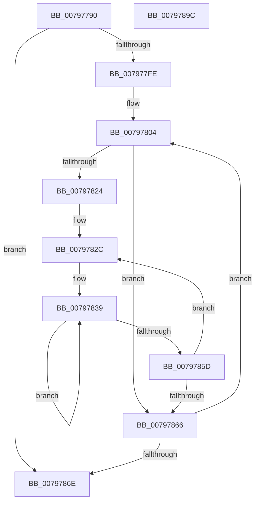

# Xp10Compute2Crc64

- RVA: `0x00797790`–`0x0079789D` (길이 `269` bytes)
- VA: `0x0000000140797790`
- 실행 섹션: `PAGE`
- PDB 이름 있음: `예`; PDB Function 태그: `아니요`
- unwind 정보 RVA: `0x000D0368`
- 디코드: `72`개 명령, `269/269` bytes 표시
- 미해석 바이트: `0` (있으면 어셈블리에 `.byte`로 보존)

> 이 문서는 커널 이미지의 기계어와 PDB 기호를 분석해 생성했습니다. 4번과 5번은 함수 원형과 자료형을 바이너리 사용 방식에서 추정한 C 해석이며 원본 소스 복구 결과는 아닙니다.

## 1. Dependencies

- 직접 호출 지점: **2**; 고유 호출 대상: **2**
- 직접 호출자로 확인된 함수: **1**
- RIP 상대 이미지 참조: **1**

### Outgoing calls
- `0x00797819` → [Xp10ScatteredReadBytes](Xp10ScatteredReadBytes_function_0079A220.md) (function, `0x0079A220`)
- `0x0079787F` → [_security_check_cookie](../../text/6A/_security_check_cookie_function_006AC640.md) (function, `0x006AC640`)

### Direct callers
- [Xp10ReadAndValidateCrc](Xp10ReadAndValidateCrc_function_00799B68.md) at `0x00799C12`

### Static image references
- `0x007977A5` → RVA `0x00E0A740` (`.data`; read)

## 2. Other-region calls and transfers

- 다른 실행 섹션으로 향하는 call: **1**
  - `0x0079787F` → [_security_check_cookie](../../text/6A/_security_check_cookie_function_006AC640.md) (`PAGE` → `.text`)
- 별도 외부 분기/꼬리 이동을 확인하지 못했습니다.

## 3. Assembly (complete function range)

```asm
00797790  48 89 5C 24 10                  mov qword ptr [rsp + 0x10], rbx
00797795  48 89 6C 24 18                  mov qword ptr [rsp + 0x18], rbp
0079779A  56                              push rsi
0079779B  57                              push rdi
0079779C  41 56                           push r14
0079779E  48 81 EC 30 01 00 00            sub rsp, 0x130
007977A5  48 8B 05 94 2F 67 00            mov rax, qword ptr [rip + 0x672f94]
007977AC  48 33 C4                        xor rax, rsp
007977AF  48 89 84 24 20 01 00 00         mov qword ptr [rsp + 0x120], rax
007977B7  48 8B 41 18                     mov rax, qword ptr [rcx + 0x18]
007977BB  48 8B F9                        mov rdi, rcx
007977BE  4C 8B 41 20                     mov r8, qword ptr [rcx + 0x20]
007977C2  48 03 C0                        add rax, rax
007977C5  48 8B 29                        mov rbp, qword ptr [rcx]
007977C8  48 C7 C3 FF FF FF FF            mov rbx, 0xffffffffffffffff
007977CF  49 2B 2C C0                     sub rbp, qword ptr [r8 + rax*8]
007977D3  48 03 69 10                     add rbp, qword ptr [rcx + 0x10]
007977D7  8D 73 01                        lea esi, [rbx + 1]
007977DA  48 C7 41 18 00 00 00 00         mov qword ptr [rcx + 0x18], 0
007977E2  49 8B 08                        mov rcx, qword ptr [r8]
007977E5  48 89 0F                        mov qword ptr [rdi], rcx
007977E8  49 8B 40 08                     mov rax, qword ptr [r8 + 8]
007977EC  48 C7 47 10 00 00 00 00         mov qword ptr [rdi + 0x10], 0
007977F4  48 8D 0C 01                     lea rcx, [rcx + rax]
007977F8  48 89 4F 08                     mov qword ptr [rdi + 8], rcx
007977FC  74 70                           je 0x14079786e
007977FE  41 BE 00 01 00 00               mov r14d, 0x100
00797804  4C 8B C5                        mov r8, rbp
00797807  48 8D 54 24 20                  lea rdx, [rsp + 0x20]
0079780C  4C 2B C6                        sub r8, rsi
0079780F  48 8B CF                        mov rcx, rdi
00797812  4D 3B C6                        cmp r8, r14
00797815  4D 0F 47 C6                     cmova r8, r14
00797819  E8 02 2A 00 00                  call 0x14079a220
0079781E  8B D0                           mov edx, eax
00797820  85 C0                           test eax, eax
00797822  74 42                           je 0x140797866
00797824  4C 8D 44 24 20                  lea r8, [rsp + 0x20]
00797829  44 8B CA                        mov r9d, edx
0079782C  41 0F B6 00                     movzx eax, byte ptr [r8]
00797830  41 BA 08 00 00 00               mov r10d, 8
00797836  48 33 D8                        xor rbx, rax
00797839  48 8B CB                        mov rcx, rbx
0079783C  8A C3                           mov al, bl
0079783E  48 D1 E9                        shr rcx, 1
00797841  49 BB B5 C9 4B AC 29 93 6C 9A   movabs r11, 0x9a6c9329ac4bc9b5
0079784B  48 8B D9                        mov rbx, rcx
0079784E  49 33 DB                        xor rbx, r11
00797851  A8 01                           test al, 1
00797853  48 0F 44 D9                     cmove rbx, rcx
00797857  49 83 EA 01                     sub r10, 1
0079785B  75 DC                           jne 0x140797839
0079785D  49 FF C0                        inc r8
00797860  49 83 E9 01                     sub r9, 1
00797864  75 C6                           jne 0x14079782c
00797866  48 03 F2                        add rsi, rdx
00797869  48 3B F5                        cmp rsi, rbp
0079786C  72 96                           jb 0x140797804
0079786E  48 F7 D3                        not rbx
00797871  48 8B C3                        mov rax, rbx
00797874  48 8B 8C 24 20 01 00 00         mov rcx, qword ptr [rsp + 0x120]
0079787C  48 33 CC                        xor rcx, rsp
0079787F  E8 BC 4D F1 FF                  call 0x1406ac640
00797884  4C 8D 9C 24 30 01 00 00         lea r11, [rsp + 0x130]
0079788C  49 8B 5B 28                     mov rbx, qword ptr [r11 + 0x28]
00797890  49 8B 6B 30                     mov rbp, qword ptr [r11 + 0x30]
00797894  49 8B E3                        mov rsp, r11
00797897  41 5E                           pop r14
00797899  5F                              pop rdi
0079789A  5E                              pop rsi
0079789B  C3                              ret
0079789C  CC                              int3
```

## 4. C-style interpretation (structured pseudocode)

```c
__int64 __fastcall Xp10Compute2Crc64(__int64 a1)
{
    __int64 result;
    __int64 v_r10;
    __int64 v_rbp;
    __int64 v_rbx;
    __int64 v_rsi;
    __int64 v_rsp;
    unsigned __int64 v_stack_m128;
    unsigned __int64 v_stack_m18;
    unsigned __int64 v_stack_m28;
    unsigned __int64 v_stack_p10;
    unsigned __int64 v_stack_p18;

    v_stack_p10 = v_rbx;
    v_stack_p18 = v_rbp;
    v_rsp = (v_rsp) - (304);
    result = (*(unsigned __int64 *)(v_rip + 6762388)) ^ (v_rsp);
    v_stack_m28 = result;
    result = (*(unsigned __int64 *)(a1 + 24)) + (*(unsigned __int64 *)(a1 + 24));
    v_rbp = (*(unsigned __int64 *)(a1)) - (*(unsigned __int64 *)(*(unsigned __int64 *)(a1 + 32) + result * 8));
    v_rbp = (v_rbp) + (*(unsigned __int64 *)(a1 + 16));
    *(unsigned __int64 *)(a1 + 24) = 0;
    *(unsigned __int64 *)(a1) = *(unsigned __int64 *)(*(unsigned __int64 *)(a1 + 32));
    *(unsigned __int64 *)(a1 + 16) = 0;
    *(unsigned __int64 *)(a1 + 8) = *(unsigned __int64 *)(*(unsigned __int64 *)(a1 + 32)) + *(unsigned __int64 *)(*(unsigned __int64 *)(a1 + 32) + 8) * 1;
    if (condition_is_equal) goto loc_0079786E;
loc_00797804:
    a3 = (v_rbp) - (-1 + 1);
    if (a3 > 256) { a3 = 256; }
    result = Xp10ScatteredReadBytes(a1, v_stack_m128, a3, a4);
    if ((unsigned int)(result) == 0) goto loc_00797866;
loc_0079782C:
    v_rbx = (-1) ^ (*(unsigned __int8 *)(v_stack_m128));
loc_00797839:
    a1 = (v_rbx) >> (1);
    v_rbx = (a1) ^ (v_r11);
    if ((((unsigned __int8)((unsigned __int8)(v_rbx))) & (1)) == 0) { v_rbx = a1; }
    v_r10 = (8) - (1);
    if (condition_is_not_equal) goto loc_00797839;
    a3 = (v_stack_m128) + 1;
    a4 = ((unsigned int)((unsigned int)((unsigned int)((unsigned int)(result))))) - (1);
    if (condition_is_not_equal) goto loc_0079782C;
loc_00797866:
    v_rsi = (-1 + 1) + ((unsigned int)((unsigned int)(result)));
    if (v_rsi < v_rbp) goto loc_00797804;
loc_0079786E:
    v_rbx = ~(v_rbx);
    a1 = (v_stack_m28) ^ (v_rsp);
    result = _security_check_cookie(a1, (unsigned int)((unsigned int)(result)), a3, a4);
    return result;
}
```

## 5. (Beta) C Style

```c
int64_t Xp10Compute2Crc64(void *Arg1)
{
    uint8_t *arg1 = (uint8_t *)Arg1;

    int64_t result;
    int64_t local_r10;
    int64_t local_rbp;
    int64_t local_rbx;
    int64_t local_rsi;
    int64_t local_rsp;
    uint64_t v_stack_m128;
    uint64_t v_stack_m18;
    uint64_t v_stack_m28;
    uint64_t v_stack_p10;
    uint64_t v_stack_p18;

    v_stack_p10 = local_rbx;
    v_stack_p18 = local_rbp;
    local_rsp = (local_rsp) - (304);
    result = (*(uint64_t *)(v_rip + 0x672F94)) ^ (local_rsp);
    v_stack_m28 = result;
    result = (*(uint64_t *)(arg1 + 0x18)) + (*(uint64_t *)(arg1 + 0x18));
    local_rbp = (*(uint64_t *)(arg1)) - (*(uint64_t *)(*(uint64_t *)(arg1 + 0x20) + result * 8));
    local_rbp = (local_rbp) + (*(uint64_t *)(arg1 + 0x10));
    *(uint64_t *)(arg1 + 0x18) = 0;
    *(uint64_t *)(arg1) = *(uint64_t *)(*(uint64_t *)(arg1 + 0x20));
    *(uint64_t *)(arg1 + 0x10) = 0;
    *(uint64_t *)(arg1 + 0x8) = *(uint64_t *)(*(uint64_t *)(arg1 + 0x20)) + *(uint64_t *)(*(uint64_t *)(arg1 + 0x20) + 0x8) * 1;
    if (condition_is_equal) goto loc_0079786E;
loc_00797804:
    a3 = (local_rbp) - (-1 + 1);
    if (a3 > 256) { a3 = 256; }
    result = Xp10ScatteredReadBytes(Arg1, v_stack_m128, a3, a4);
    if ((uint32_t)(result) == 0) goto loc_00797866;
loc_0079782C:
    local_rbx = (-1) ^ (*(uint8_t *)(v_stack_m128));
loc_00797839:
    Arg1 = (local_rbx) >> (1);
    local_rbx = (Arg1) ^ (local_r11);
    if ((((uint8_t)((uint8_t)(local_rbx))) & (1)) == 0) { local_rbx = Arg1; }
    local_r10 = (8) - (1);
    if (condition_is_not_equal) goto loc_00797839;
    a3 = (v_stack_m128) + 1;
    a4 = ((uint32_t)((uint32_t)((uint32_t)((uint32_t)(result))))) - (1);
    if (condition_is_not_equal) goto loc_0079782C;
loc_00797866:
    local_rsi = (-1 + 1) + ((uint32_t)((uint32_t)(result)));
    if (local_rsi < local_rbp) goto loc_00797804;
loc_0079786E:
    local_rbx = ~(local_rbx);
    Arg1 = (v_stack_m28) ^ (local_rsp);
    result = _security_check_cookie(Arg1, (uint32_t)((uint32_t)(result)), a3, a4);
    return result;
}
```

### 관측된 메모리 오프셋

구조체 형식이 확인되지 않은 접근은 인자 기준의 오프셋으로만 기록했습니다.

| 기준 인자 | 오프셋 표현 | 폭 (bit) | 접근 |
|---|---:|---:|---|
| `Arg1` | `+ 0x0` | `64` | `R` |
| `Arg1` | `+ 0x0` | `64` | `W` |
| `Arg1` | `+ 0x8` | `64` | `W` |
| `Arg1` | `+ 0x10` | `64` | `R` |
| `Arg1` | `+ 0x10` | `64` | `W` |
| `Arg1` | `+ 0x18` | `64` | `R` |
| `Arg1` | `+ 0x18` | `64` | `W` |
| `Arg1` | `+ 0x20` | `64` | `R` |

## 6. Execution-region graph

[열기: 2D/3D 그래프와 함수 탐색 컨트롤 패널](../../../control-panel.html?section=page&rva=0x00797790&view=graph)

- 2D 그래프는 위에서 아래로 흐르고, 3D 그래프는 빈 공간을 드래그해 회전합니다. Shift+드래그는 이동, 휠은 확대·축소, 함수 노드 선택은 대상 보고서 이동입니다.

### Static fallback


