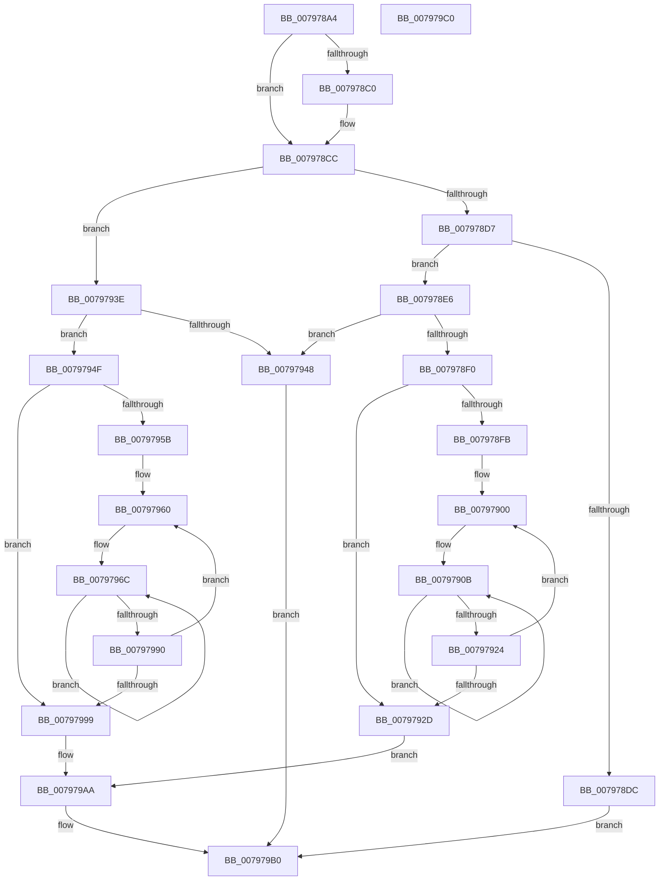

# Xp10ComputeAndWriteCrc

- RVA: `0x007978A4`–`0x007979C1` (길이 `285` bytes)
- VA: `0x00000001407978A4`
- 실행 섹션: `PAGE`
- PDB 이름 있음: `예`; PDB Function 태그: `아니요`
- unwind 정보 RVA: `0x00069588`
- 디코드: `87`개 명령, `285/285` bytes 표시
- 미해석 바이트: `0` (있으면 어셈블리에 `.byte`로 보존)

> 이 문서는 커널 이미지의 기계어와 PDB 기호를 분석해 생성했습니다. 4번과 5번은 함수 원형과 자료형을 바이너리 사용 방식에서 추정한 C 해석이며 원본 소스 복구 결과는 아닙니다.

## 1. Dependencies

- 직접 호출 지점: **0**; 고유 호출 대상: **0**
- 직접 호출자로 확인된 함수: **1**
- RIP 상대 이미지 참조: **0**

### Outgoing calls
- 직접 디코드된 call 명령이 없습니다.

### Direct callers
- [Xp10CompressBuffer](Xp10CompressBuffer_function_007972F4.md) at `0x0079764B`

### Static image references
- 디코드된 RIP-relative 메모리 참조가 없습니다.

## 2. Other-region calls and transfers

- 다른 실행 섹션으로 향하는 call: **0**
- 별도 외부 분기/꼬리 이동을 확인하지 못했습니다.

## 3. Assembly (complete function range)

```asm
007978A4  48 89 5C 24 08                  mov qword ptr [rsp + 8], rbx
007978A9  48 89 74 24 10                  mov qword ptr [rsp + 0x10], rsi
007978AE  48 89 7C 24 18                  mov qword ptr [rsp + 0x18], rdi
007978B3  45 8B 48 08                     mov r9d, dword ptr [r8 + 8]
007978B7  4C 8B D2                        mov r10, rdx
007978BA  41 F6 C1 07                     test r9b, 7
007978BE  74 0C                           je 0x1407978cc
007978C0  41 83 E1 F8                     and r9d, 0xfffffff8
007978C4  41 83 C1 08                     add r9d, 8
007978C8  45 89 48 08                     mov dword ptr [r8 + 8], r9d
007978CC  0F B7 09                        movzx ecx, word ptr [rcx]
007978CF  C1 E9 0E                        shr ecx, 0xe
007978D2  83 E1 01                        and ecx, 1
007978D5  74 67                           je 0x14079793e
007978D7  83 F9 01                        cmp ecx, 1
007978DA  74 0A                           je 0x1407978e6
007978DC  B8 0D 00 00 C0                  mov eax, 0xc000000d
007978E1  E9 CA 00 00 00                  jmp 0x1407979b0
007978E6  45 8D 59 20                     lea r11d, [r9 + 0x20]
007978EA  45 3B 58 0C                     cmp r11d, dword ptr [r8 + 0xc]
007978EE  77 58                           ja 0x140797948
007978F0  41 8B 42 0C                     mov eax, dword ptr [r10 + 0xc]
007978F4  83 CA FF                        or edx, 0xffffffff
007978F7  85 C0                           test eax, eax
007978F9  74 32                           je 0x14079792d
007978FB  4D 8B 12                        mov r10, qword ptr [r10]
007978FE  8B D8                           mov ebx, eax
00797900  41 0F B6 02                     movzx eax, byte ptr [r10]
00797904  BF 08 00 00 00                  mov edi, 8
00797909  33 D0                           xor edx, eax
0079790B  8B CA                           mov ecx, edx
0079790D  8B C2                           mov eax, edx
0079790F  D1 E9                           shr ecx, 1
00797911  8B D1                           mov edx, ecx
00797913  81 F2 78 3B F6 82               xor edx, 0x82f63b78
00797919  A8 01                           test al, 1
0079791B  0F 44 D1                        cmove edx, ecx
0079791E  48 83 EF 01                     sub rdi, 1
00797922  75 E7                           jne 0x14079790b
00797924  49 FF C2                        inc r10
00797927  48 83 EB 01                     sub rbx, 1
0079792B  75 D3                           jne 0x140797900
0079792D  49 8B 00                        mov rax, qword ptr [r8]
00797930  F7 D2                           not edx
00797932  41 8B C9                        mov ecx, r9d
00797935  48 C1 E9 03                     shr rcx, 3
00797939  89 14 01                        mov dword ptr [rcx + rax], edx
0079793C  EB 6C                           jmp 0x1407979aa
0079793E  45 8D 59 40                     lea r11d, [r9 + 0x40]
00797942  45 3B 58 0C                     cmp r11d, dword ptr [r8 + 0xc]
00797946  76 07                           jbe 0x14079794f
00797948  B8 23 00 00 C0                  mov eax, 0xc0000023
0079794D  EB 61                           jmp 0x1407979b0
0079794F  41 8B 42 0C                     mov eax, dword ptr [r10 + 0xc]
00797953  48 83 CA FF                     or rdx, 0xffffffffffffffff
00797957  85 C0                           test eax, eax
00797959  74 3E                           je 0x140797999
0079795B  4D 8B 12                        mov r10, qword ptr [r10]
0079795E  8B D8                           mov ebx, eax
00797960  41 0F B6 02                     movzx eax, byte ptr [r10]
00797964  BF 08 00 00 00                  mov edi, 8
00797969  48 33 D0                        xor rdx, rax
0079796C  48 8B CA                        mov rcx, rdx
0079796F  8A C2                           mov al, dl
00797971  48 D1 E9                        shr rcx, 1
00797974  48 BE B5 C9 4B AC 29 93 6C 9A   movabs rsi, 0x9a6c9329ac4bc9b5
0079797E  48 8B D1                        mov rdx, rcx
00797981  48 33 D6                        xor rdx, rsi
00797984  A8 01                           test al, 1
00797986  48 0F 44 D1                     cmove rdx, rcx
0079798A  48 83 EF 01                     sub rdi, 1
0079798E  75 DC                           jne 0x14079796c
00797990  49 FF C2                        inc r10
00797993  48 83 EB 01                     sub rbx, 1
00797997  75 C7                           jne 0x140797960
00797999  49 8B 00                        mov rax, qword ptr [r8]
0079799C  48 F7 D2                        not rdx
0079799F  41 8B C9                        mov ecx, r9d
007979A2  48 C1 E9 03                     shr rcx, 3
007979A6  48 89 14 01                     mov qword ptr [rcx + rax], rdx
007979AA  45 89 58 08                     mov dword ptr [r8 + 8], r11d
007979AE  33 C0                           xor eax, eax
007979B0  48 8B 5C 24 08                  mov rbx, qword ptr [rsp + 8]
007979B5  48 8B 74 24 10                  mov rsi, qword ptr [rsp + 0x10]
007979BA  48 8B 7C 24 18                  mov rdi, qword ptr [rsp + 0x18]
007979BF  C3                              ret
007979C0  CC                              int3
```

## 4. C-style interpretation (structured pseudocode)

```c
__int64 __fastcall Xp10ComputeAndWriteCrc(__int64 a1, __int64 a2, __int64 a3)
{
    __int64 result;
    __int64 v_r10;
    __int64 v_rbx;
    __int64 v_rdi;
    unsigned __int64 v_stack_p10;
    unsigned __int64 v_stack_p18;
    unsigned __int64 v_stack_p8;

    v_stack_p8 = v_rbx;
    v_stack_p10 = v_rsi;
    v_stack_p18 = v_rdi;
    if ((((unsigned __int8)((unsigned int)(*(unsigned int *)(a3 + 8)))) & (7)) != 0) {
        a4 = (unsigned int)(((unsigned int)(*(unsigned int *)(a3 + 8))) & (0xFFFFFFF8ULL));
        a4 = (unsigned int)((a4) + (8));
        *(unsigned int *)(a3 + 8) = (unsigned int)(a4);
    }
    a1 = (unsigned int)((*(unsigned __int16 *)(a1)) >> (14));
    a1 = (unsigned int)((a1) & (1));
    if (condition_is_equal) goto loc_0079793E;
    if (((unsigned int)(a1)) == 1) goto loc_007978E6;
    goto loc_007979B0;
loc_007978E6:
    if (((unsigned int)(a4 + 32)) > (*(unsigned int *)(a3 + 12))) goto loc_00797948;
    a2 = (unsigned int)((a2) | (0xFFFFFFFFULL));
    if ((unsigned int)((unsigned int)(*(unsigned int *)(a2 + 12))) == 0) goto loc_0079792D;
loc_00797900:
    a2 = (unsigned int)((a2) ^ ((unsigned int)(*(unsigned __int8 *)(*(unsigned __int64 *)(a2)))));
loc_0079790B:
    a1 = (unsigned int)(((unsigned int)((unsigned int)(a2))) >> (1));
    a2 = (unsigned int)(((unsigned int)((unsigned int)(a1))) ^ (0x82F63B78ULL));
    if ((((unsigned __int8)((unsigned int)((unsigned int)(a2)))) & (1)) == 0) { a2 = (unsigned int)(a1); }
    v_rdi = (8) - (1);
    if (condition_is_not_equal) goto loc_0079790B;
    v_r10 = (*(unsigned __int64 *)(a2)) + 1;
    v_rbx = ((unsigned int)((unsigned int)((unsigned int)(*(unsigned int *)(a2 + 12))))) - (1);
    if (condition_is_not_equal) goto loc_00797900;
loc_0079792D:
    a2 = (unsigned int)(~(a2));
    a1 = ((unsigned int)((unsigned int)(a4))) >> (3);
    *(unsigned int *)(a1 + *(unsigned __int64 *)(a3) * 1) = (unsigned int)(a2);
    goto loc_007979AA;
loc_0079793E:
    if (((unsigned int)(a4 + 64)) <= (*(unsigned int *)(a3 + 12))) goto loc_0079794F;
loc_00797948:
    goto loc_007979B0;
loc_0079794F:
    a2 = (a2) | (-1);
    if ((unsigned int)((unsigned int)(*(unsigned int *)(v_r10 + 12))) == 0) goto loc_00797999;
loc_00797960:
    a2 = (a2) ^ (*(unsigned __int8 *)(*(unsigned __int64 *)(v_r10)));
loc_0079796C:
    a1 = (a2) >> (1);
    a2 = (a1) ^ (v_rsi);
    if ((((unsigned __int8)((unsigned __int8)(a2))) & (1)) == 0) { a2 = a1; }
    v_rdi = (8) - (1);
    if (condition_is_not_equal) goto loc_0079796C;
    v_r10 = (*(unsigned __int64 *)(v_r10)) + 1;
    v_rbx = ((unsigned int)((unsigned int)((unsigned int)(*(unsigned int *)(v_r10 + 12))))) - (1);
    if (condition_is_not_equal) goto loc_00797960;
loc_00797999:
    a2 = ~(a2);
    a1 = ((unsigned int)((unsigned int)(a4))) >> (3);
    *(unsigned __int64 *)(a1 + *(unsigned __int64 *)(a3) * 1) = a2;
loc_007979AA:
    *(unsigned int *)(a3 + 8) = (unsigned int)(a4 + 64);
    result = 0;
loc_007979B0:
    return result;
}
```

## 5. (Beta) C Style

```c
int64_t Xp10ComputeAndWriteCrc(void *Arg1, void *Arg2, void *Arg3)
{
    uint8_t *arg1 = (uint8_t *)Arg1;
    uint8_t *arg2 = (uint8_t *)Arg2;
    uint8_t *arg3 = (uint8_t *)Arg3;

    int64_t result;
    int64_t local_r10;
    int64_t local_rbx;
    int64_t local_rdi;
    uint64_t v_stack_p10;
    uint64_t v_stack_p18;
    uint64_t v_stack_p8;

    v_stack_p8 = local_rbx;
    v_stack_p10 = local_rsi;
    v_stack_p18 = local_rdi;
    if ((((uint8_t)((uint32_t)(*(uint32_t *)(arg3 + 0x8)))) & (7)) != 0) {
        a4 = (uint32_t)(((uint32_t)(*(uint32_t *)(arg3 + 0x8))) & (0xFFFFFFF8ULL));
        a4 = (uint32_t)((a4) + (8));
        *(uint32_t *)(arg3 + 0x8) = (uint32_t)(a4);
    }
    Arg1 = (uint32_t)((*(uint16_t *)(arg1)) >> (14));
    Arg1 = (uint32_t)((Arg1) & (1));
    if (condition_is_equal) goto loc_0079793E;
    if (((uint32_t)(Arg1)) == 1) goto loc_007978E6;
    goto loc_007979B0;
loc_007978E6:
    if (((uint32_t)(a4 + 32)) > (*(uint32_t *)(arg3 + 0xC))) goto loc_00797948;
    Arg2 = (uint32_t)((Arg2) | (0xFFFFFFFFULL));
    if ((uint32_t)((uint32_t)(*(uint32_t *)(arg2 + 0xC))) == 0) goto loc_0079792D;
loc_00797900:
    Arg2 = (uint32_t)((Arg2) ^ ((uint32_t)(*(uint8_t *)(*(uint64_t *)(arg2)))));
loc_0079790B:
    Arg1 = (uint32_t)(((uint32_t)((uint32_t)(Arg2))) >> (1));
    Arg2 = (uint32_t)(((uint32_t)((uint32_t)(Arg1))) ^ (0x82F63B78ULL));
    if ((((uint8_t)((uint32_t)((uint32_t)(Arg2)))) & (1)) == 0) { Arg2 = (uint32_t)(Arg1); }
    local_rdi = (8) - (1);
    if (condition_is_not_equal) goto loc_0079790B;
    local_r10 = (*(uint64_t *)(arg2)) + 1;
    local_rbx = ((uint32_t)((uint32_t)((uint32_t)(*(uint32_t *)(arg2 + 0xC))))) - (1);
    if (condition_is_not_equal) goto loc_00797900;
loc_0079792D:
    Arg2 = (uint32_t)(~(Arg2));
    Arg1 = ((uint32_t)((uint32_t)(a4))) >> (3);
    *(uint32_t *)(arg1 + *(uint64_t *)(arg3) * 1) = (uint32_t)(Arg2);
    goto loc_007979AA;
loc_0079793E:
    if (((uint32_t)(a4 + 64)) <= (*(uint32_t *)(arg3 + 0xC))) goto loc_0079794F;
loc_00797948:
    goto loc_007979B0;
loc_0079794F:
    Arg2 = (Arg2) | (-1);
    if ((uint32_t)((uint32_t)(*(uint32_t *)(local_r10 + 0xC))) == 0) goto loc_00797999;
loc_00797960:
    Arg2 = (Arg2) ^ (*(uint8_t *)(*(uint64_t *)(local_r10)));
loc_0079796C:
    Arg1 = (Arg2) >> (1);
    Arg2 = (Arg1) ^ (local_rsi);
    if ((((uint8_t)((uint8_t)(Arg2))) & (1)) == 0) { Arg2 = Arg1; }
    local_rdi = (8) - (1);
    if (condition_is_not_equal) goto loc_0079796C;
    local_r10 = (*(uint64_t *)(local_r10)) + 1;
    local_rbx = ((uint32_t)((uint32_t)((uint32_t)(*(uint32_t *)(local_r10 + 0xC))))) - (1);
    if (condition_is_not_equal) goto loc_00797960;
loc_00797999:
    Arg2 = ~(Arg2);
    Arg1 = ((uint32_t)((uint32_t)(a4))) >> (3);
    *(void **)(arg1 + *(uint64_t *)(arg3) * 1) = Arg2;
loc_007979AA:
    *(uint32_t *)(arg3 + 0x8) = (uint32_t)(a4 + 64);
    result = 0;
loc_007979B0:
    return result;
}
```

### 관측된 메모리 오프셋

구조체 형식이 확인되지 않은 접근은 인자 기준의 오프셋으로만 기록했습니다.

| 기준 인자 | 오프셋 표현 | 폭 (bit) | 접근 |
|---|---:|---:|---|
| `Arg1` | `+ 0x0` | `16` | `R` |
| `Arg2` | `+ 0x0` | `64` | `R` |
| `Arg2` | `+ 0xC` | `32` | `R` |
| `Arg3` | `+ 0x0` | `64` | `R` |
| `Arg3` | `+ 0x8` | `32` | `R` |
| `Arg3` | `+ 0x8` | `32` | `W` |
| `Arg3` | `+ 0xC` | `32` | `R` |

## 6. Execution-region graph

[열기: 2D/3D 그래프와 함수 탐색 컨트롤 패널](../../../control-panel.html?section=page&rva=0x007978A4&view=graph)

- 2D 그래프는 위에서 아래로 흐르고, 3D 그래프는 빈 공간을 드래그해 회전합니다. Shift+드래그는 이동, 휠은 확대·축소, 함수 노드 선택은 대상 보고서 이동입니다.

### Static fallback


