# Xp10ExecuteHuffmanEncode

- RVA: `0x00798100`–`0x00798596` (길이 `1,174` bytes)
- VA: `0x0000000140798100`
- 실행 섹션: `PAGE`
- PDB 이름 있음: `예`; PDB Function 태그: `아니요`
- unwind 정보 RVA: `0x000D030C`
- 디코드: `342`개 명령, `1,174/1,174` bytes 표시
- 미해석 바이트: `0` (있으면 어셈블리에 `.byte`로 보존)

> 이 문서는 커널 이미지의 기계어와 PDB 기호를 분석해 생성했습니다. 4번과 5번은 함수 원형과 자료형을 바이너리 사용 방식에서 추정한 C 해석이며 원본 소스 복구 결과는 아닙니다.

## 1. Dependencies

- 직접 호출 지점: **3**; 고유 호출 대상: **2**
- 직접 호출자로 확인된 함수: **1**
- RIP 상대 이미지 참조: **1**

### Outgoing calls
- `0x00798197` → [Xp10BuildAndWriteHuffmanEncodings](Xp10BuildAndWriteHuffmanEncodings_function_00795DB0.md) (function, `0x00795DB0`)
- `0x007981DE` → [Xp10BuildAndWriteHuffmanEncodings](Xp10BuildAndWriteHuffmanEncodings_function_00795DB0.md) (function, `0x00795DB0`)
- `0x00798238` → [RtlCopyBitMap](../../text/3E/RtlCopyBitMap_function_003E2210.md) (function, `0x003E2210`)

### Direct callers
- [Xp10CompressBuffer](Xp10CompressBuffer_function_007972F4.md) at `0x007974CC`

### Static image references
- `0x007982D8` → RVA `0x00034820` (`.rdata`; read)

## 2. Other-region calls and transfers

- 다른 실행 섹션으로 향하는 call: **1**
  - `0x00798238` → [RtlCopyBitMap](../../text/3E/RtlCopyBitMap_function_003E2210.md) (`PAGE` → `.text`)
- 별도 외부 분기/꼬리 이동을 확인하지 못했습니다.

## 3. Assembly (complete function range)

```asm
00798100  4C 8B DC                        mov r11, rsp
00798103  49 89 5B 18                     mov qword ptr [r11 + 0x18], rbx
00798107  49 89 53 10                     mov qword ptr [r11 + 0x10], rdx
0079810B  49 89 4B 08                     mov qword ptr [r11 + 8], rcx
0079810F  55                              push rbp
00798110  56                              push rsi
00798111  57                              push rdi
00798112  41 54                           push r12
00798114  41 55                           push r13
00798116  41 56                           push r14
00798118  41 57                           push r15
0079811A  48 8B EC                        mov rbp, rsp
0079811D  48 83 EC 60                     sub rsp, 0x60
00798121  48 8B 01                        mov rax, qword ptr [rcx]
00798124  45 8B F8                        mov r15d, r8d
00798127  8B 71 18                        mov esi, dword ptr [rcx + 0x18]
0079812A  4C 8B C1                        mov r8, rcx
0079812D  48 8B 5D 68                     mov rbx, qword ptr [rbp + 0x68]
00798131  49 8B F9                        mov rdi, r9
00798134  45 33 C9                        xor r9d, r9d
00798137  0F B7 10                        movzx edx, word ptr [rax]
0079813A  8B CA                           mov ecx, edx
0079813C  44 89 4D E4                     mov dword ptr [rbp - 0x1c], r9d
00798140  44 8B 73 08                     mov r14d, dword ptr [rbx + 8]
00798144  83 E1 1F                        and ecx, 0x1f
00798147  C1 EA 05                        shr edx, 5
0079814A  41 8D 41 01                     lea eax, [r9 + 1]
0079814E  D3 E0                           shl eax, cl
00798150  83 E2 07                        and edx, 7
00798153  2B C2                           sub eax, edx
00798155  44 89 4D F4                     mov dword ptr [rbp - 0xc], r9d
00798159  2D F6 00 00 00                  sub eax, 0xf6
0079815E  44 89 4D 58                     mov dword ptr [rbp + 0x58], r9d
00798162  49 8D 50 1C                     lea rdx, [r8 + 0x1c]
00798166  44 89 4D 68                     mov dword ptr [rbp + 0x68], r9d
0079816A  44 0F BD E8                     bsr r13d, eax
0079816E  44 8D 60 FF                     lea r12d, [rax - 1]
00798172  44 23 E0                        and r12d, eax
00798175  49 8D 80 20 16 00 00            lea rax, [r8 + 0x1620]
0079817C  44 8D 41 14                     lea r8d, [rcx + 0x14]
00798180  48 8D 4D 58                     lea rcx, [rbp + 0x58]
00798184  41 C1 E0 04                     shl r8d, 4
00798188  49 89 4B 98                     mov qword ptr [r11 - 0x68], rcx
0079818C  48 8B C8                        mov rcx, rax
0079818F  49 89 5B 90                     mov qword ptr [r11 - 0x70], rbx
00798193  49 89 53 88                     mov qword ptr [r11 - 0x78], rdx
00798197  E8 14 DC FF FF                  call 0x140795db0
0079819C  85 C0                           test eax, eax
0079819E  0F 88 D9 03 00 00               js 0x14079857d
007981A4  48 8B 45 40                     mov rax, qword ptr [rbp + 0x40]
007981A8  45 8D 45 01                     lea r8d, [r13 + 1]
007981AC  03 75 58                        add esi, dword ptr [rbp + 0x58]
007981AF  48 8D 4D 58                     lea rcx, [rbp + 0x58]
007981B3  48 89 4C 24 30                  mov qword ptr [rsp + 0x30], rcx
007981B8  45 85 E4                        test r12d, r12d
007981BB  48 89 5C 24 28                  mov qword ptr [rsp + 0x28], rbx
007981C0  45 0F 44 C5                     cmove r8d, r13d
007981C4  48 8D 90 1C 0B 00 00            lea rdx, [rax + 0xb1c]
007981CB  41 81 C0 E8 00 00 00            add r8d, 0xe8
007981D2  48 89 54 24 20                  mov qword ptr [rsp + 0x20], rdx
007981D7  48 8D 88 20 16 00 00            lea rcx, [rax + 0x1620]
007981DE  E8 CD DB FF FF                  call 0x140795db0
007981E3  85 C0                           test eax, eax
007981E5  0F 88 92 03 00 00               js 0x14079857d
007981EB  03 75 58                        add esi, dword ptr [rbp + 0x58]
007981EE  42 8D 0C FD 00 00 00 00         lea ecx, [r15*8]
007981F6  44 8B 5B 0C                     mov r11d, dword ptr [rbx + 0xc]
007981FA  3B F1                           cmp esi, ecx
007981FC  72 5B                           jb 0x140798259
007981FE  42 8D 3C FD 00 00 00 00         lea edi, [r15*8]
00798206  44 89 73 08                     mov dword ptr [rbx + 8], r14d
0079820A  42 8D 04 37                     lea eax, [rdi + r14]
0079820E  41 3B C3                        cmp eax, r11d
00798211  0F 87 61 03 00 00               ja 0x140798578
00798217  48 8B 45 48                     mov rax, qword ptr [rbp + 0x48]
0079821B  48 8D 55 E0                     lea rdx, [rbp - 0x20]
0079821F  48 89 45 F8                     mov qword ptr [rbp - 8], rax
00798223  45 8B C6                        mov r8d, r14d
00798226  48 8B 03                        mov rax, qword ptr [rbx]
00798229  89 4D F0                        mov dword ptr [rbp - 0x10], ecx
0079822C  48 8D 4D F0                     lea rcx, [rbp - 0x10]
00798230  48 89 45 E8                     mov qword ptr [rbp - 0x18], rax
00798234  44 89 5D E0                     mov dword ptr [rbp - 0x20], r11d
00798238  E8 D3 9F C4 FF                  call 0x1403e2210
0079823D  48 8B 45 70                     mov rax, qword ptr [rbp + 0x70]
00798241  0F 57 C0                        xorps xmm0, xmm0
00798244  01 7B 08                        add dword ptr [rbx + 8], edi
00798247  83 20 00                        and dword ptr [rax], 0
0079824A  48 8B 45 40                     mov rax, qword ptr [rbp + 0x40]
0079824E  0F 11 40 08                     movups xmmword ptr [rax + 8], xmm0
00798252  33 C0                           xor eax, eax
00798254  E9 24 03 00 00                  jmp 0x14079857d
00798259  48 8B 45 70                     mov rax, qword ptr [rbp + 0x70]
0079825D  C7 00 01 00 00 00               mov dword ptr [rax], 1
00798263  41 8D 04 36                     lea eax, [r14 + rsi]
00798267  41 3B C3                        cmp eax, r11d
0079826A  0F 87 08 03 00 00               ja 0x140798578
00798270  44 8B 65 60                     mov r12d, dword ptr [rbp + 0x60]
00798274  4C 03 E7                        add r12, rdi
00798277  4C 89 65 58                     mov qword ptr [rbp + 0x58], r12
0079827B  E9 DB 02 00 00                  jmp 0x14079855b
00798280  44 8B 4B 08                     mov r9d, dword ptr [rbx + 8]
00798284  45 3B CB                        cmp r9d, r11d
00798287  0F 83 DC 02 00 00               jae 0x140798569
0079828D  48 8B 13                        mov rdx, qword ptr [rbx]
00798290  45 8B C1                        mov r8d, r9d
00798293  44 0F B7 2F                     movzx r13d, word ptr [rdi]
00798297  41 8B C9                        mov ecx, r9d
0079829A  4C 8B 7D 40                     mov r15, qword ptr [rbp + 0x40]
0079829E  83 E1 07                        and ecx, 7
007982A1  49 C1 E8 03                     shr r8, 3
007982A5  41 BE 08 00 00 00               mov r14d, 8
007982AB  4C 03 C2                        add r8, rdx
007982AE  48 89 55 68                     mov qword ptr [rbp + 0x68], rdx
007982B2  44 2B F1                        sub r14d, ecx
007982B5  47 8B 54 AF 1C                  mov r10d, dword ptr [r15 + r13*4 + 0x1c]
007982BA  41 8B F2                        mov esi, r10d
007982BD  83 E6 1F                        and esi, 0x1f
007982C0  41 C1 EA 05                     shr r10d, 5
007982C4  41 8D 04 31                     lea eax, [r9 + rsi]
007982C8  41 3B C3                        cmp eax, r11d
007982CB  76 08                           jbe 0x1407982d5
007982CD  41 8B F3                        mov esi, r11d
007982D0  41 2B F1                        sub esi, r9d
007982D3  74 65                           je 0x14079833a
007982D5  44 3B F6                        cmp r14d, esi
007982D8  48 8D 05 41 C5 89 FF            lea rax, [rip - 0x763abf]
007982DF  41 8B D6                        mov edx, r14d
007982E2  0F 43 D6                        cmovae edx, esi
007982E5  8A 04 90                        mov al, byte ptr [rax + rdx*4]
007982E8  41 22 C2                        and al, r10b
007982EB  D2 E0                           shl al, cl
007982ED  41 8B CE                        mov ecx, r14d
007982F0  41 08 00                        or byte ptr [r8], al
007982F3  8B C6                           mov eax, esi
007982F5  2B C2                           sub eax, edx
007982F7  41 D3 EA                        shr r10d, cl
007982FA  49 FF C0                        inc r8
007982FD  83 F8 08                        cmp eax, 8
00798300  72 19                           jb 0x14079831b
00798302  8B C8                           mov ecx, eax
00798304  48 C1 E9 03                     shr rcx, 3
00798308  45 88 10                        mov byte ptr [r8], r10b
0079830B  83 C0 F8                        add eax, -8
0079830E  41 C1 EA 08                     shr r10d, 8
00798312  49 FF C0                        inc r8
00798315  48 83 E9 01                     sub rcx, 1
00798319  75 ED                           jne 0x140798308
0079831B  85 C0                           test eax, eax
0079831D  74 10                           je 0x14079832f
0079831F  48 8D 0D FA C4 89 FF            lea rcx, [rip - 0x763b06]
00798326  8A 0C 81                        mov cl, byte ptr [rcx + rax*4]
00798329  41 22 CA                        and cl, r10b
0079832C  41 08 08                        or byte ptr [r8], cl
0079832F  48 8B 55 68                     mov rdx, qword ptr [rbp + 0x68]
00798333  44 03 CE                        add r9d, esi
00798336  44 89 4B 08                     mov dword ptr [rbx + 8], r9d
0079833A  48 83 C7 02                     add rdi, 2
0079833E  B8 00 01 00 00                  mov eax, 0x100
00798343  45 8B C1                        mov r8d, r9d
00798346  66 44 3B E8                     cmp r13w, ax
0079834A  0F 82 57 01 00 00               jb 0x1407984a7
00798350  41 8A C5                        mov al, r13b
00798353  24 0F                           and al, 0xf
00798355  3C 0F                           cmp al, 0xf
00798357  0F 85 4A 01 00 00               jne 0x1407984a7
0079835D  44 0F B6 27                     movzx r12d, byte ptr [rdi]
00798361  41 8B C9                        mov ecx, r9d
00798364  83 E1 07                        and ecx, 7
00798367  45 8B D1                        mov r10d, r9d
0079836A  49 C1 EA 03                     shr r10, 3
0079836E  4C 03 D2                        add r10, rdx
00798371  43 8B B4 A7 1C 0B 00 00         mov esi, dword ptr [r15 + r12*4 + 0xb1c]
00798379  44 8B F6                        mov r14d, esi
0079837C  41 83 E6 1F                     and r14d, 0x1f
00798380  C1 EE 05                        shr esi, 5
00798383  41 BF 08 00 00 00               mov r15d, 8
00798389  44 2B F9                        sub r15d, ecx
0079838C  43 8D 04 31                     lea eax, [r9 + r14]
00798390  41 3B C3                        cmp eax, r11d
00798393  76 08                           jbe 0x14079839d
00798395  45 8B F3                        mov r14d, r11d
00798398  45 2B F1                        sub r14d, r9d
0079839B  74 63                           je 0x140798400
0079839D  45 3B FE                        cmp r15d, r14d
007983A0  4C 8D 05 79 C4 89 FF            lea r8, [rip - 0x763b87]
007983A7  41 8B C7                        mov eax, r15d
007983AA  41 0F 43 C6                     cmovae eax, r14d
007983AE  8B D0                           mov edx, eax
007983B0  41 8A 04 80                     mov al, byte ptr [r8 + rax*4]
007983B4  40 22 C6                        and al, sil
007983B7  D2 E0                           shl al, cl
007983B9  41 8B CF                        mov ecx, r15d
007983BC  41 08 02                        or byte ptr [r10], al
007983BF  41 8B C6                        mov eax, r14d
007983C2  2B C2                           sub eax, edx
007983C4  D3 EE                           shr esi, cl
007983C6  49 FF C2                        inc r10
007983C9  83 F8 08                        cmp eax, 8
007983CC  72 18                           jb 0x1407983e6
007983CE  8B C8                           mov ecx, eax
007983D0  48 C1 E9 03                     shr rcx, 3
007983D4  41 88 32                        mov byte ptr [r10], sil
007983D7  83 C0 F8                        add eax, -8
007983DA  C1 EE 08                        shr esi, 8
007983DD  49 FF C2                        inc r10
007983E0  48 83 E9 01                     sub rcx, 1
007983E4  75 EE                           jne 0x1407983d4
007983E6  85 C0                           test eax, eax
007983E8  74 0A                           je 0x1407983f4
007983EA  41 8A 0C 80                     mov cl, byte ptr [r8 + rax*4]
007983EE  40 22 CE                        and cl, sil
007983F1  41 08 0A                        or byte ptr [r10], cl
007983F4  48 8B 55 68                     mov rdx, qword ptr [rbp + 0x68]
007983F8  47 8D 04 31                     lea r8d, [r9 + r14]
007983FC  44 89 43 08                     mov dword ptr [rbx + 8], r8d
00798400  48 FF C7                        inc rdi
00798403  41 80 FC E8                     cmp r12b, 0xe8
00798407  0F 86 96 00 00 00               jbe 0x1407984a3
0079840D  8B 37                           mov esi, dword ptr [rdi]
0079840F  45 8D 94 24 18 FF FF FF         lea r10d, [r12 - 0xe8]
00798417  45 8B C8                        mov r9d, r8d
0079841A  43 8D 04 10                     lea eax, [r8 + r10]
0079841E  49 C1 E9 03                     shr r9, 3
00798422  41 8B C8                        mov ecx, r8d
00798425  83 E1 07                        and ecx, 7
00798428  41 BE 08 00 00 00               mov r14d, 8
0079842E  4C 03 CA                        add r9, rdx
00798431  44 2B F1                        sub r14d, ecx
00798434  41 3B C3                        cmp eax, r11d
00798437  76 08                           jbe 0x140798441
00798439  45 8B D3                        mov r10d, r11d
0079843C  45 2B D0                        sub r10d, r8d
0079843F  74 5E                           je 0x14079849f
00798441  45 3B F2                        cmp r14d, r10d
00798444  4C 8D 3D D5 C3 89 FF            lea r15, [rip - 0x763c2b]
0079844B  41 8B C6                        mov eax, r14d
0079844E  41 0F 43 C2                     cmovae eax, r10d
00798452  8B D0                           mov edx, eax
00798454  41 8A 04 87                     mov al, byte ptr [r15 + rax*4]
00798458  40 22 C6                        and al, sil
0079845B  D2 E0                           shl al, cl
0079845D  41 8B CE                        mov ecx, r14d
00798460  41 08 01                        or byte ptr [r9], al
00798463  41 8B C2                        mov eax, r10d
00798466  2B C2                           sub eax, edx
00798468  D3 EE                           shr esi, cl
0079846A  49 FF C1                        inc r9
0079846D  83 F8 08                        cmp eax, 8
00798470  72 18                           jb 0x14079848a
00798472  8B C8                           mov ecx, eax
00798474  48 C1 E9 03                     shr rcx, 3
00798478  41 88 31                        mov byte ptr [r9], sil
0079847B  83 C0 F8                        add eax, -8
0079847E  C1 EE 08                        shr esi, 8
00798481  49 FF C1                        inc r9
00798484  48 83 E9 01                     sub rcx, 1
00798488  75 EE                           jne 0x140798478
0079848A  85 C0                           test eax, eax
0079848C  74 0A                           je 0x140798498
0079848E  41 8A 0C 87                     mov cl, byte ptr [r15 + rax*4]
00798492  40 22 CE                        and cl, sil
00798495  41 08 09                        or byte ptr [r9], cl
00798498  45 03 C2                        add r8d, r10d
0079849B  44 89 43 08                     mov dword ptr [rbx + 8], r8d
0079849F  48 83 C7 04                     add rdi, 4
007984A3  4C 8B 65 58                     mov r12, qword ptr [rbp + 0x58]
007984A7  B8 4F 01 00 00                  mov eax, 0x14f
007984AC  66 44 3B E8                     cmp r13w, ax
007984B0  0F 86 A5 00 00 00               jbe 0x14079855b
007984B6  8B 37                           mov esi, dword ptr [rdi]
007984B8  41 8D 85 C0 FE FF FF            lea eax, [r13 - 0x140]
007984BF  B9 10 00 00 00                  mov ecx, 0x10
007984C4  45 8B C8                        mov r9d, r8d
007984C7  99                              cdq
007984C8  49 C1 E9 03                     shr r9, 3
007984CC  4C 03 4D 68                     add r9, qword ptr [rbp + 0x68]
007984D0  45 8B F8                        mov r15d, r8d
007984D3  F7 F9                           idiv ecx
007984D5  41 83 E7 07                     and r15d, 7
007984D9  44 8D 71 F8                     lea r14d, [rcx - 8]
007984DD  45 2B F7                        sub r14d, r15d
007984E0  44 8B D0                        mov r10d, eax
007984E3  41 8D 0C 00                     lea ecx, [r8 + rax]
007984E7  41 3B CB                        cmp ecx, r11d
007984EA  76 08                           jbe 0x1407984f4
007984EC  45 8B D3                        mov r10d, r11d
007984EF  45 2B D0                        sub r10d, r8d
007984F2  74 63                           je 0x140798557
007984F4  45 3B F2                        cmp r14d, r10d
007984F7  4C 8D 2D 22 C3 89 FF            lea r13, [rip - 0x763cde]
007984FE  41 8B C6                        mov eax, r14d
00798501  41 8B CF                        mov ecx, r15d
00798504  41 0F 43 C2                     cmovae eax, r10d
00798508  8B D0                           mov edx, eax
0079850A  41 8A 44 85 00                  mov al, byte ptr [r13 + rax*4]
0079850F  40 22 C6                        and al, sil
00798512  D2 E0                           shl al, cl
00798514  41 8B CE                        mov ecx, r14d
00798517  41 08 01                        or byte ptr [r9], al
0079851A  41 8B C2                        mov eax, r10d
0079851D  2B C2                           sub eax, edx
0079851F  D3 EE                           shr esi, cl
00798521  49 FF C1                        inc r9
00798524  83 F8 08                        cmp eax, 8
00798527  72 18                           jb 0x140798541
00798529  8B C8                           mov ecx, eax
0079852B  48 C1 E9 03                     shr rcx, 3
0079852F  41 88 31                        mov byte ptr [r9], sil
00798532  83 C0 F8                        add eax, -8
00798535  C1 EE 08                        shr esi, 8
00798538  49 FF C1                        inc r9
0079853B  48 83 E9 01                     sub rcx, 1
0079853F  75 EE                           jne 0x14079852f
00798541  85 C0                           test eax, eax
00798543  74 0B                           je 0x140798550
00798545  41 8A 4C 85 00                  mov cl, byte ptr [r13 + rax*4]
0079854A  40 22 CE                        and cl, sil
0079854D  41 08 09                        or byte ptr [r9], cl
00798550  43 8D 04 10                     lea eax, [r8 + r10]
00798554  89 43 08                        mov dword ptr [rbx + 8], eax
00798557  48 83 C7 04                     add rdi, 4
0079855B  49 3B FC                        cmp rdi, r12
0079855E  0F 82 1C FD FF FF               jb 0x140798280
00798564  E9 E9 FC FF FF                  jmp 0x140798252
00798569  44 39 5B 08                     cmp dword ptr [rbx + 8], r11d
0079856D  1B C0                           sbb eax, eax
0079856F  F7 D0                           not eax
00798571  25 23 00 00 C0                  and eax, 0xc0000023
00798576  EB 05                           jmp 0x14079857d
00798578  B8 23 00 00 C0                  mov eax, 0xc0000023
0079857D  48 8B 9C 24 B0 00 00 00         mov rbx, qword ptr [rsp + 0xb0]
00798585  48 83 C4 60                     add rsp, 0x60
00798589  41 5F                           pop r15
0079858B  41 5E                           pop r14
0079858D  41 5D                           pop r13
0079858F  41 5C                           pop r12
00798591  5F                              pop rdi
00798592  5E                              pop rsi
00798593  5D                              pop rbp
00798594  C3                              ret
00798595  CC                              int3
```

## 4. C-style interpretation (structured pseudocode)

```c
__int64 __fastcall Xp10ExecuteHuffmanEncode(__int64 a1, __int64 a2, int a3, __int64 a4, unsigned int a5, __int64 a6, __int64 a7)
{
    __int64 result;
    __int64 v_r10;
    __int64 v_r12;
    __int64 v_r14;
    __int64 v_r15;
    __int64 v_rdi;
    __int64 v_rsi;
    __int64 v_rsp;
    unsigned __int64 v_stack_m40;
    unsigned int v_stack_m44;
    unsigned int v_stack_m48;
    unsigned __int64 v_stack_m50;
    unsigned int v_stack_m54;
    unsigned __int64 v_stack_m58;
    unsigned __int64 v_stack_m68;
    unsigned __int64 v_stack_m70;
    unsigned __int64 v_stack_m78;
    unsigned __int64 v_stack_p10;
    unsigned __int64 v_stack_p18;
    unsigned int v_stack_p20;
    unsigned int v_stack_p30;
    unsigned __int64 v_stack_p8;

    *(unsigned __int64 *)(v_rsp + 24) = v_rbx;
    *(unsigned __int64 *)(v_rsp + 16) = a2;
    *(unsigned __int64 *)(v_rsp + 8) = a1;
    v_rsp = (v_rsp) - (96);
    a4 = 0;
    v_stack_m54 = 0;
    a1 = (unsigned int)(((unsigned int)((unsigned int)(*(unsigned __int16 *)(*(unsigned __int64 *)(a1))))) & (31));
    a2 = (unsigned int)((*(unsigned __int16 *)(*(unsigned __int64 *)(a1))) >> (5));
    result = (unsigned int)((a4 + 1) << ((unsigned __int8)(a1)));
    a2 = (unsigned int)((a2) & (7));
    result = (unsigned int)((result) - ((unsigned int)(a2)));
    v_stack_m44 = 0;
    result = (unsigned int)((result) - (246));
    v_stack_p20 = 0;
    v_stack_p30 = 0;
    v_r12 = (unsigned int)((result - 1) & ((unsigned int)(result)));
    a3 = (unsigned int)((a1 + 20) << (4));
    *(unsigned __int64 *)(v_rsp - 104) = v_stack_p20;
    *(unsigned __int64 *)(v_rsp - 112) = a6;
    *(unsigned __int64 *)(v_rsp - 120) = a1 + 28;
    result = Xp10BuildAndWriteHuffmanEncodings(a1 + 5664, a1 + 28, a3, a4);
    if (sign_flag) goto loc_0079857D;
    v_rsi = (unsigned int)(((unsigned int)(*(unsigned int *)(a1 + 24))) + (v_stack_p20));
    v_stack_m68 = v_stack_p20;
    v_stack_m70 = a6;
    a3 = v_r13 + 1;
    if ((unsigned int)(v_r12) == 0) { a3 = (unsigned int)(v_r13); }
    a3 = (unsigned int)((a3) + (232));
    v_stack_m78 = v_stack_p8 + 2844;
    result = Xp10BuildAndWriteHuffmanEncodings(v_stack_p8 + 5664, v_stack_p8 + 2844, a3, a4);
    if (sign_flag) goto loc_0079857D;
    v_rsi = (unsigned int)((v_rsi) + (v_stack_p20));
    if (((unsigned int)(v_rsi)) < ((unsigned int)((unsigned int)(a3) * 8))) goto loc_00798259;
    *(unsigned int *)(a6 + 8) = (unsigned int)((unsigned int)(*(unsigned int *)(a6 + 8)));
    if (((unsigned int)((unsigned int)(a3) * 8 + (unsigned int)(*(unsigned int *)(a6 + 8)) * 1)) > ((unsigned int)((unsigned int)(*(unsigned int *)(a6 + 12))))) goto loc_00798578;
    v_stack_m40 = v_stack_p10;
    v_stack_m48 = (unsigned int)((unsigned int)(a3) * 8);
    v_stack_m50 = *(unsigned __int64 *)(a6);
    v_stack_m58 = (unsigned int)((unsigned int)(*(unsigned int *)(a6 + 12)));
    result = RtlCopyBitMap(v_stack_m48, v_stack_m58, (unsigned int)((unsigned int)((unsigned int)(*(unsigned int *)(a6 + 8)))), a4);
    *(unsigned __int64 *)(v_stack_p8 + 8) = v_xmm0;
loc_00798252:
    result = 0;
    goto loc_0079857D;
loc_00798259:
    *(unsigned int *)(a7) = 1;
    if (((unsigned int)((unsigned int)(*(unsigned int *)(a6 + 8)) + v_rsi * 1)) > ((unsigned int)((unsigned int)(*(unsigned int *)(a6 + 12))))) goto loc_00798578;
    v_r12 = ((unsigned int)(a5)) + ((unsigned int)(a3) * 8);
    v_stack_p20 = v_r12;
    goto loc_0079855B;
loc_00798280:
    if (((unsigned int)((unsigned int)(*(unsigned int *)(a6 + 8)))) >= ((unsigned int)((unsigned int)(*(unsigned int *)(a6 + 12))))) goto loc_00798569;
    a1 = (unsigned int)(((unsigned int)((unsigned int)((unsigned int)(*(unsigned int *)(a6 + 8))))) & (7));
    a3 = ((unsigned int)((unsigned int)((unsigned int)(*(unsigned int *)(a6 + 8))))) >> (3);
    a3 = (a3) + (*(unsigned __int64 *)(a6));
    v_stack_p30 = *(unsigned __int64 *)(a6);
    v_r14 = (unsigned int)((8) - ((unsigned int)(a1)));
    v_rsi = (unsigned int)(((unsigned int)((unsigned int)((unsigned int)(*(unsigned int *)(v_stack_p8 + *(unsigned __int16 *)((unsigned int)(a3) * 8) * 4 + 28))))) & (31));
    v_r10 = (unsigned int)(((unsigned int)(*(unsigned int *)(v_stack_p8 + *(unsigned __int16 *)((unsigned int)(a3) * 8) * 4 + 28))) >> (5));
    if (((unsigned int)((unsigned int)(*(unsigned int *)(a6 + 8)) + v_rsi * 1)) <= ((unsigned int)((unsigned int)(*(unsigned int *)(a6 + 12))))) goto loc_007982D5;
    v_rsi = (unsigned int)(((unsigned int)((unsigned int)((unsigned int)(*(unsigned int *)(a6 + 12))))) - ((unsigned int)((unsigned int)(*(unsigned int *)(a6 + 8)))));
    if (condition_is_equal) goto loc_0079833A;
loc_007982D5:
    a2 = (unsigned int)((unsigned int)(v_r14));
    if (((unsigned int)(v_r14)) >= ((unsigned int)(v_rsi))) { a2 = (unsigned int)(v_rsi); }
    result = (unsigned __int8)((*(unsigned __int8 *)(v_rip - 7748287 + a2 * 4)) & ((unsigned __int8)(v_r10)));
    result = (unsigned __int8)((result) << ((unsigned __int8)(a1)));
    result = (unsigned int)(((unsigned int)((unsigned int)(v_rsi))) - ((unsigned int)(a2)));
    v_r10 = (unsigned int)((v_r10) >> ((unsigned __int8)((unsigned int)((unsigned int)(v_r14)))));
    a3 = (a3) + 1;
    if (((unsigned int)(result)) < 8) goto loc_0079831B;
    a1 = ((unsigned int)((unsigned int)(result))) >> (3);
loc_00798308:
    *(unsigned __int8 *)(a3) = (unsigned __int8)(v_r10);
    result = (unsigned int)((result) + (-8));
    v_r10 = (unsigned int)((v_r10) >> (8));
    a3 = (a3) + 1;
    a1 = (a1) - (1);
    if (condition_is_not_equal) goto loc_00798308;
loc_0079831B:
    if ((unsigned int)(result) != 0) {
        a1 = v_rip - 7748358;
        a1 = *(unsigned __int8 *)(a1 + result * 4);
        a1 = (unsigned __int8)((a1) & ((unsigned __int8)(v_r10)));
    }
    a4 = (unsigned int)(((unsigned int)(*(unsigned int *)(a6 + 8))) + ((unsigned int)(v_rsi)));
    *(unsigned int *)(a6 + 8) = (unsigned int)(a4);
loc_0079833A:
    v_rdi = ((unsigned int)(a3) * 8) + (2);
    if (((unsigned __int16)(*(unsigned __int16 *)((unsigned int)(a3) * 8))) < 256) goto loc_007984A7;
    result = (unsigned __int8)(((unsigned __int8)(*(unsigned __int16 *)((unsigned int)(a3) * 8))) & (15));
    if (((unsigned __int8)(result)) != 15) goto loc_007984A7;
    a1 = (unsigned int)(((unsigned int)((unsigned int)(a4))) & (7));
    v_r10 = ((unsigned int)((unsigned int)(a4))) >> (3);
    v_r10 = (v_r10) + (a6);
    v_r14 = (unsigned int)(((unsigned int)((unsigned int)((unsigned int)(*(unsigned int *)(v_stack_p8 + *(unsigned __int8 *)(v_rdi) * 4 + 2844))))) & (31));
    v_rsi = (unsigned int)(((unsigned int)(*(unsigned int *)(v_stack_p8 + *(unsigned __int8 *)(v_rdi) * 4 + 2844))) >> (5));
    v_r15 = (unsigned int)((8) - ((unsigned int)(a1)));
    if (((unsigned int)(a4 + v_r14 * 1)) <= ((unsigned int)((unsigned int)(*(unsigned int *)(a6 + 12))))) goto loc_0079839D;
    v_r14 = (unsigned int)(((unsigned int)((unsigned int)((unsigned int)(*(unsigned int *)(a6 + 12))))) - ((unsigned int)(a4)));
    if (condition_is_equal) goto loc_00798400;
loc_0079839D:
    result = (unsigned int)((unsigned int)(v_r15));
    if (((unsigned int)(v_r15)) >= ((unsigned int)(v_r14))) { result = (unsigned int)(v_r14); }
    result = (unsigned __int8)((*(unsigned __int8 *)(v_rip - 7748487 + result * 4)) & ((unsigned __int8)(v_rsi)));
    result = (unsigned __int8)((result) << ((unsigned __int8)(a1)));
    result = (unsigned int)(((unsigned int)((unsigned int)(v_r14))) - ((unsigned int)((unsigned int)((unsigned int)(result)))));
    v_rsi = (unsigned int)((v_rsi) >> ((unsigned __int8)((unsigned int)((unsigned int)(v_r15)))));
    v_r10 = (v_r10) + 1;
    if (((unsigned int)(result)) < 8) goto loc_007983E6;
    a1 = ((unsigned int)((unsigned int)(result))) >> (3);
loc_007983D4:
    *(unsigned __int8 *)(v_r10) = (unsigned __int8)(v_rsi);
    result = (unsigned int)((result) + (-8));
    v_rsi = (unsigned int)((v_rsi) >> (8));
    v_r10 = (v_r10) + 1;
    a1 = (a1) - (1);
    if (condition_is_not_equal) goto loc_007983D4;
loc_007983E6:
    if ((unsigned int)(result) != 0) {
        a1 = *(unsigned __int8 *)(v_rip - 7748487 + result * 4);
        a1 = (unsigned __int8)((a1) & ((unsigned __int8)(v_rsi)));
    }
    *(unsigned int *)(a6 + 8) = (unsigned int)(a4 + v_r14 * 1);
loc_00798400:
    v_rdi = (v_rdi) + 1;
    if (((unsigned __int8)(*(unsigned __int8 *)(v_rdi))) <= 232) goto loc_007984A3;
    a4 = ((unsigned int)((unsigned int)(a4 + v_r14 * 1))) >> (3);
    a1 = (unsigned int)(((unsigned int)((unsigned int)(a4 + v_r14 * 1))) & (7));
    a4 = (a4) + (a6);
    v_r14 = (unsigned int)((8) - ((unsigned int)(a1)));
    if (((unsigned int)(a4 + v_r14 * 1 + *(unsigned __int8 *)(v_rdi) - 232 * 1)) <= ((unsigned int)((unsigned int)(*(unsigned int *)(a6 + 12))))) goto loc_00798441;
    v_r10 = (unsigned int)(((unsigned int)((unsigned int)((unsigned int)(*(unsigned int *)(a6 + 12))))) - ((unsigned int)(a4 + v_r14 * 1)));
    if (condition_is_equal) goto loc_0079849F;
loc_00798441:
    result = (unsigned int)((unsigned int)(v_r14));
    if (((unsigned int)(v_r14)) >= ((unsigned int)(v_r10))) { result = (unsigned int)(v_r10); }
    result = (unsigned __int8)((*(unsigned __int8 *)(v_rip - 7748651 + result * 4)) & ((unsigned __int8)((unsigned int)(*(unsigned int *)(v_rdi)))));
    result = (unsigned __int8)((result) << ((unsigned __int8)(a1)));
    result = (unsigned int)(((unsigned int)((unsigned int)(v_r10))) - ((unsigned int)((unsigned int)((unsigned int)(result)))));
    v_rsi = (unsigned int)(((unsigned int)(*(unsigned int *)(v_rdi))) >> ((unsigned __int8)((unsigned int)((unsigned int)(v_r14)))));
    a4 = (a4) + 1;
    if (((unsigned int)(result)) < 8) goto loc_0079848A;
    a1 = ((unsigned int)((unsigned int)(result))) >> (3);
loc_00798478:
    *(unsigned __int8 *)(a4) = (unsigned __int8)(v_rsi);
    result = (unsigned int)((result) + (-8));
    v_rsi = (unsigned int)((v_rsi) >> (8));
    a4 = (a4) + 1;
    a1 = (a1) - (1);
    if (condition_is_not_equal) goto loc_00798478;
loc_0079848A:
    if ((unsigned int)(result) != 0) {
        a1 = *(unsigned __int8 *)(v_rip - 7748651 + result * 4);
        a1 = (unsigned __int8)((a1) & ((unsigned __int8)(v_rsi)));
    }
    a3 = (unsigned int)((a4 + v_r14 * 1) + ((unsigned int)(v_r10)));
    *(unsigned int *)(a6 + 8) = a3;
loc_0079849F:
    v_rdi = (v_rdi) + (4);
loc_007984A3:
loc_007984A7:
    if (((unsigned __int16)(*(unsigned __int16 *)((unsigned int)(a3) * 8))) <= 335) goto loc_0079855B;
    a4 = ((unsigned int)(a3)) >> (3);
    a4 = (a4) + (a6);
    v_r15 = (unsigned int)(((unsigned int)(a3)) & (7));
    v_r14 = (unsigned int)((16 - 8) - ((unsigned int)(v_r15)));
    if (((unsigned int)(a3 + *(unsigned __int16 *)((unsigned int)(a3) * 8) - 320 * 1)) <= ((unsigned int)((unsigned int)(*(unsigned int *)(a6 + 12))))) goto loc_007984F4;
    v_r10 = (unsigned int)(((unsigned int)((unsigned int)((unsigned int)(*(unsigned int *)(a6 + 12))))) - (a3));
    if (condition_is_equal) goto loc_00798557;
loc_007984F4:
    result = (unsigned int)((unsigned int)(v_r14));
    if (((unsigned int)(v_r14)) >= ((unsigned int)(v_r10))) { result = (unsigned int)(v_r10); }
    result = (unsigned __int8)((*(unsigned __int8 *)(v_rip - 7748830 + result * 4)) & ((unsigned __int8)((unsigned int)(*(unsigned int *)(v_rdi)))));
    result = (unsigned __int8)((result) << ((unsigned __int8)((unsigned int)((unsigned int)(v_r15)))));
    result = (unsigned int)(((unsigned int)((unsigned int)(v_r10))) - ((unsigned int)((unsigned int)((unsigned int)(result)))));
    v_rsi = (unsigned int)(((unsigned int)(*(unsigned int *)(v_rdi))) >> ((unsigned __int8)((unsigned int)((unsigned int)(v_r14)))));
    a4 = (a4) + 1;
    if (((unsigned int)(result)) < 8) goto loc_00798541;
    a1 = ((unsigned int)((unsigned int)(result))) >> (3);
loc_0079852F:
    *(unsigned __int8 *)(a4) = (unsigned __int8)(v_rsi);
    result = (unsigned int)((result) + (-8));
    v_rsi = (unsigned int)((v_rsi) >> (8));
    a4 = (a4) + 1;
    a1 = (a1) - (1);
    if (condition_is_not_equal) goto loc_0079852F;
loc_00798541:
    if ((unsigned int)(result) != 0) {
        a1 = *(unsigned __int8 *)(v_rip - 7748830 + result * 4);
        a1 = (unsigned __int8)((a1) & ((unsigned __int8)(v_rsi)));
    }
    *(unsigned int *)(a6 + 8) = (unsigned int)(a3 + v_r10 * 1);
loc_00798557:
    v_rdi = (v_rdi) + (4);
loc_0079855B:
    if (v_rdi < v_stack_p20) goto loc_00798280;
    goto loc_00798252;
loc_00798569:
    result = (unsigned int)(~(a3 + v_r10 * 1));
    result = (unsigned int)((result) & (0xC0000023ULL));
    goto loc_0079857D;
loc_00798578:
loc_0079857D:
    v_rsp = (v_rsp) + (96);
    return (unsigned int)(0xC0000023ULL);
}
```

## 5. (Beta) C Style

```c
int64_t Xp10ExecuteHuffmanEncode(void *Arg1, int64_t Arg2, int32_t Arg3, int64_t Arg4, uint32_t Arg5, void *Arg6, void *Arg7)
{
    uint8_t *arg1 = (uint8_t *)Arg1;
    uint8_t *arg6 = (uint8_t *)Arg6;
    uint8_t *arg7 = (uint8_t *)Arg7;

    int64_t result;
    int64_t local_r10;
    int64_t local_r12;
    int64_t local_r14;
    int64_t local_r15;
    int64_t local_rdi;
    int64_t local_rsi;
    int64_t local_rsp;
    uint64_t v_stack_m40;
    uint32_t v_stack_m44;
    uint32_t v_stack_m48;
    uint64_t v_stack_m50;
    uint32_t v_stack_m54;
    uint64_t v_stack_m58;
    uint64_t v_stack_m68;
    uint64_t v_stack_m70;
    uint64_t v_stack_m78;
    uint64_t v_stack_p10;
    uint64_t v_stack_p18;
    uint32_t v_stack_p20;
    uint32_t v_stack_p30;
    uint64_t v_stack_p8;

    *(uint64_t *)(local_rsp + 0x18) = local_rbx;
    *(uint64_t *)(local_rsp + 0x10) = Arg2;
    *(void **)(local_rsp + 0x8) = Arg1;
    local_rsp = (local_rsp) - (96);
    Arg4 = 0;
    v_stack_m54 = 0;
    Arg1 = (uint32_t)(((uint32_t)((uint32_t)(*(uint16_t *)(*(uint64_t *)(arg1))))) & (31));
    Arg2 = (uint32_t)((*(uint16_t *)(*(uint64_t *)(arg1))) >> (5));
    result = (uint32_t)((Arg4 + 1) << ((uint8_t)(Arg1)));
    Arg2 = (uint32_t)((Arg2) & (7));
    result = (uint32_t)((result) - ((uint32_t)(Arg2)));
    v_stack_m44 = 0;
    result = (uint32_t)((result) - (246));
    v_stack_p20 = 0;
    v_stack_p30 = 0;
    local_r12 = (uint32_t)((result - 1) & ((uint32_t)(result)));
    Arg3 = (uint32_t)((Arg1 + 20) << (4));
    *(uint64_t *)(local_rsp - 0x68) = v_stack_p20;
    *(void **)(local_rsp - 0x70) = Arg6;
    *(void **)(local_rsp - 0x78) = Arg1 + 28;
    result = Xp10BuildAndWriteHuffmanEncodings(Arg1 + 5664, Arg1 + 28, Arg3, Arg4);
    if (sign_flag) goto loc_0079857D;
    local_rsi = (uint32_t)(((uint32_t)(*(uint32_t *)(arg1 + 0x18))) + (v_stack_p20));
    v_stack_m68 = v_stack_p20;
    v_stack_m70 = Arg6;
    Arg3 = local_r13 + 1;
    if ((uint32_t)(local_r12) == 0) { Arg3 = (uint32_t)(local_r13); }
    Arg3 = (uint32_t)((Arg3) + (232));
    v_stack_m78 = v_stack_p8 + 2844;
    result = Xp10BuildAndWriteHuffmanEncodings(v_stack_p8 + 5664, v_stack_p8 + 2844, Arg3, Arg4);
    if (sign_flag) goto loc_0079857D;
    local_rsi = (uint32_t)((local_rsi) + (v_stack_p20));
    if (((uint32_t)(local_rsi)) < ((uint32_t)((uint32_t)(Arg3) * 8))) goto loc_00798259;
    *(uint32_t *)(arg6 + 0x8) = (uint32_t)((uint32_t)(*(uint32_t *)(arg6 + 0x8)));
    if (((uint32_t)((uint32_t)(Arg3) * 8 + (uint32_t)(*(uint32_t *)(arg6 + 0x8)) * 1)) > ((uint32_t)((uint32_t)(*(uint32_t *)(arg6 + 0xC))))) goto loc_00798578;
    v_stack_m40 = v_stack_p10;
    v_stack_m48 = (uint32_t)((uint32_t)(Arg3) * 8);
    v_stack_m50 = *(uint64_t *)(arg6);
    v_stack_m58 = (uint32_t)((uint32_t)(*(uint32_t *)(arg6 + 0xC)));
    result = RtlCopyBitMap(v_stack_m48, v_stack_m58, (uint32_t)((uint32_t)((uint32_t)(*(uint32_t *)(arg6 + 0x8)))), Arg4);
    *(uint64_t *)(v_stack_p8 + 0x8) = v_xmm0;
loc_00798252:
    result = 0;
    goto loc_0079857D;
loc_00798259:
    *(uint32_t *)(arg7) = 1;
    if (((uint32_t)((uint32_t)(*(uint32_t *)(arg6 + 0x8)) + local_rsi * 1)) > ((uint32_t)((uint32_t)(*(uint32_t *)(arg6 + 0xC))))) goto loc_00798578;
    local_r12 = ((uint32_t)(Arg5)) + ((uint32_t)(Arg3) * 8);
    v_stack_p20 = local_r12;
    goto loc_0079855B;
loc_00798280:
    if (((uint32_t)((uint32_t)(*(uint32_t *)(arg6 + 0x8)))) >= ((uint32_t)((uint32_t)(*(uint32_t *)(arg6 + 0xC))))) goto loc_00798569;
    Arg1 = (uint32_t)(((uint32_t)((uint32_t)((uint32_t)(*(uint32_t *)(arg6 + 0x8))))) & (7));
    Arg3 = ((uint32_t)((uint32_t)((uint32_t)(*(uint32_t *)(arg6 + 0x8))))) >> (3);
    Arg3 = (Arg3) + (*(uint64_t *)(arg6));
    v_stack_p30 = *(uint64_t *)(arg6);
    local_r14 = (uint32_t)((8) - ((uint32_t)(Arg1)));
    local_rsi = (uint32_t)(((uint32_t)((uint32_t)((uint32_t)(*(uint32_t *)(v_stack_p8 + *(uint16_t *)((uint32_t)(Arg3) * 8) * 4 + 0x1C))))) & (31));
    local_r10 = (uint32_t)(((uint32_t)(*(uint32_t *)(v_stack_p8 + *(uint16_t *)((uint32_t)(Arg3) * 8) * 4 + 0x1C))) >> (5));
    if (((uint32_t)((uint32_t)(*(uint32_t *)(arg6 + 0x8)) + local_rsi * 1)) <= ((uint32_t)((uint32_t)(*(uint32_t *)(arg6 + 0xC))))) goto loc_007982D5;
    local_rsi = (uint32_t)(((uint32_t)((uint32_t)((uint32_t)(*(uint32_t *)(arg6 + 0xC))))) - ((uint32_t)((uint32_t)(*(uint32_t *)(arg6 + 0x8)))));
    if (condition_is_equal) goto loc_0079833A;
loc_007982D5:
    Arg2 = (uint32_t)((uint32_t)(local_r14));
    if (((uint32_t)(local_r14)) >= ((uint32_t)(local_rsi))) { Arg2 = (uint32_t)(local_rsi); }
    result = (uint8_t)((*(uint8_t *)(v_rip - 0x763ABF + Arg2 * 4)) & ((uint8_t)(local_r10)));
    result = (uint8_t)((result) << ((uint8_t)(Arg1)));
    result = (uint32_t)(((uint32_t)((uint32_t)(local_rsi))) - ((uint32_t)(Arg2)));
    local_r10 = (uint32_t)((local_r10) >> ((uint8_t)((uint32_t)((uint32_t)(local_r14)))));
    Arg3 = (Arg3) + 1;
    if (((uint32_t)(result)) < 8) goto loc_0079831B;
    Arg1 = ((uint32_t)((uint32_t)(result))) >> (3);
loc_00798308:
    *(uint8_t *)(Arg3) = (uint8_t)(local_r10);
    result = (uint32_t)((result) + (-8));
    local_r10 = (uint32_t)((local_r10) >> (8));
    Arg3 = (Arg3) + 1;
    Arg1 = (Arg1) - (1);
    if (condition_is_not_equal) goto loc_00798308;
loc_0079831B:
    if ((uint32_t)(result) != 0) {
        Arg1 = v_rip - 7748358;
        Arg1 = *(uint8_t *)(arg1 + result * 4);
        Arg1 = (uint8_t)((Arg1) & ((uint8_t)(local_r10)));
    }
    Arg4 = (uint32_t)(((uint32_t)(*(uint32_t *)(arg6 + 0x8))) + ((uint32_t)(local_rsi)));
    *(uint32_t *)(arg6 + 0x8) = (uint32_t)(Arg4);
loc_0079833A:
    local_rdi = ((uint32_t)(Arg3) * 8) + (2);
    if (((uint16_t)(*(uint16_t *)((uint32_t)(Arg3) * 8))) < 256) goto loc_007984A7;
    result = (uint8_t)(((uint8_t)(*(uint16_t *)((uint32_t)(Arg3) * 8))) & (15));
    if (((uint8_t)(result)) != 15) goto loc_007984A7;
    Arg1 = (uint32_t)(((uint32_t)((uint32_t)(Arg4))) & (7));
    local_r10 = ((uint32_t)((uint32_t)(Arg4))) >> (3);
    local_r10 = (local_r10) + (Arg6);
    local_r14 = (uint32_t)(((uint32_t)((uint32_t)((uint32_t)(*(uint32_t *)(v_stack_p8 + *(uint8_t *)(local_rdi) * 4 + 0xB1C))))) & (31));
    local_rsi = (uint32_t)(((uint32_t)(*(uint32_t *)(v_stack_p8 + *(uint8_t *)(local_rdi) * 4 + 0xB1C))) >> (5));
    local_r15 = (uint32_t)((8) - ((uint32_t)(Arg1)));
    if (((uint32_t)(Arg4 + local_r14 * 1)) <= ((uint32_t)((uint32_t)(*(uint32_t *)(arg6 + 0xC))))) goto loc_0079839D;
    local_r14 = (uint32_t)(((uint32_t)((uint32_t)((uint32_t)(*(uint32_t *)(arg6 + 0xC))))) - ((uint32_t)(Arg4)));
    if (condition_is_equal) goto loc_00798400;
loc_0079839D:
    result = (uint32_t)((uint32_t)(local_r15));
    if (((uint32_t)(local_r15)) >= ((uint32_t)(local_r14))) { result = (uint32_t)(local_r14); }
    result = (uint8_t)((*(uint8_t *)(v_rip - 0x763B87 + result * 4)) & ((uint8_t)(local_rsi)));
    result = (uint8_t)((result) << ((uint8_t)(Arg1)));
    result = (uint32_t)(((uint32_t)((uint32_t)(local_r14))) - ((uint32_t)((uint32_t)((uint32_t)(result)))));
    local_rsi = (uint32_t)((local_rsi) >> ((uint8_t)((uint32_t)((uint32_t)(local_r15)))));
    local_r10 = (local_r10) + 1;
    if (((uint32_t)(result)) < 8) goto loc_007983E6;
    Arg1 = ((uint32_t)((uint32_t)(result))) >> (3);
loc_007983D4:
    *(uint8_t *)(local_r10) = (uint8_t)(local_rsi);
    result = (uint32_t)((result) + (-8));
    local_rsi = (uint32_t)((local_rsi) >> (8));
    local_r10 = (local_r10) + 1;
    Arg1 = (Arg1) - (1);
    if (condition_is_not_equal) goto loc_007983D4;
loc_007983E6:
    if ((uint32_t)(result) != 0) {
        Arg1 = *(uint8_t *)(v_rip - 0x763B87 + result * 4);
        Arg1 = (uint8_t)((Arg1) & ((uint8_t)(local_rsi)));
    }
    *(uint32_t *)(arg6 + 0x8) = (uint32_t)(Arg4 + local_r14 * 1);
loc_00798400:
    local_rdi = (local_rdi) + 1;
    if (((uint8_t)(*(uint8_t *)(local_rdi))) <= 232) goto loc_007984A3;
    Arg4 = ((uint32_t)((uint32_t)(Arg4 + local_r14 * 1))) >> (3);
    Arg1 = (uint32_t)(((uint32_t)((uint32_t)(Arg4 + local_r14 * 1))) & (7));
    Arg4 = (Arg4) + (Arg6);
    local_r14 = (uint32_t)((8) - ((uint32_t)(Arg1)));
    if (((uint32_t)(Arg4 + local_r14 * 1 + *(uint8_t *)(local_rdi) - 232 * 1)) <= ((uint32_t)((uint32_t)(*(uint32_t *)(arg6 + 0xC))))) goto loc_00798441;
    local_r10 = (uint32_t)(((uint32_t)((uint32_t)((uint32_t)(*(uint32_t *)(arg6 + 0xC))))) - ((uint32_t)(Arg4 + local_r14 * 1)));
    if (condition_is_equal) goto loc_0079849F;
loc_00798441:
    result = (uint32_t)((uint32_t)(local_r14));
    if (((uint32_t)(local_r14)) >= ((uint32_t)(local_r10))) { result = (uint32_t)(local_r10); }
    result = (uint8_t)((*(uint8_t *)(v_rip - 0x763C2B + result * 4)) & ((uint8_t)((uint32_t)(*(uint32_t *)(local_rdi)))));
    result = (uint8_t)((result) << ((uint8_t)(Arg1)));
    result = (uint32_t)(((uint32_t)((uint32_t)(local_r10))) - ((uint32_t)((uint32_t)((uint32_t)(result)))));
    local_rsi = (uint32_t)(((uint32_t)(*(uint32_t *)(local_rdi))) >> ((uint8_t)((uint32_t)((uint32_t)(local_r14)))));
    Arg4 = (Arg4) + 1;
    if (((uint32_t)(result)) < 8) goto loc_0079848A;
    Arg1 = ((uint32_t)((uint32_t)(result))) >> (3);
loc_00798478:
    *(uint8_t *)(Arg4) = (uint8_t)(local_rsi);
    result = (uint32_t)((result) + (-8));
    local_rsi = (uint32_t)((local_rsi) >> (8));
    Arg4 = (Arg4) + 1;
    Arg1 = (Arg1) - (1);
    if (condition_is_not_equal) goto loc_00798478;
loc_0079848A:
    if ((uint32_t)(result) != 0) {
        Arg1 = *(uint8_t *)(v_rip - 0x763C2B + result * 4);
        Arg1 = (uint8_t)((Arg1) & ((uint8_t)(local_rsi)));
    }
    Arg3 = (uint32_t)((Arg4 + local_r14 * 1) + ((uint32_t)(local_r10)));
    *(uint32_t *)(arg6 + 0x8) = Arg3;
loc_0079849F:
    local_rdi = (local_rdi) + (4);
loc_007984A3:
loc_007984A7:
    if (((uint16_t)(*(uint16_t *)((uint32_t)(Arg3) * 8))) <= 335) goto loc_0079855B;
    Arg4 = ((uint32_t)(Arg3)) >> (3);
    Arg4 = (Arg4) + (Arg6);
    local_r15 = (uint32_t)(((uint32_t)(Arg3)) & (7));
    local_r14 = (uint32_t)((16 - 8) - ((uint32_t)(local_r15)));
    if (((uint32_t)(Arg3 + *(uint16_t *)((uint32_t)(Arg3) * 8) - 320 * 1)) <= ((uint32_t)((uint32_t)(*(uint32_t *)(arg6 + 0xC))))) goto loc_007984F4;
    local_r10 = (uint32_t)(((uint32_t)((uint32_t)((uint32_t)(*(uint32_t *)(arg6 + 0xC))))) - (Arg3));
    if (condition_is_equal) goto loc_00798557;
loc_007984F4:
    result = (uint32_t)((uint32_t)(local_r14));
    if (((uint32_t)(local_r14)) >= ((uint32_t)(local_r10))) { result = (uint32_t)(local_r10); }
    result = (uint8_t)((*(uint8_t *)(v_rip - 0x763CDE + result * 4)) & ((uint8_t)((uint32_t)(*(uint32_t *)(local_rdi)))));
    result = (uint8_t)((result) << ((uint8_t)((uint32_t)((uint32_t)(local_r15)))));
    result = (uint32_t)(((uint32_t)((uint32_t)(local_r10))) - ((uint32_t)((uint32_t)((uint32_t)(result)))));
    local_rsi = (uint32_t)(((uint32_t)(*(uint32_t *)(local_rdi))) >> ((uint8_t)((uint32_t)((uint32_t)(local_r14)))));
    Arg4 = (Arg4) + 1;
    if (((uint32_t)(result)) < 8) goto loc_00798541;
    Arg1 = ((uint32_t)((uint32_t)(result))) >> (3);
loc_0079852F:
    *(uint8_t *)(Arg4) = (uint8_t)(local_rsi);
    result = (uint32_t)((result) + (-8));
    local_rsi = (uint32_t)((local_rsi) >> (8));
    Arg4 = (Arg4) + 1;
    Arg1 = (Arg1) - (1);
    if (condition_is_not_equal) goto loc_0079852F;
loc_00798541:
    if ((uint32_t)(result) != 0) {
        Arg1 = *(uint8_t *)(v_rip - 0x763CDE + result * 4);
        Arg1 = (uint8_t)((Arg1) & ((uint8_t)(local_rsi)));
    }
    *(uint32_t *)(arg6 + 0x8) = (uint32_t)(Arg3 + local_r10 * 1);
loc_00798557:
    local_rdi = (local_rdi) + (4);
loc_0079855B:
    if (local_rdi < v_stack_p20) goto loc_00798280;
    goto loc_00798252;
loc_00798569:
    result = (uint32_t)(~(Arg3 + local_r10 * 1));
    result = (uint32_t)((result) & (0xC0000023ULL));
    goto loc_0079857D;
loc_00798578:
loc_0079857D:
    local_rsp = (local_rsp) + (96);
    return (uint32_t)(0xC0000023ULL);
}
```

### 관측된 메모리 오프셋

구조체 형식이 확인되지 않은 접근은 인자 기준의 오프셋으로만 기록했습니다.

| 기준 인자 | 오프셋 표현 | 폭 (bit) | 접근 |
|---|---:|---:|---|
| `Arg1` | `+ 0x0` | `64` | `R` |
| `Arg1` | `+ 0x18` | `32` | `R` |
| `Arg1` | `+ 0x1C` | `64` | `R` |
| `Arg1` | `+ 0x1620` | `64` | `R` |
| `Arg6` | `+ 0x0` | `64` | `R` |
| `Arg6` | `+ 0x8` | `32` | `R` |
| `Arg6` | `+ 0x8` | `32` | `R/W` |
| `Arg6` | `+ 0x8` | `32` | `W` |
| `Arg6` | `+ 0xC` | `32` | `R` |
| `Arg7` | `+ 0x0` | `32` | `R/W` |
| `Arg7` | `+ 0x0` | `32` | `W` |

## 6. Execution-region graph

[열기: 2D/3D 그래프와 함수 탐색 컨트롤 패널](../../../control-panel.html?section=page&rva=0x00798100&view=graph)

- 2D 그래프는 위에서 아래로 흐르고, 3D 그래프는 빈 공간을 드래그해 회전합니다. Shift+드래그는 이동, 휠은 확대·축소, 함수 노드 선택은 대상 보고서 이동입니다.

### Static fallback

```mermaid
flowchart TD
  bb_00798100[BB_00798100]
  bb_007981A4[BB_007981A4]
  bb_007981EB[BB_007981EB]
  bb_007981FE[BB_007981FE]
  bb_00798217[BB_00798217]
  bb_00798252[BB_00798252]
  bb_00798259[BB_00798259]
  bb_00798270[BB_00798270]
  bb_00798280[BB_00798280]
  bb_0079828D[BB_0079828D]
  bb_007982CD[BB_007982CD]
  bb_007982D5[BB_007982D5]
  bb_00798302[BB_00798302]
  bb_00798308[BB_00798308]
  bb_0079831B[BB_0079831B]
  bb_0079831F[BB_0079831F]
  bb_0079832F[BB_0079832F]
  bb_0079833A[BB_0079833A]
  bb_00798350[BB_00798350]
  bb_0079835D[BB_0079835D]
  bb_00798395[BB_00798395]
  bb_0079839D[BB_0079839D]
  bb_007983CE[BB_007983CE]
  bb_007983D4[BB_007983D4]
  bb_007983E6[BB_007983E6]
  bb_007983EA[BB_007983EA]
  bb_007983F4[BB_007983F4]
  bb_00798400[BB_00798400]
  bb_0079840D[BB_0079840D]
  bb_00798439[BB_00798439]
  bb_00798441[BB_00798441]
  bb_00798472[BB_00798472]
  bb_00798478[BB_00798478]
  bb_0079848A[BB_0079848A]
  bb_0079848E[BB_0079848E]
  bb_00798498[BB_00798498]
  bb_0079849F[BB_0079849F]
  bb_007984A3[BB_007984A3]
  bb_007984A7[BB_007984A7]
  bb_007984B6[BB_007984B6]
  bb_007984EC[BB_007984EC]
  bb_007984F4[BB_007984F4]
  bb_00798529[BB_00798529]
  bb_0079852F[BB_0079852F]
  bb_00798541[BB_00798541]
  bb_00798545[BB_00798545]
  bb_00798550[BB_00798550]
  bb_00798557[BB_00798557]
  bb_0079855B[BB_0079855B]
  bb_00798564[BB_00798564]
  bb_00798569[BB_00798569]
  bb_00798578[BB_00798578]
  bb_0079857D[BB_0079857D]
  bb_00798595[BB_00798595]
  bb_00798100 -->|branch| bb_0079857D
  bb_00798100 -->|fallthrough| bb_007981A4
  bb_007981A4 -->|branch| bb_0079857D
  bb_007981A4 -->|fallthrough| bb_007981EB
  bb_007981EB -->|branch| bb_00798259
  bb_007981EB -->|fallthrough| bb_007981FE
  bb_007981FE -->|branch| bb_00798578
  bb_007981FE -->|fallthrough| bb_00798217
  bb_00798217 -->|flow| bb_00798252
  bb_00798252 -->|branch| bb_0079857D
  bb_00798259 -->|branch| bb_00798578
  bb_00798259 -->|fallthrough| bb_00798270
  bb_00798270 -->|branch| bb_0079855B
  bb_00798280 -->|branch| bb_00798569
  bb_00798280 -->|fallthrough| bb_0079828D
  bb_0079828D -->|branch| bb_007982D5
  bb_0079828D -->|fallthrough| bb_007982CD
  bb_007982CD -->|branch| bb_0079833A
  bb_007982CD -->|fallthrough| bb_007982D5
  bb_007982D5 -->|branch| bb_0079831B
  bb_007982D5 -->|fallthrough| bb_00798302
  bb_00798302 -->|flow| bb_00798308
  bb_00798308 -->|branch| bb_00798308
  bb_00798308 -->|fallthrough| bb_0079831B
  bb_0079831B -->|branch| bb_0079832F
  bb_0079831B -->|fallthrough| bb_0079831F
  bb_0079831F -->|flow| bb_0079832F
  bb_0079832F -->|flow| bb_0079833A
  bb_0079833A -->|branch| bb_007984A7
  bb_0079833A -->|fallthrough| bb_00798350
  bb_00798350 -->|branch| bb_007984A7
  bb_00798350 -->|fallthrough| bb_0079835D
  bb_0079835D -->|branch| bb_0079839D
  bb_0079835D -->|fallthrough| bb_00798395
  bb_00798395 -->|branch| bb_00798400
  bb_00798395 -->|fallthrough| bb_0079839D
  bb_0079839D -->|branch| bb_007983E6
  bb_0079839D -->|fallthrough| bb_007983CE
  bb_007983CE -->|flow| bb_007983D4
  bb_007983D4 -->|branch| bb_007983D4
  bb_007983D4 -->|fallthrough| bb_007983E6
  bb_007983E6 -->|branch| bb_007983F4
  bb_007983E6 -->|fallthrough| bb_007983EA
  bb_007983EA -->|flow| bb_007983F4
  bb_007983F4 -->|flow| bb_00798400
  bb_00798400 -->|branch| bb_007984A3
  bb_00798400 -->|fallthrough| bb_0079840D
  bb_0079840D -->|branch| bb_00798441
  bb_0079840D -->|fallthrough| bb_00798439
  bb_00798439 -->|branch| bb_0079849F
  bb_00798439 -->|fallthrough| bb_00798441
  bb_00798441 -->|branch| bb_0079848A
  bb_00798441 -->|fallthrough| bb_00798472
  bb_00798472 -->|flow| bb_00798478
  bb_00798478 -->|branch| bb_00798478
  bb_00798478 -->|fallthrough| bb_0079848A
  bb_0079848A -->|branch| bb_00798498
  bb_0079848A -->|fallthrough| bb_0079848E
  bb_0079848E -->|flow| bb_00798498
  bb_00798498 -->|flow| bb_0079849F
  bb_0079849F -->|flow| bb_007984A3
  bb_007984A3 -->|flow| bb_007984A7
  bb_007984A7 -->|branch| bb_0079855B
  bb_007984A7 -->|fallthrough| bb_007984B6
  bb_007984B6 -->|branch| bb_007984F4
  bb_007984B6 -->|fallthrough| bb_007984EC
  bb_007984EC -->|branch| bb_00798557
  bb_007984EC -->|fallthrough| bb_007984F4
  bb_007984F4 -->|branch| bb_00798541
  bb_007984F4 -->|fallthrough| bb_00798529
  bb_00798529 -->|flow| bb_0079852F
  bb_0079852F -->|branch| bb_0079852F
  bb_0079852F -->|fallthrough| bb_00798541
  bb_00798541 -->|branch| bb_00798550
  bb_00798541 -->|fallthrough| bb_00798545
  bb_00798545 -->|flow| bb_00798550
  bb_00798550 -->|flow| bb_00798557
  bb_00798557 -->|flow| bb_0079855B
  bb_0079855B -->|branch| bb_00798280
  bb_0079855B -->|fallthrough| bb_00798564
  bb_00798564 -->|branch| bb_00798252
  bb_00798569 -->|branch| bb_0079857D
  bb_00798578 -->|flow| bb_0079857D
```


