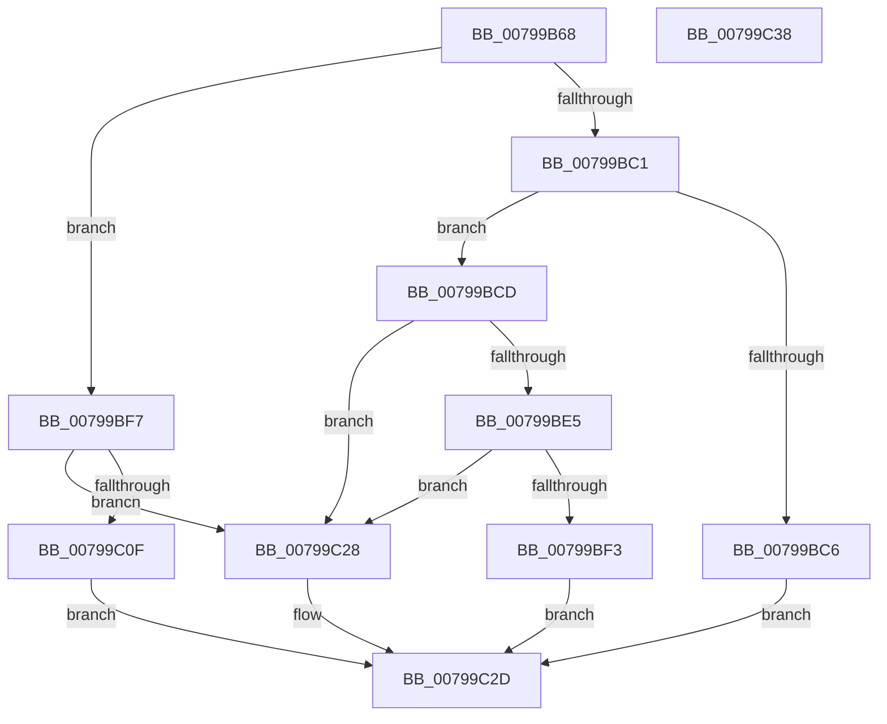

# Xp10ReadAndValidateCrc

- RVA: `0x00799B68`–`0x00799C39` (길이 `209` bytes)
- VA: `0x0000000140799B68`
- 실행 섹션: `PAGE`
- PDB 이름 있음: `예`; PDB Function 태그: `아니요`
- unwind 정보 RVA: `0x00068D5C`
- 디코드: `62`개 명령, `209/209` bytes 표시
- 미해석 바이트: `0` (있으면 어셈블리에 `.byte`로 보존)

> 이 문서는 커널 이미지의 기계어와 PDB 기호를 분석해 생성했습니다. 4번과 5번은 함수 원형과 자료형을 바이너리 사용 방식에서 추정한 C 해석이며 원본 소스 복구 결과는 아닙니다.

## 1. Dependencies

- 직접 호출 지점: **4**; 고유 호출 대상: **3**
- 직접 호출자로 확인된 함수: **1**
- RIP 상대 이미지 참조: **0**

### Outgoing calls
- `0x00799BDB` → [Xp10ScatteredBitBufferReadBytes](Xp10ScatteredBitBufferReadBytes_function_00799DB0.md) (function, `0x00799DB0`)
- `0x00799BE8` → [Xp10Compute2Crc32](Xp10Compute2Crc32_function_00797688.md) (function, `0x00797688`)
- `0x00799C05` → [Xp10ScatteredBitBufferReadBytes](Xp10ScatteredBitBufferReadBytes_function_00799DB0.md) (function, `0x00799DB0`)
- `0x00799C12` → [Xp10Compute2Crc64](Xp10Compute2Crc64_function_00797790.md) (function, `0x00797790`)

### Direct callers
- [RtlDecompressBuffer2Xp10](RtlDecompressBuffer2Xp10_function_007959A0.md) at `0x00795B86`

### Static image references
- 디코드된 RIP-relative 메모리 참조가 없습니다.

## 2. Other-region calls and transfers

- 다른 실행 섹션으로 향하는 call: **0**
- 별도 외부 분기/꼬리 이동을 확인하지 못했습니다.

## 3. Assembly (complete function range)

```asm
00799B68  48 89 5C 24 10                  mov qword ptr [rsp + 0x10], rbx
00799B6D  57                              push rdi
00799B6E  48 83 EC 20                     sub rsp, 0x20
00799B72  45 8B 48 10                     mov r9d, dword ptr [r8 + 0x10]
00799B76  4C 8B D9                        mov r11, rcx
00799B79  83 64 24 30 00                  and dword ptr [rsp + 0x30], 0
00799B7E  41 8B C1                        mov eax, r9d
00799B81  48 83 64 24 40 00               and qword ptr [rsp + 0x40], 0
00799B87  83 E0 07                        and eax, 7
00799B8A  44 2B C8                        sub r9d, eax
00799B8D  8B C8                           mov ecx, eax
00799B8F  49 D3 68 08                     shr qword ptr [r8 + 8], cl
00799B93  48 8B FA                        mov rdi, rdx
00799B96  49 8B 10                        mov rdx, qword ptr [r8]
00799B99  49 8B D8                        mov rbx, r8
00799B9C  44 8B D0                        mov r10d, eax
00799B9F  48 8B CA                        mov rcx, rdx
00799BA2  49 2B CA                        sub rcx, r10
00799BA5  45 89 48 10                     mov dword ptr [r8 + 0x10], r9d
00799BA9  33 C0                           xor eax, eax
00799BAB  4C 3B D2                        cmp r10, rdx
00799BAE  48 0F 46 C1                     cmovbe rax, rcx
00799BB2  49 89 00                        mov qword ptr [r8], rax
00799BB5  41 0F B7 0B                     movzx ecx, word ptr [r11]
00799BB9  C1 E9 0E                        shr ecx, 0xe
00799BBC  83 E1 01                        and ecx, 1
00799BBF  74 36                           je 0x140799bf7
00799BC1  83 F9 01                        cmp ecx, 1
00799BC4  74 07                           je 0x140799bcd
00799BC6  B8 0D 00 00 C0                  mov eax, 0xc000000d
00799BCB  EB 60                           jmp 0x140799c2d
00799BCD  41 B8 04 00 00 00               mov r8d, 4
00799BD3  48 8D 54 24 30                  lea rdx, [rsp + 0x30]
00799BD8  48 8B CB                        mov rcx, rbx
00799BDB  E8 D0 01 00 00                  call 0x140799db0
00799BE0  83 F8 04                        cmp eax, 4
00799BE3  75 43                           jne 0x140799c28
00799BE5  48 8B CF                        mov rcx, rdi
00799BE8  E8 9B DA FF FF                  call 0x140797688
00799BED  3B 44 24 30                     cmp eax, dword ptr [rsp + 0x30]
00799BF1  75 35                           jne 0x140799c28
00799BF3  33 C0                           xor eax, eax
00799BF5  EB 36                           jmp 0x140799c2d
00799BF7  41 B8 08 00 00 00               mov r8d, 8
00799BFD  48 8D 54 24 40                  lea rdx, [rsp + 0x40]
00799C02  48 8B CB                        mov rcx, rbx
00799C05  E8 A6 01 00 00                  call 0x140799db0
00799C0A  83 F8 08                        cmp eax, 8
00799C0D  75 19                           jne 0x140799c28
00799C0F  48 8B CF                        mov rcx, rdi
00799C12  E8 79 DB FF FF                  call 0x140797790
00799C17  48 2B 44 24 40                  sub rax, qword ptr [rsp + 0x40]
00799C1C  48 F7 D8                        neg rax
00799C1F  1B C0                           sbb eax, eax
00799C21  25 42 02 00 C0                  and eax, 0xc0000242
00799C26  EB 05                           jmp 0x140799c2d
00799C28  B8 42 02 00 C0                  mov eax, 0xc0000242
00799C2D  48 8B 5C 24 38                  mov rbx, qword ptr [rsp + 0x38]
00799C32  48 83 C4 20                     add rsp, 0x20
00799C36  5F                              pop rdi
00799C37  C3                              ret
00799C38  CC                              int3
```

## 4. C-style interpretation (structured pseudocode)

```c
__int64 __fastcall Xp10ReadAndValidateCrc(__int64 a1, __int64 a2, __int64 a3)
{
    __int64 result;
    __int64 v_rsp;
    unsigned __int64 v_stack_p10;
    unsigned __int64 v_stack_p18;
    unsigned int v_stack_p8;

    v_stack_p10 = v_rbx;
    v_rsp = (v_rsp) - (32);
    result = (unsigned int)(((unsigned int)((unsigned int)((unsigned int)(*(unsigned int *)(a3 + 16))))) & (7));
    a4 = (unsigned int)(((unsigned int)(*(unsigned int *)(a3 + 16))) - ((unsigned int)(result)));
    a1 = (*(unsigned __int64 *)(a3)) - ((unsigned int)((unsigned int)(result)));
    *(unsigned int *)(a3 + 16) = (unsigned int)(a4);
    result = 0;
    if (((unsigned int)((unsigned int)(result))) <= (*(unsigned __int64 *)(a3))) { result = a1; }
    *(unsigned __int64 *)(a3) = result;
    a1 = (unsigned int)((*(unsigned __int16 *)(a1)) >> (14));
    a1 = (unsigned int)((a1) & (1));
    if (condition_is_equal) goto loc_00799BF7;
    if (((unsigned int)(a1)) == 1) goto loc_00799BCD;
    goto loc_00799C2D;
loc_00799BCD:
    result = Xp10ScatteredBitBufferReadBytes(a3, v_stack_p8, 4, a4);
    if (((unsigned int)(result)) != 4) goto loc_00799C28;
    result = Xp10Compute2Crc32(a2, v_stack_p8, 4, a4);
    if (((unsigned int)(result)) != v_stack_p8) goto loc_00799C28;
    result = 0;
    goto loc_00799C2D;
loc_00799BF7:
    result = Xp10ScatteredBitBufferReadBytes(a3, v_stack_p18, 8, a4);
    if (((unsigned int)(result)) != 8) goto loc_00799C28;
    result = Xp10Compute2Crc64(a2, v_stack_p18, 8, a4);
    result = (result) - (v_stack_p18);
    result = -(result);
    result = (unsigned int)((result) & (0xC0000242ULL));
    goto loc_00799C2D;
loc_00799C28:
loc_00799C2D:
    v_rsp = (v_rsp) + (32);
    return (unsigned int)(0xC0000242ULL);
}
```

## 5. (Beta) C Style

```c
int64_t Xp10ReadAndValidateCrc(void *Arg1, int64_t Arg2, void *Arg3)
{
    uint8_t *arg1 = (uint8_t *)Arg1;
    uint8_t *arg3 = (uint8_t *)Arg3;

    int64_t result;
    int64_t local_rsp;
    uint64_t v_stack_p10;
    uint64_t v_stack_p18;
    uint32_t v_stack_p8;

    v_stack_p10 = local_rbx;
    local_rsp = (local_rsp) - (32);
    result = (uint32_t)(((uint32_t)((uint32_t)((uint32_t)(*(uint32_t *)(arg3 + 0x10))))) & (7));
    a4 = (uint32_t)(((uint32_t)(*(uint32_t *)(arg3 + 0x10))) - ((uint32_t)(result)));
    Arg1 = (*(uint64_t *)(arg3)) - ((uint32_t)((uint32_t)(result)));
    *(uint32_t *)(arg3 + 0x10) = (uint32_t)(a4);
    result = 0;
    if (((uint32_t)((uint32_t)(result))) <= (*(uint64_t *)(arg3))) { result = Arg1; }
    *(uint64_t *)(arg3) = result;
    Arg1 = (uint32_t)((*(uint16_t *)(arg1)) >> (14));
    Arg1 = (uint32_t)((Arg1) & (1));
    if (condition_is_equal) goto loc_00799BF7;
    if (((uint32_t)(Arg1)) == 1) goto loc_00799BCD;
    goto loc_00799C2D;
loc_00799BCD:
    result = Xp10ScatteredBitBufferReadBytes(Arg3, v_stack_p8, 4, a4);
    if (((uint32_t)(result)) != 4) goto loc_00799C28;
    result = Xp10Compute2Crc32(Arg2, v_stack_p8, 4, a4);
    if (((uint32_t)(result)) != v_stack_p8) goto loc_00799C28;
    result = 0;
    goto loc_00799C2D;
loc_00799BF7:
    result = Xp10ScatteredBitBufferReadBytes(Arg3, v_stack_p18, 8, a4);
    if (((uint32_t)(result)) != 8) goto loc_00799C28;
    result = Xp10Compute2Crc64(Arg2, v_stack_p18, 8, a4);
    result = (result) - (v_stack_p18);
    result = -(result);
    result = (uint32_t)((result) & (0xC0000242ULL));
    goto loc_00799C2D;
loc_00799C28:
loc_00799C2D:
    local_rsp = (local_rsp) + (32);
    return (uint32_t)(0xC0000242ULL);
}
```

### 관측된 메모리 오프셋

구조체 형식이 확인되지 않은 접근은 인자 기준의 오프셋으로만 기록했습니다.

| 기준 인자 | 오프셋 표현 | 폭 (bit) | 접근 |
|---|---:|---:|---|
| `Arg1` | `+ 0x0` | `16` | `R` |
| `Arg3` | `+ 0x0` | `64` | `R` |
| `Arg3` | `+ 0x0` | `64` | `W` |
| `Arg3` | `+ 0x8` | `64` | `R/W` |
| `Arg3` | `+ 0x10` | `32` | `R` |
| `Arg3` | `+ 0x10` | `32` | `W` |

## 6. Execution-region graph

[열기: 2D/3D 그래프와 함수 탐색 컨트롤 패널](../../../control-panel.html?section=page&rva=0x00799B68&view=graph)

- 2D 그래프는 위에서 아래로 흐르고, 3D 그래프는 빈 공간을 드래그해 회전합니다. Shift+드래그는 이동, 휠은 확대·축소, 함수 노드 선택은 대상 보고서 이동입니다.

### Static fallback


