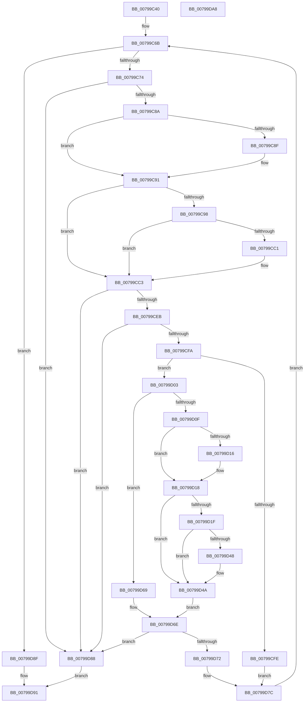

# Xp10ReadMtfHeader

- RVA: `0x00799C40`–`0x00799DA9` (길이 `361` bytes)
- VA: `0x0000000140799C40`
- 실행 섹션: `PAGE`
- PDB 이름 있음: `예`; PDB Function 태그: `아니요`
- unwind 정보 RVA: `0x0009C52C`
- 디코드: `119`개 명령, `361/361` bytes 표시
- 미해석 바이트: `0` (있으면 어셈블리에 `.byte`로 보존)

> 이 문서는 커널 이미지의 기계어와 PDB 기호를 분석해 생성했습니다. 4번과 5번은 함수 원형과 자료형을 바이너리 사용 방식에서 추정한 C 해석이며 원본 소스 복구 결과는 아닙니다.

## 1. Dependencies

- 직접 호출 지점: **2**; 고유 호출 대상: **1**
- 직접 호출자로 확인된 함수: **1**
- RIP 상대 이미지 참조: **0**

### Outgoing calls
- `0x00799CA7` → [Xp10ScatteredReadBytes](Xp10ScatteredReadBytes_function_0079A220.md) (function, `0x0079A220`)
- `0x00799D2E` → [Xp10ScatteredReadBytes](Xp10ScatteredReadBytes_function_0079A220.md) (function, `0x0079A220`)

### Direct callers
- [RtlDecompressBuffer2Xp10](RtlDecompressBuffer2Xp10_function_007959A0.md) at `0x00795B57`

### Static image references
- 디코드된 RIP-relative 메모리 참조가 없습니다.

## 2. Other-region calls and transfers

- 다른 실행 섹션으로 향하는 call: **0**
- 별도 외부 분기/꼬리 이동을 확인하지 못했습니다.

## 3. Assembly (complete function range)

```asm
00799C40  48 89 5C 24 08                  mov qword ptr [rsp + 8], rbx
00799C45  48 89 6C 24 18                  mov qword ptr [rsp + 0x18], rbp
00799C4A  56                              push rsi
00799C4B  57                              push rdi
00799C4C  41 54                           push r12
00799C4E  41 56                           push r14
00799C50  41 57                           push r15
00799C52  48 83 EC 20                     sub rsp, 0x20
00799C56  33 ED                           xor ebp, ebp
00799C58  0F 57 C0                        xorps xmm0, xmm0
00799C5B  49 8B D8                        mov rbx, r8
00799C5E  4C 8B F2                        mov r14, rdx
00799C61  4C 8B F9                        mov r15, rcx
00799C64  0F 11 02                        movups xmmword ptr [rdx], xmm0
00799C67  44 8D 65 01                     lea r12d, [rbp + 1]
00799C6B  83 FD 04                        cmp ebp, 4
00799C6E  0F 83 1B 01 00 00               jae 0x140799d8f
00799C74  83 64 24 58 00                  and dword ptr [rsp + 0x58], 0
00799C79  BF 05 00 00 00                  mov edi, 5
00799C7E  48 8B 03                        mov rax, qword ptr [rbx]
00799C81  48 85 C0                        test rax, rax
00799C84  0F 84 FE 00 00 00               je 0x140799d88
00799C8A  48 3B C7                        cmp rax, rdi
00799C8D  73 02                           jae 0x140799c91
00799C8F  8B F8                           mov edi, eax
00799C91  8B 43 10                        mov eax, dword ptr [rbx + 0x10]
00799C94  3B C7                           cmp eax, edi
00799C96  73 2B                           jae 0x140799cc3
00799C98  48 8D 4B 18                     lea rcx, [rbx + 0x18]
00799C9C  41 B8 04 00 00 00               mov r8d, 4
00799CA2  48 8D 54 24 58                  lea rdx, [rsp + 0x58]
00799CA7  E8 74 05 00 00                  call 0x14079a220
00799CAC  8B 4B 10                        mov ecx, dword ptr [rbx + 0x10]
00799CAF  8B 54 24 58                     mov edx, dword ptr [rsp + 0x58]
00799CB3  48 D3 E2                        shl rdx, cl
00799CB6  48 09 53 08                     or qword ptr [rbx + 8], rdx
00799CBA  8D 04 C1                        lea eax, [rcx + rax*8]
00799CBD  3B C7                           cmp eax, edi
00799CBF  73 02                           jae 0x140799cc3
00799CC1  8B F8                           mov edi, eax
00799CC3  8B CF                           mov ecx, edi
00799CC5  2B C7                           sub eax, edi
00799CC7  49 8B F4                        mov rsi, r12
00799CCA  89 43 10                        mov dword ptr [rbx + 0x10], eax
00799CCD  48 D3 E6                        shl rsi, cl
00799CD0  8B CF                           mov ecx, edi
00799CD2  41 2B F4                        sub esi, r12d
00799CD5  23 73 08                        and esi, dword ptr [rbx + 8]
00799CD8  48 D3 6B 08                     shr qword ptr [rbx + 8], cl
00799CDC  48 29 0B                        sub qword ptr [rbx], rcx
00799CDF  48 8B 0B                        mov rcx, qword ptr [rbx]
00799CE2  83 FF 05                        cmp edi, 5
00799CE5  0F 82 9D 00 00 00               jb 0x140799d88
00799CEB  41 0F B7 07                     movzx eax, word ptr [r15]
00799CEF  83 E0 1F                        and eax, 0x1f
00799CF2  3B F0                           cmp esi, eax
00799CF4  0F 87 8E 00 00 00               ja 0x140799d88
00799CFA  85 F6                           test esi, esi
00799CFC  75 05                           jne 0x140799d03
00799CFE  41 8B D4                        mov edx, r12d
00799D01  EB 79                           jmp 0x140799d7c
00799D03  83 64 24 58 00                  and dword ptr [rsp + 0x58], 0
00799D08  8B FE                           mov edi, esi
00799D0A  48 85 C9                        test rcx, rcx
00799D0D  74 5A                           je 0x140799d69
00799D0F  8B C6                           mov eax, esi
00799D11  48 3B C1                        cmp rax, rcx
00799D14  76 02                           jbe 0x140799d18
00799D16  8B 3B                           mov edi, dword ptr [rbx]
00799D18  8B 43 10                        mov eax, dword ptr [rbx + 0x10]
00799D1B  3B C7                           cmp eax, edi
00799D1D  73 2B                           jae 0x140799d4a
00799D1F  48 8D 4B 18                     lea rcx, [rbx + 0x18]
00799D23  41 B8 04 00 00 00               mov r8d, 4
00799D29  48 8D 54 24 58                  lea rdx, [rsp + 0x58]
00799D2E  E8 ED 04 00 00                  call 0x14079a220
00799D33  8B 4B 10                        mov ecx, dword ptr [rbx + 0x10]
00799D36  8B 54 24 58                     mov edx, dword ptr [rsp + 0x58]
00799D3A  48 D3 E2                        shl rdx, cl
00799D3D  48 09 53 08                     or qword ptr [rbx + 8], rdx
00799D41  8D 04 C1                        lea eax, [rcx + rax*8]
00799D44  3B C7                           cmp eax, edi
00799D46  73 02                           jae 0x140799d4a
00799D48  8B F8                           mov edi, eax
00799D4A  8B CF                           mov ecx, edi
00799D4C  4D 8B C4                        mov r8, r12
00799D4F  49 D3 E0                        shl r8, cl
00799D52  45 2B C4                        sub r8d, r12d
00799D55  8B CF                           mov ecx, edi
00799D57  44 23 43 08                     and r8d, dword ptr [rbx + 8]
00799D5B  48 D3 6B 08                     shr qword ptr [rbx + 8], cl
00799D5F  48 29 0B                        sub qword ptr [rbx], rcx
00799D62  2B C7                           sub eax, edi
00799D64  89 43 10                        mov dword ptr [rbx + 0x10], eax
00799D67  EB 05                           jmp 0x140799d6e
00799D69  45 33 C0                        xor r8d, r8d
00799D6C  33 FF                           xor edi, edi
00799D6E  3B FE                           cmp edi, esi
00799D70  72 16                           jb 0x140799d88
00799D72  8B CE                           mov ecx, esi
00799D74  41 8B D4                        mov edx, r12d
00799D77  D3 E2                           shl edx, cl
00799D79  41 03 D0                        add edx, r8d
00799D7C  41 89 14 AE                     mov dword ptr [r14 + rbp*4], edx
00799D80  41 03 EC                        add ebp, r12d
00799D83  E9 E3 FE FF FF                  jmp 0x140799c6b
00799D88  B8 42 02 00 C0                  mov eax, 0xc0000242
00799D8D  EB 02                           jmp 0x140799d91
00799D8F  33 C0                           xor eax, eax
00799D91  48 8B 5C 24 50                  mov rbx, qword ptr [rsp + 0x50]
00799D96  48 8B 6C 24 60                  mov rbp, qword ptr [rsp + 0x60]
00799D9B  48 83 C4 20                     add rsp, 0x20
00799D9F  41 5F                           pop r15
00799DA1  41 5E                           pop r14
00799DA3  41 5C                           pop r12
00799DA5  5F                              pop rdi
00799DA6  5E                              pop rsi
00799DA7  C3                              ret
00799DA8  CC                              int3
```

## 4. C-style interpretation (structured pseudocode)

```c
__int64 __fastcall Xp10ReadMtfHeader(__int64 a1, __int64 a2, __int64 a3)
{
    __int64 result;
    __int64 v_rbp;
    __int64 v_rdi;
    __int64 v_rsi;
    __int64 v_rsp;
    unsigned int v_stack_p10;
    unsigned __int64 v_stack_p18;
    unsigned __int64 v_stack_p8;

    v_stack_p8 = v_rbx;
    v_stack_p18 = v_rbp;
    v_rsp = (v_rsp) - (32);
    v_rbp = 0;
    *(unsigned __int64 *)(a2) = v_xmm0;
loc_00799C6B:
    if (0 >= 4) goto loc_00799D8F;
    if (*(unsigned __int64 *)(a3) == 0) goto loc_00799D88;
    v_rdi = 5;
    if ((*(unsigned __int64 *)(a3)) < 5) {
        v_rdi = (unsigned int)(*(unsigned __int64 *)(a3));
    }
    if (((unsigned int)((unsigned int)(*(unsigned int *)(a3 + 16)))) >= ((unsigned int)(v_rdi))) goto loc_00799CC3;
    result = Xp10ScatteredReadBytes(a3 + 24, v_stack_p10, 4, a4);
    a2 = ((unsigned int)(v_stack_p10)) << ((unsigned __int8)((unsigned int)(*(unsigned int *)(a3 + 16))));
    if (((unsigned int)((unsigned int)(*(unsigned int *)(a3 + 16)) + result * 8)) < ((unsigned int)(v_rdi))) {
        v_rdi = (unsigned int)((unsigned int)(*(unsigned int *)(a3 + 16)) + result * 8);
    }
    result = (unsigned int)(((unsigned int)(*(unsigned int *)(a3 + 16)) + result * 8) - ((unsigned int)(v_rdi)));
    *(unsigned int *)(a3 + 16) = (unsigned int)(result);
    v_rsi = (v_rbp + 1) << ((unsigned __int8)((unsigned int)((unsigned int)(v_rdi))));
    v_rsi = (unsigned int)((v_rsi) - ((unsigned int)(v_rbp + 1)));
    v_rsi = (unsigned int)((v_rsi) & (*(unsigned int *)(a3 + 8)));
    if (((unsigned int)(v_rdi)) < 5) goto loc_00799D88;
    result = (unsigned int)((*(unsigned __int16 *)(a1)) & (31));
    if (((unsigned int)(v_rsi)) > ((unsigned int)(result))) goto loc_00799D88;
    if ((unsigned int)(v_rsi) != 0) goto loc_00799D03;
    goto loc_00799D7C;
loc_00799D03:
    if (*(unsigned __int64 *)(a3) == 0) goto loc_00799D69;
    v_rdi = (unsigned int)((unsigned int)(v_rsi));
    if (((unsigned int)((unsigned int)(v_rsi))) >= = (*(unsigned __int64 *)(a3))) {
        v_rdi = *(unsigned int *)(a3);
    }
    if (((unsigned int)((unsigned int)(*(unsigned int *)(a3 + 16)))) >= ((unsigned int)(v_rdi))) goto loc_00799D4A;
    result = Xp10ScatteredReadBytes(a3 + 24, v_stack_p10, 4, a4);
    a2 = ((unsigned int)(v_stack_p10)) << ((unsigned __int8)((unsigned int)(*(unsigned int *)(a3 + 16))));
    if (((unsigned int)((unsigned int)(*(unsigned int *)(a3 + 16)) + result * 8)) < ((unsigned int)(v_rdi))) {
        v_rdi = (unsigned int)((unsigned int)(*(unsigned int *)(a3 + 16)) + result * 8);
    }
    a3 = (v_rbp + 1) << ((unsigned __int8)((unsigned int)((unsigned int)(v_rdi))));
    a3 = (unsigned int)((a3) - ((unsigned int)(v_rbp + 1)));
    a3 = (unsigned int)((a3) & (*(unsigned int *)(a3 + 8)));
    result = (unsigned int)(((unsigned int)(*(unsigned int *)(a3 + 16)) + result * 8) - ((unsigned int)(v_rdi)));
    *(unsigned int *)(a3 + 16) = (unsigned int)(result);
    goto loc_00799D6E;
loc_00799D69:
    a3 = 0;
    v_rdi = 0;
loc_00799D6E:
    if (0 < ((unsigned int)(v_rsi))) goto loc_00799D88;
    a2 = (unsigned int)(((unsigned int)((unsigned int)(v_rbp + 1))) << ((unsigned __int8)((unsigned int)((unsigned int)(v_rsi)))));
    a2 = (unsigned int)((a2) + (0));
loc_00799D7C:
    *(unsigned int *)(a2 + v_rbp * 4) = (unsigned int)(a2);
    v_rbp = (unsigned int)((v_rbp) + ((unsigned int)(v_rbp + 1)));
    goto loc_00799C6B;
loc_00799D88:
    goto loc_00799D91;
loc_00799D8F:
    result = 0;
loc_00799D91:
    v_rsp = (v_rsp) + (32);
    return result;
}
```

## 5. (Beta) C Style

```c
int64_t Xp10ReadMtfHeader(void *Arg1, void *Arg2, void *Arg3)
{
    uint8_t *arg1 = (uint8_t *)Arg1;
    uint8_t *arg2 = (uint8_t *)Arg2;
    uint8_t *arg3 = (uint8_t *)Arg3;

    int64_t result;
    int64_t local_rbp;
    int64_t local_rdi;
    int64_t local_rsi;
    int64_t local_rsp;
    uint32_t v_stack_p10;
    uint64_t v_stack_p18;
    uint64_t v_stack_p8;

    v_stack_p8 = local_rbx;
    v_stack_p18 = local_rbp;
    local_rsp = (local_rsp) - (32);
    local_rbp = 0;
    *(uint64_t *)(arg2) = v_xmm0;
loc_00799C6B:
    if (0 >= 4) goto loc_00799D8F;
    if (*(uint64_t *)(arg3) == 0) goto loc_00799D88;
    local_rdi = 5;
    if ((*(uint64_t *)(arg3)) < 5) {
        local_rdi = (uint32_t)(*(uint64_t *)(arg3));
    }
    if (((uint32_t)((uint32_t)(*(uint32_t *)(arg3 + 0x10)))) >= ((uint32_t)(local_rdi))) goto loc_00799CC3;
    result = Xp10ScatteredReadBytes(Arg3 + 24, v_stack_p10, 4, a4);
    Arg2 = ((uint32_t)(v_stack_p10)) << ((uint8_t)((uint32_t)(*(uint32_t *)(arg3 + 0x10))));
    if (((uint32_t)((uint32_t)(*(uint32_t *)(arg3 + 0x10)) + result * 8)) < ((uint32_t)(local_rdi))) {
        local_rdi = (uint32_t)((uint32_t)(*(uint32_t *)(arg3 + 0x10)) + result * 8);
    }
    result = (uint32_t)(((uint32_t)(*(uint32_t *)(arg3 + 0x10)) + result * 8) - ((uint32_t)(local_rdi)));
    *(uint32_t *)(arg3 + 0x10) = (uint32_t)(result);
    local_rsi = (local_rbp + 1) << ((uint8_t)((uint32_t)((uint32_t)(local_rdi))));
    local_rsi = (uint32_t)((local_rsi) - ((uint32_t)(local_rbp + 1)));
    local_rsi = (uint32_t)((local_rsi) & (*(uint32_t *)(arg3 + 0x8)));
    if (((uint32_t)(local_rdi)) < 5) goto loc_00799D88;
    result = (uint32_t)((*(uint16_t *)(arg1)) & (31));
    if (((uint32_t)(local_rsi)) > ((uint32_t)(result))) goto loc_00799D88;
    if ((uint32_t)(local_rsi) != 0) goto loc_00799D03;
    goto loc_00799D7C;
loc_00799D03:
    if (*(uint64_t *)(arg3) == 0) goto loc_00799D69;
    local_rdi = (uint32_t)((uint32_t)(local_rsi));
    if (((uint32_t)((uint32_t)(local_rsi))) >= = (*(uint64_t *)(arg3))) {
        local_rdi = *(uint32_t *)(arg3);
    }
    if (((uint32_t)((uint32_t)(*(uint32_t *)(arg3 + 0x10)))) >= ((uint32_t)(local_rdi))) goto loc_00799D4A;
    result = Xp10ScatteredReadBytes(Arg3 + 24, v_stack_p10, 4, a4);
    Arg2 = ((uint32_t)(v_stack_p10)) << ((uint8_t)((uint32_t)(*(uint32_t *)(arg3 + 0x10))));
    if (((uint32_t)((uint32_t)(*(uint32_t *)(arg3 + 0x10)) + result * 8)) < ((uint32_t)(local_rdi))) {
        local_rdi = (uint32_t)((uint32_t)(*(uint32_t *)(arg3 + 0x10)) + result * 8);
    }
    Arg3 = (local_rbp + 1) << ((uint8_t)((uint32_t)((uint32_t)(local_rdi))));
    Arg3 = (uint32_t)((Arg3) - ((uint32_t)(local_rbp + 1)));
    Arg3 = (uint32_t)((Arg3) & (*(uint32_t *)(arg3 + 0x8)));
    result = (uint32_t)(((uint32_t)(*(uint32_t *)(arg3 + 0x10)) + result * 8) - ((uint32_t)(local_rdi)));
    *(uint32_t *)(arg3 + 0x10) = (uint32_t)(result);
    goto loc_00799D6E;
loc_00799D69:
    Arg3 = 0;
    local_rdi = 0;
loc_00799D6E:
    if (0 < ((uint32_t)(local_rsi))) goto loc_00799D88;
    Arg2 = (uint32_t)(((uint32_t)((uint32_t)(local_rbp + 1))) << ((uint8_t)((uint32_t)((uint32_t)(local_rsi)))));
    Arg2 = (uint32_t)((Arg2) + (0));
loc_00799D7C:
    *(uint32_t *)(arg2 + local_rbp * 4) = (uint32_t)(Arg2);
    local_rbp = (uint32_t)((local_rbp) + ((uint32_t)(local_rbp + 1)));
    goto loc_00799C6B;
loc_00799D88:
    goto loc_00799D91;
loc_00799D8F:
    result = 0;
loc_00799D91:
    local_rsp = (local_rsp) + (32);
    return result;
}
```

### 관측된 메모리 오프셋

구조체 형식이 확인되지 않은 접근은 인자 기준의 오프셋으로만 기록했습니다.

| 기준 인자 | 오프셋 표현 | 폭 (bit) | 접근 |
|---|---:|---:|---|
| `Arg1` | `+ 0x0` | `16` | `R` |
| `Arg2` | `+ 0x0` | `128` | `R` |
| `Arg2` | `+ 0x0 + rbp*4` | `32` | `W` |
| `Arg3` | `+ 0x0` | `32` | `R` |
| `Arg3` | `+ 0x0` | `64` | `R` |
| `Arg3` | `+ 0x0` | `64` | `R/W` |
| `Arg3` | `+ 0x8` | `32` | `R` |
| `Arg3` | `+ 0x8` | `64` | `R/W` |
| `Arg3` | `+ 0x10` | `32` | `R` |
| `Arg3` | `+ 0x10` | `32` | `W` |
| `Arg3` | `+ 0x18` | `64` | `R` |

## 6. Execution-region graph

[열기: 2D/3D 그래프와 함수 탐색 컨트롤 패널](../../../control-panel.html?section=page&rva=0x00799C40&view=graph)

- 2D 그래프는 위에서 아래로 흐르고, 3D 그래프는 빈 공간을 드래그해 회전합니다. Shift+드래그는 이동, 휠은 확대·축소, 함수 노드 선택은 대상 보고서 이동입니다.

### Static fallback


