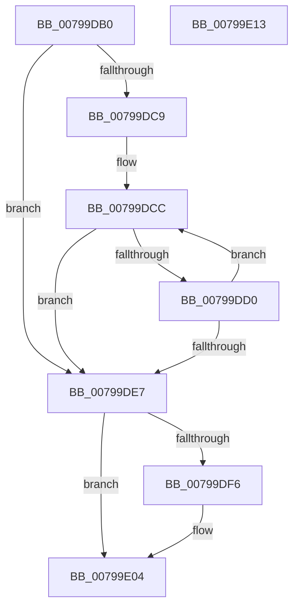

# Xp10ScatteredBitBufferReadBytes

- RVA: `0x00799DB0`–`0x00799E14` (길이 `100` bytes)
- VA: `0x0000000140799DB0`
- 실행 섹션: `PAGE`
- PDB 이름 있음: `예`; PDB Function 태그: `아니요`
- unwind 정보 RVA: `0x0005CAAC`
- 디코드: `35`개 명령, `100/100` bytes 표시
- 미해석 바이트: `0` (있으면 어셈블리에 `.byte`로 보존)

> 이 문서는 커널 이미지의 기계어와 PDB 기호를 분석해 생성했습니다. 4번과 5번은 함수 원형과 자료형을 바이너리 사용 방식에서 추정한 C 해석이며 원본 소스 복구 결과는 아닙니다.

## 1. Dependencies

- 직접 호출 지점: **1**; 고유 호출 대상: **1**
- 직접 호출자로 확인된 함수: **1**
- RIP 상대 이미지 참조: **0**

### Outgoing calls
- `0x00799DFD` → [Xp10ScatteredReadBytes](Xp10ScatteredReadBytes_function_0079A220.md) (function, `0x0079A220`)

### Direct callers
- [Xp10ReadAndValidateCrc](Xp10ReadAndValidateCrc_function_00799B68.md) at `0x00799BDB`
- [Xp10ReadAndValidateCrc](Xp10ReadAndValidateCrc_function_00799B68.md) at `0x00799C05`

### Static image references
- 디코드된 RIP-relative 메모리 참조가 없습니다.

## 2. Other-region calls and transfers

- 다른 실행 섹션으로 향하는 call: **0**
- 별도 외부 분기/꼬리 이동을 확인하지 못했습니다.

## 3. Assembly (complete function range)

```asm
00799DB0  48 89 5C 24 08                  mov qword ptr [rsp + 8], rbx
00799DB5  57                              push rdi
00799DB6  48 83 EC 20                     sub rsp, 0x20
00799DBA  83 79 10 08                     cmp dword ptr [rcx + 0x10], 8
00799DBE  41 8B F8                        mov edi, r8d
00799DC1  4C 8B C9                        mov r9, rcx
00799DC4  41 8B D8                        mov ebx, r8d
00799DC7  72 1E                           jb 0x140799de7
00799DC9  48 2B CA                        sub rcx, rdx
00799DCC  85 DB                           test ebx, ebx
00799DCE  74 17                           je 0x140799de7
00799DD0  8A 44 11 08                     mov al, byte ptr [rcx + rdx + 8]
00799DD4  FF CB                           dec ebx
00799DD6  88 02                           mov byte ptr [rdx], al
00799DD8  48 FF C2                        inc rdx
00799DDB  41 83 41 10 F8                  add dword ptr [r9 + 0x10], -8
00799DE0  41 83 79 10 08                  cmp dword ptr [r9 + 0x10], 8
00799DE5  73 E5                           jae 0x140799dcc
00799DE7  8B CF                           mov ecx, edi
00799DE9  2B CB                           sub ecx, ebx
00799DEB  C1 E1 03                        shl ecx, 3
00799DEE  49 D3 69 08                     shr qword ptr [r9 + 8], cl
00799DF2  85 DB                           test ebx, ebx
00799DF4  74 0E                           je 0x140799e04
00799DF6  49 8D 49 18                     lea rcx, [r9 + 0x18]
00799DFA  44 8B C3                        mov r8d, ebx
00799DFD  E8 1E 04 00 00                  call 0x14079a220
00799E02  2B D8                           sub ebx, eax
00799E04  2B FB                           sub edi, ebx
00799E06  48 8B 5C 24 30                  mov rbx, qword ptr [rsp + 0x30]
00799E0B  8B C7                           mov eax, edi
00799E0D  48 83 C4 20                     add rsp, 0x20
00799E11  5F                              pop rdi
00799E12  C3                              ret
00799E13  CC                              int3
```

## 4. C-style interpretation (structured pseudocode)

```c
__int64 __fastcall Xp10ScatteredBitBufferReadBytes(__int64 a1, __int64 a2, int a3)
{
    __int64 result;
    __int64 v_rbx;
    __int64 v_rdi;
    __int64 v_rsp;
    unsigned __int64 v_stack_p8;

    v_stack_p8 = v_rbx;
    v_rsp = (v_rsp) - (32);
    if ((*(unsigned int *)(a1 + 16)) < 8) goto loc_00799DE7;
    a1 = (a1) - (a2);
loc_00799DCC:
    if ((unsigned int)((unsigned int)(a3)) == 0) goto loc_00799DE7;
    v_rbx = (unsigned int)(((unsigned int)(a3)) - 1);
    *(unsigned __int8 *)(a2) = (unsigned __int8)(*(unsigned __int8 *)(a1 + a2 * 1 + 8));
    a2 = (a2) + 1;
    if ((*(unsigned int *)(a1 + 16)) >= 8) goto loc_00799DCC;
loc_00799DE7:
    a1 = (unsigned int)(((unsigned int)((unsigned int)((unsigned int)(a3)))) - ((unsigned int)(v_rbx)));
    a1 = (unsigned int)((a1) << (3));
    result = *(unsigned __int8 *)(a1 + a2 * 1 + 8);
    if ((unsigned int)(v_rbx) != 0) {
        a1 = a1 + 24;
        a3 = (unsigned int)(v_rbx);
        result = Xp10ScatteredReadBytes(a1, a2, a3, a1);
        v_rbx = (unsigned int)((v_rbx) - ((unsigned int)(result)));
    }
    v_rdi = (unsigned int)(((unsigned int)(a3)) - ((unsigned int)(v_rbx)));
    v_rsp = (v_rsp) + (32);
    return (unsigned int)((unsigned int)(v_rdi));
}
```

## 5. (Beta) C Style

```c
int64_t Xp10ScatteredBitBufferReadBytes(void *Arg1, int64_t Arg2, int32_t Arg3)
{
    uint8_t *arg1 = (uint8_t *)Arg1;

    int64_t result;
    int64_t local_rbx;
    int64_t local_rdi;
    int64_t local_rsp;
    uint64_t v_stack_p8;

    v_stack_p8 = local_rbx;
    local_rsp = (local_rsp) - (32);
    if ((*(uint32_t *)(arg1 + 0x10)) < 8) goto loc_00799DE7;
    Arg1 = (Arg1) - (Arg2);
loc_00799DCC:
    if ((uint32_t)((uint32_t)(Arg3)) == 0) goto loc_00799DE7;
    local_rbx = (uint32_t)(((uint32_t)(Arg3)) - 1);
    *(uint8_t *)(Arg2) = (uint8_t)(*(uint8_t *)(arg1 + Arg2 * 1 + 0x8));
    Arg2 = (Arg2) + 1;
    if ((*(uint32_t *)(arg1 + 0x10)) >= 8) goto loc_00799DCC;
loc_00799DE7:
    Arg1 = (uint32_t)(((uint32_t)((uint32_t)((uint32_t)(Arg3)))) - ((uint32_t)(local_rbx)));
    Arg1 = (uint32_t)((Arg1) << (3));
    result = *(uint8_t *)(arg1 + Arg2 * 1 + 0x8);
    if ((uint32_t)(local_rbx) != 0) {
        Arg1 = Arg1 + 24;
        Arg3 = (uint32_t)(local_rbx);
        result = Xp10ScatteredReadBytes(Arg1, Arg2, Arg3, Arg1);
        local_rbx = (uint32_t)((local_rbx) - ((uint32_t)(result)));
    }
    local_rdi = (uint32_t)(((uint32_t)(Arg3)) - ((uint32_t)(local_rbx)));
    local_rsp = (local_rsp) + (32);
    return (uint32_t)((uint32_t)(local_rdi));
}
```

### 관측된 메모리 오프셋

구조체 형식이 확인되지 않은 접근은 인자 기준의 오프셋으로만 기록했습니다.

| 기준 인자 | 오프셋 표현 | 폭 (bit) | 접근 |
|---|---:|---:|---|
| `Arg1` | `+ 0x8` | `64` | `R/W` |
| `Arg1` | `+ 0x8 + rdx*1` | `8` | `R` |
| `Arg1` | `+ 0x10` | `32` | `R` |
| `Arg1` | `+ 0x10` | `32` | `R/W` |
| `Arg1` | `+ 0x18` | `64` | `R` |

## 6. Execution-region graph

[열기: 2D/3D 그래프와 함수 탐색 컨트롤 패널](../../../control-panel.html?section=page&rva=0x00799DB0&view=graph)

- 2D 그래프는 위에서 아래로 흐르고, 3D 그래프는 빈 공간을 드래그해 회전합니다. Shift+드래그는 이동, 휠은 확대·축소, 함수 노드 선택은 대상 보고서 이동입니다.

### Static fallback


