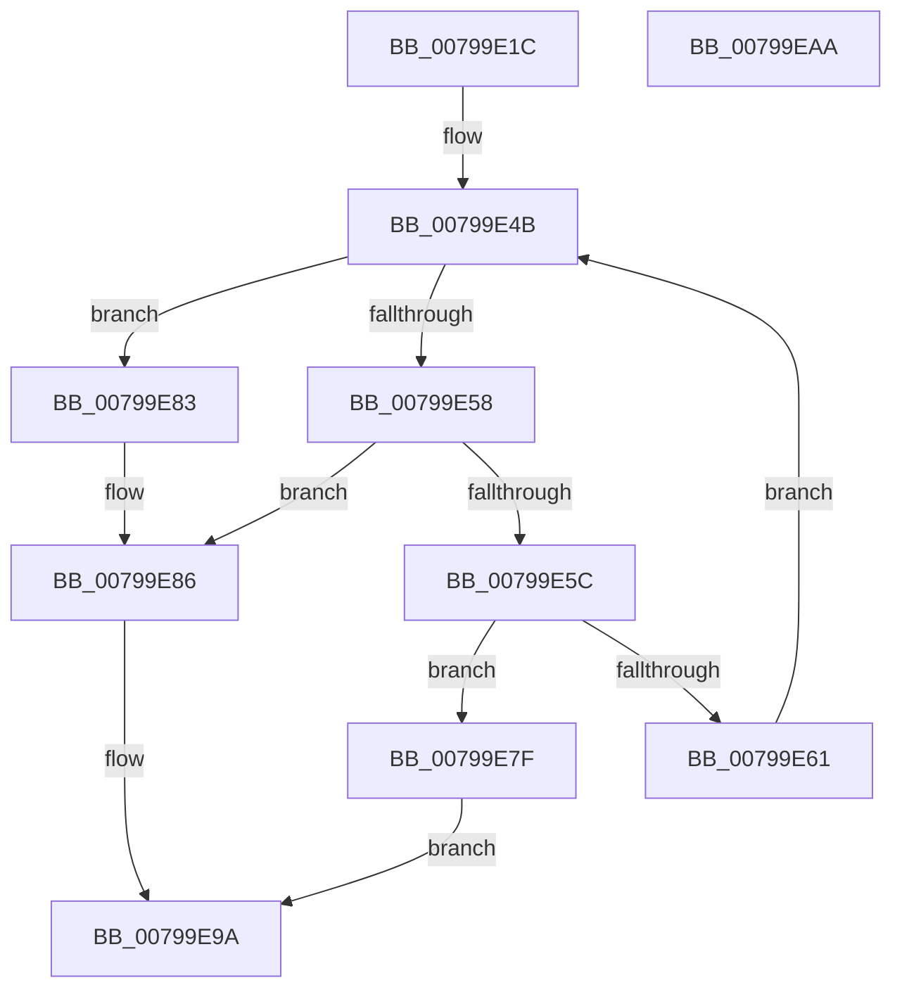

# Xp10ScatteredByteSeekBack

- RVA: `0x00799E1C`–`0x00799EAB` (길이 `143` bytes)
- VA: `0x0000000140799E1C`
- 실행 섹션: `PAGE`
- PDB 이름 있음: `예`; PDB Function 태그: `아니요`
- unwind 정보 RVA: `0x00069588`
- 디코드: `43`개 명령, `143/143` bytes 표시
- 미해석 바이트: `0` (있으면 어셈블리에 `.byte`로 보존)

> 이 문서는 커널 이미지의 기계어와 PDB 기호를 분석해 생성했습니다. 4번과 5번은 함수 원형과 자료형을 바이너리 사용 방식에서 추정한 C 해석이며 원본 소스 복구 결과는 아닙니다.

## 1. Dependencies

- 직접 호출 지점: **0**; 고유 호출 대상: **0**
- 직접 호출자로 확인된 함수: **1**
- RIP 상대 이미지 참조: **0**

### Outgoing calls
- 직접 디코드된 call 명령이 없습니다.

### Direct callers
- [Xp10ScatteredCopyFromPrevious](Xp10ScatteredCopyFromPrevious_function_0079A174.md) at `0x0079A1A1`

### Static image references
- 디코드된 RIP-relative 메모리 참조가 없습니다.

## 2. Other-region calls and transfers

- 다른 실행 섹션으로 향하는 call: **0**
- 별도 외부 분기/꼬리 이동을 확인하지 못했습니다.

## 3. Assembly (complete function range)

```asm
00799E1C  48 89 5C 24 08                  mov qword ptr [rsp + 8], rbx
00799E21  48 89 74 24 10                  mov qword ptr [rsp + 0x10], rsi
00799E26  48 89 7C 24 18                  mov qword ptr [rsp + 0x18], rdi
00799E2B  4C 8B 51 18                     mov r10, qword ptr [rcx + 0x18]
00799E2F  4C 8B C1                        mov r8, rcx
00799E32  48 8B 71 20                     mov rsi, qword ptr [rcx + 0x20]
00799E36  49 8B C2                        mov rax, r10
00799E39  4C 8B 09                        mov r9, qword ptr [rcx]
00799E3C  48 03 C0                        add rax, rax
00799E3F  4C 8B 59 08                     mov r11, qword ptr [rcx + 8]
00799E43  48 8B 59 10                     mov rbx, qword ptr [rcx + 0x10]
00799E47  48 8B 3C C6                     mov rdi, qword ptr [rsi + rax*8]
00799E4B  49 8B C1                        mov rax, r9
00799E4E  8B CA                           mov ecx, edx
00799E50  48 2B C7                        sub rax, rdi
00799E53  48 3B C1                        cmp rax, rcx
00799E56  73 2B                           jae 0x140799e83
00799E58  2B D0                           sub edx, eax
00799E5A  74 2A                           je 0x140799e86
00799E5C  4D 85 D2                        test r10, r10
00799E5F  74 1E                           je 0x140799e7f
00799E61  49 FF CA                        dec r10
00799E64  49 8B C2                        mov rax, r10
00799E67  48 03 C0                        add rax, rax
00799E6A  48 8B 4C C6 08                  mov rcx, qword ptr [rsi + rax*8 + 8]
00799E6F  48 8B 3C C6                     mov rdi, qword ptr [rsi + rax*8]
00799E73  48 2B D9                        sub rbx, rcx
00799E76  4C 8D 1C 39                     lea r11, [rcx + rdi]
00799E7A  4D 8B CB                        mov r9, r11
00799E7D  EB CC                           jmp 0x140799e4b
00799E7F  33 C0                           xor eax, eax
00799E81  EB 17                           jmp 0x140799e9a
00799E83  4C 2B C9                        sub r9, rcx
00799E86  4D 89 08                        mov qword ptr [r8], r9
00799E89  B8 01 00 00 00                  mov eax, 1
00799E8E  4D 89 58 08                     mov qword ptr [r8 + 8], r11
00799E92  4D 89 50 18                     mov qword ptr [r8 + 0x18], r10
00799E96  49 89 58 10                     mov qword ptr [r8 + 0x10], rbx
00799E9A  48 8B 5C 24 08                  mov rbx, qword ptr [rsp + 8]
00799E9F  48 8B 74 24 10                  mov rsi, qword ptr [rsp + 0x10]
00799EA4  48 8B 7C 24 18                  mov rdi, qword ptr [rsp + 0x18]
00799EA9  C3                              ret
00799EAA  CC                              int3
```

## 4. C-style interpretation (structured pseudocode)

```c
__int64 __fastcall Xp10ScatteredByteSeekBack(__int64 a1, int a2)
{
    __int64 result;
    __int64 v_r10;
    __int64 v_rbx;
    unsigned __int64 v_stack_p10;
    unsigned __int64 v_stack_p18;
    unsigned __int64 v_stack_p8;

    v_stack_p8 = v_rbx;
    v_stack_p10 = v_rsi;
    v_stack_p18 = v_rdi;
    result = (*(unsigned __int64 *)(a1 + 24)) + (*(unsigned __int64 *)(a1 + 24));
loc_00799E4B:
    result = (*(unsigned __int64 *)(a1)) - (*(unsigned __int64 *)(*(unsigned __int64 *)(a1 + 32) + result * 8));
    if (result >= ((unsigned int)(a2))) goto loc_00799E83;
    a2 = (unsigned int)((a2) - ((unsigned int)(result)));
    if (condition_is_equal) goto loc_00799E86;
    if (*(unsigned __int64 *)(a1 + 24) == 0) goto loc_00799E7F;
    v_r10 = (*(unsigned __int64 *)(a1 + 24)) - 1;
    result = (v_r10) + (v_r10);
    v_rbx = (*(unsigned __int64 *)(a1 + 16)) - (*(unsigned __int64 *)(*(unsigned __int64 *)(a1 + 32) + result * 8 + 8));
    goto loc_00799E4B;
loc_00799E7F:
    result = 0;
    goto loc_00799E9A;
loc_00799E83:
    a4 = (*(unsigned __int64 *)(*(unsigned __int64 *)(a1 + 32) + result * 8 + 8) + *(unsigned __int64 *)(*(unsigned __int64 *)(a1 + 32) + result * 8) * 1) - (*(unsigned __int64 *)(*(unsigned __int64 *)(a1 + 32) + result * 8 + 8));
loc_00799E86:
    *(unsigned __int64 *)(a1) = a4;
    *(unsigned __int64 *)(a1 + 8) = *(unsigned __int64 *)(*(unsigned __int64 *)(a1 + 32) + result * 8 + 8) + *(unsigned __int64 *)(*(unsigned __int64 *)(a1 + 32) + result * 8) * 1;
    *(unsigned __int64 *)(a1 + 24) = v_r10;
    *(unsigned __int64 *)(a1 + 16) = v_rbx;
loc_00799E9A:
    return 1;
}
```

## 5. (Beta) C Style

```c
int64_t Xp10ScatteredByteSeekBack(void *Arg1, int32_t Arg2)
{
    uint8_t *arg1 = (uint8_t *)Arg1;

    int64_t result;
    int64_t local_r10;
    int64_t local_rbx;
    uint64_t v_stack_p10;
    uint64_t v_stack_p18;
    uint64_t v_stack_p8;

    v_stack_p8 = local_rbx;
    v_stack_p10 = local_rsi;
    v_stack_p18 = local_rdi;
    result = (*(uint64_t *)(arg1 + 0x18)) + (*(uint64_t *)(arg1 + 0x18));
loc_00799E4B:
    result = (*(uint64_t *)(arg1)) - (*(uint64_t *)(*(uint64_t *)(arg1 + 0x20) + result * 8));
    if (result >= ((uint32_t)(Arg2))) goto loc_00799E83;
    Arg2 = (uint32_t)((Arg2) - ((uint32_t)(result)));
    if (condition_is_equal) goto loc_00799E86;
    if (*(uint64_t *)(arg1 + 0x18) == 0) goto loc_00799E7F;
    local_r10 = (*(uint64_t *)(arg1 + 0x18)) - 1;
    result = (local_r10) + (local_r10);
    local_rbx = (*(uint64_t *)(arg1 + 0x10)) - (*(uint64_t *)(*(uint64_t *)(arg1 + 0x20) + result * 8 + 0x8));
    goto loc_00799E4B;
loc_00799E7F:
    result = 0;
    goto loc_00799E9A;
loc_00799E83:
    a4 = (*(uint64_t *)(*(uint64_t *)(arg1 + 0x20) + result * 8 + 0x8) + *(uint64_t *)(*(uint64_t *)(arg1 + 0x20) + result * 8) * 1) - (*(uint64_t *)(*(uint64_t *)(arg1 + 0x20) + result * 8 + 0x8));
loc_00799E86:
    *(uint64_t *)(arg1) = a4;
    *(uint64_t *)(arg1 + 0x8) = *(uint64_t *)(*(uint64_t *)(arg1 + 0x20) + result * 8 + 0x8) + *(uint64_t *)(*(uint64_t *)(arg1 + 0x20) + result * 8) * 1;
    *(uint64_t *)(arg1 + 0x18) = local_r10;
    *(uint64_t *)(arg1 + 0x10) = local_rbx;
loc_00799E9A:
    return 1;
}
```

### 관측된 메모리 오프셋

구조체 형식이 확인되지 않은 접근은 인자 기준의 오프셋으로만 기록했습니다.

| 기준 인자 | 오프셋 표현 | 폭 (bit) | 접근 |
|---|---:|---:|---|
| `Arg1` | `+ 0x0` | `64` | `R` |
| `Arg1` | `+ 0x0` | `64` | `W` |
| `Arg1` | `+ 0x8` | `64` | `R` |
| `Arg1` | `+ 0x8` | `64` | `W` |
| `Arg1` | `+ 0x10` | `64` | `R` |
| `Arg1` | `+ 0x10` | `64` | `W` |
| `Arg1` | `+ 0x18` | `64` | `R` |
| `Arg1` | `+ 0x18` | `64` | `W` |
| `Arg1` | `+ 0x20` | `64` | `R` |

## 6. Execution-region graph

[열기: 2D/3D 그래프와 함수 탐색 컨트롤 패널](../../../control-panel.html?section=page&rva=0x00799E1C&view=graph)

- 2D 그래프는 위에서 아래로 흐르고, 3D 그래프는 빈 공간을 드래그해 회전합니다. Shift+드래그는 이동, 휠은 확대·축소, 함수 노드 선택은 대상 보고서 이동입니다.

### Static fallback


