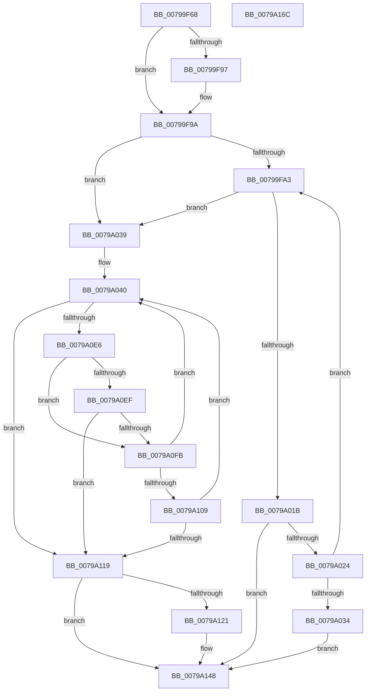

# Xp10ScatteredCopyBits

- RVA: `0x00799F68`–`0x0079A16D` (길이 `517` bytes)
- VA: `0x0000000140799F68`
- 실행 섹션: `PAGE`
- PDB 이름 있음: `예`; PDB Function 태그: `아니요`
- unwind 정보 RVA: `0x0008C20C`
- 디코드: `154`개 명령, `517/517` bytes 표시
- 미해석 바이트: `0` (있으면 어셈블리에 `.byte`로 보존)

> 이 문서는 커널 이미지의 기계어와 PDB 기호를 분석해 생성했습니다. 4번과 5번은 함수 원형과 자료형을 바이너리 사용 방식에서 추정한 C 해석이며 원본 소스 복구 결과는 아닙니다.

## 1. Dependencies

- 직접 호출 지점: **5**; 고유 호출 대상: **2**
- 직접 호출자로 확인된 함수: **1**
- RIP 상대 이미지 참조: **0**

### Outgoing calls
- `0x00799FF3` → [Xp10BitCopy](Xp10BitCopy_function_00795C38.md) (function, `0x00795C38`)
- `0x0079A027` → [Xp10ScatteredNextBuffer](Xp10ScatteredNextBuffer_function_0079A1CC.md) (function, `0x0079A1CC`)
- `0x0079A0AD` → [Xp10BitCopy](Xp10BitCopy_function_00795C38.md) (function, `0x00795C38`)
- `0x0079A0F2` → [Xp10ScatteredNextBuffer](Xp10ScatteredNextBuffer_function_0079A1CC.md) (function, `0x0079A1CC`)
- `0x0079A10C` → [Xp10ScatteredNextBuffer](Xp10ScatteredNextBuffer_function_0079A1CC.md) (function, `0x0079A1CC`)

### Direct callers
- [RtlDecompressBuffer2Xp10](RtlDecompressBuffer2Xp10_function_007959A0.md) at `0x00795B16`

### Static image references
- 디코드된 RIP-relative 메모리 참조가 없습니다.

## 2. Other-region calls and transfers

- 다른 실행 섹션으로 향하는 call: **0**
- 별도 외부 분기/꼬리 이동을 확인하지 못했습니다.

## 3. Assembly (complete function range)

```asm
00799F68  48 89 5C 24 08                  mov qword ptr [rsp + 8], rbx
00799F6D  48 89 6C 24 10                  mov qword ptr [rsp + 0x10], rbp
00799F72  48 89 74 24 18                  mov qword ptr [rsp + 0x18], rsi
00799F77  57                              push rdi
00799F78  41 54                           push r12
00799F7A  41 55                           push r13
00799F7C  41 56                           push r14
00799F7E  41 57                           push r15
00799F80  48 83 EC 30                     sub rsp, 0x30
00799F84  45 8B F0                        mov r14d, r8d
00799F87  33 ED                           xor ebp, ebp
00799F89  45 33 E4                        xor r12d, r12d
00799F8C  48 8B FA                        mov rdi, rdx
00799F8F  48 8B F1                        mov rsi, rcx
00799F92  4C 39 32                        cmp qword ptr [rdx], r14
00799F95  73 03                           jae 0x140799f9a
00799F97  44 8B 32                        mov r14d, dword ptr [rdx]
00799F9A  39 6A 10                        cmp dword ptr [rdx + 0x10], ebp
00799F9D  0F 84 96 00 00 00               je 0x14079a039
00799FA3  8B 4F 10                        mov ecx, dword ptr [rdi + 0x10]
00799FA6  45 8B C6                        mov r8d, r14d
00799FA9  4C 8B 16                        mov r10, qword ptr [rsi]
00799FAC  44 2B C5                        sub r8d, ebp
00799FAF  48 8B 56 08                     mov rdx, qword ptr [rsi + 8]
00799FB3  48 C1 E2 03                     shl rdx, 3
00799FB7  4A 8D 04 D5 00 00 00 00         lea rax, [r10*8]
00799FBF  48 2B D0                        sub rdx, rax
00799FC2  41 8B C4                        mov eax, r12d
00799FC5  83 E0 07                        and eax, 7
00799FC8  48 2B D0                        sub rdx, rax
00799FCB  41 8B C0                        mov eax, r8d
00799FCE  48 3B D1                        cmp rdx, rcx
00799FD1  48 0F 43 D1                     cmovae rdx, rcx
00799FD5  49 8B CA                        mov rcx, r10
00799FD8  48 3B C2                        cmp rax, rdx
00799FDB  41 0F 46 D0                     cmovbe edx, r8d
00799FDF  45 33 C9                        xor r9d, r9d
00799FE2  8B DA                           mov ebx, edx
00799FE4  4C 8D 47 08                     lea r8, [rdi + 8]
00799FE8  41 8B D4                        mov edx, r12d
00799FEB  48 89 5C 24 20                  mov qword ptr [rsp + 0x20], rbx
00799FF0  83 E2 07                        and edx, 7
00799FF3  E8 40 BC FF FF                  call 0x140795c38
00799FF8  42 8D 0C 23                     lea ecx, [rbx + r12]
00799FFC  03 EB                           add ebp, ebx
00799FFE  8B C1                           mov eax, ecx
0079A000  41 C1 EC 03                     shr r12d, 3
0079A004  C1 E8 03                        shr eax, 3
0079A007  41 2B C4                        sub eax, r12d
0079A00A  44 8B E1                        mov r12d, ecx
0079A00D  48 01 06                        add qword ptr [rsi], rax
0079A010  8B CB                           mov ecx, ebx
0079A012  48 D3 6F 08                     shr qword ptr [rdi + 8], cl
0079A016  29 5F 10                        sub dword ptr [rdi + 0x10], ebx
0079A019  74 1E                           je 0x14079a039
0079A01B  41 3B EE                        cmp ebp, r14d
0079A01E  0F 84 24 01 00 00               je 0x14079a148
0079A024  48 8B CE                        mov rcx, rsi
0079A027  E8 A0 01 00 00                  call 0x14079a1cc
0079A02C  85 C0                           test eax, eax
0079A02E  0F 85 6F FF FF FF               jne 0x140799fa3
0079A034  E9 0F 01 00 00                  jmp 0x14079a148
0079A039  45 33 FF                        xor r15d, r15d
0079A03C  4C 8D 6F 18                     lea r13, [rdi + 0x18]
0079A040  4C 8B 16                        mov r10, qword ptr [rsi]
0079A043  45 8B CE                        mov r9d, r14d
0079A046  48 8B 56 08                     mov rdx, qword ptr [rsi + 8]
0079A04A  44 2B CD                        sub r9d, ebp
0079A04D  4D 8B 45 00                     mov r8, qword ptr [r13]
0079A051  48 8B 4F 20                     mov rcx, qword ptr [rdi + 0x20]
0079A055  48 C1 E2 03                     shl rdx, 3
0079A059  4A 8D 04 D5 00 00 00 00         lea rax, [r10*8]
0079A061  48 2B D0                        sub rdx, rax
0079A064  48 C1 E1 03                     shl rcx, 3
0079A068  41 8B C4                        mov eax, r12d
0079A06B  83 E0 07                        and eax, 7
0079A06E  48 2B D0                        sub rdx, rax
0079A071  4A 8D 04 C5 00 00 00 00         lea rax, [r8*8]
0079A079  48 2B C8                        sub rcx, rax
0079A07C  41 8B C7                        mov eax, r15d
0079A07F  83 E0 07                        and eax, 7
0079A082  48 2B C8                        sub rcx, rax
0079A085  41 8B C1                        mov eax, r9d
0079A088  48 3B D1                        cmp rdx, rcx
0079A08B  48 0F 43 D1                     cmovae rdx, rcx
0079A08F  49 8B CA                        mov rcx, r10
0079A092  48 3B C2                        cmp rax, rdx
0079A095  41 0F 46 D1                     cmovbe edx, r9d
0079A099  45 8B CF                        mov r9d, r15d
0079A09C  8B DA                           mov ebx, edx
0079A09E  41 83 E1 07                     and r9d, 7
0079A0A2  41 8B D4                        mov edx, r12d
0079A0A5  48 89 5C 24 20                  mov qword ptr [rsp + 0x20], rbx
0079A0AA  83 E2 07                        and edx, 7
0079A0AD  E8 86 BB FF FF                  call 0x140795c38
0079A0B2  42 8D 0C 23                     lea ecx, [rbx + r12]
0079A0B6  03 EB                           add ebp, ebx
0079A0B8  8B C1                           mov eax, ecx
0079A0BA  41 C1 EC 03                     shr r12d, 3
0079A0BE  C1 E8 03                        shr eax, 3
0079A0C1  41 2B C4                        sub eax, r12d
0079A0C4  44 8B E1                        mov r12d, ecx
0079A0C7  48 01 06                        add qword ptr [rsi], rax
0079A0CA  42 8D 0C 3B                     lea ecx, [rbx + r15]
0079A0CE  41 C1 EF 03                     shr r15d, 3
0079A0D2  8B C1                           mov eax, ecx
0079A0D4  C1 E8 03                        shr eax, 3
0079A0D7  41 2B C7                        sub eax, r15d
0079A0DA  44 8B F9                        mov r15d, ecx
0079A0DD  49 01 45 00                     add qword ptr [r13], rax
0079A0E1  41 3B EE                        cmp ebp, r14d
0079A0E4  74 33                           je 0x14079a119
0079A0E6  48 8B 46 08                     mov rax, qword ptr [rsi + 8]
0079A0EA  48 39 06                        cmp qword ptr [rsi], rax
0079A0ED  75 0C                           jne 0x14079a0fb
0079A0EF  48 8B CE                        mov rcx, rsi
0079A0F2  E8 D5 00 00 00                  call 0x14079a1cc
0079A0F7  85 C0                           test eax, eax
0079A0F9  74 1E                           je 0x14079a119
0079A0FB  48 8B 47 20                     mov rax, qword ptr [rdi + 0x20]
0079A0FF  49 39 45 00                     cmp qword ptr [r13], rax
0079A103  0F 85 37 FF FF FF               jne 0x14079a040
0079A109  49 8B CD                        mov rcx, r13
0079A10C  E8 BB 00 00 00                  call 0x14079a1cc
0079A111  85 C0                           test eax, eax
0079A113  0F 85 27 FF FF FF               jne 0x14079a040
0079A119  41 8B C7                        mov eax, r15d
0079A11C  83 E0 07                        and eax, 7
0079A11F  74 27                           je 0x14079a148
0079A121  4C 8B 47 18                     mov r8, qword ptr [rdi + 0x18]
0079A125  B9 08 00 00 00                  mov ecx, 8
0079A12A  2B C8                           sub ecx, eax
0079A12C  89 4F 10                        mov dword ptr [rdi + 0x10], ecx
0079A12F  41 8A CF                        mov cl, r15b
0079A132  80 E1 07                        and cl, 7
0079A135  41 0F B6 10                     movzx edx, byte ptr [r8]
0079A139  48 D3 EA                        shr rdx, cl
0079A13C  49 8D 48 01                     lea rcx, [r8 + 1]
0079A140  48 89 4F 18                     mov qword ptr [rdi + 0x18], rcx
0079A144  48 89 57 08                     mov qword ptr [rdi + 8], rdx
0079A148  48 8B 5C 24 60                  mov rbx, qword ptr [rsp + 0x60]
0079A14D  8B C5                           mov eax, ebp
0079A14F  48 8B 74 24 70                  mov rsi, qword ptr [rsp + 0x70]
0079A154  8B CD                           mov ecx, ebp
0079A156  48 29 0F                        sub qword ptr [rdi], rcx
0079A159  48 8B 6C 24 68                  mov rbp, qword ptr [rsp + 0x68]
0079A15E  48 83 C4 30                     add rsp, 0x30
0079A162  41 5F                           pop r15
0079A164  41 5E                           pop r14
0079A166  41 5D                           pop r13
0079A168  41 5C                           pop r12
0079A16A  5F                              pop rdi
0079A16B  C3                              ret
0079A16C  CC                              int3
```

## 4. C-style interpretation (structured pseudocode)

```c
__int64 __fastcall Xp10ScatteredCopyBits(__int64 a1, __int64 a2, int a3, int a4)
{
    __int64 result;
    __int64 v_r12;
    __int64 v_r14;
    __int64 v_r15;
    __int64 v_rbp;
    __int64 v_rsp;
    unsigned __int64 v_stack_m38;
    unsigned __int64 v_stack_p10;
    unsigned __int64 v_stack_p18;
    unsigned __int64 v_stack_p8;

    v_stack_p8 = v_rbx;
    v_stack_p10 = v_rbp;
    v_stack_p18 = v_rsi;
    v_rsp = (v_rsp) - (48);
    v_rbp = 0;
    v_r12 = 0;
    v_r14 = (unsigned int)(a3);
    if ((*(unsigned __int64 *)(a2)) < ((unsigned int)(a3))) {
        v_r14 = *(unsigned int *)(a2);
    }
    if ((*(unsigned int *)(a2 + 16)) == 0) goto loc_0079A039;
loc_00799FA3:
    a3 = (unsigned int)(((unsigned int)((unsigned int)(v_r14))) - (0));
    a2 = (*(unsigned __int64 *)(a1 + 8)) << (3);
    a2 = (a2) - (*(unsigned __int64 *)(a1) * 8);
    result = (unsigned int)((0) & (7));
    a2 = (a2) - (result);
    if (a2 >= ((unsigned int)(*(unsigned int *)(a2 + 16)))) { a2 = (unsigned int)(*(unsigned int *)(a2 + 16)); }
    if (((unsigned int)(a3)) <= a2) { a2 = a3; }
    a4 = 0;
    v_stack_m38 = (unsigned int)((unsigned int)(a2));
    a2 = (unsigned int)((0) & (7));
    result = Xp10BitCopy(*(unsigned __int64 *)(a1), a2, a2 + 8, a4);
    v_rbp = (unsigned int)((v_rbp) + ((unsigned int)((unsigned int)((unsigned int)(a2)))));
    v_r12 = (unsigned int)((v_r12) >> (3));
    result = (unsigned int)(((unsigned int)((unsigned int)((unsigned int)((unsigned int)(a2)) + v_r12 * 1))) >> (3));
    result = (unsigned int)((result) - ((unsigned int)(v_r12)));
    if (condition_is_equal) goto loc_0079A039;
    if (((unsigned int)(v_rbp)) == ((unsigned int)(v_r14))) goto loc_0079A148;
    result = Xp10ScatteredNextBuffer(a1, a2, a2 + 8, a4);
    if ((unsigned int)(result) != 0) goto loc_00799FA3;
    goto loc_0079A148;
loc_0079A039:
    v_r15 = 0;
loc_0079A040:
    a4 = (unsigned int)(((unsigned int)((unsigned int)(v_r14))) - ((unsigned int)(v_rbp)));
    a2 = (*(unsigned __int64 *)(a1 + 8)) << (3);
    a2 = (a2) - (*(unsigned __int64 *)(a1) * 8);
    a1 = (*(unsigned __int64 *)(a2 + 32)) << (3);
    result = (unsigned int)(((unsigned int)((unsigned int)((unsigned int)((unsigned int)((unsigned int)((unsigned int)(a2)) + v_r12 * 1))))) & (7));
    a2 = (a2) - (result);
    a1 = (a1) - (*(unsigned __int64 *)(a2 + 24) * 8);
    result = (unsigned int)((0) & (7));
    a1 = (a1) - (result);
    if (a2 >= a1) { a2 = a1; }
    if (((unsigned int)(a4)) <= a2) { a2 = a4; }
    a4 = (unsigned int)((0) & (7));
    v_stack_m38 = (unsigned int)((unsigned int)(a2));
    a2 = (unsigned int)(((unsigned int)((unsigned int)((unsigned int)((unsigned int)((unsigned int)((unsigned int)(a2)) + v_r12 * 1))))) & (7));
    result = Xp10BitCopy(*(unsigned __int64 *)(a1), a2, *(unsigned __int64 *)(a2 + 24), a4);
    v_rbp = (unsigned int)((v_rbp) + ((unsigned int)((unsigned int)((unsigned int)(a2)))));
    v_r12 = (unsigned int)(((unsigned int)((unsigned int)((unsigned int)((unsigned int)(a2)) + v_r12 * 1))) >> (3));
    result = (unsigned int)(((unsigned int)((unsigned int)((unsigned int)((unsigned int)(a2)) + (unsigned int)((unsigned int)((unsigned int)((unsigned int)(a2)) + v_r12 * 1)) * 1))) >> (3));
    result = (unsigned int)((result) - ((unsigned int)(v_r12)));
    v_r15 = (unsigned int)((v_r15) >> (3));
    result = (unsigned int)(((unsigned int)((unsigned int)((unsigned int)((unsigned int)(a2)) + v_r15 * 1))) >> (3));
    result = (unsigned int)((result) - ((unsigned int)(v_r15)));
    if (((unsigned int)(v_rbp)) == ((unsigned int)(v_r14))) goto loc_0079A119;
    if ((*(unsigned __int64 *)(a1)) != (*(unsigned __int64 *)(a1 + 8))) goto loc_0079A0FB;
    result = Xp10ScatteredNextBuffer(a1, a2, *(unsigned __int64 *)(a2 + 24), a4);
    if ((unsigned int)(result) == 0) goto loc_0079A119;
loc_0079A0FB:
    if ((*(unsigned __int64 *)(a2 + 24)) != (*(unsigned __int64 *)(a2 + 32))) goto loc_0079A040;
    result = Xp10ScatteredNextBuffer(a2 + 24, a2, *(unsigned __int64 *)(a2 + 24), a4);
    if ((unsigned int)(result) != 0) goto loc_0079A040;
loc_0079A119:
    result = (unsigned int)(((unsigned int)((unsigned int)((unsigned int)((unsigned int)((unsigned int)((unsigned int)(a2)) + v_r15 * 1))))) & (7));
    if (!(condition_is_equal)) {
        a3 = *(unsigned __int64 *)(a2 + 24);
        a1 = 8;
        a1 = (unsigned int)((a1) - ((unsigned int)(result)));
        *(unsigned int *)(a2 + 16) = (unsigned int)(a1);
        a1 = (unsigned __int8)((unsigned int)((unsigned int)((unsigned int)((unsigned int)(a2)) + v_r15 * 1)));
        a1 = (unsigned __int8)((a1) & (7));
        a2 = *(unsigned __int8 *)(a3);
        a2 = (a2) >> ((unsigned __int8)(a1));
        a1 = a3 + 1;
        *(unsigned __int64 *)(a2 + 24) = a1;
        *(unsigned __int64 *)(a2 + 8) = a2;
    }
    v_rsp = (v_rsp) + (48);
    return (unsigned int)((unsigned int)(v_rbp));
}
```

## 5. (Beta) C Style

```c
int64_t Xp10ScatteredCopyBits(void *Arg1, void *Arg2, int32_t Arg3, int32_t Arg4)
{
    uint8_t *arg1 = (uint8_t *)Arg1;
    uint8_t *arg2 = (uint8_t *)Arg2;

    int64_t result;
    int64_t local_r12;
    int64_t local_r14;
    int64_t local_r15;
    int64_t local_rbp;
    int64_t local_rsp;
    uint64_t v_stack_m38;
    uint64_t v_stack_p10;
    uint64_t v_stack_p18;
    uint64_t v_stack_p8;

    v_stack_p8 = local_rbx;
    v_stack_p10 = local_rbp;
    v_stack_p18 = local_rsi;
    local_rsp = (local_rsp) - (48);
    local_rbp = 0;
    local_r12 = 0;
    local_r14 = (uint32_t)(Arg3);
    if ((*(uint64_t *)(arg2)) < ((uint32_t)(Arg3))) {
        local_r14 = *(uint32_t *)(arg2);
    }
    if ((*(uint32_t *)(arg2 + 0x10)) == 0) goto loc_0079A039;
loc_00799FA3:
    Arg3 = (uint32_t)(((uint32_t)((uint32_t)(local_r14))) - (0));
    Arg2 = (*(uint64_t *)(arg1 + 0x8)) << (3);
    Arg2 = (Arg2) - (*(uint64_t *)(arg1) * 8);
    result = (uint32_t)((0) & (7));
    Arg2 = (Arg2) - (result);
    if (Arg2 >= ((uint32_t)(*(uint32_t *)(arg2 + 0x10)))) { Arg2 = (uint32_t)(*(uint32_t *)(arg2 + 0x10)); }
    if (((uint32_t)(Arg3)) <= Arg2) { Arg2 = Arg3; }
    Arg4 = 0;
    v_stack_m38 = (uint32_t)((uint32_t)(Arg2));
    Arg2 = (uint32_t)((0) & (7));
    result = Xp10BitCopy(*(uint64_t *)(arg1), Arg2, Arg2 + 8, Arg4);
    local_rbp = (uint32_t)((local_rbp) + ((uint32_t)((uint32_t)((uint32_t)(Arg2)))));
    local_r12 = (uint32_t)((local_r12) >> (3));
    result = (uint32_t)(((uint32_t)((uint32_t)((uint32_t)((uint32_t)(Arg2)) + local_r12 * 1))) >> (3));
    result = (uint32_t)((result) - ((uint32_t)(local_r12)));
    if (condition_is_equal) goto loc_0079A039;
    if (((uint32_t)(local_rbp)) == ((uint32_t)(local_r14))) goto loc_0079A148;
    result = Xp10ScatteredNextBuffer(Arg1, Arg2, Arg2 + 8, Arg4);
    if ((uint32_t)(result) != 0) goto loc_00799FA3;
    goto loc_0079A148;
loc_0079A039:
    local_r15 = 0;
loc_0079A040:
    Arg4 = (uint32_t)(((uint32_t)((uint32_t)(local_r14))) - ((uint32_t)(local_rbp)));
    Arg2 = (*(uint64_t *)(arg1 + 0x8)) << (3);
    Arg2 = (Arg2) - (*(uint64_t *)(arg1) * 8);
    Arg1 = (*(uint64_t *)(arg2 + 0x20)) << (3);
    result = (uint32_t)(((uint32_t)((uint32_t)((uint32_t)((uint32_t)((uint32_t)((uint32_t)(Arg2)) + local_r12 * 1))))) & (7));
    Arg2 = (Arg2) - (result);
    Arg1 = (Arg1) - (*(uint64_t *)(arg2 + 0x18) * 8);
    result = (uint32_t)((0) & (7));
    Arg1 = (Arg1) - (result);
    if (Arg2 >= Arg1) { Arg2 = Arg1; }
    if (((uint32_t)(Arg4)) <= Arg2) { Arg2 = Arg4; }
    Arg4 = (uint32_t)((0) & (7));
    v_stack_m38 = (uint32_t)((uint32_t)(Arg2));
    Arg2 = (uint32_t)(((uint32_t)((uint32_t)((uint32_t)((uint32_t)((uint32_t)((uint32_t)(Arg2)) + local_r12 * 1))))) & (7));
    result = Xp10BitCopy(*(uint64_t *)(arg1), Arg2, *(uint64_t *)(arg2 + 0x18), Arg4);
    local_rbp = (uint32_t)((local_rbp) + ((uint32_t)((uint32_t)((uint32_t)(Arg2)))));
    local_r12 = (uint32_t)(((uint32_t)((uint32_t)((uint32_t)((uint32_t)(Arg2)) + local_r12 * 1))) >> (3));
    result = (uint32_t)(((uint32_t)((uint32_t)((uint32_t)((uint32_t)(Arg2)) + (uint32_t)((uint32_t)((uint32_t)((uint32_t)(Arg2)) + local_r12 * 1)) * 1))) >> (3));
    result = (uint32_t)((result) - ((uint32_t)(local_r12)));
    local_r15 = (uint32_t)((local_r15) >> (3));
    result = (uint32_t)(((uint32_t)((uint32_t)((uint32_t)((uint32_t)(Arg2)) + local_r15 * 1))) >> (3));
    result = (uint32_t)((result) - ((uint32_t)(local_r15)));
    if (((uint32_t)(local_rbp)) == ((uint32_t)(local_r14))) goto loc_0079A119;
    if ((*(uint64_t *)(arg1)) != (*(uint64_t *)(arg1 + 0x8))) goto loc_0079A0FB;
    result = Xp10ScatteredNextBuffer(Arg1, Arg2, *(uint64_t *)(arg2 + 0x18), Arg4);
    if ((uint32_t)(result) == 0) goto loc_0079A119;
loc_0079A0FB:
    if ((*(uint64_t *)(arg2 + 0x18)) != (*(uint64_t *)(arg2 + 0x20))) goto loc_0079A040;
    result = Xp10ScatteredNextBuffer(Arg2 + 24, Arg2, *(uint64_t *)(arg2 + 0x18), Arg4);
    if ((uint32_t)(result) != 0) goto loc_0079A040;
loc_0079A119:
    result = (uint32_t)(((uint32_t)((uint32_t)((uint32_t)((uint32_t)((uint32_t)((uint32_t)(Arg2)) + local_r15 * 1))))) & (7));
    if (!(condition_is_equal)) {
        Arg3 = *(uint64_t *)(arg2 + 0x18);
        Arg1 = 8;
        Arg1 = (uint32_t)((Arg1) - ((uint32_t)(result)));
        *(uint32_t *)(arg2 + 0x10) = (uint32_t)(Arg1);
        Arg1 = (uint8_t)((uint32_t)((uint32_t)((uint32_t)((uint32_t)(Arg2)) + local_r15 * 1)));
        Arg1 = (uint8_t)((Arg1) & (7));
        Arg2 = *(uint8_t *)(Arg3);
        Arg2 = (Arg2) >> ((uint8_t)(Arg1));
        Arg1 = Arg3 + 1;
        *(void **)(arg2 + 0x18) = Arg1;
        *(void **)(arg2 + 0x8) = Arg2;
    }
    local_rsp = (local_rsp) + (48);
    return (uint32_t)((uint32_t)(local_rbp));
}
```

### 관측된 메모리 오프셋

구조체 형식이 확인되지 않은 접근은 인자 기준의 오프셋으로만 기록했습니다.

| 기준 인자 | 오프셋 표현 | 폭 (bit) | 접근 |
|---|---:|---:|---|
| `Arg1` | `+ 0x0` | `64` | `R` |
| `Arg1` | `+ 0x0` | `64` | `R/W` |
| `Arg1` | `+ 0x8` | `64` | `R` |
| `Arg2` | `+ 0x0` | `32` | `R` |
| `Arg2` | `+ 0x0` | `64` | `R` |
| `Arg2` | `+ 0x0` | `64` | `R/W` |
| `Arg2` | `+ 0x8` | `64` | `R` |
| `Arg2` | `+ 0x8` | `64` | `R/W` |
| `Arg2` | `+ 0x8` | `64` | `W` |
| `Arg2` | `+ 0x10` | `32` | `R` |
| `Arg2` | `+ 0x10` | `32` | `R/W` |
| `Arg2` | `+ 0x10` | `32` | `W` |
| `Arg2` | `+ 0x18` | `64` | `R` |
| `Arg2` | `+ 0x18` | `64` | `W` |
| `Arg2` | `+ 0x20` | `64` | `R` |

## 6. Execution-region graph

[열기: 2D/3D 그래프와 함수 탐색 컨트롤 패널](../../../control-panel.html?section=page&rva=0x00799F68&view=graph)

- 2D 그래프는 위에서 아래로 흐르고, 3D 그래프는 빈 공간을 드래그해 회전합니다. Shift+드래그는 이동, 휠은 확대·축소, 함수 노드 선택은 대상 보고서 이동입니다.

### Static fallback


