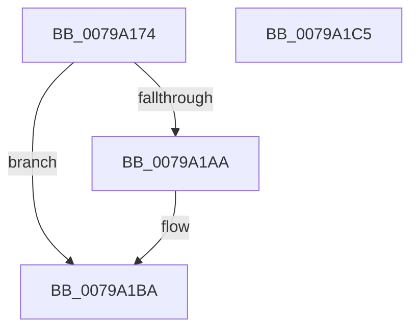

# Xp10ScatteredCopyFromPrevious

- RVA: `0x0079A174`–`0x0079A1C6` (길이 `82` bytes)
- VA: `0x000000014079A174`
- 실행 섹션: `PAGE`
- PDB 이름 있음: `예`; PDB Function 태그: `아니요`
- unwind 정보 RVA: `0x00089EA4`
- 디코드: `25`개 명령, `82/82` bytes 표시
- 미해석 바이트: `0` (있으면 어셈블리에 `.byte`로 보존)

> 이 문서는 커널 이미지의 기계어와 PDB 기호를 분석해 생성했습니다. 4번과 5번은 함수 원형과 자료형을 바이너리 사용 방식에서 추정한 C 해석이며 원본 소스 복구 결과는 아닙니다.

## 1. Dependencies

- 직접 호출 지점: **2**; 고유 호출 대상: **2**
- 직접 호출자로 확인된 함수: **1**
- RIP 상대 이미지 참조: **0**

### Outgoing calls
- `0x0079A1A1` → [Xp10ScatteredByteSeekBack](Xp10ScatteredByteSeekBack_function_00799E1C.md) (function, `0x00799E1C`)
- `0x0079A1B5` → [Xp10ScatteredCopy](Xp10ScatteredCopy_function_00799EB4.md) (function, `0x00799EB4`)

### Direct callers
- [Xp10ExecuteHuffmanDecode](Xp10ExecuteHuffmanDecode_function_007979C8.md) at `0x007980B0`
- [Xp10ExecuteHuffmanDecode](Xp10ExecuteHuffmanDecode_function_007979C8.md) at `0x007980CF`

### Static image references
- 디코드된 RIP-relative 메모리 참조가 없습니다.

## 2. Other-region calls and transfers

- 다른 실행 섹션으로 향하는 call: **0**
- 별도 외부 분기/꼬리 이동을 확인하지 못했습니다.

## 3. Assembly (complete function range)

```asm
0079A174  48 8B C4                        mov rax, rsp
0079A177  48 89 58 08                     mov qword ptr [rax + 8], rbx
0079A17B  57                              push rdi
0079A17C  48 83 EC 50                     sub rsp, 0x50
0079A180  0F 10 01                        movups xmm0, xmmword ptr [rcx]
0079A183  48 8B D9                        mov rbx, rcx
0079A186  41 8B F8                        mov edi, r8d
0079A189  0F 10 49 10                     movups xmm1, xmmword ptr [rcx + 0x10]
0079A18D  0F 11 40 C8                     movups xmmword ptr [rax - 0x38], xmm0
0079A191  0F 10 41 20                     movups xmm0, xmmword ptr [rcx + 0x20]
0079A195  48 8D 48 C8                     lea rcx, [rax - 0x38]
0079A199  0F 11 48 D8                     movups xmmword ptr [rax - 0x28], xmm1
0079A19D  0F 11 40 E8                     movups xmmword ptr [rax - 0x18], xmm0
0079A1A1  E8 76 FC FF FF                  call 0x140799e1c
0079A1A6  85 C0                           test eax, eax
0079A1A8  74 10                           je 0x14079a1ba
0079A1AA  44 8B C7                        mov r8d, edi
0079A1AD  48 8D 54 24 20                  lea rdx, [rsp + 0x20]
0079A1B2  48 8B CB                        mov rcx, rbx
0079A1B5  E8 FA FC FF FF                  call 0x140799eb4
0079A1BA  48 8B 5C 24 60                  mov rbx, qword ptr [rsp + 0x60]
0079A1BF  48 83 C4 50                     add rsp, 0x50
0079A1C3  5F                              pop rdi
0079A1C4  C3                              ret
0079A1C5  CC                              int3
```

## 4. C-style interpretation (structured pseudocode)

```c
__int64 __fastcall Xp10ScatteredCopyFromPrevious(__int64 a1, __int64 a2, int a3)
{
    __int64 result;
    __int64 v_rsp;
    unsigned __int64 v_stack_m38;
    unsigned __int64 v_stack_p8;

    *(unsigned __int64 *)(v_rsp + 8) = v_rbx;
    v_rsp = (v_rsp) - (80);
    *(unsigned __int64 *)(v_rsp - 56) = v_xmm0;
    *(unsigned __int64 *)(v_rsp - 40) = v_xmm1;
    *(unsigned __int64 *)(v_rsp - 24) = v_xmm0;
    result = Xp10ScatteredByteSeekBack(v_rsp - 56, a2, a3, a4);
    if ((unsigned int)(result) != 0) {
        a3 = (unsigned int)((unsigned int)(a3));
        a2 = v_stack_m38;
        a1 = a1;
        result = Xp10ScatteredCopy(a1, a2, a3, a4);
    }
    v_rsp = (v_rsp) + (80);
    return result;
}
```

## 5. (Beta) C Style

```c
int64_t Xp10ScatteredCopyFromPrevious(void *Arg1, int64_t Arg2, int32_t Arg3)
{
    uint8_t *arg1 = (uint8_t *)Arg1;

    int64_t result;
    int64_t local_rsp;
    uint64_t v_stack_m38;
    uint64_t v_stack_p8;

    *(uint64_t *)(local_rsp + 0x8) = local_rbx;
    local_rsp = (local_rsp) - (80);
    *(uint64_t *)(local_rsp - 0x38) = v_xmm0;
    *(uint64_t *)(local_rsp - 0x28) = v_xmm1;
    *(uint64_t *)(local_rsp - 0x18) = v_xmm0;
    result = Xp10ScatteredByteSeekBack(local_rsp - 56, Arg2, Arg3, a4);
    if ((uint32_t)(result) != 0) {
        Arg3 = (uint32_t)((uint32_t)(Arg3));
        Arg2 = v_stack_m38;
        Arg1 = Arg1;
        result = Xp10ScatteredCopy(Arg1, Arg2, Arg3, a4);
    }
    local_rsp = (local_rsp) + (80);
    return result;
}
```

### 관측된 메모리 오프셋

구조체 형식이 확인되지 않은 접근은 인자 기준의 오프셋으로만 기록했습니다.

| 기준 인자 | 오프셋 표현 | 폭 (bit) | 접근 |
|---|---:|---:|---|
| `Arg1` | `+ 0x0` | `128` | `R` |
| `Arg1` | `+ 0x10` | `128` | `R` |
| `Arg1` | `+ 0x20` | `128` | `R` |

## 6. Execution-region graph

[열기: 2D/3D 그래프와 함수 탐색 컨트롤 패널](../../../control-panel.html?section=page&rva=0x0079A174&view=graph)

- 2D 그래프는 위에서 아래로 흐르고, 3D 그래프는 빈 공간을 드래그해 회전합니다. Shift+드래그는 이동, 휠은 확대·축소, 함수 노드 선택은 대상 보고서 이동입니다.

### Static fallback


