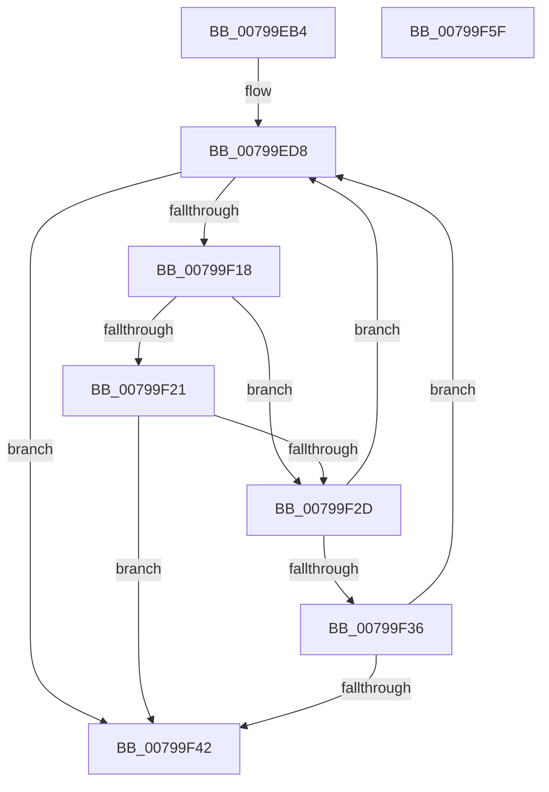

# Xp10ScatteredCopy

- RVA: `0x00799EB4`–`0x00799F60` (길이 `172` bytes)
- VA: `0x0000000140799EB4`
- 실행 섹션: `PAGE`
- PDB 이름 있음: `예`; PDB Function 태그: `아니요`
- unwind 정보 RVA: `0x0005E6B4`
- 디코드: `54`개 명령, `172/172` bytes 표시
- 미해석 바이트: `0` (있으면 어셈블리에 `.byte`로 보존)

> 이 문서는 커널 이미지의 기계어와 PDB 기호를 분석해 생성했습니다. 4번과 5번은 함수 원형과 자료형을 바이너리 사용 방식에서 추정한 C 해석이며 원본 소스 복구 결과는 아닙니다.

## 1. Dependencies

- 직접 호출 지점: **3**; 고유 호출 대상: **2**
- 직접 호출자로 확인된 함수: **1**
- RIP 상대 이미지 참조: **0**

### Outgoing calls
- `0x00799F06` → [memcpy](../../text/6C/memcpy_function_006C6840.md) (function, `0x006C6840`)
- `0x00799F24` → [Xp10ScatteredNextBuffer](Xp10ScatteredNextBuffer_function_0079A1CC.md) (function, `0x0079A1CC`)
- `0x00799F39` → [Xp10ScatteredNextBuffer](Xp10ScatteredNextBuffer_function_0079A1CC.md) (function, `0x0079A1CC`)

### Direct callers
- [Xp10ScatteredCopyFromPrevious](Xp10ScatteredCopyFromPrevious_function_0079A174.md) at `0x0079A1B5`

### Static image references
- 디코드된 RIP-relative 메모리 참조가 없습니다.

## 2. Other-region calls and transfers

- 다른 실행 섹션으로 향하는 call: **1**
  - `0x00799F06` → [memcpy](../../text/6C/memcpy_function_006C6840.md) (`PAGE` → `.text`)
- 별도 외부 분기/꼬리 이동을 확인하지 못했습니다.

## 3. Assembly (complete function range)

```asm
00799EB4  48 8B C4                        mov rax, rsp
00799EB7  48 89 58 08                     mov qword ptr [rax + 8], rbx
00799EBB  48 89 68 10                     mov qword ptr [rax + 0x10], rbp
00799EBF  48 89 70 18                     mov qword ptr [rax + 0x18], rsi
00799EC3  48 89 78 20                     mov qword ptr [rax + 0x20], rdi
00799EC7  41 56                           push r14
00799EC9  48 83 EC 20                     sub rsp, 0x20
00799ECD  45 8B F0                        mov r14d, r8d
00799ED0  48 8B FA                        mov rdi, rdx
00799ED3  48 8B F1                        mov rsi, rcx
00799ED6  33 ED                           xor ebp, ebp
00799ED8  48 8B 0E                        mov rcx, qword ptr [rsi]
00799EDB  45 8B CE                        mov r9d, r14d
00799EDE  4C 8B 46 08                     mov r8, qword ptr [rsi + 8]
00799EE2  44 2B CD                        sub r9d, ebp
00799EE5  48 8B 17                        mov rdx, qword ptr [rdi]
00799EE8  4C 2B C1                        sub r8, rcx
00799EEB  48 8B 47 08                     mov rax, qword ptr [rdi + 8]
00799EEF  48 2B C2                        sub rax, rdx
00799EF2  4C 3B C0                        cmp r8, rax
00799EF5  4C 0F 43 C0                     cmovae r8, rax
00799EF9  41 8B C1                        mov eax, r9d
00799EFC  49 3B C0                        cmp rax, r8
00799EFF  45 0F 46 C1                     cmovbe r8d, r9d
00799F03  41 8B D8                        mov ebx, r8d
00799F06  E8 35 C9 F2 FF                  call 0x1406c6840
00799F0B  48 01 1E                        add qword ptr [rsi], rbx
00799F0E  03 EB                           add ebp, ebx
00799F10  48 01 1F                        add qword ptr [rdi], rbx
00799F13  41 3B EE                        cmp ebp, r14d
00799F16  74 2A                           je 0x140799f42
00799F18  48 8B 46 08                     mov rax, qword ptr [rsi + 8]
00799F1C  48 39 06                        cmp qword ptr [rsi], rax
00799F1F  75 0C                           jne 0x140799f2d
00799F21  48 8B CE                        mov rcx, rsi
00799F24  E8 A3 02 00 00                  call 0x14079a1cc
00799F29  85 C0                           test eax, eax
00799F2B  74 15                           je 0x140799f42
00799F2D  48 8B 4F 08                     mov rcx, qword ptr [rdi + 8]
00799F31  48 39 0F                        cmp qword ptr [rdi], rcx
00799F34  75 A2                           jne 0x140799ed8
00799F36  48 8B CF                        mov rcx, rdi
00799F39  E8 8E 02 00 00                  call 0x14079a1cc
00799F3E  85 C0                           test eax, eax
00799F40  75 96                           jne 0x140799ed8
00799F42  48 8B 5C 24 30                  mov rbx, qword ptr [rsp + 0x30]
00799F47  8B C5                           mov eax, ebp
00799F49  48 8B 6C 24 38                  mov rbp, qword ptr [rsp + 0x38]
00799F4E  48 8B 74 24 40                  mov rsi, qword ptr [rsp + 0x40]
00799F53  48 8B 7C 24 48                  mov rdi, qword ptr [rsp + 0x48]
00799F58  48 83 C4 20                     add rsp, 0x20
00799F5C  41 5E                           pop r14
00799F5E  C3                              ret
00799F5F  CC                              int3
```

## 4. C-style interpretation (structured pseudocode)

```c
__int64 __fastcall Xp10ScatteredCopy(__int64 a1, __int64 a2, int a3)
{
    __int64 result;
    __int64 v_rbp;
    __int64 v_rsp;
    unsigned __int64 v_stack_p10;
    unsigned __int64 v_stack_p18;
    unsigned __int64 v_stack_p20;
    unsigned __int64 v_stack_p8;

    *(unsigned __int64 *)(v_rsp + 8) = v_rbx;
    *(unsigned __int64 *)(v_rsp + 16) = v_rbp;
    *(unsigned __int64 *)(v_rsp + 24) = v_rsi;
    *(unsigned __int64 *)(v_rsp + 32) = v_rdi;
    v_rsp = (v_rsp) - (32);
    v_rbp = 0;
loc_00799ED8:
    a4 = (unsigned int)(((unsigned int)((unsigned int)((unsigned int)(a3)))) - (0));
    a3 = (*(unsigned __int64 *)(a1 + 8)) - (*(unsigned __int64 *)(a1));
    result = (*(unsigned __int64 *)(a2 + 8)) - (*(unsigned __int64 *)(a2));
    if (a3 >= result) { a3 = result; }
    if (((unsigned int)((unsigned int)(a4))) <= a3) { a3 = (unsigned int)(a4); }
    result = memcpy(*(unsigned __int64 *)(a1), *(unsigned __int64 *)(a2), a3, a4);
    v_rbp = (unsigned int)((v_rbp) + ((unsigned int)((unsigned int)(a3))));
    if (((unsigned int)(v_rbp)) == ((unsigned int)((unsigned int)(a3)))) goto loc_00799F42;
    if ((*(unsigned __int64 *)(a1)) != (*(unsigned __int64 *)(a1 + 8))) goto loc_00799F2D;
    result = Xp10ScatteredNextBuffer(a1, *(unsigned __int64 *)(a2), a3, a4);
    if ((unsigned int)(result) == 0) goto loc_00799F42;
loc_00799F2D:
    if ((*(unsigned __int64 *)(a2)) != (*(unsigned __int64 *)(a2 + 8))) goto loc_00799ED8;
    result = Xp10ScatteredNextBuffer(a2, *(unsigned __int64 *)(a2), a3, a4);
    if ((unsigned int)(result) != 0) goto loc_00799ED8;
loc_00799F42:
    v_rsp = (v_rsp) + (32);
    return (unsigned int)((unsigned int)(v_rbp));
}
```

## 5. (Beta) C Style

```c
int64_t Xp10ScatteredCopy(void *Arg1, void *Arg2, int32_t Arg3)
{
    uint8_t *arg1 = (uint8_t *)Arg1;
    uint8_t *arg2 = (uint8_t *)Arg2;

    int64_t result;
    int64_t local_rbp;
    int64_t local_rsp;
    uint64_t v_stack_p10;
    uint64_t v_stack_p18;
    uint64_t v_stack_p20;
    uint64_t v_stack_p8;

    *(uint64_t *)(local_rsp + 0x8) = local_rbx;
    *(uint64_t *)(local_rsp + 0x10) = local_rbp;
    *(uint64_t *)(local_rsp + 0x18) = local_rsi;
    *(uint64_t *)(local_rsp + 0x20) = local_rdi;
    local_rsp = (local_rsp) - (32);
    local_rbp = 0;
loc_00799ED8:
    a4 = (uint32_t)(((uint32_t)((uint32_t)((uint32_t)(Arg3)))) - (0));
    Arg3 = (*(uint64_t *)(arg1 + 0x8)) - (*(uint64_t *)(arg1));
    result = (*(uint64_t *)(arg2 + 0x8)) - (*(uint64_t *)(arg2));
    if (Arg3 >= result) { Arg3 = result; }
    if (((uint32_t)((uint32_t)(a4))) <= Arg3) { Arg3 = (uint32_t)(a4); }
    result = memcpy(*(uint64_t *)(arg1), *(uint64_t *)(arg2), Arg3, a4);
    local_rbp = (uint32_t)((local_rbp) + ((uint32_t)((uint32_t)(Arg3))));
    if (((uint32_t)(local_rbp)) == ((uint32_t)((uint32_t)(Arg3)))) goto loc_00799F42;
    if ((*(uint64_t *)(arg1)) != (*(uint64_t *)(arg1 + 0x8))) goto loc_00799F2D;
    result = Xp10ScatteredNextBuffer(Arg1, *(uint64_t *)(arg2), Arg3, a4);
    if ((uint32_t)(result) == 0) goto loc_00799F42;
loc_00799F2D:
    if ((*(uint64_t *)(arg2)) != (*(uint64_t *)(arg2 + 0x8))) goto loc_00799ED8;
    result = Xp10ScatteredNextBuffer(Arg2, *(uint64_t *)(arg2), Arg3, a4);
    if ((uint32_t)(result) != 0) goto loc_00799ED8;
loc_00799F42:
    local_rsp = (local_rsp) + (32);
    return (uint32_t)((uint32_t)(local_rbp));
}
```

### 관측된 메모리 오프셋

구조체 형식이 확인되지 않은 접근은 인자 기준의 오프셋으로만 기록했습니다.

| 기준 인자 | 오프셋 표현 | 폭 (bit) | 접근 |
|---|---:|---:|---|
| `Arg1` | `+ 0x0` | `64` | `R` |
| `Arg1` | `+ 0x0` | `64` | `R/W` |
| `Arg1` | `+ 0x8` | `64` | `R` |
| `Arg2` | `+ 0x0` | `64` | `R` |
| `Arg2` | `+ 0x0` | `64` | `R/W` |
| `Arg2` | `+ 0x8` | `64` | `R` |

## 6. Execution-region graph

[열기: 2D/3D 그래프와 함수 탐색 컨트롤 패널](../../../control-panel.html?section=page&rva=0x00799EB4&view=graph)

- 2D 그래프는 위에서 아래로 흐르고, 3D 그래프는 빈 공간을 드래그해 회전합니다. Shift+드래그는 이동, 휠은 확대·축소, 함수 노드 선택은 대상 보고서 이동입니다.

### Static fallback


