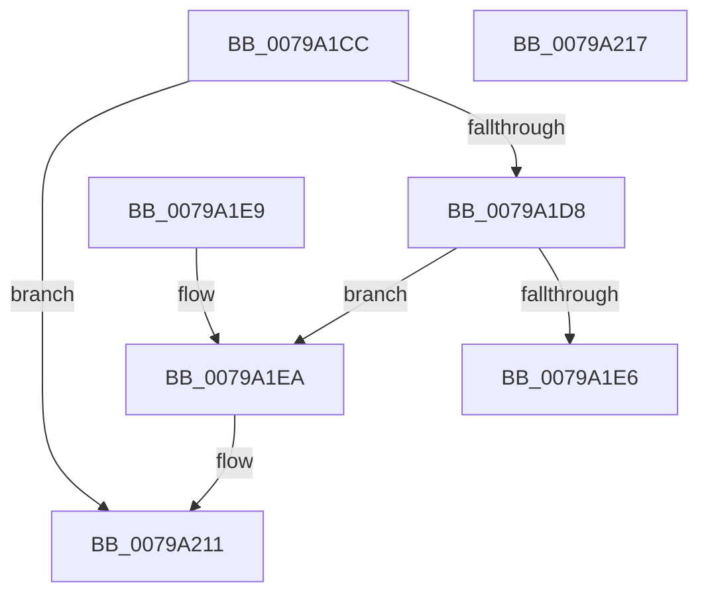

# Xp10ScatteredNextBuffer

- RVA: `0x0079A1CC`–`0x0079A218` (길이 `76` bytes)
- VA: `0x000000014079A1CC`
- 실행 섹션: `PAGE`
- PDB 이름 있음: `예`; PDB Function 태그: `아니요`
- unwind 정보 RVA: `0x000DB714`
- 디코드: `24`개 명령, `76/76` bytes 표시
- 미해석 바이트: `0` (있으면 어셈블리에 `.byte`로 보존)

> 이 문서는 커널 이미지의 기계어와 PDB 기호를 분석해 생성했습니다. 4번과 5번은 함수 원형과 자료형을 바이너리 사용 방식에서 추정한 C 해석이며 원본 소스 복구 결과는 아닙니다.

## 1. Dependencies

- 직접 호출 지점: **0**; 고유 호출 대상: **0**
- 직접 호출자로 확인된 함수: **4**
- RIP 상대 이미지 참조: **0**

### Outgoing calls
- 직접 디코드된 call 명령이 없습니다.

### Direct callers
- [Xp10ExecuteHuffmanDecode](Xp10ExecuteHuffmanDecode_function_007979C8.md) at `0x00797CC7`
- [Xp10ScatteredCopy](Xp10ScatteredCopy_function_00799EB4.md) at `0x00799F24`
- [Xp10ScatteredCopy](Xp10ScatteredCopy_function_00799EB4.md) at `0x00799F39`
- [Xp10ScatteredCopyBits](Xp10ScatteredCopyBits_function_00799F68.md) at `0x0079A027`
- [Xp10ScatteredCopyBits](Xp10ScatteredCopyBits_function_00799F68.md) at `0x0079A0F2`
- [Xp10ScatteredCopyBits](Xp10ScatteredCopyBits_function_00799F68.md) at `0x0079A10C`
- [Xp10ScatteredReadBytes](Xp10ScatteredReadBytes_function_0079A220.md) at `0x0079A275`

### Static image references
- 디코드된 RIP-relative 메모리 참조가 없습니다.

## 2. Other-region calls and transfers

- 다른 실행 섹션으로 향하는 call: **0**
- 별도 외부 분기/꼬리 이동을 확인하지 못했습니다.

## 3. Assembly (complete function range)

```asm
0079A1CC  48 8B 41 08                     mov rax, qword ptr [rcx + 8]
0079A1D0  4C 8B C1                        mov r8, rcx
0079A1D3  48 39 01                        cmp qword ptr [rcx], rax
0079A1D6  75 39                           jne 0x14079a211
0079A1D8  48 8B 41 18                     mov rax, qword ptr [rcx + 0x18]
0079A1DC  4C 8D 48 01                     lea r9, [rax + 1]
0079A1E0  4C 3B 49 28                     cmp r9, qword ptr [rcx + 0x28]
0079A1E4  72 04                           jb 0x14079a1ea
0079A1E6  33 C0                           xor eax, eax
0079A1E8  C3                              ret
0079A1E9  CC                              int3
0079A1EA  48 8B 51 20                     mov rdx, qword ptr [rcx + 0x20]
0079A1EE  48 03 C0                        add rax, rax
0079A1F1  48 8B 44 C2 08                  mov rax, qword ptr [rdx + rax*8 + 8]
0079A1F6  48 01 41 10                     add qword ptr [rcx + 0x10], rax
0079A1FA  4C 89 49 18                     mov qword ptr [rcx + 0x18], r9
0079A1FE  4D 03 C9                        add r9, r9
0079A201  4A 8B 0C CA                     mov rcx, qword ptr [rdx + r9*8]
0079A205  49 89 08                        mov qword ptr [r8], rcx
0079A208  4A 03 4C CA 08                  add rcx, qword ptr [rdx + r9*8 + 8]
0079A20D  49 89 48 08                     mov qword ptr [r8 + 8], rcx
0079A211  B8 01 00 00 00                  mov eax, 1
0079A216  C3                              ret
0079A217  CC                              int3
```

## 4. C-style interpretation (structured pseudocode)

```c
__int64 __fastcall Xp10ScatteredNextBuffer(__int64 a1)
{
    __int64 result;

    if ((*(unsigned __int64 *)(a1)) != (*(unsigned __int64 *)(a1 + 8))) goto loc_0079A211;
    if ((*(unsigned __int64 *)(a1 + 24) + 1) < (*(unsigned __int64 *)(a1 + 40))) goto loc_0079A1EA;
    result = 0;
    return result;
loc_0079A1EA:
    result = (result) + (0);
    *(unsigned __int64 *)(a1 + 24) = *(unsigned __int64 *)(a1 + 24) + 1;
    a4 = (*(unsigned __int64 *)(a1 + 24) + 1) + (*(unsigned __int64 *)(a1 + 24) + 1);
    *(unsigned __int64 *)(a1) = *(unsigned __int64 *)(*(unsigned __int64 *)(a1 + 32) + a4 * 8);
    a1 = (*(unsigned __int64 *)(*(unsigned __int64 *)(a1 + 32) + a4 * 8)) + (*(unsigned __int64 *)(*(unsigned __int64 *)(a1 + 32) + a4 * 8 + 8));
    *(unsigned __int64 *)(a1 + 8) = a1;
loc_0079A211:
    return 1;
}
```

## 5. (Beta) C Style

```c
int64_t Xp10ScatteredNextBuffer(void *Arg1)
{
    uint8_t *arg1 = (uint8_t *)Arg1;

    int64_t result;

    if ((*(uint64_t *)(arg1)) != (*(uint64_t *)(arg1 + 0x8))) goto loc_0079A211;
    if ((*(uint64_t *)(arg1 + 0x18) + 1) < (*(uint64_t *)(arg1 + 0x28))) goto loc_0079A1EA;
    result = 0;
    return result;
loc_0079A1EA:
    result = (result) + (0);
    *(uint64_t *)(arg1 + 0x18) = *(uint64_t *)(arg1 + 0x18) + 1;
    a4 = (*(uint64_t *)(arg1 + 0x18) + 1) + (*(uint64_t *)(arg1 + 0x18) + 1);
    *(uint64_t *)(arg1) = *(uint64_t *)(*(uint64_t *)(arg1 + 0x20) + a4 * 8);
    Arg1 = (*(uint64_t *)(*(uint64_t *)(arg1 + 0x20) + a4 * 8)) + (*(uint64_t *)(*(uint64_t *)(arg1 + 0x20) + a4 * 8 + 0x8));
    *(void **)(arg1 + 0x8) = Arg1;
loc_0079A211:
    return 1;
}
```

### 관측된 메모리 오프셋

구조체 형식이 확인되지 않은 접근은 인자 기준의 오프셋으로만 기록했습니다.

| 기준 인자 | 오프셋 표현 | 폭 (bit) | 접근 |
|---|---:|---:|---|
| `Arg1` | `+ 0x0` | `64` | `R` |
| `Arg1` | `+ 0x0` | `64` | `W` |
| `Arg1` | `+ 0x8` | `64` | `R` |
| `Arg1` | `+ 0x8` | `64` | `W` |
| `Arg1` | `+ 0x10` | `64` | `R/W` |
| `Arg1` | `+ 0x18` | `64` | `R` |
| `Arg1` | `+ 0x18` | `64` | `W` |
| `Arg1` | `+ 0x20` | `64` | `R` |
| `Arg1` | `+ 0x28` | `64` | `R` |

## 6. Execution-region graph

[열기: 2D/3D 그래프와 함수 탐색 컨트롤 패널](../../../control-panel.html?section=page&rva=0x0079A1CC&view=graph)

- 2D 그래프는 위에서 아래로 흐르고, 3D 그래프는 빈 공간을 드래그해 회전합니다. Shift+드래그는 이동, 휠은 확대·축소, 함수 노드 선택은 대상 보고서 이동입니다.

### Static fallback


